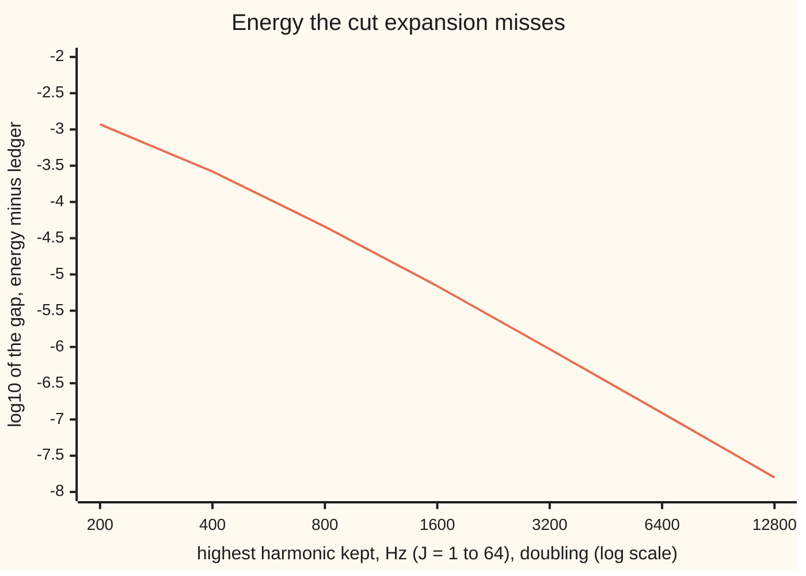

# Orthonormal bases: every signal is an infinite sum of perpendicular pieces

[Syllabus](../../../SYLLABUS.md) → [Functional analysis](../README.md) → [Hilbert Spaces](../README.md#s02) → Orthonormal bases

---

## General Overview

A one-second audio clip holds a 100 Hz tone at full scale (the largest value a digital recorder stores, written 1). A rectifier, a one-way electrical valve, cuts off every negative half of the wave. What is left is a row of bumps: the tone where it is positive, silence where it was negative.

An audio engineer asks two questions. How much energy does the clip carry? And how is that energy split between a steady offset, the 100 Hz tone and the new harmonics the rectifier made? The first answer is 0.250000 (full scale squared, times seconds). The second is a ledger: 40.528 % steady offset, 50.000 % at 100 Hz, 9.006 % at 200 Hz, 0.360 % at 400 Hz, and smaller shares above.

The ledger adds up to 100 %, with nothing lost and nothing counted twice. That is because the pieces are perpendicular to each other, in the sense of the inner product (a dot product for signals). A family of perpendicular pieces of size 1 is **orthonormal**. When the family leaves no direction out, it is an **orthonormal basis**, and every signal is the infinite sum of its pieces along it.

**Measure a signal against each member of an orthonormal set and the squared amounts never add to more than the signal's energy (Bessel); they add to exactly the energy for every signal when the set leaves no direction out (Parseval); every list with a finite sum of squares is some signal's list (Riesz–Fischer); so every separable Hilbert space is a copy of the space of square-summable lists.**

**What kind of fact this is:** Bessel's inequality, Parseval's identity for a complete orthonormal set, the Riesz–Fischer theorem and the classification of separable Hilbert spaces are theorems, proved on this card in Why it works. That the sines and cosines leave no direction out is proved on [Completeness of sines and cosines](04-completeness-of-the-trigonometric-system.md). The clip's coefficients are computed.

### The picture: the clip's energy, harmonic by harmonic

```
share of the clip's energy, in %
steady offset, 0 Hz  ████████████████████████████████            40.528
tone, 100 Hz         ████████████████████████████████████████    50.000
harmonic, 200 Hz     ███████                                      9.006
harmonic, 400 Hz     ▏                                            0.360
harmonic, 600 Hz     ▏                                            0.066
```

The rectifier moves half the energy out of the tone. Most of it becomes a steady offset; the rest goes to even harmonics at 200, 400, 600 Hz and on, each far smaller than the last.

---

## The formula

Notation first, in words.

- $`H`$ is a Hilbert space: a space with an inner product in which every Cauchy list (one whose members end up as close to each other as wished) converges in energy ([Inner products](01-inner-products-and-hilbert-spaces.md)). Here $`H`$ is every one-second clip of finite energy, $`L^2(0, 1)`$.
- For two clips $`u`$ and $`v`$, the inner product is $`\langle u, v\rangle = \int_0^1 u(t)\,v(t)\,dt`$. With complex values the first slot is conjugated, as across this wing. The size is $`\lVert u\rVert = \sqrt{\langle u, u\rangle}`$, so $`\lVert u\rVert^2`$ is the clip's **energy**.
- An **orthonormal set** $`e_1, e_2, e_3, \ldots`$ has $`\langle e_m, e_n\rangle = 1`$ when $`m = n`$ and 0 otherwise: perpendicular, each of size 1.
- The **coefficient** $`c_n = \langle e_n, f\rangle`$ is how far the clip $`f`$ runs along $`e_n`$.
- $`\ell^2`$ is the space of lists $`(c_1, c_2, \ldots)`$ whose squared sizes add to a finite total.

The energy ledger, for any orthonormal set:

```math
c_n = \langle e_n, f\rangle, \qquad \sum_{n} \lvert c_n\rvert^2 \;\le\; \lVert f\rVert^2 \quad\text{(Bessel)}
```

**Read it aloud:** each amount is one inner product, and the squared amounts never add to more than the energy.

Equality for every clip is the test of a basis, and then every clip is the sum of its pieces, $`f = \sum_n c_n e_n`$:

```math
\sum_{n} \lvert c_n\rvert^2 = \lVert f\rVert^2 \text{ for every } f \text{ in } H \quad\Longleftrightarrow\quad \text{only } z = 0 \text{ has } \langle e_n, z\rangle = 0 \text{ for every } n
```

**Read it aloud:** energy in equals energy out for every signal exactly when no nonzero signal is perpendicular to the whole set.

The clip's own expansion, with time $`t`$ in seconds, in the basis $`1`$, $`\sqrt2\cos 2\pi n t`$, $`\sqrt2\sin 2\pi n t`$:

```math
f(t) = \frac{1}{\pi} + \frac12 \sin(2\pi\cdot 100\,t) - \frac{2}{\pi}\sum_{k=1}^{\infty} \frac{\cos(2\pi\cdot 200k\,t)}{4k^2 - 1}
```

**Read it aloud:** a steady offset of 1/π, half the original tone, and cosines at every even harmonic of 100 Hz, shrinking like one over the frequency squared.

In the basis, the steady part's coefficient is $`1/\pi`$ = 0.318310, the tone's is $`\sqrt2/4`$ = 0.353553, and the cosine at 200k Hz has $`-\sqrt2/(\pi(4k^2-1))`$, which is −0.150053 at 200 Hz. Their squares are the bars above.

| Symbol | Plain meaning | In our example | Push it up and the answer… |
| --- | --- | --- | --- |
| $`t`$, $`f(t)`$ | time in seconds; the clip's value, in full-scale units | $`f(t)`$ = the larger of $`\sin(2\pi\cdot 100\,t)`$ and 0 | a louder clip: every coefficient scales with it |
| $`H`$, $`\ell^2`$ | the Hilbert space of one-second clips of finite energy; the space of square-summable lists | $`L^2(0, 1)`$; the clip's list of coefficients | — |
| $`u`$, $`v`$, $`\langle u, v\rangle`$, $`\lVert u\rVert^2`$ | any two clips; their inner product, multiply and integrate over the second; energy, a clip's inner product with itself | $`\langle f, h\rangle`$ = 0.000000; $`\lVert f\rVert^2`$ = 0.250000 | more overlap in time |
| $`e_n`$, $`n`$ | the orthonormal set's members, numbered | $`1`$, $`\sqrt2\cos 2\pi n t`$, $`\sqrt2\sin 2\pi n t`$ | — |
| $`c_n`$ | coefficient: the clip's amount along $`e_n`$ | 0.318310 for the steady part | that piece's share of energy grows with its square |
| $`g`$, $`d_n`$ | a second clip, or the clip built from a list; its coefficients | the ramp built from $`d_n = 1/n`$ | — |
| $`S_K`$, $`K`$, $`L`$; $`f_J`$, $`J`$, $`k`$ | the expansion cut short after $`K`$ (or $`L`$) members; for the clip, $`f_J`$ keeps the steady part, the tone and the even harmonics $`k`$ = 1 to $`J`$ | $`f_1`$ keeps 0, 100 and 200 Hz | the gap $`\lVert f - f_J\rVert^2`$ falls, about like $`1/J^3`$ |
| $`h`$ | the other half: the negative halves the rectifier removed, flipped up | $`h(t)`$ = the larger of $`-\sin(2\pi\cdot 100\,t)`$ and 0 | — |
| $`z`$, $`m_j`$ | a clip perpendicular to every member of a set; finite mixes closing in on it | the steady level 1, against a set with no constant | — |
| $`U`$ | the coefficient map: a clip to its list | $`Uf`$ = (0.318310, 0.353553, −0.150053, …) | — |
| $`N`$ | samples in the finite rehearsal | 8 per cycle | the sampled coefficients approach the true ones |
| $`a_1`$, $`a_2`$, … | a countable dense list in a separable space | sine and cosine mixes with rational amounts | — |

The complex basis $`e^{2\pi i n t}`$ on one second gives the same ledger; on $`(-\pi, \pi)`$ the wing writes it $`e^{inx}/\sqrt{2\pi}`$.

### When it holds

- **Orthonormal, not just orthogonal.** The members must have size 1. Plain $`\cos 2\pi n t`$ has energy 1/2, so its squared coefficient is half the share: the ledger comes out at 0.175661, not 0.250000.
- **Complete, for equality.** Bessel holds for any orthonormal set. Drop the constant from the basis and the ledger rises toward 0.148679 and stops short of 0.250000: the gap never falls below 0.101321, the steady offset's energy, which has nowhere to go.
- **Finite energy.** The clip must have $`\lVert f\rVert^2`$ finite, or the left side has no value to balance. In the other direction, a coefficient list must be square-summable to be a clip: the list $`1/\sqrt{n}`$ is not.
- **Convergence in energy, not point by point.** $`f = \sum c_n e_n`$ means $`\lVert f - S_K\rVert \to 0`$. At a single instant the sum can miss, and at a jump it overshoots ([Convergence](../../08-Differential%20equations%20and%20dynamics/09-Fourier%20Series/02-convergence-jumps-and-gibbs.md)).
- **A countable basis needs a separable space.** That is a space with a countable dense list. Without one, a basis is uncountable and its existence rests on Zorn's lemma, a form of the axiom of choice.

---

## Why it works

### Step 0: perpendicular pieces add energy like squared sides

For two perpendicular clips, $`\lVert u + v\rVert^2 = \lVert u\rVert^2 + \lVert v\rVert^2`$: the cross term $`2\langle u, v\rangle`$ is zero. That is Pythagoras. Split a clip into perpendicular pieces and the energies add, with nothing shared.

Orthonormal members also make each amount one inner product. Take the inner product of $`f = \sum c_m e_m`$ with $`e_n`$: every term but one vanishes, and the one left is $`c_n`$ ([Gram-Schmidt](../../03-Algebra/06-Dot%20Products%20and%20Best%20Fits/03-gram-schmidt-and-orthonormal-bases.md) shows the same in the plane).

### Step 1: the finite rehearsal, 8 samples

Sample one 100 Hz cycle of the clip 8 times: 0, 0.707107, 1, 0.707107, 0, 0, 0, 0. Use the mean of products as the inner product. The energy is the mean of the squares: 2/8 = 0.250000.

Eight patterns are orthonormal in this space: the constant 1, $`\sqrt2\cos`$ and $`\sqrt2\sin`$ at 1, 2 and 3 cycles, and the alternating pattern +1, −1, +1, … Eight perpendicular patterns in 8 dimensions are a basis. Four coefficients are nonzero:

| Pattern | Coefficient | Square |
| --- | ---: | ---: |
| constant | 0.301777 | 0.091069 |
| sine, 1 cycle | 0.353553 | 0.125000 |
| cosine, 2 cycles | −0.176777 | 0.031250 |
| alternating | −0.051777 | 0.002681 |
| **total** | | **0.250000** |

The squares add to the energy exactly. In finite dimensions, Parseval is Pythagoras with 8 sides.

Three numbers differ from the true clip's: the steady part is 0.301777, not 0.318310, the 200 Hz piece is −0.176777, not −0.150053, and the alternating pattern, the 400 Hz piece, is off too. Eight samples cannot tell apart frequencies that differ by 8 cycles, so the higher harmonics fold onto these 8 patterns. The infinite basis below keeps every harmonic separate.

### Step 2: Bessel, for any orthonormal set

Cut the expansion after finitely many members: $`S_K = \sum_{n \le K} c_n e_n`$. The leftover $`f - S_K`$ is perpendicular to each kept member, because $`\langle e_m, f - S_K\rangle = c_m - c_m = 0`$. So $`f = S_K + (f - S_K)`$ is a split into perpendicular pieces, and Step 0 gives

```math
\lVert f\rVert^2 = \sum_{n \le K} \lvert c_n\rvert^2 + \lVert f - S_K\rVert^2 .
```

The leftover's energy is never negative, so the ledger never passes the energy, at any $`K`$. Let $`K`$ grow: that is **Bessel's inequality**. $`S_K`$ is also the nearest point to $`f`$ among mixes of the kept members, the projection of [Projection](02-projection-theorem-and-orthogonal-complements.md).

For the clip, let $`f_J`$ keep the steady part, the tone and the even harmonics up to 200J Hz. The code computes the leftover's energy two ways: as energy minus ledger, and by integrating $`(f - f_J)^2`$ directly. Both give 0.023679 at $`J`$ = 0, 0.001163 at $`J`$ = 1 and 0.000262 at $`J`$ = 2.



The line is the gap $`\lVert f - f_J\rVert^2`$ on a log10 scale, for $`J`$ = 1, 2, 4, …, 64, each a doubling of the last. Once $`J`$ is large, each doubling cuts it by close to 8, a fall like $`1/J^3`$: at $`J`$ = 64, $`J^3`$ times the gap is 0.004124, closing on the limit $`1/(24\pi^2)`$ = 0.004222. The gap is positive at every $`J`$. Only a proof can say it reaches zero.

### Step 3: Riesz–Fischer, every square-summable list is a clip

Run Step 2 backwards. Pick any list $`c_1, c_2, \ldots`$ and form $`S_K = \sum_{n\le K} c_n e_n`$. Two cut sums $`S_L`$ and $`S_K`$ differ by a perpendicular stack, so

```math
\lVert S_L - S_K\rVert^2 = \sum_{K < n \le L} \lvert c_n\rvert^2 \quad (L > K).
```

If the squares have a finite sum, its tail shrinks to zero. Then the $`S_K`$ form a Cauchy list: its members get as close to each other as wished. $`H`$ is complete, so the list converges in energy to some clip $`g`$, and $`\langle e_n, g\rangle = c_n`$. That is the **Riesz–Fischer theorem**. The completeness of $`L^2`$ it rests on is proved on wing 10's [Riesz-Fischer](../../10-Measure%20and%20integration/07-Sizes%20of%20Functions/05-completeness-of-lp.md); the name covers both facts.

Two lists show the difference, each put on the sines $`\sqrt2\sin 2\pi n t`$:

| $`K`$ | energy of $`S_K`$, list $`1/n`$ | energy of $`S_K`$, list $`1/\sqrt n`$ |
| ---: | ---: | ---: |
| 10 | 1.549768 | 2.928968 |
| 100 | 1.634984 | 5.187378 |
| 1000 | 1.643935 | 7.485471 |
| 10000 | 1.644834 | 9.787606 |

The list $`1/n`$ settles toward $`\pi^2/6`$, and the stack from 1001 to 2000 adds only 0.000500. It builds the ramp $`\sqrt2\,\pi(1/2 - t)`$, the sawtooth of [Parseval's identity](../../08-Differential%20equations%20and%20dynamics/09-Fourier%20Series/03-parsevals-identity.md). The list $`1/\sqrt n`$ grows like the log of $`K`$, and the same stack adds 0.692897, about as much as any stack from $`K`$ to $`2K`$. No clip of finite energy has those coefficients.

Riesz–Fischer needs completeness of $`H`$. In the space of finite mixes of sines, which is not complete, the list $`1/n`$ has no limit there: the ramp is not a finite mix.

### Step 4: what makes a basis complete

Apply Step 3 to any clip's own coefficients. Bessel makes them square-summable, so $`g = \sum c_n e_n`$ exists. Then $`f - g`$ is perpendicular to every $`e_n`$. Four statements about an orthonormal list are therefore the same statement:

1. Only the zero clip is perpendicular to every $`e_n`$.
2. Every clip equals its expansion, $`f = \sum c_n e_n`$, converging in energy.
3. Parseval holds for every clip.
4. Finite mixes of the $`e_n`$ come as close as wished to every clip: they are dense.

<details>
<summary>Detailed proof: the four statements imply each other</summary>

**1 gives 2.** The clip $`f - g`$ is perpendicular to every $`e_n`$, since $`\langle e_n, f - g\rangle = c_n - c_n = 0`$. By 1 it is zero, so $`f = g`$.

**2 gives 3.** Step 2's equation reads

$`\displaystyle \lVert f\rVert^2 - \sum_{n \le K}\lvert c_n\rvert^2 = \lVert f - S_K\rVert^2,`$

and the right side goes to 0 by 2.

**3 gives 4.** The same equation, read the other way: the gap goes to zero, so $`S_K`$, a finite mix, comes as close to $`f`$ as wished.

**4 gives 1.** Let $`z`$ be perpendicular to every $`e_n`$. Then it is perpendicular to every finite mix. Pick mixes $`m_j`$ that close in on $`z`$. Then

$`\displaystyle \lVert z\rVert^2 = \langle z, z - m_j\rangle \le \lVert z\rVert\,\lVert z - m_j\rVert,`$

by the Cauchy–Schwarz inequality, and the right side goes to 0. So $`z = 0`$.

</details>

An orthonormal set with these properties is an **orthonormal basis**, also called complete. The clip's basis passes: [Completeness of sines and cosines](04-completeness-of-the-trigonometric-system.md) proves statement 1 for it. For the clip itself, the code sums the tail to 100000 terms and matches $`\sum 1/(4k^2-1)^2 = (\pi^2 - 8)/16`$ = 0.116850275068 to 12 digits. That makes the ledger $`1/\pi^2 + 1/8 + (2/\pi^2)(\pi^2-8)/16`$, which is exactly 1/4.

Drop the constant and the set fails statement 1. The steady level $`z = 1`$ has inner product 0.000000 with every cosine and sine, yet its energy is 1. The ledger then rises toward 0.148679 and stops short of 0.250000. The gap falls, 0.102484 at $`J`$ = 1 and 0.101321 to six places by $`J`$ = 64, but never below 0.101321: the steady offset's energy, $`1/\pi^2`$.

### Step 5: every separable Hilbert space is a copy of ℓ²

A space is **separable** when some countable list $`a_1, a_2, \ldots`$ is dense in it: every member has list members as close as wished. Clips are separable: mixes of sines and cosines with rational amounts are dense.

Run Gram-Schmidt down the dense list, skipping any member that is a mix of earlier ones. Out comes an orthonormal list with the same finite mixes, so its mixes are dense: statement 4 holds, and the list is a basis.

Now send each clip to its list of coefficients, $`Uf = (c_1, c_2, \ldots)`$:

- Bessel puts $`Uf`$ in $`\ell^2`$.
- Parseval makes $`U`$ keep size: $`\lVert Uf\rVert = \lVert f\rVert`$.
- Riesz–Fischer makes $`U`$ onto: every square-summable list is some clip's list.
- $`U`$ keeps inner products too: $`\langle f, g\rangle = \sum \overline{c_n}\, d_n`$, where $`d_n`$ are $`g`$'s coefficients. This follows from size alone (fold below).

$`U`$ sends $`e_n`$ to the list with 1 in place $`n`$ and 0 elsewhere. So any separable Hilbert space of infinite dimension is $`\ell^2`$ under another name. One of finite dimension $`N`$ is a copy of the $`N`$-entry lists, as in Step 1.

The two halves of the tone test it. The clip $`f`$ and the other half $`h`$ are never nonzero at the same instant, so $`\langle f, h\rangle`$ = 0.000000 in time. Their coefficients agree on the steady part and the even harmonics and have opposite signs at 100 Hz. The sum of products is −0.001163 after one even harmonic, and 0.000000 after 64.

<details>
<summary>Detailed proof: keeping size means keeping inner products</summary>

For real clips, expand two squared sizes and subtract:

$`\displaystyle \langle f, g\rangle = \tfrac14\big(\lVert f + g\rVert^2 - \lVert f - g\rVert^2\big).`$

$`U`$ is linear, so $`U(f \pm g) = Uf \pm Ug`$, and it keeps every size on the right. So it keeps the left. With complex values, add $`\tfrac{i}{4}\big(\lVert f - ig\rVert^2 - \lVert f + ig\rVert^2\big)`$, which accounts for the conjugated first slot; the argument is the same.

</details>

---

## Worked numbers, by hand

| Step | Arithmetic | Value |
| --- | --- | --- |
| energy of the clip | half of each cycle is a sine bump, whose mean square over a cycle is 1/4 | 0.250000 |
| steady part | average of the clip, $`1/\pi`$; squared | 0.318310; share 40.528 % |
| 100 Hz tone | $`\sqrt2/4`$; squared, 1/8 | 0.353553; share 50.000 % |
| 200 Hz | $`-\sqrt2/(3\pi)`$; squared | −0.150053; share 9.006 % |
| ledger, $`J`$ = 0 | $`1/\pi^2 + 1/8`$ | 0.226321 |
| ledger, $`J`$ = 1 | add 200 Hz | 0.248837 |
| gap at $`J`$ = 1 | 0.250000 − 0.248837 | 0.001163 |
| the whole tail | $`(2/\pi^2)\,(\pi^2 - 8)/16 = 1/8 - 1/\pi^2`$ | closes the ledger |
| ledger, every harmonic | $`1/\pi^2 + 1/8 + 1/8 - 1/\pi^2`$ | **0.250000** |

Energy in equals energy out: the rectified clip carries 0.250000, and its harmonics carry 0.250000 between them, 40.528 % of it as a steady offset no loudspeaker can play.

### What breaks if you drop a piece

| Mistake | Comes out at | What went wrong |
| --- | --- | --- |
| Forget the $`\sqrt2`$ on cosines and sines | ledger 0.175661, integrated to 12800 Hz, against energy 0.250000 | the set is orthogonal but not of size 1, so each share is halved |
| Drop the constant from the set | gap 0.102484 at $`J`$ = 1, 0.101321 at $`J`$ = 64, never below 0.101321 | the set is incomplete: the steady level 1 is perpendicular to all of it |
| Add coefficient sizes instead of squares | 0.896942, not 0.250000 | energies add as squares, by Pythagoras, not as amounts |
| Take coefficients $`1/\sqrt n`$ | energy 2.928968, 5.187378, 7.485471, 9.787606 at $`K`$ = 10 to 10000, and rising | not square-summable, so Riesz–Fischer builds no clip |

The code prints all four.

---

## Code, from first principles, and it actually runs

The code holds only truncations: 8 samples for the rehearsal, and the infinite basis cut after finitely many members. Integrals are Simpson's rule (a weighted sum of samples that fits a parabola through each three points), written out, on a grid with a point on every corner of the clip. It takes four independent roads:

- the 8-sample ledger against the mean of squared samples, with the samples rebuilt from their coefficients;
- each coefficient by integration against its closed form;
- energy minus ledger against the leftover $`(f - f_J)^2`$, integrated directly;
- Parseval's equality against the series $`\sum 1/(4k^2-1)^2 = (\pi^2 - 8)/16`$, summed to 100000 terms, and the inner product of the two halves in time against their coefficients.

What the truncation hides: every finite set of members is incomplete, so for this clip, whose harmonics never stop, the gap is positive at every $`J`$. A complete basis and a set missing one member look alike for finitely many $`J`$, except that the second gap stalls. Only the proof on [Completeness of sines and cosines](04-completeness-of-the-trigonometric-system.md) says the first gap reaches zero.

### Python

```python
# Orthonormal bases and Parseval -- the check behind the card.  Standard library only.
# The clip: one second of a 100 Hz tone at full scale 1, its negative half cut off
# by a rectifier: f(t) = max(sin(2 pi 100 t), 0).  The basis on [0, 1): the constant
# 1, and sqrt2 cos(2 pi n t), sqrt2 sin(2 pi n t) for n = 1, 2, 3, ...  Every infinite
# sum here is cut at K terms; the integrals are Simpson's rule written out, with
# grid points on every corner of the clip, where the tone crosses zero.
import math
PI, R2, F0 = math.pi, math.sqrt(2.0), 100
CELLS = 100000                                   # 1000 cells per 100 Hz cycle
TS = [i / CELLS for i in range(CELLS + 1)]
WS = [1.0 if i in (0, CELLS) else 4.0 if i % 2 else 2.0 for i in range(CELLS + 1)]

def clip(t): return max(math.sin(2 * PI * F0 * t), 0.0)
def other(t): return max(-math.sin(2 * PI * F0 * t), 0.0)   # the cut-off half
def integral(g): return sum(w * g(t) for w, t in zip(WS, TS)) / (3 * CELLS)   # over 1 s
def e(kind, n):                                  # one member of the basis
    if kind == "const": return lambda t: 1.0
    w = 2 * PI * n
    return (lambda t: R2 * math.cos(w * t)) if kind == "cos" else (lambda t: R2 * math.sin(w * t))
def coef(g, kind, n):                            # c = <e, g>, by integration
    b = e(kind, n); return integral(lambda t: b(t) * g(t))
def show(label, value): print(f"{label:<52}{value}")
def z(v): return v if abs(v) > 5e-7 else 0.0   # print 0.000000, never -0.000000

# ---- 1. the finite rehearsal: 8 samples of one cycle, 8 perpendicular patterns ----
N = 8
x = [max(math.sin(2 * PI * j / N), 0.0) for j in range(N)]
def ip8(u, v): return sum(a * b for a, b in zip(u, v)) / N       # mean of products
pats = [("constant", [1.0] * N)]
for k in range(1, N // 2):
    pats.append((f"cos {k}", [R2 * math.cos(2 * PI * k * j / N) for j in range(N)]))
    pats.append((f"sin {k}", [R2 * math.sin(2 * PI * k * j / N) for j in range(N)]))
pats.append(("alternating", [(-1.0) ** j for j in range(N)]))
worst = max(abs(ip8(p, q) - (1.0 if a == b else 0.0)) for a, p in pats for b, q in pats)
c8 = [ip8(p, x) for _, p in pats]
rebuilt = [sum(c * p[j] for c, (_, p) in zip(c8, pats)) for j in range(N)]
print("samples, one cycle   " + " ".join(f"{v:.6f}" for v in x))
print("nonzero coefficients " + ", ".join(f"{nm} {c:.6f}" for (nm, _), c in zip(pats, c8) if abs(c) > 1e-12))
print("their squares        " + ", ".join(f"{c * c:.6f}" for c in c8 if abs(c) > 1e-12))
show("rehearsal: energy, mean of squared samples", f"{ip8(x, x):.6f}")
show("rehearsal: ledger, sum of squared coefficients", f"{sum(c * c for c in c8):.6f}")
assert worst < 1e-12                                             # the 8 patterns are orthonormal
assert abs(sum(c * c for c in c8) - 0.25) < 1e-12                # Pythagoras in 8 dimensions
assert max(abs(r - v) for r, v in zip(rebuilt, x)) < 1e-12       # coefficients rebuild the samples

# ---- 2. the whole clip: coefficients by integration against the closed form ----
energy = integral(lambda t: clip(t) ** 2)
show("energy of the clip, by integration", f"{energy:.6f}")
def exact(kind, n):                              # closed-form coefficients of the clip
    if kind == "const": return 1 / PI
    if kind == "sin": return R2 / 4 if n == F0 else 0.0
    k = n // (2 * F0)
    return -R2 / (PI * (4 * k * k - 1)) if n % (2 * F0) == 0 else 0.0
print("basis member      by integration   closed form   share of energy")
for kind, n in [("const", 0), ("sin", 100), ("cos", 100), ("sin", 150),
                ("cos", 200), ("cos", 400), ("cos", 600)]:
    num, ex = coef(clip, kind, n), exact(kind, n)
    print(f"{kind + ' ' + str(n) + ' Hz':<18}{z(num):>13.6f}{ex:>14.6f}{100 * ex * ex / 0.25:>14.3f} %")
    assert abs(num - ex) < 1e-9                                  # integration agrees with closed form
assert abs(energy - 0.25) < 1e-9

# ---- 3. Bessel's ledger, cut after the cosine at 200J Hz, against the leftover ----
def ledger(J, const=True):
    return (1 / PI ** 2 if const else 0.0) + 0.125 + sum(
        2 / (PI ** 2 * (4 * k * k - 1) ** 2) for k in range(1, J + 1))
def leftover(J):                                 # energy of f - f_J, integrated directly
    def s(t):
        w = 2 * PI * F0 * t
        return 1 / PI + 0.5 * math.sin(w) - (2 / PI) * sum(
            math.cos(2 * k * w) / (4 * k * k - 1) for k in range(1, J + 1))
    return integral(lambda t: (clip(t) - s(t)) ** 2)
for J in [0, 1, 2]:
    gap, left = 0.25 - ledger(J), leftover(J)
    show(f"J = {J}: ledger, gap, leftover energy", f"{ledger(J):.6f}  {gap:.6f}  {left:.6f}")
    assert abs(gap - left) < 1e-8                                # energy = ledger + leftover
ks = [1, 2, 4, 8, 16, 32, 64]
print("chart, highest Hz kept " + ", ".join(str(200 * J) for J in ks))
print("chart, log10 of gap    " + ", ".join(f"{math.log10(0.25 - ledger(J)):.2f}" for J in ks))
show("J^3 x gap at J = 64; the rate 1/(24 pi^2)", f"{64 ** 3 * (0.25 - ledger(64)):.6f}  {1 / (24 * PI ** 2):.6f}")
tail = sum(1 / (4 * k * k - 1) ** 2 for k in range(1, 100001))
show("sum of 1/(4k^2-1)^2 to 100000; (pi^2-8)/16", f"{tail:.12f}  {(PI ** 2 - 8) / 16:.12f}")
assert abs(tail - (PI ** 2 - 8) / 16) < 1e-12                    # Parseval's equality, by series
assert abs(64 ** 3 * (0.25 - ledger(64)) * 24 * PI ** 2 - 1) < 0.05

# ---- 4. an incomplete set: drop the constant ----
for J in [1, 64]:
    show(f"constant dropped, J = {J}: ledger, gap", f"{ledger(J, False):.6f}  {0.25 - ledger(J, False):.6f}")
dc = lambda t: 1.0
show("steady level 1: <e, 1> for cos 200, sin 100", f"{z(coef(dc, 'cos', 200)):.6f}  {z(coef(dc, 'sin', 100)):.6f}")
assert 0.25 - ledger(1, False) > 0.25 - ledger(64, False) > 1 / PI ** 2   # it falls, never below 1/pi^2
assert abs(0.25 - ledger(64, False) - 1 / PI ** 2) < 1e-7        # the gap is the steady part's energy

# ---- 5. inner products survive: the two halves never overlap in time ----
ip_time = integral(lambda t: clip(t) * other(t))
oth = [(1 / PI) * (1 / PI), (R2 / 4) * (-R2 / 4)]                 # constant, sin 100
def ip_coef(J): return sum(oth) + sum(2 / (PI ** 2 * (4 * k * k - 1) ** 2) for k in range(1, J + 1))
show("<f, other half>: in time; by coefficients J=1, 64", f"{z(ip_time):.6f}  {z(ip_coef(1)):.6f}  {z(ip_coef(64)):.6f}")
assert abs(coef(other, "const", 0) - 1 / PI) < 1e-6 and abs(coef(other, "sin", 100) + R2 / 4) < 1e-6
assert abs(ip_coef(64)) < 1e-7

# ---- 6. Riesz-Fischer: which coefficient lists make a signal ----
for K in [10, 100, 1000, 10000]:
    a = sum(1 / n ** 2 for n in range(1, K + 1)); b = sum(1 / n for n in range(1, K + 1))
    show(f"energy of S_K, K = {K}: list 1/n, list 1/sqrt n", f"{a:.6f}  {b:.6f}")
da = sum(1 / n ** 2 for n in range(1001, 2001)); db = sum(1 / n for n in range(1001, 2001))
show("||S_2000 - S_1000||^2: list 1/n, list 1/sqrt n", f"{da:.6f}  {db:.6f}")
assert abs(a - PI ** 2 / 6) < 1.0001e-4 and abs(db - math.log(2)) < 1e-3

# ---- 7. what breaks ----
amps = 1 / PI + R2 / 4 + sum(R2 / (PI * (4 * k * k - 1)) for k in range(1, 100001))
sizes = 1 / PI + R2 / 4 + R2 / (2 * PI)          # telescoping: sum of 1/(4k^2-1) is 1/2
plain = [integral(clip), integral(lambda t: math.sin(2 * PI * F0 * t) * clip(t))] + [
    integral(lambda t, n=n: math.cos(2 * PI * n * t) * clip(t)) for n in range(200, 12801, 200)]
show("no sqrt2: ledger, plain cos and sin to 12800 Hz", f"{sum(c * c for c in plain):.6f}")
show("adding coefficient sizes, not squares", f"{sizes:.6f}")
assert abs(amps - sizes) < 1e-5
assert abs(sum(c * c for c in plain) - 1 / PI ** 2 - 0.5 * (0.25 - 1 / PI ** 2)) < 1e-6   # shares halved
print("ALL CHECKS PASS")
```

**Ran 2026-11-15 on macOS, Python 3.14.10, standard library only. All checks passed. Output, pasted from the run:**

```
samples, one cycle   0.000000 0.707107 1.000000 0.707107 0.000000 0.000000 0.000000 0.000000
nonzero coefficients constant 0.301777, sin 1 0.353553, cos 2 -0.176777, alternating -0.051777
their squares        0.091069, 0.125000, 0.031250, 0.002681
rehearsal: energy, mean of squared samples          0.250000
rehearsal: ledger, sum of squared coefficients      0.250000
energy of the clip, by integration                  0.250000
basis member      by integration   closed form   share of energy
const 0 Hz             0.318310      0.318310        40.528 %
sin 100 Hz             0.353553      0.353553        50.000 %
cos 100 Hz             0.000000      0.000000         0.000 %
sin 150 Hz             0.000000      0.000000         0.000 %
cos 200 Hz            -0.150053     -0.150053         9.006 %
cos 400 Hz            -0.030011     -0.030011         0.360 %
cos 600 Hz            -0.012862     -0.012862         0.066 %
J = 0: ledger, gap, leftover energy                 0.226321  0.023679  0.023679
J = 1: ledger, gap, leftover energy                 0.248837  0.001163  0.001163
J = 2: ledger, gap, leftover energy                 0.249738  0.000262  0.000262
chart, highest Hz kept 200, 400, 800, 1600, 3200, 6400, 12800
chart, log10 of gap    -2.93, -3.58, -4.34, -5.16, -6.03, -6.91, -7.80
J^3 x gap at J = 64; the rate 1/(24 pi^2)           0.004124  0.004222
sum of 1/(4k^2-1)^2 to 100000; (pi^2-8)/16          0.116850275068  0.116850275068
constant dropped, J = 1: ledger, gap                0.147516  0.102484
constant dropped, J = 64: ledger, gap               0.148679  0.101321
steady level 1: <e, 1> for cos 200, sin 100         0.000000  0.000000
<f, other half>: in time; by coefficients J=1, 64   0.000000  -0.001163  0.000000
energy of S_K, K = 10: list 1/n, list 1/sqrt n      1.549768  2.928968
energy of S_K, K = 100: list 1/n, list 1/sqrt n     1.634984  5.187378
energy of S_K, K = 1000: list 1/n, list 1/sqrt n    1.643935  7.485471
energy of S_K, K = 10000: list 1/n, list 1/sqrt n   1.644834  9.787606
||S_2000 - S_1000||^2: list 1/n, list 1/sqrt n      0.000500  0.692897
no sqrt2: ledger, plain cos and sin to 12800 Hz     0.175661
adding coefficient sizes, not squares               0.896942
ALL CHECKS PASS
```

### Rust

Same numbers, same labels, built with `rustc --edition 2021 -O`.

```rust
// Orthonormal bases and Parseval -- the same check as the Python, in Rust.  No crates.
// The clip: one second of a 100 Hz tone at full scale 1, its negative half cut off
// by a rectifier: f(t) = max(sin(2 pi 100 t), 0).  The basis on [0, 1): the constant
// 1, and sqrt2 cos(2 pi n t), sqrt2 sin(2 pi n t) for n = 1, 2, 3, ...  Every infinite
// sum here is cut at K terms; the integrals are Simpson's rule written out, with
// grid points on every corner of the clip, where the tone crosses zero.
use std::f64::consts::PI;
const F0: f64 = 100.0;
const CELLS: usize = 100000;                     // 1000 cells per 100 Hz cycle

fn clip(t: f64) -> f64 { (2.0 * PI * F0 * t).sin().max(0.0) }
fn other(t: f64) -> f64 { (-(2.0 * PI * F0 * t).sin()).max(0.0) }   // the cut-off half
fn integral(g: &dyn Fn(f64) -> f64) -> f64 {     // Simpson over one second
    let mut s = 0.0;
    for i in 0..=CELLS {
        let w = if i == 0 || i == CELLS { 1.0 } else if i % 2 == 1 { 4.0 } else { 2.0 };
        s += w * g(i as f64 / CELLS as f64);
    }
    s / (3 * CELLS) as f64
}
fn e(kind: &str, n: f64, t: f64) -> f64 {        // one member of the basis
    let r2 = 2f64.sqrt();
    match kind { "const" => 1.0, "cos" => r2 * (2.0 * PI * n * t).cos(), _ => r2 * (2.0 * PI * n * t).sin() }
}
fn coef(g: &dyn Fn(f64) -> f64, kind: &str, n: f64) -> f64 { integral(&|t| e(kind, n, t) * g(t)) }
fn show(label: &str, value: String) { println!("{:<52}{}", label, value); }
fn z(v: f64) -> f64 { if v.abs() > 5e-7 { v } else { 0.0 } }   // never -0.000000
fn exact(kind: &str, n: usize) -> f64 {          // closed-form coefficients of the clip
    let r2 = 2f64.sqrt();
    match kind {
        "const" => 1.0 / PI,
        "sin" => if n == 100 { r2 / 4.0 } else { 0.0 },
        _ => { let k = (n / 200) as f64;
               if n % 200 == 0 { -r2 / (PI * (4.0 * k * k - 1.0)) } else { 0.0 } }
    }
}
fn pair_sq(k: usize) -> f64 { let k = k as f64; 2.0 / (PI.powi(2) * (4.0 * k * k - 1.0).powi(2)) }
fn ledger(kk: usize, konst: bool) -> f64 {
    let mut s = (if konst { 1.0 / PI.powi(2) } else { 0.0 }) + 0.125;
    let mut tail = 0.0;
    for k in 1..=kk { tail += pair_sq(k); }
    s += tail; s
}
fn leftover(kk: usize) -> f64 {                  // energy of f - f_J, integrated directly
    integral(&|t| {
        let w = 2.0 * PI * F0 * t;
        let mut part = 0.0;
        for k in 1..=kk { let kf = k as f64; part += (2.0 * kf * w).cos() / (4.0 * kf * kf - 1.0); }
        let s = 1.0 / PI + 0.5 * w.sin() - (2.0 / PI) * part;
        (clip(t) - s).powi(2)
    })
}
fn main() {
    let r2 = 2f64.sqrt();
    // ---- 1. the finite rehearsal: 8 samples of one cycle, 8 perpendicular patterns ----
    let n = 8usize;
    let x: Vec<f64> = (0..n).map(|j| (2.0 * PI * j as f64 / n as f64).sin().max(0.0)).collect();
    let ip8 = |u: &Vec<f64>, v: &Vec<f64>| u.iter().zip(v).map(|(a, b)| a * b).sum::<f64>() / n as f64;
    let mut pats: Vec<(String, Vec<f64>)> = vec![("constant".to_string(), vec![1.0; n])];
    for k in 1..n / 2 {
        let a = 2.0 * PI * k as f64 / n as f64;
        pats.push((format!("cos {}", k), (0..n).map(|j| r2 * (a * j as f64).cos()).collect()));
        pats.push((format!("sin {}", k), (0..n).map(|j| r2 * (a * j as f64).sin()).collect()));
    }
    pats.push(("alternating".to_string(), (0..n).map(|j| if j % 2 == 0 { 1.0 } else { -1.0 }).collect()));
    let mut worst: f64 = 0.0;
    for (a, p) in &pats { for (b, q) in &pats {
        worst = worst.max((ip8(p, q) - if a == b { 1.0 } else { 0.0 }).abs()); } }
    let c8: Vec<f64> = pats.iter().map(|(_, p)| ip8(p, &x)).collect();
    let rebuilt: Vec<f64> = (0..n).map(|j| c8.iter().zip(&pats).map(|(c, (_, p))| c * p[j]).sum()).collect();
    println!("samples, one cycle   {}", x.iter().map(|v| format!("{:.6}", v)).collect::<Vec<_>>().join(" "));
    let nz: Vec<String> = pats.iter().zip(&c8).filter(|(_, c)| c.abs() > 1e-12)
        .map(|((nm, _), c)| format!("{} {:.6}", nm, c)).collect();
    println!("nonzero coefficients {}", nz.join(", "));
    let sq: Vec<String> = c8.iter().filter(|c| c.abs() > 1e-12).map(|c| format!("{:.6}", c * c)).collect();
    println!("their squares        {}", sq.join(", "));
    let led8: f64 = c8.iter().map(|c| c * c).sum();
    show("rehearsal: energy, mean of squared samples", format!("{:.6}", ip8(&x, &x)));
    show("rehearsal: ledger, sum of squared coefficients", format!("{:.6}", led8));
    assert!(worst < 1e-12);                                      // the 8 patterns are orthonormal
    assert!((led8 - 0.25).abs() < 1e-12);                        // Pythagoras in 8 dimensions
    assert!(rebuilt.iter().zip(&x).all(|(r, v)| (r - v).abs() < 1e-12));   // rebuild the samples

    // ---- 2. the whole clip: coefficients by integration against the closed form ----
    let energy = integral(&|t| clip(t).powi(2));
    show("energy of the clip, by integration", format!("{:.6}", energy));
    println!("basis member      by integration   closed form   share of energy");
    for (kind, hz) in [("const", 0usize), ("sin", 100), ("cos", 100), ("sin", 150),
                       ("cos", 200), ("cos", 400), ("cos", 600)] {
        let (num, ex) = (coef(&clip, kind, hz as f64), exact(kind, hz));
        println!("{:<18}{:>13.6}{:>14.6}{:>14.3} %", format!("{} {} Hz", kind, hz), z(num), ex, 100.0 * ex * ex / 0.25);
        assert!((num - ex).abs() < 1e-9);                        // integration agrees with closed form
    }
    assert!((energy - 0.25).abs() < 1e-9);

    // ---- 3. Bessel's ledger, cut after the cosine at 200J Hz, against the leftover ----
    for kk in [0usize, 1, 2] {
        let (gap, left) = (0.25 - ledger(kk, true), leftover(kk));
        show(&format!("J = {}: ledger, gap, leftover energy", kk), format!("{:.6}  {:.6}  {:.6}", ledger(kk, true), gap, left));
        assert!((gap - left).abs() < 1e-8);                      // energy = ledger + leftover
    }
    let ks = [1usize, 2, 4, 8, 16, 32, 64];
    println!("chart, highest Hz kept {}", ks.iter().map(|k| (200 * k).to_string()).collect::<Vec<_>>().join(", "));
    println!("chart, log10 of gap    {}", ks.iter().map(|&k| format!("{:.2}", (0.25 - ledger(k, true)).log10())).collect::<Vec<_>>().join(", "));
    let g64 = 0.25 - ledger(64, true);
    show("J^3 x gap at J = 64; the rate 1/(24 pi^2)", format!("{:.6}  {:.6}", 64f64.powi(3) * g64, 1.0 / (24.0 * PI.powi(2))));
    let mut tail = 0.0;
    for k in 1..=100000u64 { let kf = k as f64; tail += 1.0 / (4.0 * kf * kf - 1.0).powi(2); }
    show("sum of 1/(4k^2-1)^2 to 100000; (pi^2-8)/16", format!("{:.12}  {:.12}", tail, (PI.powi(2) - 8.0) / 16.0));
    assert!((tail - (PI.powi(2) - 8.0) / 16.0).abs() < 1e-12);   // Parseval's equality, by series
    assert!((64f64.powi(3) * g64 * 24.0 * PI.powi(2) - 1.0).abs() < 0.05);

    // ---- 4. an incomplete set: drop the constant ----
    for kk in [1usize, 64] {
        show(&format!("constant dropped, J = {}: ledger, gap", kk), format!("{:.6}  {:.6}", ledger(kk, false), 0.25 - ledger(kk, false)));
    }
    let dc = |_t: f64| 1.0;
    show("steady level 1: <e, 1> for cos 200, sin 100", format!("{:.6}  {:.6}", z(coef(&dc, "cos", 200.0)), z(coef(&dc, "sin", 100.0))));
    assert!(0.25 - ledger(1, false) > 0.25 - ledger(64, false) && 0.25 - ledger(64, false) > 1.0 / PI.powi(2));   // never below
    assert!((0.25 - ledger(64, false) - 1.0 / PI.powi(2)).abs() < 1e-7);   // the steady part's energy

    // ---- 5. inner products survive: the two halves never overlap in time ----
    let ip_time = integral(&|t| clip(t) * other(t));
    let oth = (1.0 / PI) * (1.0 / PI) + (r2 / 4.0) * (-r2 / 4.0);   // constant, sin 100
    let ip_coef = |kk: usize| { let mut s = 0.0; for k in 1..=kk { s += pair_sq(k); } oth + s };
    show("<f, other half>: in time; by coefficients J=1, 64", format!("{:.6}  {:.6}  {:.6}", z(ip_time), z(ip_coef(1)), z(ip_coef(64))));
    assert!((coef(&other, "const", 0.0) - 1.0 / PI).abs() < 1e-6 && (coef(&other, "sin", 100.0) + r2 / 4.0).abs() < 1e-6);
    assert!(ip_coef(64).abs() < 1e-7);

    // ---- 6. Riesz-Fischer: which coefficient lists make a signal ----
    let (mut a, mut b) = (0.0, 0.0);
    for kk in [10usize, 100, 1000, 10000] {
        a = 0.0; b = 0.0;
        for m in 1..=kk { let mf = m as f64; a += 1.0 / mf.powi(2); b += 1.0 / mf; }
        show(&format!("energy of S_K, K = {}: list 1/n, list 1/sqrt n", kk), format!("{:.6}  {:.6}", a, b));
    }
    let (mut da, mut db) = (0.0, 0.0);
    for m in 1001..=2000 { let mf = m as f64; da += 1.0 / mf.powi(2); db += 1.0 / mf; }
    show("||S_2000 - S_1000||^2: list 1/n, list 1/sqrt n", format!("{:.6}  {:.6}", da, db));
    assert!((a - PI.powi(2) / 6.0).abs() < 1.0001e-4 && (db - 2f64.ln()).abs() < 1e-3);
    let _ = b;

    // ---- 7. what breaks ----
    let mut amps = 1.0 / PI + r2 / 4.0;
    for k in 1..=100000u64 { let kf = k as f64; amps += r2 / (PI * (4.0 * kf * kf - 1.0)); }
    let sizes = 1.0 / PI + r2 / 4.0 + r2 / (2.0 * PI);   // telescoping: sum of 1/(4k^2-1) is 1/2
    let mut plain = integral(&clip).powi(2) + integral(&|t| (2.0 * PI * F0 * t).sin() * clip(t)).powi(2);
    for n in (200..=12800).step_by(200) { plain += integral(&|t| (2.0 * PI * n as f64 * t).cos() * clip(t)).powi(2); }
    show("no sqrt2: ledger, plain cos and sin to 12800 Hz", format!("{:.6}", plain));
    show("adding coefficient sizes, not squares", format!("{:.6}", sizes));
    assert!((amps - sizes).abs() < 1e-5);
    assert!((plain - 1.0 / PI.powi(2) - 0.5 * (0.25 - 1.0 / PI.powi(2))).abs() < 1e-6);   // shares halved
    println!("ALL CHECKS PASS");
}
```

**Ran 2026-11-15 on macOS, rustc 1.98.1, no crates. All checks passed. Output, pasted from the run:**

```
samples, one cycle   0.000000 0.707107 1.000000 0.707107 0.000000 0.000000 0.000000 0.000000
nonzero coefficients constant 0.301777, sin 1 0.353553, cos 2 -0.176777, alternating -0.051777
their squares        0.091069, 0.125000, 0.031250, 0.002681
rehearsal: energy, mean of squared samples          0.250000
rehearsal: ledger, sum of squared coefficients      0.250000
energy of the clip, by integration                  0.250000
basis member      by integration   closed form   share of energy
const 0 Hz             0.318310      0.318310        40.528 %
sin 100 Hz             0.353553      0.353553        50.000 %
cos 100 Hz             0.000000      0.000000         0.000 %
sin 150 Hz             0.000000      0.000000         0.000 %
cos 200 Hz            -0.150053     -0.150053         9.006 %
cos 400 Hz            -0.030011     -0.030011         0.360 %
cos 600 Hz            -0.012862     -0.012862         0.066 %
J = 0: ledger, gap, leftover energy                 0.226321  0.023679  0.023679
J = 1: ledger, gap, leftover energy                 0.248837  0.001163  0.001163
J = 2: ledger, gap, leftover energy                 0.249738  0.000262  0.000262
chart, highest Hz kept 200, 400, 800, 1600, 3200, 6400, 12800
chart, log10 of gap    -2.93, -3.58, -4.34, -5.16, -6.03, -6.91, -7.80
J^3 x gap at J = 64; the rate 1/(24 pi^2)           0.004124  0.004222
sum of 1/(4k^2-1)^2 to 100000; (pi^2-8)/16          0.116850275068  0.116850275068
constant dropped, J = 1: ledger, gap                0.147516  0.102484
constant dropped, J = 64: ledger, gap               0.148679  0.101321
steady level 1: <e, 1> for cos 200, sin 100         0.000000  0.000000
<f, other half>: in time; by coefficients J=1, 64   0.000000  -0.001163  0.000000
energy of S_K, K = 10: list 1/n, list 1/sqrt n      1.549768  2.928968
energy of S_K, K = 100: list 1/n, list 1/sqrt n     1.634984  5.187378
energy of S_K, K = 1000: list 1/n, list 1/sqrt n    1.643935  7.485471
energy of S_K, K = 10000: list 1/n, list 1/sqrt n   1.644834  9.787606
||S_2000 - S_1000||^2: list 1/n, list 1/sqrt n      0.000500  0.692897
no sqrt2: ledger, plain cos and sin to 12800 Hz     0.175661
adding coefficient sizes, not squares               0.896942
ALL CHECKS PASS
```

The two outputs match line for line.

### Lean

Lean proves the four theorems for any Hilbert space, real or complex, and checks the rehearsal's and the clip's arithmetic.

- Take any orthonormal set $`e_n`$ in a Hilbert space $`H`$. Then each signal's squared coefficients have a finite sum, at most its energy (Bessel).
- Take a list $`c_n`$ whose squared sizes have a finite sum. Then $`\sum c_n e_n`$ converges in energy to a signal with coefficients $`c_n`$ (Riesz–Fischer).
- Take any orthonormal set $`e_n`$ in $`H`$. Then Parseval holds for every signal exactly when only $`z = 0`$ is perpendicular to every $`e_n`$.
- Take a separable Hilbert space $`H`$ of infinite dimension. Then $`H`$ has a countable orthonormal basis.
- Take that basis and its coefficient map $`U`$. Then $`U`$ is linear, keeps size and maps $`H`$ onto $`\ell^2`$.
- Take the 8 samples 0, $`\sqrt2/2`$, 1, $`\sqrt2/2`$, 0, 0, 0, 0. Then their mean square is 1/4.
- Take the rehearsal's coefficients $`(1+\sqrt2)/8`$, $`\sqrt2/4`$, $`-\sqrt2/8`$ and $`(1-\sqrt2)/8`$. Then their squares add to 1/4.
- Take the clip's ledger $`1/\pi^2 + 1/8 + (2/\pi^2)(\pi^2-8)/16`$. Then it equals 1/4 exactly.

The clip's integrals, cut ledgers and gaps, and the lists $`1/n`$ and $`1/\sqrt n`$ are left to the Python and Rust checks.

```lean
-- Orthonormal bases: for an orthonormal set in a Hilbert space the squared coefficients never exceed the energy, every square-summable list is some signal's list, energy in equals energy out for every signal exactly when no nonzero signal is perpendicular to the whole set, and every separable infinite-dimensional Hilbert space is a copy of ℓ².
import Mathlib.Analysis.InnerProductSpace.l2Space
import Mathlib.Analysis.SpecialFunctions.Pow.Real

open scoped InnerProductSpace lp

variable {𝕜 : Type*} [RCLike 𝕜] {E : Type*} [NormedAddCommGroup E] [InnerProductSpace 𝕜 E]

theorem orthonormal_dist_ge_one {ι : Type*} {e : ι → E} (he : Orthonormal 𝕜 e) {i j : ι}
    (hij : i ≠ j) : 1 ≤ ‖e i - e j‖ := by
  have h := @norm_sub_sq 𝕜 E _ _ _ (e i) (e j)
  rw [he.1 i, he.1 j, he.2 hij] at h
  simp at h
  nlinarith [norm_nonneg (e i - e j)]

theorem orthonormal_countable [TopologicalSpace.SeparableSpace E] {ι : Type*} {e : ι → E}
    (he : Orthonormal 𝕜 e) : Countable ι := by
  refine Pairwise.countable_of_isOpen_disjoint (s := fun i => Metric.ball (e i) (1 / 2))
    ?_ (fun _ => Metric.isOpen_ball) (fun i => ⟨e i, Metric.mem_ball_self (by norm_num : (0:ℝ) < 1 / 2)⟩)
  intro i j hij
  apply Metric.ball_disjoint_ball
  have := orthonormal_dist_ge_one he hij
  rw [dist_eq_norm]
  linarith

/-- Parseval's identity as the test of a basis. Let `e` be an orthonormal family in a Hilbert
space `E`. The squared coefficients `‖⟪e i, f⟫‖²` add up to the energy `‖f‖²` for every `f`
exactly when only the zero vector is perpendicular to every member `e i`. -/
theorem parseval_iff_complete [CompleteSpace E] {ι : Type*} {e : ι → E}
    (he : Orthonormal 𝕜 e) :
    (∀ f : E, HasSum (fun i => ‖⟪e i, f⟫_𝕜‖ ^ 2) (‖f‖ ^ 2)) ↔
      (∀ z : E, (∀ i, ⟪e i, z⟫_𝕜 = 0) → z = 0) := by
  constructor
  · intro h z hz
    have h1 := h z
    simp only [hz, norm_zero, ne_eq, OfNat.ofNat_ne_zero, not_false_eq_true, zero_pow] at h1
    have h2 : ‖z‖ ^ 2 = 0 := (hasSum_zero.unique h1).symm
    simpa using h2
  · intro h f
    have hsp : (Submodule.span 𝕜 (Set.range e))ᗮ = ⊥ := by
      rw [Submodule.eq_bot_iff]
      intro z hz
      apply h z
      intro i
      exact Submodule.inner_right_of_mem_orthogonal (Submodule.subset_span (Set.mem_range_self i)) hz
    set b := HilbertBasis.mkOfOrthogonalEqBot he hsp
    have hb : ⇑b = e := HilbertBasis.coe_mkOfOrthogonalEqBot he hsp
    have h2 := lp.hasSum_norm (p := 2) (by norm_num) (b.repr f)
    simp only [ENNReal.toReal_ofNat, Real.rpow_two, b.repr_apply_apply, hb,
      LinearIsometryEquiv.norm_map] at h2
    exact h2

/-- Bessel's inequality and the Riesz–Fischer theorem. For any orthonormal family `e` in a
Hilbert space `E`: every vector's squared coefficients have a finite sum, at most its energy
`‖f‖²`; and every list `c` whose squared sizes have a finite sum is some vector's list of
coefficients, namely the sum `∑ c i • e i`, converging in norm. -/
theorem bessel_inequality_and_riesz_fischer [CompleteSpace E] {ι : Type*} {e : ι → E}
    (he : Orthonormal 𝕜 e) :
    (∀ f : E, Summable (fun i => ‖⟪e i, f⟫_𝕜‖ ^ 2) ∧ ∑' i, ‖⟪e i, f⟫_𝕜‖ ^ 2 ≤ ‖f‖ ^ 2) ∧
    (∀ c : ι → 𝕜, Summable (fun i => ‖c i‖ ^ 2) →
      ∃ g : E, HasSum (fun i => c i • e i) g ∧ ∀ i, ⟪e i, g⟫_𝕜 = c i) := by
  refine ⟨fun f => ⟨he.inner_products_summable f, he.tsum_inner_products_le f⟩, ?_⟩
  intro c hc
  have hs : Summable (fun i => c i • e i) := by
    have := (he.orthogonalFamily.summable_iff_norm_sq_summable c).2 hc
    simpa [LinearIsometry.toSpanSingleton_apply] using this
  refine ⟨∑' i, c i • e i, hs.hasSum, fun i => ?_⟩
  classical
  have h1 := hs.hasSum.mapL (innerSL 𝕜 (e i))
  have h2 : (fun j => (innerSL 𝕜 (e i)) (c j • e j)) = fun j => if j = i then c i else 0 := by
    funext j
    rw [innerSL_apply_apply, inner_smul_right, orthonormal_iff_ite.1 he]
    split_ifs with h1 h2 h2
    · subst h1; simp
    · exact absurd h1.symm h2
    · exact absurd h2.symm h1
    · simp
  rw [h2] at h1
  have h3 := h1.unique (hasSum_ite_eq i (c i))
  simpa [innerSL_apply_apply] using h3

/-- Every separable Hilbert space of infinite dimension is a copy of `ℓ²`: it has an orthonormal
sequence `e 0, e 1, …` that only the zero vector is perpendicular to, and sending each vector
to its list of coefficients `⟪e n, f⟫` is a linear map onto `ℓ²(ℕ, 𝕜)` that keeps norms. -/
theorem separable_hilbert_space_is_copy_of_l2 [CompleteSpace E]
    [TopologicalSpace.SeparableSpace E] (hE : ¬ FiniteDimensional 𝕜 E) :
    ∃ e : ℕ → E, Orthonormal 𝕜 e ∧ (∀ z : E, (∀ n, ⟪e n, z⟫_𝕜 = 0) → z = 0) ∧
      ∃ U : E ≃ₗᵢ[𝕜] ℓ²(ℕ, 𝕜), ∀ f n, U f n = ⟪e n, f⟫_𝕜 := by
  obtain ⟨w, b, -⟩ := exists_hilbertBasis 𝕜 E
  have hc : Countable w := orthonormal_countable b.orthonormal
  have hinf : Infinite w := by
    by_contra hfin
    rw [not_infinite_iff_finite] at hfin
    have := Fintype.ofFinite w
    exact hE (Module.Finite.of_basis b.toOrthonormalBasis.toBasis)
  obtain ⟨eqv⟩ : Nonempty (w ≃ ℕ) := nonempty_equiv_of_countable
  have ho : Orthonormal 𝕜 (b ∘ eqv.symm) := b.orthonormal.comp _ eqv.symm.injective
  have hsp : ⊤ ≤ (Submodule.span 𝕜 (Set.range (b ∘ eqv.symm))).topologicalClosure := by
    rw [Set.range_comp, Equiv.range_eq_univ, Set.image_univ, b.dense_span]
  set b' := HilbertBasis.mk ho hsp
  have hb' : ⇑b' = b ∘ eqv.symm := HilbertBasis.coe_mk ho hsp
  refine ⟨b ∘ eqv.symm, ho, ?_, b'.repr, ?_⟩
  · intro z hz
    apply b'.repr.injective
    rw [map_zero]
    ext n
    rw [b'.repr_apply_apply, hb', hz]
    rfl
  · intro f n
    rw [b'.repr_apply_apply, hb']

/-- The 8-sample rehearsal: the samples 0, √2/2, 1, √2/2, 0, 0, 0, 0 have mean square 1/4. -/
example : ((0 : ℝ) ^ 2 + (√2 / 2) ^ 2 + 1 ^ 2 + (√2 / 2) ^ 2 + 0 ^ 2 + 0 ^ 2 + 0 ^ 2 + 0 ^ 2) / 8
    = 1 / 4 := by
  ring_nf
  norm_num

/-- The rehearsal's four nonzero coefficients (1 + √2)/8, √2/4, −√2/8, (1 − √2)/8:
their squares add to the energy 1/4, Parseval with 8 sides. -/
example : ((1 + √2) / 8) ^ 2 + (√2 / 4) ^ 2 + (-√2 / 8) ^ 2 + ((1 - √2) / 8) ^ 2 = (1 : ℝ) / 4 := by
  ring_nf
  norm_num

/-- The clip's whole ledger: steady part 1/π², tone 1/8, even harmonics (2/π²)(π² − 8)/16,
together exactly the energy 1/4. -/
example : 1 / Real.pi ^ 2 + 1 / 8 + (2 / Real.pi ^ 2) * ((Real.pi ^ 2 - 8) / 16) = (1 : ℝ) / 4 := by
  have : Real.pi ≠ 0 := Real.pi_ne_zero
  field_simp
  ring

#print axioms orthonormal_dist_ge_one
#print axioms orthonormal_countable
#print axioms parseval_iff_complete
#print axioms bessel_inequality_and_riesz_fischer
#print axioms separable_hilbert_space_is_copy_of_l2
```

**Checked 2026-11-15 on macOS, Lean 4.36.0-rc2, Mathlib v4.36.0-rc2. Every proof is complete and uses only Lean's standard axioms. Output, pasted from the run:**

```
'orthonormal_dist_ge_one' depends on axioms: [propext, Classical.choice, Quot.sound]
'orthonormal_countable' depends on axioms: [propext, Classical.choice, Quot.sound]
'parseval_iff_complete' depends on axioms: [propext, Classical.choice, Quot.sound]
'bessel_inequality_and_riesz_fischer' depends on axioms: [propext, Classical.choice, Quot.sound]
'separable_hilbert_space_is_copy_of_l2' depends on axioms: [propext, Classical.choice, Quot.sound]
```

> [!TIP]
> **Try changing**
> Guess first, then run it. An assert is a line that stops the program when a number comes out wrong.
> - **Sample more finely.** Set `N = 16` in the rehearsal. Guess first: does the ledger still match the energy? Yes, both stay 0.250000. The steady coefficient moves from 0.301777 to 0.314209, closer to the true 0.318310, since fewer harmonics fold onto it.
> - **Use a full-wave rectifier.** Make `clip` return `abs(math.sin(2 * PI * F0 * t))`. Guess first: what happens to the steady part? It doubles, to 0.636620, and the energy doubles, to 0.500000. The integrals no longer match the half-wave closed form, so an assert stops it.
> - **Remove the √2.** Set `R2` to `1.0`. Guess first: which check fails first? The rehearsal: the 8 patterns are no longer of size 1, and the orthonormality assert stops it.

---

## The usual mistake

> [!warning]
> **Reading Bessel's ledger as proof that nothing is missing.** Bessel holds for every orthonormal set, complete or not. A ledger that rises and flattens can still stop short: drop the constant and it settles at 0.148679, not 0.250000. Equality needs completeness, and completeness is a fact about the whole set that no finite computation can show.
>
> Smaller traps:
>
> - **Orthogonal is not orthonormal.** Plain cosines and sines have energy 1/2, and their ledger comes out at 0.175661.
> - **Adding amounts instead of squared amounts.** The coefficient sizes add to 0.896942; only the squares add to the energy.
> - **"Any list of coefficients makes a signal."** The list $`1/\sqrt n`$ has energies 2.928968, 5.187378, 7.485471, 9.787606, and no limit.
> - **Sampled coefficients are the true ones.** With 8 samples the 200 Hz coefficient reads −0.176777, not −0.150053, because higher harmonics fold onto it.

---

## Where you meet it in real life

- **Level meters and spectrum analysers.** A meter reads the energy in time; an analyser reads it per frequency band. Parseval is why the bands add up to the meter. The rectified clip's 40.528 % steady offset is energy a DC-blocking filter (one that removes the steady part) throws away.
- **Audio coding.** Coders for compressed music use an orthonormal transform built from cosines (Princen and Bradley). Rounding a coefficient adds the square of its rounding error to the error energy of the sound, and no more, so the coder can spend its error budget band by band.
- **Image compression.** JPEG splits each 8 × 8 block of pixels with an orthonormal cosine basis, the finite rehearsal of this card in two dimensions. Dropping small coefficients drops exactly their squared energy.

> **Say it back**
> An orthonormal set is a family of perpendicular pieces of size 1, and a signal's amount along each piece is one inner product. The squared amounts never add to more than the signal's energy, because what is left over is perpendicular to what was kept. They add to exactly the energy, for every signal, when the set is complete: only the zero signal is perpendicular to all of it. Every square-summable list of amounts is some signal's list, because the space is complete. So any separable Hilbert space is the space of square-summable lists under another name.

---

## What this builds on

- [Projection](02-projection-theorem-and-orthogonal-complements.md): the cut sum $`S_K`$ is the nearest point in the span of the kept members, and the leftover is perpendicular to it.
- [Gram-Schmidt](../../03-Algebra/06-Dot%20Products%20and%20Best%20Fits/03-gram-schmidt-and-orthonormal-bases.md): straightens any list into an orthonormal one with the same span, and shows coordinates as inner products in the plane.
- [Fourier series](../../08-Differential%20equations%20and%20dynamics/09-Fourier%20Series/01-fourier-series-and-orthogonality.md): derives the sine and cosine coefficients by orthogonality, the basis this card uses for the clip.
- [Parseval's identity](../../08-Differential%20equations%20and%20dynamics/09-Fourier%20Series/03-parsevals-identity.md): proves energy in equals energy out for Fourier series, with Bessel as the partial ledger; this card does the same for any orthonormal basis.

## Where this goes next

- [Completeness of sines and cosines](04-completeness-of-the-trigonometric-system.md): proves that the clip's basis leaves no direction out, so its gap really closes.
- [Orthogonal polynomials](05-orthogonal-polynomials-from-gram-schmidt.md): another orthonormal basis, built by Gram-Schmidt from the powers $`1, t, t^2, \ldots`$.
- [Plancherel](../03-Bounded%20Operators/04-the-fourier-transform-as-a-unitary-operator.md): the same energy balance for the Fourier transform on the whole line, a map like $`U`$ that keeps size.
- [Convergence in energy](../../20-Harmonic%20analysis/01-Fourier%20Series%20in%20Depth/05-l2-convergence-and-riesz-fischer.md): why every finite-energy signal, not only a piecewise smooth one, equals its Fourier series in energy.
- [Plancherel](../03-Bounded%20Operators/04-the-fourier-transform-as-a-unitary-operator.md): the harmonic-analysis treatment of the transform's energy balance.
- [The Haar wavelet](../../20-Harmonic%20analysis/05-Wavelets%20and%20Time-Frequency/03-haar-wavelet-and-multiresolution.md): an orthonormal basis of steps and jumps, which follows a clip in time as well as frequency.
- [Frames in outline](../../20-Harmonic%20analysis/05-Wavelets%20and%20Time-Frequency/09-frames-in-outline.md): families that are not perpendicular, yet still keep energy within fixed bounds.

On this shelf, [Riesz representation](06-riesz-representation-theorem.md) reads every measurement on $`H`$ as an inner product, which in a basis is a sum of coefficient products.

The question this card leaves open: how do we know a given orthonormal set, such as the sines and cosines, leaves no direction out?

---

## Sources

Verified 2026-11-15: every link below resolves to the publisher's page.

- Young, Nicholas. *An Introduction to Hilbert Space*. Cambridge University Press, 1988. [doi:10.1017/CBO9781139172011](https://doi.org/10.1017/CBO9781139172011). Orthonormal expansions, Bessel's inequality, the Riesz–Fischer theorem and the copy of ℓ² at a first-course pace.
- Brezis, Haim. *Functional Analysis, Sobolev Spaces and Partial Differential Equations*. Springer, 2011. [doi:10.1007/978-0-387-70914-7](https://doi.org/10.1007/978-0-387-70914-7). Hilbert bases, Parseval and the separable case in a modern textbook proof.
- Princen, John P., and Alan B. Bradley. "Analysis/Synthesis Filter Bank Design Based on Time Domain Aliasing Cancellation." *IEEE Transactions on Acoustics, Speech, and Signal Processing* 34, no. 5 (1986): 1153–1161. [doi:10.1109/TASSP.1986.1164954](https://doi.org/10.1109/TASSP.1986.1164954). The cosine filter bank behind modern audio coders.
