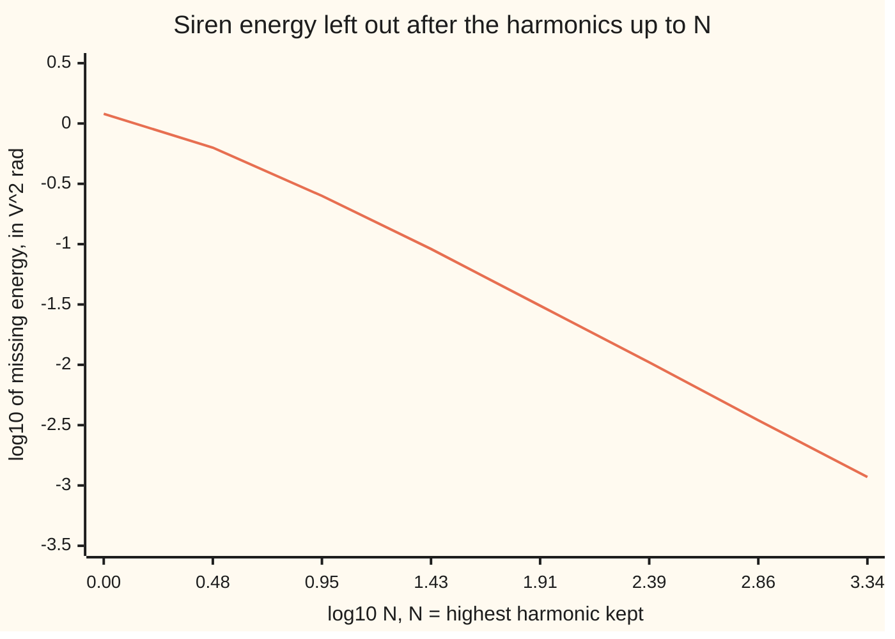

# Completeness of sines and cosines: Fourier series leave nothing behind

[Syllabus](../../../SYLLABUS.md) → [Functional analysis](../README.md) → [Hilbert Spaces](../README.md#s02) → Completeness of sines and cosines

---

## General Overview

A fire-alarm siren plays a square wave at 500 cycles a second (illustrative). Its voltage sits at +1 volt for half of each cycle and at −1 volt for the other half. A one-second clip of it holds 500 identical cycles, so one cycle tells the whole story.

The siren is a stack of pure tones at 500, 1500, 2500 Hz and every further odd multiple of 500 Hz. Their amounts were found in [Fourier series](../../08-Differential%20equations%20and%20dynamics/09-Fourier%20Series/01-fourier-series-and-orthogonality.md). A digital copy keeps finitely many of them. Audio sampled 44,100 times a second keeps tones up to 22,050 Hz, so it keeps the odd harmonics up to number 43, at 21,500 Hz.

How much of the siren does that copy lose? Measure the loss by **energy**: the integral of the squared voltage over one cycle. The copy misses 0.9209% of the siren's energy. Keep more harmonics and the loss shrinks toward 0. This card proves that it shrinks to exactly 0, for the siren and for every signal of finite energy. No part of any such signal hides from all the harmonics.

**No signal of finite energy is perpendicular to every harmonic, except the zero signal; so for every such signal, the energy of the gap between the signal and its Fourier sum falls to zero as more harmonics are kept.**

**What kind of fact this is:** a theorem, proved on this card in Why it works. It rests on two results proved on linked cards: continuous signals come arbitrarily close to any finite-energy signal ([Riesz-Fischer](../../10-Measure%20and%20integration/07-Sizes%20of%20Functions/05-completeness-of-lp.md)), and the series of a smooth signal lands on it point by point ([Convergence](../../08-Differential%20equations%20and%20dynamics/09-Fourier%20Series/02-convergence-jumps-and-gibbs.md)).

### The picture: the missing energy against the number of harmonics



The line is the siren's missing energy at N = 1, 3, 9, 27, 81, 243, 729 and 2187. On these log scales it bends over the first few points, then straightens to slope −1.0 (the last step measures −0.999). So, once N is large, ten times the harmonics leave one tenth of the energy out. It never levels off, which is what completeness predicts.

---

## The formula

Notation first, in words.

- The **phase** $`x`$ is the position inside one cycle, in radians, from −π to π. One cycle of the siren lasts 2 ms.
- $`L^2`$ is the space of **finite-energy signals** on one cycle: signals whose square has a finite integral. Two signals that differ only on a set of total length zero count as the same signal.
- The **inner product** of two signals is $`\langle u, v\rangle = \int_{-\pi}^{\pi} \overline{u(x)}\, v(x)\,dx`$. The bar is the complex conjugate. It acts on the first slot, as in the complex-analysis wing's $`v^* w`$; some texts put it on the second.
- The **norm** $`\|u\|_2 = \sqrt{\langle u, u\rangle}`$ is the square root of the energy: the length of the signal. Two signals are **perpendicular** when their inner product is 0.
- The **harmonic** $`e_n(x) = e^{inx}/\sqrt{2\pi}`$ spins $`n`$ times per cycle, for every whole number $`n`$, negative ones included. Each has length 1, and two different ones are perpendicular.

The partial sum keeps the harmonics from $`-N`$ to $`N`$:

```math
S_N f = \sum_{n=-N}^{N} \langle e_n, f\rangle\, e_n
```

The theorem:

```math
\text{if } \langle e_n, f\rangle = 0 \text{ for every whole number } n, \text{ then } \|f\|_2 = 0
```

Equivalently, for every $`f`$ in $`L^2`$:

```math
\|f - S_N f\|_2^2 \;=\; \|f\|_2^2 - \sum_{n=-N}^{N} |\langle e_n, f\rangle|^2 \;\longrightarrow\; 0 \quad (N \to \infty)
```

**Read it aloud:** the only finite-energy signal with no amount of any harmonic is silence; so the energy each signal leaves outside its first harmonics, which is its energy minus the energies of the harmonics kept, falls to zero.

In the limit the second form is **Parseval's identity** for every finite-energy signal: $`\|f\|_2^2 = \sum_n |\langle e_n, f\rangle|^2`$. The sibling card [Orthonormal bases](03-orthonormal-bases-and-parseval.md) shows the two forms say the same thing for any perpendicular family of length-1 signals. This card proves them for the harmonics.

The siren speaks in sines. Its sine amount at harmonic $`k`$ is $`b_k = 4/(\pi k)`$ for odd $`k`$ and 0 for even $`k`$, as in [Fourier series](../../08-Differential%20equations%20and%20dynamics/09-Fourier%20Series/01-fourier-series-and-orthogonality.md). The pair $`n = k`$ and $`n = -k`$ together holds energy $`\pi b_k^2`$.

| Symbol | Plain meaning | In our example | Push it up and the answer… |
| --- | --- | --- | --- |
| $`x`$ | phase inside one cycle, in radians | −π to π, one cycle of 2 ms | the pattern repeats |
| $`f`$ | the signal, in volts | +1 V on (0, π), −1 V on (−π, 0) | every energy scales with its square |
| $`L^2`$ | the finite-energy signals on one cycle | holds the siren | — |
| $`\langle u, v\rangle`$ | inner product: integral of conjugate u times v | $`\langle f, f\rangle`$ = 6.283185 V² rad | — |
| $`\lVert u \rVert_2`$ | length: square root of the energy | $`\lVert f \rVert_2^2`$ = 2π = 6.283185 | — |
| $`e_n`$, $`n`$, $`i`$ | harmonic n, length 1, spinning n times per cycle; i is the square root of −1 | n = ±1 is 500 Hz, ±3 is 1500 Hz | higher pitch |
| $`\langle e_n, f\rangle`$, $`c_n`$ | amount of harmonic n in f; $`c_n`$ is a list of amounts chosen in advance | the ±1 pair holds 5.092958 | louder tone n |
| $`b_k`$, $`k`$ | sine amount of harmonic k, the real form | 1.273240, 0.424413, 0.254648 at k = 1, 3, 5 | — |
| $`S_N f`$, $`N`$ | partial sum: harmonics from −N to N kept | N = 43 for a 44.1 kHz copy | missing energy falls like 1/N |
| $`T_N`$, $`t`$ | all mixes of the harmonics from −N to N; t is one such mix | $`S_1 f`$ is the best one for N = 1 | — |
| $`g`$, $`g'`$, $`\delta`$ | a smooth stand-in for f; its slope; the half-width of its ramps | δ = 0.02 rad | g moves away from f |
| $`\varepsilon`$ | any tolerance, however small | — | — |

### When it holds

- **Finite energy.** The theorem is about $`L^2`$. For a signal whose square has an infinite integral, there is no energy to balance and no length to shrink.
- **Every harmonic, from $`-\infty`$ to $`\infty`$.** Drop the ±3 pair (1500 Hz) and the siren's missing energy never falls below 0.565884, the energy that pair carried. Its tone $`\sin 3x`$ is perpendicular to every harmonic that is left.
- **Cosines and the constant as well as sines.** With sines only, a siren lifted by a 0.5 V offset keeps a missing energy above 1.570796 forever. The offset is perpendicular to every sine.
- **Closeness in energy, not at every point.** Completeness closes the energy gap. It does not stop the overshoot beside a jump. The peak of the partial sum stays near 1.178980 V however large N is ([Convergence](../../08-Differential%20equations%20and%20dynamics/09-Fourier%20Series/02-convergence-jumps-and-gibbs.md)).

---

## Why it works

### Step 0: counting proves it in a finite list, and fails in an infinite one

Take 8 samples of one siren cycle, a list of 8 numbers. Sample 8 harmonics at the same 8 points: the constant, $`\cos x`$, $`\sin x`$, $`\cos 2x`$, $`\sin 2x`$, $`\cos 3x`$, $`\sin 3x`$ and $`\sin 4x`$, each scaled to length 1. They are 8 perpendicular directions in an 8-number space. So they fill it, and the only list perpendicular to all 8 is the zero list. The code confirms it. The 8 amounts rebuild the samples exactly, and the sample energy 8.000000 equals the sum of the squared amounts, 8.000000.

Counting cannot work for the full signal. Remove the ±3 pair from the infinite family and infinitely many harmonics remain, yet $`\sin 3x`$ is perpendicular to all of them. An infinite perpendicular family can miss a direction. So the proof must show something stronger: every finite-energy signal can be approached, in energy, by mixes of harmonics.

The proof uses two facts. The partial sum is the best mix of its harmonics. And any signal has a smooth stand-in close to it, whose series is easy to control.

### Step 1: the partial sum is the nearest mix, and its energy never exceeds the signal's

Let $`T_N`$ be the mixes of the harmonics from $`-N`$ to $`N`$. The gap $`f - S_N f`$ is perpendicular to each of those harmonics, because $`\langle e_n, S_N f\rangle = \langle e_n, f\rangle`$ for each $`n`$ from $`-N`$ to $`N`$. So for any mix $`t`$ in $`T_N`$, Pythagoras gives

```math
\|f - t\|_2^2 = \|f - S_N f\|_2^2 + \|S_N f - t\|_2^2 \;\ge\; \|f - S_N f\|_2^2
```

This is the projection of [Projection](02-projection-theorem-and-orthogonal-complements.md) onto a finite-dimensional subspace. Taking $`t = 0`$ gives **Bessel's inequality**, proved for every perpendicular family of length-1 signals on [Orthonormal bases](03-orthonormal-bases-and-parseval.md): the energies of the kept harmonics never add to more than $`\|f\|_2^2`$. The gap $`\|f - S_N f\|_2`$ also never grows with $`N`$, because each $`T_N`$ contains the one before.

For the siren the gap's energy is the ledger: 6.283185 − 5.092958 = 1.190227 after harmonic 1. A direct integral of $`(f - S_1 f)^2`$ gives the same 1.190227.

### Step 2: a smooth stand-in comes as close as wished

Fix a tolerance $`\varepsilon > 0`$. The [Riesz-Fischer](../../10-Measure%20and%20integration/07-Sizes%20of%20Functions/05-completeness-of-lp.md) card proves that continuous functions come within any tolerance of every $`L^2`$ signal, in the norm $`\|\cdot\|_2`$. Two small repairs turn that continuous function into a stand-in $`g`$ with $`\|f - g\|_2 < \varepsilon`$, where $`g`$:

- is continuous and joins up around the cycle, $`g(-\pi) = g(\pi)`$;
- is made of finitely many straight pieces, so its slope $`g'`$ is a step function with finite energy.

The fold below gives the repairs. For the siren, the stand-in is concrete. Average the siren over a window of half-width $`\delta`$ around each point. Each flip becomes a straight ramp of width $`2\delta`$, and $`\|f - g\|_2^2 = 4\delta/3`$. At δ = 0.02 that is 0.026667, and Simpson's rule on the gap gives the same 0.026667.

### Step 3: the stand-in's series converges in energy

Integration by parts moves the slope from $`g`$ onto the harmonic. Because $`g`$ joins up around the cycle, the end terms cancel:

```math
\langle e_n, g'\rangle = i n\, \langle e_n, g\rangle
```

Bessel's inequality for $`g'`$ then gives $`\sum_n n^2 |\langle e_n, g\rangle|^2 \le \|g'\|_2^2`$. The harmonics beyond $`N`$ have $`|n| \ge N + 1`$, so

```math
\sum_{|n| > N} |\langle e_n, g\rangle|^2 \;\le\; \frac{\|g'\|_2^2}{(N+1)^2}
```

The same bound makes the amounts of $`g`$ add up absolutely, so $`S_N g`$ settles uniformly to a continuous limit. [Convergence](../../08-Differential%20equations%20and%20dynamics/09-Fourier%20Series/02-convergence-jumps-and-gibbs.md) proves that limit is $`g(x)`$ at every point, since $`g`$ is continuous and built from smooth pieces. Uniform closeness on a cycle of length 2π gives closeness in energy, and the tail above is the gap's energy:

```math
\|g - S_N g\|_2^2 \;\le\; \frac{\|g'\|_2^2}{(N+1)^2} \;\longrightarrow\; 0
```

For the siren's stand-in the slope is $`\pm 1/\delta`$ on the two ramps, of total width 4δ, so $`\|g'\|_2^2 = 4/\delta`$. At δ = 0.02 and N = 99 the bound is 4/(0.02 × 100²) = 0.020000. The real gap is far smaller: 0.000963 by the ledger, and 0.000963 by direct integration.

### Step 4: the triangle inequality hands the result to every signal

The partial sum $`S_N g`$ is a mix in $`T_N`$. By Step 1, $`S_N f`$ is at least as close to $`f`$ as that mix. So

```math
\|f - S_N f\|_2 \;\le\; \|f - S_N g\|_2 \;\le\; \|f - g\|_2 + \|g - S_N g\|_2
```

The first term is below ε by Step 2. The second falls below ε once $`N`$ is large, by Step 3. So $`\|f - S_N f\|_2 < 2\varepsilon`$ for every large $`N`$. As ε was arbitrary, the gap falls to 0, and the ledger of Step 1 becomes Parseval's identity.

For the siren at δ = 0.02 and N = 99:

| Piece | Value |
| --- | --- |
| $`\lVert f - g \rVert_2`$, the square root of 0.026667 | 0.163299 |
| $`\lVert g - S_N g \rVert_2`$, the square root of 0.000963 | 0.031029 |
| the bound, their sum | 0.194328 |
| the true gap $`\lVert f - S_N f \rVert_2`$ | 0.159574 |

The bound holds. A smaller δ with a larger N pushes both sides toward 0.

### Step 5: nothing is perpendicular to every harmonic

Suppose $`\langle e_n, f\rangle = 0`$ for every $`n`$. Then every partial sum $`S_N f`$ is the zero signal. Step 4 says $`\|f - S_N f\|_2 \to 0`$, and here that gap is $`\|f\|_2`$ itself, a fixed number. So $`\|f\|_2 = 0`$: the signal is zero except on a set of total length zero. That is the theorem.

### Step 6: the converse, every square-summable list is a signal

Run it backwards. [Orthonormal bases](03-orthonormal-bases-and-parseval.md) proves, for any perpendicular family of length-1 signals, that every list of amounts $`c_n`$ whose squared sizes add to a finite total is the list of some signal in $`L^2`$: the **Riesz-Fischer theorem**. With Step 5, signals and square-summable lists of harmonic amounts match one to one, and energy is kept.

<details>
<summary>Detailed proof: building the stand-in g in Step 2</summary>

Start from $`f`$ in $`L^2(-\pi, \pi)`$ and $`\varepsilon > 0`$. Set $`f`$ to 0 outside the cycle. The Riesz-Fischer card gives a continuous function, zero outside a bounded interval, within ε/3 of $`f`$ in the norm over the real line. Restricting both to the cycle can only shrink this gap.

**Joining up.** The continuous function may take different values at −π and π. On a short last stretch before π, replace it by the straight line that runs to its value at −π. On that stretch the change is at most twice the function's largest size. Its energy is that bound squared times the stretch's length, so a short enough stretch costs less than ε/3 in the norm.

**Straight pieces.** The joined-up function is continuous on a closed interval, so it is uniformly continuous. Pick a grid fine enough that it changes by less than $`\varepsilon/(3\sqrt{2\pi})`$ across each grid step. Join its grid values by straight lines to get $`g`$. The two differ by less than that margin everywhere, so their gap in the norm is at most

$`\displaystyle \sqrt{2\pi} \cdot \frac{\varepsilon}{3\sqrt{2\pi}} = \frac{\varepsilon}{3}`$

The ends still match, so $`g`$ joins up around the cycle. Its slope is constant on each grid step, so $`\|g'\|_2`$ is finite. Adding the three gaps gives $`\|f - g\|_2 < \varepsilon`$.

**Step 3's integration by parts.** On each straight piece, $`\int \overline{e_n}\, g' = [\overline{e_n}\, g] - \int \overline{e_n}'\, g`$. The end terms of neighbouring pieces cancel because $`g`$ is continuous. The first and last cancel because $`g(-\pi) = g(\pi)`$ and $`e_n`$ repeats every 2π. Since $`\overline{e_n}' = -in\,\overline{e_n}`$, the sum is $`in\,\langle e_n, g\rangle`$.

**Absolute convergence.** By the Cauchy-Schwarz inequality,

$`\displaystyle \sum_{n \ne 0} |\langle e_n, g\rangle| \le \Big(\sum_{n \ne 0} \frac{1}{n^2}\Big)^{1/2} \Big(\sum_{n \ne 0} n^2 |\langle e_n, g\rangle|^2\Big)^{1/2} \le \frac{\pi}{\sqrt 3}\, \|g'\|_2`$

Each $`e_n`$ has size $`1/\sqrt{2\pi}`$ at every point, so the partial sums of $`g`$ settle uniformly. Their limit is $`g`$ by Dirichlet's theorem on the Convergence card. A gap below some margin at every point of the cycle is a gap below that margin times $`\sqrt{2\pi}`$ in the norm. So $`\|g - S_N g\|_2 \to 0`$, and by Step 1 its square equals the tail energy, which Step 3 bounds.

</details>

---

## Worked numbers, by hand

The siren: +1 V for half a cycle, −1 V for the other half. Its sine amounts are $`b_k = 4/(\pi k)`$ on odd $`k`$. The ledger subtracts each kept harmonic's energy, $`\pi b_k^2`$, from the total.

| Step | Arithmetic | Value |
| --- | --- | --- |
| Energy of the siren | 1² × 2π | 6.283185 |
| Amount of harmonic 1 (500 Hz) | $`b_1`$ = 4/π | 1.273240 |
| Energy of harmonic 1 | π × 1.273240² | 5.092958 |
| Missing after N = 1 | 6.283185 − 5.092958 | 1.190227 |
| Energy of harmonic 3 (1500 Hz) | π × 0.424413² | 0.565884 |
| Missing after N = 3 | 1.190227 − 0.565884 | 0.624343 |
| Energy of harmonic 5 (2500 Hz) | π × 0.254648² | 0.203718 |
| Missing after N = 5 | 0.624343 − 0.203718 | 0.420625 |
| Share missing after N = 5 | 0.420625 / 6.283185 | 6.6944% |
| Missing after N = 43, the 44.1 kHz copy | same ledger, odd harmonics 1 to 43 | **0.057865, which is 0.9209%** |

A 44.1 kHz copy of the siren is within 0.9209% of its energy. Completeness says this share keeps falling with more harmonics, and reaches 0 only in the limit.

Each harmonic's share of the siren's energy:

```
share of the siren's energy, per harmonic
k = 1, 500 Hz    ████████████████████████████████████████  81.06%
k = 3, 1500 Hz   ████▌                                       9.01%
k = 5, 2500 Hz   █▌                                          3.24%
k = 7, 3500 Hz   █                                           1.65%
k = 9, 4500 Hz   ▌                                           1.00%
```

The rate: N times the missing energy is 2.520930 at N = 99, 2.543932 at 999 and 2.546224 at 9999. It closes on 8/π = 2.546479. So the missing energy is close to 8/(πN), and the distance $`\|f - S_N f\|_2`$ falls like $`1/\sqrt{N}`$. The jump makes the series slow. It does not stop it.

### What breaks if you drop a piece

| Mistake | Comes out at | What went wrong |
| --- | --- | --- |
| Drop the ±3 pair from the family, keep up to N = 999 | missing 0.568431, never below 0.565884 | the family is still infinite and perpendicular, but not complete: $`\sin 3x`$ is perpendicular to all of it |
| Use sines only, on the siren plus a 0.5 V offset, N = 999 | missing 1.573343, never below 1.570796 | the constant offset is perpendicular to every sine, so its energy 0.25 × 2π is never reached |
| Judge closeness by the largest gap, not by energy | the peak of the partial sum is 1.179152 V at N = 43 and 1.178980 V at N = 999 | completeness controls energy only; the overshoot beside each flip keeps its height and only narrows |
| Trust counting, as in the 8-sample rehearsal | drop $`\sin 3x`$ there and the rebuild misses 1.171573 | in 8 numbers, 8 perpendicular directions fill the space; in infinitely many, no count proves that |

---

## Code, from first principles, and it actually runs

The code works on truncations only: a list of 8 samples, and the harmonics up to N at several N. It takes four independent roads. The siren's amounts come from the closed form 4/(πk) and from Simpson's rule (a weighted sum that approximates an integral). The missing energy comes from the ledger and from a direct integral of the squared gap. Its rate comes from the ledger at large N and from the limit 8/π. The overshoot comes from the partial sum and from the sine integral. What the truncation hides: no finite N reaches zero gap; only the proof covers the limit.

### Python

```python
# Completeness of sines and cosines -- the check behind the card.  Standard library only.
# The siren is a square wave: +1 V on (0, pi), -1 V on (-pi, 0), phase x in radians.
# Energy means the integral of the square over one cycle, in V^2 rad.
# Every infinite object is a truncation: harmonics up to N, shown at several N.
import math

PI = math.pi

def simpson(fn, a, b, m):              # Simpson's rule with m (even) intervals
    h = (b - a) / m
    s = fn(a) + fn(b)
    for i in range(1, m):
        s += (4 if i % 2 else 2) * fn(a + i * h)
    return s * h / 3

def b_sq(k):                            # sine amount of the siren, closed form
    return 4 / (PI * k)

def partial(x, N, b):                   # S_N at x: odd sines up to N with amounts b(k)
    return sum(b(k) * math.sin(k * x) for k in range(1, N + 1, 2))

def missing_ledger(N, b, energy):       # energy minus the ledger of kept harmonics
    return energy - PI * sum(b(k) ** 2 for k in range(1, N + 1, 2))

def check(label, got, want, tol):
    assert abs(got - want) < tol, (label, got, want)

# 1. Rehearsal: 8 samples of one cycle and 8 sampled harmonics.
M = 8
xs = [-PI + (j + 0.5) * 2 * PI / M for j in range(M)]
fs = [1.0 if x > 0 else -1.0 for x in xs]
waves = [lambda x: 1 / math.sqrt(M)]
for n in (1, 2, 3):
    waves.append(lambda x, n=n: math.cos(n * x) * math.sqrt(2 / M))
    waves.append(lambda x, n=n: math.sin(n * x) * math.sqrt(2 / M))
waves.append(lambda x: math.sin(4 * x) / math.sqrt(M))
U = [[w(x) for x in xs] for w in waves]
dot = lambda u, v: sum(a * b for a, b in zip(u, v))
gram = max(abs(dot(U[i], U[j]) - (1 if i == j else 0)) for i in range(M) for j in range(M))
coef = [dot(u, fs) for u in U]
rebuilt = [sum(c * u[j] for c, u in zip(coef, U)) for j in range(M)]
print("rehearsal, M = 8 samples, 8 sampled harmonics")
print(f"  largest Gram error below 1e-12: {'yes' if gram < 1e-12 else 'no'}")
err = max(abs(r - f) for r, f in zip(rebuilt, fs))
print(f"  largest rebuild error below 1e-12: {'yes' if err < 1e-12 else 'no'}")
print(f"  sample energy {dot(fs, fs):.6f} = sum of squared amounts {sum(c * c for c in coef):.6f}")
print(f"  drop sin 3x: rebuild misses energy {coef[6] ** 2:.6f}")
assert gram < 1e-12, gram
assert err < 1e-12, err
check("rehearsal energy", sum(c * c for c in coef), dot(fs, fs), 1e-12)

# 2. The siren's sine amounts: closed form against Simpson.
print("sine amounts b_k = 4/(pi k): closed form, Simpson, energy pi b_k^2")
for k in (1, 3, 5):
    simp = 2 / PI * simpson(lambda x: math.sin(k * x), 0, PI, 200)
    print(f"  k = {k}: {b_sq(k):.6f} {simp:.6f} {PI * b_sq(k) ** 2:.6f}")
    check("b_k", simp, b_sq(k), 1e-6)

# 3. Missing energy ||f - S_N f||^2: ledger against a direct integral.
E = 2 * PI
print(f"siren energy ||f||^2 = {E:.6f} V^2 rad")
top = max(k for k in range(1, 100, 2) if 500 * k <= 44100 / 2)   # 500 Hz siren, 44.1 kHz audio
print(f"44.1 kHz copy keeps odd harmonics up to {top}: {500 * top} Hz <= {44100 // 2} Hz")
print("N, missing energy by ledger, by direct integral, share missing")
for N in (1, 3, 5, top):
    led = missing_ledger(N, b_sq, E)
    direct = 2 * simpson(lambda x: (1 - partial(x, N, b_sq)) ** 2, 0, PI, 6000)
    print(f"  {N}: {led:.6f} {direct:.6f} {100 * led / E:.4f}%")
    check("missing", direct, led, 1e-6)
print("large N, ledger only: N, missing, N x missing (tends to 8/pi)")
for N in (99, 999, 9999):
    led = missing_ledger(N, b_sq, E)
    print(f"  {N}: {led:.6f} {N * led:.6f}")
print(f"  8/pi = {8 / PI:.6f}")
check("rate", 9999 * missing_ledger(9999, b_sq, E), 8 / PI, 1e-3)

# 4. Chart and bars.
pts = [(N, missing_ledger(N, b_sq, E)) for N in (1, 3, 9, 27, 81, 243, 729, 2187)]
print("chart, log10 N:", " ".join(f"{math.log10(n):.2f}" for n, _ in pts))
print("chart, log10 missing:", " ".join(f"{math.log10(m):.2f}" for _, m in pts))
slope = (math.log10(pts[-1][1]) - math.log10(pts[-2][1])) / (math.log10(2187) - math.log10(729))
print(f"chart, last slope: {slope:.3f}")
check("slope", slope, -1.0, 0.01)
print("bars, share of energy per harmonic:",
      " ".join(f"k={k}:{100 * PI * b_sq(k) ** 2 / E:.2f}%" for k in (1, 3, 5, 7, 9)))

# 5. The proof in numbers: ramp g (siren averaged over a window of half-width d).
d, N = 0.02, 99
b_g = lambda k: b_sq(k) * math.sin(k * d) / (k * d)
def g(x):                               # on (0, pi)
    return min(1.0, x / d, (PI - x) / d)
pieces = lambda fn: simpson(fn, 0, d, 200) + simpson(fn, d, PI - d, 6000) + simpson(fn, PI - d, PI, 200)
fg = 2 * pieces(lambda x: (1 - g(x)) ** 2)
print(f"proof, delta = {d}, N = {N}")
print(f"  ||f - g||^2: closed 4 delta/3 = {4 * d / 3:.6f}, Simpson {fg:.6f}")
check("f-g", fg, 4 * d / 3, 1e-9)
for k in (1, 3):
    simp = 2 / PI * pieces(lambda x: g(x) * math.sin(k * x))
    print(f"  b_{k}(g): closed {b_g(k):.6f}, Simpson {simp:.6f}")
    check("b_g", simp, b_g(k), 1e-8)
Eg = E - 8 * d / 3
gled = missing_ledger(N, b_g, Eg)
gdir = 2 * pieces(lambda x: (g(x) - partial(x, N, b_g)) ** 2)
print(f"  ||g - S_N g||^2: ledger {gled:.6f}, direct {gdir:.6f}, bound 4/(delta (N+1)^2) {4 / (d * (N + 1) ** 2):.6f}")
check("g ledger", gdir, gled, 1e-6)
assert gled <= 4 / (d * (N + 1) ** 2)
fs_n = math.sqrt(missing_ledger(N, b_sq, E))
bound = math.sqrt(4 * d / 3) + math.sqrt(gled)
print(f"  ||f - S_N f|| = {fs_n:.6f} <= {math.sqrt(4 * d / 3):.6f} + {math.sqrt(gled):.6f} = {bound:.6f}")
assert fs_n <= bound

# 6. What breaks.
N = 999
drop3 = missing_ledger(N, b_sq, E) + PI * b_sq(3) ** 2
print(f"breaks, N = {N}: harmonic 3 dropped, missing {drop3:.6f} (never below {PI * b_sq(3) ** 2:.6f})")
offset = missing_ledger(N, b_sq, E) + 0.25 * 2 * PI
print(f"breaks, N = {N}: sines only, siren + 0.5 V, missing {offset:.6f} (never below {0.5 * PI:.6f})")
si = simpson(lambda u: math.sin(u) / u if u else 1.0, 0, PI, 2000)
for N in (43, 999):
    peak = partial(PI / (N + 1), N, b_sq)
    print(f"breaks, sup norm: N = {N}, peak of S_N at pi/(N+1) = {peak:.6f}")
print(f"breaks, sup norm: limit (2/pi) Si(pi) = {2 / PI * si:.6f}")
check("gibbs", partial(PI / 1000, 999, b_sq), 2 / PI * si, 1e-5)
print("ALL CHECKS PASS")
```

**Ran 2026-11-15 on macOS, Python 3.14.10, standard library only. All checks passed. Output, pasted from the run:**

```
rehearsal, M = 8 samples, 8 sampled harmonics
  largest Gram error below 1e-12: yes
  largest rebuild error below 1e-12: yes
  sample energy 8.000000 = sum of squared amounts 8.000000
  drop sin 3x: rebuild misses energy 1.171573
sine amounts b_k = 4/(pi k): closed form, Simpson, energy pi b_k^2
  k = 1: 1.273240 1.273240 5.092958
  k = 3: 0.424413 0.424413 0.565884
  k = 5: 0.254648 0.254648 0.203718
siren energy ||f||^2 = 6.283185 V^2 rad
44.1 kHz copy keeps odd harmonics up to 43: 21500 Hz <= 22050 Hz
N, missing energy by ledger, by direct integral, share missing
  1: 1.190227 1.190227 18.9431%
  3: 0.624343 0.624343 9.9367%
  5: 0.420625 0.420625 6.6944%
  43: 0.057865 0.057865 0.9209%
large N, ledger only: N, missing, N x missing (tends to 8/pi)
  99: 0.025464 2.520930
  999: 0.002546 2.543932
  9999: 0.000255 2.546224
  8/pi = 2.546479
chart, log10 N: 0.00 0.48 0.95 1.43 1.91 2.39 2.86 3.34
chart, log10 missing: 0.08 -0.20 -0.60 -1.04 -1.51 -1.98 -2.46 -2.93
chart, last slope: -0.999
bars, share of energy per harmonic: k=1:81.06% k=3:9.01% k=5:3.24% k=7:1.65% k=9:1.00%
proof, delta = 0.02, N = 99
  ||f - g||^2: closed 4 delta/3 = 0.026667, Simpson 0.026667
  b_1(g): closed 1.273155, Simpson 1.273155
  b_3(g): closed 0.424159, Simpson 0.424159
  ||g - S_N g||^2: ledger 0.000963, direct 0.000963, bound 4/(delta (N+1)^2) 0.020000
  ||f - S_N f|| = 0.159574 <= 0.163299 + 0.031029 = 0.194328
breaks, N = 999: harmonic 3 dropped, missing 0.568431 (never below 0.565884)
breaks, N = 999: sines only, siren + 0.5 V, missing 1.573343 (never below 1.570796)
breaks, sup norm: N = 43, peak of S_N at pi/(N+1) = 1.179152
breaks, sup norm: N = 999, peak of S_N at pi/(N+1) = 1.178980
breaks, sup norm: limit (2/pi) Si(pi) = 1.178980
ALL CHECKS PASS
```

### Rust

```rust
// Completeness of sines and cosines -- the check behind the card.  std only.
// The siren is a square wave: +1 V on (0, pi), -1 V on (-pi, 0), phase x in radians.
// Energy means the integral of the square over one cycle, in V^2 rad.
// Every infinite object is a truncation: harmonics up to N, shown at several N.
use std::f64::consts::PI;

fn simpson(f: &dyn Fn(f64) -> f64, a: f64, b: f64, m: usize) -> f64 {
    let h = (b - a) / m as f64;
    let mut s = f(a) + f(b);
    for i in 1..m {
        s += if i % 2 == 1 { 4.0 } else { 2.0 } * f(a + i as f64 * h);
    }
    s * h / 3.0
}

fn b_sq(k: usize) -> f64 { 4.0 / (PI * k as f64) }

fn partial(x: f64, n: usize, b: &dyn Fn(usize) -> f64) -> f64 {
    let mut s = 0.0;
    for k in (1..=n).step_by(2) { s += b(k) * (k as f64 * x).sin(); }
    s
}

fn missing_ledger(n: usize, b: &dyn Fn(usize) -> f64, energy: f64) -> f64 {
    let mut s = 0.0;
    for k in (1..=n).step_by(2) { s += b(k).powi(2); }
    energy - PI * s
}

fn check(label: &str, got: f64, want: f64, tol: f64) {
    assert!((got - want).abs() < tol, "{} {} {}", label, got, want);
}

fn yes(ok: bool) -> &'static str { if ok { "yes" } else { "no" } }

fn main() {
    // 1. Rehearsal: 8 samples of one cycle and 8 sampled harmonics.
    let m = 8usize;
    let xs: Vec<f64> = (0..m).map(|j| -PI + (j as f64 + 0.5) * 2.0 * PI / m as f64).collect();
    let fs: Vec<f64> = xs.iter().map(|&x| if x > 0.0 { 1.0 } else { -1.0 }).collect();
    let r = (2.0 / m as f64).sqrt();
    let mut u: Vec<Vec<f64>> = vec![xs.iter().map(|_| 1.0 / (m as f64).sqrt()).collect()];
    for n in 1..=3 {
        let nf = n as f64;
        u.push(xs.iter().map(|&x| (nf * x).cos() * r).collect());
        u.push(xs.iter().map(|&x| (nf * x).sin() * r).collect());
    }
    u.push(xs.iter().map(|&x| (4.0 * x).sin() / (m as f64).sqrt()).collect());
    let dot = |a: &Vec<f64>, b: &Vec<f64>| -> f64 {
        let mut s = 0.0;
        for (p, q) in a.iter().zip(b.iter()) { s += p * q; }
        s
    };
    let mut gram: f64 = 0.0;
    for i in 0..m { for j in 0..m {
        let id = if i == j { 1.0 } else { 0.0 };
        gram = gram.max((dot(&u[i], &u[j]) - id).abs());
    } }
    let coef: Vec<f64> = u.iter().map(|v| dot(v, &fs)).collect();
    let mut err: f64 = 0.0;
    for j in 0..m {
        let mut s = 0.0;
        for (c, v) in coef.iter().zip(u.iter()) { s += c * v[j]; }
        err = err.max((s - fs[j]).abs());
    }
    let csum: f64 = coef.iter().map(|c| c * c).sum();
    println!("rehearsal, M = 8 samples, 8 sampled harmonics");
    println!("  largest Gram error below 1e-12: {}", yes(gram < 1e-12));
    println!("  largest rebuild error below 1e-12: {}", yes(err < 1e-12));
    println!("  sample energy {:.6} = sum of squared amounts {:.6}", dot(&fs, &fs), csum);
    println!("  drop sin 3x: rebuild misses energy {:.6}", coef[6].powi(2));
    assert!(gram < 1e-12, "{}", gram);
    assert!(err < 1e-12, "{}", err);
    check("rehearsal energy", csum, dot(&fs, &fs), 1e-12);

    // 2. The siren's sine amounts: closed form against Simpson.
    println!("sine amounts b_k = 4/(pi k): closed form, Simpson, energy pi b_k^2");
    for k in [1usize, 3, 5] {
        let kf = k as f64;
        let simp = 2.0 / PI * simpson(&|x: f64| (kf * x).sin(), 0.0, PI, 200);
        println!("  k = {}: {:.6} {:.6} {:.6}", k, b_sq(k), simp, PI * b_sq(k).powi(2));
        check("b_k", simp, b_sq(k), 1e-6);
    }

    // 3. Missing energy ||f - S_N f||^2: ledger against a direct integral.
    let e = 2.0 * PI;
    println!("siren energy ||f||^2 = {:.6} V^2 rad", e);
    let top = (1..100usize).step_by(2).filter(|&k| 500.0 * k as f64 <= 44100.0 / 2.0).max().unwrap();
    println!("44.1 kHz copy keeps odd harmonics up to {}: {} Hz <= {} Hz", top, 500 * top, 44100 / 2);
    println!("N, missing energy by ledger, by direct integral, share missing");
    for n in [1usize, 3, 5, top] {
        let led = missing_ledger(n, &b_sq, e);
        let direct = 2.0 * simpson(&|x: f64| (1.0 - partial(x, n, &b_sq)).powi(2), 0.0, PI, 6000);
        println!("  {}: {:.6} {:.6} {:.4}%", n, led, direct, 100.0 * led / e);
        check("missing", direct, led, 1e-6);
    }
    println!("large N, ledger only: N, missing, N x missing (tends to 8/pi)");
    for n in [99usize, 999, 9999] {
        let led = missing_ledger(n, &b_sq, e);
        println!("  {}: {:.6} {:.6}", n, led, n as f64 * led);
    }
    println!("  8/pi = {:.6}", 8.0 / PI);
    check("rate", 9999.0 * missing_ledger(9999, &b_sq, e), 8.0 / PI, 1e-3);

    // 4. Chart and bars.
    let ns = [1usize, 3, 9, 27, 81, 243, 729, 2187];
    let pts: Vec<(usize, f64)> = ns.iter().map(|&n| (n, missing_ledger(n, &b_sq, e))).collect();
    let a: Vec<String> = pts.iter().map(|p| format!("{:.2}", (p.0 as f64).log10())).collect();
    let b: Vec<String> = pts.iter().map(|p| format!("{:.2}", p.1.log10())).collect();
    println!("chart, log10 N: {}", a.join(" "));
    println!("chart, log10 missing: {}", b.join(" "));
    let slope = (pts[7].1.log10() - pts[6].1.log10()) / (2187f64.log10() - 729f64.log10());
    println!("chart, last slope: {:.3}", slope);
    check("slope", slope, -1.0, 0.01);
    let bars: Vec<String> = [1usize, 3, 5, 7, 9].iter()
        .map(|&k| format!("k={}:{:.2}%", k, 100.0 * PI * b_sq(k).powi(2) / e)).collect();
    println!("bars, share of energy per harmonic: {}", bars.join(" "));

    // 5. The proof in numbers: ramp g (siren averaged over a window of half-width d).
    let (d, n) = (0.02f64, 99usize);
    let b_g = |k: usize| b_sq(k) * (k as f64 * d).sin() / (k as f64 * d);
    let g = |x: f64| 1.0f64.min(x / d).min((PI - x) / d);
    let pieces = |f: &dyn Fn(f64) -> f64| simpson(f, 0.0, d, 200)
        + simpson(f, d, PI - d, 6000) + simpson(f, PI - d, PI, 200);
    let fg = 2.0 * pieces(&|x: f64| (1.0 - g(x)).powi(2));
    println!("proof, delta = {}, N = {}", d, n);
    println!("  ||f - g||^2: closed 4 delta/3 = {:.6}, Simpson {:.6}", 4.0 * d / 3.0, fg);
    check("f-g", fg, 4.0 * d / 3.0, 1e-9);
    for k in [1usize, 3] {
        let kf = k as f64;
        let simp = 2.0 / PI * pieces(&|x: f64| g(x) * (kf * x).sin());
        println!("  b_{}(g): closed {:.6}, Simpson {:.6}", k, b_g(k), simp);
        check("b_g", simp, b_g(k), 1e-8);
    }
    let eg = e - 8.0 * d / 3.0;
    let gled = missing_ledger(n, &b_g, eg);
    let gdir = 2.0 * pieces(&|x: f64| (g(x) - partial(x, n, &b_g)).powi(2));
    let gb = 4.0 / (d * ((n + 1) as f64).powi(2));
    println!("  ||g - S_N g||^2: ledger {:.6}, direct {:.6}, bound 4/(delta (N+1)^2) {:.6}", gled, gdir, gb);
    check("g ledger", gdir, gled, 1e-6);
    assert!(gled <= gb);
    let fs_n = missing_ledger(n, &b_sq, e).sqrt();
    let bound = (4.0 * d / 3.0).sqrt() + gled.sqrt();
    println!("  ||f - S_N f|| = {:.6} <= {:.6} + {:.6} = {:.6}", fs_n, (4.0 * d / 3.0).sqrt(), gled.sqrt(), bound);
    assert!(fs_n <= bound);

    // 6. What breaks.
    let n = 999usize;
    let drop3 = missing_ledger(n, &b_sq, e) + PI * b_sq(3).powi(2);
    println!("breaks, N = {}: harmonic 3 dropped, missing {:.6} (never below {:.6})", n, drop3, PI * b_sq(3).powi(2));
    let offset = missing_ledger(n, &b_sq, e) + 0.25 * 2.0 * PI;
    println!("breaks, N = {}: sines only, siren + 0.5 V, missing {:.6} (never below {:.6})", n, offset, 0.5 * PI);
    let si = simpson(&|u: f64| if u != 0.0 { u.sin() / u } else { 1.0 }, 0.0, PI, 2000);
    for n in [43usize, 999] {
        let peak = partial(PI / (n + 1) as f64, n, &b_sq);
        println!("breaks, sup norm: N = {}, peak of S_N at pi/(N+1) = {:.6}", n, peak);
    }
    println!("breaks, sup norm: limit (2/pi) Si(pi) = {:.6}", 2.0 / PI * si);
    check("gibbs", partial(PI / 1000.0, 999, &b_sq), 2.0 / PI * si, 1e-5);
    println!("ALL CHECKS PASS");
}
```

**Ran 2026-11-15 on macOS, rustc 1.98.1, no crates. All checks passed. Output, pasted from the run:**

```
rehearsal, M = 8 samples, 8 sampled harmonics
  largest Gram error below 1e-12: yes
  largest rebuild error below 1e-12: yes
  sample energy 8.000000 = sum of squared amounts 8.000000
  drop sin 3x: rebuild misses energy 1.171573
sine amounts b_k = 4/(pi k): closed form, Simpson, energy pi b_k^2
  k = 1: 1.273240 1.273240 5.092958
  k = 3: 0.424413 0.424413 0.565884
  k = 5: 0.254648 0.254648 0.203718
siren energy ||f||^2 = 6.283185 V^2 rad
44.1 kHz copy keeps odd harmonics up to 43: 21500 Hz <= 22050 Hz
N, missing energy by ledger, by direct integral, share missing
  1: 1.190227 1.190227 18.9431%
  3: 0.624343 0.624343 9.9367%
  5: 0.420625 0.420625 6.6944%
  43: 0.057865 0.057865 0.9209%
large N, ledger only: N, missing, N x missing (tends to 8/pi)
  99: 0.025464 2.520930
  999: 0.002546 2.543932
  9999: 0.000255 2.546224
  8/pi = 2.546479
chart, log10 N: 0.00 0.48 0.95 1.43 1.91 2.39 2.86 3.34
chart, log10 missing: 0.08 -0.20 -0.60 -1.04 -1.51 -1.98 -2.46 -2.93
chart, last slope: -0.999
bars, share of energy per harmonic: k=1:81.06% k=3:9.01% k=5:3.24% k=7:1.65% k=9:1.00%
proof, delta = 0.02, N = 99
  ||f - g||^2: closed 4 delta/3 = 0.026667, Simpson 0.026667
  b_1(g): closed 1.273155, Simpson 1.273155
  b_3(g): closed 0.424159, Simpson 0.424159
  ||g - S_N g||^2: ledger 0.000963, direct 0.000963, bound 4/(delta (N+1)^2) 0.020000
  ||f - S_N f|| = 0.159574 <= 0.163299 + 0.031029 = 0.194328
breaks, N = 999: harmonic 3 dropped, missing 0.568431 (never below 0.565884)
breaks, N = 999: sines only, siren + 0.5 V, missing 1.573343 (never below 1.570796)
breaks, sup norm: N = 43, peak of S_N at pi/(N+1) = 1.179152
breaks, sup norm: N = 999, peak of S_N at pi/(N+1) = 1.178980
breaks, sup norm: limit (2/pi) Si(pi) = 1.178980
ALL CHECKS PASS
```

### Lean

Lean proves the theorem in both its forms, and Parseval's identity, for every finite-energy signal on one cycle.

- A finite-energy signal perpendicular to every harmonic is zero, except on a set of total length zero.
- Take any finite-energy signal $`f`$. Then the gap's energy $`\|f - S_N f\|_2^2`$ falls to 0 as $`N`$ grows.
- Take any finite-energy signal $`f`$. Then its energy $`\|f\|_2^2`$ is the sum of $`|\langle e_n, f\rangle|^2`$ over every whole number $`n`$.
- The 44.1 kHz copy keeps the odd harmonics up to 43, at 21,500 Hz. A 48 kHz copy keeps them up to 47.

The siren's amounts, its missing energy at each $`N`$, the stand-in $`g`$ and the overshoot are left to the Python and Rust checks.

```lean
-- Completeness of sines and cosines: no finite-energy signal on one cycle (−π, π) is perpendicular to every harmonic e_n(x) = e^(inx)/√(2π) except the zero signal, so every such signal's Fourier partial sums close the energy gap.
import Mathlib.Analysis.Fourier.AddCircle
import Mathlib.Analysis.SpecialFunctions.Complex.Circle
import Mathlib.Analysis.SpecialFunctions.Integrals.Basic
import Mathlib.Order.Filter.AtTopBot.Interval

open MeasureTheory Complex Filter Topology Real

/-- The harmonic `e_n(x) = e^(inx) / √(2π)`, for every whole number `n`, negative ones included. -/
noncomputable def harmonic (n : ℤ) (x : ℝ) : ℂ :=
  Complex.exp (n * x * Complex.I) / (Real.sqrt (2 * π) : ℂ)

/-- The amount of harmonic `n` in `f`: the inner product `⟨e_n, f⟩ = ∫_{-π}^{π} conj(e_n x) f x dx`,
conjugating the first slot. -/
noncomputable def amount (f : ℝ → ℂ) (n : ℤ) : ℂ :=
  ∫ x in (-π)..π, (starRingEnd ℂ) (harmonic n x) * f x

/-- The partial sum `S_N f = ∑_{n=-N}^{N} ⟨e_n, f⟩ e_n`. -/
noncomputable def partialSum (f : ℝ → ℂ) (N : ℕ) (x : ℝ) : ℂ :=
  ∑ n ∈ Finset.Icc (-(N : ℤ)) N, amount f n * harmonic n x

lemma amount_eq_sqrt_mul_fourierCoeffOn (f : ℝ → ℂ) (n : ℤ) :
    amount f n = (Real.sqrt (2 * π) : ℂ) * fourierCoeffOn (neg_lt_self Real.pi_pos) f n := by
  rw [fourierCoeffOn_eq_integral]
  have hs : (Real.sqrt (2 * π) : ℂ) ≠ 0 := by
    exact_mod_cast (Real.sqrt_pos.2 (by positivity)).ne'
  have hss : (Real.sqrt (2 * π) : ℂ) * (Real.sqrt (2 * π) : ℂ) = 2 * π := by
    rw [← Complex.ofReal_mul, Real.mul_self_sqrt (by positivity)]; push_cast; ring
  have h1 : ∀ x : ℝ, (starRingEnd ℂ) (harmonic n x) * f x
      = (Real.sqrt (2 * π) : ℂ)⁻¹ * (fourier (-n) (x : AddCircle (π - -π)) • f x) := by
    intro x
    rw [fourier_coe_apply, harmonic, map_div₀, ← Complex.exp_conj, Complex.conj_ofReal, smul_eq_mul]
    have : (starRingEnd ℂ) (↑n * ↑x * I) = 2 * ↑π * I * ↑(-n) * ↑x / ↑(π - -π) := by
      simp only [map_mul, map_intCast, Complex.conj_ofReal, Complex.conj_I]
      push_cast
      field_simp
      ring
    rw [this]; ring
  simp_rw [amount, h1]
  rw [intervalIntegral.integral_const_mul, Complex.real_smul, ← mul_assoc]
  congr 1
  push_cast
  field_simp
  rw [sq, hss]; ring

#print axioms amount_eq_sqrt_mul_fourierCoeffOn

lemma parseval_aux (f : ℝ → ℂ)
    (hf : MemLp f 2 (volume.restrict (Set.Ioc (-π) π))) :
    HasSum (fun n : ℤ => ‖amount f n‖ ^ 2) (∫ x in (-π)..π, ‖f x‖ ^ 2) := by
  have h := (hasSum_sq_fourierCoeffOn (neg_lt_self Real.pi_pos) hf).mul_left (2 * π)
  have hsq : ‖(Real.sqrt (2 * π) : ℂ)‖ ^ 2 = 2 * π := by
    rw [Complex.norm_real, Real.norm_eq_abs, sq_abs, Real.sq_sqrt (by positivity)]
  convert h using 1
  · funext n
    rw [amount_eq_sqrt_mul_fourierCoeffOn, norm_mul, mul_pow, hsq]
  · rw [smul_eq_mul, ← mul_assoc, show π - -π = 2 * π by ring,
      mul_inv_cancel₀ (by positivity), one_mul]

#print axioms parseval_aux

lemma integrableOn_norm_sq (f : ℝ → ℂ)
    (hf : MemLp f 2 (volume.restrict (Set.Ioc (-π) π))) :
    Integrable (fun x => ‖f x‖ ^ 2) (volume.restrict (Set.Ioc (-π) π)) := by
  have hf' : MemLp f ((2 : ℕ) : ENNReal) (volume.restrict (Set.Ioc (-π) π)) := by
    simpa using hf
  exact hf'.integrable_norm_pow (by norm_num)

#print axioms integrableOn_norm_sq

lemma continuous_harmonic (n : ℤ) : Continuous (harmonic n) := by
  unfold harmonic; fun_prop

#print axioms continuous_harmonic

lemma conj_harmonic_mul_harmonic (n m : ℤ) (x : ℝ) :
    (starRingEnd ℂ) (harmonic n x) * harmonic m x
      = Complex.exp (((m - n : ℤ) : ℂ) * x * Complex.I) / (2 * π) := by
  have hss : (Real.sqrt (2 * π) : ℂ) * (Real.sqrt (2 * π) : ℂ) = 2 * π := by
    rw [← Complex.ofReal_mul, Real.mul_self_sqrt (by positivity)]; push_cast; ring
  rw [harmonic, harmonic, map_div₀, ← Complex.exp_conj, Complex.conj_ofReal, div_mul_div_comm,
    ← Complex.exp_add, hss]
  congr 2
  simp only [map_mul, map_intCast, Complex.conj_ofReal, Complex.conj_I]
  push_cast; ring

#print axioms conj_harmonic_mul_harmonic

lemma amount_harmonic (m n : ℤ) : amount (harmonic m) n = if n = m then 1 else 0 := by
  unfold amount
  simp_rw [conj_harmonic_mul_harmonic]
  rw [intervalIntegral.integral_div]
  split_ifs with h
  · subst h
    simp
    field_simp
    ring
  · have hk : (((m - n : ℤ) : ℂ) * Complex.I) ≠ 0 := by
      refine mul_ne_zero ?_ Complex.I_ne_zero
      exact_mod_cast sub_ne_zero.2 (Ne.symm h)
    have : ∀ x : ℝ, Complex.exp (((m - n : ℤ) : ℂ) * x * Complex.I)
        = Complex.exp ((((m - n : ℤ) : ℂ) * Complex.I) * x) := fun x => by ring_nf
    simp_rw [this]
    rw [integral_exp_mul_complex hk]
    have e1 : Complex.exp ((((m - n : ℤ) : ℂ) * Complex.I) * (π : ℝ))
        = Complex.exp ((((m - n : ℤ) : ℂ) * Complex.I) * ((-π : ℝ) : ℂ)) := by
      rw [Complex.exp_eq_exp_iff_exists_int]
      refine ⟨m - n, ?_⟩
      push_cast; ring
    rw [e1, sub_self, zero_div, zero_div]

#print axioms amount_harmonic

lemma memLp_of_continuous (g : ℝ → ℂ) (hg : Continuous g) :
    MemLp g 2 (volume.restrict (Set.Ioc (-π) π)) := by
  obtain ⟨C, hC⟩ := (isCompact_Icc (a := -π) (b := π)).exists_bound_of_continuousOn
    hg.continuousOn
  refine MemLp.of_bound hg.aestronglyMeasurable C ?_
  refine ae_restrict_of_forall_mem measurableSet_Ioc fun x hx => hC x ?_
  exact Set.Ioc_subset_Icc_self hx

#print axioms memLp_of_continuous

lemma intervalIntegrable_conj_mul (f : ℝ → ℂ)
    (hf : MemLp f 2 (volume.restrict (Set.Ioc (-π) π))) (n : ℤ) :
    IntervalIntegrable (fun x => (starRingEnd ℂ) (harmonic n x) * f x) volume (-π) π := by
  have hfi : IntervalIntegrable f volume (-π) π := by
    rw [intervalIntegrable_iff_integrableOn_Ioc_of_le (neg_le_self Real.pi_pos.le)]
    exact hf.integrable one_le_two
  exact hfi.continuousOn_mul (by
    have := continuous_harmonic n
    fun_prop)

#print axioms intervalIntegrable_conj_mul

lemma amount_sub (f g : ℝ → ℂ)
    (hf : MemLp f 2 (volume.restrict (Set.Ioc (-π) π)))
    (hg : MemLp g 2 (volume.restrict (Set.Ioc (-π) π))) (n : ℤ) :
    amount (fun x => f x - g x) n = amount f n - amount g n := by
  unfold amount
  rw [← intervalIntegral.integral_sub (intervalIntegrable_conj_mul f hf n)
    (intervalIntegrable_conj_mul g hg n)]
  congr 1
  funext x
  ring

#print axioms amount_sub

lemma continuous_partialSum (f : ℝ → ℂ) (N : ℕ) : Continuous (partialSum f N) := by
  unfold partialSum
  have := continuous_harmonic
  fun_prop

#print axioms continuous_partialSum

lemma amount_partialSum (f : ℝ → ℂ) (N : ℕ) (n : ℤ) :
    amount (partialSum f N) n
      = if n ∈ Finset.Icc (-(N : ℤ)) N then amount f n else 0 := by
  have h : amount (partialSum f N) n
      = ∑ m ∈ Finset.Icc (-(N : ℤ)) N, amount f m * amount (harmonic m) n := by
    unfold amount partialSum
    simp_rw [Finset.mul_sum]
    rw [intervalIntegral.integral_finsetSum]
    · refine Finset.sum_congr rfl fun m _ => ?_
      rw [← intervalIntegral.integral_const_mul]
      congr 1; funext x; unfold amount; ring
    · intro m _
      apply Continuous.intervalIntegrable
      have := continuous_harmonic m
      have := continuous_harmonic n
      fun_prop
  rw [h]
  simp_rw [amount_harmonic, mul_ite, mul_one, mul_zero]
  rw [Finset.sum_ite_eq]

#print axioms amount_partialSum

/-- Completeness of the trigonometric system: a finite-energy signal on one cycle `(−π, π)`
that is perpendicular to every harmonic `e_n`, `n ∈ ℤ`, is the zero signal, that is, zero
except on a set of total length zero. -/
theorem perpendicular_to_every_harmonic_is_zero (f : ℝ → ℂ)
    (hf : MemLp f 2 (volume.restrict (Set.Ioc (-π) π)))
    (hperp : ∀ n : ℤ, amount f n = 0) :
    f =ᵐ[volume.restrict (Set.Ioc (-π) π)] 0 := by
  have h := parseval_aux f hf
  simp only [hperp, norm_zero, ne_eq, OfNat.ofNat_ne_zero, not_false_eq_true, zero_pow] at h
  have h0 : (∫ x in (-π)..π, ‖f x‖ ^ 2) = 0 := h.unique hasSum_zero
  rw [intervalIntegral.integral_of_le (neg_le_self Real.pi_pos.le)] at h0
  have h1 := (integral_eq_zero_iff_of_nonneg (fun x => by positivity)
    (integrableOn_norm_sq f hf)).1 h0
  filter_upwards [h1] with x hx
  simpa using hx

/-- Convergence in energy: for every finite-energy signal `f` on one cycle, the energy of the
gap between `f` and its partial sum, `‖f − S_N f‖₂² = ∫_{-π}^{π} |f x − S_N f x|² dx`,
falls to zero as `N → ∞`. -/
theorem energy_gap_tendsto_zero (f : ℝ → ℂ)
    (hf : MemLp f 2 (volume.restrict (Set.Ioc (-π) π))) :
    Tendsto (fun N : ℕ => ∫ x in (-π)..π, ‖f x - partialSum f N x‖ ^ 2) atTop (𝓝 0) := by
  have hT := parseval_aux f hf
  have key : ∀ N : ℕ, (∫ x in (-π)..π, ‖f x - partialSum f N x‖ ^ 2)
      = (∫ x in (-π)..π, ‖f x‖ ^ 2)
        - ∑ n ∈ Finset.Icc (-(N : ℤ)) N, ‖amount f n‖ ^ 2 := by
    intro N
    set s := Finset.Icc (-(N : ℤ)) N
    have hP := memLp_of_continuous _ (continuous_partialSum f N)
    have hg := parseval_aux (fun x => f x - partialSum f N x) (hf.sub hP)
    have hS : HasSum (fun n : ℤ => if n ∈ s then ‖amount f n‖ ^ 2 else 0)
        (∑ n ∈ s, ‖amount f n‖ ^ 2) := by
      have := hasSum_sum_of_ne_finset_zero (s := s)
        (f := fun n : ℤ => if n ∈ s then ‖amount f n‖ ^ 2 else 0)
        (L := SummationFilter.unconditional ℤ) (fun n hn => by simp [hn])
      rwa [Finset.sum_congr rfl fun n (hn : n ∈ s) =>
        (show (if n ∈ s then ‖amount f n‖ ^ 2 else 0) = ‖amount f n‖ ^ 2 by simp [hn])] at this
    have hD := hT.sub hS
    refine hg.unique ?_
    convert hD using 1
    funext n
    rw [amount_sub f _ hf hP, amount_partialSum]
    split_ifs <;> simp
  simp_rw [key]
  have hlim : Tendsto (fun N : ℕ => ∑ n ∈ Finset.Icc (-(N : ℤ)) N, ‖amount f n‖ ^ 2) atTop
      (𝓝 (∫ x in (-π)..π, ‖f x‖ ^ 2)) :=
    (hT : Tendsto _ atTop _).comp Finset.tendsto_Icc_neg
  have := (tendsto_const_nhds (x := ∫ x in (-π)..π, ‖f x‖ ^ 2)).sub hlim
  rwa [sub_self] at this

/-- Parseval's identity for every finite-energy signal on one cycle: its energy
`‖f‖₂² = ∫_{-π}^{π} |f x|² dx` is the sum over all whole numbers `n` of the energies
`|⟨e_n, f⟩|²` of its harmonics. -/
theorem parseval_for_every_finite_energy_signal (f : ℝ → ℂ)
    (hf : MemLp f 2 (volume.restrict (Set.Ioc (-π) π))) :
    HasSum (fun n : ℤ => ‖amount f n‖ ^ 2) (∫ x in (-π)..π, ‖f x‖ ^ 2) := by
  exact parseval_aux f hf

/-- The 44.1 kHz copy of the 500 Hz siren keeps the odd harmonics up to number 43:
harmonic 43 sits at 21,500 Hz, within 22,050 Hz, and harmonic 45, at 22,500 Hz, does not. -/
example : 500 * 43 = 21500 ∧ 500 * 43 ≤ 44100 / 2 ∧ 44100 / 2 < 500 * 45 := by norm_num

/-- A 48 kHz copy keeps the odd harmonics up to number 47, at 23,500 Hz. -/
example : 500 * 47 = 23500 ∧ 500 * 47 ≤ 48000 / 2 ∧ 48000 / 2 < 500 * 49 := by norm_num

#print axioms perpendicular_to_every_harmonic_is_zero
#print axioms energy_gap_tendsto_zero
#print axioms parseval_for_every_finite_energy_signal
```

**Checked 2026-11-15 on macOS, Lean 4.36.0-rc2, Mathlib v4.36.0-rc2. Every proof is complete and uses only Lean's standard axioms. Output, pasted from the run:**

```
'amount_eq_sqrt_mul_fourierCoeffOn' depends on axioms: [propext, Classical.choice, Quot.sound]
'parseval_aux' depends on axioms: [propext, Classical.choice, Quot.sound]
'integrableOn_norm_sq' depends on axioms: [propext, Classical.choice, Quot.sound]
'continuous_harmonic' depends on axioms: [propext, Classical.choice, Quot.sound]
'conj_harmonic_mul_harmonic' depends on axioms: [propext, Classical.choice, Quot.sound]
'amount_harmonic' depends on axioms: [propext, Classical.choice, Quot.sound]
'memLp_of_continuous' depends on axioms: [propext, Classical.choice, Quot.sound]
'intervalIntegrable_conj_mul' depends on axioms: [propext, Classical.choice, Quot.sound]
'amount_sub' depends on axioms: [propext, Classical.choice, Quot.sound]
'continuous_partialSum' depends on axioms: [propext, Classical.choice, Quot.sound]
'amount_partialSum' depends on axioms: [propext, Classical.choice, Quot.sound]
'perpendicular_to_every_harmonic_is_zero' depends on axioms: [propext, Classical.choice, Quot.sound]
'energy_gap_tendsto_zero' depends on axioms: [propext, Classical.choice, Quot.sound]
'parseval_for_every_finite_energy_signal' depends on axioms: [propext, Classical.choice, Quot.sound]
```

> [!TIP]
> **Try changing**
> - Guess first: how much less does a 48 kHz copy lose than the 44.1 kHz one? In section 3, change both `44100`s to `48000`. Answer: the top harmonic becomes 47 (23,500 Hz), and the copy misses 0.053044, which is 0.8442%, against 0.9209%.
> - Guess first: does a sharper stand-in make the proof's bound tighter? In section 5, set `d` to `0.005`. Answer: the stand-in sits closer, 0.006667 against 0.026667, but its own gap grows to 0.014229, so the bound becomes 0.081650 + 0.119287 = 0.200936. It still holds over the true 0.159574.
> - Guess first: if the ledger forgets the ±3 pair, which road notices? In `missing_ledger`, add `if k != 3` after `range(1, N + 1, 2)`. Answer: the direct integral. At N = 3 the ledger says 1.190227 but the integral finds 0.624343, and the check named "missing" stops the run.
> - Guess first: does the overshoot beside the flip shrink at N = 9999? In section 6, change `(43, 999)` to `(43, 999, 9999)`. Answer: no. The peak is 1.178980 V again; only its width shrinks.

---

## The usual mistake

> [!warning]
> **Taking completeness to mean the series equals the signal at every point.** Completeness is about energy. The siren's partial sums give 0 V at each flip, where the siren jumps between −1 V and +1 V. Beside each flip they peak at 1.178980 V for large N. The energy of those misfits goes to zero because they narrow, not because they vanish.
>
> - **Infinitely many perpendicular harmonics do not make a complete family.** Without the ±3 pair the family is still infinite, and the siren's gap stays above 0.565884.
> - **Sines alone are not complete on a full cycle.** A 0.5 V offset leaves 1.570796 out forever.
> - **The finite rehearsal is not a proof.** In 8 numbers, counting closes the gap at once. In $`L^2`$ the gap closes only in the limit: 0.002546 at N = 999, still not zero.
> - **Missing energy and distance fall at different rates.** Ten times the harmonics cut the energy gap from 0.025464 to 0.002546. The distance, its square root, falls only by √10.

---

## Where you meet it in real life

- **Digital audio.** A 44.1 kHz recording keeps harmonics up to 22,050 Hz. For the 500 Hz siren that is 0.9209% of the energy lost. Completeness guarantees that the loss is exactly the energy of the dropped harmonics, no more.
- **Audio compression.** A compressed audio file drops weak frequency components. Parseval for every finite-energy signal makes the error energy equal to the energy thrown away, so the encoder can budget it.
- **Heat and vibration.** A temperature profile along a bar or a plucked string is expanded in sines and cosines to solve the heat or wave equation. Completeness means the series reaches every starting profile of finite energy.
- **Quantum mechanics.** A particle on a ring has states $`e_n`$, one for each angular momentum: how fast it circles and which way, so $`e_n`$ and $`e_{-n}`$ share a speed. The chance of each angular momentum is the squared size of the state's amount of $`e_n`$. These chances add to 1 because the family is complete.
- **Spectrum analysers.** The total power of a signal equals the sum of the powers in its frequency bands. That holds only because no power hides outside the harmonics.

> **Say it back**
> A finite-energy signal is a vector in $`L^2`$, and the harmonics are perpendicular directions of length 1.
> Completeness says no nonzero signal is perpendicular to all of them, so the energy gap between a signal and its partial sum falls to zero.
> The proof combines three facts: the partial sum is the nearest mix of its harmonics, a smooth stand-in comes as close as wished, and the stand-in's series converges.
> For the siren the missing energy falls like 8/(πN): 0.9209% at N = 43.
> Completeness controls energy, not every point: the overshoot of 1.179 V beside each flip stays.

---

## What this builds on

- [Orthonormal bases](03-orthonormal-bases-and-parseval.md): a perpendicular family of length-1 vectors is complete exactly when Parseval holds and nothing nonzero is perpendicular to it. This card proves the harmonics pass that test. It also proves Bessel's inequality and the Riesz-Fischer theorem, used in Steps 1 and 6.
- [Fourier series](../../08-Differential%20equations%20and%20dynamics/09-Fourier%20Series/01-fourier-series-and-orthogonality.md): the sine and cosine amounts of a periodic signal, the square wave's 4/(πk), and the perpendicular harmonics.
- [Fourier series](../../07-Complex%20analysis/08-Transforms%20in%20Outline/01-fourier-series-in-complex-form.md): the same series as spinning arrows $`e^{inx}`$, the form this card normalises to $`e_n`$.
- [Convergence](../../08-Differential%20equations%20and%20dynamics/09-Fourier%20Series/02-convergence-jumps-and-gibbs.md): Dirichlet's theorem that the series of a piecewise-smooth signal lands on it point by point, used in Step 3, and the Gibbs overshoot.
- [Riesz-Fischer](../../10-Measure%20and%20integration/07-Sizes%20of%20Functions/05-completeness-of-lp.md): $`L^2`$ is complete and continuous functions are dense in it, used in Step 2.
- [Parseval's identity](../../08-Differential%20equations%20and%20dynamics/09-Fourier%20Series/03-parsevals-identity.md): the energy ledger for piecewise-smooth signals, which this card extends to every finite-energy signal.

## Where this goes next

- Convergence in energy (planned): how fast the energy gap closes, read from the smoothness of the signal.
- [Orthogonal polynomials](05-orthogonal-polynomials-from-gram-schmidt.md): another complete perpendicular family, built from the powers of x by Gram-Schmidt.
- [Riesz representation](06-riesz-representation-theorem.md): every continuous measurement on $`L^2`$ is an inner product with one fixed signal, here a list of Fourier amounts.
- [Reproducing kernels](08-reproducing-kernel-hilbert-spaces.md): spaces where reading off a value at one point is itself an inner product, which $`L^2`$ is not.

The question this card leaves open: completeness closes the gap in energy, so at which points, and for which signals, does the series also land on the signal itself?

---

## Sources

Verified 2026-11-15: every link below resolves to the publisher's page.

- Katznelson, Yitzhak. *An Introduction to Harmonic Analysis*, 3rd ed. Cambridge University Press, 2004. [doi:10.1017/CBO9781139165372](https://doi.org/10.1017/CBO9781139165372). Fourier series on the circle, Parseval's identity and completeness of the exponentials in $`L^2`$.
- Young, Nicholas. *An Introduction to Hilbert Space*. Cambridge University Press, 1988. [doi:10.1017/CBO9781139172011](https://doi.org/10.1017/CBO9781139172011). Orthonormal bases, Bessel's inequality and the completeness of the trigonometric system, at the level of this card.
- Brezis, Haim. *Functional Analysis, Sobolev Spaces and Partial Differential Equations*. Springer, 2011. [doi:10.1007/978-0-387-70914-7](https://doi.org/10.1007/978-0-387-70914-7). Hilbert bases, Parseval's identity, density of continuous functions and completeness of $`L^p`$.
