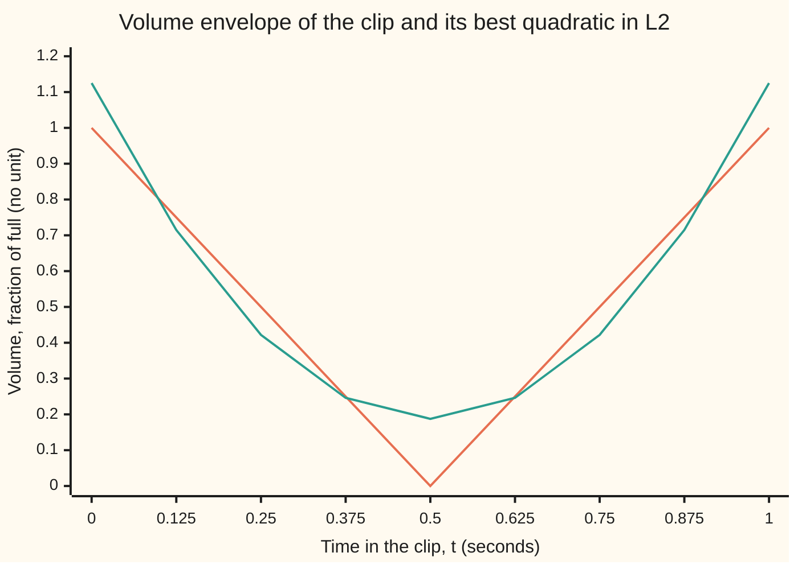
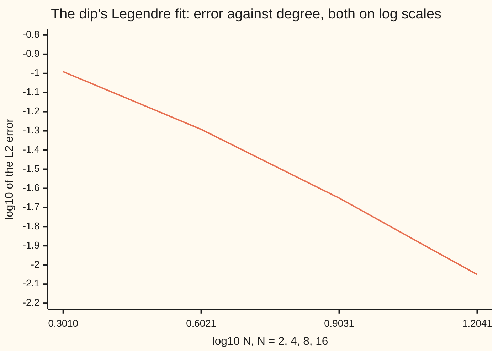

# Orthogonal polynomials: straightening the powers into a perpendicular family

[Syllabus](../../../SYLLABUS.md) → [Functional analysis](../README.md) → [Hilbert Spaces](../README.md#s02) → Orthogonal polynomials

---

## General Overview

A one-second audio clip has a dip to silence in the middle. The editor fades the volume in a straight line from full to nothing at 0.5 s, then straight back up to full at 1 s. This volume curve is the clip's **envelope**: the slow curve that scales its loudness, here as a fraction of full volume, so 1 means full and 0 means silent.

A synthesiser wants a smooth stand-in for the envelope, a curve with no corner at 0.5 s (an illustrative choice): a quadratic (a polynomial of degree 2, three coefficients). Which quadratic is closest over the whole second?

"Closest" here means the smallest energy of the miss: square the gap between the two curves at every instant and add it up over the second. That is the distance of the space L2 (functions whose square has a finite integral). The best quadratic is then a **projection**: the nearest point in the set of all quadratics.

Measure time on a stretched clock x that runs from −1 at the start to 1 at the end, so the dip sits at x = 0. The obvious building blocks are then 1, x and x². They are not perpendicular in L2. The constant 1 and the curve x² overlap, so changing one coefficient changes what the other should be. Gram-Schmidt, the recipe that straightens a skewed set of arrows, straightens these three functions too. Out come 1, x and x² − 1/3. Scaled to equal 1 at the right-hand end, they are the Legendre polynomials 1, x and (3x² − 1)/2.

With a perpendicular family, each coefficient of the fit is one division, found alone. The best quadratic for the dip is 3/16 + 15/16 x². Its L2 error, the square root of the miss's energy on −1 to 1, is 0.102. Spread over the one second, that is a root-mean-square miss of 0.072 of full volume. Keep straightening x³, x⁴ and so on, and the family stays perpendicular while the L2 error keeps falling: 0.102 at degree 2, 0.0089 at degree 16.

**Gram-Schmidt run on the powers 1, x, x², … with the L2 inner product on −1 to 1 produces the Legendre polynomials, a perpendicular family in which every least-squares fit is a sum of separate projections, one division per coefficient.**

**What kind of fact this is:** a method and two theorems, proved on this card in Why it works: the leftovers are perpendicular and equal Legendre's polynomials, and the family is complete in L2, using Weierstrass's theorem from a linked card.

### The picture: the dip to silence and its best quadratic



Orange: the editor's dip, a V with its point at 0.5 s. Teal: the best quadratic, 3/16 + 15/16 x² with x = 2t − 1. It misses most at the corner (0.1875 against 0) and at the two ends (1.125 against 1), and it is closer on average than any other quadratic. Degree N = 2.

---

## The formula

First, put the clip on the standard interval. Write $`x = 2t - 1`$, where $`t`$ is time in seconds. As $`t`$ runs from 0 to 1, $`x`$ runs from −1 to 1. The dip is then $`f(x) = |x|`$.

The **inner product** of two real functions on −1 to 1 multiplies them and integrates ([Inner products](01-inner-products-and-hilbert-spaces.md)). The functions here are real, so the library's conjugate on the first slot changes nothing. Two functions are **orthogonal** (perpendicular) when it is 0:

```math
\langle f, g \rangle = \int_{-1}^{1} f(x)\, g(x)\, dx, \qquad \lVert f \rVert = \sqrt{\langle f, f \rangle}
```

Gram-Schmidt on the powers $`1, x, x^2, \ldots`$ subtracts from each power its shadow on every leftover already made. The shadow is the power's **projection** onto that leftover: the part of the power that points along it.

```math
p_0 = 1, \qquad p_n = x^n - \sum_{k=0}^{n-1} \frac{\langle x^n, p_k \rangle}{\langle p_k, p_k \rangle}\, p_k, \qquad P_n = \frac{p_n}{p_n(1)}
```

**Read it aloud:** each new polynomial is the next power minus the part of it that already points along the earlier ones; scale it to equal 1 at x = 1 and it is the Legendre polynomial of that degree.

The payoff is the fit. The best polynomial of degree at most $`N`$ for $`f`$, in the L2 distance, is

```math
f \approx \sum_{n=0}^{N} c_n P_n, \qquad c_n = \frac{\langle f, P_n \rangle}{\langle P_n, P_n \rangle}
```

**Read it aloud:** each coefficient is the overlap of the envelope with one Legendre polynomial, divided by that polynomial's own size squared.

| Symbol | Plain meaning | In our example | Push it up and the answer… |
| --- | --- | --- | --- |
| $`t`$, $`x`$ | time in the clip, in seconds; rescaled time, $`2t - 1`$ | t from 0 to 1; x from −1 to 1, 0 at the dip | — |
| $`f`$ | the envelope: volume as a fraction of full | $`f(x) = \lvert x \rvert`$ | — |
| $`\langle f, g \rangle`$ | the inner product: multiply, integrate from −1 to 1 | $`\langle 1, x^2 \rangle = 2/3`$ | more overlap between the two curves |
| $`\lVert f \rVert`$ | the L2 norm: the square root of the energy $`\langle f, f \rangle`$ | $`\lVert f \rVert^2 = 2/3`$ | a louder envelope |
| $`x^n`$ | the plain powers, the raw material | $`1, x, x^2`$ | higher powers lean ever closer to the lower ones |
| $`p_n`$ | the leftover of $`x^n`$: degree $`n`$, leading coefficient 1 | $`p_2 = x^2 - 1/3`$ | — |
| $`P_n`$ | the Legendre polynomial: $`p_n`$ scaled so $`P_n(1) = 1`$ | $`P_2 = (3x^2 - 1)/2`$ | more wiggles on −1 to 1 |
| $`G`$ | the Gram matrix: all inner products of the building blocks | rows `[2, 0, 2/3]`, `[0, 2/3, 0]`, `[2/3, 0, 2/5]` | — |
| $`a`$, $`b`$ | the fit's coefficients on the plain powers, and the overlaps $`\langle f, x^i \rangle`$; they solve $`G a = b`$ | $`a = (3/16, 0, 15/16)`$, $`b = (1, 0, 1/2)`$ | — |
| $`c_n`$ | the coefficient of $`P_n`$ in the fit | $`1/2, 0, 5/8`$ | that polynomial's share of the fit grows |
| $`N`$ | the highest degree kept | 2, then 4, 8 and 16 | the fit error falls |
| $`\varepsilon`$, $`L`$, $`D`$ | any tolerance, however small (Step 7); the two factors of $`G`$ in the fold, $`L`$ lower-triangular with 1s on its diagonal, $`D`$ diagonal | $`L`$ holds the 1/3 of $`x^2 = p_2 + \tfrac13 p_0`$; $`D`$ holds the leftover sizes 2, 2/3, 8/45 | — |

### When it holds

- **The inner product is positive for every nonzero polynomial.** Integrating over an interval guarantees it. Three samples at −1, 0 and 1 do not: $`x^3 - x`$ is zero at all three, so its "size" is 0 and Gram-Schmidt divides by zero.
- **One interval and one weight, fixed in advance.** The Legendre polynomials are perpendicular on −1 to 1 with weight 1. On 0 to 1, $`\langle P_0, P_1 \rangle = 1/2`$, not 0. Other weights give other families, named in Where you meet it.
- **The envelope has finite energy.** The fit needs $`\langle f, P_n \rangle`$ to exist; every function in L2 qualifies.
- **"Best" means best on average.** The fit makes the energy of the miss smallest. It does not make the worst miss smallest: the quadratic still misses the corner by 0.1875.

---

## Why it works

### Step 0: Gram-Schmidt only ever uses the inner product

[Gram-Schmidt](../../03-Algebra/06-Dot%20Products%20and%20Best%20Fits/03-gram-schmidt-and-orthonormal-bases.md) straightens arrows with dot products. Every step uses only three rules of the dot product: it is symmetric, it is linear in each slot, and a nonzero vector has positive size. The integral $`\langle f, g \rangle`$ obeys the same three rules on polynomials. So the recipe runs unchanged on functions, with the integral in place of the dot product.

### Step 1: the Gram matrix of the powers holds everything the recipe needs

The recipe never looks at a polynomial's graph. It only needs inner products of powers, and those are one integral each:

```math
\langle x^i, x^j \rangle = \int_{-1}^{1} x^{i+j}\, dx = \begin{cases} \dfrac{2}{i+j+1} & i + j \text{ even} \\[4pt] 0 & i + j \text{ odd} \end{cases}
```

The odd case is 0 because an odd function's area left of 0 cancels its area right of 0. For $`1, x, x^2`$ this gives the **Gram matrix** $`G`$, the table of all their inner products:

```math
G = \begin{pmatrix} 2 & 0 & 2/3 \\ 0 & 2/3 & 0 \\ 2/3 & 0 & 2/5 \end{pmatrix}
```

The two entries 2/3 off the diagonal are the problem. They say that 1 and $`x^2`$ overlap.

### Step 2: run it on 1, x, x²

- $`p_0 = 1`$, with size squared $`\langle 1, 1 \rangle = 2`$.
- $`x`$ has no shadow on 1, since $`\langle x, 1 \rangle = 0`$. So $`p_1 = x`$.
- $`x^2`$ has shadow $`(2/3)/2 = 1/3`$ on 1 and none on $`x`$. So $`p_2 = x^2 - 1/3`$.
- One more: $`x^3`$ has shadow $`(2/5)/(2/3) = 3/5`$ on $`x`$. So $`p_3 = x^3 - 3x/5`$.

Each leftover is perpendicular to every earlier one. Take $`p_j`$ with $`j < n`$. The earlier leftovers are already perpendicular to each other, so only one term of the sum survives the inner product with $`p_j`$:

```math
\langle p_n, p_j \rangle = \langle x^n, p_j \rangle - \frac{\langle x^n, p_j \rangle}{\langle p_j, p_j \rangle}\, \langle p_j, p_j \rangle = 0
```

Their sizes squared are 2, 2/3, 8/45 and 8/175.

### Step 3: the leftovers are Legendre's polynomials, and could be nothing else

Scale $`p_2`$ so that it equals 1 at $`x = 1`$: $`p_2(1) = 2/3`$, so $`P_2 = (3x^2 - 1)/2`$. Likewise $`P_3 = (5x^3 - 3x)/2`$. These are the polynomials that [Legendre's equation](../../08-Differential%20equations%20and%20dynamics/07-Series%20Solutions%20and%20Boundary%20Problems/04-legendre-polynomials.md) produces from a differential equation, with no inner product in sight.

Why the same family? Because a polynomial of degree $`n`$ with leading coefficient 1 that is perpendicular to every lower degree is unique. Suppose $`q`$ is another one. Then $`q - p_n`$ has degree below $`n`$, and it is perpendicular to every polynomial of degree below $`n`$, including itself. So $`\lVert q - p_n \rVert^2 = 0`$, and $`q = p_n`$. The Legendre card proves its polynomials are perpendicular, so they must be these. The code also checks it a second way, up to degree 16, against Bonnet's recurrence $`(n+1)P_{n+1} = (2n+1)\,x P_n - n P_{n-1}`$, which uses no integrals at all.

### Step 4: in the new family the Gram matrix is diagonal

The Gram matrix of $`P_0, P_1, P_2, P_3`$ has 0 everywhere off the diagonal, and $`2, 2/3, 2/5, 2/7`$ on it, which is $`2/(2n+1)`$. The code confirms both facts up to degree 16. A diagonal Gram matrix is the whole point: a system of equations with a diagonal matrix splits into separate one-line equations.

<details>
<summary>Gram-Schmidt is a factoring of the Gram matrix</summary>

Write each power in terms of the leftovers: $`1 = p_0`$, $`x = p_1`$, $`x^2 = p_2 + \tfrac13 p_0`$. Put these coefficients in a lower-triangular matrix $`L`$ with 1s on the diagonal, and the leftover sizes in a diagonal matrix $`D`$. Then

$`\displaystyle G = L\,D\,L^{\mathsf T}, \qquad L = \begin{pmatrix} 1 & 0 & 0 \\ 0 & 1 & 0 \\ 1/3 & 0 & 1 \end{pmatrix}, \qquad D = \begin{pmatrix} 2 & 0 & 0 \\ 0 & 2/3 & 0 \\ 0 & 0 & 8/45 \end{pmatrix}.`$

Check one entry: the bottom-right is $`(1/3)^2 \times 2 + 8/45 = 10/45 + 8/45 = 2/5`$. So running Gram-Schmidt on functions is the same as factoring their Gram matrix. In matrix language this is the Cholesky factoring, with the square roots left out.

</details>

### Step 5: the fit is a projection, and Pythagoras gives its error

The best quadratic is the point of the space of quadratics nearest to $`f`$ ([Projection](02-projection-theorem-and-orthogonal-complements.md)). Its miss $`f - \text{fit}`$ must be perpendicular to every quadratic. In a perpendicular family that condition splits into one equation per polynomial, $`\langle f - \text{fit}, P_n \rangle = 0`$, which gives $`c_n = \langle f, P_n \rangle / \langle P_n, P_n \rangle`$ directly.

With the plain powers, the same condition is the 3-by-3 system $`G a = b`$, where $`a`$ lists the coefficients of $`1, x, x^2`$ and $`b`$ lists $`\langle f, x^i \rangle`$. For the dip, $`b = (1, 0, 1/2)`$, and solving gives the same quadratic, 3/16 + 15/16 x². Same answer, but every coefficient depends on every other.

Pythagoras finishes the job. The fit and the miss are perpendicular, so their energies add up to the envelope's energy:

```math
\lVert f - \text{fit} \rVert^2 = \lVert f \rVert^2 - \sum_{n=0}^{N} c_n^2 \lVert P_n \rVert^2
```

This is [Orthonormal bases](03-orthonormal-bases-and-parseval.md)'s Parseval identity, cut off at $`N`$ terms. [Fitting instead of passing through](../../16-Numerical%20analysis/04-Interpolation%20and%20Approximation/07-least-squares-and-orthogonal-polynomials.md) does the same fit on a list of data points rather than a whole interval.

### Step 6: integrate with the zeros

The zeros of $`P_2`$ are $`\pm 1/\sqrt3 = \pm 0.577350`$. Sampling at just these two points and adding integrates every cubic on −1 to 1 exactly; [Gaussian quadrature](../../16-Numerical%20analysis/05-Quadrature/03-gaussian-quadrature.md) proves it and extends it to $`n`$ points. On the fit it gives 1, the exact area. On the dip itself it gives 1.154701 against the true 1, because $`\lvert x \rvert`$ has a corner and is no polynomial.

### Step 7: what changes as N grows without limit

Three things change when the list of powers never ends.

**The powers lean together.** The leftover $`p_n`$ is the part of $`x^n`$ that is new. As a share of $`x^n`$'s size it shrinks fast:

```
share of x^n that is new, |p_n| / |x^n|
x^1    ##############################  1.000000
x^2    ####################            0.666667
x^4    #######                         0.228571
x^8    #                               0.019891
x^16                                   0.000109
```

Only 0.000109 of the size of $`x^{16}`$ points in a new direction. The Gram matrix of the plain powers becomes nearly singular (it almost has no inverse), and solving $`G a = b`$ in floating point loses digits; the fitting card measures how many. The Legendre family has no such problem: its Gram matrix stays diagonal at every $`N`$.

**The family is complete.** Every L2 function is the limit, in the L2 norm, of its Legendre fits. Proof in three lines. Continuous functions come as close as you like to any L2 function, in the L2 norm ([Riesz-Fischer](../../10-Measure%20and%20integration/07-Sizes%20of%20Functions/05-completeness-of-lp.md) proves this density). By [Weierstrass and the minimax fit](../../16-Numerical%20analysis/04-Interpolation%20and%20Approximation/08-weierstrass-and-best-approximation.md), a polynomial comes within any $`\varepsilon`$ of a continuous function at every point, so within $`\sqrt{2}\,\varepsilon`$ in the L2 norm. And the degree-$`N`$ Legendre fit is at least as close as that polynomial, because it is the best of its degree. [Completeness of sines and cosines](04-completeness-of-the-trigonometric-system.md) proves the same for the clip's Fourier family; here the polynomials do the job instead.

**The error falls, and the code can only show a few steps.** For the dip:

| Degree kept, N | L2 error of the best fit |
| --- | --- |
| 2 | 0.102062 |
| 4 | 0.051031 |
| 8 | 0.022326 |
| 16 | 0.008908 |



The line is the L2 error of the best degree-N fit to the dip, at N = 2, 4, 8 and 16. Between 8 and 16 the error falls like $`N^{-1.3256}`$: slowly, because of the corner at 0.5 s. What the truncation hides: the code stops at degree 16, so it shows a falling trend, not a limit. That the error reaches 0 is the completeness proof above, and it is a statement about the L2 norm only.

---

## Worked numbers, by hand

The dip $`f(x) = \lvert x \rvert`$ on −1 to 1, fitted with a quadratic. Integrals of $`\lvert x \rvert x^k`$ are $`2/(k+2)`$ for even $`k`$ and 0 for odd $`k`$.

| Step | Arithmetic | Value |
| --- | --- | --- |
| Size of 1 | $`\int_{-1}^{1} 1\, dx`$ | 2 |
| Shadow of $`x`$ on 1 | $`\langle x, 1 \rangle / 2 = 0/2`$ | 0, so $`p_1 = x`$ |
| Shadow of $`x^2`$ on 1 | $`\langle x^2, 1 \rangle / 2 = (2/3)/2`$ | 1/3, so $`p_2 = x^2 - 1/3`$ |
| Scale to 1 at $`x = 1`$ | $`p_2(1) = 2/3`$, so $`P_2 = \tfrac32 p_2`$ | $`(3x^2 - 1)/2`$ |
| Overlap with $`P_0`$ | $`\langle \lvert x \rvert, 1 \rangle`$ | 1 |
| Overlap with $`P_2`$ | $`\tfrac32 \cdot \tfrac12 - \tfrac12 \cdot 1`$ | 1/4 |
| $`c_0`$ | $`1 / 2`$ | 1/2 |
| $`c_2`$ | $`(1/4) / (2/5)`$ | 5/8 |
| The fit | $`\tfrac12 + \tfrac58 \cdot \tfrac{3x^2 - 1}{2}`$ | $`3/16 + 15/16\, x^2`$ |
| Energy captured | $`(1/2)^2 \cdot 2 + (5/8)^2 \cdot 2/5 = 1/2 + 5/32`$ | 21/32 |
| Energy missed | $`2/3 - 21/32`$ | 1/96 |
| L2 error | $`\sqrt{1/96}`$ | **0.102062** |

The miss has energy 1/96 on −1 to 1. Over the clip's one second that is half as much, 1/192, so the root-mean-square miss is $`\sqrt{1/192} = 0.072169`$: the quadratic is off by about 7% of full volume, on average. Its average loudness, $`c_0 = 1/2`$, is exactly the dip's, because $`c_0`$ is always the mean.

### What breaks if you drop a piece

| Mistake | Comes out at | What went wrong |
| --- | --- | --- |
| Skip the shadow on 1: fit with 1 and raw $`x^2`$, one division each | $`1/2 + 5/4\, x^2`$, error 0.612372 | $`\langle 1, x^2 \rangle = 2/3`$, not 0, so the two coefficients are not independent |
| Forget to divide by $`\langle P_n, P_n \rangle`$ | $`7/8 + 3/8\, x^2`$, error 0.752773 | The overlap counts the polynomial's own size too |
| Check perpendicularity on 0 to 1 instead | $`\langle P_0, P_1 \rangle = 1/2`$, $`\langle P_1, P_2 \rangle = 1/8`$ | Legendre is tied to −1 to 1; on 0 to 1 the leftovers are $`x - 1/2`$ and $`x^2 - x + 1/6`$ |
| Use three samples as the inner product | leftover of $`x^3`$ is $`x^3 - x`$, size squared 0 (true: 8/175) | Not positive: a nonzero cubic vanishes at −1, 0 and 1, and Gram-Schmidt divides by 0 |

The last row is the hypothesis failing: three samples are an inner product on quadratics, but not on cubics.

---

## Code, from first principles, and it actually runs

The code works in exact fractions, so every integral is exact. It runs Gram-Schmidt on $`1, x, \ldots, x^{16}`$ and reaches the card's claims by four independent roads:

1. The leftovers match Bonnet's recurrence, which uses no integrals.
2. The Legendre Gram matrix is diagonal, with $`2/(2n+1)`$ on the diagonal.
3. The fit by one division per coefficient matches an elimination solve of $`G a = b`$ on the plain powers.
4. The error computed directly matches the error from Pythagoras.

It also prints the truncation at N = 2, 4, 8 and 16 and every "what breaks" number.

### Python

```python
# Orthogonal polynomials from Gram-Schmidt -- the check behind the card.  Standard library only.
# A polynomial is a list of exact fractions, lowest power first.  Every integral is exact:
# over [-1, 1], x^k integrates to 2/(k+1) for even k and to 0 for odd k.
from fractions import Fraction as F
from math import sqrt, log10

def mom(k, lo):                        # integral of x^k from lo (-1 or 0) to 1
    if lo == 0: return F(1, k + 1)
    return F(2, k + 1) if k % 2 == 0 else F(0)
def mul(p, q):
    r = [F(0)] * (len(p) + len(q) - 1)
    for i, a in enumerate(p):
        for j, b in enumerate(q): r[i + j] += a * b
    return r
def add(p, q, s):                      # p + s q
    n = max(len(p), len(q))
    p, q = p + [F(0)] * (n - len(p)), q + [F(0)] * (n - len(q))
    return [a + s * b for a, b in zip(p, q)]
def ev(p, x): return sum(c * x ** k for k, c in enumerate(p))
def ip(p, q, lo=-1): return sum(c * mom(k, lo) for k, c in enumerate(mul(p, q)))
def ip3(p, q): return sum(ev(p, x) * ev(q, x) for x in (-1, 0, 1))   # three samples only
def ip_abs(p): return sum(c * F(2, k + 2) for k, c in enumerate(p) if k % 2 == 0)  # <|x|, p>
def power(m): return [F(0)] * m + [F(1)]
def gram_schmidt(n, inner):            # leftovers p_0..p_n of 1, x, ..., x^n
    ps = []
    for m in range(n + 1):
        v = power(m)
        for p in ps: v = add(v, p, -inner(power(m), p) / inner(p, p))
        ps.append(v)
    return ps
def show(p): return "[" + ", ".join(str(c) for c in p) + "]"
def err2(g): return F(2, 3) - 2 * ip_abs(g) + ip(g, g)        # ||f - g||^2, f = |x|

NMAX = 16
ps = gram_schmidt(NMAX, ip)
P = [[c / ev(p, 1) for c in p] for p in ps]                   # scaled so P_n(1) = 1
for n in range(4): print(f"p{n} leftover", show(ps[n]))
print("P2, P3 scaled to 1 at x = 1", show(P[2]), show(P[3]), " leftover sizes^2", show([ip(p, p) for p in ps[:4]]))
# Road 2: Bonnet's recurrence (n+1) P_{n+1} = (2n+1) x P_n - n P_{n-1}, no inner products
B = [power(0), power(1)]
for n in range(1, NMAX): B.append([k / (n + 1) for k in add([(2 * n + 1) * k for k in mul(power(1), B[n])], B[n - 1], -n)])
assert all(P[n] == B[n] for n in range(NMAX + 1)), "Gram-Schmidt must give Legendre"
G = [[ip(power(i), power(j)) for j in range(3)] for i in range(3)]
for i in range(3): print(f"Gram row {i} of 1, x, x^2", show(G[i]))
offdiag = max(abs(ip(P[i], P[j])) for i in range(NMAX + 1) for j in range(i))
assert offdiag == 0, "Legendre Gram matrix must be diagonal"
assert all(ip(P[n], P[n]) == F(2, 2 * n + 1) for n in range(NMAX + 1)), "norm 2/(2n+1)"
print("Legendre Gram diagonal", show([ip(P[n], P[n]) for n in range(4)]), "off-diagonal max", offdiag)
for n in (1, 2, 4, 8, 16):
    print(f"new part of x^{n}: |p_n|/|x^n|", f"{sqrt(ip(ps[n], ps[n]) / ip(power(n), power(n))):.6f}")

# The fit: the fade |x| projected onto 1, x, x^2.  Road 1: one ratio per coefficient.
c = [ip_abs(P[n]) / ip(P[n], P[n]) for n in range(3)]
print("<|x|, P_n>", show([ip_abs(P[n]) for n in range(3)]), " energy per piece", show([c[n] ** 2 * ip(P[n], P[n]) for n in range(3)]))
fit = add(add([c[0]], P[1], c[1]), P[2], c[2])
print("coefficients c0 c1 c2", show(c), " fit", show(fit))
# Road 2: the normal equations G a = b with the plain powers, solved by elimination.
A = [G[i][:] + [ip_abs(power(i))] for i in range(3)]
print("right side b = <|x|, x^i>", show([row[3] for row in A]))
for k in range(3):
    for i in range(k + 1, 3):
        m = A[i][k] / A[k][k]; A[i] = [a - m * b for a, b in zip(A[i], A[k])]
a = [F(0)] * 3
for i in (2, 1, 0): a[i] = (A[i][3] - sum(A[i][j] * a[j] for j in range(i + 1, 3))) / A[i][i]
assert a == fit, "projection by ratios must equal the normal-equations solve"
e_direct = err2(fit)
e_pyth = F(2, 3) - sum(c[n] ** 2 * ip(P[n], P[n]) for n in range(3))
assert e_direct == e_pyth == F(1, 96), "Pythagoras: leftover energy"
print("error^2 direct", e_direct, " by Pythagoras", e_pyth, " error", f"{sqrt(e_direct):.6f}")
print("per second", e_direct / 2, " rms error", f"{sqrt(e_direct / 2):.6f}", " energy of fade", F(2, 3))
print("mean loudness: fit integral / 2", ip(fit, power(0)) / 2, " c0", c[0])
r = 1 / sqrt(3)                                               # zeros of P2
print("zeros of P2", f"{-r:.6f} {r:.6f}")
print("2-point rule on fit", f"{float(ev(fit, -r) + ev(fit, r)):.6f}", " exact", ip(fit, power(0)))
print("2-point rule on |x|", f"{2 * r:.6f}", " exact", ip_abs(power(0)))
print("chart t, x, fade, fit")
for i in range(9):
    x = F(i - 4, 4)
    print(f"chart {float((x + 1) / 2):.3f} {float(x):6.2f} {float(abs(x)):.4f} {float(ev(fit, x)):.4f}")
errs = {}
for N in (2, 4, 8, 16):
    e2 = F(2, 3) - sum(ip_abs(P[n]) ** 2 / ip(P[n], P[n]) for n in range(N + 1))
    errs[N] = sqrt(e2)
    print(f"truncation N = {N:2d}  error {errs[N]:.6f}  log10 N {log10(N):.4f}  log10 error {log10(errs[N]):.4f}")
slope = log10(errs[8] / errs[16]) / log10(2)
print("error falls like N to the power", f"-{slope:.4f}")
assert 1.2 < slope < 1.5 and errs[16] < errs[8] < errs[4], "error must keep falling, slowly"

# What breaks.
bad1 = [F(1, 2), F(0), ip_abs(power(2)) / ip(power(2), power(2))]   # x^2 never straightened
bad2 = add([ip_abs(P[0])], P[2], ip_abs(P[2]))                       # no division by |P_n|^2
print("wrong: skip shadow on 1", show(bad1), f"error {sqrt(err2(bad1)):.6f}", " <1, x^2>", ip(power(0), power(2)))
print("wrong: no divide by |P_n|^2", show(bad2), f"error {sqrt(err2(bad2)):.6f}")
print("wrong: interval [0, 1]  <P0, P1>", ip(P[0], P[1], 0), " <P1, P2>", ip(P[1], P[2], 0))
print("on [0, 1] the leftovers are", " ".join(show(p) for p in gram_schmidt(2, lambda u, v: ip(u, v, 0))))
q = gram_schmidt(3, ip3)
print("wrong: three samples  x^3 leftover", show(q[3]), " size^2", ip3(q[3], q[3]), " true size^2", ip(ps[3], ps[3]))
assert ip3(q[3], q[3]) == 0 and ip(q[3], q[3]) > 0, "three samples miss x^3 - x"
assert err2(bad1) > err2(fit) and err2(bad2) > err2(fit), "the projection is the closest"
print("ALL CHECKS PASS")
```

**Ran 2026-11-15 on macOS, Python 3.14.10, standard library only. All checks passed. Output, pasted from the run:**

```
p0 leftover [1]
p1 leftover [0, 1]
p2 leftover [-1/3, 0, 1]
p3 leftover [0, -3/5, 0, 1]
P2, P3 scaled to 1 at x = 1 [-1/2, 0, 3/2] [0, -3/2, 0, 5/2]  leftover sizes^2 [2, 2/3, 8/45, 8/175]
Gram row 0 of 1, x, x^2 [2, 0, 2/3]
Gram row 1 of 1, x, x^2 [0, 2/3, 0]
Gram row 2 of 1, x, x^2 [2/3, 0, 2/5]
Legendre Gram diagonal [2, 2/3, 2/5, 2/7] off-diagonal max 0
new part of x^1: |p_n|/|x^n| 1.000000
new part of x^2: |p_n|/|x^n| 0.666667
new part of x^4: |p_n|/|x^n| 0.228571
new part of x^8: |p_n|/|x^n| 0.019891
new part of x^16: |p_n|/|x^n| 0.000109
<|x|, P_n> [1, 0, 1/4]  energy per piece [1/2, 0, 5/32]
coefficients c0 c1 c2 [1/2, 0, 5/8]  fit [3/16, 0, 15/16]
right side b = <|x|, x^i> [1, 0, 1/2]
error^2 direct 1/96  by Pythagoras 1/96  error 0.102062
per second 1/192  rms error 0.072169  energy of fade 2/3
mean loudness: fit integral / 2 1/2  c0 1/2
zeros of P2 -0.577350 0.577350
2-point rule on fit 1.000000  exact 1
2-point rule on |x| 1.154701  exact 1
chart t, x, fade, fit
chart 0.000  -1.00 1.0000 1.1250
chart 0.125  -0.75 0.7500 0.7148
chart 0.250  -0.50 0.5000 0.4219
chart 0.375  -0.25 0.2500 0.2461
chart 0.500   0.00 0.0000 0.1875
chart 0.625   0.25 0.2500 0.2461
chart 0.750   0.50 0.5000 0.4219
chart 0.875   0.75 0.7500 0.7148
chart 1.000   1.00 1.0000 1.1250
truncation N =  2  error 0.102062  log10 N 0.3010  log10 error -0.9911
truncation N =  4  error 0.051031  log10 N 0.6021  log10 error -1.2922
truncation N =  8  error 0.022326  log10 N 0.9031  log10 error -1.6512
truncation N = 16  error 0.008908  log10 N 1.2041  log10 error -2.0502
error falls like N to the power -1.3256
wrong: skip shadow on 1 [1/2, 0, 5/4] error 0.612372  <1, x^2> 2/3
wrong: no divide by |P_n|^2 [7/8, 0, 3/8] error 0.752773
wrong: interval [0, 1]  <P0, P1> 1/2  <P1, P2> 1/8
on [0, 1] the leftovers are [1] [-1/2, 1] [1/6, -1, 1]
wrong: three samples  x^3 leftover [0, -1, 0, 1]  size^2 0  true size^2 8/175
ALL CHECKS PASS
```

### Rust

The same check, with exact fractions as a small struct on 128-bit integers. Any overflow stops the program rather than giving a wrong digit.

```rust
// Orthogonal polynomials from Gram-Schmidt -- the same check as the Python, in Rust.
// Standard library only, no crates.  Exact fractions are a small struct on i128 whose
// arithmetic panics on overflow.  A polynomial is a Vec of fractions, lowest power first.
use std::fmt;
use std::ops::{Add, Div, Mul, Neg, Sub};

#[derive(Clone, Copy, PartialEq, Debug)]
struct Q { n: i128, d: i128 }
fn gcd(a: i128, b: i128) -> i128 { if b == 0 { a.abs() } else { gcd(b, a % b) } }
fn q(n: i128, d: i128) -> Q {
    let g = gcd(n, d).max(1);
    let s = if d < 0 { -1 } else { 1 };
    Q { n: s * n / g, d: s * d / g }
}
impl Add for Q { type Output = Q; fn add(self, o: Q) -> Q {
    q(self.n.checked_mul(o.d).unwrap().checked_add(o.n.checked_mul(self.d).unwrap()).unwrap(), self.d.checked_mul(o.d).unwrap()) } }
impl Neg for Q { type Output = Q; fn neg(self) -> Q { Q { n: -self.n, d: self.d } } }
impl Sub for Q { type Output = Q; fn sub(self, o: Q) -> Q { self + (-o) } }
impl Mul for Q { type Output = Q; fn mul(self, o: Q) -> Q {
    q(self.n.checked_mul(o.n).unwrap(), self.d.checked_mul(o.d).unwrap()) } }
impl Div for Q { type Output = Q; fn div(self, o: Q) -> Q { self * Q { n: o.d, d: o.n } * q(1, 1) } }
impl fmt::Display for Q { fn fmt(&self, f: &mut fmt::Formatter) -> fmt::Result {
    if self.d == 1 { write!(f, "{}", self.n) } else { write!(f, "{}/{}", self.n, self.d) } } }
impl Q { fn f(&self) -> f64 { self.n as f64 / self.d as f64 } }
fn z() -> Q { q(0, 1) }
type P = Vec<Q>;

fn mom(k: usize, lo: i32) -> Q {            // integral of x^k from lo (-1 or 0) to 1
    if lo == 0 { return q(1, k as i128 + 1); }
    if k % 2 == 0 { q(2, k as i128 + 1) } else { z() }
}
fn mul(p: &P, r: &P) -> P {
    let mut o = vec![z(); p.len() + r.len() - 1];
    for (i, a) in p.iter().enumerate() { for (j, b) in r.iter().enumerate() { o[i + j] = o[i + j] + *a * *b; } }
    o
}
fn add(p: &P, r: &P, s: Q) -> P {           // p + s r
    let n = p.len().max(r.len());
    (0..n).map(|i| *p.get(i).unwrap_or(&z()) + s * *r.get(i).unwrap_or(&z())).collect()
}
fn ev(p: &P, x: Q) -> Q { let mut s = z(); let mut xk = q(1, 1); for c in p { s = s + *c * xk; xk = xk * x; } s }
fn ip_lo(p: &P, r: &P, lo: i32) -> Q { mul(p, r).iter().enumerate().fold(z(), |s, (k, c)| s + *c * mom(k, lo)) }
fn ip(p: &P, r: &P) -> Q { ip_lo(p, r, -1) }
fn ip3(p: &P, r: &P) -> Q { [-1, 0, 1].iter().fold(z(), |s, x| s + ev(p, q(*x, 1)) * ev(r, q(*x, 1))) }
fn ip_abs(p: &P) -> Q {                     // <|x|, p>
    p.iter().enumerate().filter(|(k, _)| k % 2 == 0).fold(z(), |s, (k, c)| s + *c * q(2, k as i128 + 2))
}
fn power(m: usize) -> P { let mut v = vec![z(); m + 1]; v[m] = q(1, 1); v }
fn gram_schmidt(n: usize, inner: fn(&P, &P) -> Q) -> Vec<P> {
    let mut ps: Vec<P> = Vec::new();
    for m in 0..=n {
        let mut v = power(m);
        for p in &ps { v = add(&v, p, -(inner(&power(m), p) / inner(p, p))); }
        ps.push(v);
    }
    ps
}
fn show(p: &[Q]) -> String { format!("[{}]", p.iter().map(|c| c.to_string()).collect::<Vec<_>>().join(", ")) }
fn err2(g: &P) -> Q { q(2, 3) - q(2, 1) * ip_abs(g) + ip(g, g) }   // ||f - g||^2, f = |x|

fn main() {
    let nmax = 16;
    let ps = gram_schmidt(nmax, ip);
    let pl: Vec<P> = ps.iter().map(|p| { let s = ev(p, q(1, 1)); p.iter().map(|c| *c / s).collect() }).collect();
    for n in 0..4 { println!("p{} leftover {}", n, show(&ps[n])); }
    let sizes: Vec<Q> = ps[..4].iter().map(|p| ip(p, p)).collect();
    println!("P2, P3 scaled to 1 at x = 1 {} {}  leftover sizes^2 {}", show(&pl[2]), show(&pl[3]), show(&sizes));
    // Road 2: Bonnet's recurrence (n+1) P_{n+1} = (2n+1) x P_n - n P_{n-1}, no inner products
    let mut b: Vec<P> = vec![power(0), power(1)];
    for n in 1..nmax {
        let t: P = mul(&power(1), &b[n]).iter().map(|c| q(2 * n as i128 + 1, 1) * *c).collect();
        let next: P = add(&t, &b[n - 1], q(-(n as i128), 1)).iter().map(|c| *c / q(n as i128 + 1, 1)).collect();
        b.push(next);
    }
    assert!((0..=nmax).all(|n| pl[n] == b[n]), "Gram-Schmidt must give Legendre");
    let g: Vec<Vec<Q>> = (0..3).map(|i| (0..3).map(|j| ip(&power(i), &power(j))).collect()).collect();
    for i in 0..3 { println!("Gram row {} of 1, x, x^2 {}", i, show(&g[i])); }
    let mut offdiag = z();
    for i in 0..=nmax { for j in 0..i { let v = ip(&pl[i], &pl[j]); if v.n.abs() * offdiag.d > offdiag.n.abs() * v.d { offdiag = q(v.n.abs(), v.d); } } }
    assert!(offdiag == z(), "Legendre Gram matrix must be diagonal");
    assert!((0..=nmax).all(|n| ip(&pl[n], &pl[n]) == q(2, 2 * n as i128 + 1)), "norm 2/(2n+1)");
    let diag: Vec<Q> = (0..4).map(|n| ip(&pl[n], &pl[n])).collect();
    println!("Legendre Gram diagonal {} off-diagonal max {}", show(&diag), offdiag);
    for n in [1usize, 2, 4, 8, 16] {
        println!("new part of x^{}: |p_n|/|x^n| {:.6}", n, (ip(&ps[n], &ps[n]) / ip(&power(n), &power(n))).f().sqrt());
    }

    // The fit: the fade |x| projected onto 1, x, x^2.  Road 1: one ratio per coefficient.
    let c: Vec<Q> = (0..3).map(|n| ip_abs(&pl[n]) / ip(&pl[n], &pl[n])).collect();
    let fp: Vec<Q> = (0..3).map(|n| ip_abs(&pl[n])).collect();
    let en: Vec<Q> = (0..3).map(|n| c[n] * c[n] * ip(&pl[n], &pl[n])).collect();
    println!("<|x|, P_n> {}  energy per piece {}", show(&fp), show(&en));
    let fit = add(&add(&vec![c[0]], &pl[1], c[1]), &pl[2], c[2]);
    println!("coefficients c0 c1 c2 {}  fit {}", show(&c), show(&fit));
    // Road 2: the normal equations G a = b with the plain powers, solved by elimination.
    let mut a: Vec<Vec<Q>> = (0..3).map(|i| { let mut r = g[i].clone(); r.push(ip_abs(&power(i))); r }).collect();
    let rhs: Vec<Q> = a.iter().map(|r| r[3]).collect();
    println!("right side b = <|x|, x^i> {}", show(&rhs));
    for k in 0..3 { for i in k + 1..3 {
        let m = a[i][k] / a[k][k];
        let rk = a[k].clone();
        for j in 0..4 { a[i][j] = a[i][j] - m * rk[j]; }
    } }
    let mut sol = vec![z(); 3];
    for i in (0..3).rev() {
        let mut s = a[i][3];
        for j in i + 1..3 { s = s - a[i][j] * sol[j]; }
        sol[i] = s / a[i][i];
    }
    assert!(sol == fit, "projection by ratios must equal the normal-equations solve");
    let e_direct = err2(&fit);
    let e_pyth = (0..3).fold(q(2, 3), |s, n| s - c[n] * c[n] * ip(&pl[n], &pl[n]));
    assert!(e_direct == e_pyth && e_pyth == q(1, 96), "Pythagoras: leftover energy");
    println!("error^2 direct {}  by Pythagoras {}  error {:.6}", e_direct, e_pyth, e_direct.f().sqrt());
    println!("per second {}  rms error {:.6}  energy of fade {}", e_direct / q(2, 1), (e_direct / q(2, 1)).f().sqrt(), q(2, 3));
    println!("mean loudness: fit integral / 2 {}  c0 {}", ip(&fit, &power(0)) / q(2, 1), c[0]);
    let r = 1.0 / 3f64.sqrt();                                   // zeros of P2
    let evf = |p: &P, x: f64| p.iter().enumerate().fold(0.0, |s, (k, c)| s + c.f() * x.powi(k as i32));
    println!("zeros of P2 {:.6} {:.6}", -r, r);
    println!("2-point rule on fit {:.6}  exact {}", evf(&fit, -r) + evf(&fit, r), ip(&fit, &power(0)));
    println!("2-point rule on |x| {:.6}  exact {}", 2.0 * r, ip_abs(&power(0)));
    println!("chart t, x, fade, fit");
    for i in 0..9i128 {
        let x = q(i - 4, 4);
        println!("chart {:.3} {:6.2} {:.4} {:.4}", ((x + q(1, 1)) / q(2, 1)).f(), x.f(), x.f().abs(), ev(&fit, x).f());
    }
    let mut errs = [0.0f64; 17];
    for nn in [2usize, 4, 8, 16] {
        let e2 = (0..=nn).fold(q(2, 3), |s, n| { let t = ip_abs(&pl[n]); s - t * t / ip(&pl[n], &pl[n]) });
        errs[nn] = e2.f().sqrt();
        println!("truncation N = {:2}  error {:.6}  log10 N {:.4}  log10 error {:.4}", nn, errs[nn], (nn as f64).log10(), errs[nn].log10());
    }
    let slope = (errs[8] / errs[16]).log10() / 2f64.log10();
    println!("error falls like N to the power -{:.4}", slope);
    assert!(1.2 < slope && slope < 1.5 && errs[16] < errs[8] && errs[8] < errs[4], "error must keep falling, slowly");

    // What breaks.
    let bad1: P = vec![q(1, 2), z(), ip_abs(&power(2)) / ip(&power(2), &power(2))];   // x^2 never straightened
    let bad2 = add(&vec![ip_abs(&pl[0])], &pl[2], ip_abs(&pl[2]));                      // no division by |P_n|^2
    println!("wrong: skip shadow on 1 {} error {:.6}  <1, x^2> {}", show(&bad1), err2(&bad1).f().sqrt(), ip(&power(0), &power(2)));
    println!("wrong: no divide by |P_n|^2 {} error {:.6}", show(&bad2), err2(&bad2).f().sqrt());
    println!("wrong: interval [0, 1]  <P0, P1> {}  <P1, P2> {}", ip_lo(&pl[0], &pl[1], 0), ip_lo(&pl[1], &pl[2], 0));
    let on01: Vec<String> = gram_schmidt(2, |u, v| ip_lo(u, v, 0)).iter().map(|p| show(p)).collect();
    println!("on [0, 1] the leftovers are {}", on01.join(" "));
    let t3 = gram_schmidt(3, ip3);
    println!("wrong: three samples  x^3 leftover {}  size^2 {}  true size^2 {}", show(&t3[3]), ip3(&t3[3], &t3[3]), ip(&ps[3], &ps[3]));
    assert!(ip3(&t3[3], &t3[3]) == z() && ip(&t3[3], &t3[3]).n > 0, "three samples miss x^3 - x");
    let lt = |u: Q, v: Q| u.n * v.d < v.n * u.d;
    assert!(lt(err2(&fit), err2(&bad1)) && lt(err2(&fit), err2(&bad2)), "the projection is the closest");
    println!("ALL CHECKS PASS");
}
```

**Ran 2026-11-15 on macOS, rustc 1.98.1, no crates. All checks passed. Output, pasted from the run:**

```
p0 leftover [1]
p1 leftover [0, 1]
p2 leftover [-1/3, 0, 1]
p3 leftover [0, -3/5, 0, 1]
P2, P3 scaled to 1 at x = 1 [-1/2, 0, 3/2] [0, -3/2, 0, 5/2]  leftover sizes^2 [2, 2/3, 8/45, 8/175]
Gram row 0 of 1, x, x^2 [2, 0, 2/3]
Gram row 1 of 1, x, x^2 [0, 2/3, 0]
Gram row 2 of 1, x, x^2 [2/3, 0, 2/5]
Legendre Gram diagonal [2, 2/3, 2/5, 2/7] off-diagonal max 0
new part of x^1: |p_n|/|x^n| 1.000000
new part of x^2: |p_n|/|x^n| 0.666667
new part of x^4: |p_n|/|x^n| 0.228571
new part of x^8: |p_n|/|x^n| 0.019891
new part of x^16: |p_n|/|x^n| 0.000109
<|x|, P_n> [1, 0, 1/4]  energy per piece [1/2, 0, 5/32]
coefficients c0 c1 c2 [1/2, 0, 5/8]  fit [3/16, 0, 15/16]
right side b = <|x|, x^i> [1, 0, 1/2]
error^2 direct 1/96  by Pythagoras 1/96  error 0.102062
per second 1/192  rms error 0.072169  energy of fade 2/3
mean loudness: fit integral / 2 1/2  c0 1/2
zeros of P2 -0.577350 0.577350
2-point rule on fit 1.000000  exact 1
2-point rule on |x| 1.154701  exact 1
chart t, x, fade, fit
chart 0.000  -1.00 1.0000 1.1250
chart 0.125  -0.75 0.7500 0.7148
chart 0.250  -0.50 0.5000 0.4219
chart 0.375  -0.25 0.2500 0.2461
chart 0.500   0.00 0.0000 0.1875
chart 0.625   0.25 0.2500 0.2461
chart 0.750   0.50 0.5000 0.4219
chart 0.875   0.75 0.7500 0.7148
chart 1.000   1.00 1.0000 1.1250
truncation N =  2  error 0.102062  log10 N 0.3010  log10 error -0.9911
truncation N =  4  error 0.051031  log10 N 0.6021  log10 error -1.2922
truncation N =  8  error 0.022326  log10 N 0.9031  log10 error -1.6512
truncation N = 16  error 0.008908  log10 N 1.2041  log10 error -2.0502
error falls like N to the power -1.3256
wrong: skip shadow on 1 [1/2, 0, 5/4] error 0.612372  <1, x^2> 2/3
wrong: no divide by |P_n|^2 [7/8, 0, 3/8] error 0.752773
wrong: interval [0, 1]  <P0, P1> 1/2  <P1, P2> 1/8
on [0, 1] the leftovers are [1] [-1/2, 1] [1/6, -1, 1]
wrong: three samples  x^3 leftover [0, -1, 0, 1]  size^2 0  true size^2 8/175
ALL CHECKS PASS
```

The two outputs agree line for line. Every fraction is exact, so the agreement is to the last digit, not to a tolerance.

### Lean

Lean proves the card's theorems for every degree and every L2 function, and checks the hand-worked numbers.

- Run Gram-Schmidt on the powers in L2 on −1 to 1. Then each leftover is a nonzero multiple of the Legendre polynomial of its degree.
- Take any two Legendre polynomials $`P_m`$ and $`P_n`$. Then their inner product is 0 when $`m \ne n`$, and $`2/(2n+1)`$ when $`m = n`$.
- Take any $`f`$ in L2 and any degree $`N`$. Then the best fit of degree at most $`N`$ is $`\sum c_n P_n`$, each $`c_n`$ found by one division.
- Take the same $`f`$ and $`N`$. Then the energy of the miss is $`\lVert f \rVert^2`$ minus the energy captured, $`\sum c_n^2 \lVert P_n \rVert^2`$.
- Take the same $`f`$. Then the L2 error of its best fit tends to 0 as $`N`$ grows, so the family is complete.
- The integrals behind the Gram matrix entries 0, 2/3 and 2/5 are right.
- The scaled leftovers are $`P_2 = (3x^2 - 1)/2`$ and $`P_3 = (5x^3 - 3x)/2`$.
- The arithmetic of the dip's fit holds: $`c_2 = 5/8`$, the quadratic 3/16 + 15/16 x², and the missed energy 1/96.
- What breaks: on 0 to 1, $`\langle P_0, P_1 \rangle = 1/2`$, and three samples see $`x^3 - x`$ as zero.

The dip's integrals, the degree-16 runs, the error table and the quadrature zeros are left to the Python and Rust checks.

```lean
-- Orthogonal polynomials: Gram-Schmidt on the powers 1, x, x², … in L2 on −1 to 1 gives the Legendre polynomials, which are perpendicular with sizes squared 2/(2n + 1), so every least-squares polynomial fit is a sum of one-division coefficients and the fits converge to every L2 function.
import Mathlib.Analysis.InnerProductSpace.GramSchmidtOrtho
import Mathlib.Analysis.InnerProductSpace.Projection.FiniteDimensional
import Mathlib.MeasureTheory.Function.L2Space
import Mathlib.RingTheory.Polynomial.ShiftedLegendre
import Mathlib.Analysis.SpecialFunctions.Integrals.Basic
import Mathlib.Algebra.CharZero.Infinite
import Mathlib.Analysis.Calculus.Deriv.Polynomial
import Mathlib.Topology.ContinuousMap.Weierstrass
import Mathlib.MeasureTheory.Function.ContinuousMapDense

open MeasureTheory Polynomial Filter Topology
open scoped InnerProductSpace

/-- The interval −1 to 1 with length as its measure, so that the L2 inner product of two
functions is `∫_{-1}^{1} f g`. -/
noncomputable abbrev μI : Measure ℝ := volume.restrict (Set.Icc (-1 : ℝ) 1)

/-- A real polynomial, read as a member of L2 on −1 to 1. -/
noncomputable def polyL2 (p : ℝ[X]) : Lp ℝ 2 μI :=
  MemLp.toLp (fun x => p.eval x) (by
    obtain ⟨C, hC⟩ := (isCompact_Icc (a := (-1 : ℝ)) (b := 1)).exists_bound_of_continuousOn
      (f := fun x => p.eval x) p.continuous.continuousOn
    exact MemLp.of_bound p.continuous.aestronglyMeasurable C
      (ae_restrict_of_forall_mem measurableSet_Icc hC))

/-- The Legendre polynomial `P n` on −1 to 1, taken from Mathlib's shifted Legendre polynomial on
0 to 1 by the change of variable `t = (1 − x)/2`. It equals 1 at `x = 1`. -/
noncomputable def legendre (n : ℕ) : ℝ[X] :=
  ((shiftedLegendre n).map (Int.castRingHom ℝ)).comp (C (1 / 2 : ℝ) * (1 - X))

open scoped Classical in
/-- The polynomials of degree at most `N`, as a subspace of L2 on −1 to 1: the span of
`1, x, …, x^N`. -/
noncomputable abbrev polysUpTo (N : ℕ) : Submodule ℝ (Lp ℝ 2 μI) :=
  Submodule.span ℝ (((Finset.range (N + 1)).image fun k => polyL2 (X ^ k) : Finset _) : Set _)

theorem og_ibp (p q : ℝ[X]) :
    ∫ x in (0:ℝ)..1, p.eval x * (derivative q).eval x =
      p.eval 1 * q.eval 1 - p.eval 0 * q.eval 0 -
        ∫ x in (0:ℝ)..1, (derivative p).eval x * q.eval x :=
  intervalIntegral.integral_mul_deriv_eq_deriv_mul (fun x _ => p.hasDerivAt x)
    (fun x _ => q.hasDerivAt x) (p.derivative.continuous.intervalIntegrable _ _)
    (q.derivative.continuous.intervalIntegrable _ _)

theorem og_ibp_iter (n : ℕ) (q w : ℝ[X])
    (hw : ∀ j < n, (derivative^[j] w).eval 0 = 0 ∧ (derivative^[j] w).eval 1 = 0) :
    ∀ k ≤ n, ∫ x in (0:ℝ)..1, q.eval x * (derivative^[n] w).eval x =
      (-1) ^ k * ∫ x in (0:ℝ)..1, (derivative^[k] q).eval x * (derivative^[n - k] w).eval x := by
  intro k
  induction k with
  | zero => intro _; simp
  | succ k ih =>
    intro hk
    rw [ih (by omega)]
    have e : n - k = (n - (k + 1)) + 1 := by omega
    rw [e, Function.iterate_succ_apply', og_ibp, (hw _ (by omega)).1, (hw _ (by omega)).2,
      ← Function.iterate_succ_apply' derivative k q]
    simp only [mul_zero, sub_zero, zero_sub, pow_succ]
    ring

theorem og_beta (a b : ℕ) :
    ∫ x in (0:ℝ)..1, x ^ a * (1 - x) ^ b =
      (a.factorial * b.factorial : ℝ) / ((a + b + 1).factorial) := by
  induction b generalizing a with
  | zero =>
    simp only [pow_zero, mul_one, integral_pow, Nat.factorial_zero, Nat.cast_one, add_zero]
    rw [Nat.factorial_succ]; push_cast
    have : (a.factorial : ℝ) ≠ 0 := by positivity
    field_simp; simp
  | succ b ih =>
    have h := og_ibp ((1 - X) ^ (b + 1)) (C (1 / ((a:ℝ) + 1)) * X ^ (a + 1))
    simp only [derivative_C_mul_X_pow, derivative_pow, eval_mul, eval_pow, eval_sub, eval_one,
      eval_X, eval_C, derivative_sub, derivative_one, derivative_X, eval_zero,
      Nat.add_sub_cancel, sub_self, zero_pow (Nat.succ_ne_zero _), zero_mul, mul_zero,
      sub_zero] at h
    have h2 : ∀ x : ℝ, (1 - x) ^ (b + 1) * (1 / ((a:ℝ) + 1) * ↑(a + 1) * x ^ a) =
        x ^ a * (1 - x) ^ (b + 1) := by
      intro x; push_cast; field_simp
    simp only [h2] at h
    rw [h]
    have h3 : ∀ x : ℝ, ↑(b + 1) * (1 - x) ^ b * (0 - 1) * (1 / ((a:ℝ) + 1) * x ^ (a + 1)) =
        (-(((b:ℝ) + 1) / ((a:ℝ) + 1))) * (x ^ (a + 1) * (1 - x) ^ b) := by
      intro x; push_cast; ring
    simp only [h3]
    rw [intervalIntegral.integral_const_mul, ih, show a + 1 + b + 1 = a + (b + 1) + 1 by ring]
    simp only [Nat.factorial_succ]
    push_cast
    field_simp
    ring

theorem og_rodrigues (n : ℕ) :
    ((shiftedLegendre n).map (Int.castRingHom ℝ)) =
      C (1 / (n.factorial : ℝ)) * derivative^[n] (X ^ n * (1 - X) ^ n) := by
  have h := congrArg (Polynomial.map (Int.castRingHom ℝ)) (factorial_mul_shiftedLegendre_eq n)
  rw [Polynomial.map_mul, ← iterate_derivative_map] at h
  simp only [Polynomial.map_natCast, Polynomial.map_mul, Polynomial.map_pow, Polynomial.map_X,
    Polynomial.map_sub, Polynomial.map_one] at h
  rw [← h, ← mul_assoc, ← C_eq_natCast, ← C_mul]
  have : (n.factorial : ℝ) ≠ 0 := by positivity
  simp [this]

theorem og_wvan (n : ℕ) : ∀ j < n,
    (derivative^[j] ((X : ℝ[X]) ^ n * (1 - X) ^ n)).eval 0 = 0 ∧
    (derivative^[j] ((X : ℝ[X]) ^ n * (1 - X) ^ n)).eval 1 = 0 := by
  intro j hj
  have key : ∀ t : ℝ, (X - C t) ^ n ∣ (X : ℝ[X]) ^ n * (1 - X) ^ n →
      (derivative^[j] ((X : ℝ[X]) ^ n * (1 - X) ^ n)).eval t = 0 := by
    intro t ht
    have h1 := pow_sub_dvd_iterate_derivative_of_pow_dvd j ht
    have h2 : (X - C t) ∣ derivative^[j] ((X : ℝ[X]) ^ n * (1 - X) ^ n) :=
      (dvd_pow_self _ (by omega)).trans h1
    exact dvd_iff_isRoot.mp h2
  refine ⟨key 0 ?_, key 1 ?_⟩
  · simp
  · apply Dvd.dvd.mul_left
    apply pow_dvd_pow_of_dvd
    exact ⟨-1, by simp⟩

theorem og_int_iter_zero (n : ℕ) (r : ℝ[X]) (hr : r.degree < n) :
    ∫ x in (0:ℝ)..1, r.eval x * (derivative^[n] ((X : ℝ[X]) ^ n * (1 - X) ^ n)).eval x = 0 := by
  rw [og_ibp_iter n r _ (og_wvan n) n le_rfl, iterate_derivative_eq_zero_of_degree_lt hr]
  simp

theorem og_orth0 (n : ℕ) (r : ℝ[X]) (hr : r.degree < n) :
    ∫ x in (0:ℝ)..1, r.eval x * ((shiftedLegendre n).map (Int.castRingHom ℝ)).eval x = 0 := by
  rw [og_rodrigues]
  simp only [eval_mul, eval_C]
  have : ∀ x : ℝ, r.eval x * (1 / (n.factorial : ℝ) *
      (derivative^[n] ((X : ℝ[X]) ^ n * (1 - X) ^ n)).eval x) =
      (1 / (n.factorial : ℝ)) * (r.eval x *
      (derivative^[n] ((X : ℝ[X]) ^ n * (1 - X) ^ n)).eval x) := fun x => by ring
  simp only [this, intervalIntegral.integral_const_mul, og_int_iter_zero n r hr, mul_zero]

theorem og_xn_int (n : ℕ) :
    ∫ x in (0:ℝ)..1, (X ^ n : ℝ[X]).eval x *
      ((shiftedLegendre n).map (Int.castRingHom ℝ)).eval x =
      (-1) ^ n * ∫ x in (0:ℝ)..1, x ^ n * (1 - x) ^ n := by
  rw [og_rodrigues]
  simp only [eval_mul, eval_C]
  have : ∀ x : ℝ, (X ^ n : ℝ[X]).eval x * (1 / (n.factorial : ℝ) *
      (derivative^[n] ((X : ℝ[X]) ^ n * (1 - X) ^ n)).eval x) =
      (1 / (n.factorial : ℝ)) * ((X ^ n : ℝ[X]).eval x *
      (derivative^[n] ((X : ℝ[X]) ^ n * (1 - X) ^ n)).eval x) := fun x => by ring
  simp only [this, intervalIntegral.integral_const_mul]
  rw [og_ibp_iter n _ _ (og_wvan n) n le_rfl, iterate_derivative_X_pow_eq_smul,
    Nat.descFactorial_self, Nat.sub_self, pow_zero]
  simp only [Function.iterate_zero, id_eq, eval_smul, eval_one, eval_mul, eval_pow, eval_X,
    eval_sub, smul_eq_mul, mul_one]
  rw [intervalIntegral.integral_const_mul]
  have : (n.factorial : ℝ) ≠ 0 := by positivity
  field_simp

theorem og_norm0 (n : ℕ) :
    ∫ x in (0:ℝ)..1, ((shiftedLegendre n).map (Int.castRingHom ℝ)).eval x *
      ((shiftedLegendre n).map (Int.castRingHom ℝ)).eval x = 1 / (2 * (n : ℝ) + 1) := by
  have hI := og_xn_int n
  set s := (shiftedLegendre n).map (Int.castRingHom ℝ) with hs
  have hdeg : s.degree = n := by
    rw [hs, degree_map_eq_of_injective (RingHom.injective_int (Int.castRingHom ℝ)),
      degree_shiftedLegendre]
  have hnd : s.natDegree = n := natDegree_eq_of_degree_eq_some hdeg
  have hs0 : s ≠ 0 := by intro h; rw [h] at hdeg; simp at hdeg
  have hlc : s.leadingCoeff = (-1) ^ n * ((2 * n).choose n : ℝ) := by
    rw [leadingCoeff, hnd, hs, coeff_map, coeff_shiftedLegendre]
    simp [two_mul]
  have hsplit := eraseLead_add_C_mul_X_pow s
  rw [hnd] at hsplit
  have her : s.eraseLead.degree < n := hdeg ▸ degree_eraseLead_lt hs0
  calc ∫ x in (0:ℝ)..1, s.eval x * s.eval x
      = ∫ x in (0:ℝ)..1, (s.eraseLead.eval x * s.eval x +
          s.leadingCoeff * ((X ^ n : ℝ[X]).eval x * s.eval x)) := by
        congr 1; ext x
        have hx := congrArg (eval x) hsplit
        simp only [eval_add, eval_mul, eval_C, eval_pow, eval_X] at hx
        nth_rw 1 [← hx]
        simp only [eval_pow, eval_X]; ring
    _ = s.leadingCoeff * ∫ x in (0:ℝ)..1, (X ^ n : ℝ[X]).eval x * s.eval x := by
        rw [intervalIntegral.integral_add (f := fun x => s.eraseLead.eval x * s.eval x)
          (g := fun x => s.leadingCoeff * ((X ^ n : ℝ[X]).eval x * s.eval x))
          ((s.eraseLead.continuous.mul s.continuous).intervalIntegrable _ _)
          ((continuous_const.mul ((X ^ n : ℝ[X]).continuous.mul s.continuous)).intervalIntegrable
            _ _),
          og_orth0 n _ her, zero_add, intervalIntegral.integral_const_mul]
    _ = 1 / (2 * (n : ℝ) + 1) := by
        rw [hI, og_beta, hlc]
        have h1 : ((2 * n).choose n : ℝ) * n.factorial * n.factorial = (2 * n).factorial := by
          have := Nat.choose_mul_factorial_mul_factorial (show n ≤ 2 * n by omega)
          rw [show 2 * n - n = n by omega] at this
          exact_mod_cast this
        have h2 : ((n + n + 1).factorial : ℝ) = (2 * n + 1) * (2 * n).factorial := by
          rw [show n + n + 1 = 2 * n + 1 by ring, Nat.factorial_succ]; push_cast; ring
        rw [h2, ← h1]
        have : (n.factorial : ℝ) ≠ 0 := by positivity
        have : ((2 * n).choose n : ℝ) ≠ 0 := by
          have := Nat.choose_pos (show n ≤ 2 * n by omega); positivity
        field_simp
        rw [← pow_mul, mul_comm, pow_mul]; norm_num

theorem og_legendre_eq (n : ℕ) :
    legendre n = ((shiftedLegendre n).map (Int.castRingHom ℝ)).comp
      (C (-1 / 2 : ℝ) * X + C (1 / 2)) := by
  unfold legendre
  congr 1
  apply Polynomial.funext; intro x
  simp; ring

theorem og_change_var (a b : ℝ[X]) :
    ∫ x in (-1 : ℝ)..1, a.eval x * (b.comp (C (-1 / 2 : ℝ) * X + C (1 / 2))).eval x =
      2 * ∫ t in (0 : ℝ)..1, (a.comp (1 - C 2 * X)).eval t * b.eval t := by
  set F : ℝ → ℝ := fun t => (a.comp (1 - C 2 * X)).eval t * b.eval t with hF
  have h : ∀ x : ℝ, a.eval x * (b.comp (C (-1 / 2 : ℝ) * X + C (1 / 2))).eval x =
      F ((-1 / 2) * x + 1 / 2) := by
    intro x
    simp only [hF, eval_comp, eval_mul, eval_add, eval_C, eval_X, eval_sub, eval_one]
    congr 2; ring
  simp only [h]
  rw [intervalIntegral.integral_comp_mul_add F (by norm_num : (-1 / 2 : ℝ) ≠ 0)]
  norm_num
  rw [intervalIntegral.integral_symm]
  ring

theorem og_natDegree_legendre (n : ℕ) : (legendre n).natDegree = n := by
  rw [og_legendre_eq, natDegree_comp, natDegree_map_eq_of_injective
    (RingHom.injective_int (Int.castRingHom ℝ)), natDegree_shiftedLegendre,
    natDegree_linear (by norm_num), mul_one]

theorem og_orth (n : ℕ) (q : ℝ[X]) (hq : q.natDegree < n) :
    ∫ x in (-1 : ℝ)..1, q.eval x * (legendre n).eval x = 0 := by
  rw [og_legendre_eq, og_change_var, og_orth0, mul_zero]
  refine (degree_le_natDegree).trans_lt ?_
  exact_mod_cast (natDegree_comp_le).trans_lt (by
    calc q.natDegree * (1 - C 2 * X : ℝ[X]).natDegree ≤ q.natDegree * 1 := by
          gcongr
          rw [sub_eq_add_neg, ← neg_mul, ← C_neg, add_comm, ← C_1]
          exact natDegree_linear_le
      _ < n := by omega)

theorem og_norm (n : ℕ) :
    ∫ x in (-1 : ℝ)..1, (legendre n).eval x * (legendre n).eval x =
      2 / (2 * (n : ℝ) + 1) := by
  conv_lhs => rw [og_legendre_eq n]
  rw [og_change_var]
  have : (((shiftedLegendre n).map (Int.castRingHom ℝ)).comp
      (C (-1 / 2 : ℝ) * X + C (1 / 2))).comp (1 - C 2 * X) =
      (shiftedLegendre n).map (Int.castRingHom ℝ) := by
    rw [comp_assoc]
    conv_rhs => rw [← comp_X (p := (shiftedLegendre n).map (Int.castRingHom ℝ))]
    congr 1
    apply Polynomial.funext; intro x
    simp; ring
  rw [this, og_norm0]
  ring

theorem og_polyL2_coe (p : ℝ[X]) : polyL2 p =ᵐ[μI] fun x => p.eval x :=
  MemLp.coeFn_toLp _

theorem og_polyL2_add (p q : ℝ[X]) : polyL2 (p + q) = polyL2 p + polyL2 q := by
  apply Lp.ext
  filter_upwards [og_polyL2_coe (p + q), og_polyL2_coe p, og_polyL2_coe q,
    Lp.coeFn_add (polyL2 p) (polyL2 q)] with x h1 h2 h3 h4
  rw [h1, h4, Pi.add_apply, h2, h3, eval_add]

theorem og_polyL2_smul (a : ℝ) (p : ℝ[X]) : polyL2 (a • p) = a • polyL2 p := by
  apply Lp.ext
  filter_upwards [og_polyL2_coe (a • p), og_polyL2_coe p,
    Lp.coeFn_smul a (polyL2 p)] with x h1 h2 h4
  rw [h1, h4, Pi.smul_apply, h2, eval_smul]

/-- `polyL2` as a linear map. -/
noncomputable def og_polyL2Lin : ℝ[X] →ₗ[ℝ] Lp ℝ 2 μI where
  toFun := polyL2
  map_add' := og_polyL2_add
  map_smul' := og_polyL2_smul

theorem og_inner (p q : ℝ[X]) :
    ⟪polyL2 p, polyL2 q⟫_ℝ = ∫ x in (-1 : ℝ)..1, p.eval x * q.eval x := by
  rw [MeasureTheory.L2.inner_def, intervalIntegral.integral_of_le (by norm_num),
    ← integral_Icc_eq_integral_Ioc]
  apply integral_congr_ae
  filter_upwards [og_polyL2_coe p, og_polyL2_coe q] with x h1 h2
  rw [h1, h2, RCLike.inner_apply, conj_trivial, mul_comm]

theorem og_polyL2_mem_span (m : ℕ) (r : ℝ[X]) (hr : r.degree < m) :
    polyL2 r ∈ Submodule.span ℝ ((fun k : ℕ => polyL2 (X ^ k)) '' Set.Iio m) := by
  rcases eq_or_ne r 0 with h0 | h0
  · subst h0
    have : polyL2 0 = 0 := og_polyL2Lin.map_zero
    rw [this]; exact Submodule.zero_mem _
  have hnd : r.natDegree < m := (natDegree_lt_iff_degree_lt h0).2 hr
  rw [as_sum_range' r m hnd]
  have : polyL2 (∑ i ∈ Finset.range m, monomial i (r.coeff i)) =
      ∑ i ∈ Finset.range m, (r.coeff i) • polyL2 (X ^ i) := by
    change og_polyL2Lin _ = _
    rw [map_sum]
    refine Finset.sum_congr rfl fun i _ => ?_
    rw [← C_mul_X_pow_eq_monomial, ← smul_eq_C_mul, map_smul]; rfl
  rw [this]
  refine Submodule.sum_mem _ fun i hi => Submodule.smul_mem _ _ (Submodule.subset_span ?_)
  exact ⟨i, by simpa using hi, rfl⟩

open scoped Classical in
theorem og_polysUpTo_eq (N : ℕ) :
    polysUpTo N = Submodule.span ℝ ((fun k : ℕ => polyL2 (X ^ k)) '' Set.Iio (N + 1)) := by
  rw [polysUpTo, Finset.coe_image, Finset.coe_range]

theorem og_dense (f : Lp ℝ 2 μI) (ε : ℝ) (hε : 0 < ε) :
    ∃ p : ℝ[X], ‖f - polyL2 p‖ < ε := by
  have hd := BoundedContinuousFunction.toLp_denseRange ℝ μI ℝ (p := 2) (by simp)
  obtain ⟨g, hg⟩ := hd.exists_dist_lt f (half_pos hε)
  set M : ℝ := (measureUnivNNReal μI : ℝ) ^ ((2 : ENNReal).toReal⁻¹) with hM
  have hM0 : 0 ≤ M := by positivity
  set δ : ℝ := ε / (2 * (M + 1)) with hδ
  have hδ0 : 0 < δ := by positivity
  obtain ⟨p, hp⟩ := exists_polynomial_near_of_continuousOn (-1) 1 g g.continuous.continuousOn δ hδ0
  refine ⟨p, ?_⟩
  have hb : ‖BoundedContinuousFunction.toLp 2 μI ℝ g - polyL2 p‖ ≤ M * δ := by
    apply Lp.norm_le_of_ae_bound hδ0.le
    filter_upwards [Lp.coeFn_sub (BoundedContinuousFunction.toLp 2 μI ℝ g) (polyL2 p),
      BoundedContinuousFunction.coeFn_toLp (p := 2) (μ := μI) (𝕜 := ℝ) g, og_polyL2_coe p,
      ae_restrict_mem measurableSet_Icc] with x h1 h2 h3 hx
    rw [h1, Pi.sub_apply, h2, h3, Real.norm_eq_abs, abs_sub_comm]
    exact (hp x hx).le
  have hMδ : M * δ < ε / 2 := by
    rw [hδ, mul_div_assoc', div_lt_div_iff₀ (by positivity) (by norm_num)]
    nlinarith
  calc ‖f - polyL2 p‖ ≤ ‖f - BoundedContinuousFunction.toLp 2 μI ℝ g‖ +
        ‖BoundedContinuousFunction.toLp 2 μI ℝ g - polyL2 p‖ := norm_sub_le_norm_sub_add_norm_sub _ _ _
    _ < ε / 2 + ε / 2 := by
        rw [← dist_eq_norm]; linarith
    _ = ε := by ring

/-- Gram-Schmidt run on the powers `1, x, x², …` with the L2 inner product on −1 to 1 produces the
Legendre polynomials: the `n`-th leftover is a nonzero multiple of `P n`, so scaling it to equal 1
at `x = 1` gives exactly `P n`. -/
theorem gram_schmidt_of_powers_is_legendre (n : ℕ) :
    ∃ c : ℝ, c ≠ 0 ∧
      InnerProductSpace.gramSchmidt ℝ (fun k : ℕ => polyL2 (X ^ k)) n =
        c • polyL2 (legendre n) := by
  set f : ℕ → Lp ℝ 2 μI := fun k => polyL2 (X ^ k) with hf
  set W := Submodule.span ℝ (f '' Set.Iio n) with hW
  set v := InnerProductSpace.gramSchmidt ℝ f n with hv
  set a := (legendre n).leadingCoeff with ha
  have hleg0 : legendre n ≠ 0 := by
    intro h0
    have h := og_norm n
    rw [h0] at h
    simp only [eval_zero, mul_zero, intervalIntegral.integral_zero] at h
    have : (0 : ℝ) < 2 / (2 * (n : ℝ) + 1) := by positivity
    linarith
  have ha0 : a ≠ 0 := leadingCoeff_ne_zero.2 hleg0
  -- the Gram-Schmidt leftover differs from `f n` by a member of `W`
  have hva : v - f n ∈ W := by
    rw [hv, InnerProductSpace.gramSchmidt_def ℝ f n, sub_sub_cancel_left]
    refine W.neg_mem (W.sum_mem fun i hi => ?_)
    have hi' : i < n := Finset.mem_Iio.1 hi
    have h1 : (ℝ ∙ InnerProductSpace.gramSchmidt ℝ f i) ≤ W := by
      rw [hW, ← InnerProductSpace.span_gramSchmidt_Iio ℝ f n]
      exact Submodule.span_mono (Set.singleton_subset_iff.2 ⟨i, hi', rfl⟩)
    exact h1 (Submodule.starProjection_apply_mem _ _)
  -- the leftover is perpendicular to `W`
  have hvo : ∀ w ∈ W, ⟪w, v⟫_ℝ = 0 := by
    have : W ≤ (ℝ ∙ v)ᗮ := by
      rw [hW, Submodule.span_le]
      rintro _ ⟨i, hi, rfl⟩
      rw [SetLike.mem_coe, Submodule.mem_orthogonal_singleton_iff_inner_right]
      exact InnerProductSpace.gramSchmidt_inv_triangular ℝ f hi
    intro w hw
    rw [real_inner_comm]
    exact Submodule.mem_orthogonal_singleton_iff_inner_right.1 (this hw)
  -- `P n` differs from `a • f n` by a member of `W`
  have hsplit := eraseLead_add_C_mul_X_pow (legendre n)
  rw [og_natDegree_legendre] at hsplit
  have hPa : polyL2 (legendre n) - a • f n ∈ W := by
    have : polyL2 (legendre n) - a • f n = polyL2 (legendre n).eraseLead := by
      conv_lhs => rw [← hsplit]
      rw [og_polyL2_add, ← smul_eq_C_mul, og_polyL2_smul, ← ha, add_sub_cancel_right]
    rw [this]
    apply og_polyL2_mem_span
    have := degree_eraseLead_lt hleg0
    rwa [degree_eq_natDegree hleg0, og_natDegree_legendre] at this
  -- `P n` is perpendicular to `W`
  have hPo : ∀ w ∈ W, ⟪w, polyL2 (legendre n)⟫_ℝ = 0 := by
    have : W ≤ (ℝ ∙ polyL2 (legendre n))ᗮ := by
      rw [hW, Submodule.span_le]
      rintro _ ⟨i, hi, rfl⟩
      rw [SetLike.mem_coe, Submodule.mem_orthogonal_singleton_iff_inner_right, real_inner_comm,
        og_inner]
      exact og_orth n _ (by rw [natDegree_X_pow]; exact hi)
    intro w hw
    rw [real_inner_comm]
    exact Submodule.mem_orthogonal_singleton_iff_inner_right.1 (this hw)
  -- so `a • v - P n` lies in `W` and is perpendicular to `W`, hence is zero
  set d := a • v - polyL2 (legendre n) with hd
  have hdW : d ∈ W := by
    have : d = a • (v - f n) - (polyL2 (legendre n) - a • f n) := by
      rw [hd, smul_sub]; abel
    rw [this]
    exact W.sub_mem (W.smul_mem _ hva) hPa
  have hdd : ⟪d, d⟫_ℝ = 0 := by
    conv_rhs => skip
    nth_rw 2 [hd]
    rw [inner_sub_right, real_inner_smul_right, hvo d hdW, hPo d hdW]
    ring
  have hd0 : d = 0 := inner_self_eq_zero.1 hdd
  refine ⟨a⁻¹, inv_ne_zero ha0, ?_⟩
  rw [hd, sub_eq_zero] at hd0
  rw [← hd0, smul_smul, inv_mul_cancel₀ ha0, one_smul]

/-- The Gram matrix of the Legendre polynomials on −1 to 1 is diagonal: `P m` and `P n` are
perpendicular when `m ≠ n`, and `P n` has size squared `2/(2n + 1)`. -/
theorem legendre_gram_matrix_is_diagonal (m n : ℕ) :
    ∫ x in (-1 : ℝ)..1, (legendre m).eval x * (legendre n).eval x =
      if m = n then (2 : ℝ) / (2 * (n : ℝ) + 1) else 0 := by
  split_ifs with h
  · subst h; exact og_norm m
  · rcases lt_or_gt_of_ne h with h | h
    · exact og_orth n _ (by rw [og_natDegree_legendre]; exact h)
    · simp_rw [mul_comm ((legendre m).eval _)]
      exact og_orth m _ (by rw [og_natDegree_legendre]; exact h)

/-- The least-squares fit: for every `f` in L2 on −1 to 1, the best polynomial of degree at most
`N` (the projection of `f` onto those polynomials) is `∑ c_n P_n` with each
`c_n = ⟨f, P_n⟩ / ⟨P_n, P_n⟩` found by one division; its error obeys Pythagoras,
`‖f − fit‖² = ‖f‖² − ∑ c_n² ‖P_n‖²`; and as `N` grows the error tends to 0 in the L2 norm, so the
Legendre family is complete. -/
theorem legendre_fit_is_sum_of_projections_and_converges (f : Lp ℝ 2 μI) :
    (∀ N : ℕ,
      (polysUpTo N).starProjection f =
        ∑ n ∈ Finset.range (N + 1),
          (⟪polyL2 (legendre n), f⟫_ℝ / ⟪polyL2 (legendre n), polyL2 (legendre n)⟫_ℝ) •
            polyL2 (legendre n) ∧
      ‖f - (polysUpTo N).starProjection f‖ ^ 2 =
        ‖f‖ ^ 2 - ∑ n ∈ Finset.range (N + 1),
          (⟪polyL2 (legendre n), f⟫_ℝ / ⟪polyL2 (legendre n), polyL2 (legendre n)⟫_ℝ) ^ 2 *
            ‖polyL2 (legendre n)‖ ^ 2) ∧
    Tendsto (fun N => ‖f - (polysUpTo N).starProjection f‖) atTop (𝓝 0) := by
  set e : ℕ → Lp ℝ 2 μI := fun n => polyL2 (legendre n) with he
  have hee : ∀ m n, ⟪e m, e n⟫_ℝ = if m = n then 2 / (2 * (n : ℝ) + 1) else 0 :=
    fun m n => by rw [he, og_inner]; exact legendre_gram_matrix_is_diagonal m n
  have hee0 : ∀ n, ⟪e n, e n⟫_ℝ ≠ 0 := fun n => by rw [hee]; simp only [↓reduceIte]; positivity
  have heK : ∀ N, ∀ n ≤ N, e n ∈ polysUpTo N := fun N n hn => by
    rw [og_polysUpTo_eq]
    apply og_polyL2_mem_span
    refine degree_le_natDegree.trans_lt ?_
    rw [og_natDegree_legendre]
    exact_mod_cast Nat.lt_succ_of_le hn
  have hKe : ∀ N, polysUpTo N ≤ Submodule.span ℝ (e '' Set.Iio (N + 1)) := fun N => by
    rw [og_polysUpTo_eq, ← InnerProductSpace.span_gramSchmidt_Iio ℝ, Submodule.span_le]
    rintro _ ⟨i, hi, rfl⟩
    obtain ⟨c, -, hc⟩ := gram_schmidt_of_powers_is_legendre i
    rw [SetLike.mem_coe, hc]
    exact Submodule.smul_mem _ _ (Submodule.subset_span ⟨i, hi, rfl⟩)
  have hproj : ∀ N : ℕ, (polysUpTo N).starProjection f =
      ∑ n ∈ Finset.range (N + 1), (⟪e n, f⟫_ℝ / ⟪e n, e n⟫_ℝ) • e n := by
    intro N
    apply Submodule.eq_starProjection_of_mem_of_inner_eq_zero
    · exact Submodule.sum_mem _ fun n hn =>
        Submodule.smul_mem _ _ (heK N n (Nat.lt_succ_iff.1 (Finset.mem_range.1 hn)))
    · have horth : ∀ m < N + 1, ⟪f - ∑ n ∈ Finset.range (N + 1),
          (⟪e n, f⟫_ℝ / ⟪e n, e n⟫_ℝ) • e n, e m⟫_ℝ = 0 := by
        intro m hm
        rw [inner_sub_left, sum_inner, Finset.sum_eq_single m]
        · rw [real_inner_smul_left, div_mul_cancel₀ _ (hee0 m), real_inner_comm, sub_self]
        · intro b _ hb
          rw [real_inner_smul_left, hee b m]; simp [hb]
        · intro h; exact absurd (Finset.mem_range.2 hm) h
      have hle : polysUpTo N ≤ (ℝ ∙ (f - ∑ n ∈ Finset.range (N + 1),
          (⟪e n, f⟫_ℝ / ⟪e n, e n⟫_ℝ) • e n))ᗮ := by
        refine (hKe N).trans ?_
        rw [Submodule.span_le]
        rintro _ ⟨m, hm, rfl⟩
        rw [SetLike.mem_coe, Submodule.mem_orthogonal_singleton_iff_inner_right]
        exact horth m hm
      intro w hw
      exact Submodule.mem_orthogonal_singleton_iff_inner_right.1 (hle hw)
  refine ⟨fun N => ⟨by rw [hproj N], ?_⟩, ?_⟩
  · have hpy := Submodule.norm_sq_eq_add_norm_sq_starProjection f (polysUpTo N)
    rw [Submodule.starProjection_orthogonal_val] at hpy
    have hs2 : ‖∑ n ∈ Finset.range (N + 1), (⟪e n, f⟫_ℝ / ⟪e n, e n⟫_ℝ) • e n‖ ^ 2 =
        ∑ n ∈ Finset.range (N + 1), (⟪e n, f⟫_ℝ / ⟪e n, e n⟫_ℝ) ^ 2 * ‖e n‖ ^ 2 := by
      rw [← real_inner_self_eq_norm_sq, sum_inner]
      refine Finset.sum_congr rfl fun i hi => ?_
      rw [inner_sum, Finset.sum_eq_single i]
      · rw [real_inner_smul_left, real_inner_smul_right, real_inner_self_eq_norm_sq]; ring
      · intro b _ hb
        rw [real_inner_smul_left, real_inner_smul_right, hee i b]; simp [Ne.symm hb]
      · intro h; exact absurd hi h
    rw [hproj N] at hpy ⊢
    rw [hs2] at hpy
    linarith
  · rw [Metric.tendsto_atTop]
    intro ε hε
    obtain ⟨p, hp⟩ := og_dense f ε hε
    refine ⟨p.natDegree, fun N hN => ?_⟩
    rw [Real.dist_eq, sub_zero, abs_of_nonneg (norm_nonneg _)]
    have hpK : polyL2 p ∈ polysUpTo N := by
      rw [og_polysUpTo_eq]
      apply og_polyL2_mem_span
      exact degree_le_natDegree.trans_lt (by exact_mod_cast Nat.lt_succ_of_le hN)
    calc ‖f - (polysUpTo N).starProjection f‖ ≤ ‖f - polyL2 p‖ := by
          rw [Submodule.starProjection_minimal]
          exact ciInf_le ⟨0, by rintro _ ⟨x, rfl⟩; exact norm_nonneg _⟩
            (⟨polyL2 p, hpK⟩ : polysUpTo N)
      _ < ε := hp

-- The card's worked numbers.
-- Gram matrix entries of 1, x, x²: ⟨1, x²⟩ = 2/3, ⟨x², x²⟩ = 2/5, ⟨1, x⟩ = 0.
example : ∫ x in (-1 : ℝ)..1, x ^ 2 = 2 / 3 := by norm_num [integral_pow]
example : ∫ x in (-1 : ℝ)..1, x ^ 4 = 2 / 5 := by norm_num [integral_pow]
example : ∫ x in (-1 : ℝ)..1, x = 0 := by norm_num [integral_id]
-- The leftovers scaled to 1 at x = 1: P₂ = (3x² − 1)/2 and P₃ = (5x³ − 3x)/2.
example : legendre 2 = C (3 / 2) * X ^ 2 - C (1 / 2) := by
  apply Polynomial.funext; intro x
  norm_num [legendre, shiftedLegendre, Finset.sum_range_succ, Nat.choose]; ring
example : legendre 3 = C (5 / 2) * X ^ 3 - C (3 / 2) * X := by
  apply Polynomial.funext; intro x
  norm_num [legendre, shiftedLegendre, Finset.sum_range_succ, Nat.choose]; ring
-- Shadows: x² on 1 is (2/3)/2 = 1/3; x³ on x is (2/5)/(2/3) = 3/5.
example : (2 / 3 : ℚ) / 2 = 1 / 3 := by norm_num
example : (2 / 5 : ℚ) / (2 / 3) = 3 / 5 := by norm_num
-- Gram-Schmidt as a factoring G = L D Lᵀ: the bottom-right entry (1/3)² · 2 + 8/45 = 2/5.
example : (1 / 3 : ℚ) ^ 2 * 2 + 8 / 45 = 2 / 5 := by norm_num
-- The dip |x|: ⟨|x|, P₂⟩ = 3/2 · 1/2 − 1/2 · 1 = 1/4, c₂ = (1/4)/(2/5) = 5/8.
example : (3 / 2 : ℚ) * (1 / 2) - 1 / 2 * 1 = 1 / 4 := by norm_num
example : (1 / 4 : ℚ) / (2 / 5) = 5 / 8 := by norm_num
-- The fit 1/2 + 5/8 · (3x² − 1)/2 is 3/16 + 15/16 x².
example (x : ℚ) : 1 / 2 + 5 / 8 * ((3 * x ^ 2 - 1) / 2) = 3 / 16 + 15 / 16 * x ^ 2 := by ring
-- Energy captured 1/2 + 5/32 = 21/32, and missed 2/3 − 21/32 = 1/96.
example : (1 / 2 : ℚ) ^ 2 * 2 + (5 / 8) ^ 2 * (2 / 5) = 21 / 32 := by norm_num
example : (2 / 3 : ℚ) - 21 / 32 = 1 / 96 := by norm_num
-- What breaks: on 0 to 1, ⟨P₀, P₁⟩ = 1/2, not 0.
example : ∫ x in (0 : ℝ)..1, x = 1 / 2 := by norm_num [integral_id]
-- What breaks: three samples at −1, 0, 1 see x³ − x as zero.
example : ∀ x ∈ ({-1, 0, 1} : Finset ℤ), x ^ 3 - x = 0 := by decide

#print axioms gram_schmidt_of_powers_is_legendre
#print axioms legendre_gram_matrix_is_diagonal
#print axioms legendre_fit_is_sum_of_projections_and_converges
#print axioms og_ibp
#print axioms og_ibp_iter
#print axioms og_beta
#print axioms og_rodrigues
#print axioms og_wvan
#print axioms og_int_iter_zero
#print axioms og_orth0
#print axioms og_xn_int
#print axioms og_norm0
#print axioms og_legendre_eq
#print axioms og_change_var
#print axioms og_natDegree_legendre
#print axioms og_orth
#print axioms og_norm
#print axioms og_polyL2_coe
#print axioms og_polyL2_add
#print axioms og_polyL2_smul
#print axioms og_inner
#print axioms og_polyL2_mem_span
#print axioms og_polysUpTo_eq
#print axioms og_dense
#print axioms og_polyL2Lin
```

**Checked 2026-11-15 on macOS, Lean 4.36.0-rc2, Mathlib v4.36.0-rc2. Every proof is complete and uses only Lean's standard axioms. Output, pasted from the run:**

```
'gram_schmidt_of_powers_is_legendre' depends on axioms: [propext, Classical.choice, Quot.sound]
'legendre_gram_matrix_is_diagonal' depends on axioms: [propext, Classical.choice, Quot.sound]
'legendre_fit_is_sum_of_projections_and_converges' depends on axioms: [propext, Classical.choice, Quot.sound]
'og_ibp' depends on axioms: [propext, Classical.choice, Quot.sound]
'og_ibp_iter' depends on axioms: [propext, Classical.choice, Quot.sound]
'og_beta' depends on axioms: [propext, Classical.choice, Quot.sound]
'og_rodrigues' depends on axioms: [propext, Classical.choice, Quot.sound]
'og_wvan' depends on axioms: [propext, Classical.choice, Quot.sound]
'og_int_iter_zero' depends on axioms: [propext, Classical.choice, Quot.sound]
'og_orth0' depends on axioms: [propext, Classical.choice, Quot.sound]
'og_xn_int' depends on axioms: [propext, Classical.choice, Quot.sound]
'og_norm0' depends on axioms: [propext, Classical.choice, Quot.sound]
'og_legendre_eq' depends on axioms: [propext, Classical.choice, Quot.sound]
'og_change_var' depends on axioms: [propext, Classical.choice, Quot.sound]
'og_natDegree_legendre' depends on axioms: [propext, Classical.choice, Quot.sound]
'og_orth' depends on axioms: [propext, Classical.choice, Quot.sound]
'og_norm' depends on axioms: [propext, Classical.choice, Quot.sound]
'og_polyL2_coe' depends on axioms: [propext, Classical.choice, Quot.sound]
'og_polyL2_add' depends on axioms: [propext, Classical.choice, Quot.sound]
'og_polyL2_smul' depends on axioms: [propext, Classical.choice, Quot.sound]
'og_inner' depends on axioms: [propext, Classical.choice, Quot.sound]
'og_polyL2_mem_span' depends on axioms: [propext, Classical.choice, Quot.sound]
'og_polysUpTo_eq' depends on axioms: [propext, Classical.choice, Quot.sound]
'og_dense' depends on axioms: [propext, Classical.choice, Quot.sound]
'og_polyL2Lin' depends on axioms: [propext, Classical.choice, Quot.sound]
```

> [!TIP]
> **Try changing**
> Guess first, then run it. An assert is a line that stops the program if a number comes out wrong.
> - **Integrate over 0 to 1.** In `ip`, change the default `lo=-1` to `lo=0`. Guess: are the leftovers still Legendre's? No. They become $`x - 1/2`$ and $`x^2 - x + 1/6`$, the Legendre polynomials slid onto 0 to 1, and the first assert stops it.
> - **Add the shadow instead of subtracting it.** In `gram_schmidt`, drop the minus sign. Guess what $`p_2`$ becomes: $`x^2 + 1/3`$, which overlaps 1, and the first assert stops it.
> - **Give the sampled inner product a fourth point.** Add 2 to the samples in `ip3`. Guess: $`x^3 - x`$ is no longer invisible, its size is positive, and the three-sample assert stops it.

---

## The usual mistake

> [!warning]
> **Fitting with the plain powers and finding each coefficient alone.** The ratio $`\langle f, x^2 \rangle / \langle x^2, x^2 \rangle`$ gives 5/4 for the dip, and $`1/2 + 5/4\, x^2`$ misses by 0.612372, six times the true best of 0.102062. The ratio rule is only right when the building blocks are perpendicular, and 1 and $`x^2`$ overlap by 2/3. Straighten first, or solve the full system $`G a = b`$.
>
> Smaller traps:
> - **Dropping the division by the size.** Using the bare overlaps 1 and 1/4 as coefficients gives $`7/8 + 3/8\, x^2`$, error 0.752773.
> - **Moving the interval and keeping the polynomials.** On 0 to 1, $`P_0`$ and $`P_1`$ overlap by 1/2. Rescale time to −1 to 1 first, as the card does with $`x = 2t - 1`$.
> - **Too few samples standing in for the integral.** Three points make $`x^3 - x`$ look like zero.
> - **Reading the best average fit as the best everywhere.** The fit's worst miss is 0.1875 at the corner. Making the worst miss smallest is a different problem, the minimax fit.

---

## Where you meet it in real life

- **Numerical integration.** Finite-element and simulation programs integrate over each small piece with Gauss–Legendre rules, whose sample points are the zeros found here.
- **Fitting trends to data.** Statistics programs fit polynomial trends in an orthogonal-polynomial basis, so that adding a degree leaves the earlier coefficients unchanged.
- **Spectral methods.** Some heat-flow and fluid-flow solvers write the unknown as a sum of Legendre polynomials.
- **Gravity and electric fields.** The field around a planet or a charged sphere is expanded in Legendre polynomials of the cosine of the angle from the pole.
- **Other weights, other families.** Gram-Schmidt on the same powers with weight $`1/\sqrt{1 - x^2}`$ gives Chebyshev polynomials, used in approximation; with weight $`e^{-x^2}`$ on the whole line it gives Hermite polynomials, the shapes of a quantum oscillator.

> **Say it back**
> The powers 1, x and x² overlap in L2, so a fit in them tangles every coefficient with every other. Gram-Schmidt, run with the integral in place of the dot product, straightens them into 1, x and x² − 1/3, which are Legendre's polynomials. Their Gram matrix is diagonal, so each coefficient of a least-squares fit is one division, and Pythagoras gives the error. The dip to silence is best matched by 3/16 + 15/16 x², with an L2 error of 0.102062. With more degrees the powers lean ever closer together, but the Legendre family stays perpendicular, is complete, and drives the error towards zero.

---

## What this builds on

- [Orthonormal bases](03-orthonormal-bases-and-parseval.md): perpendicular families, coefficients as inner products, and Parseval, used here as the Pythagoras step.
- [Gram-Schmidt](../../03-Algebra/06-Dot%20Products%20and%20Best%20Fits/03-gram-schmidt-and-orthonormal-bases.md): the straightening recipe on arrows, run here on functions.
- [Legendre's equation](../../08-Differential%20equations%20and%20dynamics/07-Series%20Solutions%20and%20Boundary%20Problems/04-legendre-polynomials.md): $`P_0`$ to $`P_4`$ from a differential equation, and their orthogonality, reached here with no equation at all.
- [Fitting instead of passing through](../../16-Numerical%20analysis/04-Interpolation%20and%20Approximation/07-least-squares-and-orthogonal-polynomials.md): least squares on data points in an orthogonal basis, and how badly the plain powers behave in floating point.
- [Gaussian quadrature](../../16-Numerical%20analysis/05-Quadrature/03-gaussian-quadrature.md): why the zeros of $`P_n`$ are the best sample points for integration.
- [Riesz-Fischer](../../10-Measure%20and%20integration/07-Sizes%20of%20Functions/05-completeness-of-lp.md): continuous functions come as close as wished to every L2 function, the first line of Step 7's completeness proof.
- [Weierstrass and the minimax fit](../../16-Numerical%20analysis/04-Interpolation%20and%20Approximation/08-weierstrass-and-best-approximation.md): a polynomial comes within any tolerance of a continuous function at every point, the second line of that proof. Its minimax fit makes the worst miss smallest, instead of the energy of the miss.

## Where this goes next

- [Riesz representation](06-riesz-representation-theorem.md), the next card: every measurement on a Hilbert space, such as "the overlap with $`P_2`$", is an inner product with one fixed vector.
- [Reproducing kernels](08-reproducing-kernel-hilbert-spaces.md): on the polynomials of degree at most N, reading off a value at one point is an inner product, with a kernel built from $`P_0`$ to $`P_N`$.
- [Sturm-Liouville](../../08-Differential%20equations%20and%20dynamics/07-Series%20Solutions%20and%20Boundary%20Problems/09-sturm-liouville-and-orthogonality.md): why Legendre's family is also the set of modes of a differential equation, and how other weights fit the same form.

The question this card leaves open: for a general weight, such as $`e^{-x^2}`$ on the whole real line, are the polynomials still complete, so that the fits still converge to every function in that space?

---

## Sources

Verified 2026-11-15: every link below resolves to the publisher's page.

- NIST Digital Library of Mathematical Functions, §18.3, "Definitions". [dlmf.nist.gov/18.3](https://dlmf.nist.gov/18.3). The Legendre polynomials as the orthogonal family with weight 1 on −1 to 1, and their norms 2/(2n + 1).
- Gram, J. P. "Ueber die Entwickelung reeller Functionen in Reihen mittelst der Methode der kleinsten Quadrate." *Journal für die reine und angewandte Mathematik* 94 (1883): 41–73. [doi:10.1515/crll.1883.94.41](https://doi.org/10.1515/crll.1883.94.41). Least-squares fitting by series of orthogonal functions, built one perpendicular term at a time.
- Schmidt, Erhard. "Zur Theorie der linearen und nichtlinearen Integralgleichungen." *Mathematische Annalen* 63 (1907): 433–476. [doi:10.1007/BF01449770](https://doi.org/10.1007/BF01449770). The orthogonalisation recipe stated for functions with the integral inner product.
- Kreyszig, Erwin. *Introductory Functional Analysis with Applications*. Wiley, 1978; Wiley Classics Library paperback, 1991. [Publisher's page](https://www.wiley.com/en-us/Introductory+Functional+Analysis+with+Applications-p-9780471504597). Section 3.7 obtains the Legendre, Hermite and Laguerre polynomials by Gram-Schmidt in Hilbert spaces.
- Gautschi, Walter. *Orthogonal Polynomials: Computation and Approximation*. Oxford University Press, 2004. [doi:10.1093/oso/9780198506720.001.0001](https://doi.org/10.1093/oso/9780198506720.001.0001). Orthogonal polynomials for any weight, their recurrences, and their use in fitting and quadrature.
