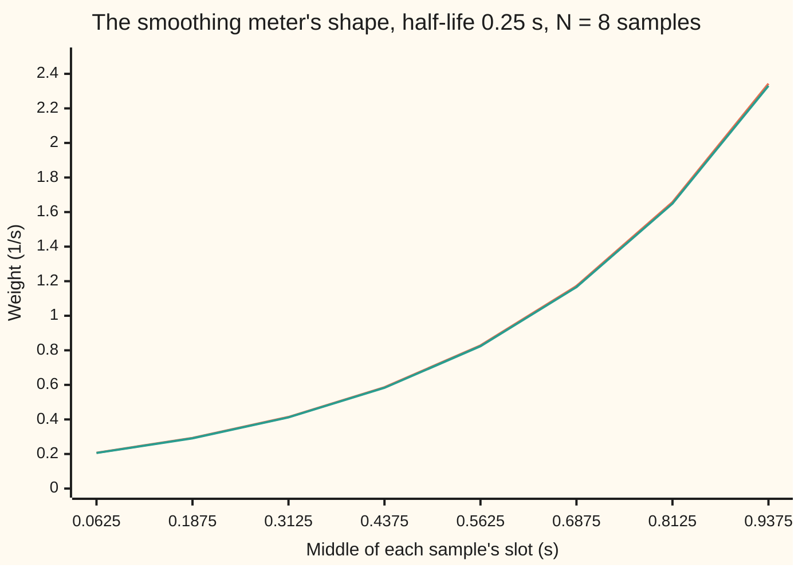

# Riesz representation: every measurement on a Hilbert space is one fixed vector

[Syllabus](../../../SYLLABUS.md) → [Functional analysis](../README.md) → [Hilbert Spaces](../README.md#s02) → Riesz representation

---

## General Overview

A microphone records a one-second clip. Take a coarse copy of it: four pressure samples, a quarter second apart, of 2, −1, 3 and 1 pascals (Pa, the unit of pressure; illustrative values). A smoothing meter reads the clip. Every quarter second it keeps half of its old value and adds half of the new sample. Its final reading is 1.25 Pa.

That meter is a process, not a formula. But it is linear: double the clip and the reading doubles; add two clips and the readings add. So the reading is a weighted total of the samples. Feed the meter one lone sample at a time and the weights appear: 1/16, 1/8, 1/4 and 1/2 of each sample. Recent sound counts most.

Written as an overlap, the weights form one shape: a clip of 0.25, 0.5, 1 and 2 that rises toward the end. The **overlap** of two clips is the sum of sample times sample, times the 0.25 s spacing ([The dot product](../../03-Algebra/06-Dot%20Products%20and%20Best%20Fits/01-dot-product.md), weighted by time). The meter's reading of any clip is its overlap with that shape.

The Riesz representation theorem says this always happens, even for a true clip with infinitely many values. Every linear reading that cannot blow up on small clips is the overlap with one fixed shape. The shape is unique, and its length is the reading's worst-case gain. The road also runs back: every shape defines such a reading. So the space of readings is a copy of the space of clips.

**On a Hilbert space, every bounded linear measurement is the inner product with one fixed vector, and every vector gives one such measurement of the same size.**

**What kind of fact this is:** a theorem. [L2 as a Hilbert space](../../10-Measure%20and%20integration/07-Sizes%20of%20Functions/06-l2-as-a-hilbert-space.md) proves it for real L2 by an argument that uses only the projection theorem, so it holds in every Hilbert space. Why it works on this card proves what complex scalars add: a conjugate in the representer, and a way back that conjugates. The code checks finite truncations of the clip only.

### The picture: the meter's shape, coarse and fine



The orange line is the shape found by probing the meter at N = 8 samples. The green line is the limit shape, $`(\ln 2 / 0.25)\, 2^{-(1-t)/0.25}`$ per second, at the middle of each slot. The two lines nearly coincide already. The weight doubles every 0.25 s: that is the meter's half-life.

---

## The formula

Notation first, in words.

- $`H`$ is a **Hilbert space**: a space of vectors with an inner product, complete in the length it gives, meaning every sequence whose terms bunch ever closer has a limit inside the space ([Inner products](01-inner-products-and-hilbert-spaces.md)). Here the vectors are clips, and $`H`$ is L2 on the one-second interval ([L2 as a Hilbert space](../../10-Measure%20and%20integration/07-Sizes%20of%20Functions/06-l2-as-a-hilbert-space.md)).
- $`\langle y, x\rangle`$ is the **inner product**, the overlap. For an N-sample clip it is $`\Delta t \sum_k \overline{y_k}\, x_k`$, with sample spacing $`\Delta t = 1/N`$ seconds. The bar is the complex conjugate. This wing conjugates the **first** slot; texts differ.
- $`\lVert x\rVert = \sqrt{\langle x, x\rangle}`$ is the **length** of a clip.
- $`\varphi`$ (said "phi") is a **bounded linear functional**: a rule that turns each vector into one number, respects adding and scaling, and has a finite size $`\lVert\varphi\rVert`$, the largest $`\lvert\varphi(x)\rvert / \lVert x\rVert`$ ([Hahn-Banach](../01-Normed%20and%20Banach%20Spaces/06-hahn-banach-theorem.md)).
- $`H'`$ is the **dual space**: every bounded linear functional on $`H`$ ([Dual spaces](../01-Normed%20and%20Banach%20Spaces/09-dual-spaces-and-lp-duality.md)).

The theorem:

```math
\text{for each } \varphi \in H' \text{ there is exactly one } y_\varphi \in H \text{ with } \varphi(x) = \langle y_\varphi, x\rangle \text{ for every } x \in H, \quad \text{and } \lVert\varphi\rVert = \lVert y_\varphi\rVert .
```

**Read it aloud:** every bounded linear reading is the overlap with one fixed vector, and the reading's size is that vector's length.

The way back is the map from a vector to its reading. It keeps lengths, and it conjugates scalars:

```math
y \;\mapsto\; \langle y, \cdot\,\rangle, \qquad \langle a y + w, \cdot\,\rangle = \overline{a}\,\langle y, \cdot\,\rangle + \langle w, \cdot\,\rangle .
```

**Read it aloud:** each vector gives a reading; adding vectors adds their readings, and scaling a vector by a complex number scales its reading by that number's conjugate.

The L2 card writes the theorem as $`\varphi(f) = \langle f, g\rangle`$, with real scalars, where the order of the slots does not matter. With complex scalars and this wing's convention, the representing vector goes in the first slot: $`\varphi(x) = \langle y, x\rangle`$.

| Symbol | Plain meaning | In our example | Push it up and the answer… |
| --- | --- | --- | --- |
| $`H`$ | a Hilbert space | one-second clips: N samples, or L2 on the second | more samples, a finer shape |
| $`x`$, $`u`$, $`w`$ | vectors in $`H`$; u is the clip dropped onto the kernel | x is the clip 2, −1, 3, 1 Pa; u is the last sample alone | the reading scales with the clip |
| $`N`$, $`\Delta t`$, $`k`$, $`x_k`$, $`y_k`$, $`e_k`$ | sample count; spacing $`1/N`$ s; sample number; sample values; the lone sample k | 4 and 0.25 s | the shape tends to its limit |
| $`\langle y, x\rangle`$, $`\lVert x\rVert`$ | the overlap; the length, the square root of the overlap with itself | 1.25 Pa; $`\lVert y\rVert`$ = 1.1524 | — |
| $`\varphi`$, $`\varphi(x)`$ | a bounded linear functional; its value | the meter; 1.25 Pa | — |
| $`\lVert\varphi\rVert`$, $`C`$ | its size: worst-case reading per unit length; any bound on it | 1.1524 at N = 4 | a louder worst case |
| $`y_\varphi`$, $`y`$, $`y'`$ | the representer: the one vector that does the reading; a rival | 0.25, 0.5, 1, 2 | — |
| $`H'`$ | the dual space: all bounded linear functionals | every linear meter on the clip | — |
| $`\ker\varphi`$, $`z`$ | the kernel, vectors read as 0; the nonzero miss from u to its projection onto the kernel, perpendicular to the kernel | silent clips; z = (8, 16, 32, 64)/85 | — |
| $`a`$, $`i`$ | a scalar; $`i = \sqrt{-1}`$ | $`i`$ in the Fourier example | — |
| $`f_1`$, $`c_1`$ | the 1 Hz wave $`e^{2\pi i t}`$; its coefficient $`c_1(x) = \langle f_1, x\rangle`$ | $`c_1`$ = −0.25 + 0.5i on the clip | — |
| $`t`$, $`n`$, $`b_n`$ | time in seconds; a tone's number; the amount of tone n in a mixture | the sawtooth at t = 0.25 s | — |

### When it holds

- **The functional is bounded.** On continuous clips measured by the L2 length, "the pressure at the last instant" is linear but not bounded, so it does not extend to L2. Its would-be shape has length 2, 4, 8, 16 and 32 at N = 4, 16, 64, 256 and 1024: no limit, so no representer.
- **The space is complete.** On finite mixtures of tones, the rule "each tone's amount divided by its number" is bounded, size $`\pi/\sqrt 6`$ = 1.2826. Its representer is a sawtooth wave, which is no finite mixture. Inside that space the rule has no representer.
- **The length comes from an inner product.** Without one there is no "perpendicular" for the proof. In Lp with 1 ≤ p < ∞ and p ≠ 2, the dual is Lq, a different space ([Dual spaces](../01-Normed%20and%20Banach%20Spaces/09-dual-spaces-and-lp-duality.md)).
- **Complex scalars are conjugated.** The representer of $`i\,c_1`$ is $`-i\,f_1`$. Writing $`i\,f_1`$ gives 0.5 + 0.25i on the clip instead of −0.5 − 0.25i.

---

## Why it works

### Step 0: a reading sees only one direction

The meter reads some clips as zero: the **silent clips**, its kernel $`\ker\varphi`$. With four samples they form a flat three-dimensional slice through zero. For a reading that is not always zero, exactly one direction is perpendicular to that slice.

Any clip splits into a silent part plus a part along that one direction. The meter ignores the silent part. So the reading only measures how far the clip reaches along the perpendicular direction, and that is an overlap with a vector pointing that way.

### Step 1: in finite dimensions, probe each sample

With N samples, a clip is a total of lone samples: $`x = \sum_k x_k e_k`$, where $`e_k`$ is 1 at sample k and 0 elsewhere. Linearity gives $`\varphi(x) = \sum_k x_k\,\varphi(e_k)`$. Matching this with $`\Delta t \sum_k \overline{y_k}\, x_k`$ forces

```math
y_k = \overline{\varphi(e_k)}\,/\,\Delta t .
```

For the meter, $`\varphi(e_k)`$ is 1/16, 1/8, 1/4, 1/2, and dividing by 0.25 s gives 0.25, 0.5, 1, 2. In finite dimensions every linear functional is bounded, so this always works.

### Step 2: in infinite dimensions, probes fail, so use the kernel

On L2, a single instant has length zero, so there is no lone sample to probe. [L2 as a Hilbert space](../../10-Measure%20and%20integration/07-Sizes%20of%20Functions/06-l2-as-a-hilbert-space.md) proves the theorem for real L2 with the silent clips instead. They form a **closed subspace** (closed under adding and scaling, and containing its own limits, because the reading is bounded), so the projection theorem ([Projection](02-projection-theorem-and-orthogonal-complements.md)) drops any clip u onto them, and the miss z from u to its drop is perpendicular to every silent clip. That proof uses nothing but the projection theorem, so it runs in every Hilbert space.

In the example, take u = the last sample alone. The miss is z = (8, 16, 32, 64)/85, which the meter reads as 1/2. Its squared length is 16/85.

### Step 3: every clip splits along z, and the conjugate enters

As on the L2 card, the clip $`x - \frac{\varphi(x)}{\varphi(z)}\,z`$ reads as zero, so it is silent and perpendicular to z. Take its overlap with z and solve. With complex scalars this is the one place the proof changes: the scalar picks up a conjugate when it moves into the first slot.

```math
\varphi(x) = \Big\langle\, \frac{\overline{\varphi(z)}}{\lVert z\rVert^2}\, z,\; x \Big\rangle, \qquad y_\varphi = \frac{\overline{\varphi(z)}}{\lVert z\rVert^2}\, z .
```

**Read it aloud:** the representer is the perpendicular direction z, scaled so that the meter's reading of z comes out right.

In the example, $`y = (1/2)\,(85/16)\,z = (85/32)\,z`$ = 0.25, 0.5, 1, 2: the same shape as the probes.

### Step 4: the size of the reading is the length of the shape

The Cauchy–Schwarz inequality, $`\lvert\langle y, x\rangle\rvert \le \lVert y\rVert\,\lVert x\rVert`$, caps every reading at $`\lVert y\rVert`$ per unit length. The clip x = y reaches the cap. So $`\lVert\varphi\rVert = \lVert y\rVert`$.

For the meter, $`\lVert y\rVert = \sqrt{85/64}`$ = 1.1524. Among 2000 random clips the best ratio is 1.1337, under the cap; the clip shaped like y reaches 1.1524 exactly. Swap the roles and this is the **matched-filter** rule of radar: for a known pulse, the reading of fixed size that responds most is the one shaped like the pulse.

### Step 5: the way back, and why it conjugates

Two representers $`y, y'`$ of one reading give $`\langle y - y', x\rangle = 0`$ for every x. Take $`x = y - y'`$: its length is zero, so $`y = y'`$. Each reading has one shape.

Going back, every vector y gives the reading $`\langle y, \cdot\,\rangle`$, bounded with size $`\lVert y\rVert`$ by Step 4. So the map from $`H`$ to $`H'`$ is one-to-one, onto, and keeps lengths. It is **conjugate-linear**: scaling y by a scales the reading by $`\overline a`$.

The Fourier coefficient shows why this matters. On the four-sample clip, the 1 Hz coefficient $`c_1(x) = \langle f_1, x\rangle`$ is −0.25 + 0.5i, with $`f_1(t) = e^{2\pi i t}`$. The reading $`i\,c_1`$ gives −0.5 − 0.25i. Its representer is $`-i\,f_1`$, not $`i\,f_1`$.

<details>
<summary>Detailed proof: what complex scalars change in the L2 card's proof</summary>

**Setting.** $`H`$ is a Hilbert space over the real or complex numbers, with $`\langle y, x\rangle`$ conjugate-linear in y and linear in x. $`\varphi`$ is linear with $`\lvert\varphi(x)\rvert \le C\lVert x\rVert`$ for all x.

The proof on [L2 as a Hilbert space](../../10-Measure%20and%20integration/07-Sizes%20of%20Functions/06-l2-as-a-hilbert-space.md) has five steps: the kernel is closed, a perpendicular $`z \ne 0`$ exists, every vector splits along z, the size, and uniqueness. The closed kernel, z, the size and uniqueness use only the projection theorem and Cauchy–Schwarz, so they carry over unchanged, with the representer in the first slot. The split changes, and the way back is added.

1. *The split.* For x in $`H`$, put $`w = \varphi(z)\,x - \varphi(x)\,z`$. Then $`\varphi(w) = 0`$, so $`\langle z, w\rangle = 0`$. Expanding, linear in the second slot:

$`\displaystyle \varphi(z)\,\langle z, x\rangle = \varphi(x)\,\lVert z\rVert^2, \qquad \varphi(x) = \Big\langle \frac{\overline{\varphi(z)}}{\lVert z\rVert^2}\, z,\ x\Big\rangle .`$

Call that vector y. The conjugate comes from pulling the scalar out of the first slot.

2. *The way back.* For y in $`H`$, $`x \mapsto \langle y, x\rangle`$ is linear in x and bounded by Cauchy–Schwarz. Since $`\langle a y, x\rangle = \overline a\,\langle y, x\rangle`$, the map $`y \mapsto \langle y, \cdot\,\rangle`$ is conjugate-linear, keeps lengths by the size step, and is onto by the split. ∎

</details>

---

## Worked numbers, by hand

The four-sample clip, 2, −1, 3, 1 Pa, with $`\Delta t`$ = 0.25 s and the half-life-0.25 s meter.

| Step | Arithmetic | Value |
| --- | --- | --- |
| run the meter | 0 → 1 → 0 → 1.5 → 1.25, halving then adding half a sample | 1.25 Pa |
| probe each sample | the meter on a lone 1: 1/16, 1/8, 1/4, 1/2 | — |
| the shape | divide each by 0.25 s | 0.25, 0.5, 1, 2 |
| the overlap | 0.25 × (0.25·2 − 0.5·1 + 1·3 + 2·1) | **1.25 Pa** |
| the meter's size | $`\sqrt{0.25\,(0.0625 + 0.25 + 1 + 4)} = \sqrt{85/64}`$ | **1.1524** |

The overlap with one fixed shape reproduces the meter exactly, and no clip of unit length can push the reading above 1.1524.

### Letting N grow

The true clip has a value at every instant. Sampling it more finely changes the meter's shape only slightly. The table compares the shape's length with the limit shape's length, $`\sqrt{2\ln 2\,(1 - 2^{-8})}`$ = 1.175108.

| N | Length of the shape | Gap to the limit |
| ---: | ---: | ---: |
| 4 | 1.152443 | 0.022665086 |
| 16 | 1.173641 | 0.001466785 |
| 64 | 1.175016 | 0.000091878 |
| 256 | 1.175102 | 0.000005743 |
| 1024 | 1.175108 | 0.000000359 |
| 4096 | 1.175108 | 0.000000022 |

Each fourfold N cuts the gap about sixteenfold, so the gap falls like $`1/N^2`$. On the one-second interval the meter's worst-case gain is 1.1751 per unit length of clip. What the truncation hides: at every finite N the probe road works for any linear reading, bounded or not. Only the infinite case needs the boundedness and completeness that the theorem assumes.

### What breaks if you drop a piece

| Mistake | Comes out at | What went wrong |
| --- | --- | --- |
| Overlap as a plain sum, no $`\Delta t`$ | 5.0 Pa, not 1.25 | The shape depends on the inner product; change it and the shape changes |
| A reading of one instant | lengths 2, 4, 8, 16, 32 at N = 4 to 1024 | Not bounded: the shape grows like $`\sqrt N`$ and has no limit in L2 |
| Finite tone mixtures only | lengths 1.244897, 1.278665, 1.282160 at 10, 100, 1000 tones, toward 1.282550 | Not complete: the limit shape is a sawtooth, with value 1.110721 at 0.25 s, outside the space |
| No conjugate: shape $`i\,f_1`$ for $`i\,c_1`$ | 0.5 + 0.25i, not −0.5 − 0.25i | The way back is conjugate-linear |

For the tones, each mixture is $`\sum_n b_n \sqrt 2 \sin(2\pi n t)`$ and the reading is $`\sum_n b_n / n`$. The truncated shape at 0.25 s gives 1.180756, 1.103650 and 1.110014 at 10, 100 and 1000 tones, closing on the sawtooth $`\sqrt 2\,\pi\,(1/2 - t)`$. Every truncation is a finite mixture; the limit is not.

---

## Code, from first principles, and it actually runs

The code holds only finite truncations: clips of N samples. Its roads are numbered as in the code. Road 1 runs the meter for the reading. Roads 2 and 3 find the shape independently: road 2 probes each lone sample, and road 3 follows the L2 card's kernel construction, dropping the last sample onto the silent clips using Gram–Schmidt. A separate test checks the size: 2000 random clips from a SplitMix64 generator, seed 20261115, never beat the shape's length. Then N grows to 4096 against the closed-form limit. For N = 1024 and 4096 the code skips the probing and writes each lone sample's reading in closed form, since a lone sample shrinks by the meter's fixed factor at every later step. Last, the code prints every failure case above.

### Python

```python
# Riesz representation -- the check behind the card.  Standard library only.
# A one-second audio clip is a list of N pressure samples (Pa), dt = 1/N s
# apart, with overlap <y, x> = dt * sum(conj(y_k) * x_k).  A smoothing meter
# with half-life 0.25 s turns the clip into one reading.  The card's claim:
# that reading is the overlap with one fixed shape y, and |reading| <= |y| |x|.
import math

H = 0.25                                  # the meter's half-life, in seconds

def meter(x, n):                          # road 1: run the meter sample by sample
    a, m = 2.0 ** (-(1.0 / n) / H), 0.0
    for xk in x:
        m = a * m + (1 - a) * xk
    return m

def dot(y, x, n):                         # the overlap, real samples
    return sum(yk * xk for yk, xk in zip(y, x)) / n

def length(y, n):
    return math.sqrt(dot(y, y, n))

def probe(rule, n):                       # road 2: the rule on each lone sample
    return [rule([1.0 if j == k else 0.0 for j in range(n)], n) * n for k in range(n)]

def by_kernel(rule, n):                   # road 3: the proof's construction
    last = [1.0 if j == n - 1 else 0.0 for j in range(n)]
    r_last = rule(last, n)
    basis = []                            # silent clips, made perpendicular
    for k in range(n - 1):
        v = [1.0 if j == k else 0.0 for j in range(n)]
        c = rule(v, n) / r_last
        v = [vj - c * lj for vj, lj in zip(v, last)]
        for b in basis:
            p = dot(b, v, n)
            v = [vj - p * bj for vj, bj in zip(v, b)]
        s = length(v, n)
        basis.append([vj / s for vj in v])
    z = last[:]                           # drop the last sample onto the kernel
    for b in basis:
        p = dot(b, last, n)
        z = [zj - p * bj for zj, bj in zip(z, b)]
    return z, [rule(z, n) / dot(z, z, n) * zj for zj in z]

state = 20261115                          # SplitMix64, written out
def rand():
    global state
    state = (state + 0x9E3779B97F4A7C15) % 2**64
    z = state
    z = ((z ^ (z >> 30)) * 0xBF58476D1CE4E5B9) % 2**64
    z = ((z ^ (z >> 27)) * 0x94D049BB133111EB) % 2**64
    return ((z ^ (z >> 31)) >> 11) / 2.0**53 * 2 - 1

def f(v):
    return "[" + ", ".join(f"{t:.4f}" for t in v) + "]"

clip, n = [2.0, -1.0, 3.0, 1.0], 4
y_probe, (z, y_kernel) = probe(meter, n), by_kernel(meter, n)
reading = meter(clip, n)
norm = length(y_probe, n)
best = max(abs(meter(x, n)) / length(x, n) for x in ([rand() for _ in range(n)] for _ in range(2000)))
print(f"clip {f(clip)} Pa, N = {n}, dt = {1 / n:.4f} s")
trail = [meter(clip[:k + 1], n) for k in range(n)]
print(f"road 1, meter run: {f(trail)}, reading = {reading:.4f} Pa")
print(f"lone-sample readings: {f([t / n for t in y_probe])}")
print(f"road 2, probe each sample: y = {f(y_probe)}")
print(f"road 3, miss z = {f(z)}, meter(z) = {meter(z, n):.4f}, |z|^2 = {dot(z, z, n):.4f}")
print(f"road 3, drop onto the silent clips: y = {f(y_kernel)}")
print(f"overlap <y, clip> = {dot(y_probe, clip, n):.4f} Pa")
print(f"meter size |y| = sqrt(85/64) = {norm:.6f}; best of 2000 random clips {best:.6f}; at x = y {meter(y_probe, n) / norm:.6f}")
plain = sum(a * b for a, b in zip(y_probe, clip))
print(f"mistake, plain sum without dt: {plain:.4f} Pa, not {reading:.4f}")
# Let N grow: the shape tends to (ln2/H) 2^(-(1-t)/H), length below.
limit = math.sqrt(math.log(2) / (2 * H) * (1 - 2.0 ** (-2 / H)))
print(f"closed-form length of the limit shape: {limit:.6f}")
errs = []
for n in (4, 16, 64, 256, 1024, 4096):
    yn = probe(meter, n) if n <= 256 else [(1 - 2.0 ** (-1 / (n * H))) * 2.0 ** (-(n - 1 - k) / (n * H)) * n for k in range(n)]
    errs.append(abs(length(yn, n) - limit))
    print(f"N = {n:4d}: |y| = {length(yn, n):.6f}, error {errs[-1]:.9f}")
y8 = probe(meter, 8)
print("chart, N = 8 shape: " + ", ".join(f"{t:.3f}" for t in y8))
print("chart, limit shape at each cell's middle: " + ", ".join(f"{math.log(2) / H * 2.0 ** (-(1 - (k + 0.5) / 8) / H):.3f}" for k in range(8)))
point = []                                # pressure at the last instant alone
for n in (4, 16, 64, 256, 1024):
    point.append(length(probe(lambda x, m: x[-1], n), n))
print("mistake, reading one instant: |y| at N = 4, 16, 64, 256, 1024: " + ", ".join(f"{t:.1f}" for t in point))
# Finite mixtures of tones sqrt(2) sin(2 pi n t), reading sum b_n / n.
saw = math.sqrt(2) * math.pi * (0.5 - 0.25)
for n in (10, 100, 1000):
    tone_len = math.sqrt(sum(1 / k ** 2 for k in range(1, n + 1)))
    s = sum(math.sqrt(2) * math.sin(2 * math.pi * k * 0.25) / k for k in range(1, n + 1))
    print(f"tones up to {n:4d}: |y| = {tone_len:.6f}, y(0.25 s) = {s:.6f}")
print(f"limit: |y| = pi/sqrt(6) = {math.pi / math.sqrt(6):.6f}, sawtooth y(0.25 s) = {saw:.6f}, no finite mixture")
# Complex scalars: the 1 Hz Fourier coefficient c1(x) = <f1, x>, f1 = e^(2 pi i t).
f1 = [complex(math.cos(2 * math.pi * k / 4), math.sin(2 * math.pi * k / 4)) for k in range(4)]
def cdot(y, x):
    return sum(yk.conjugate() * xk for yk, xk in zip(y, x)) / 4
c1 = cdot(f1, clip)
right = cdot([-1j * e for e in f1], clip)
wrong = cdot([1j * e for e in f1], clip)
def cf(z):
    return f"{z.real:.4f} {'+' if z.imag >= 0 else '-'} {abs(z.imag):.4f}i"
print(f"c1(clip) = {cf(c1)}; the rule i*c1 gives {cf(1j * c1)}")
print(f"shape -i*f1 gives {cf(right)}; mistake, shape i*f1 gives {cf(wrong)}")
assert all(abs(p - q) < 1e-12 for p, q in zip(y_probe, y_kernel))      # roads 2 and 3
assert abs(dot(y_probe, clip, 4) - reading) < 1e-12                    # road 1 = overlap
assert best <= norm + 1e-12 and abs(norm - math.sqrt(85 / 64)) < 1e-12  # Cauchy-Schwarz
assert all(errs[i + 1] < errs[i] / 3 for i in range(len(errs) - 1))     # truncation closes
assert 1 / 1001 < math.pi ** 2 / 6 - tone_len ** 2 < 1 / 1000       # tail of 1/n^2: 1/(N+1) to 1/N
assert abs(s - saw) < math.sqrt(2) / 1001                              # alternating tail < first term
assert abs(point[-1] - 32) < 1e-9 and abs(right - 1j * c1) < 1e-12 and abs(wrong - 1j * c1) > 0.5
print("ALL CHECKS PASS")
```

**Ran 2026-11-15 on macOS, Python 3.14.10, standard library only. All checks passed. Output, pasted from the run:**

```
clip [2.0000, -1.0000, 3.0000, 1.0000] Pa, N = 4, dt = 0.2500 s
road 1, meter run: [1.0000, 0.0000, 1.5000, 1.2500], reading = 1.2500 Pa
lone-sample readings: [0.0625, 0.1250, 0.2500, 0.5000]
road 2, probe each sample: y = [0.2500, 0.5000, 1.0000, 2.0000]
road 3, miss z = [0.0941, 0.1882, 0.3765, 0.7529], meter(z) = 0.5000, |z|^2 = 0.1882
road 3, drop onto the silent clips: y = [0.2500, 0.5000, 1.0000, 2.0000]
overlap <y, clip> = 1.2500 Pa
meter size |y| = sqrt(85/64) = 1.152443; best of 2000 random clips 1.133655; at x = y 1.152443
mistake, plain sum without dt: 5.0000 Pa, not 1.2500
closed-form length of the limit shape: 1.175108
N =    4: |y| = 1.152443, error 0.022665086
N =   16: |y| = 1.173641, error 0.001466785
N =   64: |y| = 1.175016, error 0.000091878
N =  256: |y| = 1.175102, error 0.000005743
N = 1024: |y| = 1.175108, error 0.000000359
N = 4096: |y| = 1.175108, error 0.000000022
chart, N = 8 shape: 0.207, 0.293, 0.414, 0.586, 0.828, 1.172, 1.657, 2.343
chart, limit shape at each cell's middle: 0.206, 0.291, 0.412, 0.583, 0.824, 1.166, 1.649, 2.331
mistake, reading one instant: |y| at N = 4, 16, 64, 256, 1024: 2.0, 4.0, 8.0, 16.0, 32.0
tones up to   10: |y| = 1.244897, y(0.25 s) = 1.180756
tones up to  100: |y| = 1.278665, y(0.25 s) = 1.103650
tones up to 1000: |y| = 1.282160, y(0.25 s) = 1.110014
limit: |y| = pi/sqrt(6) = 1.282550, sawtooth y(0.25 s) = 1.110721, no finite mixture
c1(clip) = -0.2500 + 0.5000i; the rule i*c1 gives -0.5000 - 0.2500i
shape -i*f1 gives -0.5000 - 0.2500i; mistake, shape i*f1 gives 0.5000 + 0.2500i
ALL CHECKS PASS
```

### Rust

Same numbers, same labels, built with `rustc --edition 2021 -O`.

```rust
// Riesz representation -- the same check as the Python, in Rust.  No crates.
// A one-second audio clip is a list of N pressure samples (Pa), dt = 1/N s
// apart, with overlap <y, x> = dt * sum(conj(y_k) * x_k).  A smoothing meter
// with half-life 0.25 s turns the clip into one reading.  The card's claim:
// that reading is the overlap with one fixed shape y, and |reading| <= |y| |x|.
const H: f64 = 0.25; // the meter's half-life, in seconds

fn meter(x: &[f64], n: usize) -> f64 { // road 1: run the meter sample by sample
    let a = 2f64.powf(-(1.0 / n as f64) / H);
    let mut m = 0.0;
    for &xk in x { m = a * m + (1.0 - a) * xk }
    m
}

fn last_only(x: &[f64], _n: usize) -> f64 { x[x.len() - 1] }

fn dot(y: &[f64], x: &[f64], n: usize) -> f64 { // the overlap, real samples
    y.iter().zip(x).map(|(a, b)| a * b).sum::<f64>() / n as f64
}

fn length(y: &[f64], n: usize) -> f64 { dot(y, y, n).sqrt() }

fn unit(k: usize, n: usize) -> Vec<f64> { (0..n).map(|j| if j == k { 1.0 } else { 0.0 }).collect() }

fn probe(rule: fn(&[f64], usize) -> f64, n: usize) -> Vec<f64> { // road 2: each lone sample
    (0..n).map(|k| rule(&unit(k, n), n) * n as f64).collect()
}

fn by_kernel(rule: fn(&[f64], usize) -> f64, n: usize) -> (Vec<f64>, Vec<f64>) { // road 3: the proof
    let last = unit(n - 1, n);
    let r_last = rule(&last, n);
    let mut basis: Vec<Vec<f64>> = Vec::new(); // silent clips, made perpendicular
    for k in 0..n - 1 {
        let mut v = unit(k, n);
        let c = rule(&v, n) / r_last;
        v = v.iter().zip(&last).map(|(vj, lj)| vj - c * lj).collect();
        for b in &basis {
            let p = dot(b, &v, n);
            v = v.iter().zip(b).map(|(vj, bj)| vj - p * bj).collect();
        }
        let s = length(&v, n);
        basis.push(v.iter().map(|vj| vj / s).collect());
    }
    let mut z = last.clone(); // drop the last sample onto the kernel
    for b in &basis {
        let p = dot(b, &last, n);
        z = z.iter().zip(b).map(|(zj, bj)| zj - p * bj).collect();
    }
    let c = rule(&z, n) / dot(&z, &z, n);
    let y = z.iter().map(|zj| c * zj).collect();
    (z, y)
}

struct Rng(u64); // SplitMix64, written out
impl Rng {
    fn next(&mut self) -> f64 {
        self.0 = self.0.wrapping_add(0x9E3779B97F4A7C15);
        let mut z = self.0;
        z = (z ^ (z >> 30)).wrapping_mul(0xBF58476D1CE4E5B9);
        z = (z ^ (z >> 27)).wrapping_mul(0x94D049BB133111EB);
        ((z ^ (z >> 31)) >> 11) as f64 / 2f64.powi(53) * 2.0 - 1.0
    }
}

fn f(v: &[f64]) -> String { format!("[{}]", v.iter().map(|t| format!("{:.4}", t)).collect::<Vec<_>>().join(", ")) }

type C = (f64, f64); // a complex number as (real, imaginary)
fn cdot(y: &[C], x: &[f64]) -> C { // conjugate the first slot
    let (mut re, mut im) = (0.0, 0.0);
    for (a, &b) in y.iter().zip(x) { re += a.0 * b; im -= a.1 * b }
    (re / 4.0, im / 4.0)
}
fn cf(z: C) -> String { format!("{:.4} {} {:.4}i", z.0, if z.1 >= 0.0 { "+" } else { "-" }, z.1.abs()) }

fn main() {
    let (clip, n) = (vec![2.0, -1.0, 3.0, 1.0], 4usize);
    let (y_probe, (z, y_kernel)) = (probe(meter, n), by_kernel(meter, n));
    let reading = meter(&clip, n);
    let norm = length(&y_probe, n);
    let mut rng = Rng(20261115);
    let mut best: f64 = 0.0;
    for _ in 0..2000 {
        let x: Vec<f64> = (0..n).map(|_| rng.next()).collect();
        best = best.max(meter(&x, n).abs() / length(&x, n));
    }
    println!("clip {} Pa, N = {}, dt = {:.4} s", f(&clip), n, 1.0 / n as f64);
    let trail: Vec<f64> = (0..n).map(|k| meter(&clip[..k + 1], n)).collect();
    println!("road 1, meter run: {}, reading = {:.4} Pa", f(&trail), reading);
    println!("lone-sample readings: {}", f(&y_probe.iter().map(|t| t / n as f64).collect::<Vec<f64>>()));
    println!("road 2, probe each sample: y = {}", f(&y_probe));
    println!("road 3, miss z = {}, meter(z) = {:.4}, |z|^2 = {:.4}", f(&z), meter(&z, n), dot(&z, &z, n));
    println!("road 3, drop onto the silent clips: y = {}", f(&y_kernel));
    println!("overlap <y, clip> = {:.4} Pa", dot(&y_probe, &clip, n));
    println!("meter size |y| = sqrt(85/64) = {:.6}; best of 2000 random clips {:.6}; at x = y {:.6}", norm, best, meter(&y_probe, n) / norm);
    let plain: f64 = y_probe.iter().zip(&clip).map(|(a, b)| a * b).sum();
    println!("mistake, plain sum without dt: {:.4} Pa, not {:.4}", plain, reading);
    let limit = ((2f64).ln() / (2.0 * H) * (1.0 - 2f64.powf(-2.0 / H))).sqrt();
    println!("closed-form length of the limit shape: {:.6}", limit);
    let mut errs: Vec<f64> = Vec::new();
    for &m in &[4usize, 16, 64, 256, 1024, 4096] {
        let ym: Vec<f64> = if m <= 256 { probe(meter, m) } else {
            (0..m).map(|k| (1.0 - 2f64.powf(-1.0 / (m as f64 * H))) * 2f64.powf(-((m - 1 - k) as f64) / (m as f64 * H)) * m as f64).collect()
        };
        errs.push((length(&ym, m) - limit).abs());
        println!("N = {:4}: |y| = {:.6}, error {:.9}", m, length(&ym, m), errs[errs.len() - 1]);
    }
    let y8 = probe(meter, 8);
    println!("chart, N = 8 shape: {}", y8.iter().map(|t| format!("{:.3}", t)).collect::<Vec<_>>().join(", "));
    println!("chart, limit shape at each cell's middle: {}", (0..8).map(|k| format!("{:.3}",
        (2f64).ln() / H * 2f64.powf(-(1.0 - (k as f64 + 0.5) / 8.0) / H))).collect::<Vec<_>>().join(", "));
    let point: Vec<f64> = [4usize, 16, 64, 256, 1024].iter().map(|&m| length(&probe(last_only, m), m)).collect();
    println!("mistake, reading one instant: |y| at N = 4, 16, 64, 256, 1024: {}", point.iter().map(|t| format!("{:.1}", t)).collect::<Vec<_>>().join(", "));
    let saw = 2f64.sqrt() * std::f64::consts::PI * (0.5 - 0.25);
    let (mut tone_len, mut s) = (0.0, 0.0);
    for &m in &[10usize, 100, 1000] {
        tone_len = (1..=m).map(|k| 1.0 / (k * k) as f64).sum::<f64>().sqrt();
        s = (1..=m).map(|k| 2f64.sqrt() * (2.0 * std::f64::consts::PI * k as f64 * 0.25).sin() / k as f64).sum::<f64>();
        println!("tones up to {:4}: |y| = {:.6}, y(0.25 s) = {:.6}", m, tone_len, s);
    }
    println!("limit: |y| = pi/sqrt(6) = {:.6}, sawtooth y(0.25 s) = {:.6}, no finite mixture", std::f64::consts::PI / 6f64.sqrt(), saw);
    let tau = 2.0 * std::f64::consts::PI;
    let f1: Vec<C> = (0..4).map(|k| ((tau * k as f64 / 4.0).cos(), (tau * k as f64 / 4.0).sin())).collect();
    let c1 = cdot(&f1, &clip);
    let ic1 = (-c1.1, c1.0); // i times c1
    let right = cdot(&f1.iter().map(|e| (e.1, -e.0)).collect::<Vec<C>>(), &clip); // -i f1
    let wrong = cdot(&f1.iter().map(|e| (-e.1, e.0)).collect::<Vec<C>>(), &clip); // i f1
    println!("c1(clip) = {}; the rule i*c1 gives {}", cf(c1), cf(ic1));
    println!("shape -i*f1 gives {}; mistake, shape i*f1 gives {}", cf(right), cf(wrong));
    assert!(y_probe.iter().zip(&y_kernel).all(|(p, q)| (p - q).abs() < 1e-12)); // roads 2 and 3
    assert!((dot(&y_probe, &clip, 4) - reading).abs() < 1e-12); // road 1 = overlap
    assert!(best <= norm + 1e-12 && (norm - (85.0f64 / 64.0).sqrt()).abs() < 1e-12); // Cauchy-Schwarz
    assert!((0..errs.len() - 1).all(|i| errs[i + 1] < errs[i] / 3.0)); // truncation closes
    let tail = std::f64::consts::PI.powi(2) / 6.0 - tone_len * tone_len;
    assert!(1.0 / 1001.0 < tail && tail < 1.0 / 1000.0); // tail of 1/n^2: 1/(N+1) to 1/N
    assert!((s - saw).abs() < 2f64.sqrt() / 1001.0); // alternating tail < first term
    assert!((point[point.len() - 1] - 32.0).abs() < 1e-9);
    assert!(((right.0 - ic1.0).powi(2) + (right.1 - ic1.1).powi(2)).sqrt() < 1e-12);
    assert!(((wrong.0 - ic1.0).powi(2) + (wrong.1 - ic1.1).powi(2)).sqrt() > 0.5);
    println!("ALL CHECKS PASS");
}
```

**Ran 2026-11-15 on macOS, rustc 1.98.1, no crates. All checks passed. Output, pasted from the run:**

```
clip [2.0000, -1.0000, 3.0000, 1.0000] Pa, N = 4, dt = 0.2500 s
road 1, meter run: [1.0000, 0.0000, 1.5000, 1.2500], reading = 1.2500 Pa
lone-sample readings: [0.0625, 0.1250, 0.2500, 0.5000]
road 2, probe each sample: y = [0.2500, 0.5000, 1.0000, 2.0000]
road 3, miss z = [0.0941, 0.1882, 0.3765, 0.7529], meter(z) = 0.5000, |z|^2 = 0.1882
road 3, drop onto the silent clips: y = [0.2500, 0.5000, 1.0000, 2.0000]
overlap <y, clip> = 1.2500 Pa
meter size |y| = sqrt(85/64) = 1.152443; best of 2000 random clips 1.133655; at x = y 1.152443
mistake, plain sum without dt: 5.0000 Pa, not 1.2500
closed-form length of the limit shape: 1.175108
N =    4: |y| = 1.152443, error 0.022665086
N =   16: |y| = 1.173641, error 0.001466785
N =   64: |y| = 1.175016, error 0.000091878
N =  256: |y| = 1.175102, error 0.000005743
N = 1024: |y| = 1.175108, error 0.000000359
N = 4096: |y| = 1.175108, error 0.000000022
chart, N = 8 shape: 0.207, 0.293, 0.414, 0.586, 0.828, 1.172, 1.657, 2.343
chart, limit shape at each cell's middle: 0.206, 0.291, 0.412, 0.583, 0.824, 1.166, 1.649, 2.331
mistake, reading one instant: |y| at N = 4, 16, 64, 256, 1024: 2.0, 4.0, 8.0, 16.0, 32.0
tones up to   10: |y| = 1.244897, y(0.25 s) = 1.180756
tones up to  100: |y| = 1.278665, y(0.25 s) = 1.103650
tones up to 1000: |y| = 1.282160, y(0.25 s) = 1.110014
limit: |y| = pi/sqrt(6) = 1.282550, sawtooth y(0.25 s) = 1.110721, no finite mixture
c1(clip) = -0.2500 + 0.5000i; the rule i*c1 gives -0.5000 - 0.2500i
shape -i*f1 gives -0.5000 - 0.2500i; mistake, shape i*f1 gives 0.5000 + 0.2500i
ALL CHECKS PASS
```

The two outputs match line for line.

### Lean

Lean proves the theorem and its way back on every real or complex Hilbert space, and checks the four-sample numbers exactly.

- Take a bounded linear functional $`\varphi`$ on $`H`$. Then exactly one vector $`y`$ gives $`\varphi(x) = \langle y, x\rangle`$ for every $`x`$. That $`y`$ has $`\lVert y\rVert = \lVert\varphi\rVert`$.
- Take the map sending each vector $`y`$ to the reading $`\langle y, \cdot\,\rangle`$. Then it is one-to-one, onto $`H'`$, keeps lengths, and is conjugate-linear.
- Suppose $`y`$ represents $`\varphi`$ and $`a`$ is a scalar. Then $`\overline a\, y`$ represents $`a\,\varphi`$.
- The meter reads the clip 2, −1, 3, 1 Pa as 1.25 Pa. On every four-sample clip, it equals the overlap with the shape 0.25, 0.5, 1, 2.
- The shape's length squared is 85/64. The plain sum without $`\Delta t`$ gives 5 Pa, not 1.25.
- Take the miss z = (8, 16, 32, 64)/85. Then the meter reads it as 0.5, and $`\lVert z\rVert^2`$ = 16/85.
- The miss z meets the silent clip 1, 0, 0, −0.125 at a right angle. Scaled by 85/32, it gives back the shape 0.25, 0.5, 1, 2.
- On the clip, $`c_1`$ is −0.25 + 0.5i. Take the reading $`i\,c_1`$. Then the shape $`-i\,f_1`$ gives −0.5 − 0.25i, and the shape $`i\,f_1`$ gives 0.5 + 0.25i.

The shapes at larger N, the reading of one instant and the finite tone mixtures are left to the Python and Rust checks.

```lean
-- Riesz representation: on a Hilbert space every bounded linear functional is the inner product with exactly one fixed vector of the same size, and this identifies the space with its dual conjugate-linearly.
import Mathlib.Analysis.InnerProductSpace.Dual
import Mathlib.Analysis.Complex.Basic
import Mathlib.Tactic.NormNum
import Mathlib.Tactic.Ring

/-! `E` is a Hilbert space: a complete inner product space over `𝕜`, the real or the complex
numbers (`RCLike 𝕜`). Mathlib's inner product `⟪y, x⟫_𝕜` conjugates its first slot, as on
the card. A bounded linear functional is a continuous linear map `φ : E →L[𝕜] 𝕜`
(an element of Mathlib's dual space `StrongDual 𝕜 E`), and `‖φ‖` is its operator norm,
the largest `|φ x| / ‖x‖`. -/

open scoped InnerProductSpace ComplexConjugate

section General

variable {𝕜 E : Type*} [RCLike 𝕜] [NormedAddCommGroup E] [InnerProductSpace 𝕜 E]
  [CompleteSpace E]

/-- The Riesz representation theorem: on a Hilbert space, every bounded linear functional `φ`
is the inner product with one fixed vector `y`, placed in the first (conjugated) slot:
`φ x = ⟪y, x⟫` for every `x`. That vector is the only one that does this, and its length is
the size of the functional: `‖φ‖ = ‖y‖`. -/
theorem riesz_representation (φ : StrongDual 𝕜 E) :
    ∃ y : E, (∀ x : E, φ x = ⟪y, x⟫_𝕜) ∧ ‖φ‖ = ‖y‖ ∧
      ∀ y' : E, (∀ x : E, φ x = ⟪y', x⟫_𝕜) → y' = y := by
  refine ⟨(InnerProductSpace.toDual 𝕜 E).symm φ, ?_, ?_, ?_⟩
  · intro x
    rw [InnerProductSpace.toDual_symm_apply]
  · rw [LinearIsometryEquiv.norm_map]
  · intro y' hy'
    apply (InnerProductSpace.toDual 𝕜 E).injective
    rw [LinearIsometryEquiv.apply_symm_apply]
    ext x
    rw [InnerProductSpace.toDual_apply_apply, hy' x]

/-- The way back: every vector `y` gives the bounded functional `x ↦ ⟪y, x⟫`, and the map
`y ↦ ⟪y, ·⟫` from the Hilbert space to its dual is a bijection that keeps lengths and is
conjugate-linear (scaling `y` by `a` scales the functional by `conj a`). So the dual is a copy
of the space. -/
theorem hilbert_space_conjugate_isometric_to_dual :
    ∃ T : E ≃ₗᵢ⋆[𝕜] StrongDual 𝕜 E, ∀ y x : E, T y x = ⟪y, x⟫_𝕜 := by
  exact ⟨InnerProductSpace.toDual 𝕜 E, fun y x => InnerProductSpace.toDual_apply_apply⟩

/-- Complex scalars are conjugated: if `y` represents `φ`, then the representer of `a • φ`
is `conj a • y`, not `a • y`. -/
theorem representer_of_scaled_functional (φ : StrongDual 𝕜 E) (y : E)
    (hy : ∀ x : E, φ x = ⟪y, x⟫_𝕜) (a : 𝕜) :
    ∀ x : E, (a • φ) x = ⟪conj a • y, x⟫_𝕜 := by
  intro x
  rw [smul_apply, hy x, inner_smul_left, RCLike.conj_conj, smul_eq_mul]

end General

/-! The card's worked numbers. The clip is 2, −1, 3, 1 Pa, four samples `Δt = 1/4` s apart.
The meter keeps half its old value and adds half of each new sample. -/

-- The meter's run on the clip: 0 → 1 → 0 → 3/2 → 5/4, final reading 5/4 Pa.
example : ([2, -1, 3, 1] : List ℚ).foldl (fun m s => m / 2 + s / 2) 0 = 5 / 4 := by norm_num
-- Probing each lone sample gives the weights 1/16, 1/8, 1/4, 1/2.
example : ([1, 0, 0, 0] : List ℚ).foldl (fun m s => m / 2 + s / 2) 0 = 1 / 16 ∧
    ([0, 1, 0, 0] : List ℚ).foldl (fun m s => m / 2 + s / 2) 0 = 1 / 8 ∧
    ([0, 0, 1, 0] : List ℚ).foldl (fun m s => m / 2 + s / 2) 0 = 1 / 4 ∧
    ([0, 0, 0, 1] : List ℚ).foldl (fun m s => m / 2 + s / 2) 0 = 1 / 2 := by norm_num
-- Dividing by Δt = 1/4 gives the shape 1/4, 1/2, 1, 2.
example : (1 / 16 : ℚ) / (1 / 4) = 1 / 4 ∧ (1 / 8 : ℚ) / (1 / 4) = 1 / 2 ∧
    (1 / 4 : ℚ) / (1 / 4) = 1 ∧ (1 / 2 : ℚ) / (1 / 4) = 2 := by norm_num
-- The meter equals the overlap with that shape on every four-sample clip.
example (x₀ x₁ x₂ x₃ : ℚ) :
    ([x₀, x₁, x₂, x₃] : List ℚ).foldl (fun m s => m / 2 + s / 2) 0 =
      (1 / 4) * ((1 / 4) * x₀ + (1 / 2) * x₁ + 1 * x₂ + 2 * x₃) := by
  norm_num; ring
-- The overlap with the clip: 1/4 × (1/4·2 − 1/2·1 + 1·3 + 2·1) = 5/4 Pa.
example : (1 / 4 : ℚ) * ((1 / 4) * 2 + (1 / 2) * (-1) + 1 * 3 + 2 * 1) = 5 / 4 := by norm_num
-- The meter's size squared: ‖y‖² = 1/4 × (1/16 + 1/4 + 1 + 4) = 85/64.
example : (1 / 4 : ℚ) * ((1 / 4) ^ 2 + (1 / 2) ^ 2 + 1 ^ 2 + 2 ^ 2) = 85 / 64 := by norm_num
-- The miss z = (8, 16, 32, 64)/85: the meter reads it as 1/2 and ‖z‖² = 16/85.
example : (1 / 16 : ℚ) * (8 / 85) + (1 / 8) * (16 / 85) + (1 / 4) * (32 / 85) +
    (1 / 2) * (64 / 85) = 1 / 2 := by norm_num
example : (1 / 4 : ℚ) * ((8 / 85) ^ 2 + (16 / 85) ^ 2 + (32 / 85) ^ 2 + (64 / 85) ^ 2) =
    16 / 85 := by norm_num
-- z is perpendicular to the silent clips: the silent clip e₀ − (1/8)·e₃ reads 0 and meets z at a right angle.
example : (1 / 16 : ℚ) * 1 + (1 / 2) * (-(1 / 8)) = 0 ∧
    (1 / 4 : ℚ) * (1 * (8 / 85) + (-(1 / 8)) * (64 / 85)) = 0 := by norm_num
-- The representer (conj φ(z) / ‖z‖²) · z = (85/32) · z = (1/4, 1/2, 1, 2).
example : (1 / 2 : ℚ) / (16 / 85) = 85 / 32 ∧
    (85 / 32 : ℚ) * (8 / 85) = 1 / 4 ∧ (85 / 32 : ℚ) * (16 / 85) = 1 / 2 ∧
    (85 / 32 : ℚ) * (32 / 85) = 1 ∧ (85 / 32 : ℚ) * (64 / 85) = 2 := by norm_num
-- Mistake, the plain sum without Δt: 5 Pa, not 5/4.
example : (1 / 4 : ℚ) * 2 + (1 / 2) * (-1) + 1 * 3 + 2 * 1 = 5 := by norm_num
-- The 1 Hz coefficient: conj f₁ at t = 0, 1/4, 1/2, 3/4 is 1, −i, −1, i,
-- so c₁(clip) = 1/4 × (2 − (−i) − 3 + i) = −1/4 + i/2.
example : (1 / 4 : ℂ) * (2 * 1 + (-1) * (-Complex.I) + 3 * (-1) + 1 * Complex.I) =
    -1 / 4 + Complex.I / 2 := by ring
-- The reading i·c₁ is −1/2 − i/4; its representer −i·f₁ gives conj(−i)·c₁ = −1/2 − i/4.
example : Complex.I * (-1 / 4 + Complex.I / 2) = -1 / 2 - Complex.I / 4 := by
  ring_nf; rw [Complex.I_sq]; ring
example : conj (-Complex.I) * (-1 / 4 + Complex.I / 2) = -1 / 2 - Complex.I / 4 := by
  rw [map_neg, Complex.conj_I]; ring_nf; rw [Complex.I_sq]; ring
-- Mistake, the shape i·f₁ gives conj(i)·c₁ = 1/2 + i/4 instead.
example : conj Complex.I * (-1 / 4 + Complex.I / 2) = 1 / 2 + Complex.I / 4 := by
  rw [Complex.conj_I]; ring_nf; rw [Complex.I_sq]; ring

#print axioms riesz_representation
#print axioms hilbert_space_conjugate_isometric_to_dual
#print axioms representer_of_scaled_functional
```

**Checked 2026-11-15 on macOS, Lean 4.36.0-rc2, Mathlib v4.36.0-rc2. Every proof is complete and uses only Lean's standard axioms. Output, pasted from the run:**

```
'riesz_representation' depends on axioms: [propext, Classical.choice, Quot.sound]
'hilbert_space_conjugate_isometric_to_dual' depends on axioms: [propext, Classical.choice, Quot.sound]
'representer_of_scaled_functional' depends on axioms: [propext, Classical.choice, Quot.sound]
```

> [!TIP]
> **Try changing**
> Guess first, then run the Python.
> - **Feed the meter its own shape.** Set `clip` to `[0.25, 0.5, 1.0, 2.0]`. The reading becomes 1.3281 Pa, the square of the size 1.1524: Step 4's best case. Every assert still passes.
> - **A slower meter.** Set `H = 0.5`. The shape flattens to 0.4142, 0.5858, 0.8284, 1.1716 and the size drops to 0.8021. The third assert stops the run, since 85/64 belongs to the 0.25 s meter.
> - **Drop the conjugate.** In `cdot`, replace `yk.conjugate() * xk` with `yk * xk`. Now the shape $`-i\,f_1`$ gives −0.5 + 0.25i while the rule gives 0.5 − 0.25i, and the last assert stops the run.
> - **Push the point reading further.** Add 4096 to the list of N for "reading one instant". Its shape's length becomes 64: it doubles with every fourfold N and never settles. The last assert, pinned to 32, stops the run.

---

## The usual mistake

> [!warning]
> **Treating "the value at one instant" as a bounded reading.** It is linear, so it looks like a fine measurement. But on continuous clips measured by the L2 length it is not bounded, so it does not extend to L2: its would-be shape has length 2, 4, 8, 16, 32 at N = 4 to 1024 and never settles. Riesz says nothing about it. Spaces where point values are bounded are the subject of [Reproducing kernels](08-reproducing-kernel-hilbert-spaces.md).
>
> - **Dropping the sample spacing.** Treat the overlap as a plain sum and the shape 0.25, 0.5, 1, 2 reads the clip as 5.0 Pa, not 1.25 Pa. The representer belongs to an inner product, not to the reading alone.
> - **Forgetting the conjugate.** The reading $`i\,c_1`$ has shape $`-i\,f_1`$. The shape $`i\,f_1`$ gives 0.5 + 0.25i, not −0.5 − 0.25i.
> - **Assuming a representer inside an incomplete space.** On finite tone mixtures the rule "amount over tone number" has size 1.282550, but its shape is a sawtooth, outside the space.

---

## Where you meet it in real life

- **Sensors and instruments.** Any linear, stable sensor reading, such as a microphone signal after a linear smoothing filter, like the meter here, or a camera pixel, is the overlap of the signal with one response shape. Calibrating the sensor means measuring that shape.
- **Radar and communications.** The matched filter correlates the received signal with the expected pulse. Step 4 is why: the noise a reading picks up grows with the reading's size, and among readings of fixed size the one shaped like the pulse responds most to it, so it gives the best ratio of signal to noise.
- **Gradients in optimisation.** The derivative of a cost is a linear functional. The gradient is its Riesz representer, so changing the inner product changes the gradient. This is how a "Sobolev gradient" smooths updates.
- **Finite elements and weak solutions.** A load on a beam or a plate is a functional on displacements. [Lax-Milgram](07-lax-milgram-theorem.md) extends Riesz to turn that load into a unique solution.
- **Quantum mechanics.** Dirac's bra-ket notation writes every bounded functional, a bra, as the conjugate of a vector, a ket. That is this theorem, and it is why physics conjugates the first slot.

> **Say it back**
> A bounded linear reading on a Hilbert space is the overlap with one fixed vector. The vector points perpendicular to the clips the reading calls zero, and its length is the reading's worst-case gain. In finite dimensions the vector comes from probing each coordinate; in infinite dimensions it comes from the projection theorem, which needs completeness and boundedness. Every vector gives such a reading, so the dual space is a copy of the space, with complex scalars conjugated. The smoothing meter reads the clip 2, −1, 3, 1 Pa as 1.25 Pa, the overlap with the shape 0.25, 0.5, 1, 2.

---

## What this builds on

- [Projection](02-projection-theorem-and-orthogonal-complements.md): the closest point in a closed subspace, which supplies the perpendicular vector z.
- [Dual spaces](../01-Normed%20and%20Banach%20Spaces/09-dual-spaces-and-lp-duality.md): the dual space $`H'`$ and Lp duality, of which this is the p = 2 case.
- [The dot product](../../03-Algebra/06-Dot%20Products%20and%20Best%20Fits/01-dot-product.md): the finite overlap that every reading turns out to be.
- [L2 as a Hilbert space](../../10-Measure%20and%20integration/07-Sizes%20of%20Functions/06-l2-as-a-hilbert-space.md): the real L2 version of the theorem and its kernel proof, which Steps 2 and 3 carry to every Hilbert space.

## Where this goes next

- [Lax-Milgram](07-lax-milgram-theorem.md): the next card. It replaces the inner product with a bounded form that is coercive (it grows at least like the squared length) and still gets one representer, which solves weak equations.
- [Reproducing kernels](08-reproducing-kernel-hilbert-spaces.md): Hilbert spaces where "the value at a point" is bounded, so it has a representer, the kernel function at that point.
- [Weak convergence](09-weak-convergence-and-banach-alaoglu.md): convergence tested by every bounded reading, which Riesz turns into convergence of every overlap.

Left open: in a Hilbert space every bounded reading reaches its size at one unit vector, its shape scaled to length 1; in a Banach space that is not a Hilbert space, does every bounded reading still reach its size on some unit vector?

---

## Sources

Verified 2026-11-15: every link below resolves to the publisher's page.

- Kreyszig, Erwin. *Introductory Functional Analysis with Applications*. Wiley, 1978; Wiley Classics Library paperback, 1991. [Publisher page](https://www.wiley.com/en-us/Introductory+Functional+Analysis+with+Applications-p-9780471504597). The Riesz representation theorem and the conjugate-linear identification of a Hilbert space with its dual, at a gentle pace.
- Brezis, Haim. *Functional Analysis, Sobolev Spaces and Partial Differential Equations*. Springer, 2011. [DOI 10.1007/978-0-387-70914-7](https://doi.org/10.1007/978-0-387-70914-7). Chapter 5 proves Riesz representation and Lax-Milgram; Chapters 8 and 9 use them for weak solutions.
- Axler, Sheldon. *Measure, Integration & Real Analysis*. Springer, Graduate Texts in Mathematics, 2020. [DOI 10.1007/978-3-030-33143-6](https://doi.org/10.1007/978-3-030-33143-6), open access. Chapter 8 on Hilbert spaces proves the representation theorem in full.
- Dirac, P. A. M. "A new notation for quantum mechanics." *Mathematical Proceedings of the Cambridge Philosophical Society* 35 (1939). [DOI 10.1017/S0305004100021162](https://doi.org/10.1017/S0305004100021162). Bras and kets: functionals written as conjugated vectors.
- O'Connor, J. J., and E. F. Robertson. "Frigyes Riesz." MacTutor Archive, University of St Andrews. [Biography](https://mathshistory.st-andrews.ac.uk/Biographies/Riesz/). Riesz's 1907 work on square-integrable functions, his introduction of weak convergence, and his founding role in functional analysis.
