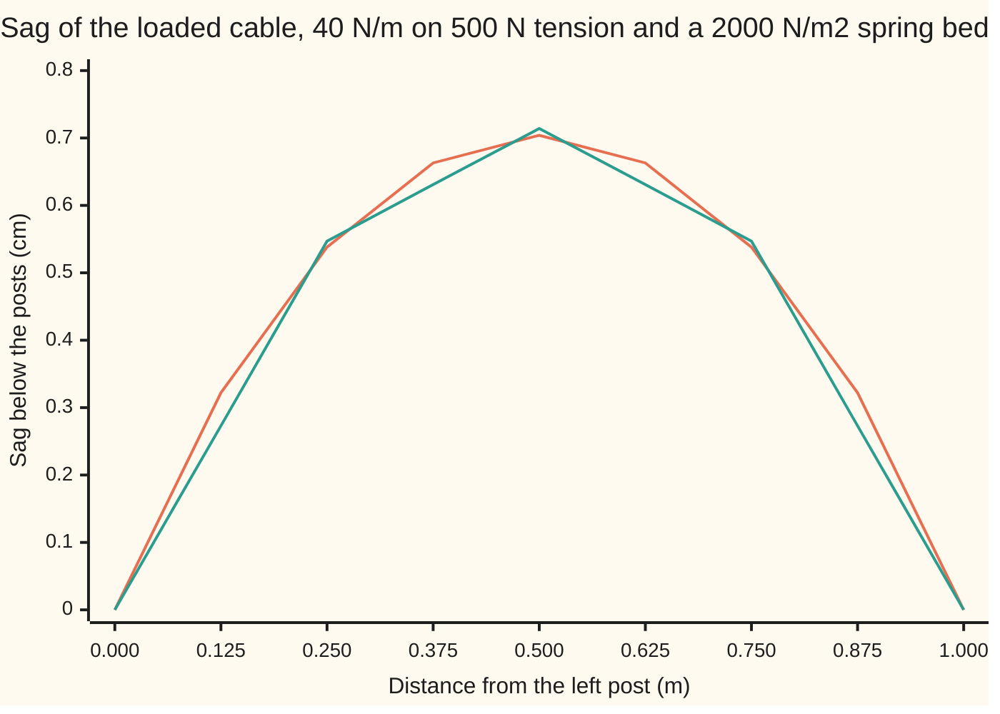
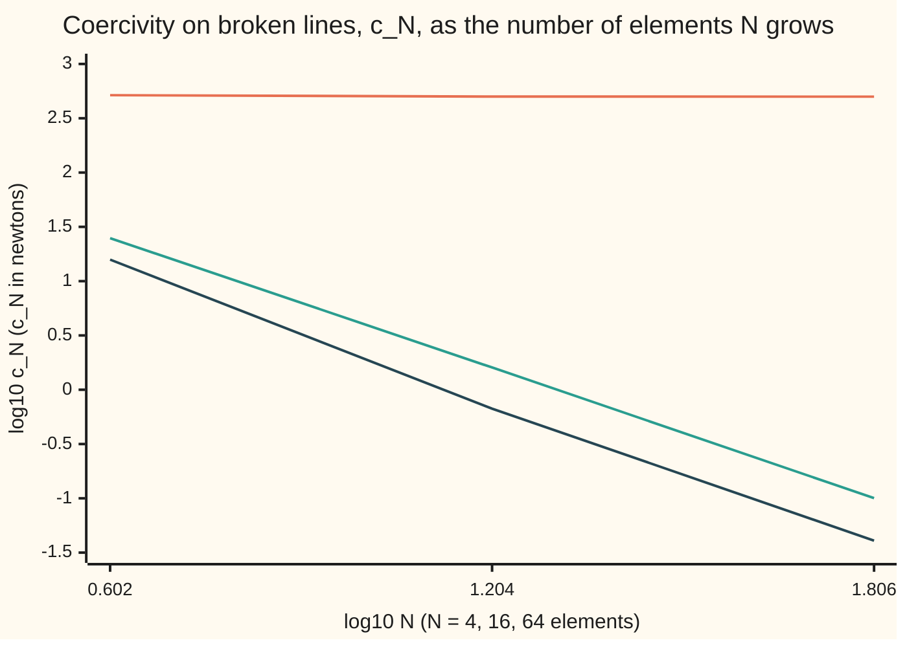

# Lax-Milgram: a bounded energy form that stays away from zero has one solution

[Syllabus](../../../SYLLABUS.md) → [Functional analysis](../README.md) → [Hilbert Spaces](../README.md#s02) → Lax-Milgram

---

## General Overview

A cable 1 m long hangs between two posts at the same height. It rests on a bed of springs, like a pipe laid on soft ground. A load of 40 N per metre presses it down. The cable is pulled tight with 500 N, and the springs push back with 2000 N for every metre of sag along every metre of cable. All four numbers are illustrative.

How far does the middle sag? The answer is 0.703891 cm. But the deeper question comes first: does this load give **exactly one** resting shape? A shape is a whole curve, so it carries infinitely many numbers. A finite system of equations can be checked by counting. A curve cannot.

Engineers start from the cable's **energy**: stretching energy from the slope, spring energy from the sag, minus the work done by the load. Both stored energies come from one pairing of two shapes, $`a(u, v)`$, called the **energy form**. The Lax-Milgram theorem asks two questions about that form and nothing else:

- **Bounded:** the form never exceeds a fixed number $`C`$ times the sizes of the two shapes.
- **Coercive** (stays away from zero): every nonzero shape costs at least $`c`$ times its size squared, for a fixed $`c > 0`$.

The shapes live in a Hilbert space: a space with an inner product (a rule that multiplies two shapes into a number) in which limits of shapes stay inside the space. Two yeses give exactly one resting shape, and a ceiling on its size, before anything is solved. For the cable, $`c`$ = 500 N and $`C`$ = 702.642 N. The ceiling says the middle sags less than 1.154701 cm. The true 0.703891 cm sits under it.

**If an energy form on a Hilbert space is bounded and coercive, then every bounded load has exactly one resting shape, and its size is at most the load's size divided by the coercivity constant.**

**What kind of fact this is:** a theorem, proved on this card in Why it works from the Riesz representation and projection theorems. The cable's two constants are also proved here. The code checks finite truncations only; the infinite-dimensional statement rests on the proof.

### The picture: the cable's sag, exact and with four elements



The smooth line is the exact sag. The broken line is the finite rehearsal with N = 4 elements (straight pieces 0.25 m long), read at the nodes and halfway between them. Sag is drawn upward so the numbers read directly.

---

## The formula

Notation first, in words. A **shape** $`v`$ is a curve along the cable that is zero at both posts and has finite stretching energy. These shapes form the space $`V`$, written $`H^1_0(0, 1)`$ on [Weak derivatives](../04-Distributions%20and%20Sobolev%20Spaces/07-weak-derivatives-and-sobolev-spaces.md). Its inner product and size (the length of [Inner products](01-inner-products-and-hilbert-spaces.md)) use the slope only:

```math
\langle u, v\rangle_V = \int_0^1 u'v'\,dx, \qquad \lVert v\rVert_V = \Big(\int_0^1 v'^2\,dx\Big)^{1/2}.
```

$`V`$ is complete with this size, so it is a Hilbert space. A **form** $`a(u, v)`$ takes two shapes and returns a number, and is linear in each slot. A **load** $`\ell(v)`$ takes one shape and returns a number, linearly. The theorem:

```math
\begin{aligned} &|a(u, v)| \le C\,\lVert u\rVert_V \lVert v\rVert_V, \qquad a(v, v) \ge c\,\lVert v\rVert_V^2, \qquad |\ell(v)| \le \lVert \ell\rVert\,\lVert v\rVert_V \\ &\Longrightarrow\ \text{exactly one } u \in V \text{ with } a(u, v) = \ell(v) \text{ for every } v \in V, \quad\text{and}\quad \lVert u\rVert_V \le \frac{\lVert \ell\rVert}{c}. \end{aligned}
```

**Read it aloud:** if the form is held above by $`C`$ and held away from zero by $`c`$, and the load is bounded, then exactly one shape balances the load against every test shape, and its size is at most the load's size over $`c`$.

For the cable, with sag $`u`$ in metres, tension $`T`$, spring bed $`k`$ and load $`q`$:

```math
a(u, v) = \int_0^1 \big(T\,u'v' + k\,uv\big)\,dx, \qquad \ell(v) = \int_0^1 q\,v\,dx, \qquad E(v) = \tfrac12\,a(v, v) - \ell(v).
```

$`E(v)`$ is the cable's total energy in joules. The equation $`a(u, v) = \ell(v)`$ for every $`v`$ is the cable's weak form, $`-Tu'' + ku = q`$ with the posts at zero, as on [Finite elements](../../16-Numerical%20analysis/07-PDE%20Solvers/07-finite-elements-galerkin-and-hat-functions.md).

| Symbol | Plain meaning | In our example | Push it up and the answer… |
| --- | --- | --- | --- |
| $`x`$, $`x_0`$, $`u(x)`$ | distance from the left post, m; a chosen point on the cable, m; sag below the posts, m | middle sag 0.703891 cm | — |
| $`T`$ | cable tension, N | 500 N | $`c`$ rises, the sag falls |
| $`k`$ | spring bed stiffness, N per m of sag per m of cable | 2000 N/m² | $`C`$ rises, the sag falls |
| $`q`$ | load, N per m | 40 N/m | the sag rises in proportion |
| $`V`$, $`\langle\cdot,\cdot\rangle_V`$, $`\lVert\cdot\rVert_V`$, $`\lVert\cdot\rVert_{L^2}`$ | the shapes; their slope inner product; their size; their plain average size, $`(\int v^2)^{1/2}`$ | $`\lVert u\rVert_V`$ = 0.016532 √m | — |
| $`a(u, v)`$, $`E(v)`$ | energy form; total energy, J | $`a(u, u)`$ = 0.190724675 J, $`E(u)`$ = −0.095362338 J | — |
| $`\ell`$, $`\lVert\ell\rVert`$, $`g`$ | the load as a function of shapes; its size; the shape that represents it | $`\lVert\ell\rVert`$ = 11.547005 N·√m | the ceiling rises |
| $`C`$ | bound constant, N | 702.642 N | the solving iteration slows |
| $`c`$ | coercivity constant, N | 500 N | the ceiling falls |
| $`A`$, $`f`$, $`\rho`$, $`u_n`$, $`e`$, $`w`$, $`y`$ | the form as an operator; the load as a shape; step size of the iteration; a sequence of shapes; the gap to the answer; shapes used inside the proof | $`\rho = c/C^2`$ | — |
| $`N`$, $`h`$, $`c_N`$, $`C_N`$, $`s_j`$, $`\theta_j`$ | number of elements; their length; the two constants on broken lines; the $`j`$-th sine list and its angle | 4; 0.25 m; 515.7783 N; 692.5550 N | $`N`$ up: $`c_N`$ falls toward $`c`$ |
| $`b`$ | drift: a term $`b\int u'v`$ that makes the form lopsided | 1000 N/m | $`C`$ rises, $`c`$ does not move |

### When it holds

- **Coercive.** Springs that push outward, $`k = -\pi^2 T`$, give the shape $`\sin(\pi x)`$ zero energy. Then $`c`$ is 0, uniqueness is lost, and the uniform load has no balancing shape at all.
- **Bounded in the same norm.** Measured by the plain average size $`\lVert v\rVert_{L^2}`$ instead of by slope, the cable's form has no bound $`C`$: a fine zigzag stores huge stretching energy while staying small. At N = 64 the best bound is already 24533649.1 N/m².
- **A complete space.** Smooth shapes alone are not complete. Step 3 below needs limits of shapes to stay in the space, and the projection theorem needs a closed subspace.
- **A bounded load.** A spread load or a point force is bounded on $`V`$. A point couple at a point $`x_0`$ on the cable, $`\ell(v) = v'(x_0)`$, is not: no shape in $`V`$ answers it.

---

## Why it works

### Step 0: why a finite count is not enough

On $`N`$ unknowns, a coercive matrix is easy. Take a list $`x`$ of $`N`$ numbers and an $`N \times N`$ matrix $`A`$. If $`x^\top A x \ge c\,|x|^2`$, then $`Ax = 0`$ forces $`x = 0`$. So $`A`$ is one-to-one, and a one-to-one square matrix is also onto: every right side has a solution.

In infinite dimensions, one-to-one no longer implies onto. The cable without tension shows it. Its form $`\int k\,uv`$ is positive for every nonzero shape, so no two shapes give the same response. Yet no shape in $`V`$ balances a uniform load (What breaks, row 2). Coercivity in the **right norm** closes that gap. Steps 3 and 4 show that the set of loads with an answer has no holes, and that no load lies outside it.

### Step 1: the symmetric case is Riesz

The cable's form is symmetric: $`a(u, v) = a(v, u)`$. Coercivity and boundedness say $`c\,\lVert v\rVert_V^2 \le a(v, v) \le C\,\lVert v\rVert_V^2`$. So $`a`$ is itself an inner product, with a size equivalent to $`\lVert\cdot\rVert_V`$, and $`V`$ stays complete under it.

[Riesz representation](06-riesz-representation-theorem.md) says: every bounded linear functional on a Hilbert space is the inner product with exactly one element. Apply it with $`a`$ as the inner product, and the load $`\ell`$ is $`a(u, \cdot)`$ for exactly one $`u`$. That $`u`$ also minimises the energy $`E`$, so the symmetric case is the minimum principle of [Convex functions](../../06-Calculus%20and%20analysis/07-Several%20Variables/09-convex-functions.md), in infinite dimensions.

Riesz also measures the load. In the slope inner product, the cable's load is represented by $`g(x) = \tfrac{q}{2}x(1 - x)`$, because $`\int g'v' = \int q\,v`$ after integration by parts. So $`\lVert\ell\rVert = \lVert g\rVert_V = q/\sqrt{12}`$ = 11.547005 N·√m on the 1 m cable.

Lax-Milgram's own work starts when the form is **not** symmetric. Then $`a`$ is no inner product, and Riesz cannot be applied to it directly.

### Step 2: turn the form into an operator

Fix a shape $`u`$. Then $`v \mapsto a(u, v)`$ is linear and bounded by $`C\,\lVert u\rVert_V`$. Riesz, now in the slope inner product, gives exactly one shape $`Au`$ with

```math
a(u, v) = \langle Au, v\rangle_V \quad\text{for every } v, \qquad \lVert Au\rVert_V \le C\,\lVert u\rVert_V.
```

The same theorem turns the load into a shape $`f`$, with $`\ell(v) = \langle f, v\rangle_V`$ and $`\lVert f\rVert_V = \lVert\ell\rVert`$. The problem is now one equation: $`Au = f`$. In finite dimensions $`A`$ is the inverse of the inner product's matrix times the form's matrix.

### Step 3: coercivity makes A one-to-one with a closed range

Put $`v = u`$ and use the Cauchy-Schwarz inequality:

```math
c\,\lVert u\rVert_V^2 \le a(u, u) = \langle Au, u\rangle_V \le \lVert Au\rVert_V\,\lVert u\rVert_V, \quad\text{so}\quad \lVert Au\rVert_V \ge c\,\lVert u\rVert_V.
```

Three consequences follow.

1. **Uniqueness.** If $`Au_1 = Au_2`$, then $`c\,\lVert u_1 - u_2\rVert_V \le 0`$, so $`u_1 = u_2`$.
2. **The bound.** Once $`Au = f`$, the inequality gives $`\lVert u\rVert_V \le \lVert f\rVert_V / c = \lVert\ell\rVert / c`$.
3. **Closed range.** Suppose $`Au_n`$ approaches some shape $`y`$. Then $`\lVert u_n - u_m\rVert_V \le \lVert Au_n - Au_m\rVert_V / c`$, so the $`u_n`$ crowd together. $`V`$ is complete, so they approach some $`u`$, and $`Au = y`$ because $`A`$ is bounded. The range contains all its limits.

### Step 4: nothing is outside the range

Let $`w`$ be perpendicular to the whole range of $`A`$. Then in particular $`\langle Aw, w\rangle_V = 0`$. But that is $`a(w, w) \ge c\,\lVert w\rVert_V^2`$, so $`w = 0`$.

The range is a closed subspace whose perpendicular complement is only zero. By the [Projection](02-projection-theorem-and-orthogonal-complements.md) theorem, it is all of $`V`$. So $`Au = f`$ has a solution, and Step 3 says it is the only one. That proves the theorem.

### Step 5: a second proof, as a recipe

The theorem has a second proof that runs as a recipe. It is the route the second source in Sources takes, through its Theorem 5.6, of which the theorem here is Corollary 5.8. Start anywhere and repeat

```math
u_{n+1} = u_n - \rho\,(Au_n - f), \qquad \rho = \frac{c}{C^2}.
```

Each step shrinks the distance to the answer by at least the factor $`\sqrt{1 - c^2/C^2}`$. A map that shrinks distances by a fixed factor on a complete space has exactly one fixed point, by [Banach's fixed point theorem](../../17-Topology/01-Metric%20Spaces/08-banach-fixed-point-in-metric-spaces.md). Its fixed point solves $`Au = f`$. This road needs no symmetry.

<details>
<summary>Detailed proof: the shrink factor of one step</summary>

Let $`e`$ be the gap between the current shape and the answer. One step maps it to $`e - \rho Ae`$. Expand the square of its size:

$`\displaystyle \lVert e - \rho Ae\rVert_V^2 = \lVert e\rVert_V^2 - 2\rho\,\langle Ae, e\rangle_V + \rho^2\lVert Ae\rVert_V^2.`$

Coercivity gives $`\langle Ae, e\rangle_V = a(e, e) \ge c\,\lVert e\rVert_V^2`$. Boundedness gives $`\lVert Ae\rVert_V \le C\,\lVert e\rVert_V`$. So

$`\displaystyle \lVert e - \rho Ae\rVert_V^2 \le \big(1 - 2\rho c + \rho^2 C^2\big)\,\lVert e\rVert_V^2.`$

The bracket is smallest at $`\rho = c/C^2`$, where it equals $`1 - c^2/C^2`$. That is below 1 whenever $`c > 0`$. With $`c = 0`$ the factor is 1 and nothing shrinks: coercivity is exactly what makes the recipe converge.

</details>

### Step 6: the cable's two constants

**Coercive, with $`c = T`$.** The springs only add energy when $`k \ge 0`$: $`a(v, v) = T\int v'^2 + k\int v^2 \ge T\,\lVert v\rVert_V^2`$. So $`c`$ = 500 N.

**Bounded, with $`C = T + k/\pi^2`$.** A shape pinned at both posts cannot be large without a slope. Precisely, $`\lVert v\rVert_{L^2} \le \lVert v\rVert_V/\pi`$ on a 1 m cable, the Wirtinger inequality proved in the fold of [Finite elements](../../16-Numerical%20analysis/07-PDE%20Solvers/07-finite-elements-galerkin-and-hat-functions.md). Cauchy-Schwarz on each term then gives

```math
|a(u, v)| \le T\,\lVert u\rVert_V\lVert v\rVert_V + k\,\lVert u\rVert_{L^2}\lVert v\rVert_{L^2} \le \Big(T + \frac{k}{\pi^2}\Big)\lVert u\rVert_V\lVert v\rVert_V.
```

So $`C`$ = 702.642 N. The shape $`\sin(\pi x)`$ reaches this bound, so it cannot be lowered.

**From size to sag.** For a shape pinned at both posts, $`|u(x)|^2 \le x(1 - x)\,\lVert u\rVert_V^2`$, by Cauchy-Schwarz on $`u(x) = \int_0^x u'`$ and on $`u(x) = -\int_x^1 u'`$. At the middle, $`|u| \le \tfrac12\lVert u\rVert_V`$. So the ceiling 0.023094 √m on the size becomes a ceiling of 1.154701 cm on the middle sag.

**With drift.** Add $`b\int u'v`$. It contributes $`b\int u'u = \tfrac{b}{2}\big[u^2\big]_0^1 = 0`$ to $`a(u, u)`$, so $`c`$ stays 500 N. It adds at most $`b\,\lVert u\rVert_V\lVert v\rVert_{L^2} \le (b/\pi)\lVert u\rVert_V\lVert v\rVert_V`$ to the bound, so $`C`$ = 1020.952 N with $`b`$ = 1000 N/m. The form is now lopsided, $`a(u, v) \ne a(v, u)`$, and only Steps 2 to 5 apply. On the cable the drift is a mathematical variant, added only to make the form lopsided; the same term is physical wherever material flows past, as in heat carried by moving water or the river pollutant in Where you meet it.

### Step 7: the finite rehearsal, and what changes as N grows

Cut the cable into $`N`$ elements of length $`h = 1/N`$ and use broken lines through the nodes, built from hat functions as on [Finite elements](../../16-Numerical%20analysis/07-PDE%20Solvers/07-finite-elements-galerkin-and-hat-functions.md). A broken line is a list of $`N - 1`$ node sags. The form becomes a matrix, and the size $`\lVert\cdot\rVert_V`$ becomes the stiffness matrix's quadratic form.

The constants on broken lines are $`c_N`$, the smallest ratio $`a(v, v)/\lVert v\rVert_V^2`$, and $`C_N`$, the largest. The sine lists $`s_j`$, with entries $`\sin(j\pi i/N)`$, are shared eigenvectors of both matrices. With $`\theta_j = j\pi/N`$ their ratios are

```math
T + k\,\frac{h^2\,(2 + \cos\theta_j)}{6\,(1 - \cos\theta_j)}, \qquad j = 1, \dots, N - 1.
```

The largest is at $`j = 1`$ and gives $`C_N`$; the smallest is at $`j = N - 1`$ and gives $`c_N`$. The code confirms each sine list is an exact eigenvector by computing its residual.

| $`N`$ | $`c_N`$, newtons | $`C_N`$, newtons | middle sag, cm | error, cm | energy, J |
| ---: | ---: | ---: | ---: | ---: | ---: |
| 4 | 515.7783 | 692.5550 | 0.714459 | −0.010568 | −0.090400972 |
| 8 | 502.9133 | 700.0584 | 0.706480 | −0.002588 | −0.094129205 |
| 16 | 500.6700 | 701.9926 | 0.704535 | −0.000644 | −0.095054493 |
| 32 | 500.1639 | 702.4797 | 0.704052 | −0.000161 | −0.095285404 |
| 64 | 500.0408 | 702.6017 | 0.703932 | −0.000040 | −0.095343106 |

What the table shows:

- $`c_N`$ falls toward 500 N and $`C_N`$ rises toward 702.642 N. Both stay strictly inside. The error of the middle sag falls by 4 each time $`N`$ doubles.
- Every energy lies above the exact least energy −0.095362338 J, as a minimum over fewer shapes must.
- **What the truncation hides.** On the true cable, no shape reaches $`c`$ = 500 N: only ever-finer zigzags approach it. Every matrix is coercive with some $`c_N > 0`$. The infinite question is whether $`c_N`$ stays away from zero as $`N`$ grows.



Both axes are log10, so a fall like $`1/N^2`$ is a straight line. Top line: the cable, which settles at 500 N (log10 2.6990). Middle line: springs pushing outward, $`k = -\pi^2 T`$. Bottom line: no tension, $`T = 0`$. The lower two are positive at every $`N`$ but keep falling toward zero. At no finite $`N`$ does the failure show as a singular matrix.

---

## Worked numbers, by hand

The cable: $`T`$ = 500 N, $`k`$ = 2000 N/m², $`q`$ = 40 N/m, 1 m long.

| Step | Arithmetic | Value |
| --- | --- | --- |
| coercivity constant | $`c = T`$ | 500.000 N |
| bound constant | $`C = T + k/\pi^2 = 500 + 2000/9.8696`$ | 702.642 N |
| size of the load | $`\lVert\ell\rVert = q/\sqrt{12} = 40/3.4641`$ | 11.547005 N·√m |
| ceiling on the size of the sag | $`\lVert\ell\rVert/c = 11.547005/500`$ | 0.023094 √m |
| ceiling on the middle sag | $`0.5\ \sqrt{\text{m}} \times 0.023094\ \sqrt{\text{m}}`$ | 1.154701 cm |
| true size of the sag | closed form, and by Simpson's rule | 0.016532 √m |
| 4 elements: diagonal entry | $`2T/h + 4kh/6 = 4000 + 333.333`$ | 4333.333333 |
| 4 elements: entry beside it | $`-T/h + kh/6 = -2000 + 83.333`$ | −1916.666667 |
| 4 elements: load per node | $`q\,h = 40 \times 0.25`$ | 10.000000 N |
| 4 elements: solve three equations | the outer nodes are equal by symmetry | 0.546780, 0.714459, 0.546780 cm |
| **exact middle sag** | $`\tfrac{q}{k}\big(1 - 1/\cosh 1\big)`$ | **0.703891 cm** |

Before solving anything, Lax-Milgram promised one shape with a middle sag under 1.154701 cm. The cable sags 0.703891 cm, and four elements already land within 0.010568 cm of it.

### What breaks if you drop a piece

| Mistake | Comes out at | What went wrong |
| --- | --- | --- |
| Springs that push outward, $`k = -\pi^2 T`$ | $`c_N`$ = 24.8895, 1.6033, 0.1004 N at N = 4, 16, 64; middle sag 20.665, 321.817, 5140.331 cm | Not coercive: $`\sin(\pi x)`$ costs no energy. The sag grows like $`N^2`$ and never settles. |
| No tension, springs only, $`T = 0`$ | $`c_N`$ = 15.7783, 0.6700, 0.0408 N; $`\lVert u_N\rVert_V`$ = 0.0767, 0.1489, 0.2978 √m | Positive but not coercive in $`V`$. The springs want 2 cm everywhere, the posts want 0, and the jump at each post grows steeper: the size doubles each time $`N`$ is multiplied by 4. |
| Measure shapes by $`\lVert v\rVert_{L^2}`$ instead of by slope | best bound $`C_N`$ = 65378.1, 1494563.9, 24533649.1 N/m² | Not bounded: fine zigzags have small height but huge stretching energy, so no $`C`$ works for every $`N`$. |

---

## Code, from first principles, and it actually runs

The code builds the hat-function matrices and solves them with the Thomas algorithm (elimination for a matrix with three diagonals). It takes three independent roads to the sag: the closed form, Simpson's rule on it (which also checks the energy balance $`a(u, u) = \ell(u)`$), and the truncation at N = 4 to 64, closing at order 2. A sine-mode formula for $`c_N`$ and $`C_N`$ is checked against direct matrix products. For the drift form, the iteration of Step 5 is checked against the direct solve and a second closed form, at the middle and at 0.25 m, where a wrong drift sign would show (the middle cannot tell $`b`$ from $`-b`$). The drift's zero share of $`x^\top A x`$ is measured on the solver's own matrix. Last come the three failures.

### Python

```python
# Lax-Milgram on a loaded cable: the check behind the card. Standard library only.
# Sag u (m) of a 1 m cable: tension T (N), spring bed k (N/m^2), load q (N/m), drift b.
# Form a(u,v) = int(T u'v' + b u'v + k u v), load l(v) = int(q v), norm |v|_V = |v'|_L2.
from math import pi, sqrt, sin, cos, cosh, sinh, tanh, exp, log10

T, K, Q = 500.0, 2000.0, 40.0                   # illustrative cable numbers

def thomas(sub, dia, sup, rhs):                 # tridiagonal solve, written out
    n = len(rhs); c = [0.0] * n; d = [0.0] * n
    c[0] = sup / dia; d[0] = rhs[0] / dia
    for i in range(1, n):
        m = dia - sub * c[i - 1]
        c[i] = sup / m; d[i] = (rhs[i] - sub * d[i - 1]) / m
    x = [0.0] * n; x[-1] = d[-1]
    for i in range(n - 2, -1, -1):
        x[i] = d[i] - c[i] * x[i + 1]
    return x

def matrix(N, t, k, b):                         # rows of a(phi_j, phi_i) for hat functions
    h = 1.0 / N
    return (-t / h + k * h / 6 - b / 2, 2 * t / h + 4 * k * h / 6, -t / h + k * h / 6 + b / 2)

def apply(row, x):
    s, d, p = row; n = len(x)
    return [s * (x[i - 1] if i else 0) + d * x[i] + p * (x[i + 1] if i < n - 1 else 0) for i in range(n)]

def vnorm(x, N):                                # |v|_V^2 = x^T Kstiff x, Kstiff = (1/h) tridiag(-1,2,-1)
    return sqrt(sum(a * b for a, b in zip(x, apply((-N, 2.0 * N, -N), x))))

def galerkin(N, t=T, k=K, b=0.0):
    s, d, p = matrix(N, t, k, b)
    return thomas(s, d, p, [Q / N] * (N - 1))

def ratio(N, j, t, k):                     # a(s_j,s_j)/|s_j|_V^2 for the sine mode s_j
    h, c = 1.0 / N, cos(j * pi / N)
    return t + k * h * h * (2 + c) / (6 * (1 - c))

def exact(x, b=0.0):                            # closed form of -T u'' + b u' + K u = Q, u(0)=u(1)=0
    r1 = (b + sqrt(b * b + 4 * T * K)) / (2 * T); r2 = (b - sqrt(b * b + 4 * T * K)) / (2 * T)
    A = (-Q / K) * (1 - exp(r2)) / (exp(r1) - exp(r2)); B = -Q / K - A
    return Q / K + A * exp(r1 * x) + B * exp(r2 * x)

mu = sqrt(K / T)
c, C = T, T + K / pi ** 2                       # coercivity and bound in the V norm
lnorm = Q / sqrt(12)                            # |l| = |Riesz representer g|_V, g = (Q/2) x (1 - x)
mid = (Q / K) * (1 - 1 / cosh(mu / 2))
un_closed = (Q / K) * mu * sqrt(sinh(mu) / (2 * mu) - 0.5) / cosh(mu / 2)
n = 2000; hh = 1.0 / n                          # Simpson on the closed form: |u|_V and a(u,u)
du = lambda x: -(Q / K) * mu * sinh(mu * (x - 0.5)) / cosh(mu / 2)
u = lambda x: (Q / K) * (1 - cosh(mu * (x - 0.5)) / cosh(mu / 2))
simp = lambda f: hh / 3 * sum((1 if i in (0, n) else 4 if i % 2 else 2) * f(i * hh) for i in range(n + 1))
un_simp = sqrt(simp(lambda x: du(x) ** 2))
a_uu = simp(lambda x: T * du(x) ** 2 + K * u(x) ** 2)
l_u = Q * (Q / K) * (1 - (2 / mu) * tanh(mu / 2))
print(f"form constants: c = {c:.3f} N, C = {C:.3f} N, |l| = {lnorm:.6f}")
print(f"size of sag |u|_V: closed {un_closed:.6f}, Simpson {un_simp:.6f}, Lax-Milgram bound |l|/c {lnorm / c:.6f}")
print(f"middle sag: exact {100 * mid:.6f} cm, guaranteed below {100 * 0.5 * lnorm / c:.6f} cm")
print(f"energy balance: a(u,u) = {a_uu:.9f} J, l(u) = {l_u:.9f} J, least energy {-0.5 * l_u:.9f} J")
r4 = matrix(4, T, K, 0.0); x4 = galerkin(4)
print(f"N = 4 matrix: diagonal {r4[1]:.6f}, beside it {r4[0]:.6f}, load per node {Q / 4:.6f} N")
print(f"N = 4 nodes (cm): {100 * x4[0]:.6f} {100 * x4[1]:.6f} {100 * x4[2]:.6f}")
print("  N   c_N (N)     C_N (N)    middle sag cm  error cm    energy J")
errs = []
for N in (4, 8, 16, 32, 64):
    x = galerkin(N); e = mid - x[N // 2 - 1]; errs.append(abs(e))
    print(f"{N:3d} {ratio(N, N - 1, T, K):10.4f} {ratio(N, 1, T, K):10.4f} {100 * x[N // 2 - 1]:12.6f} {100 * e:10.6f} {-0.5 * sum(x) * Q / N:12.9f}")
res = 0.0                                       # sine modes really are the extremes: residual of A s - ratio K s
for N in (4, 16):
    for j in range(1, N):
        s = [sin(j * pi * i / N) for i in range(1, N)]
        As = apply(matrix(N, T, K, 0.0), s); Ks = apply((-N, 2.0 * N, -N), s)
        res = max(res, max(abs(p - ratio(N, j, T, K) * q) for p, q in zip(As, Ks)))
print(f"every sine mode, N = 4 and 16: |A s_j - ratio_j K s_j| below 1e-9: {res < 1e-9}")
bd = 1000.0                                     # drift: a stops being symmetric
Cb = C + bd / pi
xb = galerkin(64, b=bd); rho = c / Cb ** 2      # Step 5's recipe: x <- x - rho K^-1 (A x - F)
row = matrix(64, T, K, bd); F = [Q / 64] * 63; y = [0.0] * 63; e0 = vnorm(xb, 64)
for it in range(1, 400):
    r = [p - f for p, f in zip(apply(row, y), F)]
    z = thomas(-64.0, 128.0, -64.0, r); y = [p - rho * q for p, q in zip(y, z)]
    if vnorm([p - q for p, q in zip(y, xb)], 64) < 1e-10 * e0: break
xAx = lambda r, v: sum(p * q for p, q in zip(v, apply(r, v)))  # drift's share of x^T A x, solver's own matrices
share = (xAx(row, xb) - xAx(matrix(64, T, K, 0.0), xb)) / xAx(matrix(64, T, K, 0.0), xb)
print(f"drift b = {bd:.0f}: C = {Cb:.3f} N, c still {c:.3f} N, drift's share of x^T A x below 1e-9: {abs(share) < 1e-9}")
print(f"drift middle sag (cm): closed {100 * exact(0.5, bd):.6f}, N = 64 {100 * xb[31]:.6f}, iteration {100 * y[31]:.6f}")
print(f"drift sag at 0.25 m (cm): closed {100 * exact(0.25, bd):.6f}, N = 64 {100 * xb[15]:.6f}")
print(f"iteration: {it} steps to 1e-10, factor per step at most {sqrt(1 - (c / Cb) ** 2):.6f}")
print("what breaks, N = 4 / 16 / 64:")
out = [ratio(N, 1, T, -pi * pi * T) for N in (4, 16, 64)]
mids = [100 * galerkin(N, T, -pi * pi * T)[N // 2 - 1] for N in (4, 16, 64)]
print("  springs push out: c_N " + " ".join(f"{v:.4f}" for v in out) + "; middle cm " + " ".join(f"{v:.3f}" for v in mids))
z0 = [ratio(N, N - 1, 0.0, K) for N in (4, 16, 64)]
zn = [vnorm(galerkin(N, 0.0, K), N) for N in (4, 16, 64)]
print("  no tension: c_N " + " ".join(f"{v:.4f}" for v in z0) + "; |u_N|_V " + " ".join(f"{v:.4f}" for v in zn))
l2 = [T * 6 * (1 - cos((N - 1) * pi / N)) * N * N / (2 + cos((N - 1) * pi / N)) + K for N in (4, 16, 64)]
print("  L2 norm: bound C_N " + " ".join(f"{v:.1f}" for v in l2))
cn = [ratio(N, N - 1, T, K) for N in (4, 16, 64)]
print("chart, log10 N " + " ".join(f"{log10(N):.3f}" for N in (4, 16, 64)) + "; log10 c_N " + " / ".join(" ".join(f"{log10(v):.4f}" for v in L) for L in (cn, out, z0)))
print("chart, x (m)  " + " ".join(f"{i / 8:.3f}" for i in range(9)))
print("chart, exact  " + " ".join(f"{100 * u(i / 8):.3f}" for i in range(9)))
nod = [0.0] + x4 + [0.0]
print("chart, N = 4  " + " ".join(f"{100 * (nod[i // 2] if i % 2 == 0 else (nod[i // 2] + nod[i // 2 + 1]) / 2):.3f}" for i in range(9)))
assert abs(un_simp - un_closed) < 1e-9 and un_closed <= lnorm / c and mid < 0.5 * lnorm / c, "two roads, under the bounds"
assert abs(a_uu - l_u) < 1e-9, "energy balance a(u,u) = l(u)"
assert abs(sqrt(simp(lambda x: (Q / 2 * (1 - 2 * x)) ** 2)) - lnorm) < 1e-9, "|l| = size of the Riesz representer g"
assert errs[-1] < 1e-6 and 3.9 < errs[-2] / errs[-1] < 4.1, "Galerkin middle sag converges at order 2"
assert all(T < ratio(N, N - 1, T, K) < ratio(N, 1, T, K) < C for N in (4, 64)) and C - ratio(64, 1, T, K) < 0.1, "c <= c_N <= C_N <= C, gap closing"
assert res < 1e-9, "sine modes are exact extremes"
assert abs(share) < 1e-9, "drift adds nothing to a(v,v) in the solver's own matrix"
assert abs(xb[31] - exact(0.5, bd)) < 1e-6 and abs(xb[15] - exact(0.25, bd)) < 1e-6, "drift: closed form against solve, middle and 0.25 m"
assert abs(y[31] - xb[31]) < 1e-12 and it < 399, "drift: the iteration reaches the solve before 400 steps"
assert out[2] < 0.01 * out[0] and zn[2] > 3 * zn[0], "both failures: c_N heads to 0"
print("ALL CHECKS PASS")
```

**Ran 2026-11-15 on macOS, Python 3.14.10, standard library only. All checks passed. Output, pasted from the run:**

```
form constants: c = 500.000 N, C = 702.642 N, |l| = 11.547005
size of sag |u|_V: closed 0.016532, Simpson 0.016532, Lax-Milgram bound |l|/c 0.023094
middle sag: exact 0.703891 cm, guaranteed below 1.154701 cm
energy balance: a(u,u) = 0.190724675 J, l(u) = 0.190724675 J, least energy -0.095362338 J
N = 4 matrix: diagonal 4333.333333, beside it -1916.666667, load per node 10.000000 N
N = 4 nodes (cm): 0.546780 0.714459 0.546780
  N   c_N (N)     C_N (N)    middle sag cm  error cm    energy J
  4   515.7783   692.5550     0.714459  -0.010568 -0.090400972
  8   502.9133   700.0584     0.706480  -0.002588 -0.094129205
 16   500.6700   701.9926     0.704535  -0.000644 -0.095054493
 32   500.1639   702.4797     0.704052  -0.000161 -0.095285404
 64   500.0408   702.6017     0.703932  -0.000040 -0.095343106
every sine mode, N = 4 and 16: |A s_j - ratio_j K s_j| below 1e-9: True
drift b = 1000: C = 1020.952 N, c still 500.000 N, drift's share of x^T A x below 1e-9: True
drift middle sag (cm): closed 0.667800, N = 64 0.667862, iteration 0.667862
drift sag at 0.25 m (cm): closed 0.446360, N = 64 0.446390
iteration: 80 steps to 1e-10, factor per step at most 0.871869
what breaks, N = 4 / 16 / 64:
  springs push out: c_N 24.8895 1.6033 0.1004; middle cm 20.665 321.817 5140.331
  no tension: c_N 15.7783 0.6700 0.0408; |u_N|_V 0.0767 0.1489 0.2978
  L2 norm: bound C_N 65378.1 1494563.9 24533649.1
chart, log10 N 0.602 1.204 1.806; log10 c_N 2.7125 2.6996 2.6990 / 1.3960 0.2050 -0.9983 / 1.1981 -0.1739 -1.3897
chart, x (m)  0.000 0.125 0.250 0.375 0.500 0.625 0.750 0.875 1.000
chart, exact  0.000 0.322 0.538 0.663 0.704 0.663 0.538 0.322 0.000
chart, N = 4  0.000 0.273 0.547 0.631 0.714 0.631 0.547 0.273 0.000
ALL CHECKS PASS
```

### Rust

```rust
// Lax-Milgram on a loaded cable: the check behind the card. std only.
// Sag u (m) of a 1 m cable: tension T (N), spring bed k (N/m^2), load q (N/m), drift b.
// Form a(u,v) = int(T u'v' + b u'v + k u v), load l(v) = int(q v), norm |v|_V = |v'|_L2.
use std::f64::consts::PI;

const T: f64 = 500.0; const K: f64 = 2000.0; const Q: f64 = 40.0; // illustrative cable numbers

fn thomas(sub: f64, dia: f64, sup: f64, rhs: &[f64]) -> Vec<f64> {
    let n = rhs.len();
    let (mut c, mut d) = (vec![0.0; n], vec![0.0; n]);
    (c[0], d[0]) = (sup / dia, rhs[0] / dia);
    for i in 1..n {
        let m = dia - sub * c[i - 1];
        c[i] = sup / m;
        d[i] = (rhs[i] - sub * d[i - 1]) / m;
    }
    let mut x = vec![0.0; n];
    x[n - 1] = d[n - 1];
    for i in (0..n - 1).rev() {
        x[i] = d[i] - c[i] * x[i + 1];
    }
    x
}

fn matrix(n: usize, t: f64, k: f64, b: f64) -> (f64, f64, f64) {
    let h = 1.0 / n as f64;
    (-t / h + k * h / 6.0 - b / 2.0, 2.0 * t / h + 4.0 * k * h / 6.0, -t / h + k * h / 6.0 + b / 2.0)
}

fn apply(row: (f64, f64, f64), x: &[f64]) -> Vec<f64> {
    let n = x.len();
    (0..n)
        .map(|i| {
            let l = if i > 0 { x[i - 1] } else { 0.0 };
            let r = if i < n - 1 { x[i + 1] } else { 0.0 };
            row.0 * l + row.1 * x[i] + row.2 * r
        })
        .collect()
}

fn vnorm(x: &[f64], n: usize) -> f64 {
    let nf = n as f64;
    x.iter().zip(apply((-nf, 2.0 * nf, -nf), x)).map(|(a, b)| a * b).sum::<f64>().sqrt()
}

fn galerkin(n: usize, t: f64, k: f64, b: f64) -> Vec<f64> {
    let (s, d, p) = matrix(n, t, k, b);
    thomas(s, d, p, &vec![Q / n as f64; n - 1])
}

fn ratio(n: usize, j: usize, t: f64, k: f64) -> f64 {
    let h = 1.0 / n as f64;
    let c = (j as f64 * PI / n as f64).cos();
    t + k * h * h * (2.0 + c) / (6.0 * (1.0 - c))
}

fn exact(x: f64, b: f64) -> f64 {
    let disc = (b * b + 4.0 * T * K).sqrt();
    let (r1, r2) = ((b + disc) / (2.0 * T), (b - disc) / (2.0 * T));
    let a = (-Q / K) * (1.0 - r2.exp()) / (r1.exp() - r2.exp());
    let bb = -Q / K - a;
    Q / K + a * (r1 * x).exp() + bb * (r2 * x).exp()
}

fn py(b: bool) -> &'static str { if b { "True" } else { "False" } }

fn join(v: &[f64], p: usize) -> String {
    v.iter().map(|x| format!("{:.*}", p, x)).collect::<Vec<_>>().join(" ")
}

fn main() {
    let mu = (K / T).sqrt();
    let (c, cc) = (T, T + K / (PI * PI));
    let lnorm = Q / 12f64.sqrt();
    let mid = (Q / K) * (1.0 - 1.0 / (mu / 2.0).cosh());
    let un_closed = (Q / K) * mu * (mu.sinh() / (2.0 * mu) - 0.5).sqrt() / (mu / 2.0).cosh();
    let (n, hh) = (2000usize, 1.0 / 2000.0);
    let du = |x: f64| -(Q / K) * mu * (mu * (x - 0.5)).sinh() / (mu / 2.0).cosh();
    let u = |x: f64| (Q / K) * (1.0 - (mu * (x - 0.5)).cosh() / (mu / 2.0).cosh());
    let simp = |f: &dyn Fn(f64) -> f64| {
        hh / 3.0 * (0..=n).map(|i| {
            let w = if i == 0 || i == n { 1.0 } else if i % 2 == 1 { 4.0 } else { 2.0 };
            w * f(i as f64 * hh)
        }).sum::<f64>()
    };
    let un_simp = simp(&|x| du(x) * du(x)).sqrt();
    let a_uu = simp(&|x| T * du(x) * du(x) + K * u(x) * u(x));
    let l_u = Q * (Q / K) * (1.0 - (2.0 / mu) * (mu / 2.0).tanh());
    println!("form constants: c = {:.3} N, C = {:.3} N, |l| = {:.6}", c, cc, lnorm);
    println!("size of sag |u|_V: closed {:.6}, Simpson {:.6}, Lax-Milgram bound |l|/c {:.6}", un_closed, un_simp, lnorm / c);
    println!("middle sag: exact {:.6} cm, guaranteed below {:.6} cm", 100.0 * mid, 100.0 * 0.5 * lnorm / c);
    println!("energy balance: a(u,u) = {:.9} J, l(u) = {:.9} J, least energy {:.9} J", a_uu, l_u, -0.5 * l_u);
    let (r4, x4) = (matrix(4, T, K, 0.0), galerkin(4, T, K, 0.0));
    println!("N = 4 matrix: diagonal {:.6}, beside it {:.6}, load per node {:.6} N", r4.1, r4.0, Q / 4.0);
    println!("N = 4 nodes (cm): {:.6} {:.6} {:.6}", 100.0 * x4[0], 100.0 * x4[1], 100.0 * x4[2]);
    println!("  N   c_N (N)     C_N (N)    middle sag cm  error cm    energy J");
    let mut errs = vec![];
    for nn in [4usize, 8, 16, 32, 64] {
        let x = galerkin(nn, T, K, 0.0);
        let e = mid - x[nn / 2 - 1];
        errs.push(e.abs());
        let en = -0.5 * x.iter().sum::<f64>() * Q / nn as f64;
        println!("{:3} {:10.4} {:10.4} {:12.6} {:10.6} {:12.9}", nn, ratio(nn, nn - 1, T, K), ratio(nn, 1, T, K), 100.0 * x[nn / 2 - 1], 100.0 * e, en);
    }
    let mut res: f64 = 0.0; // sine modes really are the extremes: residual of A s - ratio K s
    for nn in [4usize, 16] {
        let nf = nn as f64;
        for j in 1..nn {
            let s: Vec<f64> = (1..nn).map(|i| (j as f64 * PI * i as f64 / nf).sin()).collect();
            let a_s = apply(matrix(nn, T, K, 0.0), &s);
            let k_s = apply((-nf, 2.0 * nf, -nf), &s);
            for (p, q) in a_s.iter().zip(k_s.iter()) {
                res = res.max((p - ratio(nn, j, T, K) * q).abs());
            }
        }
    }
    println!("every sine mode, N = 4 and 16: |A s_j - ratio_j K s_j| below 1e-9: {}", py(res < 1e-9));
    let bd = 1000.0; // drift: a stops being symmetric
    let cb = cc + bd / PI;
    let xb = galerkin(64, T, K, bd);
    let (rho, row) = (c / (cb * cb), matrix(64, T, K, bd)); // Step 5's recipe: x <- x - rho K^-1 (A x - F)
    let (f, mut y, e0, mut it) = (vec![Q / 64.0; 63], vec![0.0; 63], vnorm(&xb, 64), 0);
    for k in 1..400 {
        it = k;
        let r: Vec<f64> = apply(row, &y).iter().zip(f.iter()).map(|(p, q)| p - q).collect();
        let z = thomas(-64.0, 128.0, -64.0, &r);
        y = y.iter().zip(z.iter()).map(|(p, q)| p - rho * q).collect();
        let diff: Vec<f64> = y.iter().zip(xb.iter()).map(|(p, q)| p - q).collect();
        if vnorm(&diff, 64) < 1e-10 * e0 { break; }
    }
    let xax = |r: (f64, f64, f64), v: &[f64]| v.iter().zip(apply(r, v)).map(|(p, q)| p * q).sum::<f64>(); // drift's share of x^T A x
    let share = (xax(row, &xb) - xax(matrix(64, T, K, 0.0), &xb)) / xax(matrix(64, T, K, 0.0), &xb);
    println!("drift b = {:.0}: C = {:.3} N, c still {:.3} N, drift's share of x^T A x below 1e-9: {}", bd, cb, c, py(share.abs() < 1e-9));
    println!("drift middle sag (cm): closed {:.6}, N = 64 {:.6}, iteration {:.6}", 100.0 * exact(0.5, bd), 100.0 * xb[31], 100.0 * y[31]);
    println!("drift sag at 0.25 m (cm): closed {:.6}, N = 64 {:.6}", 100.0 * exact(0.25, bd), 100.0 * xb[15]);
    println!("iteration: {} steps to 1e-10, factor per step at most {:.6}", it, (1.0 - (c / cb).powi(2)).sqrt());
    println!("what breaks, N = 4 / 16 / 64:");
    let ns = [4usize, 16, 64];
    let out: Vec<f64> = ns.iter().map(|&nn| ratio(nn, 1, T, -PI * PI * T)).collect();
    let mids: Vec<f64> = ns.iter().map(|&nn| 100.0 * galerkin(nn, T, -PI * PI * T, 0.0)[nn / 2 - 1]).collect();
    println!("  springs push out: c_N {}; middle cm {}", join(&out, 4), join(&mids, 3));
    let z0: Vec<f64> = ns.iter().map(|&nn| ratio(nn, nn - 1, 0.0, K)).collect();
    let zn: Vec<f64> = ns.iter().map(|&nn| vnorm(&galerkin(nn, 0.0, K, 0.0), nn)).collect();
    println!("  no tension: c_N {}; |u_N|_V {}", join(&z0, 4), join(&zn, 4));
    let l2: Vec<f64> = ns.iter().map(|&nn| {
        let (nf, cs) = (nn as f64, ((nn - 1) as f64 * PI / nn as f64).cos());
        T * 6.0 * (1.0 - cs) * nf * nf / (2.0 + cs) + K
    }).collect();
    println!("  L2 norm: bound C_N {}", join(&l2, 1));
    let lg = |v: &[f64]| join(&v.iter().map(|x| x.log10()).collect::<Vec<_>>(), 4);
    let cn: Vec<f64> = ns.iter().map(|&nn| ratio(nn, nn - 1, T, K)).collect();
    println!("chart, log10 N {}; log10 c_N {} / {} / {}", join(&ns.iter().map(|&nn| (nn as f64).log10()).collect::<Vec<_>>(), 3), lg(&cn), lg(&out), lg(&z0));
    let xs: Vec<f64> = (0..9).map(|i| i as f64 / 8.0).collect();
    println!("chart, x (m)  {}", join(&xs, 3));
    println!("chart, exact  {}", join(&xs.iter().map(|&x| 100.0 * u(x)).collect::<Vec<_>>(), 3));
    let nod = [0.0, x4[0], x4[1], x4[2], 0.0];
    let br: Vec<f64> = (0..9).map(|i| 100.0 * if i % 2 == 0 { nod[i / 2] } else { (nod[i / 2] + nod[i / 2 + 1]) / 2.0 }).collect();
    println!("chart, N = 4  {}", join(&br, 3));
    assert!((un_simp - un_closed).abs() < 1e-9 && un_closed <= lnorm / c && mid < 0.5 * lnorm / c, "two roads, under the bounds");
    assert!((a_uu - l_u).abs() < 1e-9, "energy balance a(u,u) = l(u)");
    assert!((simp(&|x| (Q / 2.0 * (1.0 - 2.0 * x)).powi(2)).sqrt() - lnorm).abs() < 1e-9, "|l| = size of the Riesz representer g");
    assert!(errs[4] < 1e-6 && errs[3] / errs[4] > 3.9 && errs[3] / errs[4] < 4.1, "Galerkin middle sag converges at order 2");
    assert!([4usize, 64].iter().all(|&nn| T < ratio(nn, nn - 1, T, K) && ratio(nn, nn - 1, T, K) < ratio(nn, 1, T, K) && ratio(nn, 1, T, K) < cc) && cc - ratio(64, 1, T, K) < 0.1, "c <= c_N <= C_N <= C, gap closing");
    assert!(res < 1e-9, "sine modes are exact extremes");
    assert!(share.abs() < 1e-9, "drift adds nothing to a(v,v) in the solver's own matrix");
    assert!((xb[31] - exact(0.5, bd)).abs() < 1e-6 && (xb[15] - exact(0.25, bd)).abs() < 1e-6, "drift: closed form against solve, middle and 0.25 m");
    assert!((y[31] - xb[31]).abs() < 1e-12 && it < 399, "drift: the iteration reaches the solve before 400 steps");
    assert!(out[2] < 0.01 * out[0] && zn[2] > 3.0 * zn[0], "both failures: c_N heads to 0");
    println!("ALL CHECKS PASS");
}
```

**Ran 2026-11-15 on macOS, rustc 1.98.1, no crates. All checks passed. Output, pasted from the run:**

```
form constants: c = 500.000 N, C = 702.642 N, |l| = 11.547005
size of sag |u|_V: closed 0.016532, Simpson 0.016532, Lax-Milgram bound |l|/c 0.023094
middle sag: exact 0.703891 cm, guaranteed below 1.154701 cm
energy balance: a(u,u) = 0.190724675 J, l(u) = 0.190724675 J, least energy -0.095362338 J
N = 4 matrix: diagonal 4333.333333, beside it -1916.666667, load per node 10.000000 N
N = 4 nodes (cm): 0.546780 0.714459 0.546780
  N   c_N (N)     C_N (N)    middle sag cm  error cm    energy J
  4   515.7783   692.5550     0.714459  -0.010568 -0.090400972
  8   502.9133   700.0584     0.706480  -0.002588 -0.094129205
 16   500.6700   701.9926     0.704535  -0.000644 -0.095054493
 32   500.1639   702.4797     0.704052  -0.000161 -0.095285404
 64   500.0408   702.6017     0.703932  -0.000040 -0.095343106
every sine mode, N = 4 and 16: |A s_j - ratio_j K s_j| below 1e-9: True
drift b = 1000: C = 1020.952 N, c still 500.000 N, drift's share of x^T A x below 1e-9: True
drift middle sag (cm): closed 0.667800, N = 64 0.667862, iteration 0.667862
drift sag at 0.25 m (cm): closed 0.446360, N = 64 0.446390
iteration: 80 steps to 1e-10, factor per step at most 0.871869
what breaks, N = 4 / 16 / 64:
  springs push out: c_N 24.8895 1.6033 0.1004; middle cm 20.665 321.817 5140.331
  no tension: c_N 15.7783 0.6700 0.0408; |u_N|_V 0.0767 0.1489 0.2978
  L2 norm: bound C_N 65378.1 1494563.9 24533649.1
chart, log10 N 0.602 1.204 1.806; log10 c_N 2.7125 2.6996 2.6990 / 1.3960 0.2050 -0.9983 / 1.1981 -0.1739 -1.3897
chart, x (m)  0.000 0.125 0.250 0.375 0.500 0.625 0.750 0.875 1.000
chart, exact  0.000 0.322 0.538 0.663 0.704 0.663 0.538 0.322 0.000
chart, N = 4  0.000 0.273 0.547 0.631 0.714 0.631 0.547 0.273 0.000
ALL CHECKS PASS
```

### Lean

Lean proves the theorem for any real Hilbert space, the recipe's shrink factor and convergence, and checks the cable's four-element numbers.

- Suppose $`a(u, v)`$ is bounded by $`C`$ and coercive with $`c > 0`$, and the load $`\ell`$ is bounded. Then exactly one shape $`u`$ has $`a(u, v) = \ell(v)`$ for every $`v`$. Its size is at most $`\lVert\ell\rVert / c`$.
- Take $`A`$ and $`\rho = c/C^2`$ as in Step 5. Then one step maps the gap $`e`$ to $`e - \rho Ae`$. Its size squared is at most $`1 - c^2/C^2`$ times $`\lVert e\rVert_V^2`$.
- Take the same $`A`$, any load shape $`f`$ and any start $`u_0`$. Then the recipe's shapes $`u_n`$ converge, in the size of $`V`$, to a solution of $`Au = f`$.
- With four elements, the diagonal entry is 13000/3, the entry beside it is −5750/3, and the load per node is 10 N.
- The node sags 9/1646, 147/20575 and 9/1646 m (0.546780, 0.714459 and 0.546780 cm) solve the three equations exactly.
- Take $`\lVert\ell\rVert^2 = q^2/12`$ with $`q`$ = 40 N/m and $`c`$ = 500 N. Then the ceiling squared, $`(\lVert\ell\rVert/c)^2`$, is 1/1875.

The cable's constants, its exact sag, the larger N, the drift case and the three failures are left to the Python and Rust checks.

```lean
-- Lax-Milgram: on a real Hilbert space, a bounded coercive form meets every bounded load with exactly one balancing element, whose size is at most the load's size over the coercivity constant.
import Mathlib.Analysis.InnerProductSpace.LaxMilgram
import Mathlib.Tactic.NormNum
import Mathlib.Topology.MetricSpace.Contracting

open Filter Topology
open scoped RealInnerProductSpace

/-- Lax-Milgram. Let `V` be a real Hilbert space (an inner product space that is complete) and
`a(u, v)` a form, linear in each slot, that is bounded, `|a(u, v)| ≤ C ‖u‖ ‖v‖`, and coercive,
`a(v, v) ≥ c ‖v‖²` with `c > 0`. Then for every bounded load `ℓ` there is exactly one `u` in `V`
with `a(u, v) = ℓ(v)` for every `v`, and that `u` has size `‖u‖ ≤ ‖ℓ‖ / c`. -/
theorem lax_milgram_unique_solution_with_bound {V : Type*} [NormedAddCommGroup V]
    [InnerProductSpace ℝ V] [CompleteSpace V]
    (a : V →ₗ[ℝ] V →ₗ[ℝ] ℝ) {C c : ℝ}
    (h_bounded : ∀ u v, |a u v| ≤ C * ‖u‖ * ‖v‖)
    (hc : 0 < c) (h_coercive : ∀ v, c * ‖v‖ ^ 2 ≤ a v v)
    (ℓ : V →L[ℝ] ℝ) :
    (∃! u : V, ∀ v, a u v = ℓ v) ∧ ∀ u : V, (∀ v, a u v = ℓ v) → ‖u‖ ≤ ‖ℓ‖ / c := by
  set B : V →L[ℝ] V →L[ℝ] ℝ :=
    a.mkContinuous₂ C (fun x y => by rw [Real.norm_eq_abs]; exact h_bounded x y) with hB
  have hBa : ∀ x y, B x y = a x y := fun x y => rfl
  have hcoer : IsCoercive B := ⟨c, hc, fun u => by
    rw [hBa, mul_assoc, ← sq]; exact h_coercive u⟩
  have huniq : ∀ y z : V, (∀ v, a y v = ℓ v) → (∀ v, a z v = ℓ v) → y = z := by
    intro y z hy hz
    have h0 : a (y - z) (y - z) = 0 := by
      rw [show a (y - z) = a y - a z from map_sub a y z, LinearMap.sub_apply, hy, hz, sub_self]
    have h1 := h_coercive (y - z)
    rw [h0] at h1
    have h2 : ‖y - z‖ ^ 2 ≤ 0 := by
      by_contra h; push Not at h; nlinarith
    have h3 : ‖y - z‖ = 0 := by nlinarith [norm_nonneg (y - z)]
    exact sub_eq_zero.mp (norm_eq_zero.mp h3)
  refine ⟨?_, ?_⟩
  · set E := hcoer.continuousLinearEquivOfBilin
    refine ⟨E.symm ((InnerProductSpace.toDual ℝ V).symm ℓ), ?_, ?_⟩
    · intro v
      rw [← hBa, ← IsCoercive.continuousLinearEquivOfBilin_apply hcoer]
      change ⟪E (E.symm _), v⟫ = ℓ v
      rw [ContinuousLinearEquiv.apply_symm_apply, InnerProductSpace.toDual_symm_apply]
    · intro y hy
      exact huniq y _ hy (by
        intro v
        rw [← hBa, ← IsCoercive.continuousLinearEquivOfBilin_apply hcoer]
        change ⟪E (E.symm _), v⟫ = ℓ v
        rw [ContinuousLinearEquiv.apply_symm_apply, InnerProductSpace.toDual_symm_apply])
  · intro u hu
    rw [le_div_iff₀ hc]
    have h1 : c * ‖u‖ ^ 2 ≤ ‖ℓ‖ * ‖u‖ := by
      calc c * ‖u‖ ^ 2 ≤ a u u := h_coercive u
        _ = ℓ u := hu u
        _ ≤ |ℓ u| := le_abs_self _
        _ = ‖ℓ u‖ := (Real.norm_eq_abs _).symm
        _ ≤ ‖ℓ‖ * ‖u‖ := ℓ.le_opNorm u
    rcases (norm_nonneg u).eq_or_lt with h | h
    · rw [← h]; simp [norm_nonneg]
    · have : (‖u‖ * c) * ‖u‖ ≤ ‖ℓ‖ * ‖u‖ := by nlinarith
      exact le_of_mul_le_mul_right this h

/-- The shrink factor of one step of the recipe. Let `A` be the form written as an operator,
`a(u, v) = ⟨Au, v⟩`, with `⟨Ae, e⟩ ≥ c ‖e‖²` and `‖Ae‖ ≤ C ‖e‖`. With step size `ρ = c / C²`,
one step maps a gap `e` to `e - ρ Ae`, and `‖e - ρ Ae‖² ≤ (1 - c² / C²) ‖e‖²`. -/
theorem lax_milgram_step_shrinks {V : Type*} [NormedAddCommGroup V] [InnerProductSpace ℝ V]
    (A : V →L[ℝ] V) {C c : ℝ} (hc : 0 < c)
    (h_coercive : ∀ e, c * ‖e‖ ^ 2 ≤ ⟪A e, e⟫)
    (h_bounded : ∀ e, ‖A e‖ ≤ C * ‖e‖) (e : V) :
    ‖e - (c / C ^ 2) • A e‖ ^ 2 ≤ (1 - c ^ 2 / C ^ 2) * ‖e‖ ^ 2 := by
  by_cases he : e = 0
  · subst he; simp
  have hn : 0 < ‖e‖ := norm_pos_iff.mpr he
  have hin : ⟪A e, e⟫ ≤ ‖A e‖ * ‖e‖ := real_inner_le_norm _ _
  have hAe := h_bounded e
  have hcC : c ≤ C := by
    have : c * ‖e‖ * ‖e‖ ≤ C * ‖e‖ * ‖e‖ := by
      have h3 := mul_le_mul_of_nonneg_right hAe (norm_nonneg e)
      have h4 := h_coercive e
      have h5 : c * ‖e‖ ^ 2 = c * ‖e‖ * ‖e‖ := by ring
      linarith
    exact le_of_mul_le_mul_right (le_of_mul_le_mul_right this hn) hn
  have hC : 0 < C := lt_of_lt_of_le hc hcC
  have hAe2 : ‖A e‖ ^ 2 ≤ C ^ 2 * ‖e‖ ^ 2 := by
    rw [← mul_pow]; exact pow_le_pow_left₀ (norm_nonneg _) hAe 2
  have hco := h_coercive e
  rw [norm_sub_sq_real, inner_smul_right, norm_smul, mul_pow, Real.norm_eq_abs,
    abs_of_pos (by positivity : 0 < c / C ^ 2), real_inner_comm]
  set ρ := c / C ^ 2 with hρ
  have hρpos : 0 < ρ := by positivity
  have hρC : ρ * C ^ 2 = c := by rw [hρ]; field_simp
  have key : ‖e‖ ^ 2 - 2 * (ρ * ⟪A e, e⟫) + ρ ^ 2 * ‖A e‖ ^ 2
      ≤ ‖e‖ ^ 2 - 2 * (ρ * (c * ‖e‖ ^ 2)) + ρ ^ 2 * (C ^ 2 * ‖e‖ ^ 2) := by
    have := mul_le_mul_of_nonneg_left hco hρpos.le
    have := mul_le_mul_of_nonneg_left hAe2 (sq_nonneg ρ)
    linarith
  refine key.trans (le_of_eq ?_)
  rw [hρ]; field_simp; ring

/-- The second proof, as a recipe. On a real Hilbert space, with `A` coercive and bounded as
above, start from any `u₀` and repeat `u ↦ u - ρ (Au - f)` with `ρ = c / C²`. The shapes
converge (in the norm of `V`) to a solution of `Au = f`, and that solution is the only one. -/
theorem lax_milgram_recipe_converges {V : Type*} [NormedAddCommGroup V] [InnerProductSpace ℝ V]
    [CompleteSpace V] (A : V →L[ℝ] V) {C c : ℝ} (hc : 0 < c)
    (h_coercive : ∀ e, c * ‖e‖ ^ 2 ≤ ⟪A e, e⟫)
    (h_bounded : ∀ e, ‖A e‖ ≤ C * ‖e‖) (f u₀ : V) :
    ∃! u : V, A u = f ∧
      Tendsto (fun n : ℕ => (fun x => x - (c / C ^ 2) • (A x - f))^[n] u₀) atTop (𝓝 u) := by
  by_cases hV : ∀ x : V, x = 0
  · refine ⟨0, ⟨(hV _).trans (hV _).symm, ?_⟩, fun y _ => hV y⟩
    have : (fun n : ℕ => (fun x => x - (c / C ^ 2) • (A x - f))^[n] u₀) = fun _ => 0 :=
      funext fun n => hV _
    rw [this]; exact tendsto_const_nhds
  push Not at hV
  obtain ⟨e, he⟩ := hV
  have hn : 0 < ‖e‖ := norm_pos_iff.mpr he
  have hcC : c ≤ C := by
    have hin : ⟪A e, e⟫ ≤ ‖A e‖ * ‖e‖ := real_inner_le_norm _ _
    have hAe := h_bounded e
    have hco := h_coercive e
    have : c * ‖e‖ * ‖e‖ ≤ C * ‖e‖ * ‖e‖ := by nlinarith
    exact le_of_mul_le_mul_right (le_of_mul_le_mul_right this hn) hn
  have hC : 0 < C := lt_of_lt_of_le hc hcC
  set ρ := c / C ^ 2 with hρ
  have hρpos : 0 < ρ := by positivity
  set q := 1 - c ^ 2 / C ^ 2 with hq
  have hq0 : 0 ≤ q := by
    rw [hq, sub_nonneg, div_le_one (by positivity)]
    exact pow_le_pow_left₀ hc.le hcC 2
  have hq1 : q < 1 := by
    rw [hq]; have : 0 < c ^ 2 / C ^ 2 := by positivity
    linarith
  set T : V → V := fun x => x - ρ • (A x - f) with hT
  have hTd : ∀ x y, T x - T y = (x - y) - ρ • A (x - y) := by
    intro x y; simp only [hT, map_sub, smul_sub]; abel
  set K : NNReal := ⟨Real.sqrt q, Real.sqrt_nonneg _⟩ with hK
  have hK1 : K < 1 := by
    rw [← NNReal.coe_lt_coe]
    change Real.sqrt q < 1
    rw [Real.sqrt_lt' one_pos]; simpa using hq1
  have hLip : LipschitzWith K T := by
    refine LipschitzWith.of_dist_le_mul fun x y => ?_
    rw [dist_eq_norm, dist_eq_norm, hTd]
    have h := lax_milgram_step_shrinks A hc h_coercive h_bounded (x - y)
    change ‖(x - y) - ρ • A (x - y)‖ ≤ Real.sqrt q * ‖x - y‖
    calc ‖(x - y) - ρ • A (x - y)‖ = Real.sqrt (‖(x - y) - ρ • A (x - y)‖ ^ 2) :=
          (Real.sqrt_sq (norm_nonneg _)).symm
      _ ≤ Real.sqrt (q * ‖x - y‖ ^ 2) := Real.sqrt_le_sqrt h
      _ = Real.sqrt q * ‖x - y‖ := by
          rw [Real.sqrt_mul hq0, Real.sqrt_sq (norm_nonneg _)]
  have hcon : ContractingWith K T := ⟨hK1, hLip⟩
  set u := ContractingWith.fixedPoint T hcon
  have hfix : T u = u := ContractingWith.fixedPoint_isFixedPt hcon
  have hAu : A u = f := by
    have h1 : ρ • (A u - f) = 0 := by
      have : u - ρ • (A u - f) = u := hfix
      simpa using this
    rcases smul_eq_zero.mp h1 with h | h
    · exact absurd h hρpos.ne'
    · exact sub_eq_zero.mp h
  have hlim : Tendsto (fun n : ℕ => T^[n] u₀) atTop (𝓝 u) :=
    ContractingWith.tendsto_iterate_fixedPoint hcon u₀
  exact ⟨u, ⟨hAu, hlim⟩, fun y hy => tendsto_nhds_unique hy.2 hlim⟩

-- Four elements of 1/4 m, T = 500 N, k = 2000 N/m²: the diagonal entry 2T/h + 4kh/6 is 13000/3.
example : (2 * 500 / (1 / 4 : ℚ) + 4 * 2000 * (1 / 4) / 6) = 13000 / 3 := by norm_num

-- The entry beside it, -T/h + kh/6, is -5750/3.
example : (-500 / (1 / 4 : ℚ) + 2000 * (1 / 4) / 6) = -5750 / 3 := by norm_num

-- The load per node, q h with q = 40 N/m, is 10 N.
example : (40 : ℚ) * (1 / 4) = 10 := by norm_num

-- The three node sags 9/1646, 147/20575, 9/1646 m (0.546780, 0.714459, 0.546780 cm)
-- solve the four-element system exactly.
example : (13000 / 3 : ℚ) * (9 / 1646) + (-5750 / 3) * (147 / 20575) = 10 ∧
    (-5750 / 3 : ℚ) * (9 / 1646) + 13000 / 3 * (147 / 20575) + (-5750 / 3) * (9 / 1646) = 10 ∧
    (-5750 / 3 : ℚ) * (147 / 20575) + 13000 / 3 * (9 / 1646) = 10 := by norm_num

-- The ceiling on the size of the sag, with c = T = 500 N: the load size squared
-- is q² / 12 = 400 / 3, so the ceiling squared (|l| / c)² is 1 / 1875.
example : ((40 : ℚ) ^ 2 / 12) / 500 ^ 2 = 1 / 1875 := by norm_num

#print axioms lax_milgram_unique_solution_with_bound
#print axioms lax_milgram_step_shrinks
#print axioms lax_milgram_recipe_converges
```

**Checked 2026-11-15 on macOS, Lean 4.36.0-rc2, Mathlib v4.36.0-rc2. Every proof is complete and uses only Lean's standard axioms. Output, pasted from the run:**

```
'lax_milgram_unique_solution_with_bound' depends on axioms: [propext, Classical.choice, Quot.sound]
'lax_milgram_step_shrinks' depends on axioms: [propext, Classical.choice, Quot.sound]
'lax_milgram_recipe_converges' depends on axioms: [propext, Classical.choice, Quot.sound]
```

> [!TIP]
> **Try changing**
> Guess first, then run it. An assert is a line that stops the program if a number comes out wrong.
> - **Double the tension.** Set `T` to `1000.0`. Guess first: $`c`$ doubles, so the ceiling halves. It prints $`c`$ = 1000.000 N, a ceiling of 0.577350 cm and a true middle sag of 0.413444 cm. Every assert passes.
> - **Stronger drift.** Set `bd` to `3000.0`. Guess first: $`c`$ stays at 500 N, but $`C`$ rises to 1657.572 N, so the iteration slows. It needs 236 steps instead of 80, and the guaranteed factor per step rises to 0.953420. Every assert passes.
> - **Stiffer springs.** Set `K` to `8000.0`. Guess first: $`C`$ rises to 1310.569 N and the sag falls to 0.367099 cm. The "gap closing" assert stops the program: with stiffer springs $`C_{64}`$ = 1310.4067 N sits further below $`C`$ than its 0.1 N tolerance, so more elements are needed to close in.

---

## The usual mistake

> [!warning]
> **Positive at every N is not coercive.** Every matrix on the card's failure lines is positive, so every truncated problem has one answer. That proves nothing about the cable. With no tension, $`c_N`$ falls to 0.0408 N at N = 64 and the size of the answer keeps growing, 0.2978 √m and rising. Coercivity needs one $`c > 0`$ that works for every shape, so for every $`N`$ at once.
>
> - **The wrong norm.** Springs alone give $`a(v, v) \ge k\,\lVert v\rVert_{L^2}^2`$. That is coercive in the $`L^2`$ size, but the form is unbounded there: $`C_N`$ reaches 24533649.1 N/m² at N = 64. Both constants must use the same norm.
> - **Thinking Lax-Milgram needs symmetry.** It does not. With drift $`b`$ = 1000 N/m the form is lopsided, $`c`$ stays 500 N, and the middle sag is 0.667800 cm, found three ways.
> - **Reading the ceiling as an estimate.** The guarantee is 1.154701 cm; the sag is 0.703891 cm. The ceiling is safe, not sharp.

---

## Where you meet it in real life

- **Structural analysis software.** Every linear finite element model of a beam, plate or frame relies on a coercive energy form. A structure that is not held down has a rigid motion with zero energy, and the solver reports a singular stiffness matrix. This is the zero-energy failure of the first row of What breaks, in its plainest form.
- **Heat through walls and floors.** The steady heat equation with fixed face temperatures is coercive, so the temperature profile is unique ([Weak solutions](../04-Distributions%20and%20Sobolev%20Spaces/08-weak-solutions-of-differential-equations.md)).
- **Pollutants carried by a river or groundwater.** Spreading plus flow gives a lopsided form like the drift case. Lax-Milgram, not Riesz, is what guarantees one concentration profile.
- **Error guarantees for simulations.** The ratio $`C/c`$ appears in the standard bound on finite element error (Céa's lemma): the computed answer is within $`C/c`$ times the best possible broken line.

> **Say it back**
> A boundary problem can be written as an energy form $`a(u, v)`$ and a load $`\ell(v)`$ on a Hilbert space of shapes. If the form is bounded by $`C`$ and coercive with $`c > 0`$ in the same norm, exactly one shape balances the load, and its size is at most the load's size over $`c`$. The proof turns the form into an operator by Riesz, shows coercivity gives a one-to-one map with a closed range, and shows nothing lies outside that range. For the cable, $`c`$ = 500 N and $`C`$ = 702.642 N, so the middle sag is guaranteed under 1.154701 cm, and it is 0.703891 cm. Truncated problems are always solvable; what matters is that $`c_N`$ stays away from zero as $`N`$ grows.

---

## What this builds on

- [Riesz representation](06-riesz-representation-theorem.md): every bounded functional is an inner product; it solves the symmetric case and builds the operator $`A`$ in Step 2.
- [Boundary value problems](../../08-Differential%20equations%20and%20dynamics/07-Series%20Solutions%20and%20Boundary%20Problems/05-two-point-boundary-value-problems.md): conditions at two ends can give one answer, none or many; Lax-Milgram says when the answer is "one" for a whole class of problems.
- [Convex functions](../../06-Calculus%20and%20analysis/07-Several%20Variables/09-convex-functions.md): a bowl-shaped energy has one lowest point; coercivity is the infinite-dimensional version of a bowl that curves up in every direction.
- [Finite elements](../../16-Numerical%20analysis/07-PDE%20Solvers/07-finite-elements-galerkin-and-hat-functions.md): the cable's weak form, the hat functions and the Wirtinger inequality behind $`C`$.

## Where this goes next

- [Weak solutions](../04-Distributions%20and%20Sobolev%20Spaces/08-weak-solutions-of-differential-equations.md): boundary problems whose answers have corners, where this theorem supplies existence.
- [Lax-Milgram](../../19-Partial%20differential%20equations/06-Weak%20Solutions%20and%20Free%20Boundaries/03-lax-milgram-and-elliptic-existence.md), in the partial differential equations wing: the same two checks for problems on regions in the plane and in space.

Other cards on this shelf: [Inner products](01-inner-products-and-hilbert-spaces.md), [Projection](02-projection-theorem-and-orthogonal-complements.md), [Orthonormal bases](03-orthonormal-bases-and-parseval.md), [Completeness of sines and cosines](04-completeness-of-the-trigonometric-system.md), [Orthogonal polynomials](05-orthogonal-polynomials-from-gram-schmidt.md), [Reproducing kernels](08-reproducing-kernel-hilbert-spaces.md), [Weak convergence](09-weak-convergence-and-banach-alaoglu.md).

Left open: when the form is not coercive, as with the outward springs, which loads still have a solution, and how many?

---

## Sources

Verified 2026-11-15: every link below resolves to the publisher's page.

- Lax, P. D., and A. N. Milgram. "Parabolic equations." In *Contributions to the Theory of Partial Differential Equations*, Annals of Mathematics Studies 33, Princeton University Press, 1954. [doi:10.1515/9781400882182-010](https://doi.org/10.1515/9781400882182-010). The original statement of the theorem.
- Brezis, H. *Functional Analysis, Sobolev Spaces and Partial Differential Equations*. Springer, 2011. [doi:10.1007/978-0-387-70914-7](https://doi.org/10.1007/978-0-387-70914-7). Lax-Milgram as Corollary 5.8, and the one-dimensional boundary problems of Chapter 8.
- Evans, L. C. *Partial Differential Equations*, 2nd edition. American Mathematical Society, Graduate Studies in Mathematics 19, 2010. [doi:10.1090/gsm/019](https://doi.org/10.1090/gsm/019). Section 6.2: the theorem's proof and its use for elliptic equations with a drift term.
- Brenner, S. C., and L. R. Scott. *The Mathematical Theory of Finite Element Methods*, 3rd edition. Springer, 2008. [doi:10.1007/978-0-387-75934-0](https://doi.org/10.1007/978-0-387-75934-0). Chapter 2: Lax-Milgram, Céa's lemma and the role of $`C/c`$ in error bounds.
