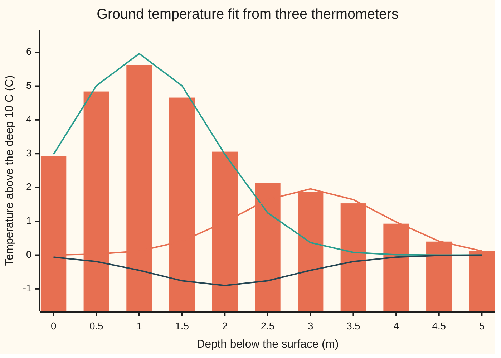

# Reproducing kernels: a space where reading off a value is an inner product

[Syllabus](../../../SYLLABUS.md) → [Functional analysis](../README.md) → [Hilbert Spaces](../README.md#s02) → Reproducing kernels

---

## General Overview

An installer is fitting a ground-source heat pump. Its pipe loop will run 1.5 m below a lawn, so the installer wants the ground temperature there. A test borehole has thermometers at 1, 2 and 3 m. On one July day they read 16, 13 and 12 °C. Deep ground stays near 10 °C all year. (These numbers are illustrative.)

A kernel method fills the gaps between the thermometers. Each reading spreads its influence to nearby depths through a **bump**, a smooth hill centred on its own depth. The prediction at any depth is a weighted sum of three bumps, one per thermometer, added to the deep 10 °C. Here it gives **14.6627 °C at 1.5 m** and 12.1400 °C at 2.5 m.

There are infinitely many smooth profiles to search, yet the best one is always a sum of bumps at the data points. The reason is this card's idea. The bumps live in a space where reading a profile's value at a depth is an inner product with the bump at that depth. A piece perpendicular to all three bumps reads zero at every thermometer, so it can only add cost.

**A reproducing kernel builds a Hilbert space of functions in which each value f(x) is the inner product of f with the kernel's bump at x; because of that, any fit judged by its values at n data points and an increasing charge on its length is a sum of n bumps at those points, with weights from one n-by-n linear system.**

**What kind of fact this is:** two theorems and a method. The reproducing property and the representer theorem (the best fit is a sum of bumps) are proved on this card in Why it works. The construction of the space from the kernel (the Moore–Aronszajn theorem) is sketched in a fold, with the 1950 paper in Sources as the full proof. Kernel ridge regression, the fit itself, is a method: the kernel and the charge are choices.

### The picture: the fitted profile as a sum of three bumps



Caption: the bars are the fitted profile, in °C above the deep 10 °C, at 11 depths from 0 to 5 m. The three lines are the weighted bumps at 1 m (first line), 2 m (second, negative) and 3 m (third). At every depth the bar is the sum of the three lines. Only three weights were fitted, N = 3.

---

## The formula

A **kernel** $`k(x, x')`$ scores how alike two depths are: 1 for the same depth, less for depths further apart (the kernel trick of [Support vector machines](../../14-Applied%20and%20computational/06-Machine%20Learning%20Mathematics/09-kernels-and-support-vector-machines.md)). This card uses a Gaussian kernel written in base 2, with depths in metres:

```math
k(x, x') = 2^{-(x - x')^2} = e^{-(x - x')^2 / (2\ell^2)}, \qquad \ell = 1/\sqrt{2\ln 2} = 0.8493 \text{ m}.
```

**Read it aloud:** two depths 1 m apart are half as alike as a depth with itself, and 2 m apart one sixteenth as alike.

The **bump** at $`x`$ is the function $`k_x = k(\cdot, x)`$: the kernel with one depth held at $`x`$, as a function of the other. $`H_k`$ is the **kernel's space**: the Hilbert space built from the bumps, with inner product $`\langle f, g\rangle_k`$ and length $`\lVert f\rVert_k`$ (Step 3 builds it). Scalars on this card are real. The subscript $`k`$ keeps this length apart from the $`L^2`$ length $`\lVert f\rVert_2`$ of [Inner products](01-inner-products-and-hilbert-spaces.md).

```math
f(x) = \langle f, k_x\rangle_k \ \text{ for every } f \in H_k, \qquad \langle k_x, k_{x'}\rangle_k = k(x, x').
```

**Read it aloud:** to read a profile's value at a depth, take its inner product with the bump at that depth; two bumps have the kernel as their inner product.

The fit, **kernel ridge regression**, picks the profile with the smallest cost $`J`$:

```math
\hat f = \mathrm{argmin}_{f \in H_k}\, J(f), \quad J(f) = \sum_{i=1}^{n} \big(y_i - f(x_i)\big)^2 + \lambda \lVert f\rVert_k^2, \quad \hat f = \sum_{i=1}^{n} \alpha_i\, k_{x_i}, \quad \alpha = (K + \lambda I)^{-1} y.
```

**Read it aloud:** the best profile balances its squared misses at the thermometers against lambda times its squared length, and it is a sum of bumps at the thermometers, weighted by the solution of one linear system.

| Symbol | Plain meaning | In our example | Push it up and the answer… |
| --- | --- | --- | --- |
| $`x`$, $`x'`$, $`x_i`$, $`n`$ | depths below the surface, in metres; thermometer $`i`$'s depth; the number of thermometers | 1, 2, 3 m; $`n`$ = 3 | — |
| $`y_i`$, $`y`$ | reading $`i`$ minus the deep 10 °C; the list of them | 6, 3, 2 °C | raise one reading, its bump grows |
| $`k(x, x')`$, $`\ell`$ | the kernel: how alike two depths are; its reach | 1/2 at 1 m apart, 1/16 at 2 m; $`\ell`$ = 0.8493 m | a longer reach, a smoother profile |
| $`k_x`$ | the bump at depth $`x`$: the function $`k(\cdot, x)`$ | $`k_1`$ peaks at 1 m | — |
| $`H_k`$, $`\langle f, g\rangle_k`$, $`\lVert f\rVert_k`$ | the kernel's space; its inner product; its length | $`\lVert\hat f\rVert_k`$ = 5.8684 °C | — |
| $`f`$, $`\hat f`$, $`g`$ | any profile in $`H_k`$; the best fit; a profile perpendicular to every data bump | $`\hat f(1.5)`$ = 4.6627 °C; $`\lVert g\rVert_k^2`$ = 0.6921 | — |
| $`K`$, $`I`$ | the Gram matrix, $`K_{ij} = k(x_i, x_j)`$; the identity matrix | rows (1, 0.5, 0.0625), (0.5, 1, 0.5), (0.0625, 0.5, 1) | — |
| $`\lambda`$, $`J`$ | the charge on the profile's squared length; the cost, squared misses plus $`\lambda\lVert f\rVert_k^2`$ | 1/16; $`J(\hat f)`$ = 2.3090 °C² | a flatter fit that misses the readings more |
| $`\alpha_i`$ | the weight on bump $`i`$ | 5.9551, −0.8989, 1.9551 | — |
| $`\varphi_m`$, $`M`$, $`X`$ | the $`m`$-th hidden feature of the kernel; how many are kept; the table of feature values, one row per thermometer | $`M`$ = 12 leaves a gap of 0.000000090 °C | larger $`M`$, smaller gap |
| $`\lVert f\rVert_2`$, $`w`$, $`C_x`$, $`c`$ | the $`L^2`$ length; a tent's half-width; a bound on reading at $`x`$; a list of test weights | $`w`$ = 0.01 m gives a peak of 12.2474; $`c`$ = (1, −1, 1) | — |
| $`e_j`$, $`A`$, $`T`$, $`u`$, $`u'`$, $`a_i`$, $`b_j`$, $`x'_j`$, $`f_n`$, $`f_\parallel`$ | proof helpers: the list with 1 in place $`j`$; any inner-product matrix; a raised T turns a column into a row; depth from 2 m, for $`x`$ and $`x'`$; weights and depths of two finite sums; a sequence of profiles; the part of $`f`$ in the span of the data bumps | $`u`$ = −0.5 at 1.5 m | — |

### When it holds

- **The kernel is positive definite.** Every Gram matrix must give $`c^{T} K c \ge 0`$ for every list of weights $`c`$, because that number is a squared length. A box similarity, 1 within 1 m and 0 beyond, gives −1 at depths 1, 1.9 and 2.8 m: no space exists.
- **Reading off a value must be bounded.** The space must satisfy $`\lvert f(x)\rvert \le C_x \lVert f\rVert`$. $`L^2`$ fails: tents of $`L^2`$ length 1 reach 122.4745 at their peak at half-width 0.0001 m.
- **The cost sees the profile only at the data points, plus its length.** A cost that also looked at the value at 5 m would add a bump at 5 m.
- **The charge is positive, or the data points are well apart.** With $`\lambda`$ = 0 and a fourth thermometer at 2.1 m reading 14 °C, the weights reach −358.24 and 362.38, and the fit says 10.72 °C at 1.5 m.
- **The data cover the depths you ask about.** Away from the thermometers every bump fades, so the fit drifts back to the deep 10 °C. At 5 m it is only 0.12 °C above it, whatever the ground does.

---

## Why it works

### Step 0: values as inner products turn fitting into geometry

If each value $`f(x)`$ is an inner product with a fixed bump $`k_x`$, then what $`f`$ does at the thermometers is how it lines up with three bumps. Anything perpendicular to those bumps is invisible there and only adds length. The best fit drops it, leaving $`n`$ unknowns however large the space.

### Step 1: on a finite list of points, every inner product has a kernel

Rehearse on profiles known only at the three depths: lists $`f = (f_1, f_2, f_3)`$. Give them the inner product $`\langle f, g\rangle = f^{T} K^{-1} g`$, with $`K`$ the Gram matrix above. Here

```math
K^{-1} = \frac{1}{225}\begin{pmatrix} 320 & -200 & 80 \\ -200 & 425 & -200 \\ 80 & -200 & 320 \end{pmatrix}.
```

Take $`k_{x_j}`$ to be column $`j`$ of $`K`$. Then $`\langle f, k_{x_j}\rangle = f^{T} K^{-1} K e_j = f_j`$, where $`e_j`$ is the list with 1 in place $`j`$. The inner product reads off the value. For the readings $`y`$ = (6, 3, 2) the code gets back exactly 6, 3 and 2.

In finite dimensions this always works: any inner product $`f^{T} A g`$ on lists has the reproducing kernel $`A^{-1}`$.

### Step 2: in infinite dimensions, reading a value must be bounded

On a whole interval of depths, the $`L^2`$ inner product of [Inner products](01-inner-products-and-hilbert-spaces.md) has no kernel. Its functions count as equal when they agree almost everywhere (except on a set of length zero), so a single value means nothing. Worse, tall thin tents have small length. A tent of half-width $`w`$ and $`L^2`$ length 1 peaks at $`\sqrt{3/(2w)}`$:

| Half-width $`w`$ | Peak value, $`L^2`$ length 1 |
| --- | --- |
| 1 m | 1.2247 |
| 0.01 m | 12.2474 |
| 0.0001 m | 122.4745 |

No number $`C_x`$ can bound $`\lvert f(x)\rvert`$ by $`C_x \lVert f\rVert_2`$.

A **reproducing kernel Hilbert space** (RKHS) is a Hilbert space of functions where every reading is bounded: $`\lvert f(x)\rvert \le C_x\lVert f\rVert`$ for each $`x`$. Then reading at $`x`$ is a bounded linear functional (a linear map to numbers). [Riesz representation](06-riesz-representation-theorem.md) says every such functional is an inner product with one fixed vector. Call that vector $`k_x`$. Then $`f(x) = \langle f, k_x\rangle`$, and setting $`k(x, x') = \langle k_x, k_{x'}\rangle`$ defines the kernel.

Two facts follow at once.

1. **The kernel is positive definite.** For any depths and weights, $`\sum_{i,j} c_i c_j\, k(x_i, x_j) = \lVert \sum_i c_i k_{x_i}\rVert^2 \ge 0`$.
2. **Readings are bounded by the length.** By the Cauchy–Schwarz inequality, $`\lvert f(x)\rvert \le \lVert f\rVert \sqrt{k(x, x)}`$. The Gaussian kernel has $`k(x, x) = 1`$, so no profile in $`H_k`$ exceeds its own length anywhere. The fit has length 5.8684 °C and its largest value from 0 to 8 m is 5.6330 °C above the deep value.

### Step 3: from a kernel to its space

Go the other way: start from a positive definite kernel. Take all finite sums of bumps, give two bumps the inner product $`k(x, x')`$, and add every limit, as the reals complete the rationals. The result is $`H_k`$, the only RKHS with kernel $`k`$. This is the **Moore–Aronszajn theorem**.

Positive definiteness is what makes the lengths real. The box similarity at 1, 1.9 and 2.8 m has rows (1, 1, 0), (1, 1, 1) and (0, 1, 1), and the weights $`c`$ = (1, −1, 1) give a "squared length" of −1.

<details>
<summary>Detailed proof sketch: the Moore–Aronszajn construction</summary>

Let $`f = \sum_i a_i k_{x_i}`$ and $`g = \sum_j b_j k_{x'_j}`$ be finite sums, and set

$`\displaystyle \langle f, g\rangle = \sum_i \sum_j a_i b_j\, k(x_i, x'_j) = \sum_j b_j\, f(x'_j).`$

The right-hand form uses only the values of $`f`$, so it does not matter how $`f`$ was written as a sum; by symmetry, likewise for $`g`$. Taking $`g = k_x`$ gives the reproducing property $`\langle f, k_x\rangle = f(x)`$.

Positive definiteness gives $`\langle f, f\rangle = a^{T} K a \ge 0`$. If $`\langle f, f\rangle = 0`$, Cauchy–Schwarz (valid for any such form) gives $`\lvert f(x)\rvert = \lvert\langle f, k_x\rangle\rvert \le 0`$ at every $`x`$, so $`f = 0`$. The form is an inner product.

Completion: if $`f_n`$ is a Cauchy sequence of finite sums (its terms get arbitrarily close in length), then

$`\displaystyle \lvert f_n(x) - f_m(x)\rvert \le \lVert f_n - f_m\rVert \sqrt{k(x, x)},`$

so the values settle at each $`x`$ and define a function $`f`$. Put every such limit in $`H_k`$, with $`\lVert f\rVert = \lim \lVert f_n\rVert`$. The delicate point is that a Cauchy sequence whose values tend to 0 everywhere also has length tending to 0; the 1950 paper in Sources proves it. So each limit function is a single, well-defined element.

Uniqueness: any RKHS with kernel $`k`$ contains every bump with the same inner products. A function perpendicular to every bump has $`f(x) = \langle f, k_x\rangle = 0`$ everywhere, so the bumps' finite sums are dense (their limits fill the space). Both spaces are therefore the same completion. ∎

</details>

### Step 4: the best fit is a sum of bumps at the data points

This is the **representer theorem**. Split any profile $`f`$ in $`H_k`$ by [Projection](02-projection-theorem-and-orthogonal-complements.md): $`f = f_\parallel + g`$. Here $`f_\parallel`$ lies in the span of the data bumps $`k_{x_1}, \dots, k_{x_n}`$, and $`g`$ is perpendicular to all of them.

1. **The fit at the data does not see $`g`$.** $`g(x_i) = \langle g, k_{x_i}\rangle = 0`$, so $`f(x_i) = f_\parallel(x_i)`$ and the squared misses are unchanged.
2. **The length only grows.** By Pythagoras, $`\lVert f\rVert_k^2 = \lVert f_\parallel\rVert_k^2 + \lVert g\rVert_k^2`$.

So $`J(f) = J(f_\parallel) + \lambda\lVert g\rVert_k^2`$. The best fit has $`g = 0`$: it is a sum of data bumps.

The borehole shows it exactly. Take the bump at the surface, $`k_0`$, and remove its shadow on the three data bumps. What is left, $`g`$, reads exactly 0 at 1, 2 and 3 m, yet has $`\lVert g\rVert_k^2 = 2835/4096 = 0.6921`$. Adding it raises the cost from 2.3090 °C² to 2.3522 °C², which is 2.3090 + 0.6921/16.

### Step 5: the weights come from one linear system

Put $`f = \sum_j \alpha_j k_{x_j}`$ into the cost. The values at the data are $`K\alpha`$, and the squared length is $`\alpha^{T} K \alpha`$, so

```math
J(\alpha) = \lVert y - K\alpha\rVert^2 + \lambda\, \alpha^{T} K \alpha .
```

Its gradient (the direction of fastest rise) is $`2K\big((K + \lambda I)\alpha - y\big)`$, which vanishes at $`\alpha = (K + \lambda I)^{-1} y`$. This is [Regularisation](../../09-Probability%20and%20statistics/09-Regression/06-ridge-and-lasso.md)'s ridge formula in its dual form. Ridge on a table of features $`X`$, one row per thermometer, gives the feature weights $`(X^{T} X + \lambda I)^{-1} X^{T} y`$, which equal $`X^{T} (X X^{T} + \lambda I)^{-1} y`$. Here $`X X^{T}`$ holds the features' inner products between pairs of thermometers, which is the Gram matrix $`K`$ (Step 6), and $`(K + \lambda I)^{-1} y`$ is $`\alpha`$.

Rearranged, $`y - K\alpha = \lambda\alpha`$. Each weight is its thermometer's **leftover** (reading minus fit) divided by $`\lambda`$. At 1 m the fit is 15.6278 °C and the leftover 0.3722 °C; the exact leftover divided by $`\lambda`$ = 1/16 is 5.9551 = $`\alpha_1`$. The 2 m weight is negative: the bumps from 1 and 3 m already overshoot 13 °C there, so the 2 m bump pulls the fit down.

### Step 6: kernel ridge is ridge on infinitely many hidden features

Measure depth from the middle thermometer: $`u = x - 2`$ and $`u' = x' - 2`$. Split the kernel and expand the exponential:

```math
2^{-(u - u')^2} = 2^{-u^2}\, 2^{-u'^2}\, e^{(2\ln 2)\,u u'} = \sum_{m=0}^{\infty} \varphi_m(x)\, \varphi_m(x'), \qquad \varphi_m(x) = 2^{-u^2}\, \frac{(2\ln 2)^{m/2}\, u^m}{\sqrt{m!}} .
```

**Read it aloud:** the kernel is a dot product of infinitely many hidden features, one for each power of the depth.

So a profile in $`H_k`$ is a weighted sum of features, and its length is the length of the weight list (for the shortest list that gives it). Kernel ridge is plain ridge regression on these features. Keep only the first $`M`$ and run ordinary ridge on them:

| Features kept $`M`$ | Prediction at 1.5 m (°C) | Gap to the kernel answer (°C) |
| --- | --- | --- |
| 1 | 13.767216 | 0.895507441 |
| 2 | 15.309907 | 0.647183366 |
| 4 | 14.799286 | 0.136563071 |
| 6 | 14.671513 | 0.008789698 |
| 8 | 14.663024 | 0.000300170 |
| 12 | 14.662723 | 0.000000090 |

The gap falls faster than any fixed ratio, because feature $`m`$ carries the factor $`1/\sqrt{m!}`$. The kernel route needs no truncation: three bumps, one 3-by-3 system.

What the truncation hides: $`H_k`$ is infinite-dimensional, one direction per feature, and no finite $`M`$ gives the kernel exactly. The code holds finitely many numbers; only the proof covers the whole space.

---

## Worked numbers, by hand

Readings 16, 13 and 12 °C at 1, 2 and 3 m; deep ground 10 °C; $`\lambda`$ = 1/16. Read as a Gaussian process (Where you meet it; [Gaussian processes](../../11-Stochastic%20processes%20and%20calculus/05-Brownian%20Motion/09-gaussian-processes-and-karhunen-loeve.md)), $`\lambda`$ = 1/16 assumes the thermometers' noise variance is one sixteenth of the ground's own variance, so the noise is a quarter as large as the variation the bumps describe (illustrative). That is why the fit may miss the 16 °C reading by 0.3722 °C.

| Step | Arithmetic | Value |
| --- | --- | --- |
| kernel values | $`2^{0}`$, $`2^{-1}`$, $`2^{-4}`$ for 0, 1 and 2 m apart | 1, 0.5, 0.0625 |
| readings above 10 °C | 16 − 10, 13 − 10, 12 − 10 | $`y`$ = 6, 3, 2 |
| $`(K + I/16)\,\alpha = y`$, times 16 | rows (17, 8, 1), (8, 17, 8), (1, 8, 17); right side 96, 48, 32 | three whole-number equations |
| row 1 minus row 3 | $`16(\alpha_1 - \alpha_3) = 64`$ | $`\alpha_1 - \alpha_3`$ = 4 |
| row 1 plus row 3; row 2 | $`18(\alpha_1 + \alpha_3) + 16\alpha_2 = 128`$; $`8(\alpha_1 + \alpha_3) + 17\alpha_2 = 48`$ | two equations |
| remove $`\alpha_1 + \alpha_3`$ | 9 × (row 2) minus 4 × (row 1 plus row 3) | $`89\alpha_2 = -80`$, $`\alpha_2`$ = −0.8989 |
| back-substitute | $`\alpha_1 + \alpha_3 = (128 - 16\alpha_2)/18 = 704/89`$ | 7.9101 |
| the outer weights | $`(7.9101 \pm 4)/2`$ | $`\alpha_1`$ = 5.9551, $`\alpha_3`$ = 1.9551 |
| check at 1 m | leftover 16 − 15.6278 = 0.3722; exact leftover / $`\lambda`$ | 5.9551 = $`\alpha_1`$ |
| kernel at 1.5 m | $`2^{-0.25}`$, $`2^{-0.25}`$, $`2^{-2.25}`$ | 0.8409, 0.8409, 0.2102 |
| sum the bumps | $`(\alpha_1 + \alpha_2) \times 0.8409 + \alpha_3 \times 0.2102`$ = 4.2517 + 0.4110 | 4.6627 |
| add the deep value | 10 + 4.6627 | **14.6627 °C** |

The ground at 1.5 m should be 14.6627 °C on this July day, 4.6627 °C above the deep value: the warmth the pipe loop draws on.

### What breaks if you drop a piece

| Mistake | Comes out at | What went wrong |
| --- | --- | --- |
| A box similarity (1 within 1 m, else 0) at 1, 1.9, 2.8 m | weights (1, −1, 1) give squared length −1 | Not positive definite: no space has these inner products |
| Read values in $`L^2`$ | tents of length 1 peak at 1.2247, 12.2474, 122.4745 for $`w`$ = 1, 0.01, 0.0001 m | Reading is unbounded, so there is no kernel |
| $`\lambda`$ = 0, with a fourth thermometer at 2.1 m reading 14 °C | weights −358.24 and 362.38; 10.72 °C at 1.5 m, 16.35 °C at 2.5 m | Two nearly equal bumps cancel each other; with $`\lambda`$ = 1/16: 14.89 and 12.66 °C |
| Bumps at 0.5, 2.5 and 4.5 m instead of at the data | cost 2.9045 °C² against 2.3090 °C² | The best fit lies in the span of the data bumps, not any other three |

The code prints all four.

---

## Code, from first principles, and it actually runs

The code works in exact fractions, since every kernel value at whole-metre depths is a power of 1/2. It takes three roads to the fit: the 3-by-3 system $`(K + \lambda I)\alpha = y`$; ordinary ridge on $`M`$ hidden features, which meets it to 9 decimal places; and the optimality test, leftovers equal to $`\lambda\alpha`$ exactly, with every 0.01 nudge of a weight raising the cost. It also checks the reproducing property, the representer split, the reading bound and every row of What breaks.

### Python

```python
# Reproducing kernels -- the check behind the card.  Standard library only; the solver is written out.
# Three thermometers in a borehole and a Gaussian kernel in base 2, k(x, z) = 2^-((x - z)/1 m)^2,
# so at whole-metre depths every kernel value is an exact fraction.
from fractions import Fraction as F
import math

depth = [1, 2, 3]                           # thermometer depths, m
temp = [16, 13, 12]                         # one July day, deg C (illustrative)
deep = 10                                   # deep-ground temperature, deg C (illustrative)
y = [F(t - deep) for t in temp]             # readings above the deep value: 6, 3, 2
lam = F(1, 16)                              # the charge on the size of the fit

def kq(x, z): return F(1, 2 ** ((x - z) ** 2))      # exact, whole-metre depths only
def kf(x, z): return 2.0 ** (-(x - z) ** 2)
def num(q): return str(q.numerator) if q.denominator == 1 else f"{float(q):.4f}"
def vec(v): return "(" + ", ".join(num(q) for q in v) + ")"
def c2f(v): return f"{0.0 if abs(v) < 0.005 else v:5.2f}"   # no "-0.00"
def mv(A, v): return [sum((a * b for a, b in zip(row, v)), 0 * v[0]) for row in A]
def dot(u, v): return sum((a * b for a, b in zip(u, v)), 0 * u[0])

def solve(A, b):                            # Gauss-Jordan with partial pivoting
    n = len(b)
    M = [list(row) + [v] for row, v in zip(A, b)]
    for c in range(n):
        p = max(range(c, n), key=lambda r: abs(M[r][c]))
        M[c], M[p] = M[p], M[c]
        for r in range(n):
            if r != c:
                f = M[r][c] / M[c][c]
                M[r] = [a - f * e for a, e in zip(M[r], M[c])]
    return [M[i][n] / M[i][i] for i in range(n)]

def ridge(cent, xs, ys, lm):                # min sum (y - f)^2 + lm |f|^2 over span of k at cent
    B = [[kf(x, z) for z in cent] for x in xs]
    G = [[kf(a, b) for b in cent] for a in cent]
    A = [[sum(B[i][r] * B[i][s] for i in range(len(xs))) + lm * G[r][s] for s in range(len(cent))]
         for r in range(len(cent))]
    c = solve(A, [sum(B[i][r] * ys[i] for i in range(len(xs))) for r in range(len(cent))])
    fit = mv(B, c)
    return c, sum((a - b) ** 2 for a, b in zip(ys, fit)) + lm * dot(c, mv(G, c))

# ---- the finite rehearsal: functions on the three depths ----
K = [[kq(a, b) for b in depth] for a in depth]
Kinv = [solve(K, [F(int(i == j)) for i in range(3)]) for j in range(3)]   # columns = rows (symmetric)
reads = [dot(y, mv(Kinv, K[j])) for j in range(3)]                        # <y, k_x> with <f,g> = f K^-1 g
print("Gram matrix K, rows:", "; ".join(vec(r) for r in K))
print("K^-1 x 225, rows: " + "; ".join(vec([225 * v for v in r]) for r in Kinv))
print(f"<y, k_x> on the three depths reads off y: {vec(reads)}")
print(f"base-2 kernel = exp(-d^2/(2 l^2)) with reach l = 1/sqrt(2 ln 2) = {1 / math.sqrt(2 * math.log(2)):.4f} m")

# ---- kernel ridge: the best fit is a sum of kernels at the data points ----
KL = [[K[i][j] + lam * (i == j) for j in range(3)] for i in range(3)]
alpha = solve(KL, y)
fitted = mv(K, alpha)
resid = [a - b for a, b in zip(y, fitted)]
norm2 = dot(alpha, mv(K, alpha))
J = dot(resid, resid) + lam * norm2
print(f"alpha = (K + I/16)^-1 y = {vec(alpha)}  exactly {', '.join(str(a) for a in alpha)}")
print(f"by hand: 16(K + I/16) rows {'; '.join(vec([16 * v for v in r]) for r in KL)}; 16y = {vec([16 * v for v in y])}")
print(f"  a1 - a3 = {num(alpha[0] - alpha[2])}, a1 + a3 = {alpha[0] + alpha[2]} = {num(alpha[0] + alpha[2])}, 89 a2 = {num(89 * alpha[1])}")
print(f"fit at 1, 2, 3 m: {vec([f + deep for f in fitted])} deg C; residuals {vec(resid)}")
print(f"residual / lambda = {vec([r / lam for r in resid])} (equals alpha)")
print(f"|f|^2 = alpha.K.alpha = {num(norm2)}, |f| = {math.sqrt(norm2):.4f}; "
      f"J* = misses {num(dot(resid, resid))} + lambda |f|^2 {num(lam * norm2)} = {num(J)}")
f = lambda x: sum(float(a) * kf(x, d) for a, d in zip(alpha, depth))
grid = [i / 2 for i in range(11)]
print("depth m:  " + " ".join(f"{x:5.1f}" for x in grid))
print("fit - 10:  " + " ".join(c2f(f(x)) for x in grid))
for a, d in zip(alpha, depth):
    print(f"bump {d} m: " + " ".join(c2f(float(a) * kf(x, d)) for x in grid))
k1, k3 = kf(1.5, 1), kf(1.5, 3)
print(f"by hand at 1.5 m: k = {k1:.4f}, {k1:.4f}, {k3:.4f}; (a1 + a2) x {k1:.4f} = {float(alpha[0] + alpha[1]) * k1:.4f}, "
      f"a3 x {k3:.4f} = {float(alpha[2]) * k3:.4f}")
print(f"answer: 1.5 m reads {deep + f(1.5):.4f} deg C, 2.5 m {deep + f(2.5):.4f}, surface 0 m {deep + f(0):.4f}")
big = max(abs(f(i / 100)) for i in range(0, 801))
print(f"largest |f| on 0 to 8 m: {big:.4f} <= |f| sqrt(k(x,x)) = {math.sqrt(norm2):.4f}")

# ---- representer: a direction off the span only adds cost ----
kz = [kq(0, d) for d in depth]                                  # bump at the surface, 0 m
cz = solve(K, kz)                                               # its projection onto the span
g_at = [kz[i] - dot(K[i], cz) for i in range(3)]                # g = k_0 - projection, at the data
g2 = 1 - dot(kz, cz)                                            # |g|^2
cent4 = [0] + depth
K4 = [[kq(a, b) for b in cent4] for a in cent4]
coef = [F(1)] + [a - c for a, c in zip(alpha, cz)]              # f + g on centres 0, 1, 2, 3
vals = [dot(K4[i + 1], coef) for i in range(3)]
Jg = sum((a - b) ** 2 for a, b in zip(y, vals)) + lam * dot(coef, mv(K4, coef))
print(f"g = k_0 minus its projection: g at 1, 2, 3 m = {vec(g_at)}; |g|^2 = {num(g2)} = {g2}")
print(f"J(f + g) = {num(Jg)} = J* + lambda |g|^2 = {num(J + lam * g2)}")
def cost(a):
    r = [u - v for u, v in zip(y, mv(K, a))]
    return dot(r, r) + lam * dot(a, mv(K, a))
nudge = min(cost([alpha[i] + F(s, 100) * (i == j) for i in range(3)]) for s in (-1, 1) for j in range(3))
print(f"six nudges of one alpha by 0.01: least J = {num(nudge)} > J*")

# ---- a second road: ordinary ridge on M explicit features ----
c2 = 2 * math.log(2)
def phi(x, M): return [2.0 ** (-(x - 2) ** 2) * (c2 ** 0.5 * (x - 2)) ** m / math.sqrt(math.factorial(m)) for m in range(M)]
yf, gaps = [float(v) for v in y], []
print("M features: prediction at 1.5 m (deg C), gap to the kernel answer")
for M in (1, 2, 3, 4, 6, 8, 12, 16, 20):
    P = [phi(d, M) for d in depth]
    A = [[sum(P[i][r] * P[i][s] for i in range(3)) + float(lam) * (r == s) for s in range(M)] for r in range(M)]
    w = solve(A, [sum(P[i][r] * yf[i] for i in range(3)) for r in range(M)])
    pred = dot(phi(1.5, M), w)
    gaps.append(abs(pred - f(1.5)))
    print(f"  M = {M:2d}: {deep + pred:.6f}  gap {gaps[-1]:.9f}")

# ---- what breaks ----
box = [[int(abs(a - b) < 1) for b in (1, 1.9, 2.8)] for a in (1, 1.9, 2.8)]
cbox = [1, -1, 1]
qbox = dot(cbox, mv(box, cbox))
print(f"mistake 1, box kernel at 1, 1.9, 2.8 m: rows {box}; c = (1, -1, 1) gives c.K.c = {qbox}")
print("mistake 2, L2 tents of norm 1 and half-width w: value at the peak")
spikes = []
for wd, lab in ((1.0, "1"), (0.01, "0.01"), (0.0001, "0.0001")):
    h, n = math.sqrt(3 / (2 * wd)), 20000
    sq = sum((h * (1 - abs(-wd + (i + 0.5) * 2 * wd / n) / wd)) ** 2 for i in range(n)) * 2 * wd / n
    spikes.append(h / math.sqrt(sq))
    print(f"  w = {lab} m: peak {spikes[-1]:.4f}, formula sqrt(3/(2w)) = {math.sqrt(3 / (2 * wd)):.4f}")
xs4, ys4 = [1, 2, 2.1, 3], [6.0, 3.0, 4.0, 2.0]
for lm in (0.0, 0.0625):
    c4, _ = ridge(xs4, xs4, ys4, lm)
    p = lambda x: sum(a * kf(x, d) for a, d in zip(c4, xs4))
    print(f"mistake 3, extra sensor 2.1 m at 14 deg C, lambda = {lm:.4f}: alpha = ({', '.join(f'{a:.2f}' for a in c4)}),"
          f" fit at 1.5 m {deep + p(1.5):.2f}, at 2.5 m {deep + p(2.5):.2f}")
    if lm == 0: wild = max(abs(a) for a in c4)
araw = [float(a) for a in solve(KL, [F(t) for t in temp])]
fr = lambda x: sum(a * kf(x, d) for a, d in zip(araw, depth))
print(f"mistake 4, deep 10 deg C not removed: fit at 1.5 m {fr(1.5):.2f}, at 5 m {fr(5):.2f} deg C")
_, Jelse = ridge([0.5, 2.5, 4.5], depth, yf, float(lam))
print(f"mistake 5, kernels centred at 0.5, 2.5, 4.5 m instead: J = {Jelse:.4f} against J* = {float(J):.4f}")

assert reads == y and resid == [lam * a for a in alpha]                 # reproducing; residual = lambda alpha
assert all(v == 0 for v in g_at) and g2 > 0 and Jg == J + lam * g2       # representer, exactly
assert nudge > J and Jelse > float(J) + 0.1 and big <= math.sqrt(norm2)
assert gaps[-1] < 1e-9 and all(a > b for a, b in zip(gaps[:6], gaps[1:7]))  # features meet the kernel
assert qbox == -1 and all(abs(s - math.sqrt(3 / (2 * w))) < 1e-3 * s for s, w in zip(spikes, (1.0, 0.01, 0.0001)))
assert wild > 10 * max(abs(float(a)) for a in alpha)
print("ALL CHECKS PASS")
```

**Ran 2026-11-15 on macOS, Python 3.14.10, standard library only. All checks passed. Output, pasted from the run:**

```
Gram matrix K, rows: (1, 0.5000, 0.0625); (0.5000, 1, 0.5000); (0.0625, 0.5000, 1)
K^-1 x 225, rows: (320, -200, 80); (-200, 425, -200); (80, -200, 320)
<y, k_x> on the three depths reads off y: (6, 3, 2)
base-2 kernel = exp(-d^2/(2 l^2)) with reach l = 1/sqrt(2 ln 2) = 0.8493 m
alpha = (K + I/16)^-1 y = (5.9551, -0.8989, 1.9551)  exactly 530/89, -80/89, 174/89
by hand: 16(K + I/16) rows (17, 8, 1); (8, 17, 8); (1, 8, 17); 16y = (96, 48, 32)
  a1 - a3 = 4, a1 + a3 = 704/89 = 7.9101, 89 a2 = -80
fit at 1, 2, 3 m: (15.6278, 13.0562, 11.8778) deg C; residuals (0.3722, -0.0562, 0.1222)
residual / lambda = (5.9551, -0.8989, 1.9551) (equals alpha)
|f|^2 = alpha.K.alpha = 34.4380, |f| = 5.8684; J* = misses 0.1566 + lambda |f|^2 2.1524 = 2.3090
depth m:    0.0   0.5   1.0   1.5   2.0   2.5   3.0   3.5   4.0   4.5   5.0
fit - 10:   2.93  4.84  5.63  4.66  3.06  2.14  1.88  1.53  0.93  0.40  0.12
bump 1 m:  2.98  5.01  5.96  5.01  2.98  1.25  0.37  0.08  0.01  0.00  0.00
bump 2 m: -0.06 -0.19 -0.45 -0.76 -0.90 -0.76 -0.45 -0.19 -0.06 -0.01  0.00
bump 3 m:  0.00  0.03  0.12  0.41  0.98  1.64  1.96  1.64  0.98  0.41  0.12
by hand at 1.5 m: k = 0.8409, 0.8409, 0.2102; (a1 + a2) x 0.8409 = 4.2517, a3 x 0.2102 = 0.4110
answer: 1.5 m reads 14.6627 deg C, 2.5 m 12.1400, surface 0 m 12.9252
largest |f| on 0 to 8 m: 5.6330 <= |f| sqrt(k(x,x)) = 5.8684
g = k_0 minus its projection: g at 1, 2, 3 m = (0, 0, 0); |g|^2 = 0.6921 = 2835/4096
J(f + g) = 2.3522 = J* + lambda |g|^2 = 2.3522
six nudges of one alpha by 0.01: least J = 2.3091 > J*
M features: prediction at 1.5 m (deg C), gap to the kernel answer
  M =  1: 13.767216  gap 0.895507441
  M =  2: 15.309907  gap 0.647183366
  M =  3: 15.054135  gap 0.391411770
  M =  4: 14.799286  gap 0.136563071
  M =  6: 14.671513  gap 0.008789698
  M =  8: 14.663024  gap 0.000300170
  M = 12: 14.662723  gap 0.000000090
  M = 16: 14.662723  gap 0.000000000
  M = 20: 14.662723  gap 0.000000000
mistake 1, box kernel at 1, 1.9, 2.8 m: rows [[1, 1, 0], [1, 1, 1], [0, 1, 1]]; c = (1, -1, 1) gives c.K.c = -1
mistake 2, L2 tents of norm 1 and half-width w: value at the peak
  w = 1 m: peak 1.2247, formula sqrt(3/(2w)) = 1.2247
  w = 0.01 m: peak 12.2474, formula sqrt(3/(2w)) = 12.2474
  w = 0.0001 m: peak 122.4745, formula sqrt(3/(2w)) = 122.4745
mistake 3, extra sensor 2.1 m at 14 deg C, lambda = 0.0000: alpha = (30.19, -358.24, 362.38, -27.46), fit at 1.5 m 10.72, at 2.5 m 16.35
mistake 3, extra sensor 2.1 m at 14 deg C, lambda = 0.0625: alpha = (6.13, -9.69, 9.93, 0.75), fit at 1.5 m 14.89, at 2.5 m 12.66
mistake 4, deep 10 deg C not removed: fit at 1.5 m 14.68, at 5 m 0.63 deg C
mistake 5, kernels centred at 0.5, 2.5, 4.5 m instead: J = 2.9045 against J* = 2.3090
ALL CHECKS PASS
```

### Rust

Same numbers, same labels, built with `rustc --edition 2021 -O`. The fractions are a small struct of two 128-bit integers.

```rust
// Reproducing kernels -- the same check as the Python, in Rust.  No crates; the solver is written out.
// Gaussian kernel in base 2, k(x, z) = 2^-((x - z)/1 m)^2: at whole-metre depths every kernel value
// is an exact fraction, held in the small struct Q below.
use std::ops::{Add, Div, Mul, Sub};

#[derive(Clone, Copy, PartialEq, Debug)]
struct Q(i128, i128);                                 // numerator, denominator > 0, lowest terms
fn gcd(a: i128, b: i128) -> i128 { if b == 0 { a.abs() } else { gcd(b, a % b) } }
fn q(n: i128, d: i128) -> Q { let g = gcd(n, d).max(1) * d.signum(); Q(n / g, d / g) }
impl Add for Q { type Output = Q; fn add(self, o: Q) -> Q { q(self.0 * o.1 + o.0 * self.1, self.1 * o.1) } }
impl Sub for Q { type Output = Q; fn sub(self, o: Q) -> Q { q(self.0 * o.1 - o.0 * self.1, self.1 * o.1) } }
impl Mul for Q { type Output = Q; fn mul(self, o: Q) -> Q { q(self.0 * o.0, self.1 * o.1) } }
impl Div for Q { type Output = Q; fn div(self, o: Q) -> Q { q(self.0 * o.1, self.1 * o.0) } }

trait Fld: Copy + Add<Output = Self> + Sub<Output = Self> + Mul<Output = Self> + Div<Output = Self> { fn zero() -> Self; fn mag(self) -> f64; }
impl Fld for Q { fn zero() -> Q { Q(0, 1) } fn mag(self) -> f64 { (self.0 as f64 / self.1 as f64).abs() } }
impl Fld for f64 { fn zero() -> f64 { 0.0 } fn mag(self) -> f64 { self.abs() } }

fn z(n: i128) -> Q { Q(n, 1) }
fn fq(x: Q) -> f64 { x.0 as f64 / x.1 as f64 }
fn kq(x: i128, w: i128) -> Q { Q(1, 1i128 << ((x - w) * (x - w))) }    // exact, whole metres only
fn kf(x: f64, w: f64) -> f64 { 2f64.powf(-((x - w) * (x - w))) }
fn num(x: Q) -> String { if x.1 == 1 { format!("{}", x.0) } else { format!("{:.4}", fq(x)) } }
fn vec(v: &[Q]) -> String { format!("({})", v.iter().map(|x| num(*x)).collect::<Vec<_>>().join(", ")) }
fn c2f(v: f64) -> String { format!("{:5.2}", if v.abs() < 0.005 { 0.0 } else { v }) }   // no "-0.00"
fn dot<T: Fld>(u: &[T], v: &[T]) -> T { u.iter().zip(v).fold(T::zero(), |s, (a, b)| s + *a * *b) }
fn mv<T: Fld>(a: &[Vec<T>], v: &[T]) -> Vec<T> { a.iter().map(|r| dot(r, v)).collect() }

fn solve<T: Fld>(a: &[Vec<T>], b: &[T]) -> Vec<T> {   // Gauss-Jordan with partial pivoting
    let n = b.len();
    let mut m: Vec<Vec<T>> = a.iter().zip(b).map(|(r, v)| { let mut r = r.clone(); r.push(*v); r }).collect();
    for c in 0..n {
        let mut p = c;
        for r in c..n { if m[r][c].mag() > m[p][c].mag() { p = r } }
        m.swap(c, p);
        for r in 0..n {
            if r != c {
                let f = m[r][c] / m[c][c];
                let pivot = m[c].clone();
                m[r] = m[r].iter().zip(&pivot).map(|(x, e)| *x - f * *e).collect();
            }
        }
    }
    (0..n).map(|i| m[i][n] / m[i][i]).collect()
}

fn ridge(cent: &[f64], xs: &[f64], ys: &[f64], lm: f64) -> (Vec<f64>, f64) {
    let b: Vec<Vec<f64>> = xs.iter().map(|&x| cent.iter().map(|&w| kf(x, w)).collect()).collect();
    let g: Vec<Vec<f64>> = cent.iter().map(|&x| cent.iter().map(|&w| kf(x, w)).collect()).collect();
    let nc = cent.len();
    let a: Vec<Vec<f64>> = (0..nc).map(|r| (0..nc).map(|s| (0..xs.len()).fold(0.0, |t, i| t + b[i][r] * b[i][s]) + lm * g[r][s]).collect()).collect();
    let c = solve(&a, &(0..nc).map(|r| (0..xs.len()).fold(0.0, |t, i| t + b[i][r] * ys[i])).collect::<Vec<f64>>());
    let miss = ys.iter().zip(&mv(&b, &c)).fold(0.0, |t, (a, b)| t + (a - b) * (a - b));
    (c.clone(), miss + lm * dot(&c, &mv(&g, &c)))
}

fn phi(x: f64, m: usize) -> Vec<f64> {
    let c2 = 2.0 * 2f64.ln();
    let mut fact = 1.0;
    (0..m).map(|k| { if k > 0 { fact *= k as f64 } 2f64.powf(-((x - 2.0) * (x - 2.0))) * (c2.sqrt() * (x - 2.0)).powi(k as i32) / fact.sqrt() }).collect()
}

fn main() {
    let (depth, temp, deep): ([i128; 3], [i128; 3], i128) = ([1, 2, 3], [16, 13, 12], 10);
    let y: Vec<Q> = temp.iter().map(|t| z(t - deep)).collect();
    let (lam, deepf) = (q(1, 16), deep as f64);
    // ---- the finite rehearsal: functions on the three depths ----
    let k: Vec<Vec<Q>> = depth.iter().map(|&a| depth.iter().map(|&b| kq(a, b)).collect()).collect();
    let kinv: Vec<Vec<Q>> = (0..3).map(|j| solve(&k, &(0..3).map(|i| z((i == j) as i128)).collect::<Vec<Q>>())).collect();
    let reads: Vec<Q> = (0..3).map(|j| dot(&y, &mv(&kinv, &k[j]))).collect();
    println!("Gram matrix K, rows: {}", k.iter().map(|r| vec(r)).collect::<Vec<_>>().join("; "));
    println!("K^-1 x 225, rows: {}", kinv.iter().map(|r| vec(&r.iter().map(|v| z(225) * *v).collect::<Vec<Q>>())).collect::<Vec<_>>().join("; "));
    println!("<y, k_x> on the three depths reads off y: {}", vec(&reads));
    println!("base-2 kernel = exp(-d^2/(2 l^2)) with reach l = 1/sqrt(2 ln 2) = {:.4} m", 1.0 / (2.0 * 2f64.ln()).sqrt());
    // ---- kernel ridge: the best fit is a sum of kernels at the data points ----
    let kl: Vec<Vec<Q>> = (0..3).map(|i| (0..3).map(|j| if i == j { k[i][j] + lam } else { k[i][j] }).collect()).collect();
    let alpha = solve(&kl, &y);
    let fitted = mv(&k, &alpha);
    let resid: Vec<Q> = y.iter().zip(&fitted).map(|(a, b)| *a - *b).collect();
    let norm2 = dot(&alpha, &mv(&k, &alpha));
    let jstar = dot(&resid, &resid) + lam * norm2;
    println!("alpha = (K + I/16)^-1 y = {}  exactly {}", vec(&alpha), alpha.iter().map(|a| if a.1 == 1 { format!("{}", a.0) } else { format!("{}/{}", a.0, a.1) }).collect::<Vec<_>>().join(", "));
    println!("by hand: 16(K + I/16) rows {}; 16y = {}", kl.iter().map(|r| vec(&r.iter().map(|v| z(16) * *v).collect::<Vec<Q>>())).collect::<Vec<_>>().join("; "), vec(&y.iter().map(|v| z(16) * *v).collect::<Vec<Q>>()));
    let s13 = alpha[0] + alpha[2];
    println!("  a1 - a3 = {}, a1 + a3 = {}/{} = {}, 89 a2 = {}", num(alpha[0] - alpha[2]), s13.0, s13.1, num(s13), num(z(89) * alpha[1]));
    println!("fit at 1, 2, 3 m: {} deg C; residuals {}", vec(&fitted.iter().map(|f| *f + z(deep)).collect::<Vec<Q>>()), vec(&resid));
    println!("residual / lambda = {} (equals alpha)", vec(&resid.iter().map(|r| *r / lam).collect::<Vec<Q>>()));
    println!("|f|^2 = alpha.K.alpha = {}, |f| = {:.4}; J* = misses {} + lambda |f|^2 {} = {}", num(norm2), fq(norm2).sqrt(), num(dot(&resid, &resid)), num(lam * norm2), num(jstar));
    let fx = |x: f64| alpha.iter().zip(&depth).fold(0.0, |s, (a, d)| s + fq(*a) * kf(x, *d as f64));
    let grid: Vec<f64> = (0..11).map(|i| i as f64 / 2.0).collect();
    println!("depth m:  {}", grid.iter().map(|x| format!("{:5.1}", x)).collect::<Vec<_>>().join(" "));
    println!("fit - 10:  {}", grid.iter().map(|&x| c2f(fx(x))).collect::<Vec<_>>().join(" "));
    for (a, d) in alpha.iter().zip(&depth) {
        println!("bump {} m: {}", d, grid.iter().map(|&x| c2f(fq(*a) * kf(x, *d as f64))).collect::<Vec<_>>().join(" "));
    }
    let (k1, k3) = (kf(1.5, 1.0), kf(1.5, 3.0));
    println!("by hand at 1.5 m: k = {:.4}, {:.4}, {:.4}; (a1 + a2) x {:.4} = {:.4}, a3 x {:.4} = {:.4}", k1, k1, k3, k1, fq(alpha[0] + alpha[1]) * k1, k3, fq(alpha[2]) * k3);
    println!("answer: 1.5 m reads {:.4} deg C, 2.5 m {:.4}, surface 0 m {:.4}", deepf + fx(1.5), deepf + fx(2.5), deepf + fx(0.0));
    let big = (0..801).map(|i| fx(i as f64 / 100.0).abs()).fold(0.0, f64::max);
    println!("largest |f| on 0 to 8 m: {:.4} <= |f| sqrt(k(x,x)) = {:.4}", big, fq(norm2).sqrt());
    // ---- representer: a direction off the span only adds cost ----
    let kz: Vec<Q> = depth.iter().map(|&d| kq(0, d)).collect();
    let cz = solve(&k, &kz);
    let g_at: Vec<Q> = (0..3).map(|i| kz[i] - dot(&k[i], &cz)).collect();
    let g2 = z(1) - dot(&kz, &cz);
    let k4: Vec<Vec<Q>> = (0..4).map(|a| (0..4).map(|b| kq(a, b)).collect()).collect();     // centres 0, 1, 2, 3 m
    let coef: Vec<Q> = [z(1)].into_iter().chain(alpha.iter().zip(&cz).map(|(a, c)| *a - *c)).collect();
    let vals: Vec<Q> = (0..3).map(|i| dot(&k4[i + 1], &coef)).collect();
    let jg = y.iter().zip(&vals).fold(z(0), |s, (a, b)| s + (*a - *b) * (*a - *b)) + lam * dot(&coef, &mv(&k4, &coef));
    println!("g = k_0 minus its projection: g at 1, 2, 3 m = {}; |g|^2 = {} = {}/{}", vec(&g_at), num(g2), g2.0, g2.1);
    println!("J(f + g) = {} = J* + lambda |g|^2 = {}", num(jg), num(jstar + lam * g2));
    let cost = |a: &[Q]| { let r: Vec<Q> = y.iter().zip(&mv(&k, a)).map(|(u, v)| *u - *v).collect(); dot(&r, &r) + lam * dot(a, &mv(&k, a)) };
    let mut nudge = cost(&[z(1000), z(0), z(0)]);
    for s in [-1, 1] { for j in 0..3 {
        let a: Vec<Q> = (0..3).map(|i| if i == j { alpha[i] + q(s, 100) } else { alpha[i] }).collect();
        if fq(cost(&a)) < fq(nudge) { nudge = cost(&a) }
    } }
    println!("six nudges of one alpha by 0.01: least J = {} > J*", num(nudge));
    // ---- a second road: ordinary ridge on M explicit features ----
    let yf: Vec<f64> = y.iter().map(|v| fq(*v)).collect();
    let mut gaps: Vec<f64> = Vec::new();
    println!("M features: prediction at 1.5 m (deg C), gap to the kernel answer");
    for m in [1usize, 2, 3, 4, 6, 8, 12, 16, 20] {
        let p: Vec<Vec<f64>> = depth.iter().map(|&d| phi(d as f64, m)).collect();
        let a: Vec<Vec<f64>> = (0..m).map(|r| (0..m).map(|s| (0..3).fold(0.0, |t, i| t + p[i][r] * p[i][s]) + fq(lam) * ((r == s) as i32 as f64)).collect()).collect();
        let rhs: Vec<f64> = (0..m).map(|r| (0..3).fold(0.0, |t, i| t + p[i][r] * yf[i])).collect();
        let w = solve(&a, &rhs);
        let pred = dot(&phi(1.5, m), &w);
        gaps.push((pred - fx(1.5)).abs());
        println!("  M = {:2}: {:.6}  gap {:.9}", m, deepf + pred, gaps[gaps.len() - 1]);
    }
    // ---- what breaks ----
    let pts = [1.0, 1.9, 2.8f64];
    let bx: Vec<Vec<i64>> = pts.iter().map(|a| pts.iter().map(|b| ((a - b).abs() < 1.0) as i64).collect()).collect();
    let cb = [1i64, -1, 1];
    let qbox: i64 = (0..3).map(|i| (0..3).map(|j| cb[i] * bx[i][j] * cb[j]).sum::<i64>()).sum();
    println!("mistake 1, box kernel at 1, 1.9, 2.8 m: rows {:?}; c = (1, -1, 1) gives c.K.c = {}", bx, qbox);
    println!("mistake 2, L2 tents of norm 1 and half-width w: value at the peak");
    let mut spikes: Vec<f64> = Vec::new();
    for (wd, lab) in [(1.0f64, "1"), (0.01, "0.01"), (0.0001, "0.0001")] {
        let (h, n) = ((3.0 / (2.0 * wd)).sqrt(), 20000);
        let sq = (0..n).fold(0.0, |t, i| { let x = -wd + (i as f64 + 0.5) * 2.0 * wd / n as f64; let v = h * (1.0 - x.abs() / wd); t + v * v }) * 2.0 * wd / n as f64;
        spikes.push(h / sq.sqrt());
        println!("  w = {} m: peak {:.4}, formula sqrt(3/(2w)) = {:.4}", lab, spikes[spikes.len() - 1], (3.0 / (2.0 * wd)).sqrt());
    }
    let (xs4, ys4) = ([1.0, 2.0, 2.1, 3.0], [6.0, 3.0, 4.0, 2.0]);
    let mut wild = 0.0;
    for lm in [0.0, 0.0625] {
        let (c4, _) = ridge(&xs4, &xs4, &ys4, lm);
        let p = |x: f64| c4.iter().zip(&xs4).fold(0.0, |s, (a, d)| s + a * kf(x, *d));
        println!("mistake 3, extra sensor 2.1 m at 14 deg C, lambda = {:.4}: alpha = ({}), fit at 1.5 m {:.2}, at 2.5 m {:.2}",
                 lm, c4.iter().map(|a| format!("{:.2}", a)).collect::<Vec<_>>().join(", "), deepf + p(1.5), deepf + p(2.5));
        if lm == 0.0 { wild = c4.iter().fold(0.0, |m: f64, a| m.max(a.abs())) }
    }
    let araw: Vec<f64> = solve(&kl, &temp.iter().map(|t| z(*t)).collect::<Vec<Q>>()).iter().map(|a| fq(*a)).collect();
    let fr = |x: f64| araw.iter().zip(&depth).fold(0.0, |s, (a, d)| s + a * kf(x, *d as f64));
    println!("mistake 4, deep 10 deg C not removed: fit at 1.5 m {:.2}, at 5 m {:.2} deg C", fr(1.5), fr(5.0));
    let (_, jelse) = ridge(&[0.5, 2.5, 4.5], &[1.0, 2.0, 3.0], &yf, fq(lam));
    println!("mistake 5, kernels centred at 0.5, 2.5, 4.5 m instead: J = {:.4} against J* = {:.4}", jelse, fq(jstar));

    assert!(reads == y && resid.iter().zip(&alpha).all(|(r, a)| *r == lam * *a));       // reproducing; residual = lambda alpha
    assert!(g_at.iter().all(|v| *v == z(0)) && fq(g2) > 0.0 && jg == jstar + lam * g2);    // representer, exactly
    assert!(fq(nudge) > fq(jstar) && jelse > fq(jstar) + 0.1 && big <= fq(norm2).sqrt());
    assert!(gaps[gaps.len() - 1] < 1e-9 && gaps[..7].windows(2).all(|p| p[0] > p[1]));    // features meet the kernel
    assert!(qbox == -1 && spikes.iter().zip([1.0f64, 0.01, 0.0001]).all(|(s, w)| (s - (3.0 / (2.0 * w)).sqrt()).abs() < 1e-3 * s));
    assert!(wild > 10.0 * alpha.iter().fold(0.0, |m: f64, a| m.max(fq(*a).abs())));
    println!("ALL CHECKS PASS");
}
```

**Ran 2026-11-15 on macOS, rustc 1.98.1, no crates. All checks passed. Output, pasted from the run:**

```
Gram matrix K, rows: (1, 0.5000, 0.0625); (0.5000, 1, 0.5000); (0.0625, 0.5000, 1)
K^-1 x 225, rows: (320, -200, 80); (-200, 425, -200); (80, -200, 320)
<y, k_x> on the three depths reads off y: (6, 3, 2)
base-2 kernel = exp(-d^2/(2 l^2)) with reach l = 1/sqrt(2 ln 2) = 0.8493 m
alpha = (K + I/16)^-1 y = (5.9551, -0.8989, 1.9551)  exactly 530/89, -80/89, 174/89
by hand: 16(K + I/16) rows (17, 8, 1); (8, 17, 8); (1, 8, 17); 16y = (96, 48, 32)
  a1 - a3 = 4, a1 + a3 = 704/89 = 7.9101, 89 a2 = -80
fit at 1, 2, 3 m: (15.6278, 13.0562, 11.8778) deg C; residuals (0.3722, -0.0562, 0.1222)
residual / lambda = (5.9551, -0.8989, 1.9551) (equals alpha)
|f|^2 = alpha.K.alpha = 34.4380, |f| = 5.8684; J* = misses 0.1566 + lambda |f|^2 2.1524 = 2.3090
depth m:    0.0   0.5   1.0   1.5   2.0   2.5   3.0   3.5   4.0   4.5   5.0
fit - 10:   2.93  4.84  5.63  4.66  3.06  2.14  1.88  1.53  0.93  0.40  0.12
bump 1 m:  2.98  5.01  5.96  5.01  2.98  1.25  0.37  0.08  0.01  0.00  0.00
bump 2 m: -0.06 -0.19 -0.45 -0.76 -0.90 -0.76 -0.45 -0.19 -0.06 -0.01  0.00
bump 3 m:  0.00  0.03  0.12  0.41  0.98  1.64  1.96  1.64  0.98  0.41  0.12
by hand at 1.5 m: k = 0.8409, 0.8409, 0.2102; (a1 + a2) x 0.8409 = 4.2517, a3 x 0.2102 = 0.4110
answer: 1.5 m reads 14.6627 deg C, 2.5 m 12.1400, surface 0 m 12.9252
largest |f| on 0 to 8 m: 5.6330 <= |f| sqrt(k(x,x)) = 5.8684
g = k_0 minus its projection: g at 1, 2, 3 m = (0, 0, 0); |g|^2 = 0.6921 = 2835/4096
J(f + g) = 2.3522 = J* + lambda |g|^2 = 2.3522
six nudges of one alpha by 0.01: least J = 2.3091 > J*
M features: prediction at 1.5 m (deg C), gap to the kernel answer
  M =  1: 13.767216  gap 0.895507441
  M =  2: 15.309907  gap 0.647183366
  M =  3: 15.054135  gap 0.391411770
  M =  4: 14.799286  gap 0.136563071
  M =  6: 14.671513  gap 0.008789698
  M =  8: 14.663024  gap 0.000300170
  M = 12: 14.662723  gap 0.000000090
  M = 16: 14.662723  gap 0.000000000
  M = 20: 14.662723  gap 0.000000000
mistake 1, box kernel at 1, 1.9, 2.8 m: rows [[1, 1, 0], [1, 1, 1], [0, 1, 1]]; c = (1, -1, 1) gives c.K.c = -1
mistake 2, L2 tents of norm 1 and half-width w: value at the peak
  w = 1 m: peak 1.2247, formula sqrt(3/(2w)) = 1.2247
  w = 0.01 m: peak 12.2474, formula sqrt(3/(2w)) = 12.2474
  w = 0.0001 m: peak 122.4745, formula sqrt(3/(2w)) = 122.4745
mistake 3, extra sensor 2.1 m at 14 deg C, lambda = 0.0000: alpha = (30.19, -358.24, 362.38, -27.46), fit at 1.5 m 10.72, at 2.5 m 16.35
mistake 3, extra sensor 2.1 m at 14 deg C, lambda = 0.0625: alpha = (6.13, -9.69, 9.93, 0.75), fit at 1.5 m 14.89, at 2.5 m 12.66
mistake 4, deep 10 deg C not removed: fit at 1.5 m 14.68, at 5 m 0.63 deg C
mistake 5, kernels centred at 0.5, 2.5, 4.5 m instead: J = 2.9045 against J* = 2.3090
ALL CHECKS PASS
```

The two outputs match line for line.

### Lean

Lean proves the three facts for every reproducing kernel Hilbert space of real functions, and checks the borehole's fractions exactly.

- Take any profile $`f`$ in $`H_k`$ and any depth $`x`$. Then $`f(x) = \langle f, k_x\rangle_k`$, and two bumps have the kernel as their inner product.
- Take any cost that sees a profile only at the data points, plus a strictly increasing charge on its length. Then the best profile is a sum of bumps at the data points.
- Take any data points, readings and charge $`\lambda > 0`$, and set $`\alpha = (K + \lambda I)^{-1} y`$. Then the sum of bumps with weights $`\alpha`$ has the smallest cost $`J`$, and no other profile ties it.
- The borehole's weights 530/89, −80/89 and 174/89 solve $`(K + I/16)\,\alpha = y`$ exactly, as do the by-hand steps.
- $`K^{-1}`$ is exactly the matrix in Step 1.
- The leftovers divided by $`\lambda`$ = 1/16 are the weights, and the best cost is 411/178 = 2.3090 °C².
- What is left of the surface bump $`k_0`$, after its shadow on the data bumps, has squared length 2835/4096 = 0.6921.
- The box similarity at 1, 1.9 and 2.8 m gives the weights (1, −1, 1) a "squared length" of −1.

The decimal fit, the hidden features, the $`L^2`$ tents and the fourth thermometer are left to the Python and Rust checks.

```lean
-- Reproducing kernels: in a reproducing kernel Hilbert space each value is an inner product with a bump, so any fit judged by its values at n data points plus an increasing charge on its length is a sum of n bumps at those points, and for kernel ridge the weights solve (K + λI)α = y.
import Mathlib.Analysis.InnerProductSpace.Reproducing
import Mathlib.LinearAlgebra.Matrix.NonsingularInverse
import Mathlib.Tactic.NormNum
import Mathlib.Tactic.FinCases

open scoped RealInnerProductSpace

/-- The value of a finite sum of bumps at a point. -/
lemma rkhs_sum_bumps_apply {X H : Type*} [NormedAddCommGroup H]
    [InnerProductSpace ℝ H] [CompleteSpace H] [RKHS ℝ H X ℝ]
    {n : ℕ} (x : Fin n → X) (c : Fin n → ℝ) (z : X) :
    (∑ i, c i • RKHS.kerFun H (x i) 1) z = ∑ i, c i * RKHS.kernel H z (x i) 1 := by
  show RKHS.eval H z (∑ i, c i • RKHS.kerFun H (x i) 1) = _
  rw [map_sum]
  simp

/-- The inner product of a finite sum of bumps with any profile. -/
lemma rkhs_inner_sum_bumps {X H : Type*} [NormedAddCommGroup H]
    [InnerProductSpace ℝ H] [CompleteSpace H] [RKHS ℝ H X ℝ]
    {n : ℕ} (x : Fin n → X) (c : Fin n → ℝ) (h : H) :
    ⟪∑ i, c i • RKHS.kerFun H (x i) 1, h⟫ = ∑ i, c i * h (x i) := by
  rw [sum_inner]
  refine Finset.sum_congr rfl fun i _ => ?_
  rw [real_inner_smul_left, RKHS.kerFun_inner]
  simp

/-- The representer theorem. Let `H` be a reproducing kernel Hilbert space of real functions on
`X` (a Hilbert space of functions in which reading off a value is bounded), with bump
`k_x = RKHS.kerFun H x 1`. Take `n` data points `x₁, …, xₙ`, any cost `L` that sees a profile
only through its values at the data points, and a strictly increasing charge `Ω` on its
length. If `f` makes the total cost `L(f(x₁), …, f(xₙ)) + Ω(‖f‖)` smallest, then `f` is a sum
of bumps at the data points: `f = ∑ αᵢ k_{xᵢ}` for some weights `α`. -/
theorem best_fit_is_sum_of_bumps_at_data {X H : Type*} [NormedAddCommGroup H]
    [InnerProductSpace ℝ H] [CompleteSpace H] [RKHS ℝ H X ℝ]
    {n : ℕ} (x : Fin n → X) (L : (Fin n → ℝ) → ℝ) (Ω : ℝ → ℝ) (hΩ : StrictMono Ω)
    (f : H) (hf : ∀ g : H, L (fun i => f (x i)) + Ω ‖f‖ ≤ L (fun i => g (x i)) + Ω ‖g‖) :
    ∃ α : Fin n → ℝ, f = ∑ i, α i • RKHS.kerFun H (x i) 1 := by
  set M : Submodule ℝ H := Submodule.span ℝ (Set.range fun i => RKHS.kerFun H (x i) 1) with hM
  have : FiniteDimensional ℝ M := FiniteDimensional.span_of_finite ℝ (Set.finite_range _)
  have : CompleteSpace M := FiniteDimensional.complete ℝ M
  set g : H := M.starProjection f with hg
  have hperp : f - g ∈ Mᗮ := M.sub_starProjection_mem_orthogonal f
  have hgM : g ∈ M := M.starProjection_apply_mem f
  have hvals : (fun i => g (x i)) = fun i => f (x i) := by
    funext i
    have hk : RKHS.kerFun H (x i) 1 ∈ M := Submodule.subset_span ⟨i, rfl⟩
    have h0 : ⟪RKHS.kerFun H (x i) 1, f - g⟫ = 0 := Submodule.inner_right_of_mem_orthogonal hk hperp
    rw [RKHS.kerFun_inner] at h0
    simp at h0
    linarith
  have hfg : f = g := by
    by_contra hne
    have hinner : ⟪g, f - g⟫ = 0 := Submodule.inner_right_of_mem_orthogonal hgM hperp
    have hpy := norm_add_sq_eq_norm_sq_add_norm_sq_real hinner
    rw [add_sub_cancel] at hpy
    have hpos : 0 < ‖f - g‖ := norm_pos_iff.mpr (sub_ne_zero.mpr hne)
    have hlt : ‖g‖ < ‖f‖ := by
      have : ‖g‖ ^ 2 < ‖f‖ ^ 2 := by nlinarith
      exact lt_of_pow_lt_pow_left₀ 2 (norm_nonneg _) this
    have := hf g
    rw [hvals] at this
    linarith [hΩ hlt]
  have hfM : f ∈ M := hfg ▸ hgM
  obtain ⟨α, hα⟩ := (Submodule.mem_span_range_iff_exists_fun ℝ).mp hfM
  exact ⟨α, hα.symm⟩

/-- The reproducing property. In a reproducing kernel Hilbert space of real functions on `X`,
reading a profile's value at a point is its inner product with the bump there,
`f(x) = ⟨f, k_x⟩_k`, and two bumps have the kernel as their inner product,
`⟨k_x, k_{x'}⟩_k = k(x, x')`. -/
theorem value_is_inner_product_with_bump {X H : Type*} [NormedAddCommGroup H]
    [InnerProductSpace ℝ H] [CompleteSpace H] [RKHS ℝ H X ℝ] (f : H) (x x' : X) :
    f x = ⟪f, RKHS.kerFun H x 1⟫ ∧
      ⟪RKHS.kerFun H x 1, RKHS.kerFun H x' 1⟫ = RKHS.kernel H x x' 1 := by
  constructor
  · rw [RKHS.inner_kerFun]; simp
  · rw [RKHS.kerFun_inner, RKHS.kerFun_apply]; simp

/-- Kernel ridge regression. With data points `x₁, …, xₙ`, readings `y`, a positive charge `lam`
(the card's `λ > 0`) and Gram matrix `K_{ij} = k(xᵢ, xⱼ)`, set `α = (K + λI)⁻¹ y` and
`f̂ = ∑ αᵢ k_{xᵢ}`. Then `f̂` is the profile with the smallest cost
`J(f) = ∑ (yᵢ - f(xᵢ))² + λ ‖f‖²`: every profile costs at least as much, and any profile with
the same cost is `f̂` itself. -/
theorem kernel_ridge_fit_solves_linear_system {X H : Type*} [NormedAddCommGroup H]
    [InnerProductSpace ℝ H] [CompleteSpace H] [RKHS ℝ H X ℝ]
    {n : ℕ} (x : Fin n → X) (y : Fin n → ℝ) {lam : ℝ} (hlam : 0 < lam) :
    let K : Matrix (Fin n) (Fin n) ℝ := Matrix.of fun i j => RKHS.kernel H (x i) (x j) 1
    let α : Fin n → ℝ := (K + lam • (1 : Matrix (Fin n) (Fin n) ℝ))⁻¹.mulVec y
    let fhat : H := ∑ i, α i • RKHS.kerFun H (x i) 1
    let J : H → ℝ := fun f => ∑ i, (y i - f (x i)) ^ 2 + lam * ‖f‖ ^ 2
    (∀ f : H, J fhat ≤ J f) ∧ ∀ f : H, J f = J fhat → f = fhat := by
  intro K α fhat J
  set A : Matrix (Fin n) (Fin n) ℝ := K + lam • (1 : Matrix (Fin n) (Fin n) ℝ) with hA
  have hKv : ∀ (c : Fin n → ℝ) (j : Fin n),
      K.mulVec c j = (∑ i, c i • RKHS.kerFun H (x i) 1) (x j) := by
    intro c j
    rw [rkhs_sum_bumps_apply]
    simp only [K, Matrix.mulVec, dotProduct, Matrix.of_apply]
    exact Finset.sum_congr rfl fun i _ => mul_comm _ _
  have hAv : ∀ (c : Fin n → ℝ) (j : Fin n), A.mulVec c j = K.mulVec c j + lam * c j := by
    intro c j
    simp [hA, Matrix.add_mulVec, Matrix.smul_mulVec, Matrix.one_mulVec]
  have hdet : A.det ≠ 0 := by
    intro h0
    obtain ⟨v, hv0, hv⟩ := Matrix.exists_mulVec_eq_zero_iff.mpr h0
    apply hv0
    set gv : H := ∑ i, v i • RKHS.kerFun H (x i) 1
    have hsum : ∑ j, v j * A.mulVec v j = 0 := by simp [hv]
    have hexp : ∑ j, v j * A.mulVec v j = ⟪gv, gv⟫ + lam * ∑ j, v j ^ 2 := by
      rw [rkhs_inner_sum_bumps, Finset.mul_sum, ← Finset.sum_add_distrib]
      refine Finset.sum_congr rfl fun j _ => ?_
      rw [hAv, hKv]; ring
    have hgg : 0 ≤ ⟪gv, gv⟫ := real_inner_self_nonneg
    have hsq : ∑ j, v j ^ 2 = 0 := by
      have h1 : 0 ≤ ∑ j, v j ^ 2 := Finset.sum_nonneg fun j _ => sq_nonneg _
      nlinarith
    funext j
    have := (Finset.sum_eq_zero_iff_of_nonneg (fun j _ => sq_nonneg (v j))).mp hsq j
      (Finset.mem_univ _)
    simpa using this
  have hsys : A.mulVec α = y := by
    simp only [α, Matrix.mulVec_mulVec]
    rw [Matrix.mul_nonsing_inv A (isUnit_iff_ne_zero.mpr hdet), Matrix.one_mulVec]
  have hres : ∀ j, y j - fhat (x j) = lam * α j := by
    intro j
    have := congrFun hsys j
    rw [hAv, hKv] at this
    linarith
  have key : ∀ h : H, J (fhat + h) = J fhat + (∑ i, h (x i) ^ 2 + lam * ‖h‖ ^ 2) := by
    intro h
    have hin : ⟪fhat, h⟫ = ∑ i, α i * h (x i) := rkhs_inner_sum_bumps x α h
    simp only [J]
    rw [norm_add_sq_real, hin]
    have e1 : ∑ i, (y i - (fhat + h) (x i)) ^ 2
        = ∑ i, ((y i - fhat (x i)) ^ 2 + h (x i) ^ 2 - 2 * lam * (α i * h (x i))) := by
      refine Finset.sum_congr rfl fun i _ => ?_
      have := hres i
      simp only [RKHS.coe_add, Pi.add_apply]
      rw [show y i - (fhat (x i) + h (x i)) = (y i - fhat (x i)) - h (x i) by ring, this]
      ring
    rw [e1, Finset.sum_sub_distrib, Finset.sum_add_distrib, ← Finset.mul_sum]
    ring
  refine ⟨fun f => ?_, fun f hf => ?_⟩
  · have := key (f - fhat)
    rw [add_sub_cancel] at this
    rw [this]
    have h1 : 0 ≤ ∑ i, (f - fhat) (x i) ^ 2 := Finset.sum_nonneg fun i _ => sq_nonneg _
    have h2 : 0 ≤ lam * ‖f - fhat‖ ^ 2 := mul_nonneg hlam.le (sq_nonneg _)
    linarith
  · have := key (f - fhat)
    rw [add_sub_cancel, hf] at this
    have h1 : 0 ≤ ∑ i, (f - fhat) (x i) ^ 2 := Finset.sum_nonneg fun i _ => sq_nonneg _
    have h2 : 0 ≤ lam * ‖f - fhat‖ ^ 2 := mul_nonneg hlam.le (sq_nonneg _)
    have h3 : lam * ‖f - fhat‖ ^ 2 = 0 := by linarith
    have h4 : ‖f - fhat‖ = 0 := by
      rcases mul_eq_zero.mp h3 with h | h
      · exact absurd h hlam.ne'
      · exact pow_eq_zero_iff (n := 2) (by norm_num) |>.mp h
    exact sub_eq_zero.mp (norm_eq_zero.mp h4)

-- The borehole: thermometers at 1, 2, 3 m, readings above the deep 10 °C are y = (6, 3, 2),
-- kernel 2^(-(x - x')²), so the Gram matrix has rows (1, 1/2, 1/16), (1/2, 1, 1/2), (1/16, 1/2, 1).
-- Times 16, the system (K + I/16) α = y has rows (17, 8, 1), (8, 17, 8), (1, 8, 17) and right
-- side (96, 48, 32); its solution is α = (530/89, -80/89, 174/89) = (5.9551, -0.8989, 1.9551).
example : (17 * (530 / 89) + 8 * (-80 / 89) + 1 * (174 / 89) : ℚ) = 96 ∧
    (8 * (530 / 89) + 17 * (-80 / 89) + 8 * (174 / 89) : ℚ) = 48 ∧
    (1 * (530 / 89) + 8 * (-80 / 89) + 17 * (174 / 89) : ℚ) = 32 := by norm_num

-- The by-hand steps: α₁ - α₃ = 4, α₁ + α₃ = 704/89, 89 α₂ = -80.
example : (530 / 89 - 174 / 89 : ℚ) = 4 ∧ (530 / 89 + 174 / 89 : ℚ) = 704 / 89 ∧
    (89 * (-80 / 89) : ℚ) = -80 := by norm_num

-- K⁻¹ = (1/225) [[320, -200, 80], [-200, 425, -200], [80, -200, 320]].
example : !![(1 : ℚ), 1/2, 1/16; 1/2, 1, 1/2; 1/16, 1/2, 1] *
    ((1 / 225 : ℚ) • !![(320 : ℚ), -200, 80; -200, 425, -200; 80, -200, 320]) = 1 := by
  ext i j
  fin_cases i <;> fin_cases j <;>
    norm_num [Matrix.mul_apply, Fin.sum_univ_three, Matrix.one_apply]

-- Each weight is its leftover over λ = 1/16: leftovers y - Kα are (265/712, -5/89, 87/712),
-- and 16 times them is α; the best cost is J* = 411/178 = 2.3090 °C².
example : (6 - (530 / 89 + (1 / 2) * (-80 / 89) + (1 / 16) * (174 / 89)) : ℚ) = 265 / 712 ∧
    (16 * (265 / 712) : ℚ) = 530 / 89 ∧
    ((265 / 712) ^ 2 + (-5 / 89) ^ 2 + (87 / 712) ^ 2 +
      (1 / 16) * ((530 / 89) * (6 - 265 / 712) + (-80 / 89) * (3 + 5 / 89) +
        (174 / 89) * (2 - 87 / 712)) : ℚ) = 411 / 178 := by norm_num

-- The surface bump k₀ reads (1/2, 1/16, 1/512) at 1, 2, 3 m; what is left after its shadow on
-- the data bumps has squared length 1 - k₀ᵀ K⁻¹ k₀ = 2835/4096 = 0.6921.
example : (1 - (1 / 225) * ((1 / 2) * (320 * (1 / 2) - 200 * (1 / 16) + 80 * (1 / 512)) +
    (1 / 16) * (-200 * (1 / 2) + 425 * (1 / 16) - 200 * (1 / 512)) +
    (1 / 512) * (80 * (1 / 2) - 200 * (1 / 16) + 320 * (1 / 512))) : ℚ) = 2835 / 4096 := by
  norm_num

-- What breaks: the box similarity at 1, 1.9, 2.8 m has rows (1, 1, 0), (1, 1, 1), (0, 1, 1),
-- and the weights c = (1, -1, 1) give a "squared length" cᵀ B c = -1.
example : dotProduct ![(1 : ℤ), -1, 1]
    (!![(1 : ℤ), 1, 0; 1, 1, 1; 0, 1, 1].mulVec ![1, -1, 1]) = -1 := by decide

#print axioms rkhs_sum_bumps_apply
#print axioms rkhs_inner_sum_bumps
#print axioms best_fit_is_sum_of_bumps_at_data
#print axioms value_is_inner_product_with_bump
#print axioms kernel_ridge_fit_solves_linear_system
```

**Checked 2026-11-15 on macOS, Lean 4.36.0-rc2, Mathlib v4.36.0-rc2. Every proof is complete and uses only Lean's standard axioms. Output, pasted from the run:**

```
'rkhs_sum_bumps_apply' depends on axioms: [propext, Classical.choice, Quot.sound]
'rkhs_inner_sum_bumps' depends on axioms: [propext, Classical.choice, Quot.sound]
'best_fit_is_sum_of_bumps_at_data' depends on axioms: [propext, Classical.choice, Quot.sound]
'value_is_inner_product_with_bump' depends on axioms: [propext, Classical.choice, Quot.sound]
'kernel_ridge_fit_solves_linear_system' depends on axioms: [propext, Classical.choice, Quot.sound]
```

> [!TIP]
> **Try changing**
> Guess first, then run the Python.
> - **A heavier charge.** Set `lam = F(1, 4)`. Guess first: does the 1.5 m prediction rise or fall? It falls to 14.2415 °C, because a larger charge flattens the fit toward the deep value. The printed label still says I/16; every assert passes.
> - **A warmer 2 m reading.** Set `temp = [16, 14, 12]`. Guess first: what sign does the 2 m weight take? Positive, 64/89 = 0.7191, and 1.5 m now reads 15.2674 °C.
> - **Fewer features.** Stop the list of $`M`$ at 8. Guess first: the last gap is 0.000300170, far above 0.000000001, so the fourth assert stops the program.
> - **A box that fits.** Change the box kernel's depths `(1, 1.9, 2.8)` to `(1, 2, 3)` in both places. Guess first: the matrix becomes the identity, the squared length is 3, and the fifth assert stops the program, since nothing breaks.

---

## The usual mistake

> [!warning]
> **Fitting raw readings with a kernel that fades to zero.** Every Gaussian bump dies away, so the fit falls back to 0 far from the data. Without subtracting the deep 10 °C, the fit looks right at 1.5 m, 14.68 °C, but says 0.63 °C at 5 m, where the ground sits near 10 °C. Subtract a sensible background first, and add it back after.
>
> - **Trusting the fit beyond the data.** Above the top thermometer the bumps fade too. The fit says 12.9252 °C at the surface, sliding back toward 10 °C; it knows nothing about the sun on the lawn.
> - **Setting the charge to zero.** Two thermometers 0.1 m apart that disagree by 1 °C force weights of −358.24 and 362.38, and 10.72 °C at 1.5 m.
> - **Using a similarity that is not positive definite.** A box score at 1, 1.9 and 2.8 m gives a squared length of −1; the linear system then has no meaning as a fit.
> - **Placing bumps somewhere other than the data.** Bumps at 0.5, 2.5 and 4.5 m cost 2.9045 °C² against 2.3090 °C². The representer theorem says where the bumps go.

---

## Where you meet it in real life

- **Geostatistics (kriging).** Maps of soil temperature, ore grade or rainfall from scattered boreholes use this fit, with the kernel as a covariance. The surface direction's squared length, 0.6921, is the share of the variance left at 0 m when readings carry no noise.
- **Gaussian-process regression.** A machine-learning model that predicts with error bars gives the same mean prediction as kernel ridge, when $`\lambda`$ is the noise variance divided by the signal variance.
- **Smoothing splines.** The cubic smoothing spline ([Smoothing a scatter](../../09-Probability%20and%20statistics/15-Nonparametric%20Inference/04-kernel-regression-and-smoothing-splines.md)), a standard curve-smoother, is a straight line plus a sum of kernels at the data, for one particular kernel; the 1971 paper in Sources proved it.
- **Support vector machines.** The weight vector is a sum over training points ([Support vector machines](../../14-Applied%20and%20computational/06-Machine%20Learning%20Mathematics/09-kernels-and-support-vector-machines.md)); the representer theorem is why that holds for any kernel.

> **Say it back**
> A reproducing kernel scores how alike two points are, and builds a Hilbert space of functions from bumps centred at every point. In that space, reading a function's value at x is its inner product with the bump at x, so reading is bounded by the function's length. Any part of a function perpendicular to the data bumps is zero at every data point and only adds length. So the best fit, squared misses plus a charge on the length, is a sum of bumps at the data points, with weights from one n-by-n system. For the borehole, three weights give 14.6627 °C at 1.5 m.

---

## What this builds on

- [Riesz representation](06-riesz-representation-theorem.md): every bounded functional is an inner product with one vector; applied to reading a value, that vector is the bump $`k_x`$.
- [Projection](02-projection-theorem-and-orthogonal-complements.md): the split into the span of the data bumps plus a perpendicular part, which proves the representer theorem.
- [Least squares](../../09-Probability%20and%20statistics/09-Regression/01-least-squares-regression.md): the sum of squared misses that the fit makes small.
- [Regularisation](../../09-Probability%20and%20statistics/09-Regression/06-ridge-and-lasso.md): the ridge charge $`\lambda`$ and the formula with $`\lambda`$ added down the diagonal, here applied to the Gram matrix.
- [Support vector machines](../../14-Applied%20and%20computational/06-Machine%20Learning%20Mathematics/09-kernels-and-support-vector-machines.md): the kernel trick, a kernel as a dot product of hidden features, which this card turns into a space.
- [Principal components](../../09-Probability%20and%20statistics/09-Regression/07-principal-components.md): an eigen-decomposition of a matrix of inner products, which kernel principal components repeat with the Gram matrix.

## Where this goes next

- [Weak convergence](09-weak-convergence-and-banach-alaoglu.md): in $`H_k`$, weak convergence means convergence against every fixed vector; taking that vector to be $`k_x`$ shows it already forces the values to converge at every point.

The question this card leaves open: which functions belong to the Gaussian kernel's space, and how does the choice of kernel limit what a fit can ever learn?

---

## Sources

Verified 2026-11-15: every link below resolves to the publisher's page.

- Aronszajn, N. "Theory of Reproducing Kernels." *Transactions of the American Mathematical Society* 68, no. 3 (1950): 337–404. [doi:10.1090/S0002-9947-1950-0051437-7](https://doi.org/10.1090/S0002-9947-1950-0051437-7). The reproducing property, positive definite kernels, and the construction of the space from its kernel.
- Kimeldorf, George, and Grace Wahba. "Some Results on Tchebycheffian Spline Functions." *Journal of Mathematical Analysis and Applications* 33, no. 1 (1971): 82–95. [doi:10.1016/0022-247X(71)90184-3](https://doi.org/10.1016/0022-247X(71)90184-3). The first representer theorem: penalised fits are finite sums of kernels at the data.
- Schölkopf, Bernhard, Ralf Herbrich, and Alex J. Smola. "A Generalized Representer Theorem." In *Computational Learning Theory*, Lecture Notes in Computer Science 2111 (2001): 416–426. [doi:10.1007/3-540-44581-1_27](https://doi.org/10.1007/3-540-44581-1_27). The representer theorem for any cost that sees the data only through values, plus an increasing function of the length.
- Berlinet, Alain, and Christine Thomas-Agnan. *Reproducing Kernel Hilbert Spaces in Probability and Statistics*. Springer, 2004. [doi:10.1007/978-1-4419-9096-9](https://doi.org/10.1007/978-1-4419-9096-9). Kernels in statistics, including the link to kriging and splines.
- Paulsen, Vern I., and Mrinal Raghupathi. *An Introduction to the Theory of Reproducing Kernel Hilbert Spaces*. Cambridge University Press, 2016. [doi:10.1017/CBO9781316219232](https://doi.org/10.1017/CBO9781316219232). Bounded evaluation, the Moore–Aronszajn theorem, and kernels on finite sets.
