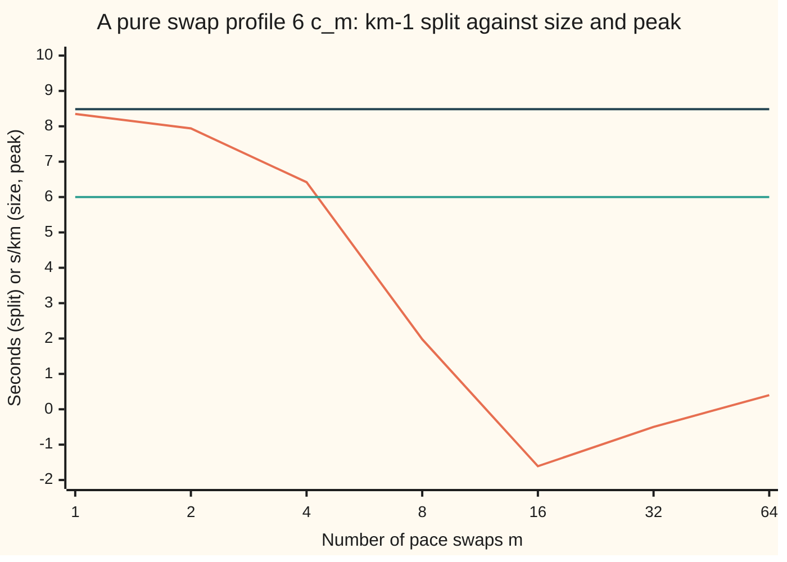

# Weak convergence: only the measurements must settle, and that buys compactness

[Syllabus](../../../SYLLABUS.md) → [Functional analysis](../README.md) → [Hilbert Spaces](../README.md#s02) → Weak convergence

---

## General Overview

A coach keeps a pace profile for every 10 km race a runner runs. The target pace is 4:00 per km, which is 240 seconds per km. The profile records, at each point of the race, how far the runner is off that target, in seconds per km (s/km): plus is slower, minus is faster. All numbers on this card are illustrative.

Every profile on file finishes in exactly 40:00. The profiles differ only in where the time goes. Race n has three parts:

- a **start term**: a fast start paid back by a slow finish, or the reverse;
- a **middle term**: fast at both ends and slow in the middle, or the reverse;
- **pace swaps**: the runner switches between slow and fast n + 2 times, sharper each race.

The swaps make this file a thought experiment: no runner switches pace thousands of times in 10 km, or runs 200,000 races. The start and middle terms jump about from race to race. Even so, no profile is bigger than 9.3808 s/km in root-mean-square size (the square root of the average squared deviation).

The whole sequence never settles. Race 1 loses 17.02 s on the first kilometre, race 2 loses 4.58 s, and race 3 gains 7.58 s. But a chosen run of races (numbers 2, 3, 9, 16, 22, 41, and so on) makes every split settle. Its first kilometre settles near −13.4252 s, that is 13.4252 s fast, and every other split, and every weighted average of pace, settles too.

The settled shape is a fast start with a slow middle. The swapping is lost: it carries 36 (s/km)² of squared size in every race, and none of it in the limit.

That is **weak convergence**: only the measurements must settle, not the profile itself. And any bounded sequence can be thinned until they do. Infinite dimensions take away ordinary compactness, the guarantee that every bounded sequence has a subsequence that settles in size; this weaker kind survives.

**In a Hilbert space every bounded sequence has a subsequence on which every measurement settles; the limit keeps the measurements but can lose size, and Banach–Alaoglu gives the same compactness, in the weak-star sense, to the unit ball of any dual space.**

**What kind of fact this is:** two definitions (weak and weak-star convergence) and two theorems. The Hilbert-space extraction is proved on this card in Why it works. Banach–Alaoglu is proved here for separable spaces, and in general in a fold that rests on Tychonoff's theorem and so on the axiom of choice. Mazur's theorem and the Eberlein–Šmulian theorem are stated with sources.

### The picture: the splits fade, the size stays



Orange: the time lost on the first kilometre by a profile that swaps pace m times, falling towards 0 as m grows. Green: its root-mean-square size, 6 s/km at every m. Dark blue: its peak deviation, 8.4853 s/km at every m. The code prints all three rows, with the split computed twice.

---

## The formula

Notation first, in words. A profile $`x(t)`$ is the pace deviation in s/km at fraction $`t`$ of the distance, so $`t = 0.1`$ is the 1 km mark. The profiles form the Hilbert space $`H = L^2(0, 1)`$ ([Inner products](01-inner-products-and-hilbert-spaces.md)): a complete space with an inner product. Here the inner product is $`\langle x, y\rangle = \int_0^1 x(t)\,y(t)\,dt`$. With complex numbers the first slot is conjugated; this card uses real numbers only. The size $`\lVert x\rVert = \sqrt{\langle x, x\rangle}`$, which [Inner products](01-inner-products-and-hilbert-spaces.md) calls the length, is the root-mean-square deviation.

A **measurement** is a reading $`\langle y, x\rangle`$ against a fixed weight $`y`$ in $`H`$. The first-kilometre split is one: with $`y = 10`$ on $`[0, 0.1]`$ and 0 elsewhere, $`\langle y, x\rangle`$ is the seconds lost over km 1. By [Riesz representation](06-riesz-representation-theorem.md), every bounded linear measurement on $`H`$ has this form.

A sequence **converges weakly**, written $`x_n \rightharpoonup x`$, when every measurement settles at its value on $`x`$:

```math
x_n \rightharpoonup x \iff \langle y, x_n\rangle \to \langle y, x\rangle \ \text{ for every } y \in H
```

**Read it aloud:** x_n converges weakly to x when, for every fixed weight y, the reading of x_n against y tends to the reading of x against y.

The theorem the card is about:

```math
\sup_n \lVert x_n\rVert \le B \implies \text{some subsequence } x_{n_k} \rightharpoonup x, \ \text{ with } \lVert x\rVert \le \liminf_{k \to \infty} \lVert x_{n_k}\rVert \le B
```

**Read it aloud:** if every term has size at most B, some subsequence converges weakly, and the limit is no bigger than the sizes the subsequence keeps returning to.

For a normed space $`X`$ with dual $`X'`$ (its bounded linear functionals, [Dual spaces](../01-Normed%20and%20Banach%20Spaces/09-dual-spaces-and-lp-duality.md)), this card introduces **weak-star convergence**: functionals converge when their values at every point converge.

```math
\varphi_n \overset{*}{\rightharpoonup} \varphi \iff \varphi_n(x) \to \varphi(x) \ \text{ for every } x \in X; \qquad \{\varphi \in X' : \lVert\varphi\rVert \le 1\} \ \text{is weak-star compact}
```

**Read it aloud:** functionals converge weak-star when they agree in the limit at every point; Banach–Alaoglu says the unit ball of a dual space is compact in that sense.

| Symbol | Plain meaning | In our example | Push it up and the answer… |
| --- | --- | --- | --- |
| $`t`$ | fraction of the race distance, 0 to 1 | $`t = 0.4`$ is the 4 km mark | later in the race |
| $`H`$, $`\langle x, y\rangle`$, $`\lVert x\rVert`$ | the Hilbert space, its inner product, its size | $`L^2(0,1)`$; $`\int_0^1 xy\,dt`$; root-mean-square s/km | — |
| $`c_k`$ | the orthonormal cosines $`\sqrt 2\cos(k\pi t)`$, $`k = 1, 2, \dots`$, with $`c_0 = 1`$ | $`c_1`$ start term, $`c_2`$ middle term, $`c_{n+2}`$ swaps | more swaps, faster pace changes |
| $`x_n`$, $`x`$ | race n's profile; the weak limit | $`x = -5.9062\,c_1 - 3.9375\,c_2`$ at the box centres | — |
| $`y`$ | a measurement's weight: $`\langle y, x\rangle`$ is the reading | 10 on $`[0, 0.1]`$: the km-1 split in s | bigger weight, bigger reading |
| $`x_n \rightharpoonup x`$, $`\liminf`$ | weak convergence; the smallest value a sequence keeps returning to | splits settle near −13.4252 s (box centres) | — |
| $`B`$ | a bound on every size | $`\sqrt{88} = 9.3808`$ s/km | more room, same theorem |
| $`n_k`$ | the k-th race kept in the subsequence (written $`n_j`$ where k counts cosines) | 2, 3, 9, 16, 22, 41, 47, 66, 110, 248, 261, 292 | — |
| $`m`$, $`N`$ | swaps in a pure swap profile $`6\,c_m`$; races averaged in Mazur's average | m = 1 to 64; N = 1 to 100 | km-1 split falls; average size falls as $`6/\sqrt N`$ |
| $`X`$, $`X'`$, $`\varphi`$, $`p`$ | a normed space (also $`\ell^1`$, $`\ell^\infty`$: summable and bounded lists), its dual, one functional; a continuous pace | $`C[0,1]`$; window averages; $`p(t) = 240 + 6\sqrt2\cos(\pi t)`$ s/km | shorter window, closer to the point reading |
| $`a_k`$, $`K`$, $`\varepsilon`$ | the k-th cosine coefficient; a cut-off; a small tolerance | $`a_1 = -5.9062`$, $`a_2 = -3.9375`$ in the limit | larger K, smaller tail error |
| $`\varphi_n \overset{*}{\rightharpoonup} \varphi`$ | weak-star convergence: values at every point settle | window averages tend to $`p(0.4) = 242.6221`$ | — |

### When it holds

- **The sequence must be bounded.** The start term $`6m\,c_1`$ reads 8.346, 83.464 and 834.639 s on km 1 at m = 1, 10, 100. No subsequence settles. Weakly convergent sequences are always bounded ([Three Banach theorems](../01-Normed%20and%20Banach%20Spaces/08-open-mapping-closed-graph-and-uniform-boundedness.md)).
- **A subsequence, not the whole sequence.** The start coefficient is 3.24, −2.50, −5.94, −3.92 s/km in races 1 to 4. Only a chosen run of races settles, and different runs can settle on different limits.
- **Weak, not in size.** Every race inside both final boxes has size between 9.2087 and 9.3808 s/km (the tail table shows 9.2744 to 9.3409), while the limit, at the box centres, has size 7.0984. The distance from $`x_n`$ to $`x`$ never falls below the swaps' 6 s/km.
- **The space must be reflexive for weak limits inside it.** Hilbert spaces are ([Reflexive spaces](../01-Normed%20and%20Banach%20Spaces/10-reflexive-spaces-and-the-second-dual.md)). In $`\ell^1`$ the unit lists $`e_n`$ (1 in place n, 0 elsewhere) have no weakly convergent subsequence, and only the weak-star sense in a dual space survives.
- **Sequences need a countable dense set.** On $`\ell^\infty`$, the bounded lists, the coordinate readings have no weak-star convergent subsequence. For any chosen subsequence, the list that alternates 1, −1, 1, −1 on it, and 0 elsewhere, keeps the readings from settling.

---

## Why it works

### Step 0: a profile is known by countably many numbers

Each profile is pinned down by its coefficients against the cosines, $`a_k(x) = \langle c_k, x\rangle`$. A bounded sequence gives, for each k, a bounded list of numbers. A bounded list of numbers always has a settling subsequence ([No gaps](../../06-Calculus%20and%20analysis/01-Limits%20and%20Continuity/02-supremum-and-completeness.md)).

[Reflexive spaces](../01-Normed%20and%20Banach%20Spaces/10-reflexive-spaces-and-the-second-dual.md) already proves the extraction in every reflexive space, through the second dual. In a Hilbert space the limit can be built directly from its coefficients, and that shows exactly what is lost.

So thin the races until coefficient 1 settles, then thin again until coefficient 2 settles, and so on. A diagonal choice makes all of them settle at once. Boundedness then spreads the settling from the coefficients to every measurement.

Nothing forces the size to settle at the limit's size. A swap $`c_{n+2}`$ has coefficient 0 against any fixed $`c_k`$ once $`n + 2 > k`$, so the coefficients forget it. Its size does not go anywhere.

### Step 1: every coefficient is a bounded list

The functions $`c_0 = 1, c_1, c_2, \dots`$ form an orthonormal basis of $`L^2(0,1)`$: they have size 1, are at right angles, and leave nothing out ([Orthonormal bases](03-orthonormal-bases-and-parseval.md); the cosine version of [Completeness of sines and cosines](04-completeness-of-the-trigonometric-system.md)).

The Cauchy–Schwarz inequality gives $`\lvert a_k(x_n)\rvert \le \lVert c_k\rVert\,\lVert x_n\rVert \le B`$. In the example the coefficients are explicit:

```math
x_n = 6\cos(n)\,c_1 + 4\sin(n\sqrt2)\,c_2 + 6\,c_{n+2}, \qquad \lVert x_n\rVert^2 = 36\cos^2 n + 16\sin^2(n\sqrt2) + 36 \le 88
```

So $`B = \sqrt{88} = 9.3808`$ s/km, and the largest size among the first 200,000 races is 9.3808 to four places.

### Step 2: thin out one coefficient at a time, then take the diagonal

1. The start coefficients $`6\cos n`$ lie in $`[-6, 6]`$. Halve the interval and keep a half that holds infinitely many races; one always does. Pick the next race in it. Repeat. (The code, which sees only races up to 200,000, keeps the half holding more of them.)
2. Inside the races kept, do the same for the middle coefficients $`4\sin(n\sqrt2)`$ in $`[-4, 4]`$.
3. In the full proof this goes on for coefficient 3, 4, and so on. The diagonal takes the first pick of the first thinning, the second of the second, and so on. Along the diagonal, every coefficient settles.

The code runs six halvings on each of the two coefficients that move. It picks races 2, 3, 9, 16, 22, 41, 47, 66, 110, 248, 261 and 292. The start coefficient ends in $`[-6, -5.8125]`$ and the middle one in $`[-4, -3.875]`$. Of the first 200,000 races, 1270 sit in both boxes. Equidistribution of the angles $`n`$ and $`n\sqrt2`$ around the circle predicts 1273.2, so the thinning can go on for ever.

The code stops after six halvings, so it pins the limit only to the two boxes. Any limit inside them has a km-1 split from −13.6383 to −13.2121 s. The card uses the box centres as the limit.

The swap coefficients need no thinning: each fixed $`a_k(x_n)`$ is 0 once $`n + 2 > k`$.

### Step 3: the limit is a real profile

Let $`a_k`$ be the settled value of coefficient k. For any cut-off K, Bessel's inequality (Pythagoras for the first K coefficients) gives

```math
\sum_{k \le K} a_k^2 = \lim_{j} \sum_{k \le K} a_k(x_{n_j})^2 \le \liminf_{j} \lVert x_{n_j}\rVert^2 \le B^2
```

This holds for every K, so $`x = \sum_k a_k c_k`$ converges in $`H`$ and $`\lVert x\rVert \le \liminf_j \lVert x_{n_j}\rVert`$. In the example, to the box centres, $`x = -5.9062\,c_1 - 3.9375\,c_2`$: a fast start that fades, and a sag in the middle.

### Step 4: every measurement settles

Take any weight $`y`$ and a small tolerance $`\varepsilon`$. Cut $`y`$ to its first K coefficients, $`y_K`$, with $`\lVert y - y_K\rVert < \varepsilon`$. Then

```math
\lvert\langle y, x_{n_j} - x\rangle\rvert \le \lvert\langle y_K, x_{n_j} - x\rangle\rvert + \lVert y - y_K\rVert\,\lVert x_{n_j} - x\rVert \le \lvert\langle y_K, x_{n_j} - x\rangle\rvert + 2B\varepsilon
```

The first term involves only K coefficients, so it tends to 0. The second is as small as we like. So $`x_{n_j} \rightharpoonup x`$.

In the example, the km-1 split of the limit, at the box centres, is −13.4252 s. Races after the last pick that sit in both boxes, which the subsequence can take next, include 581, 2127, 16371 and 158170. They read −13.3975, −13.5458, −13.4920 and −13.4031 s. Each gap stays under its bound: half the box width times each cosine's km-1 reading, plus the swap's $`60\sqrt2/(\pi(n+2))`$.

If $`H`$ has no countable basis, the same proof runs in the closed span of the $`x_n`$, which has one. Any measurement splits into a part in that span and a part at right angles to every $`x_n`$, which reads 0.

### Step 5: what is lost, and how averages recover it

**Size can only drop.** Since $`\langle x, x_{n_j}\rangle \to \lVert x\rVert^2`$ and $`\lvert\langle x, x_{n_j}\rangle\rvert \le \lVert x\rVert\,\lVert x_{n_j}\rVert`$, the limit's size is at most the sizes' lower limit. In a Hilbert space the loss is exact:

```math
\lVert x_{n_j} - x\rVert^2 = \lVert x_{n_j}\rVert^2 - 2\langle x, x_{n_j}\rangle + \lVert x\rVert^2 \to \lim_j \lVert x_{n_j}\rVert^2 - \lVert x\rVert^2
```

So weak convergence plus convergence of the sizes to the limit's size is convergence in size. In the example race 158170 has squared size 86.0139 and the limit 50.3877, a loss of 35.6262. The swaps carry 36; the rest is the box width.

**Nonlinear readings do not pass to the limit.** The swap profiles $`6\,c_m`$ converge weakly to 0, yet the peak deviation of every one is 8.4853 s/km. Settling in the peak would be [Uniform convergence](../../06-Calculus%20and%20analysis/06-Series/07-uniform-convergence.md), which fails here.

**Averages recover size convergence.** Mazur's theorem: if $`x_n \rightharpoonup x`$, some averages (convex combinations, weights at least 0 adding to 1) of the $`x_n`$ converge to $`x`$ in size. For the swaps, the plain average of N of them has size $`6/\sqrt N`$ by Pythagoras: 6, 3, 1.5 and 0.6 at N = 1, 4, 16 and 100. A grid computation agrees.

### Step 6: weak-star convergence and Banach–Alaoglu

Now let $`X`$ be any normed space and $`X'`$ its dual. Weak-star convergence asks only that $`\varphi_n(x)`$ settle at each point $`x`$ of $`X`$.

**Banach–Alaoglu, separable case.** Suppose $`X`$ has a countable dense set $`x_1, x_2, \dots`$ and $`\lVert\varphi_n\rVert \le 1`$.

1. Each list $`\varphi_n(x_j)`$ is bounded by $`\lVert x_j\rVert`$, so the diagonal argument of Step 2 makes every one settle.
2. Any $`x`$ is within $`\varepsilon`$ of some $`x_j`$. Then $`\lvert\varphi_n(x) - \varphi_n(x_j)\rvert \le \varepsilon`$ for every n, so $`\varphi_n(x)`$ settles too.
3. The limit $`\varphi(x)`$ is linear, because each $`\varphi_n`$ is, and $`\lvert\varphi(x)\rvert \le \lVert x\rVert`$. So $`\varphi`$ is in the unit ball, and $`\varphi_{n_k} \overset{*}{\rightharpoonup} \varphi`$.

For a Hilbert space, Riesz identifies $`H'`$ with $`H`$, and weak-star convergence there is weak convergence. Steps 1 to 4 are this proof, with the cosine coefficients as the dense set's coordinates. No choice axiom is used: the halvings pick each race explicitly.

**A limit that leaves the densities.** Take $`X = C[0,1]`$, continuous profiles with the sup norm (the largest absolute value). Polynomials with rational coefficients are dense ([Weierstrass and the minimax fit](../../16-Numerical%20analysis/04-Interpolation%20and%20Approximation/08-weierstrass-and-best-approximation.md)), so $`X`$ is separable. Let $`\varphi_n`$ be the average of a continuous pace $`p`$ over the stretch $`[0.4, 0.4 + 1/n]`$, a functional of size 1.

For $`p(t) = 240 + 6\sqrt2\cos(\pi t)`$, the averages over a tenth, a hundredth and a thousandth of the race are 241.3219, 242.4949 and 242.6094 s/km. They tend to the reading at the 4 km mark, $`p(0.4) = 242.6221`$. The weak-star limit is the point reading. It is still in the unit ball of $`C[0,1]'`$, as Banach–Alaoglu promises, because $`\lvert p(0.4)\rvert`$ is at most the sup norm of $`p`$. What it leaves is the smaller set the sequence started in: each window average is an average against a density, and the point reading is not. Among the densities, these stretches have no limit at all.

This is [Convergence in distribution](../../10-Measure%20and%20integration/10-The%20Limit%20Theorems%2C%20Proved/05-convergence-in-distribution.md) seen from here. A law is a functional on bounded continuous functions, and "weak convergence of laws" is weak-star convergence. The uniform law (probability spread evenly) on a shrinking stretch converges to a point mass at 0.4.

Without a countable dense set, sequences no longer suffice: the unit ball is still weak-star compact, but compactness must then be stated with covers, not subsequences. For the weak sense in a Banach space, sequences always suffice: by the Eberlein–Šmulian theorem, a set is compact in the weak sense exactly when every sequence in it has a subsequence converging weakly to a point of the set.

<details>
<summary>Detailed proof: Banach–Alaoglu in general, with no sequences</summary>

**The product.** For each $`x`$ in $`X`$, let $`D_x`$ be the closed interval $`[-\lVert x\rVert, \lVert x\rVert]`$ (a closed disc, for complex scalars). Let $`Q`$ be the product of all the $`D_x`$: one coordinate for each point of $`X`$. Its product topology is convergence coordinate by coordinate. By Tychonoff's theorem $`Q`$ is compact ([Compactness with no distances, and Tychonoff](../../17-Topology/02-Topological%20Spaces/06-compactness-and-tychonoff.md)).

**The embedding.** Send a functional $`\varphi`$ with $`\lVert\varphi\rVert \le 1`$ to its list of values $`(\varphi(x))_x`$. Since $`\lvert\varphi(x)\rvert \le \lVert x\rVert`$, the list lies in $`Q`$. Coordinate-by-coordinate convergence of these lists is exactly weak-star convergence.

**The ball is closed in Q.** A point $`f`$ of $`Q`$ comes from a functional in the ball exactly when it is linear. Linearity is a list of equations between coordinates:

$`\displaystyle f(x + z) = f(x) + f(z), \qquad f(a x) = a\, f(x) \quad \text{for all } x, z \in X \text{ and scalars } a.`$

Each equation involves at most three coordinates, and coordinates are continuous on $`Q`$. So the set where one equation holds is closed, and the intersection of all of them is closed. Any $`f`$ in it is linear with $`\lvert f(x)\rvert \le \lVert x\rVert`$, so it is a functional in the unit ball.

**Conclusion.** The unit ball is a closed subset of the compact set $`Q`$, so it is compact in the weak-star topology.

**What it costs.** Tychonoff's theorem for a product with uncountably many factors rests on the axiom of choice: the rule that a proof may pick from infinitely many options at once. The separable case in Step 6 avoids it.

**Why sequences fail without separability.** On $`\ell^\infty`$, let $`\varphi_n`$ read the n-th entry. Given any subsequence $`n_k`$, the list that is 1 at $`n_1, n_3, \dots`$ and −1 at $`n_2, n_4, \dots`$, and 0 elsewhere, is bounded, and its readings alternate. So no subsequence converges weak-star, although the ball is compact.

</details>

---

## Worked numbers, by hand

The limit found by six halvings on each coefficient, taken at the box centres, read on the first kilometre and sized.

| Step | Arithmetic | Value |
| --- | --- | --- |
| km-1 reading of $`c_1`$ | $`10\sqrt2\,\sin(\pi/10)/\pi`$ | 1.3911 s |
| km-1 reading of $`c_2`$ | $`10\sqrt2\,\sin(\pi/5)/(2\pi)`$ | 1.3230 s |
| start term of the limit | $`-5.9062 \times 1.3911`$ | −8.2160 s |
| middle term of the limit | $`-3.9375 \times 1.3230`$ | −5.2092 s |
| limit's km-1 split | $`-8.2160 - 5.2092`$ | −13.4252 s |
| any limit inside the boxes | the box corners, read the same way | −13.6383 to −13.2121 s |
| race 158170's km-1 split | read by the code | −13.4031 s |
| limit's squared size | $`5.9062^2 + 3.9375^2 = 34.8838 + 15.5039`$ | 50.3877 |
| race 158170's squared size | start² + middle² + 36, unrounded | 86.0139 |
| size lost | $`86.0139 - 50.3877`$ | **35.6262 (s/km)²** |

**The chosen races settle on a first kilometre between 13.2121 and 13.6383 s fast, 13.4252 s at the box centres, while about 36 (s/km)² of squared size, the swaps' share, is gone from the limit.** A coach reading only splits sees the limit; a coach tracking the average squared deviation sees the swaps.

### What breaks if you drop a piece

| Mistake | Comes out at | What went wrong |
| --- | --- | --- |
| Follow the whole sequence | km-1 splits 17.02, 4.58, −7.58, −4.28, 9.24, 14.27, 4.80, −6.24 s | the start and middle terms never settle; only a subsequence does |
| Expect the size to pass to the limit | 9.2744 s/km at race 158170, 7.0984 in the limit | weak limits keep readings, not size |
| Expect the peak to settle | 8.4853 s/km for every swap profile | that is uniform convergence, which fails |
| Drop the bound | km-1 splits 8.346, 83.464, 834.639 s for $`6m\,c_1`$ | no subsequence of an unbounded list settles |
| Use sequences on $`\ell^\infty`$'s dual | a list built to read 1, −1, 1, −1, 1, −1 on the chosen subsequence | no countable dense set, so the diagonal has nothing to run over |

The code prints all five; the last is a construction, printed to show the alternation, not a computed result.

---

## Code, from first principles, and it actually runs

The code holds coefficients and finite grids only, so it checks instances and trends, not the infinite case. It takes two roads wherever it can. Each split is computed from the cosine's antiderivative and by a midpoint grid. Sizes come from Pythagoras on the coefficients; the swap profiles, race 581 and the limit are also sized on a grid. The count of races in the final boxes is checked against equidistribution, the arcsine share that $`\cos n`$ and $`\sin(n\sqrt2)`$ spend in an interval. Mazur's averages are sized by Pythagoras and by a grid. The window averages come from the antiderivative and from a grid, with a bound from the slope of $`p`$.

### Python

```python
# Weak convergence and Banach-Alaoglu -- the check behind the card.  Standard library only.
# A pace profile x(t) is a 10 km race's pace minus the 240 s/km target, in s/km, at
# fraction t of the distance.  Profiles live in L2(0, 1) with the orthonormal cosines
# c_k(t) = sqrt2 cos(k pi t).  Race n (illustrative numbers):
#   x_n = 6 cos(n) c_1 + 4 sin(n sqrt2) c_2 + 6 c_(n+2)     (start term, middle term, swaps)
# The code holds coefficients and finite grids only: it checks instances and trends;
# the infinite-dimensional claims rest on the proofs on the card.
import math

R2, M = math.sqrt(2), 200000

def split1(k):           # km-1 time lost by c_k, in s: 10 * integral of c_k over [0, 0.1]
    return 10 * R2 * math.sin(k * math.pi / 10) / (k * math.pi)

def grid(f, a, b, G):    # midpoint rule for the integral of f over [a, b]
    h = (b - a) / G
    return h * sum(f(a + (i + 0.5) * h) for i in range(G))

# 1. The picture: pure swap profiles 6 c_m.  Splits fade, size and peak stay.
print("swap profile 6 c_m: m | km-1 split s (formula, grid) | RMS s/km (grid) | peak | total")
chart = []
for m in (1, 2, 4, 8, 16, 32, 64):
    f = lambda t, m=m: 6 * R2 * math.cos(m * math.pi * t)
    s_a, s_g = 6 * split1(m), 10 * grid(f, 0, 0.1, 10000)
    rms = math.sqrt(grid(lambda t: f(t) ** 2, 0, 1, 20000))
    tot = 10 * grid(f, 0, 1, 20000)
    chart.append(s_a)
    print(f"  m={m:2d} | {s_a:7.3f} {s_g:7.3f} | {rms:.4f} | {6 * R2:.4f} | {abs(tot):.4f}")
    assert abs(s_a - s_g) < 1e-6 and abs(rms - 6) < 1e-9 and abs(tot) < 1e-6
print("  chart row:", ", ".join(f"{v:.2f}" for v in chart))

# 2. The races themselves: the start and middle terms jump about, so x_n has no weak limit.
start = [6 * math.cos(n) for n in range(1, M + 1)]
middle = [4 * math.sin(n * R2) for n in range(1, M + 1)]
def km1(n):              # km-1 split of race n, from the three coefficients
    return start[n - 1] * split1(1) + middle[n - 1] * split1(2) + 6 * split1(n + 2)
def rms(n):
    return math.sqrt(start[n - 1] ** 2 + middle[n - 1] ** 2 + 36)
print("races 1-8: start ", ", ".join(f"{start[n - 1]:.2f}" for n in range(1, 9)))
print("           middle", ", ".join(f"{middle[n - 1]:.2f}" for n in range(1, 9)))
print("           km-1  ", ", ".join(f"{km1(n):.2f}" for n in range(1, 9)))
print(f"  bound B = sqrt(36 + 16 + 36) = {math.sqrt(88):.4f}; largest RMS seen {max(rms(n) for n in range(1, M + 1)):.4f}")

# 3. The diagonal: halve the start term's range 6 times, then the middle term's inside it,
#    each time keeping the half that holds more of the later races, and pick the next race.
def inside(n, box, upto):
    return all(box[j][0] <= (start, middle)[j][n - 1] <= box[j][1] for j in range(upto + 1))
def diagonal(depth):
    box, last, picks, steps = [[-6.0, 6.0], [-4.0, 4.0]], 0, [], []
    for coord in (0, 1):
        vals = (start, middle)[coord]
        for _ in range(depth):
            lo, hi = box[coord]
            mid = (lo + hi) / 2
            cand = [n for n in range(last + 1, M + 1) if inside(n, box, coord)]
            low = sum(1 for n in cand if vals[n - 1] < mid)
            box[coord] = [lo, mid] if low >= len(cand) - low else [mid, hi]
            last = next(n for n in cand if box[coord][0] <= vals[n - 1] <= box[coord][1])
            picks.append(last)
            steps.append((coord, list(box[coord])))
    return box, picks, steps
box, picks, steps = diagonal(6)
print("picks n_k =", ", ".join(map(str, picks)))
print(f"  start box [{box[0][0]:.4f}, {box[0][1]:.4f}], middle box [{box[1][0]:.4f}, {box[1][1]:.4f}]")
a1, a2 = sum(box[0]) / 2, sum(box[1]) / 2
inbox = [n for n in range(1, M + 1) if inside(n, box, 1)]
law = ((math.acos(box[0][0] / 6) - math.acos(box[0][1] / 6)) / math.pi
       * (math.asin(box[1][1] / 4) - math.asin(box[1][0] / 4)) / math.pi)
print(f"  races n <= {M} in both boxes: {len(inbox)}; equidistribution predicts {M * law:.1f}")
print(f"  limit x = {a1:.4f} c_1 {a2:+.4f} c_2; km-1 split {a1 * split1(1) + a2 * split1(2):.4f} s;"
      f" RMS {math.hypot(a1, a2):.4f} s/km")
print(f"  by hand: c_1 reads {split1(1):.4f} s on km 1, c_2 {split1(2):.4f}; {a1 * split1(1):.4f} {a2 * split1(2):+.4f};"
      f" RMS^2 {a1 * a1:.4f} + {a2 * a2:.4f} = {a1 * a1 + a2 * a2:.4f}")
sq = [sorted(v * v for v in b) for b in box]                    # squared coefficients allowed by each box
print(f"  known only to the boxes: limit's km-1 split {box[0][0] * split1(1) + box[1][0] * split1(2):.4f} to"
      f" {box[0][1] * split1(1) + box[1][1] * split1(2):.4f} s; any race in both boxes has RMS"
      f" {math.sqrt(sq[0][0] + sq[1][0] + 36):.4f} to {math.sqrt(sq[0][1] + sq[1][1] + 36):.4f} s/km")

# 4. Along the subsequence every split settles; the size does not fall to the limit's.
lim1, limrms = a1 * split1(1) + a2 * split1(2), math.hypot(a1, a2)
tail = [n for n in inbox if n > picks[-1]]
print("tail j | race n | km-1 split | gap to limit | allowed gap | RMS")
for j in (1, 10, 100, 1000):
    n = tail[j - 1]
    gap = abs(km1(n) - lim1)
    allow = 0.09375 * split1(1) + 0.0625 * abs(split1(2)) + 60 * R2 / (math.pi * (n + 2))
    print(f"  {j:4d} | {n:6d} | {km1(n):8.4f} | {gap:.4f} | {allow:.4f} | {rms(n):.4f}")
    assert gap <= allow + 1e-12
n0 = tail[0]                    # a second road to the sizes: integrate the profiles squared on a grid
prof = lambda t: R2 * (start[n0 - 1] * math.cos(math.pi * t) + middle[n0 - 1] * math.cos(2 * math.pi * t)
                       + 6 * math.cos((n0 + 2) * math.pi * t))
g_race = grid(lambda t: prof(t) ** 2, 0, 1, 20 * (n0 + 2))
g_lim = grid(lambda t: 2 * (a1 * math.cos(math.pi * t) + a2 * math.cos(2 * math.pi * t)) ** 2, 0, 1, 2000)
print(f"  RMS on a grid: race {n0} {math.sqrt(g_race):.4f} (Pythagoras {rms(n0):.4f}),"
      f" limit {math.sqrt(g_lim):.4f} (Pythagoras {limrms:.4f})")
assert abs(g_race - rms(n0) ** 2) < 1e-9 and abs(g_lim - limrms ** 2) < 1e-9    # sizes, two roads
lost = rms(tail[999]) ** 2 - limrms ** 2
print(f"  lost energy at tail 1000: {rms(tail[999]) ** 2:.4f} - {limrms ** 2:.4f} = {lost:.4f} (s/km)^2; swap energy 6^2 = 36; peak of swaps {6 * R2:.4f}")

# 5. Mazur: averages of the swap parts converge in norm.  RMS of (6/N)(c_3 + ... + c_(N+2)).
print("Mazur average of N swap parts: N | RMS by Parseval | RMS by grid")
for N in (1, 4, 16, 100):
    par = 6 / math.sqrt(N)
    g = math.sqrt(grid(lambda t: (6 / N * sum(R2 * math.cos(k * math.pi * t) for k in range(3, N + 3))) ** 2, 0, 1, 4000))
    print(f"  {N:3d} | {par:.4f} | {g:.4f}")
    assert abs(par - g) < 1e-9

# 6. Weak-star in the dual of C[0, 1]: averages over [0.4, 0.4 + 1/n] tend to the reading at 0.4.
p = lambda t: 240 + 6 * R2 * math.cos(math.pi * t)
P = lambda t: 240 * t + 6 * R2 * math.sin(math.pi * t) / math.pi          # antiderivative of p
print(f"pace p(t) = 240 + 6 sqrt2 cos(pi t); reading at the 4 km mark p(0.4) = {p(0.4):.4f} s/km")
for n in (10, 100, 1000):
    exact, g = n * (P(0.4 + 1 / n) - P(0.4)), n * grid(p, 0.4, 0.4 + 1 / n, 1000)
    print(f"  window 1/{n:<4d} of the race: average {exact:.4f} (grid {g:.4f}), gap {abs(exact - p(0.4)):.4f}")
    assert abs(exact - g) < 1e-8 and abs(exact - p(0.4)) <= 6 * R2 * math.pi / (2 * n)

# 7. No countable dense set: coordinate readings on l-infinity, against a list built
#    to alternate on any chosen subsequence (here 2, 5, 9, 14, 20, 27).
chosen = [2, 5, 9, 14, 20, 27]
xinf = {n: (1 if k % 2 == 0 else -1) for k, n in enumerate(chosen)}
print("l-infinity readings on the chosen subsequence:", ", ".join(str(xinf[n]) for n in chosen))

b8, p8, _ = diagonal(8)
print(f"try: 8 halvings each: last pick {p8[-1]}, limit {sum(b8[0]) / 2:.4f} c_1 {sum(b8[1]) / 2:+.4f} c_2,"
      f" races in both boxes {sum(1 for n in range(1, M + 1) if inside(n, b8, 1))}")
print(f"try: swap 6 c_m at m = 10, 20, 30: |km-1 split| {abs(6 * split1(10)):.4f}, {abs(6 * split1(20)):.4f}, {abs(6 * split1(30)):.4f}")
print(f"try: unbounded start term 6m c_1, m = 1, 10, 100: km-1 split {6 * split1(1):.3f}, {60 * split1(1):.3f}, {600 * split1(1):.3f}")

assert abs(len(inbox) - M * law) < 4 * math.sqrt(M * law)          # equidistribution, two roads
assert all(lo <= (start, middle)[c][n - 1] <= hi for n, (c, (lo, hi)) in zip(picks, steps)) and picks == sorted(set(picks))
assert abs(box[0][1] - box[0][0] - 12 / 64) < 1e-12 and abs(box[1][1] - box[1][0] - 8 / 64) < 1e-12
assert abs(lost - 36) < 1.0 and limrms < rms(tail[999])         # energy lost, about the swaps' 36
assert max(start[:8]) - min(start[:8]) > 10                     # the whole sequence does not settle
print("ALL CHECKS PASS")
```

**Ran 2026-11-15 on macOS, Python 3.14.10, standard library only. All checks passed. Output, pasted from the run:**

```
swap profile 6 c_m: m | km-1 split s (formula, grid) | RMS s/km (grid) | peak | total
  m= 1 |   8.346   8.346 | 6.0000 | 8.4853 | 0.0000
  m= 2 |   7.938   7.938 | 6.0000 | 8.4853 | 0.0000
  m= 4 |   6.422   6.422 | 6.0000 | 8.4853 | 0.0000
  m= 8 |   1.984   1.984 | 6.0000 | 8.4853 | 0.0000
  m=16 |  -1.605  -1.605 | 6.0000 | 8.4853 | 0.0000
  m=32 |  -0.496  -0.496 | 6.0000 | 8.4853 | 0.0000
  m=64 |   0.401   0.401 | 6.0000 | 8.4853 | 0.0000
  chart row: 8.35, 7.94, 6.42, 1.98, -1.61, -0.50, 0.40
races 1-8: start  3.24, -2.50, -5.94, -3.92, 1.70, 5.76, 4.52, -0.87
           middle 3.95, 1.23, -3.57, -2.34, 2.84, 3.23, -1.83, -3.80
           km-1   17.02, 4.58, -7.58, -4.28, 9.24, 14.27, 4.80, -6.24
  bound B = sqrt(36 + 16 + 36) = 9.3808; largest RMS seen 9.3808
picks n_k = 2, 3, 9, 16, 22, 41, 47, 66, 110, 248, 261, 292
  start box [-6.0000, -5.8125], middle box [-4.0000, -3.8750]
  races n <= 200000 in both boxes: 1270; equidistribution predicts 1273.2
  limit x = -5.9062 c_1 -3.9375 c_2; km-1 split -13.4252 s; RMS 7.0984 s/km
  by hand: c_1 reads 1.3911 s on km 1, c_2 1.3230; -8.2160 -5.2092; RMS^2 34.8838 + 15.5039 = 50.3877
  known only to the boxes: limit's km-1 split -13.6383 to -13.2121 s; any race in both boxes has RMS 9.2087 to 9.3808 s/km
tail j | race n | km-1 split | gap to limit | allowed gap | RMS
     1 |    581 | -13.3975 | 0.0277 | 0.2594 | 9.2940
    10 |   2127 | -13.5458 | 0.1206 | 0.2258 | 9.3409
   100 |  16371 | -13.4920 | 0.0668 | 0.2147 | 9.3186
  1000 | 158170 | -13.4031 | 0.0221 | 0.2133 | 9.2744
  RMS on a grid: race 581 9.2940 (Pythagoras 9.2940), limit 7.0984 (Pythagoras 7.0984)
  lost energy at tail 1000: 86.0139 - 50.3877 = 35.6262 (s/km)^2; swap energy 6^2 = 36; peak of swaps 8.4853
Mazur average of N swap parts: N | RMS by Parseval | RMS by grid
    1 | 6.0000 | 6.0000
    4 | 3.0000 | 3.0000
   16 | 1.5000 | 1.5000
  100 | 0.6000 | 0.6000
pace p(t) = 240 + 6 sqrt2 cos(pi t); reading at the 4 km mark p(0.4) = 242.6221 s/km
  window 1/10   of the race: average 241.3219 (grid 241.3219), gap 1.3002
  window 1/100  of the race: average 242.4949 (grid 242.4949), gap 0.1272
  window 1/1000 of the race: average 242.6094 (grid 242.6094), gap 0.0127
l-infinity readings on the chosen subsequence: 1, -1, 1, -1, 1, -1
try: 8 halvings each: last pick 1134, limit -5.9766 c_1 +3.9844 c_2, races in both boxes 314
try: swap 6 c_m at m = 10, 20, 30: |km-1 split| 0.0000, 0.0000, 0.0000
try: unbounded start term 6m c_1, m = 1, 10, 100: km-1 split 8.346, 83.464, 834.639
ALL CHECKS PASS
```

### Rust

```rust
// Weak convergence and Banach-Alaoglu -- the check behind the card.  Rust std only.
// A pace profile x(t) is a 10 km race's pace minus the 240 s/km target, in s/km, at
// fraction t of the distance.  Profiles live in L2(0, 1) with the orthonormal cosines
// c_k(t) = sqrt2 cos(k pi t).  Race n (illustrative numbers):
//   x_n = 6 cos(n) c_1 + 4 sin(n sqrt2) c_2 + 6 c_(n+2)     (start term, middle term, swaps)
// The code holds coefficients and finite grids only: it checks instances and trends;
// the infinite-dimensional claims rest on the proofs on the card.
use std::f64::consts::PI;

const M: usize = 200000;

fn r2() -> f64 { 2f64.sqrt() }

// km-1 time lost by c_k, in s: 10 * integral of c_k over [0, 0.1]
fn split1(k: usize) -> f64 { 10.0 * r2() * (k as f64 * PI / 10.0).sin() / (k as f64 * PI) }

// midpoint rule for the integral of f over [a, b]
fn grid(f: &dyn Fn(f64) -> f64, a: f64, b: f64, g: usize) -> f64 {
    let h = (b - a) / g as f64;
    let mut s = 0.0;
    for i in 0..g { s += f(a + (i as f64 + 0.5) * h); }
    h * s
}

fn join_f(v: &[f64], d: usize) -> String {
    v.iter().map(|x| format!("{:.*}", d, x)).collect::<Vec<_>>().join(", ")
}

struct Races { start: Vec<f64>, middle: Vec<f64> }

impl Races {
    fn val(&self, c: usize, n: usize) -> f64 { if c == 0 { self.start[n - 1] } else { self.middle[n - 1] } }
    fn inside(&self, n: usize, bx: &[[f64; 2]; 2], upto: usize) -> bool {
        (0..=upto).all(|j| bx[j][0] <= self.val(j, n) && self.val(j, n) <= bx[j][1])
    }
    fn km1(&self, n: usize) -> f64 { self.start[n - 1] * split1(1) + self.middle[n - 1] * split1(2) + 6.0 * split1(n + 2) }
    fn rms(&self, n: usize) -> f64 { (self.start[n - 1].powi(2) + self.middle[n - 1].powi(2) + 36.0).sqrt() }
    fn diagonal(&self, depth: usize) -> ([[f64; 2]; 2], Vec<usize>, Vec<(usize, [f64; 2])>) {
        let (mut bx, mut last, mut picks, mut steps) = ([[-6.0, 6.0], [-4.0, 4.0]], 0usize, vec![], vec![]);
        for coord in 0..2 {
            for _ in 0..depth {
                let [lo, hi] = bx[coord];
                let mid = (lo + hi) / 2.0;
                let cand: Vec<usize> = (last + 1..=M).filter(|&n| self.inside(n, &bx, coord)).collect();
                let low = cand.iter().filter(|&&n| self.val(coord, n) < mid).count();
                bx[coord] = if low >= cand.len() - low { [lo, mid] } else { [mid, hi] };
                last = *cand.iter().find(|&&n| bx[coord][0] <= self.val(coord, n) && self.val(coord, n) <= bx[coord][1]).unwrap();
                picks.push(last);
                steps.push((coord, bx[coord]));
            }
        }
        (bx, picks, steps)
    }
}

fn main() {
    let r2 = r2();
    // 1. The picture: pure swap profiles 6 c_m.  Splits fade, size and peak stay.
    println!("swap profile 6 c_m: m | km-1 split s (formula, grid) | RMS s/km (grid) | peak | total");
    let mut chart = vec![];
    for m in [1usize, 2, 4, 8, 16, 32, 64] {
        let f = move |t: f64| 6.0 * r2 * (m as f64 * PI * t).cos();
        let (s_a, s_g) = (6.0 * split1(m), 10.0 * grid(&f, 0.0, 0.1, 10000));
        let rms = grid(&|t| f(t).powi(2), 0.0, 1.0, 20000).sqrt();
        let tot = 10.0 * grid(&f, 0.0, 1.0, 20000);
        chart.push(s_a);
        println!("  m={:2} | {:7.3} {:7.3} | {:.4} | {:.4} | {:.4}", m, s_a, s_g, rms, 6.0 * r2, tot.abs());
        assert!((s_a - s_g).abs() < 1e-6 && (rms - 6.0).abs() < 1e-9 && tot.abs() < 1e-6);
    }
    println!("  chart row: {}", join_f(&chart, 2));

    // 2. The races themselves: the start and middle terms jump about, so x_n has no weak limit.
    let rc = Races {
        start: (1..=M).map(|n| 6.0 * (n as f64).cos()).collect(),
        middle: (1..=M).map(|n| 4.0 * (n as f64 * r2).sin()).collect(),
    };
    println!("races 1-8: start  {}", join_f(&rc.start[..8], 2));
    println!("           middle {}", join_f(&rc.middle[..8], 2));
    println!("           km-1   {}", join_f(&(1..=8).map(|n| rc.km1(n)).collect::<Vec<_>>(), 2));
    let maxrms = (1..=M).map(|n| rc.rms(n)).fold(f64::MIN, f64::max);
    println!("  bound B = sqrt(36 + 16 + 36) = {:.4}; largest RMS seen {:.4}", 88f64.sqrt(), maxrms);

    // 3. The diagonal: halve the start term's range 6 times, then the middle term's inside it,
    //    each time keeping the half that holds more of the later races, and pick the next race.
    let (bx, picks, steps) = rc.diagonal(6);
    println!("picks n_k = {}", picks.iter().map(|n| n.to_string()).collect::<Vec<_>>().join(", "));
    println!("  start box [{:.4}, {:.4}], middle box [{:.4}, {:.4}]", bx[0][0], bx[0][1], bx[1][0], bx[1][1]);
    let (a1, a2) = ((bx[0][0] + bx[0][1]) / 2.0, (bx[1][0] + bx[1][1]) / 2.0);
    let inbox: Vec<usize> = (1..=M).filter(|&n| rc.inside(n, &bx, 1)).collect();
    let law = ((bx[0][0] / 6.0).acos() - (bx[0][1] / 6.0).acos()) / PI
        * ((bx[1][1] / 4.0).asin() - (bx[1][0] / 4.0).asin()) / PI;
    println!("  races n <= {} in both boxes: {}; equidistribution predicts {:.1}", M, inbox.len(), M as f64 * law);
    println!("  limit x = {:.4} c_1 {:+.4} c_2; km-1 split {:.4} s; RMS {:.4} s/km",
             a1, a2, a1 * split1(1) + a2 * split1(2), a1.hypot(a2));
    println!("  by hand: c_1 reads {:.4} s on km 1, c_2 {:.4}; {:.4} {:+.4}; RMS^2 {:.4} + {:.4} = {:.4}",
             split1(1), split1(2), a1 * split1(1), a2 * split1(2), a1 * a1, a2 * a2, a1 * a1 + a2 * a2);
    let sq: Vec<[f64; 2]> = bx.iter().map(|b| { let (u, v) = (b[0] * b[0], b[1] * b[1]); [u.min(v), u.max(v)] }).collect(); // squared coefficients allowed
    println!("  known only to the boxes: limit's km-1 split {:.4} to {:.4} s; any race in both boxes has RMS {:.4} to {:.4} s/km",
             bx[0][0] * split1(1) + bx[1][0] * split1(2), bx[0][1] * split1(1) + bx[1][1] * split1(2), (sq[0][0] + sq[1][0] + 36.0).sqrt(), (sq[0][1] + sq[1][1] + 36.0).sqrt());

    // 4. Along the subsequence every split settles; the size does not fall to the limit's.
    let (lim1, limrms) = (a1 * split1(1) + a2 * split1(2), a1.hypot(a2));
    let tail: Vec<usize> = inbox.iter().cloned().filter(|&n| n > *picks.last().unwrap()).collect();
    println!("tail j | race n | km-1 split | gap to limit | allowed gap | RMS");
    for j in [1usize, 10, 100, 1000] {
        let n = tail[j - 1];
        let gap = (rc.km1(n) - lim1).abs();
        let allow = 0.09375 * split1(1) + 0.0625 * split1(2).abs() + 60.0 * r2 / (PI * (n + 2) as f64);
        println!("  {:4} | {:6} | {:8.4} | {:.4} | {:.4} | {:.4}", j, n, rc.km1(n), gap, allow, rc.rms(n));
        assert!(gap <= allow + 1e-12);
    }
    let n0 = tail[0]; // a second road to the sizes: integrate the profiles squared on a grid
    let prof = |t: f64| r2 * (rc.start[n0 - 1] * (PI * t).cos() + rc.middle[n0 - 1] * (2.0 * PI * t).cos() + 6.0 * ((n0 + 2) as f64 * PI * t).cos());
    let (g_race, g_lim) = (grid(&|t| prof(t).powi(2), 0.0, 1.0, 20 * (n0 + 2)), grid(&|t| 2.0 * (a1 * (PI * t).cos() + a2 * (2.0 * PI * t).cos()).powi(2), 0.0, 1.0, 2000));
    println!("  RMS on a grid: race {} {:.4} (Pythagoras {:.4}), limit {:.4} (Pythagoras {:.4})", n0, g_race.sqrt(), rc.rms(n0), g_lim.sqrt(), limrms);
    assert!((g_race - rc.rms(n0).powi(2)).abs() < 1e-9 && (g_lim - limrms.powi(2)).abs() < 1e-9); // sizes, two roads
    let lost = rc.rms(tail[999]).powi(2) - limrms.powi(2);
    println!("  lost energy at tail 1000: {:.4} - {:.4} = {:.4} (s/km)^2; swap energy 6^2 = 36; peak of swaps {:.4}",
             rc.rms(tail[999]).powi(2), limrms.powi(2), lost, 6.0 * r2);

    // 5. Mazur: averages of the swap parts converge in norm.  RMS of (6/N)(c_3 + ... + c_(N+2)).
    println!("Mazur average of N swap parts: N | RMS by Parseval | RMS by grid");
    for nn in [1usize, 4, 16, 100] {
        let par = 6.0 / (nn as f64).sqrt();
        let avg = move |t: f64| {
            let mut s = 0.0;
            for k in 3..nn + 3 { s += r2 * (k as f64 * PI * t).cos(); }
            (6.0 / nn as f64 * s).powi(2)
        };
        let g = grid(&avg, 0.0, 1.0, 4000).sqrt();
        println!("  {:3} | {:.4} | {:.4}", nn, par, g);
        assert!((par - g).abs() < 1e-9);
    }

    // 6. Weak-star in the dual of C[0, 1]: averages over [0.4, 0.4 + 1/n] tend to the reading at 0.4.
    let p = move |t: f64| 240.0 + 6.0 * r2 * (PI * t).cos();
    let pp = move |t: f64| 240.0 * t + 6.0 * r2 * (PI * t).sin() / PI; // antiderivative of p
    println!("pace p(t) = 240 + 6 sqrt2 cos(pi t); reading at the 4 km mark p(0.4) = {:.4} s/km", p(0.4));
    for n in [10usize, 100, 1000] {
        let w = 1.0 / n as f64;
        let (exact, g) = (n as f64 * (pp(0.4 + w) - pp(0.4)), n as f64 * grid(&p, 0.4, 0.4 + w, 1000));
        println!("  window 1/{:<4} of the race: average {:.4} (grid {:.4}), gap {:.4}", n, exact, g, (exact - p(0.4)).abs());
        assert!((exact - g).abs() < 1e-8 && (exact - p(0.4)).abs() <= 6.0 * r2 * PI / (2.0 * n as f64));
    }

    // 7. No countable dense set: coordinate readings on l-infinity, against a list built
    //    to alternate on any chosen subsequence (here 2, 5, 9, 14, 20, 27).
    let chosen = [2usize, 5, 9, 14, 20, 27];
    let xinf: Vec<i32> = (0..chosen.len()).map(|k| if k % 2 == 0 { 1 } else { -1 }).collect();
    println!("l-infinity readings on the chosen subsequence: {}",
             xinf.iter().map(|v| v.to_string()).collect::<Vec<_>>().join(", "));

    let (b8, p8, _) = rc.diagonal(8);
    println!("try: 8 halvings each: last pick {}, limit {:.4} c_1 {:+.4} c_2, races in both boxes {}",
             p8.last().unwrap(), (b8[0][0] + b8[0][1]) / 2.0, (b8[1][0] + b8[1][1]) / 2.0,
             (1..=M).filter(|&n| rc.inside(n, &b8, 1)).count());
    println!("try: swap 6 c_m at m = 10, 20, 30: |km-1 split| {:.4}, {:.4}, {:.4}",
             (6.0 * split1(10)).abs(), (6.0 * split1(20)).abs(), (6.0 * split1(30)).abs());
    println!("try: unbounded start term 6m c_1, m = 1, 10, 100: km-1 split {:.3}, {:.3}, {:.3}",
             6.0 * split1(1), 60.0 * split1(1), 600.0 * split1(1));

    assert!((inbox.len() as f64 - M as f64 * law).abs() < 4.0 * (M as f64 * law).sqrt()); // two roads
    assert!(picks.iter().zip(&steps).all(|(&n, &(c, [lo, hi]))| lo <= rc.val(c, n) && rc.val(c, n) <= hi));
    assert!(picks.windows(2).all(|w| w[0] < w[1]));
    assert!((bx[0][1] - bx[0][0] - 12.0 / 64.0).abs() < 1e-12 && (bx[1][1] - bx[1][0] - 8.0 / 64.0).abs() < 1e-12);
    assert!((lost - 36.0).abs() < 1.0 && limrms < rc.rms(tail[999])); // energy lost, about the swaps' 36
    let s8 = &rc.start[..8];
    assert!(s8.iter().cloned().fold(f64::MIN, f64::max) - s8.iter().cloned().fold(f64::MAX, f64::min) > 10.0);
    println!("ALL CHECKS PASS");
}
```

**Ran 2026-11-15 on macOS, rustc 1.98.1, no crates. All checks passed. Output, pasted from the run:**

```
swap profile 6 c_m: m | km-1 split s (formula, grid) | RMS s/km (grid) | peak | total
  m= 1 |   8.346   8.346 | 6.0000 | 8.4853 | 0.0000
  m= 2 |   7.938   7.938 | 6.0000 | 8.4853 | 0.0000
  m= 4 |   6.422   6.422 | 6.0000 | 8.4853 | 0.0000
  m= 8 |   1.984   1.984 | 6.0000 | 8.4853 | 0.0000
  m=16 |  -1.605  -1.605 | 6.0000 | 8.4853 | 0.0000
  m=32 |  -0.496  -0.496 | 6.0000 | 8.4853 | 0.0000
  m=64 |   0.401   0.401 | 6.0000 | 8.4853 | 0.0000
  chart row: 8.35, 7.94, 6.42, 1.98, -1.61, -0.50, 0.40
races 1-8: start  3.24, -2.50, -5.94, -3.92, 1.70, 5.76, 4.52, -0.87
           middle 3.95, 1.23, -3.57, -2.34, 2.84, 3.23, -1.83, -3.80
           km-1   17.02, 4.58, -7.58, -4.28, 9.24, 14.27, 4.80, -6.24
  bound B = sqrt(36 + 16 + 36) = 9.3808; largest RMS seen 9.3808
picks n_k = 2, 3, 9, 16, 22, 41, 47, 66, 110, 248, 261, 292
  start box [-6.0000, -5.8125], middle box [-4.0000, -3.8750]
  races n <= 200000 in both boxes: 1270; equidistribution predicts 1273.2
  limit x = -5.9062 c_1 -3.9375 c_2; km-1 split -13.4252 s; RMS 7.0984 s/km
  by hand: c_1 reads 1.3911 s on km 1, c_2 1.3230; -8.2160 -5.2092; RMS^2 34.8838 + 15.5039 = 50.3877
  known only to the boxes: limit's km-1 split -13.6383 to -13.2121 s; any race in both boxes has RMS 9.2087 to 9.3808 s/km
tail j | race n | km-1 split | gap to limit | allowed gap | RMS
     1 |    581 | -13.3975 | 0.0277 | 0.2594 | 9.2940
    10 |   2127 | -13.5458 | 0.1206 | 0.2258 | 9.3409
   100 |  16371 | -13.4920 | 0.0668 | 0.2147 | 9.3186
  1000 | 158170 | -13.4031 | 0.0221 | 0.2133 | 9.2744
  RMS on a grid: race 581 9.2940 (Pythagoras 9.2940), limit 7.0984 (Pythagoras 7.0984)
  lost energy at tail 1000: 86.0139 - 50.3877 = 35.6262 (s/km)^2; swap energy 6^2 = 36; peak of swaps 8.4853
Mazur average of N swap parts: N | RMS by Parseval | RMS by grid
    1 | 6.0000 | 6.0000
    4 | 3.0000 | 3.0000
   16 | 1.5000 | 1.5000
  100 | 0.6000 | 0.6000
pace p(t) = 240 + 6 sqrt2 cos(pi t); reading at the 4 km mark p(0.4) = 242.6221 s/km
  window 1/10   of the race: average 241.3219 (grid 241.3219), gap 1.3002
  window 1/100  of the race: average 242.4949 (grid 242.4949), gap 0.1272
  window 1/1000 of the race: average 242.6094 (grid 242.6094), gap 0.0127
l-infinity readings on the chosen subsequence: 1, -1, 1, -1, 1, -1
try: 8 halvings each: last pick 1134, limit -5.9766 c_1 +3.9844 c_2, races in both boxes 314
try: swap 6 c_m at m = 10, 20, 30: |km-1 split| 0.0000, 0.0000, 0.0000
try: unbounded start term 6m c_1, m = 1, 10, 100: km-1 split 8.346, 83.464, 834.639
ALL CHECKS PASS
```

### Lean

Lean proves the Hilbert-space extraction for every real Hilbert space, and Banach–Alaoglu for every normed space, and checks the card's arithmetic.

- Take a real Hilbert space $`H`$ and a sequence $`x_n`$ with every $`\lVert x_n\rVert \le B`$. Then some subsequence $`x_{n_k}`$ converges weakly to some $`x`$ in $`H`$.
- Take that subsequence and its weak limit $`x`$. Then $`\lVert x\rVert \le \liminf_k \lVert x_{n_k}\rVert \le B`$, so size can drop but never rise.
- Take any normed space $`X`$, with real or complex scalars. Then the unit ball of $`X'`$ is weak-star compact.
- Suppose $`X`$ has a countable dense set and every $`\lVert\varphi_n\rVert \le 1`$. Then some subsequence converges weak-star to a $`\varphi`$ with $`\lVert\varphi\rVert \le 1`$.
- The bound is $`B^2 = 36 + 16 + 36 = 88`$.
- A swap profile $`6\,c_m`$ has squared size $`6^2 = 36`$.
- Take $`N`$ = 1, 4, 16 and 100. Then $`36/N`$ equals $`6^2`$, $`3^2`$, $`1.5^2`$ and $`0.6^2`$: Mazur's average sizes, squared.

The races, halvings, splits, window averages and $`\ell^\infty`$ readings are left to the Python and Rust checks.

```lean
-- Weak convergence: every bounded sequence in a real Hilbert space has a weakly convergent subsequence whose limit is no bigger than the sizes it keeps returning to, and the closed unit ball of any dual space is weak-star compact (sequentially so when the space is separable).
import Mathlib.Analysis.InnerProductSpace.Basic
import Mathlib.Analysis.Normed.Module.WeakDual
import Mathlib.Order.LiminfLimsup
import Mathlib.Analysis.InnerProductSpace.Dual
import Mathlib.Analysis.InnerProductSpace.Projection.Basic

open Filter Topology

/-- Sequential Banach–Alaoglu with radius `r`: a sequence in the dual of a separable normed
space with norms at most `r` has a pointwise convergent subsequence with limit of norm at most
`r`. -/
theorem helper_seq_weak_star_closedBall
    {𝕜 : Type*} [RCLike 𝕜] {X : Type*} [NormedAddCommGroup X] [NormedSpace 𝕜 X]
    [TopologicalSpace.SeparableSpace X]
    (φ : ℕ → StrongDual 𝕜 X) (r : ℝ) (hφ : ∀ n, ‖φ n‖ ≤ r) :
    ∃ (ns : ℕ → ℕ) (ψ : StrongDual 𝕜 X), StrictMono ns ∧ ‖ψ‖ ≤ r ∧
      ∀ x : X, Tendsto (fun k => φ (ns k) x) atTop (𝓝 (ψ x)) := by
  have hK := WeakDual.isSeqCompact_closedBall 𝕜 X 0 r
  have hmem : ∀ n, StrongDual.toWeakDual (φ n) ∈
      WeakDual.toStrongDual ⁻¹' Metric.closedBall (0 : StrongDual 𝕜 X) r := by
    intro n
    simpa [Metric.mem_closedBall, dist_zero_right] using hφ n
  obtain ⟨ψ', hψ', ns, hns, hlim⟩ := hK hmem
  refine ⟨ns, WeakDual.toStrongDual ψ', hns, ?_, ?_⟩
  · simpa [Metric.mem_closedBall, dist_zero_right] using hψ'
  · intro x
    exact ((WeakDual.eval_continuous x).tendsto ψ').comp hlim

#print axioms helper_seq_weak_star_closedBall

/-- In a Hilbert space every bounded sequence has a subsequence on which every measurement
settles: if every `x n` has size at most `B`, there are races `ns 0 < ns 1 < ...` and a limit
`xlim` with `⟪y, x (ns k)⟫ → ⟪y, xlim⟫` for every weight `y`, and the limit keeps the
measurements but can only lose size: `‖xlim‖ ≤ liminf ‖x (ns k)‖ ≤ B`. -/
theorem bounded_seq_has_weakly_convergent_subseq
    {H : Type*} [NormedAddCommGroup H] [InnerProductSpace ℝ H] [CompleteSpace H]
    (x : ℕ → H) (B : ℝ) (hB : ∀ n, ‖x n‖ ≤ B) :
    ∃ (ns : ℕ → ℕ) (xlim : H), StrictMono ns ∧
      (∀ y : H, Tendsto (fun k => inner ℝ y (x (ns k))) atTop (𝓝 (inner ℝ y xlim))) ∧
      ‖xlim‖ ≤ liminf (fun k => ‖x (ns k)‖) atTop ∧
      liminf (fun k => ‖x (ns k)‖) atTop ≤ B := by
  have hB0 : 0 ≤ B := le_trans (norm_nonneg _) (hB 0)
  set M : Submodule ℝ H := (Submodule.span ℝ (Set.range x)).topologicalClosure with hM
  have hsep : TopologicalSpace.IsSeparable (M : Set H) := by
    rw [hM, Submodule.topologicalClosure_coe]
    exact ((Set.countable_range x).isSeparable.span (R := ℝ)).closure
  have : TopologicalSpace.SeparableSpace M := hsep.separableSpace
  have : CompleteSpace M :=
    (Submodule.isClosed_topologicalClosure _).completeSpace_coe
  have hxM : ∀ n, x n ∈ M := fun n =>
    Submodule.le_topologicalClosure _ (Submodule.subset_span (Set.mem_range_self n))
  let φ : ℕ → StrongDual ℝ M := fun n => (innerSL ℝ (x n)).comp M.subtypeL
  have hφ : ∀ n, ‖φ n‖ ≤ B := by
    intro n
    refine ContinuousLinearMap.opNorm_le_bound _ hB0 fun m => ?_
    simp only [φ, ContinuousLinearMap.comp_apply, innerSL_apply_apply, Submodule.subtypeL_apply]
    calc ‖inner ℝ (x n) (m : H)‖ ≤ ‖x n‖ * ‖(m : H)‖ := norm_inner_le_norm _ _
      _ ≤ B * ‖m‖ := by
        rw [Submodule.norm_coe]
        exact mul_le_mul_of_nonneg_right (hB n) (norm_nonneg _)
  obtain ⟨ns, ψ, hns, -, hlim⟩ := helper_seq_weak_star_closedBall φ B hφ
  set z : M := (InnerProductSpace.toDual ℝ M).symm ψ
  have key : ∀ y : H, ∀ w ∈ M, inner ℝ y w = inner ℝ (M.starProjection y) w := by
    intro y w hw
    have h0 := Submodule.starProjection_inner_eq_zero (K := M) y w hw
    rw [inner_sub_left, sub_eq_zero] at h0
    exact h0
  have hweak : ∀ y : H, Tendsto (fun k => inner ℝ y (x (ns k))) atTop (𝓝 (inner ℝ y (z : H))) := by
    intro y
    have hPy : M.starProjection y ∈ M := M.starProjection_apply_mem y
    have h1 := hlim ⟨_, hPy⟩
    have e1 : (fun k => inner ℝ y (x (ns k))) = fun k => φ (ns k) ⟨_, hPy⟩ := by
      funext k
      simp only [φ, ContinuousLinearMap.comp_apply, innerSL_apply_apply, Submodule.subtypeL_apply]
      rw [key y _ (hxM _), real_inner_comm]
    have e2 : inner ℝ y (z : H) = ψ ⟨_, hPy⟩ := by
      rw [← InnerProductSpace.toDual_symm_apply, Submodule.coe_inner, key y _ z.2, real_inner_comm]
    rw [e1, e2]
    exact h1
  have hbdd : IsBoundedUnder (· ≥ ·) atTop (fun k => ‖x (ns k)‖) :=
    isBoundedUnder_of ⟨0, fun k => norm_nonneg _⟩
  refine ⟨ns, (z : H), hns, hweak, ?_, ?_⟩
  · by_contra hcon
    push Not at hcon
    obtain ⟨c, hc1, hc2⟩ := exists_between hcon
    set u : H := ‖(z : H)‖⁻¹ • (z : H)
    have hu : ‖u‖ ≤ 1 := by
      rcases eq_or_ne ‖(z : H)‖ 0 with h | h
      · simp [u, h]
      · rw [norm_smul, norm_inv, norm_norm, inv_mul_cancel₀ h]
    have huz : inner ℝ u (z : H) = ‖(z : H)‖ := by
      rw [real_inner_smul_left, real_inner_self_eq_norm_sq]
      rcases eq_or_ne ‖(z : H)‖ 0 with h | h
      · simp [h]
      · field_simp
    have hev : ∀ᶠ k in atTop, c ≤ ‖x (ns k)‖ := by
      have := (hweak u).eventually (lt_mem_nhds (huz ▸ hc2))
      filter_upwards [this] with k hk
      calc c ≤ inner ℝ u (x (ns k)) := hk.le
        _ ≤ ‖u‖ * ‖x (ns k)‖ := real_inner_le_norm _ _
        _ ≤ 1 * ‖x (ns k)‖ := mul_le_mul_of_nonneg_right hu (norm_nonneg _)
        _ = ‖x (ns k)‖ := one_mul _
    have := le_liminf_of_le (isCoboundedUnder_ge_of_le atTop (fun k => hB (ns k))) hev
    linarith
  · exact liminf_le_of_frequently_le (Frequently.of_forall fun k => hB (ns k)) hbdd

/-- Banach–Alaoglu: for any normed space `X`, the unit ball `{φ ∈ X' : ‖φ‖ ≤ 1}` of its dual is
compact in the weak-star topology (convergence of the values `φ x` at every point `x`). -/
theorem dual_unit_ball_weak_star_compact
    {𝕜 : Type*} [RCLike 𝕜] {X : Type*} [NormedAddCommGroup X] [NormedSpace 𝕜 X] :
    IsCompact {φ : WeakDual 𝕜 X | ‖WeakDual.toStrongDual φ‖ ≤ 1} := by
  simpa [Set.preimage, Metric.mem_closedBall, dist_zero_right] using
    WeakDual.isCompact_closedBall (𝕜 := 𝕜) (E := X) (0 : StrongDual 𝕜 X) 1

/-- Banach–Alaoglu, separable case: if `X` has a countable dense set, every sequence of
functionals `φ n` with `‖φ n‖ ≤ 1` has a subsequence converging weak-star, that is at every
point `x`, to a functional `ψ` that is still in the unit ball. -/
theorem separable_dual_unit_ball_weak_star_seq_compact
    {𝕜 : Type*} [RCLike 𝕜] {X : Type*} [NormedAddCommGroup X] [NormedSpace 𝕜 X]
    [TopologicalSpace.SeparableSpace X]
    (φ : ℕ → StrongDual 𝕜 X) (hφ : ∀ n, ‖φ n‖ ≤ 1) :
    ∃ (ns : ℕ → ℕ) (ψ : StrongDual 𝕜 X), StrictMono ns ∧ ‖ψ‖ ≤ 1 ∧
      ∀ x : X, Tendsto (fun k => φ (ns k) x) atTop (𝓝 (ψ x)) := by
  exact helper_seq_weak_star_closedBall φ 1 hφ

-- The card's bound: B² = 36 + 16 + 36 = 88 (start, middle and swap terms at their largest).
example : (36 : ℕ) + 16 + 36 = 88 := by norm_num
-- The swap profile 6 c_m has squared size 6² = 36 at every m.
example : (6 : ℕ) ^ 2 = 36 := by norm_num
-- Mazur's average of N swaps has squared size 36/N: size 6, 3, 1.5, 0.6 at N = 1, 4, 16, 100.
example : (36 : ℚ) / 1 = 6 ^ 2 := by norm_num
example : (36 : ℚ) / 4 = 3 ^ 2 := by norm_num
example : (36 : ℚ) / 16 = (3 / 2) ^ 2 := by norm_num
example : (36 : ℚ) / 100 = (3 / 5) ^ 2 := by norm_num

#print axioms bounded_seq_has_weakly_convergent_subseq
#print axioms dual_unit_ball_weak_star_compact
#print axioms separable_dual_unit_ball_weak_star_seq_compact
```

**Checked 2026-11-15 on macOS, Lean 4.36.0-rc2, Mathlib v4.36.0-rc2. Every proof is complete and uses only Lean's standard axioms. Output, pasted from the run:**

```
'helper_seq_weak_star_closedBall' depends on axioms: [propext, Classical.choice, Quot.sound]
'bounded_seq_has_weakly_convergent_subseq' depends on axioms: [propext, Classical.choice, Quot.sound]
'dual_unit_ball_weak_star_compact' depends on axioms: [propext, Classical.choice, Quot.sound]
'separable_dual_unit_ball_weak_star_seq_compact' depends on axioms: [propext, Classical.choice, Quot.sound]
```

> [!TIP]
> **Try changing**
> - **Halve more often.** Guess first: with eight halvings each, does the limit stay near the six-halving limit $`-5.9062\,c_1 - 3.9375\,c_2`$? The "try" line says no: the limit becomes $`-5.9766\,c_1 + 3.9844\,c_2`$, from 314 races, last pick 1134. A different subsequence can settle on a different weak limit.
> - **Swaps that fit the kilometre.** Guess first: what does km 1 read for $`6\,c_m`$ at m = 10, 20, 30? Exactly 0.0000: each kilometre holds equal slow and fast stretches that cancel, so the split cannot see the swaps at all, though the size is still 6.
> - **Drop the bound.** Guess first: does $`6m\,c_1`$ have a settling subsequence? Its km-1 split is 8.346, 83.464 and 834.639 s at m = 1, 10, 100. It grows without limit, so none does.

---

## The usual mistake

> [!warning]
> **Reading a weak limit as the profile the races approach.** It is only the profile their measurements approach. Race 158170 is still 6 s/km of swaps away from the limit, and its squared size is 86.0139 against the limit's 50.3877.
>
> - **Size expected to carry over.** The limit's size, 7.0984 s/km, is below every size in the tail table, 9.2744 to 9.3409. Size can only drop.
> - **Squares of weak limits.** The weak limit of $`x_n^2`$ is not $`x^2`$: the swaps add 36 (s/km)² to every race's average squared deviation and nothing to the limit's.
> - **One bounded sequence, many weak limit points.** Six halvings each give $`-3.9375\,c_2`$; eight give $`+3.9844\,c_2`$. Each convergent subsequence has exactly one limit, but different subsequences can have different ones.
> - **Weak-star limits expected to stay among the densities.** Window averages of pace are averages against densities, and they converge to the point reading 242.6221 s/km, which is not. The limit is still in the dual unit ball, as Banach–Alaoglu promises.

---

## Where you meet it in real life

- **Best pacing.** Keller's theory of competitive running finds the best pace for a race as an optimal-control problem. Existence proofs for such problems take pacing plans whose cost falls to its least value, extract a weakly convergent subsequence, and use that a convex cost cannot rise in a weak limit.
- **Equations solved weakly.** Existence proofs for nonlinear equations, such as those of fluid flow, approximate the solution in finite-dimensional pieces. The approximations are bounded in a Hilbert space, so a subsequence converges weakly, and its limit is shown to solve the equation. For linear problems such as a beam, [Lax-Milgram](07-lax-milgram-theorem.md) gives the solution directly and the pieces converge in size.
- **Layered materials.** A laminate of thin stiff and soft layers has stiffness that oscillates ever faster. The stiffness converges weakly to its average, yet for a load across the layers the laminate's true stiffness is the harmonic mean, because stiffness and strain multiply and products do not pass to weak limits.
- **Probability.** Convergence in distribution is weak-star convergence of laws. Prokhorov's theorem ([Tightness and Prokhorov's theorem](../../10-Measure%20and%20integration/10-The%20Limit%20Theorems%2C%20Proved/11-tightness-and-prokhorovs-theorem.md)), which finds convergent subsequences of laws, is Banach–Alaoglu plus a condition that keeps mass from escaping.
- **Audio.** A run of one-second pure tones of rising pitch keeps its energy, yet each tone's reading against any fixed clip fades, as the clip's Fourier coefficients do. The tones converge weakly to silence.

> **Say it back**
> A sequence converges weakly when every measurement of it settles, even if the thing itself never does. In a Hilbert space every bounded sequence has such a subsequence: thin it coefficient by coefficient, then take the diagonal. The limit keeps the measurements but can lose size: the race profiles' pace swaps carry 36 (s/km)² that vanish from the limit. For any dual space, Banach–Alaoglu makes the unit ball compact in the weak-star sense, where only the values at each point must settle. With a countable dense set this is a diagonal argument; in general it is Tychonoff's theorem. The limit stays in the dual unit ball, but it can leave the smaller set the sequence started in, as window averages of pace tend to a point reading.

---

## What this builds on

- [Reflexive spaces](../01-Normed%20and%20Banach%20Spaces/10-reflexive-spaces-and-the-second-dual.md) introduced weak convergence and showed that settling subsequences exist exactly in reflexive spaces; this card takes the Hilbert case in full and adds the weak-star sense.
- [Inner products](01-inner-products-and-hilbert-spaces.md) gives $`H`$, its size and the Cauchy–Schwarz bound that keeps each coefficient bounded.
- [Modes of convergence](../../10-Measure%20and%20integration/05-Swapping%20Limits%20and%20Integrals/04-modes-of-convergence.md) maps the ways functions converge; weak convergence is a new mode, weaker than convergence in mean square.
- [Uniform convergence](../../06-Calculus%20and%20analysis/06-Series/07-uniform-convergence.md) is the strong end, one tolerance for every t; the swaps' fixed peak shows weak convergence never gives it.
- [Convergence in distribution](../../10-Measure%20and%20integration/10-The%20Limit%20Theorems%2C%20Proved/05-convergence-in-distribution.md) already called the convergence of laws "weak"; here it is weak-star convergence in a dual space.

---

## Where this goes next

- [Krein-Milman](../06-Banach%20Algebras%20and%20Fixed%20Points/06-krein-milman-and-extreme-points.md) takes the weak-star compact unit ball from Banach–Alaoglu and shows it is rebuilt from its extreme points, its corners.
- [Compactness in Lp](10-compactness-in-lp-kolmogorov-riesz-and-dunford-pettis.md): small shifts must change a family only a little, and in L1 no mass may pile up.
- [Operator topologies](../03-Bounded%20Operators/13-strong-and-weak-operator-topologies.md): three meanings of 'these operators converge', and Goldstine's density theorem.
- [Bochner spaces and the weak heat equation](../../19-Partial%20differential%20equations/06-Weak%20Solutions%20and%20Free%20Boundaries/10-bochner-spaces-and-weak-solutions-of-the-heat-equation.md): a solution as a path through a space of functions.
- [The direct method](../../19-Partial%20differential%20equations/07-Nonlinear%20PDE%20and%20Fluids/10-direct-method-in-the-calculus-of-variations.md): minimise, take a weak limit, and check the energy cannot jump up.
- [Monotone operators](../../19-Partial%20differential%20equations/07-Nonlinear%20PDE%20and%20Fluids/12-monotone-operators-and-minty-browder.md): Minty's trick solves nonlinear equations that have no energy.

The swaps leave one question open: weak limits can lose size, so when does a cost that depends on the squared size still reach its least value at the limit?

---

## Sources

Verified 2026-11-15: every link below resolves to the publisher's page.

- L. Alaoglu, [Weak topologies of normed linear spaces](https://doi.org/10.2307/1968829), *Annals of Mathematics* 41 (1940). The compactness of the dual unit ball in the weak-star topology.
- H. Brezis, [*Functional Analysis, Sobolev Spaces and Partial Differential Equations*](https://doi.org/10.1007/978-0-387-70914-7), Springer, 2011. Chapter 3: weak and weak-star topologies, Banach–Alaoglu, Mazur's lemma, and weakly convergent subsequences; chapter 5 for Hilbert spaces.
- J. B. Conway, [*A Course in Functional Analysis*](https://doi.org/10.1007/978-1-4757-4383-8), 2nd edition, Springer, Graduate Texts in Mathematics 96. Chapter V: weak topologies, Alaoglu's theorem and the Eberlein–Šmulian theorem.
- S. Mazur, [Über konvexe Mengen in linearen normierten Räumen](https://doi.org/10.4064/sm-4-1-70-84), *Studia Mathematica* 4 (1933). Weak limits are norm limits of convex combinations.
- J. B. Keller, [A theory of competitive running](https://doi.org/10.1063/1.3128231), *Physics Today* 26 (1973). Best pacing for a race as an optimal-control problem.
