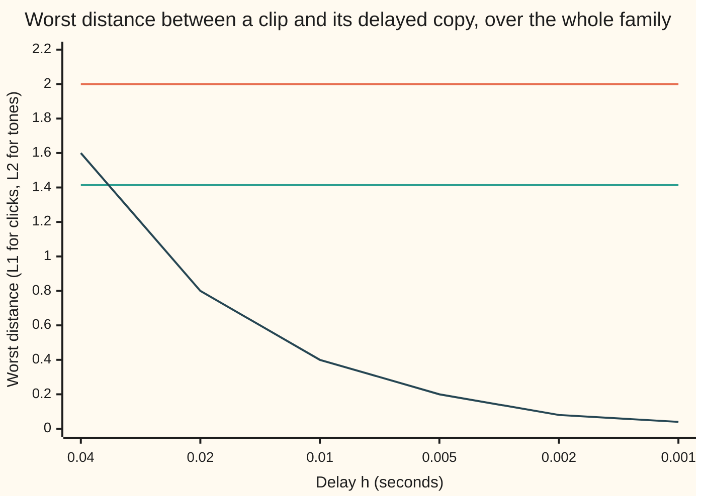

# Compactness in Lp: small shifts must change a family only a little, and in L1 no mass may pile up

[Syllabus](../../../SYLLABUS.md) → [Functional analysis](../README.md) → [Hilbert Spaces](../README.md#s02) → Compactness in Lp

---

## General Overview

Take a one-second audio clip that holds a single click. Click number n has height n and lasts 1/n of a second: click 100 is 100 units tall for 10 milliseconds. The amplitudes are illustrative. Every click has the same area under it, 1, so every click has the same size in $`L^1`$, the space of clips sized by the area under their absolute value ([Lp spaces](../../10-Measure%20and%20integration/07-Sizes%20of%20Functions/01-lp-spaces.md)).

A recorder that keeps N samples sees a list of N numbers. Every bounded sequence of such lists has a subsequence that converges entry by entry ([Compactness three ways](../../17-Topology/01-Metric%20Spaces/06-compactness-in-metric-spaces.md)). At N = 1000 samples, every click shorter than one sample lands in the first sample, and from click 1000 on the recordings are identical.

Without sampling, the clicks never settle. Click 100 and click 200 are 1 apart in $`L^1`$. Delay any click after the first by its own length and the delayed copy is 2 away from the original. In infinite dimensions, bounded is not enough. Two tests decide what is enough.

- **The shift test (Kolmogorov–Riesz).** Delay every member of the family by a short time h. If every member moves only a little, the same little for all, the family has convergent subsequences. The clicks fail: each one moves by 2 once h reaches its length.
- **The pile-up test (Dunford–Pettis).** For the weaker kind of convergence, where only averages against bounded weights must settle, the test in $`L^1`$ is that no member piles much of its area onto a tiny stretch. The clicks fail this too: all their area goes onto ever shorter stretches.

Two more families show the tests are different. Pure tones $`\sin(2\pi n x)`$ never pile up, and they settle weakly to silence, but a delay of half a cycle flips each one, so they fail the shift test. Clicks blurred over 50 milliseconds pass both tests, and they converge in $`L^1`$ to a flat 50 ms box.

**A bounded family in $`L^p`$ has a subsequence converging in size exactly when one small delay moves every member by little; in $`L^1`$ it has a subsequence converging weakly exactly when no member piles its mass onto small sets.**

**What kind of fact this is:** two theorems. Kolmogorov–Riesz is proved on this card in Why it works, both directions, for clips on a loop. Dunford–Pettis is proved in one direction in a fold; the converse is stated with a named source, and for the clicks it is proved directly.

### The picture: the worst move under a delay



Orange: the clicks, worst distance 2 at every delay. Green: the tones, measured in $`L^2`$, worst distance 1.4142 at every delay. Dark blue: the clicks blurred over 0.05 s, worst distance 40h, falling to 0. Only the blue family passes the shift test. The code computes the blue line on a grid at n = 10000, a click the blur has already turned into a near-box. The other two lines take the worst member up to n = 10000.

---

## The formula

Notation first, in words. A clip is a function $`f(x)`$ of time $`x`$ in seconds on the loop $`[0, 1)`$: the end of the second is joined to its start, as when a clip plays on repeat. For $`1 \le p < \infty`$, its size is $`\lVert f\rVert_p = \big(\int_0^1 \lvert f(x)\rvert^p\,dx\big)^{1/p}`$ and $`L^p`$ is the space of clips with finite size ([Function spaces C and Lp](../01-Normed%20and%20Banach%20Spaces/03-function-spaces-c-and-lp.md)).

This card introduces the **delay** $`\tau_h`$: $`(\tau_h f)(x) = f(x - h)`$, wrapping round the loop. It plays the clip h seconds later. It is a continuous shift of time, not the shift of a list on the operator shelves.

A family $`\mathcal{F}`$ of clips is **bounded** when every size is at most some $`B`$. It is **relatively compact** when every sequence in it has a subsequence that converges in size to some clip in $`L^p`$, not necessarily one in the family. Its **shift modulus** is the worst move under a delay of at most h (here ω names this modulus, not a frequency):

```math
\omega_{\mathcal F}(h) = \sup_{f \in \mathcal F}\ \sup_{\lvert s\rvert \le h}\ \lVert \tau_s f - f\rVert_p
```

**The Kolmogorov–Riesz theorem** (also called the Fréchet–Kolmogorov theorem), for $`1 \le p < \infty`$ on the loop:

```math
\mathcal F \text{ bounded in } L^p: \qquad \mathcal F \text{ relatively compact} \iff \omega_{\mathcal F}(h) \to 0 \text{ as } h \to 0
```

**Read it aloud:** a bounded family of clips has a size-convergent subsequence in every sequence exactly when one small delay moves every clip in the family by little.

On the whole real line one more condition is needed: no member keeps much size far out, $`\sup_{\mathcal F} \int_{\lvert x\rvert > R} \lvert f\rvert^p\,dx \to 0`$ as the radius $`R`$ grows.

**Weak convergence in $`L^1`$.** By [Dual spaces](../01-Normed%20and%20Banach%20Spaces/09-dual-spaces-and-lp-duality.md), every bounded linear measurement on $`L^1`$ is an average $`\int_0^1 y f\,dx`$ against a bounded weight $`y`$ in $`L^\infty`$. A sequence converges **weakly**, $`f_n \rightharpoonup f`$, when every such reading settles ([Weak convergence](09-weak-convergence-and-banach-alaoglu.md)). A family is **uniformly integrable** when its worst tail above a level $`K`$ dies away ([Uniform integrability](../../10-Measure%20and%20integration/05-Swapping%20Limits%20and%20Integrals/05-uniform-integrability.md)).

**The Dunford–Pettis theorem**, on the loop or any space of finite total measure:

```math
\text{every sequence in } \mathcal F \text{ has a subsequence } f_{n_k} \rightharpoonup v \text{ in } L^1 \iff \lim_{K \to \infty}\ \sup_{f \in \mathcal F} \int_{\{\lvert f\rvert > K\}} \lvert f\rvert\,dx = 0
```

**Read it aloud:** a family in L1 has weakly convergent subsequences exactly when the area any member keeps above a high level K is small, uniformly, once K is large.

| Symbol | Plain meaning | In our example | Push it up and the answer… |
| --- | --- | --- | --- |
| $`x`$, $`[0,1)`$, $`R`$ | time in seconds on the one-second loop; a radius on the real line, for the tail condition | the clip; a box sliding to the right | — |
| $`f_n`$, $`n`$, $`m`$ | click n: height n on $`[0, 1/n)`$, else 0; m, a second click number | $`f_{100}`$: 100 units for 10 ms, area 1 | taller, shorter, same area |
| $`g_n`$ | pure tone $`\sin(2\pi n x)`$, n cycles a second | size $`\lVert g_n\rVert_2 = 0.7071`$ | faster wiggle, same size |
| $`p`$, $`L^p`$, $`\lVert f\rVert_p`$ | the power; clips of finite p-size; that size | p = 1 for clicks, p = 2 for tones | — |
| $`h`$, $`s`$, $`\tau_h`$ | a delay in seconds; any delay $`s`$ up to h; the delayed clip | h = 0.001 s | larger moves |
| $`\mathcal F`$, $`B`$ | a family of clips; a bound on every size | the clicks, B = 1 | — |
| $`\omega_{\mathcal F}(h)`$, $`\eta`$, $`u_i`$ | worst move of any member under a delay up to h; a tolerance in the proof; the finitely many clips that meet it | clicks 2, blurred clicks 40h | — |
| $`y`$, $`a`$, $`M`$, $`\rightharpoonup`$ | a bounded weight; the end of its stretch $`[0, a)`$; a bound on it; weak convergence: every average against a weight settles | $`y = 1`$ on the first millisecond, $`a = 0.001`$ | — |
| $`K`$, $`K'`$, $`t(K)`$, $`f^{(K)}`$ | a level for the tail test; a higher level (fold); the worst area above K; a clip cut at K | K = 10: every click above it keeps area 1 | tails should shrink |
| $`n_j`$, $`n_k`$, $`v`$, $`v_K`$, $`w`$ | a subsequence's indices; its weak limit; the cut clips' weak limit; any clip (fold) | clicks: no $`v`$ exists | — |
| $`\varepsilon`$, $`A_\varepsilon f`$ | blur width; the blur: $`A_\varepsilon f(x)`$ is the average of $`f`$ over $`[x - \varepsilon, x]`$ | ε = 0.05 s | smaller shift moves, $`2h/\varepsilon`$ |
| $`N`$, $`P_N f`$ | samples kept; the clip averaged over N equal bins | N = 10, 100, 1000 | finer bins see shorter clicks |

### When it holds

- **p below infinity.** In $`L^\infty`$, sized by the largest value, a single clip with a jump never passes: any delay moves the jump, and the largest gap stays the full jump height, though one clip alone is compact. Kolmogorov–Riesz needs an average, not a worst moment.
- **Bounded.** On the loop the constant clips 1, 2, 3, … pass the shift test perfectly, since a delay changes nothing, yet no subsequence settles. The bound is a separate hypothesis.
- **A tail condition on the real line.** A box of height 1 on $`[n, n+1)`$ moves by 0.0200 under a delay of 0.01, for every n, yet boxes 1 and 5 are 2.0000 apart. It slides off to infinity.
- **Uniform integrability gives weak limits, not size limits.** The tones are bounded by 1, so they never pile up, and they converge weakly to 0. Yet $`\lVert g_n - g_{2n}\rVert_1 = 0.7958`$ at every n.
- **Finite total measure for Dunford–Pettis.** The sliding box is uniformly integrable, but against the weight $`y = 1`$ it reads 1 forever, while any weak limit would read 0 on every bounded stretch. On an infinite line, mass must also not escape to infinity.

---

## Why it works

### Step 0: compact means finitely many clips at every tolerance

A set in a complete space has a convergent subsequence in every sequence exactly when it is **totally bounded**: for every tolerance, finitely many points lie within that tolerance of every member ([Compactness three ways](../../17-Topology/01-Metric%20Spaces/06-compactness-in-metric-spaces.md)). $`L^p`$ is complete ([Riesz-Fischer](../../10-Measure%20and%20integration/07-Sizes%20of%20Functions/05-completeness-of-lp.md)), so total boundedness is all that is needed.

For continuous functions the tool that finds those finitely many points is [Arzela-Ascoli](../../17-Topology/01-Metric%20Spaces/09-arzela-ascoli.md): a family bounded at each moment and sharing one closeness rule has convergent subsequences in the worst-moment distance. Clips in $`L^p`$ are not continuous, so blur them first. The shift test does two jobs at once. It makes the blur move each clip by little, and it gives the blurred clips a shared closeness rule. That is Kolmogorov–Riesz: Arzelà–Ascoli for $`L^p`$.

### Step 1: the shift test makes the blur faithful

The blur $`A_\varepsilon f(x)`$ averages $`f`$ over the last ε seconds. So $`A_\varepsilon f`$ is an average of delayed copies $`\tau_s f`$, with $`0 \le s \le \varepsilon`$. The distance from an average of copies to the original is at most the average of their distances. This is [Minkowski's inequality](../../10-Measure%20and%20integration/07-Sizes%20of%20Functions/03-minkowskis-inequality.md) for integrals. For $`p = 1`$ it follows by swapping the two integrals ([Tonelli and Fubini](../../10-Measure%20and%20integration/06-Product%20Measures%20and%20Fubini/03-tonelli-and-fubini.md)); for $`p > 1`$ the integral form is proved in [Convolution and mollifiers](../04-Distributions%20and%20Sobolev%20Spaces/03-convolution-and-mollifiers.md):

```math
\lVert A_\varepsilon f - f\rVert_p \le \frac{1}{\varepsilon}\int_0^\varepsilon \lVert \tau_s f - f\rVert_p\,ds \le \omega_{\mathcal F}(\varepsilon)
```

The same bound holds for every member at once, because $`\omega_{\mathcal F}`$ is a worst case over the family.

### Step 2: the blurred family is bounded and shares one closeness rule

Two bounds, one for each hypothesis of Arzelà–Ascoli. The loop has length 1, so an $`L^1`$ size is at most the $`L^p`$ size ([Holder's inequality](../../10-Measure%20and%20integration/07-Sizes%20of%20Functions/02-holders-inequality.md)).

1. **Bounded at each moment.** An average over ε seconds is at most $`1/\varepsilon`$ times the area there, and Hölder bounds that area: $`\lvert A_\varepsilon f(x)\rvert \le \varepsilon^{-1/p} B`$.
2. **One closeness rule.** Delaying the blurred clip by h changes its window by the delay of $`f`$ inside it:

```math
\lvert A_\varepsilon f(x - h) - A_\varepsilon f(x)\rvert = \frac{1}{\varepsilon}\Big\lvert \int_{x-\varepsilon}^{x} \big(f(t - h) - f(t)\big)\,dt\Big\rvert \le \frac{\lVert \tau_h f - f\rVert_1}{\varepsilon} \le \frac{\omega_{\mathcal F}(h)}{\varepsilon}
```

The right side does not depend on the member or on the moment x, and it falls to 0 with h. So the blurred clips are continuous and share one closeness rule.

### Step 3: Arzelà–Ascoli finishes the proof

Fix a tolerance η. Choose ε with $`\omega_{\mathcal F}(\varepsilon) < \eta/3`$.

1. By Step 2 and Arzelà–Ascoli, finitely many continuous clips $`u_1, \dots, u_k`$ come within η/3 of every blurred member in the worst-moment distance, hence in $`L^p`$ size.
2. By Step 1, every member is within η/3 of its blur.
3. So every member is within 2η/3 of some $`u_i`$. The family is totally bounded, and Step 0 gives the subsequences.

### Step 4: the converse, a compact family passes the shift test

A single clip passes on its own. Continuous clips are dense in $`L^p`$ ([Function spaces C and Lp](../01-Normed%20and%20Banach%20Spaces/03-function-spaces-c-and-lp.md)). A continuous clip $`u`$ on the loop is uniformly continuous, so its delays move it little. A delay keeps size, so for any clip $`f`$:

```math
\lVert \tau_s f - f\rVert_p \le 2\lVert f - u\rVert_p + \lVert \tau_s u - u\rVert_p
```

Both terms are small. For a relatively compact family, take finitely many members within η of every member. Each of the finitely many passes, and every other member is within η of one of them. So $`\omega_{\mathcal F}(h) \le 2\eta + `$ the worst of finitely many small moves, which falls below 3η for small h.

This is why one clip, or any finite set of clips, always passes. Clicks up to number 100 move at most 0.2000 under a delay of 0.001; clicks up to 1000 already move 2.0000. The test is about the whole infinite family, and only the trend tells.

### Step 5: the clicks fail, and no subsequence converges in size

For $`m > n`$, clicks $`f_n`$ and $`f_m`$ overlap on $`[0, 1/m)`$, where they differ by $`m - n`$, and $`f_n`$ alone covers the rest of $`[0, 1/n)`$:

```math
\lVert f_n - f_m\rVert_1 = \frac{m - n}{m} + n\Big(\frac1n - \frac1m\Big) = 2\Big(1 - \frac{n}{m}\Big)
```

Any subsequence has, after each term n, a later term at least 2n, and those two are at least 1 apart. So no subsequence is Cauchy. The code prints 1.0000 for (10, 20), 1.5000 for (10, 40) and 1.9800 for (100, 10000).

The shift test sees the same thing. A delay h moves the part of length $`\min(h, 1/n)`$ off itself and leaves a hole of the same length, so $`\lVert \tau_h f_n - f_n\rVert_1 = 2\min(nh, 1)`$ for $`n \ge 2`$ and $`0 \le h \le 1/2`$. (Click 1 fills the whole loop, so no delay moves it.) Every delay, however short, reaches 2 once n is at least 1/h.

### Step 6: the sampled clip hides it

Averaging over N equal bins, $`P_N f`$, is the N-sample recording. In $`N`$ dimensions every bounded family is relatively compact. The clicks show how: once $`n \ge N`$, all of $`f_n`$ falls inside the first bin, so $`P_N f_n`$ is the same list for every such n, and the distance from $`P_N f_n`$ to $`P_N f_{2n}`$ is 0 from n = N on. Below that it is 1 when bin edges fall on both clicks' ends, and strictly between 0 and 1 when they do not: 0.8000 for click 3 at N = 10. Raising N only moves the failure to shorter clicks. The trend never closes.

### Step 7: Dunford–Pettis, the clicks pile up

The clicks are the lottery tickets of [Uniform integrability](../../10-Measure%20and%20integration/05-Swapping%20Limits%20and%20Integrals/05-uniform-integrability.md): $`n`$ on a set of length $`1/n`$. Above any level K, every click with $`n > K`$ keeps its whole area 1, so the worst tail is 1 at K = 10, 100 and 1000. Not uniformly integrable.

No subsequence converges weakly in $`L^1`$. Read each click against the weight $`y = 1`$ on $`[0, a)`$: the reading is $`\min(1, na)`$. On the first millisecond the readings are 0.0100, 0.1000, 1.0000 and 1.0000 for n = 10, 100, 1000 and 10000. So a weak limit $`f`$ would need $`\int_0^a f\,dx = 1`$ for every $`a > 0`$. But an integrable $`f`$ keeps only a vanishing area on a shrinking stretch. No such $`f`$ exists.

The mass is heading for a point mass at time 0, an object outside $`L^1`$. It does exist in the larger dual of the continuous clips, where Banach–Alaoglu promises weak-star limits ([Weak convergence](09-weak-convergence-and-banach-alaoglu.md)). $`L^1`$ is not reflexive ([Reflexive spaces](../01-Normed%20and%20Banach%20Spaces/10-reflexive-spaces-and-the-second-dual.md)), so its bounded families need not have weakly convergent subsequences. For $`1 < p < \infty`$, $`L^p`$ is reflexive, and bounded is enough for weak limits.

Uniform integrability is the cure. If it holds, cut every member at a level K. The cut clips are bounded, so they live in $`L^2`$, where bounded sequences have weakly convergent subsequences. The parts above K carry a uniformly small area, so they cannot disturb any bounded reading by much.

<details>
<summary>Detailed proof: uniform integrability gives a weakly convergent subsequence</summary>

Write $`t(K) = \sup_{\mathcal F} \int_{\{\lvert f\rvert > K\}} \lvert f\rvert\,dx`$, which tends to 0 by assumption. Let $`f^{(K)}`$ be $`f`$ where $`\lvert f\rvert \le K`$ and 0 elsewhere. Then for every member and every $`K' > K`$:

$`\displaystyle \lVert f - f^{(K)}\rVert_1 \le t(K), \qquad \lVert f^{(K')} - f^{(K)}\rVert_1 \le t(K).`$

**Extract.** Take a sequence $`f_n`$ in the family. The cut clips $`f_n^{(1)}`$ are bounded by 1, so their $`L^2`$ sizes are at most 1. By [Weak convergence](09-weak-convergence-and-banach-alaoglu.md) a subsequence converges weakly in $`L^2`$. Thin that for K = 2, then K = 3, and take the diagonal. Along it, for every whole number K, $`f_{n_j}^{(K)} \rightharpoonup v_K`$ weakly in $`L^2`$. A bounded weight $`y`$ is in $`L^2`$, so every bounded reading of $`f_{n_j}^{(K)}`$ settles at the reading of $`v_K`$.

**The pieces fit together.** The $`L^1`$ size of $`w`$ is the largest reading $`\int y w\,dx`$ over weights with $`\lvert y\rvert \le 1`$ (take $`y`$ to be the sign of $`w`$). For any such weight and $`K < K'`$:

$`\displaystyle \int y\,(v_{K'} - v_K)\,dx = \lim_j \int y\,\big(f_{n_j}^{(K')} - f_{n_j}^{(K)}\big)\,dx \le t(K).`$

So $`\lVert v_{K'} - v_K\rVert_1 \le t(K)`$: the $`v_K`$ form a Cauchy sequence in $`L^1`$, which is complete. Call the limit $`v`$. It satisfies $`\lVert v - v_K\rVert_1 \le t(K)`$.

**Every reading settles.** For a weight with $`\lvert y\rvert \le M`$:

$`\displaystyle \Big\lvert \int y\,(f_{n_j} - v)\,dx\Big\rvert \le M\,t(K) + \Big\lvert \int y\,\big(f_{n_j}^{(K)} - v_K\big)\,dx\Big\rvert + M\,t(K).`$

The middle term tends to 0 as j grows. So the readings settle to within $`2M\,t(K)`$ for every K, and $`t(K) \to 0`$. Hence $`f_{n_j} \rightharpoonup v`$ weakly in $`L^1`$.

**The converse,** that a family with weakly convergent subsequences must be uniformly integrable, is stated here and proved by Dunford and Pettis (1940) and in Bogachev's *Measure Theory*, chapter 4. For the clicks, Step 7 proves it directly.

</details>

### Step 8: the tones, weakly compact but not compact

The tones are bounded by 1, so above K = 1 they keep no area: uniformly integrable. They converge weakly to silence. Against the first quarter second the reading is $`(1 - \cos(\pi n/2))/(2\pi n)`$, at most $`1/(\pi n)`$: 0.159155, 0.159155, 0.053052, 0.014469, 0.001576 and 0.000159 for n = 1, 2, 3, 11, 101 and 1001. For any weight $`y`$ in $`L^2`$, Bessel's inequality makes the readings fade, because the $`\sqrt2\,g_n`$ are orthonormal ([Orthonormal bases](03-orthonormal-bases-and-parseval.md)).

They fail the shift test. A delay of half a cycle, $`h = 1/(2n)`$, turns $`g_n`$ into $`-g_n`$:

```math
\lVert \tau_{1/(2n)} g_n - g_n\rVert_2 = 2\lVert g_n\rVert_2 = 2 \times 0.7071 = 1.4142
```

In $`L^1`$ the same delay moves each tone by $`4/\pi = 1.2732`$. Any two tones are 1.0000 apart in $`L^2`$, by Pythagoras, and $`g_n`$ and $`g_{2n}`$ are 0.7958 apart in $`L^1`$. The weak limit, 0, has lost all of the size 0.7071, as weak limits may.

### Step 9: the blur repairs any family of unit area

Blurring with width ε makes any clip of area at most 1 pass with modulus $`2h/\varepsilon`$. Delaying $`A_\varepsilon f`$ by h adds a strip of length h at the back of each window and drops one at the front. Each strip carries at most $`h/\varepsilon`$ of averaged area, so

```math
\lVert \tau_h A_\varepsilon f - A_\varepsilon f\rVert_1 \le \frac{2h}{\varepsilon}\,\lVert f\rVert_1
```

With ε = 0.05 that is 40h. The code meets it exactly at n = 10000: 1.6000 at h = 0.04 down to 0.0400 at h = 0.001. Smaller clicks move less: 0.1000 for click 5 and 0.3800 for click 20, at h = 0.01. So the blurred clicks are relatively compact. In fact they converge in $`L^1`$: for $`n \ge 20`$ the blurred click is a trapezoid (a triangle at n = 20), and its distance to the box of height 20 on $`[0, 0.05)`$ is $`1/(n\varepsilon)`$: 1.0000, 0.2000 and 0.0200 at n = 20, 100 and 1000.

---

## Worked numbers, by hand

Click 100 and its neighbours, sized in $`L^1`$, then blurred over ε = 0.05 s.

| Step | Arithmetic | Value |
| --- | --- | --- |
| size of click 100 | $`100 \times 0.01`$ | 1 |
| delay by h = 0.001: strip moved off, plus hole left | $`2 \times 100 \times 0.001`$ | 0.2 |
| delay by h = 0.01, the click's own length | $`2 \times \min(100 \times 0.01, 1)`$ | 2 |
| click 100 against click 200 | $`2 \times (1 - 100/200)`$ | 1 |
| area of click 100 above K = 10 | the whole click is above 10 | 1 |
| reading on the first millisecond, click 100 | $`100 \times 0.001`$ | 0.1 |
| the same reading, click 1000 | $`\min(1000 \times 0.001, 1)`$ | 1 |
| blurred click 100 against the box | $`1/(100 \times 0.05)`$ | 0.2 |
| worst move of any blurred click, h = 0.001 | $`2 \times 0.001/0.05`$ | **0.04** |

**A delay of one millisecond moves some click by 2, its full size plus the hole it leaves, but moves every blurred click by at most 0.04.** The raw clicks have no convergent subsequence, in size or weakly; the blurred clicks converge in $`L^1`$ to a 50 ms box.

### What breaks if you drop a piece

| Mistake | Comes out at | What went wrong |
| --- | --- | --- |
| Drop the shift test | clicks move 2.0000 at every h; clicks 10 and 20 are 1.0000 apart | bounded in $`L^1`$, yet no subsequence converges |
| Check only finitely many members | worst move 0.2000 for n ≤ 100, 2.0000 for n ≤ 1000, at h = 0.001 | any finite family passes; the test is a trend over the whole family |
| Drop uniform integrability | first-millisecond readings 0.0100, 0.1000, 1.0000, 1.0000; tail 1.0000 at every K | the mass heads for a point mass, outside $`L^1`$ |
| Read uniform integrability as compactness | tones: $`\lVert g_n - g_{2n}\rVert_1 = 0.7958`$, shift move 1.4142 in $`L^2`$ | it gives weak limits only |
| Drop the tail condition on the line | sliding box: delay 0.01 moves it 0.0200; boxes 1 and 5 are 2.0000 apart | the mass escapes to infinity |

---

## Code, from first principles, and it actually runs

The code holds finitely many clips and grids, so it checks instances and trends; the theorems rest on the proofs above. It takes three roads. Every distance has a closed form, checked against a midpoint grid lined up with every jump and corner, so the grid is exact up to rounding. The chart's click and tone lines are closed-form worst cases over n up to 10000, confirmed on a grid at the worst member. The binned clicks are checked against a counting rule for the aligned cases, 0 when $`n \ge N`$ and 1 when bin edges fall on both clicks' ends, and every other case must fall strictly between. The blurred clicks are checked against the bound $`2h/\varepsilon`$ and, at h = 0.01, against exact values. The tones' $`L^1`$ gap is computed from an antiderivative and from a grid.

### Python

```python
# Compactness in Lp -- the check behind the card.  Standard library only.
# A one-second audio clip is a function on the loop [0, 1): time in seconds, the end joined
# to the start, amplitudes illustrative.  Click f_n = n on [0, 1/n), else 0, so its L1 size
# is 1.  Tone g_n(x) = sin(2 pi n x).  Blur: average over the last eps = 0.05 s.
# Delay: (tau_h f)(x) = f(x - h), wrapping round the loop.  The code holds finitely many
# clips and grids, so it checks instances and trends; the theorems rest on the card's proofs.
# Roads: closed forms against midpoint grids lined up with every jump and corner,
# bin averages against a counting rule, and exact ramp-and-plateau shift values.
import math

def grid(f, a, b, G):                    # midpoint rule for the integral of f over [a, b]
    w = (b - a) / G
    return w * sum(f(a + (i + 0.5) * w) for i in range(G))

def click(n, height=None):
    c = float(n) if height is None else height
    return lambda x: c if x % 1.0 < 1.0 / n else 0.0

def blur_click(n, eps=0.05):             # (B f_n)(x) = (1/eps) * integral of f_n over [x - eps, x]
    def u(x):
        x %= 1.0
        return n * max(0.0, min(x, 1.0 / n) - max(x - eps, 0.0)) / eps
    return u

def l1_shift(u, h, a, b, G):
    return grid(lambda x: abs(u(x - h) - u(x)), a, b, G)

# 1. Clicks fail the shift test: ||tau_h f_n - f_n||_1 = 2 min(nh, 1).
sizes = [grid(click(n), 0, 1, 20000) for n in (10, 100, 1000, 10000)]
assert all(abs(v - 1) < 1e-9 for v in sizes)
print("clicks f_n: L1 sizes at n = 10, 100, 1000, 10000 (grid): " + ", ".join(f"{v:.4f}" for v in sizes))
print("clicks f_n: L1 distance to the shift by h (formula; a grid agrees)")
print("  h     | n=10   | n=100  | n=1000 | n=10000")
for h in (0.1, 0.01, 0.001):
    row = [2 * min(n * h, 1.0) for n in (10, 100, 1000, 10000)]
    for n, v in zip((10, 100, 1000, 10000), row):
        assert abs(v - l1_shift(click(n), h, 0, 1, 20000)) < 1e-9
    print(f"  {h:.3f} | " + " | ".join(f"{v:.4f}" for v in row))
for M in (100, 1000):
    print(f"  finite family n <= {M}: worst shift distance at h = 0.001 is {max(2 * min(n * 0.001, 1.0) for n in range(1, M + 1)):.4f}")
pairs = [(10, 20), (10, 40), (100, 200), (100, 10000)]
d = [grid(lambda x, n=n, m=m: abs(click(n)(x) - click(m)(x)), 0, 1, 20000) for n, m in pairs]
for (n, m), v in zip(pairs, d):
    assert abs(v - 2 * (1 - n / m)) < 1e-9
print("  ||f_n - f_m||_1 for (n, m) = " + ", ".join(f"({n}, {m}) {v:.4f}" for (n, m), v in zip(pairs, d)))

# 2. The finite rehearsal: average each click over N equal bins (an N-sample clip).
def binned_gap(n, N):                    # || P_N f_n - P_N f_2n ||_1 = sum over bins of |mass difference|
    tot = 0.0
    for j in range(N):
        lo, hi = j / N, (j + 1) / N
        tot += abs(n * max(0.0, min(hi, 1 / n) - lo) - 2 * n * max(0.0, min(hi, 1 / (2 * n)) - lo))
    return tot
print("N-sample clips: ||P_N f_n - P_N f_2n||_1")
print("  n      | N=10   | N=100  | N=1000 | no bins")
for n in (1, 3, 10, 100, 1000):
    row = [binned_gap(n, N) for N in (10, 100, 1000)]
    for N, v in zip((10, 100, 1000), row):     # 0 from n = N on; 1 when bin edges meet both ends
        want = 0.0 if n >= N else 1.0 if N % (2 * n) == 0 else None
        assert 0 < v < 1 if want is None else abs(v - want) < 1e-9
    nob = grid(lambda x, a=click(n), b=click(2 * n): abs(a(x) - b(x)), 0, 1, 60000)   # no bins
    assert abs(nob - 2 * (1 - n / (2 * n))) < 1e-9
    print(f"  n={n:<5d}| " + " | ".join(f"{v:.4f}" for v in row) + f" | {nob:.4f}")

# 3. Clicks are not uniformly integrable, so no subsequence converges weakly in L1.
tail = lambda n, K: grid(lambda x, c=click(n): c(x) if c(x) > K else 0.0, 0, 1, 20000)   # area above K
tails = [max(tail(n, K) for n in (K // 2, K, 2 * K, 10 * K)) for K in (10, 100, 1000)]
for K, t in zip((10, 100, 1000), tails):          # rule: click n keeps area 1 above K exactly when n > K
    assert abs(t - max(1.0 if n > K else 0.0 for n in range(1, 10 * K + 1))) < 1e-9 and abs(tail(K, K)) < 1e-9
print("  worst tail sup_n of the integral of f_n where f_n > K, at K = 10, 100, 1000: " + ", ".join(f"{t:.4f}" for t in tails))
first = [min(1.0, n * 0.001) for n in (10, 100, 1000, 10000)]
for n, v in zip((10, 100, 1000, 10000), first):
    assert abs(v - grid(click(n), 0, 0.001, 1000)) < 1e-9
print("  reading on the first millisecond, n = 10, 100, 1000, 10000: " + ", ".join(f"{v:.4f}" for v in first))

# 4. Tones g_n: bounded by 1, so uniformly integrable; weakly to 0; still not compact.
tone = lambda n: (lambda x: math.sin(2 * math.pi * n * x))
for n in (1, 10, 100):
    sz = math.sqrt(grid(lambda x: tone(n)(x) ** 2, 0, 1, 4000))
    sh = math.sqrt(grid(lambda x: (tone(n)(x - 1 / (2 * n)) - tone(n)(x)) ** 2, 0, 1, 4000))
    pr = math.sqrt(grid(lambda x: (tone(n)(x) - tone(2 * n)(x)) ** 2, 0, 1, 4000))
    sh1 = grid(lambda x: abs(tone(n)(x - 1 / (2 * n)) - tone(n)(x)), 0, 1, 200000)
    assert abs(sz - 1 / math.sqrt(2)) < 1e-9 and abs(sh - math.sqrt(2)) < 1e-9 and abs(pr - 1) < 1e-9 and abs(sh1 - 4 / math.pi) < 1e-6
    print(f"  tone n={n:<3d}: ||g_n||_2 {sz:.4f}; shift by 1/(2n): L2 {sh:.4f}, L1 {sh1:.4f}; ||g_n - g_2n||_2 {pr:.4f}")
F = lambda x: -math.cos(4 * math.pi * x) / (4 * math.pi) + math.cos(2 * math.pi * x) / (2 * math.pi)
cuts = [0, 1 / 6, 1 / 2, 5 / 6, 1]
gap1 = sum(abs(F(b) - F(a)) for a, b in zip(cuts, cuts[1:]))
for n in (1, 10):
    assert abs(gap1 - grid(lambda x: abs(tone(n)(x) - tone(2 * n)(x)), 0, 1, 200000)) < 1e-6
print(f"  ||g_n - g_2n||_1 = {gap1:.4f} at every n (antiderivative and grid)")
reads = []
for n in (1, 2, 3, 11, 101, 1001):
    r = (1 - math.cos(math.pi * n / 2)) / (2 * math.pi * n)
    assert abs(r - grid(tone(n), 0, 0.25, 200000)) < 1e-8
    reads.append(r)
print("  tone reading on the first quarter second, n = 1, 2, 3, 11, 101, 1001: " + ", ".join(f"{r:.6f}" for r in reads))

# 5. Blurred clicks pass: worst shift distance 2h/eps, and they converge to the box.
box = lambda x: 20.0 if x % 1.0 < 0.05 else 0.0
for n in (20, 100, 1000):
    v = grid(lambda x: abs(blur_click(n)(x) - box(x)), 0, 0.1, 100000)
    assert abs(v - 1 / (n * 0.05)) < 1e-9
    print(f"  blurred click n={n:<4d}: L1 distance to the box 20 on [0, 0.05) = {v:.4f}")
hs = (0.04, 0.02, 0.01, 0.005, 0.002, 0.001)
chart = [l1_shift(blur_click(10000), h, -0.05, 0.1, 150000) for h in hs]
for h, v in zip(hs, chart):
    assert abs(v - 40 * h) < 1e-6
clk = [max(2 * min(n * h, 1.0) for n in range(2, 10001)) for h in hs]          # worst over clicks 2..10^4
ton = [max(math.sqrt(2) * math.sin(math.pi * min(n * h, 0.5)) for n in range(1, 10001)) for h in hs]
for h, c, t in zip(hs, clk, ton):                # a grid at the worst member agrees
    m = math.ceil(1 / (2 * h))                   # tone m flips under the delay 1/(2m) <= h
    assert abs(c - l1_shift(click(round(1 / h)), h, 0, 1, 20000)) < 1e-9
    assert abs(t - math.sqrt(grid(lambda x: (tone(m)(x - 1 / (2 * m)) - tone(m)(x)) ** 2, 0, 1, 4000))) < 1e-9
print("chart h:            " + ", ".join(f"{h}" for h in hs))
print("  blurred, worst:   " + ", ".join(f"{v:.4f}" for v in chart))
print("  clicks, worst:    " + ", ".join(f"{v:.4f}" for v in clk))
print("  tones (L2), worst: " + ", ".join(f"{v:.4f}" for v in ton))
at01 = [l1_shift(blur_click(n), 0.01, -0.05, 0.35, 400000) for n in (5, 20, 10000)]
for n, v in zip((5, 20, 10000), at01):            # exact: ramps of width r and height H, plateau P
    r, H, P = min(0.05, 1 / n), n * min(0.05, 1 / n) / 0.05, abs(1 / n - 0.05)
    assert abs(v - (2 * H * 0.01 - H * max(0.0, 0.01 - P) ** 2 / (2 * r))) < 1e-9
print("  blurred at h = 0.01, n = 5, 20, 10000: " + ", ".join(f"{v:.4f}" for v in at01))

# 6. What breaks on the whole line: a box sliding away passes the shift test, yet never settles.
slide = lambda n: (lambda x: 1.0 if n <= x < n + 1 else 0.0)
s1 = grid(lambda x: abs(slide(3)(x - 0.01) - slide(3)(x)), 0, 10, 10000)
s2 = grid(lambda x: abs(slide(1)(x) - slide(5)(x)), 0, 10, 10000)
assert abs(s1 - 0.02) < 1e-9 and abs(s2 - 2) < 1e-9
print(f"sliding box on the line: shift by 0.01 gives {s1:.4f}; ||b_1 - b_5||_1 = {s2:.4f}")

# 7. Try changing.
v = l1_shift(blur_click(10000, 0.01), 0.001, -0.05, 0.1, 150000)
assert abs(v - 0.2) < 1e-6
print(f"try: blur over 0.01 s: worst shift distance at h = 0.001 is {v:.4f}")
sq = [2 * min(n * 0.01, 1.0) / math.sqrt(n) for n in range(1, 100001)]
best = max(range(len(sq)), key=lambda i: sq[i]) + 1
v = l1_shift(click(best, math.sqrt(best)), 0.01, 0, 1, 20000)
assert abs(v - max(sq)) < 1e-9 and abs(max(sq) - 2 * math.sqrt(0.01)) < 1e-9
print(f"try: height sqrt(n) clicks: worst shift distance at h = 0.01 is {max(sq):.4f}, at n = {best}")
print("ALL CHECKS PASS")
```

**Ran 2026-11-24 on macOS, Python 3.14.10, standard library only. All checks passed. Output, pasted from the run:**

```
clicks f_n: L1 sizes at n = 10, 100, 1000, 10000 (grid): 1.0000, 1.0000, 1.0000, 1.0000
clicks f_n: L1 distance to the shift by h (formula; a grid agrees)
  h     | n=10   | n=100  | n=1000 | n=10000
  0.100 | 2.0000 | 2.0000 | 2.0000 | 2.0000
  0.010 | 0.2000 | 2.0000 | 2.0000 | 2.0000
  0.001 | 0.0200 | 0.2000 | 2.0000 | 2.0000
  finite family n <= 100: worst shift distance at h = 0.001 is 0.2000
  finite family n <= 1000: worst shift distance at h = 0.001 is 2.0000
  ||f_n - f_m||_1 for (n, m) = (10, 20) 1.0000, (10, 40) 1.5000, (100, 200) 1.0000, (100, 10000) 1.9800
N-sample clips: ||P_N f_n - P_N f_2n||_1
  n      | N=10   | N=100  | N=1000 | no bins
  n=1    | 1.0000 | 1.0000 | 1.0000 | 1.0000
  n=3    | 0.8000 | 0.9800 | 0.9980 | 1.0000
  n=10   | 0.0000 | 1.0000 | 1.0000 | 1.0000
  n=100  | 0.0000 | 0.0000 | 1.0000 | 1.0000
  n=1000 | 0.0000 | 0.0000 | 0.0000 | 1.0000
  worst tail sup_n of the integral of f_n where f_n > K, at K = 10, 100, 1000: 1.0000, 1.0000, 1.0000
  reading on the first millisecond, n = 10, 100, 1000, 10000: 0.0100, 0.1000, 1.0000, 1.0000
  tone n=1  : ||g_n||_2 0.7071; shift by 1/(2n): L2 1.4142, L1 1.2732; ||g_n - g_2n||_2 1.0000
  tone n=10 : ||g_n||_2 0.7071; shift by 1/(2n): L2 1.4142, L1 1.2732; ||g_n - g_2n||_2 1.0000
  tone n=100: ||g_n||_2 0.7071; shift by 1/(2n): L2 1.4142, L1 1.2732; ||g_n - g_2n||_2 1.0000
  ||g_n - g_2n||_1 = 0.7958 at every n (antiderivative and grid)
  tone reading on the first quarter second, n = 1, 2, 3, 11, 101, 1001: 0.159155, 0.159155, 0.053052, 0.014469, 0.001576, 0.000159
  blurred click n=20  : L1 distance to the box 20 on [0, 0.05) = 1.0000
  blurred click n=100 : L1 distance to the box 20 on [0, 0.05) = 0.2000
  blurred click n=1000: L1 distance to the box 20 on [0, 0.05) = 0.0200
chart h:            0.04, 0.02, 0.01, 0.005, 0.002, 0.001
  blurred, worst:   1.6000, 0.8000, 0.4000, 0.2000, 0.0800, 0.0400
  clicks, worst:    2.0000, 2.0000, 2.0000, 2.0000, 2.0000, 2.0000
  tones (L2), worst: 1.4142, 1.4142, 1.4142, 1.4142, 1.4142, 1.4142
  blurred at h = 0.01, n = 5, 20, 10000: 0.1000, 0.3800, 0.4000
sliding box on the line: shift by 0.01 gives 0.0200; ||b_1 - b_5||_1 = 2.0000
try: blur over 0.01 s: worst shift distance at h = 0.001 is 0.2000
try: height sqrt(n) clicks: worst shift distance at h = 0.01 is 0.2000, at n = 100
ALL CHECKS PASS
```

### Rust

```rust
// Compactness in Lp -- the check behind the card.  Rust std only.
// A one-second audio clip is a function on the loop [0, 1): time in seconds, the end joined
// to the start, amplitudes illustrative.  Click f_n = n on [0, 1/n), else 0, so its L1 size
// is 1.  Tone g_n(x) = sin(2 pi n x).  Blur: average over the last eps = 0.05 s.
// Delay: (tau_h f)(x) = f(x - h), wrapping round the loop.  The code holds finitely many
// clips and grids, so it checks instances and trends; the theorems rest on the card's proofs.
// Roads: closed forms against midpoint grids lined up with every jump and corner,
// bin averages against a counting rule, and exact ramp-and-plateau shift values.
use std::f64::consts::PI;

// midpoint rule for the integral of f over [a, b]
fn grid(f: &dyn Fn(f64) -> f64, a: f64, b: f64, g: usize) -> f64 {
    let w = (b - a) / g as f64;
    let mut s = 0.0;
    for i in 0..g { s += f(a + (i as f64 + 0.5) * w); }
    w * s
}

fn md1(x: f64) -> f64 { x.rem_euclid(1.0) }
fn click(n: usize, c: f64) -> impl Fn(f64) -> f64 { move |x| if md1(x) < 1.0 / n as f64 { c } else { 0.0 } }
fn tone(n: usize) -> impl Fn(f64) -> f64 { move |x| (2.0 * PI * n as f64 * x).sin() }

// (B f_n)(x) = (1/eps) * integral of f_n over [x - eps, x]
fn blur_click(n: usize, eps: f64) -> impl Fn(f64) -> f64 {
    move |x| { let x = md1(x); n as f64 * (x.min(1.0 / n as f64) - (x - eps).max(0.0)).max(0.0) / eps }
}

fn l1_shift(u: &dyn Fn(f64) -> f64, h: f64, a: f64, b: f64, g: usize) -> f64 { grid(&|x| (u(x - h) - u(x)).abs(), a, b, g) }
fn join(v: &[f64], d: usize) -> String { v.iter().map(|x| format!("{:.*}", d, x)).collect::<Vec<_>>().join(", ") }
fn bars(v: &[f64]) -> String { v.iter().map(|x| format!("{:.4}", x)).collect::<Vec<_>>().join(" | ") }

// || P_N f_n - P_N f_2n ||_1 = sum over bins of |mass difference|
fn binned_gap(n: usize, nb: usize) -> f64 {
    let (nf, mut tot) = (n as f64, 0.0);
    for j in 0..nb {
        let (lo, hi) = (j as f64 / nb as f64, (j + 1) as f64 / nb as f64);
        tot += (nf * (hi.min(1.0 / nf) - lo).max(0.0) - 2.0 * nf * (hi.min(1.0 / (2.0 * nf)) - lo).max(0.0)).abs();
    }
    tot
}

fn main() {
    // 1. Clicks fail the shift test: ||tau_h f_n - f_n||_1 = 2 min(nh, 1).
    let ns = [10usize, 100, 1000, 10000];
    let sizes: Vec<f64> = ns.iter().map(|&n| grid(&click(n, n as f64), 0.0, 1.0, 20000)).collect();
    assert!(sizes.iter().all(|v| (v - 1.0).abs() < 1e-9));
    println!("clicks f_n: L1 sizes at n = 10, 100, 1000, 10000 (grid): {}", join(&sizes, 4));
    println!("clicks f_n: L1 distance to the shift by h (formula; a grid agrees)");
    println!("  h     | n=10   | n=100  | n=1000 | n=10000");
    for h in [0.1, 0.01, 0.001] {
        let row: Vec<f64> = ns.iter().map(|&n| 2.0 * (n as f64 * h).min(1.0)).collect();
        for (&n, &v) in ns.iter().zip(&row) { assert!((v - l1_shift(&click(n, n as f64), h, 0.0, 1.0, 20000)).abs() < 1e-9); }
        println!("  {:.3} | {}", h, bars(&row));
    }
    for m in [100usize, 1000] {
        let w = (1..=m).map(|n| 2.0 * (n as f64 * 0.001).min(1.0)).fold(f64::MIN, f64::max);
        println!("  finite family n <= {}: worst shift distance at h = 0.001 is {:.4}", m, w);
    }
    let pairs = [(10usize, 20usize), (10, 40), (100, 200), (100, 10000)];
    let mut parts = vec![];
    for &(n, m) in &pairs {
        let (a, b) = (click(n, n as f64), click(m, m as f64));
        let v = grid(&|x| (a(x) - b(x)).abs(), 0.0, 1.0, 20000);
        assert!((v - 2.0 * (1.0 - n as f64 / m as f64)).abs() < 1e-9);
        parts.push(format!("({}, {}) {:.4}", n, m, v));
    }
    println!("  ||f_n - f_m||_1 for (n, m) = {}", parts.join(", "));

    // 2. The finite rehearsal: average each click over N equal bins (an N-sample clip).
    println!("N-sample clips: ||P_N f_n - P_N f_2n||_1");
    println!("  n      | N=10   | N=100  | N=1000 | no bins");
    for n in [1usize, 3, 10, 100, 1000] {
        let row: Vec<f64> = [10usize, 100, 1000].iter().map(|&nb| binned_gap(n, nb)).collect();
        for (&nb, &v) in [10usize, 100, 1000].iter().zip(&row) { // 0 from n = N on; 1 when bin edges meet both ends
            let want = if n >= nb { 0.0 } else if nb % (2 * n) == 0 { 1.0 } else { -1.0 };
            assert!(if want < 0.0 { 0.0 < v && v < 1.0 } else { (v - want).abs() < 1e-9 });
        }
        let nob = grid(&|x| (click(n, n as f64)(x) - click(2 * n, 2.0 * n as f64)(x)).abs(), 0.0, 1.0, 60000); // no bins
        assert!((nob - 2.0 * (1.0 - n as f64 / (2 * n) as f64)).abs() < 1e-9);
        println!("  n={:<5}| {} | {:.4}", n, bars(&row), nob);
    }

    // 3. Clicks are not uniformly integrable, so no subsequence converges weakly in L1.
    let tail = |n: usize, k: usize| { let c = click(n, n as f64); grid(&|x| if c(x) > k as f64 { c(x) } else { 0.0 }, 0.0, 1.0, 20000) }; // area above K
    let tails: Vec<f64> = [10usize, 100, 1000].iter().map(|&k| [k / 2, k, 2 * k, 10 * k].iter().map(|&n| tail(n, k)).fold(f64::MIN, f64::max)).collect();
    for (&k, &t) in [10usize, 100, 1000].iter().zip(&tails) { // rule: click n keeps area 1 above K exactly when n > K
        assert!((t - (1..=10 * k).map(|n| if n > k { 1.0 } else { 0.0 }).fold(f64::MIN, f64::max)).abs() < 1e-9 && tail(k, k).abs() < 1e-9);
    }
    println!("  worst tail sup_n of the integral of f_n where f_n > K, at K = 10, 100, 1000: {}", join(&tails, 4));
    let first: Vec<f64> = ns.iter().map(|&n| (n as f64 * 0.001).min(1.0)).collect();
    for (&n, &v) in ns.iter().zip(&first) { assert!((v - grid(&click(n, n as f64), 0.0, 0.001, 1000)).abs() < 1e-9); }
    println!("  reading on the first millisecond, n = 10, 100, 1000, 10000: {}", join(&first, 4));

    // 4. Tones g_n: bounded by 1, so uniformly integrable; weakly to 0; still not compact.
    for n in [1usize, 10, 100] {
        let (g, g2, h) = (tone(n), tone(2 * n), 1.0 / (2.0 * n as f64));
        let sz = grid(&|x| g(x).powi(2), 0.0, 1.0, 4000).sqrt();
        let sh = grid(&|x| (g(x - h) - g(x)).powi(2), 0.0, 1.0, 4000).sqrt();
        let pr = grid(&|x| (g(x) - g2(x)).powi(2), 0.0, 1.0, 4000).sqrt();
        let sh1 = grid(&|x| (g(x - h) - g(x)).abs(), 0.0, 1.0, 200000);
        assert!((sz - 1.0 / 2f64.sqrt()).abs() < 1e-9 && (sh - 2f64.sqrt()).abs() < 1e-9 && (pr - 1.0).abs() < 1e-9 && (sh1 - 4.0 / PI).abs() < 1e-6);
        println!("  tone n={:<3}: ||g_n||_2 {:.4}; shift by 1/(2n): L2 {:.4}, L1 {:.4}; ||g_n - g_2n||_2 {:.4}", n, sz, sh, sh1, pr);
    }
    let anti = |x: f64| -(4.0 * PI * x).cos() / (4.0 * PI) + (2.0 * PI * x).cos() / (2.0 * PI);
    let cuts = [0.0, 1.0 / 6.0, 0.5, 5.0 / 6.0, 1.0];
    let gap1: f64 = cuts.windows(2).map(|w| (anti(w[1]) - anti(w[0])).abs()).sum();
    for n in [1usize, 10] {
        let (g, g2) = (tone(n), tone(2 * n));
        assert!((gap1 - grid(&|x| (g(x) - g2(x)).abs(), 0.0, 1.0, 200000)).abs() < 1e-6);
    }
    println!("  ||g_n - g_2n||_1 = {:.4} at every n (antiderivative and grid)", gap1);
    let mut reads = vec![];
    for n in [1usize, 2, 3, 11, 101, 1001] {
        let r = (1.0 - (PI * n as f64 / 2.0).cos()) / (2.0 * PI * n as f64);
        assert!((r - grid(&tone(n), 0.0, 0.25, 200000)).abs() < 1e-8);
        reads.push(r);
    }
    println!("  tone reading on the first quarter second, n = 1, 2, 3, 11, 101, 1001: {}", join(&reads, 6));

    // 5. Blurred clicks pass: worst shift distance 2h/eps, and they converge to the box.
    let bx = |x: f64| if md1(x) < 0.05 { 20.0 } else { 0.0 };
    for n in [20usize, 100, 1000] {
        let u = blur_click(n, 0.05);
        let v = grid(&|x| (u(x) - bx(x)).abs(), 0.0, 0.1, 100000);
        assert!((v - 1.0 / (n as f64 * 0.05)).abs() < 1e-9);
        println!("  blurred click n={:<4}: L1 distance to the box 20 on [0, 0.05) = {:.4}", n, v);
    }
    let hs = [0.04, 0.02, 0.01, 0.005, 0.002, 0.001];
    let chart: Vec<f64> = hs.iter().map(|&h| l1_shift(&blur_click(10000, 0.05), h, -0.05, 0.1, 150000)).collect();
    for (&h, &v) in hs.iter().zip(&chart) { assert!((v - 40.0 * h).abs() < 1e-6); }
    let clk: Vec<f64> = hs.iter().map(|&h| (2..=10000).map(|n| 2.0 * (n as f64 * h).min(1.0)).fold(f64::MIN, f64::max)).collect(); // worst over clicks 2..10^4
    let ton: Vec<f64> = hs.iter().map(|&h| (1..=10000).map(|n| 2f64.sqrt() * (PI * (n as f64 * h).min(0.5)).sin()).fold(f64::MIN, f64::max)).collect();
    for ((&h, &c), &t) in hs.iter().zip(&clk).zip(&ton) { // a grid at the worst member agrees
        let (n, m) = ((1.0 / h).round() as usize, (1.0 / (2.0 * h)).ceil() as usize); // tone m flips under the delay 1/(2m) <= h
        assert!((c - l1_shift(&click(n, n as f64), h, 0.0, 1.0, 20000)).abs() < 1e-9);
        assert!((t - grid(&|x| (tone(m)(x - 1.0 / (2.0 * m as f64)) - tone(m)(x)).powi(2), 0.0, 1.0, 4000).sqrt()).abs() < 1e-9);
    }
    println!("chart h:            {}", hs.iter().map(|h| h.to_string()).collect::<Vec<_>>().join(", "));
    println!("  blurred, worst:   {}", join(&chart, 4));
    println!("  clicks, worst:    {}", join(&clk, 4));
    println!("  tones (L2), worst: {}", join(&ton, 4));
    let at01: Vec<f64> = [5usize, 20, 10000].iter().map(|&n| l1_shift(&blur_click(n, 0.05), 0.01, -0.05, 0.35, 400000)).collect();
    for (&n, &v) in [5usize, 20, 10000].iter().zip(&at01) { // exact: ramps of width r and height H, plateau P
        let (r, hh, p) = (0.05f64.min(1.0 / n as f64), n as f64 * 0.05f64.min(1.0 / n as f64) / 0.05, (1.0 / n as f64 - 0.05).abs());
        assert!((v - (2.0 * hh * 0.01 - hh * (0.01 - p).max(0.0).powi(2) / (2.0 * r))).abs() < 1e-9);
    }
    println!("  blurred at h = 0.01, n = 5, 20, 10000: {}", join(&at01, 4));

    // 6. What breaks on the whole line: a box sliding away passes the shift test, yet never settles.
    let slide = |n: f64| move |x: f64| if n <= x && x < n + 1.0 { 1.0f64 } else { 0.0 };
    let (b3, b1, b5) = (slide(3.0), slide(1.0), slide(5.0));
    let s1 = grid(&|x| (b3(x - 0.01) - b3(x)).abs(), 0.0, 10.0, 10000);
    let s2 = grid(&|x| (b1(x) - b5(x)).abs(), 0.0, 10.0, 10000);
    assert!((s1 - 0.02).abs() < 1e-9 && (s2 - 2.0).abs() < 1e-9);
    println!("sliding box on the line: shift by 0.01 gives {:.4}; ||b_1 - b_5||_1 = {:.4}", s1, s2);

    // 7. Try changing.
    let v = l1_shift(&blur_click(10000, 0.01), 0.001, -0.05, 0.1, 150000);
    assert!((v - 0.2).abs() < 1e-6);
    println!("try: blur over 0.01 s: worst shift distance at h = 0.001 is {:.4}", v);
    let sq: Vec<f64> = (1..=100000usize).map(|n| 2.0 * (n as f64 * 0.01).min(1.0) / (n as f64).sqrt()).collect();
    let mut best = 1;
    for (i, &s) in sq.iter().enumerate() { if s > sq[best - 1] { best = i + 1; } }
    let top = sq[best - 1];
    let v = l1_shift(&click(best, (best as f64).sqrt()), 0.01, 0.0, 1.0, 20000);
    assert!((v - top).abs() < 1e-9 && (top - 2.0 * 0.01f64.sqrt()).abs() < 1e-9);
    println!("try: height sqrt(n) clicks: worst shift distance at h = 0.01 is {:.4}, at n = {}", top, best);
    println!("ALL CHECKS PASS");
}
```

**Ran 2026-11-24 on macOS, rustc 1.98.1, no crates. All checks passed. Output, pasted from the run:**

```
clicks f_n: L1 sizes at n = 10, 100, 1000, 10000 (grid): 1.0000, 1.0000, 1.0000, 1.0000
clicks f_n: L1 distance to the shift by h (formula; a grid agrees)
  h     | n=10   | n=100  | n=1000 | n=10000
  0.100 | 2.0000 | 2.0000 | 2.0000 | 2.0000
  0.010 | 0.2000 | 2.0000 | 2.0000 | 2.0000
  0.001 | 0.0200 | 0.2000 | 2.0000 | 2.0000
  finite family n <= 100: worst shift distance at h = 0.001 is 0.2000
  finite family n <= 1000: worst shift distance at h = 0.001 is 2.0000
  ||f_n - f_m||_1 for (n, m) = (10, 20) 1.0000, (10, 40) 1.5000, (100, 200) 1.0000, (100, 10000) 1.9800
N-sample clips: ||P_N f_n - P_N f_2n||_1
  n      | N=10   | N=100  | N=1000 | no bins
  n=1    | 1.0000 | 1.0000 | 1.0000 | 1.0000
  n=3    | 0.8000 | 0.9800 | 0.9980 | 1.0000
  n=10   | 0.0000 | 1.0000 | 1.0000 | 1.0000
  n=100  | 0.0000 | 0.0000 | 1.0000 | 1.0000
  n=1000 | 0.0000 | 0.0000 | 0.0000 | 1.0000
  worst tail sup_n of the integral of f_n where f_n > K, at K = 10, 100, 1000: 1.0000, 1.0000, 1.0000
  reading on the first millisecond, n = 10, 100, 1000, 10000: 0.0100, 0.1000, 1.0000, 1.0000
  tone n=1  : ||g_n||_2 0.7071; shift by 1/(2n): L2 1.4142, L1 1.2732; ||g_n - g_2n||_2 1.0000
  tone n=10 : ||g_n||_2 0.7071; shift by 1/(2n): L2 1.4142, L1 1.2732; ||g_n - g_2n||_2 1.0000
  tone n=100: ||g_n||_2 0.7071; shift by 1/(2n): L2 1.4142, L1 1.2732; ||g_n - g_2n||_2 1.0000
  ||g_n - g_2n||_1 = 0.7958 at every n (antiderivative and grid)
  tone reading on the first quarter second, n = 1, 2, 3, 11, 101, 1001: 0.159155, 0.159155, 0.053052, 0.014469, 0.001576, 0.000159
  blurred click n=20  : L1 distance to the box 20 on [0, 0.05) = 1.0000
  blurred click n=100 : L1 distance to the box 20 on [0, 0.05) = 0.2000
  blurred click n=1000: L1 distance to the box 20 on [0, 0.05) = 0.0200
chart h:            0.04, 0.02, 0.01, 0.005, 0.002, 0.001
  blurred, worst:   1.6000, 0.8000, 0.4000, 0.2000, 0.0800, 0.0400
  clicks, worst:    2.0000, 2.0000, 2.0000, 2.0000, 2.0000, 2.0000
  tones (L2), worst: 1.4142, 1.4142, 1.4142, 1.4142, 1.4142, 1.4142
  blurred at h = 0.01, n = 5, 20, 10000: 0.1000, 0.3800, 0.4000
sliding box on the line: shift by 0.01 gives 0.0200; ||b_1 - b_5||_1 = 2.0000
try: blur over 0.01 s: worst shift distance at h = 0.001 is 0.2000
try: height sqrt(n) clicks: worst shift distance at h = 0.01 is 0.2000, at n = 100
ALL CHECKS PASS
```

### Lean

Lean proves Kolmogorov–Riesz on the loop, the proved direction of Dunford–Pettis, and that the clicks fail both tests.

- Take a bounded family of clips in $`L^p`$ on the loop, with $`1 \le p < \infty`$. Then it is relatively compact exactly when one small delay moves every member by little.
- Take a uniformly integrable family on a space of finite total measure. Then every sequence in it has a subsequence that converges weakly in $`L^1`$.
- Take click n with $`n \ge 2`$ and a delay h with $`0 \le h \le 1/2`$. Then the delay moves it by $`2\min(nh, 1)`$ in $`L^1`$.
- Take clicks n and m with $`0 < n < m`$. Then they are $`2(1 - n/m)`$ apart in $`L^1`$, so no subsequence converges in size.
- Above any level K, every click with $`n > K`$ keeps its whole area 1.
- No subsequence of the clicks converges weakly in $`L^1`$ to an integrable clip.
- The worked numbers check, from click 100's size 1 to the blurred clicks' worst move 0.04 at h = 0.001.

The tones, the binned clicks, the blurred clicks' moves and the sliding box are left to the Python and Rust checks.

```lean
-- Compactness in Lp: a bounded family in Lp of the one-second loop, 1 ≤ p < ∞, has convergent subsequences exactly when one small delay moves every member by little, a uniformly integrable family in L1 has weakly convergent subsequences, and the clicks n on [0, 1/n) fail both tests.
import Mathlib
import Mathlib.MeasureTheory.Integral.IntervalIntegral.Periodic
import Mathlib.MeasureTheory.Function.LpSpace.Basic
import Mathlib.MeasureTheory.Group.Measure
import Mathlib.MeasureTheory.Integral.Bochner.Set
import Mathlib.Tactic.NormNum

open MeasureTheory Filter Topology
open scoped ENNReal

/-- The delay τ_s on clips in Lp of the one-second loop: (τ_s f)(x) = f(x − s), wrapping round
the loop. It plays the clip s seconds later. -/
noncomputable def delay (p : ℝ≥0∞) (s : ℝ) :
    Lp ℝ p (volume : Measure UnitAddCircle) →+ Lp ℝ p (volume : Measure UnitAddCircle) :=
  Lp.compMeasurePreserving (fun x => x - (s : UnitAddCircle)) (measurePreserving_sub_right volume _)

/-- Click n on the loop: height n on [0, 1/n) and 0 on the rest of the second, repeated every
second. -/
noncomputable def click (n : ℕ) (x : ℝ) : ℝ :=
  if Int.fract x < 1 / (n : ℝ) then (n : ℝ) else 0

-- Helper lemmas for the three proofs below.

instance unitAddCircle_isProbabilityMeasure :
    IsProbabilityMeasure (volume : Measure UnitAddCircle) := ⟨UnitAddCircle.measure_univ⟩

/-- Translation by a point of the circle. -/

noncomputable def shiftL (p : ℝ≥0∞) (a : UnitAddCircle) :
    Lp ℝ p (volume : Measure UnitAddCircle) →+ Lp ℝ p (volume : Measure UnitAddCircle) :=
  Lp.compMeasurePreserving (fun x => x - a) (measurePreserving_sub_right volume a)

theorem delay_eq_shiftL (p : ℝ≥0∞) (s : ℝ) : delay p s = shiftL p (s : UnitAddCircle) := rfl

#print axioms delay_eq_shiftL

theorem norm_shiftL (p : ℝ≥0∞) [Fact (1 ≤ p)] (a : UnitAddCircle)
    (f : Lp ℝ p (volume : Measure UnitAddCircle)) : ‖shiftL p a f‖ = ‖f‖ :=
  Lp.norm_compMeasurePreserving _ _

#print axioms norm_shiftL

theorem exists_rep (a : UnitAddCircle) : ∃ t : ℝ, (t : UnitAddCircle) = a ∧ |t| = ‖a‖ := by
  obtain ⟨t0, rfl⟩ := QuotientAddGroup.mk_surjective a
  refine ⟨t0 - round t0, ?_, ?_⟩
  · have : ((t0 - round t0 : ℝ) : UnitAddCircle) = (t0 : UnitAddCircle) := by
      rw [AddCircle.coe_sub]
      have : ((round t0 : ℝ) : UnitAddCircle) = 0 := by
        rw [AddCircle.coe_eq_zero_iff]; exact ⟨round t0, by simp⟩
      rw [this, sub_zero]
    exact this
  · have := AddCircle.norm_eq (p := (1 : ℝ)) (x := t0)
    simp only [inv_one, one_mul, mul_one] at this
    exact this.symm

#print axioms exists_rep

theorem continuous_delay (p : ℝ≥0∞) [Fact (1 ≤ p)] (hp : p ≠ ∞)
    (f : Lp ℝ p (volume : Measure UnitAddCircle)) : Continuous fun s : ℝ => delay p s f := by
  let g : ℝ → C(UnitAddCircle, UnitAddCircle) := fun s =>
    ⟨fun x => x - (s : UnitAddCircle), by fun_prop⟩
  have hg : Continuous g := by
    apply ContinuousMap.continuous_of_continuous_uncurry
    exact (continuous_snd.sub (continuous_quotient_mk'.comp continuous_fst))
  exact continuous_const.compMeasurePreservingLp hg
    (fun s => measurePreserving_sub_right volume _) hp

#print axioms continuous_delay

theorem delay_zero (p : ℝ≥0∞) [Fact (1 ≤ p)] (f : Lp ℝ p (volume : Measure UnitAddCircle)) :
    delay p 0 f = f := by
  ext1
  filter_upwards [Lp.coeFn_compMeasurePreserving f (measurePreserving_sub_right volume
    ((0 : ℝ) : UnitAddCircle))] with x hx
  exact hx.trans (by simp)

#print axioms delay_zero

theorem forward_dir (p : ℝ≥0∞) [Fact (1 ≤ p)] (hp : p ≠ ∞)
    (𝓕 : Set (Lp ℝ p (volume : Measure UnitAddCircle)))
    (h : ∀ u : ℕ → Lp ℝ p (volume : Measure UnitAddCircle), (∀ n, u n ∈ 𝓕) →
      ∃ g : Lp ℝ p (volume : Measure UnitAddCircle), ∃ φ : ℕ → ℕ, StrictMono φ ∧
        Tendsto (fun k => u (φ k)) atTop (𝓝 g)) :
    ∀ ε > 0, ∃ δ > 0, ∀ f ∈ 𝓕, ∀ s : ℝ, |s| ≤ δ → ‖delay p s f - f‖ ≤ ε := by
  by_contra hne
  push Not at hne
  obtain ⟨ε, hε, hbad⟩ := hne
  have hb : ∀ n : ℕ, ∃ f ∈ 𝓕, ∃ s : ℝ, |s| ≤ 1 / (n + 1) ∧ ε < ‖delay p s f - f‖ :=
    fun n => hbad _ (by positivity)
  choose u hu s hs hus using hb
  obtain ⟨g, φ, hφ, hlim⟩ := h u hu
  have hs0 : Tendsto (fun k => s (φ k)) atTop (𝓝 0) := by
    have h1 : Tendsto (fun n : ℕ => s n) atTop (𝓝 0) := by
      apply squeeze_zero_norm (fun n => (hs n)) tendsto_one_div_add_atTop_nhds_zero_nat
    exact h1.comp hφ.tendsto_atTop
  have hcg : Tendsto (fun k => delay p (s (φ k)) g) atTop (𝓝 g) := by
    have := ((continuous_delay p hp g).tendsto 0).comp hs0
    rwa [delay_zero] at this
  have hA : Tendsto (fun k => ‖u (φ k) - g‖) atTop (𝓝 0) := by
    simpa using (tendsto_iff_norm_sub_tendsto_zero.1 hlim)
  have hB : Tendsto (fun k => ‖delay p (s (φ k)) g - g‖) atTop (𝓝 0) := by
    simpa using (tendsto_iff_norm_sub_tendsto_zero.1 hcg)
  have hC : Tendsto (fun k => 2 * ‖u (φ k) - g‖ + ‖delay p (s (φ k)) g - g‖) atTop (𝓝 0) := by
    simpa using (hA.const_mul 2).add hB
  obtain ⟨k, hk⟩ := (hC.eventually (gt_mem_nhds hε)).exists
  have hle : ‖delay p (s (φ k)) (u (φ k)) - u (φ k)‖ ≤
      2 * ‖u (φ k) - g‖ + ‖delay p (s (φ k)) g - g‖ := by
    have e : delay p (s (φ k)) (u (φ k)) - u (φ k) =
        delay p (s (φ k)) (u (φ k) - g) + (delay p (s (φ k)) g - g) + (g - u (φ k)) := by
      rw [map_sub]; abel
    rw [e]
    have n1 : ‖delay p (s (φ k)) (u (φ k) - g)‖ = ‖u (φ k) - g‖ := norm_shiftL p _ _
    have n2 : ‖g - u (φ k)‖ = ‖u (φ k) - g‖ := norm_sub_rev _ _
    calc _ ≤ ‖delay p (s (φ k)) (u (φ k) - g) + (delay p (s (φ k)) g - g)‖ + ‖g - u (φ k)‖ :=
          norm_add_le _ _
      _ ≤ ‖delay p (s (φ k)) (u (φ k) - g)‖ + ‖delay p (s (φ k)) g - g‖ + ‖g - u (φ k)‖ := by
          gcongr; exact norm_add_le _ _
      _ = _ := by rw [n1, n2]; ring
  linarith [hus (φ k)]

#print axioms forward_dir

theorem avg_eLpNorm_le (p : ℝ≥0∞) [Fact (1 ≤ p)] (hp : p ≠ ∞)
    (f : Lp ℝ p (volume : Measure UnitAddCircle))
    (ν : Measure UnitAddCircle) [IsProbabilityMeasure ν]
    (hνi : ∀ x, Integrable (fun s => f (x - s)) ν) (ε : ℝ)
    (hτ : ∀ᵐ a ∂ν, ‖shiftL p a f - f‖ ≤ ε) :
    eLpNorm (fun x => (∫ s, f (x - s) ∂ν) - f x) p volume ≤ ENNReal.ofReal ε := by
  have hp1 : (1 : ℝ≥0∞) ≤ p := Fact.out
  have hp0 : p ≠ 0 := (zero_lt_one.trans_le hp1).ne'
  set r := p.toReal with hr_def
  have hr : 0 < r := ENNReal.toReal_pos hp0 hp
  have hF : Measurable (f : UnitAddCircle → ℝ) := (Lp.stronglyMeasurable f).measurable
  have hH : Measurable (fun z : UnitAddCircle × UnitAddCircle => f (z.1 - z.2) - f z.1) :=
    (hF.comp (measurable_fst.sub measurable_snd)).sub (hF.comp measurable_fst)
  have hD : ∀ x, (∫ s, f (x - s) ∂ν) - f x = ∫ s, (f (x - s) - f x) ∂ν := by
    intro x
    rw [integral_sub (hνi x) (integrable_const _), integral_const]
    simp
  have hDm : StronglyMeasurable (fun x => (∫ s, f (x - s) ∂ν) - f x) := by
    have : StronglyMeasurable (fun x => ∫ s, f (x - s) ∂ν) :=
      (hF.comp (measurable_fst.sub measurable_snd)).stronglyMeasurable.integral_prod_right'
    exact this.sub (Lp.stronglyMeasurable f)
  have hpt : ∀ x, ‖(∫ s, f (x - s) ∂ν) - f x‖ₑ ^ r ≤ ∫⁻ s, ‖f (x - s) - f x‖ₑ ^ r ∂ν := by
    intro x
    rw [hD x]
    have hm : AEStronglyMeasurable (fun s => f (x - s) - f x) ν :=
      ((hF.comp (measurable_const.sub measurable_id)).sub measurable_const).aestronglyMeasurable
    have h1 := eLpNorm_le_eLpNorm_of_exponent_le (μ := ν) (f := fun s => f (x - s) - f x) hp1
    rw [eLpNorm_one_eq_lintegral_enorm hm, eLpNorm_eq_lintegral_rpow_enorm_toReal hp0 hp hm] at h1
    have h2 : ‖∫ s, (f (x - s) - f x) ∂ν‖ₑ ≤ (∫⁻ s, ‖f (x - s) - f x‖ₑ ^ r ∂ν) ^ (1 / r) :=
      (enorm_integral_le_lintegral_enorm _).trans h1
    calc ‖∫ s, (f (x - s) - f x) ∂ν‖ₑ ^ r ≤ ((∫⁻ s, ‖f (x - s) - f x‖ₑ ^ r ∂ν) ^ (1 / r)) ^ r :=
          ENNReal.rpow_le_rpow h2 hr.le
      _ = _ := by rw [← ENNReal.rpow_mul, one_div_mul_cancel hr.ne', ENNReal.rpow_one]
  have hin : ∀ᵐ s ∂ν, ∫⁻ x, ‖f (x - s) - f x‖ₑ ^ r ∂volume ≤ ENNReal.ofReal ε ^ r := by
    filter_upwards [hτ] with s hs
    have he : eLpNorm (⇑(shiftL p s f - f)) p volume =
        (∫⁻ x, ‖f (x - s) - f x‖ₑ ^ r ∂volume) ^ (1 / r) := by
      have hms : AEStronglyMeasurable (fun x => f (x - s) - f x) volume :=
        ((hF.comp (measurable_id.sub_const s)).sub hF).aestronglyMeasurable
      rw [← eLpNorm_eq_lintegral_rpow_enorm_toReal hp0 hp hms]
      apply eLpNorm_congr_ae
      filter_upwards [Lp.coeFn_sub (shiftL p s f) f,
        Lp.coeFn_compMeasurePreserving f (measurePreserving_sub_right volume s)] with x h1 h2
      rw [h1, Pi.sub_apply]
      exact congrArg (· - f x) h2
    have hle : eLpNorm (⇑(shiftL p s f - f)) p volume ≤ ENNReal.ofReal ε := by
      rw [← ENNReal.ofReal_toReal (Lp.eLpNorm_ne_top _)]
      exact ENNReal.ofReal_le_ofReal (by rwa [Lp.norm_def] at hs)
    rw [he] at hle
    calc ∫⁻ x, ‖f (x - s) - f x‖ₑ ^ r = ((∫⁻ x, ‖f (x - s) - f x‖ₑ ^ r) ^ (1 / r)) ^ r := by
          rw [← ENNReal.rpow_mul, one_div_mul_cancel hr.ne', ENNReal.rpow_one]
      _ ≤ ENNReal.ofReal ε ^ r := ENNReal.rpow_le_rpow hle hr.le
  rw [eLpNorm_eq_lintegral_rpow_enorm_toReal hp0 hp hDm.aestronglyMeasurable]
  have hmain : ∫⁻ x, ‖(∫ s, f (x - s) ∂ν) - f x‖ₑ ^ r ∂volume ≤ ENNReal.ofReal ε ^ r := by
    calc ∫⁻ x, ‖(∫ s, f (x - s) ∂ν) - f x‖ₑ ^ r ∂volume
        ≤ ∫⁻ x, ∫⁻ s, ‖f (x - s) - f x‖ₑ ^ r ∂ν ∂volume := lintegral_mono hpt
      _ = ∫⁻ s, ∫⁻ x, ‖f (x - s) - f x‖ₑ ^ r ∂volume ∂ν := by
          apply lintegral_lintegral_swap
          exact (hH.enorm.pow_const r).aemeasurable
      _ ≤ ∫⁻ s, ENNReal.ofReal ε ^ r ∂ν := lintegral_mono_ae hin
      _ = ENNReal.ofReal ε ^ r := by simp
  calc (∫⁻ x, ‖(∫ s, f (x - s) ∂ν) - f x‖ₑ ^ r ∂volume) ^ (1 / r)
      ≤ (ENNReal.ofReal ε ^ r) ^ (1 / r) := ENNReal.rpow_le_rpow hmain (by positivity)
    _ = ENNReal.ofReal ε := by
        rw [← ENNReal.rpow_mul, mul_one_div_cancel hr.ne', ENNReal.rpow_one]

#print axioms avg_eLpNorm_le

theorem eLpNorm_shiftL_sub (p : ℝ≥0∞) (a : UnitAddCircle)
    (f : Lp ℝ p (volume : Measure UnitAddCircle)) :
    eLpNorm (⇑(shiftL p a f - f)) p volume = eLpNorm (fun x => f (x - a) - f x) p volume := by
  apply eLpNorm_congr_ae
  filter_upwards [Lp.coeFn_sub (shiftL p a f) f,
    Lp.coeFn_compMeasurePreserving f (measurePreserving_sub_right volume a)] with x h1 h2
  rw [h1, Pi.sub_apply]
  exact congrArg (· - f x) h2

#print axioms eLpNorm_shiftL_sub

theorem avg_diff_le (p : ℝ≥0∞) [Fact (1 ≤ p)] (f : Lp ℝ p (volume : Measure UnitAddCircle))
    (ν : Measure UnitAddCircle) (K : ℝ≥0∞)
    (hνK : ∀ φ : UnitAddCircle → ℝ≥0∞, ∫⁻ x, φ x ∂ν ≤ K * ∫⁻ x, φ x)
    (hνi : ∀ x, Integrable (fun s => f (x - s)) ν) (x y : UnitAddCircle) :
    ‖(∫ s, f (y - s) ∂ν) - ∫ s, f (x - s) ∂ν‖ₑ ≤
      K * eLpNorm (⇑(shiftL p (x - y) f - f)) p volume := by
  have hF : Measurable (f : UnitAddCircle → ℝ) := (Lp.stronglyMeasurable f).measurable
  rw [← integral_sub (hνi y) (hνi x)]
  refine (enorm_integral_le_lintegral_enorm _).trans ((hνK _).trans ?_)
  gcongr
  have hcv : ∫⁻ s, ‖f (y - s) - f (x - s)‖ₑ = ∫⁻ u, ‖f (u - (x - y)) - f u‖ₑ := by
    rw [← lintegral_sub_left_eq_self (fun u => ‖f (u - (x - y)) - f u‖ₑ) x]
    congr 1; ext s; congr 3; abel
  rw [hcv]
  have hms : AEStronglyMeasurable (fun u => f (u - (x - y)) - f u) volume :=
    ((hF.comp (measurable_id.sub_const _)).sub hF).aestronglyMeasurable
  rw [← eLpNorm_one_eq_lintegral_enorm hms, eLpNorm_shiftL_sub]
  exact eLpNorm_le_eLpNorm_of_exponent_le Fact.out

#print axioms avg_diff_le

theorem avg_bound_le (p : ℝ≥0∞) [Fact (1 ≤ p)] (f : Lp ℝ p (volume : Measure UnitAddCircle))
    (ν : Measure UnitAddCircle) (K : ℝ≥0∞)
    (hνK : ∀ φ : UnitAddCircle → ℝ≥0∞, ∫⁻ x, φ x ∂ν ≤ K * ∫⁻ x, φ x) (x : UnitAddCircle) :
    ‖∫ s, f (x - s) ∂ν‖ₑ ≤ K * eLpNorm f p volume := by
  refine (enorm_integral_le_lintegral_enorm _).trans ((hνK _).trans ?_)
  gcongr
  rw [lintegral_sub_left_eq_self (fun u => ‖f u‖ₑ) x,
    ← eLpNorm_one_eq_lintegral_enorm (Lp.aestronglyMeasurable f)]
  exact eLpNorm_le_eLpNorm_of_exponent_le Fact.out

#print axioms avg_bound_le

theorem reverse_dir (p : ℝ≥0∞) [Fact (1 ≤ p)] (hp : p ≠ ∞)
    (𝓕 : Set (Lp ℝ p (volume : Measure UnitAddCircle)))
    (hbdd : ∃ B : ℝ, ∀ f ∈ 𝓕, ‖f‖ ≤ B)
    (hEC : ∀ ε > 0, ∃ δ > 0, ∀ f ∈ 𝓕, ∀ s : ℝ, |s| ≤ δ → ‖delay p s f - f‖ ≤ ε) :
    TotallyBounded 𝓕 := by
  obtain ⟨B, hB⟩ := hbdd
  have hEC' : ∀ ε > 0, ∃ δ > 0, ∀ f ∈ 𝓕, ∀ a : UnitAddCircle, ‖a‖ < δ →
      ‖shiftL p a f - f‖ ≤ ε := by
    intro ε hε
    obtain ⟨δ, hδ, h⟩ := hEC ε hε
    refine ⟨δ, hδ, fun f hf a ha => ?_⟩
    obtain ⟨t, rfl, ht⟩ := exists_rep a
    exact h f hf t (by rw [ht]; exact ha.le)
  rw [Metric.totallyBounded_iff]
  intro ε hε
  obtain ⟨δ, hδ, hδf⟩ := hEC' (ε / 3) (by positivity)
  set S := Metric.ball (0 : UnitAddCircle) δ with hS_def
  have hSm : MeasurableSet S := measurableSet_ball
  have hS0 : volume S ≠ 0 := (Metric.measure_ball_pos volume 0 hδ).ne'
  have hSt : volume S ≠ ∞ := measure_ne_top _ _
  set K : ℝ≥0∞ := (volume S)⁻¹ with hK_def
  have hKt : K ≠ ∞ := ENNReal.inv_ne_top.2 hS0
  set ν : Measure UnitAddCircle := K • volume.restrict S with hν_def
  have : IsProbabilityMeasure ν := ⟨by
    simp [ν, K, Measure.smul_apply, ENNReal.inv_mul_cancel hS0 hSt]⟩
  have hνK : ∀ φ : UnitAddCircle → ℝ≥0∞, ∫⁻ x, φ x ∂ν ≤ K * ∫⁻ x, φ x := by
    intro φ
    rw [hν_def, lintegral_smul_measure, smul_eq_mul]
    exact mul_le_mul_right (setLIntegral_le_lintegral _ _) K
  have hνi : ∀ (f : Lp ℝ p (volume : Measure UnitAddCircle)) x,
      Integrable (fun s => f (x - s)) ν := by
    intro f x
    have : Integrable (fun s => f (x - s)) volume :=
      ((Lp.memLp f).integrable Fact.out).comp_sub_left x
    exact this.restrict.smul_measure hKt
  let G : Lp ℝ p (volume : Measure UnitAddCircle) → UnitAddCircle → ℝ :=
    fun f x => ∫ s, f (x - s) ∂ν
  have hdiff : ∀ f x y, dist (G f y) (G f x) ≤ K.toReal * ‖shiftL p (x - y) f - f‖ := by
    intro f x y
    have h1 := avg_diff_le p f ν K hνK (hνi f) x y
    rw [dist_eq_norm, ← toReal_enorm, Lp.norm_def, ← ENNReal.toReal_mul]
    exact ENNReal.toReal_mono (ENNReal.mul_ne_top hKt (Lp.eLpNorm_ne_top _)) h1
  have hbound : ∀ f x, |G f x| ≤ K.toReal * ‖f‖ := by
    intro f x
    have h1 := avg_bound_le p f ν K hνK x
    rw [← Real.norm_eq_abs, ← toReal_enorm, Lp.norm_def, ← ENNReal.toReal_mul]
    exact ENNReal.toReal_mono (ENNReal.mul_ne_top hKt (Lp.eLpNorm_ne_top _)) h1
  have hest : ∀ x0 : UnitAddCircle, ∀ ε' > 0, ∃ δ' > 0, ∀ x, dist x x0 < δ' → ∀ f ∈ 𝓕,
      dist (G f x0) (G f x) < ε' := by
    intro x0 ε' hε'
    obtain ⟨δ', hδ', h'⟩ := hEC' (ε' / (2 * (K.toReal + 1))) (by positivity)
    refine ⟨δ', hδ', fun x hx f hf => ?_⟩
    have hK0 : 0 ≤ K.toReal := ENNReal.toReal_nonneg
    calc dist (G f x0) (G f x) ≤ K.toReal * ‖shiftL p (x - x0) f - f‖ := hdiff f x x0
      _ ≤ K.toReal * (ε' / (2 * (K.toReal + 1))) :=
          mul_le_mul_of_nonneg_left (h' f hf _ (by rwa [← dist_eq_norm])) hK0
      _ < ε' := by
          rw [mul_div_assoc', div_lt_iff₀ (by positivity)]; nlinarith
  have hcont : ∀ f ∈ 𝓕, Continuous (G f) := by
    intro f hf
    rw [Metric.continuous_iff]
    intro x0 ε' hε'
    obtain ⟨δ', hδ', h'⟩ := hest x0 ε' hε'
    exact ⟨δ', hδ', fun x hx => by rw [dist_comm]; exact h' x hx f hf⟩
  let Φ : 𝓕 → (BoundedContinuousFunction UnitAddCircle ℝ) := fun f =>
    BoundedContinuousFunction.mkOfCompact ⟨G f, hcont f f.2⟩
  have hΦ : ∀ f x, Φ f x = G f x := fun f x => rfl
  set A := Set.range Φ
  set M := K.toReal * B
  have in_s : ∀ (g : BoundedContinuousFunction UnitAddCircle ℝ) (x : UnitAddCircle), g ∈ A → g x ∈ Set.Icc (-M) M := by
    rintro g x ⟨f, rfl⟩
    rw [hΦ, Set.mem_Icc, ← abs_le]
    exact (hbound f x).trans (mul_le_mul_of_nonneg_left (hB f f.2) ENNReal.toReal_nonneg)
  have H : Equicontinuous ((↑) : A → UnitAddCircle → ℝ) := by
    intro x0
    rw [Metric.equicontinuousAt_iff]
    intro ε' hε'
    obtain ⟨δ', hδ', h'⟩ := hest x0 ε' hε'
    refine ⟨δ', hδ', fun x hx i => ?_⟩
    obtain ⟨f, hf⟩ := i.2
    rw [← hf]
    exact h' x hx f f.2
  have hA : IsCompact (closure A) :=
    BoundedContinuousFunction.arzela_ascoli (Set.Icc (-M) M) isCompact_Icc A in_s H
  have TB : TotallyBounded A := hA.totallyBounded.subset subset_closure
  let L := BoundedContinuousFunction.toLp (E := ℝ) p (volume : Measure UnitAddCircle) ℝ
  have TB' : TotallyBounded (L '' A) := TB.image L.uniformContinuous
  obtain ⟨t, htfin, hcover⟩ := Metric.totallyBounded_iff.1 TB' (ε / 3) (by positivity)
  refine ⟨t, htfin, fun f hf => ?_⟩
  have hmem : L (Φ ⟨f, hf⟩) ∈ L '' A := ⟨_, ⟨_, rfl⟩, rfl⟩
  obtain ⟨y, hy, hdy⟩ := Set.mem_iUnion₂.1 (hcover hmem)
  have hclose : dist f (L (Φ ⟨f, hf⟩)) ≤ ε / 3 := by
    rw [dist_comm, dist_eq_norm, Lp.norm_def]
    have he : eLpNorm (⇑(L (Φ ⟨f, hf⟩) - f)) p volume =
        eLpNorm (fun x => (∫ s, f (x - s) ∂ν) - f x) p volume := by
      apply eLpNorm_congr_ae
      filter_upwards [Lp.coeFn_sub (L (Φ ⟨f, hf⟩)) f,
        BoundedContinuousFunction.coeFn_toLp (E := ℝ) (p := p) (μ := volume) ℝ (Φ ⟨f, hf⟩)]
        with x h1 h2
      rw [h1, Pi.sub_apply, h2]
      rfl
    rw [he]
    have hae : ∀ᵐ a ∂ν, ‖shiftL p a f - f‖ ≤ ε / 3 := by
      have : ∀ᵐ a ∂(volume.restrict S), a ∈ S := ae_restrict_mem hSm
      filter_upwards [Measure.ae_smul_measure this K] with a ha
      exact hδf f hf a (mem_ball_zero_iff.1 ha)
    exact ENNReal.toReal_le_of_le_ofReal (by positivity)
      (avg_eLpNorm_le p hp f ν (hνi f) (ε / 3) hae)
  refine Set.mem_iUnion₂.2 ⟨y, hy, ?_⟩
  rw [Metric.mem_ball] at hdy ⊢
  calc dist f y ≤ dist f (L (Φ ⟨f, hf⟩)) + dist (L (Φ ⟨f, hf⟩)) y := dist_triangle _ _ _
    _ < ε / 3 + ε / 3 := by linarith
    _ < ε := by linarith

#print axioms reverse_dir

theorem diag_subseq {ι : Type*} [Countable ι] (a : ι → ℕ → ℝ) (C : ι → ℝ)
    (ha : ∀ i n, |a i n| ≤ C i) :
    ∃ φ : ℕ → ℕ, StrictMono φ ∧ ∀ i, ∃ c, Tendsto (fun k => a i (φ k)) atTop (𝓝 c) := by
  have hs : IsCompact (Set.pi Set.univ (fun i => Set.Icc (-C i) (C i))) :=
    isCompact_univ_pi (fun i => isCompact_Icc)
  obtain ⟨c, -, φ, hφ, hc⟩ := hs.tendsto_subseq (x := fun n i => a i n)
    (fun n => by simp only [Set.mem_pi, Set.mem_univ, Set.mem_Icc, forall_const]
                 exact fun i => abs_le.1 (ha i n))
  exact ⟨φ, hφ, fun i => ⟨c i, (tendsto_pi_nhds.1 hc) i⟩⟩

#print axioms diag_subseq

theorem hilbert_weak_limit {H : Type*} [NormedAddCommGroup H] [InnerProductSpace ℝ H]
    [CompleteSpace H] (x : ℕ → H) (B : ℝ) (hB : ∀ n, ‖x n‖ ≤ B)
    (hconv : ∀ m, ∃ c, Tendsto (fun n => inner ℝ (x m) (x n)) atTop (𝓝 c)) :
    ∃ w : H, ∀ z, Tendsto (fun n => inner ℝ z (x n)) atTop (𝓝 (inner ℝ z w)) := by
  set S : Submodule ℝ H := Submodule.span ℝ (Set.range x)
  have hS : ∀ z ∈ S, ∃ c, Tendsto (fun n => inner ℝ z (x n)) atTop (𝓝 c) := by
    intro z hz
    induction hz using Submodule.span_induction with
    | mem z hz => obtain ⟨m, rfl⟩ := hz; exact hconv m
    | zero => exact ⟨0, by simp⟩
    | add a b _ _ ha hb =>
      obtain ⟨c, hc⟩ := ha; obtain ⟨d, hd⟩ := hb
      exact ⟨c + d, by simpa [inner_add_left] using hc.add hd⟩
    | smul r a _ ha =>
      obtain ⟨c, hc⟩ := ha
      exact ⟨r * c, by simpa [real_inner_smul_left] using hc.const_mul r⟩
  set V := S.topologicalClosure
  have hB0 : 0 ≤ B := le_trans (norm_nonneg _) (hB 0)
  have hV : ∀ z ∈ V, ∃ c, Tendsto (fun n => inner ℝ z (x n)) atTop (𝓝 c) := by
    intro z hz
    apply cauchySeq_tendsto_of_complete
    rw [Metric.cauchySeq_iff']
    intro ε hε
    have hz' : z ∈ closure (S : Set H) := by
      rwa [← Submodule.topologicalClosure_coe]
    obtain ⟨z', hz'S, hzz'⟩ := Metric.mem_closure_iff.1 hz' (ε / (3 * (B + 1)))
      (by positivity)
    obtain ⟨c, hc⟩ := hS z' hz'S
    obtain ⟨N, hN⟩ := Metric.cauchySeq_iff'.1 hc.cauchySeq (ε / 3) (by positivity)
    refine ⟨N, fun n hn => ?_⟩
    have h1 : ∀ m, |inner ℝ z (x m) - inner ℝ z' (x m)| ≤ ε / 3 := by
      intro m
      rw [← inner_sub_left]
      calc |inner ℝ (z - z') (x m)| ≤ ‖z - z'‖ * ‖x m‖ := abs_real_inner_le_norm _ _
        _ ≤ ε / (3 * (B + 1)) * (B + 1) := by
            apply mul_le_mul (by rw [← dist_eq_norm]; exact hzz'.le) (by linarith [hB m])
              (norm_nonneg _) (by positivity)
        _ = ε / 3 := by field_simp
    have h2 := hN n hn
    rw [Real.dist_eq] at h2 ⊢
    have := h1 n; have := h1 N
    calc |inner ℝ z (x n) - inner ℝ z (x N)|
        ≤ |inner ℝ z (x n) - inner ℝ z' (x n)| + |inner ℝ z' (x n) - inner ℝ z' (x N)|
          + |inner ℝ z' (x N) - inner ℝ z (x N)| := by
          have := abs_add_three (inner ℝ z (x n) - inner ℝ z' (x n))
            (inner ℝ z' (x n) - inner ℝ z' (x N)) (inner ℝ z' (x N) - inner ℝ z (x N))
          ring_nf at this ⊢; linarith
      _ < ε := by rw [abs_sub_comm (inner ℝ z' (x N))]; linarith
  have hall : ∀ z, ∃ c, Tendsto (fun n => inner ℝ z (x n)) atTop (𝓝 c) := by
    intro z
    have htop : z ∈ V ⊔ Vᗮ := by
      rw [Submodule.sup_orthogonal_of_hasOrthogonalProjection]; trivial
    obtain ⟨a, ha, b, hb, rfl⟩ := Submodule.mem_sup.1 htop
    obtain ⟨c, hc⟩ := hV a ha
    refine ⟨c, ?_⟩
    have hxV : ∀ n, x n ∈ V := fun n =>
      Submodule.le_topologicalClosure _ (Submodule.subset_span ⟨n, rfl⟩)
    have : ∀ n, inner ℝ b (x n) = 0 := fun n =>
      Submodule.inner_left_of_mem_orthogonal (hxV n) hb
    simpa [inner_add_left, this] using hc
  choose f hf using hall
  let g : ℕ → H →L[ℝ] ℝ := fun n => innerSL ℝ (x n)
  have hg : Tendsto (fun n z => g n z) atTop (𝓝 f) := by
    rw [tendsto_pi_nhds]
    intro z
    simpa [g, real_inner_comm] using hf z
  let ℓ : H →L[ℝ] ℝ := continuousLinearMapOfTendsto g hg
  refine ⟨(InnerProductSpace.toDual ℝ H).symm ℓ, fun z => ?_⟩
  rw [real_inner_comm, InnerProductSpace.toDual_symm_apply]
  exact hf z

#print axioms hilbert_weak_limit

theorem trunc_abs_le (K : ℝ) (hK : 0 ≤ K) (r : ℝ) : |max (-K) (min K r)| ≤ K := by
  rw [abs_le]; constructor
  · exact le_max_left _ _
  · exact max_le (by linarith) (min_le_left _ _)

#print axioms trunc_abs_le

theorem trunc_abs_le_abs (K : ℝ) (hK : 0 ≤ K) (r : ℝ) : |max (-K) (min K r)| ≤ |r| := by
  rw [abs_le]
  rcases abs_cases r with h | h <;> rcases min_cases K r with h1 | h1 <;>
    rcases max_cases (-K) (min K r) with h2 | h2 <;> constructor <;> linarith

#print axioms trunc_abs_le_abs

theorem trunc_err (K : ℝ) (hK : 0 ≤ K) (r : ℝ) :
    |r - max (-K) (min K r)| ≤ if K < |r| then |r| else 0 := by
  split_ifs with h <;> rw [abs_le] <;>
  rcases abs_cases r with h' | h' <;> rcases min_cases K r with h1 | h1 <;>
    rcases max_cases (-K) (min K r) with h2 | h2 <;> constructor <;> linarith

#print axioms trunc_err

theorem memLp_top_ae_bound {α : Type*} [MeasurableSpace α] {μ : Measure α} {y : α → ℝ}
    (hy : MemLp y ∞ μ) : ∃ C, 0 ≤ C ∧ ∀ᵐ x ∂μ, |y x| ≤ C := by
  have h2 : eLpNormEssSup y μ ≠ ∞ := by
    have h := hy.eLpNorm_ne_top; rwa [eLpNorm_exponent_top hy.aestronglyMeasurable] at h
  refine ⟨(eLpNormEssSup y μ).toReal, ENNReal.toReal_nonneg, ?_⟩
  filter_upwards [ae_le_eLpNormEssSup (f := y) (μ := μ)] with x hx
  rw [← Real.norm_eq_abs, ← toReal_enorm]
  exact ENNReal.toReal_mono h2 hx

#print axioms memLp_top_ae_bound

theorem tail_integrable {α : Type*} [MeasurableSpace α] {μ : Measure α} {f : α → ℝ}
    (hf : Integrable f μ) (K : ℝ) : Integrable (fun x => if K < |f x| then |f x| else 0) μ := by
  have hm : Measurable (fun r : ℝ => if K < |r| then |r| else 0) :=
    Measurable.ite (measurableSet_lt measurable_const continuous_abs.measurable)
      continuous_abs.measurable measurable_const
  refine hf.norm.mono' (hm.comp_aemeasurable hf.aemeasurable).aestronglyMeasurable
    (ae_of_all _ fun x => ?_)
  simp only [Real.norm_eq_abs]
  split_ifs <;> simp

#print axioms tail_integrable

theorem trunc_err_integral {α : Type*} [MeasurableSpace α] {μ : Measure α} [IsFiniteMeasure μ]
    {f y : α → ℝ} (hf : Integrable f μ) (hy : MemLp y ∞ μ) (Cy : ℝ)
    (hCy : ∀ᵐ x ∂μ, |y x| ≤ Cy) (K : ℝ) (hK : 0 ≤ K) :
    |∫ x, y x * f x ∂μ - ∫ x, y x * max (-K) (min K (f x)) ∂μ| ≤
      Cy * ∫ x, (if K < |f x| then |f x| else 0) ∂μ := by
  have hTf : Integrable (fun x => max (-K) (min K (f x))) μ :=
    hf.norm.mono' (((continuous_const.max (continuous_const.min continuous_id)).comp_aestronglyMeasurable
      hf.aestronglyMeasurable)) (ae_of_all _ fun x => by
        simpa [Real.norm_eq_abs] using trunc_abs_le_abs K hK (f x))
  have h1 : Integrable (fun x => y x * f x) μ := hf.mul_of_top_right hy
  have h2 : Integrable (fun x => y x * max (-K) (min K (f x))) μ := hTf.mul_of_top_right hy
  rw [← integral_sub h1 h2, ← integral_const_mul]
  refine (abs_integral_le_integral_abs).trans (integral_mono_ae (h1.sub h2).abs
    ((tail_integrable hf K).const_mul Cy) ?_)
  filter_upwards [hCy] with x hx
  rw [← mul_sub, abs_mul]
  exact mul_le_mul hx (trunc_err K hK (f x)) (abs_nonneg _) ((abs_nonneg _).trans hx)

#print axioms trunc_err_integral

theorem click_measurable (n : ℕ) : Measurable (click n) := by
  unfold click
  exact Measurable.ite (measurableSet_lt measurable_fract measurable_const)
    measurable_const measurable_const

#print axioms click_measurable

theorem click_abs_le (n : ℕ) (x : ℝ) : |click n x| ≤ n := by
  unfold click; split_ifs <;> simp

#print axioms click_abs_le

theorem click_eq (n : ℕ) {y : ℝ} (h0 : 0 ≤ y) (h1 : y < 1) :
    click n y = if y < 1 / (n : ℝ) then (n : ℝ) else 0 := by
  simp only [click, Int.fract_eq_self.2 ⟨h0, h1⟩]

#print axioms click_eq

theorem click_eq_neg (n : ℕ) {y : ℝ} (h0 : -1 ≤ y) (h1 : y < 0) :
    click n y = if y + 1 < 1 / (n : ℝ) then (n : ℝ) else 0 := by
  have : Int.fract y = y + 1 := Int.fract_eq_iff.2 ⟨by linarith, by linarith, -1, by push_cast; ring⟩
  simp only [click, this]

#print axioms click_eq_neg

theorem integral_eq_of_Ioo {f : ℝ → ℝ} {a b c : ℝ} (hab : a ≤ b)
    (h : ∀ x ∈ Set.Ioo a b, f x = c) : ∫ x in a..b, f x = (b - a) * c := by
  rw [intervalIntegral.integral_of_le hab, integral_Ioc_eq_integral_Ioo,
    setIntegral_congr_fun measurableSet_Ioo h, setIntegral_const]
  simp [Measure.real, Real.volume_Ioo, ENNReal.toReal_ofReal (sub_nonneg.2 hab)]

#print axioms integral_eq_of_Ioo

theorem ii_of_bdd {g : ℝ → ℝ} (hg : Measurable g) (M : ℝ) (hM : ∀ x, |g x| ≤ M) (a b : ℝ) :
    IntervalIntegrable g volume a b := by
  refine ⟨?_, ?_⟩ <;>
  exact Measure.integrableOn_of_bounded (M := M) (by simp) hg.aestronglyMeasurable
    (ae_of_all _ fun x => by simpa [Real.norm_eq_abs] using hM x)

#print axioms ii_of_bdd

theorem clicks_part1 : ∀ n : ℕ, 2 ≤ n → ∀ h : ℝ, 0 ≤ h → h ≤ 1 / 2 →
        ∫ x in (0 : ℝ)..1, |click n (x - h) - click n x| = 2 * min ((n : ℝ) * h) 1 := by
  intro n hn h h0 h1
  have hn' : (2 : ℝ) ≤ n := by exact_mod_cast hn
  have hn0 : (0 : ℝ) < n := by linarith
  have ha0 : (0 : ℝ) < 1 / n := by positivity
  have ha1 : 1 / (n : ℝ) ≤ 1 / 2 := by
    rw [div_le_div_iff₀ hn0 (by norm_num)]; linarith
  have hna : (n : ℝ) * (1 / n) = 1 := by field_simp
  have ii : ∀ p q, IntervalIntegrable (fun x => |click n (x - h) - click n x|) volume p q :=
    ii_of_bdd (((click_measurable n).comp (measurable_id.sub_const h)).sub
      (click_measurable n)).abs (2 * n) (fun x => by
        rw [abs_abs]
        have := click_abs_le n (x - h); have := click_abs_le n x
        calc |click n (x - h) - click n x| ≤ |click n (x - h)| + |click n x| := abs_sub _ _
          _ ≤ 2 * n := by linarith)
  rcases le_or_gt h (1 / n) with hh | hh
  · rw [← intervalIntegral.integral_add_adjacent_intervals (ii 0 h) (ii h 1),
      ← intervalIntegral.integral_add_adjacent_intervals (ii h (1 / n)) (ii (1 / n) 1),
      ← intervalIntegral.integral_add_adjacent_intervals (ii (1 / n) (h + 1 / n))
        (ii (h + 1 / n) 1)]
    rw [integral_eq_of_Ioo h0 (c := n) (fun x hx => by
          rw [click_eq_neg n (by linarith [hx.1]) (by linarith [hx.2]),
            click_eq n (by linarith [hx.1]) (by linarith [hx.2]),
            ite_eq_right (by linarith [hx.1]), ite_eq_left (by linarith [hx.2])]; simp),
      integral_eq_of_Ioo hh (c := 0) (fun x hx => by
          rw [click_eq n (by linarith [hx.1]) (by linarith [hx.2]),
            click_eq n (by linarith [hx.1]) (by linarith [hx.2]),
            ite_eq_left (by linarith [hx.2]), ite_eq_left (by linarith [hx.2])]; simp),
      integral_eq_of_Ioo (by linarith) (c := n) (fun x hx => by
          rw [click_eq n (by linarith [hx.1]) (by linarith [hx.2]),
            click_eq n (by linarith [hx.1]) (by linarith [hx.2]),
            ite_eq_left (by linarith [hx.2]), ite_eq_right (by linarith [hx.1])]; simp),
      integral_eq_of_Ioo (by linarith) (c := 0) (fun x hx => by
          rw [click_eq n (by linarith [hx.1]) (by linarith [hx.2]),
            click_eq n (by linarith [hx.1]) (by linarith [hx.2]),
            ite_eq_right (by linarith [hx.1]), ite_eq_right (by linarith [hx.1])]; simp)]
    have : (n : ℝ) * h ≤ 1 := by nlinarith
    rw [min_eq_left this]; ring
  · rw [← intervalIntegral.integral_add_adjacent_intervals (ii 0 (1 / n)) (ii (1 / n) 1),
      ← intervalIntegral.integral_add_adjacent_intervals (ii (1 / n) h) (ii h 1),
      ← intervalIntegral.integral_add_adjacent_intervals (ii h (h + 1 / n))
        (ii (h + 1 / n) 1)]
    rw [integral_eq_of_Ioo ha0.le (c := n) (fun x hx => by
          rw [click_eq_neg n (by linarith [hx.1]) (by linarith [hx.2]),
            click_eq n (by linarith [hx.1]) (by linarith [hx.2]),
            ite_eq_right (by linarith [hx.1]), ite_eq_left (by linarith [hx.2])]; simp),
      integral_eq_of_Ioo hh.le (c := 0) (fun x hx => by
          rw [click_eq_neg n (by linarith [hx.1]) (by linarith [hx.2]),
            click_eq n (by linarith [hx.1]) (by linarith [hx.2]),
            ite_eq_right (by linarith [hx.1]), ite_eq_right (by linarith [hx.1])]; simp),
      integral_eq_of_Ioo (by linarith) (c := n) (fun x hx => by
          rw [click_eq n (by linarith [hx.1]) (by linarith [hx.2]),
            click_eq n (by linarith [hx.1]) (by linarith [hx.2]),
            ite_eq_left (by linarith [hx.2]), ite_eq_right (by linarith [hx.1])]; simp),
      integral_eq_of_Ioo (by linarith) (c := 0) (fun x hx => by
          rw [click_eq n (by linarith [hx.1]) (by linarith [hx.2]),
            click_eq n (by linarith [hx.1]) (by linarith [hx.2]),
            ite_eq_right (by linarith [hx.1]), ite_eq_right (by linarith [hx.1])]; simp)]
    have : 1 ≤ (n : ℝ) * h := by nlinarith
    rw [min_eq_right this]; linear_combination 2 * hna

#print axioms clicks_part1

theorem clicks_part2 : ∀ n m : ℕ, 0 < n → n < m →
        ∫ x in (0 : ℝ)..1, |click n x - click m x| = 2 * (1 - (n : ℝ) / m) := by
  intro n m hn hnm
  have hn1 : (1 : ℝ) ≤ n := by exact_mod_cast hn
  have hnm' : (n : ℝ) < m := by exact_mod_cast hnm
  have hm0 : (0 : ℝ) < m := by linarith
  have hb0 : (0 : ℝ) < 1 / m := by positivity
  have hba : 1 / (m : ℝ) < 1 / n := one_div_lt_one_div_of_lt (by linarith) hnm'
  have ha1 : 1 / (n : ℝ) ≤ 1 := by rw [div_le_one (by linarith)]; exact hn1
  have ii : ∀ p q, IntervalIntegrable (fun x => |click n x - click m x|) volume p q :=
    ii_of_bdd ((click_measurable n).sub (click_measurable m)).abs (n + m) (fun x => by
        rw [abs_abs]
        have := click_abs_le n x; have := click_abs_le m x
        calc |click n x - click m x| ≤ |click n x| + |click m x| := abs_sub _ _
          _ ≤ n + m := by linarith)
  rw [← intervalIntegral.integral_add_adjacent_intervals (ii 0 (1 / m)) (ii (1 / m) 1),
      ← intervalIntegral.integral_add_adjacent_intervals (ii (1 / m) (1 / n)) (ii (1 / n) 1)]
  rw [integral_eq_of_Ioo hb0.le (c := m - n) (fun x hx => by
          rw [click_eq n (by linarith [hx.1]) (by linarith [hx.2]),
            click_eq m (by linarith [hx.1]) (by linarith [hx.2]),
            ite_eq_left (by linarith [hx.2]), ite_eq_left (by linarith [hx.2])]
          rw [abs_of_neg (by linarith)]; ring),
      integral_eq_of_Ioo hba.le (c := n) (fun x hx => by
          rw [click_eq n (by linarith [hx.1]) (by linarith [hx.2]),
            click_eq m (by linarith [hx.1]) (by linarith [hx.2]),
            ite_eq_left (by linarith [hx.2]), ite_eq_right (by linarith [hx.1])]; simp),
      integral_eq_of_Ioo ha1 (c := 0) (fun x hx => by
          rw [click_eq n (by linarith [hx.1]) (by linarith [hx.2]),
            click_eq m (by linarith [hx.1]) (by linarith [hx.2]),
            ite_eq_right (by linarith [hx.1]), ite_eq_right (by linarith [hx.1, hx.2])]; simp)]
  field_simp; ring

#print axioms clicks_part2

theorem setIntegral_Ico_eq (f : ℝ → ℝ) {a b : ℝ} (hab : a ≤ b) :
    ∫ x in Set.Ico a b, f x = ∫ x in a..b, f x := by
  rw [intervalIntegral.integral_of_le hab, integral_Ico_eq_integral_Ioo,
    integral_Ioc_eq_integral_Ioo]

#print axioms setIntegral_Ico_eq

theorem clicks_part3 : ∀ K : ℝ, ∀ n : ℕ, 0 < n → K < n →
        ∫ x in Set.Ico (0 : ℝ) 1, (if K < |click n x| then |click n x| else 0) = 1 := by
  intro K n hn hK
  have hn1 : (1 : ℝ) ≤ n := by exact_mod_cast hn
  have ha0 : (0 : ℝ) < 1 / n := by positivity
  have ha1 : 1 / (n : ℝ) ≤ 1 := by rw [div_le_one (by linarith)]; exact hn1
  have hm : Measurable (fun x => if K < |click n x| then |click n x| else 0) :=
    Measurable.ite (measurableSet_lt measurable_const (click_measurable n).abs)
      (click_measurable n).abs measurable_const
  have ii : ∀ p q, IntervalIntegrable (fun x => if K < |click n x| then |click n x| else 0)
      volume p q := ii_of_bdd hm n (fun x => by
        have := click_abs_le n x
        split_ifs <;> simp [abs_abs, this])
  rw [setIntegral_Ico_eq _ zero_le_one,
    ← intervalIntegral.integral_add_adjacent_intervals (ii 0 (1 / n)) (ii (1 / n) 1),
    integral_eq_of_Ioo ha0.le (c := n) (fun x hx => by
      rw [click_eq n (by linarith [hx.1]) (by linarith [hx.2]),
        ite_eq_left (show x < 1 / (n : ℝ) by linarith [hx.2])]
      rw [abs_of_pos (by linarith), ite_eq_left hK]),
    integral_eq_of_Ioo ha1 (c := 0) (fun x hx => by
      rw [click_eq n (by linarith [hx.1]) (by linarith [hx.2]),
        ite_eq_right (show ¬ x < 1 / (n : ℝ) by linarith [hx.1])]
      simp)]
  field_simp; ring

#print axioms clicks_part3

theorem clicks_part4 : ¬ ∃ φ : ℕ → ℕ, StrictMono φ ∧ ∃ v : ℝ → ℝ, IntegrableOn v (Set.Ico 0 1) ∧
        ∀ y : ℝ → ℝ, MemLp y ∞ (volume.restrict (Set.Ico (0 : ℝ) 1)) →
          Tendsto (fun k => ∫ x in Set.Ico (0 : ℝ) 1, y x * click (φ k) x) atTop
            (𝓝 (∫ x in Set.Ico (0 : ℝ) 1, y x * v x)) := by
  rintro ⟨φ, hφ, v, hv, hlim⟩
  have key : ∀ t : ℝ, 0 < t → t ≤ 1 → ∫ x in (0 : ℝ)..t, v x = 1 := by
    intro t ht0 ht1
    set y : ℝ → ℝ := fun x => if x < t then 1 else 0 with hy_def
    have hym : Measurable y := Measurable.ite (measurableSet_lt measurable_id measurable_const)
      measurable_const measurable_const
    have hy : MemLp y ∞ (volume.restrict (Set.Ico (0 : ℝ) 1)) :=
      memLp_top_of_bound hym.aestronglyMeasurable 1 (ae_of_all _ fun x => by
        simp only [hy_def]; split_ifs <;> simp)
    have h1 := hlim y hy
    have hev : ∀ᶠ k in atTop, ∫ x in Set.Ico (0 : ℝ) 1, y x * click (φ k) x = 1 := by
      obtain ⟨N, hN⟩ := exists_nat_gt (1 / t)
      filter_upwards [hφ.tendsto_atTop.eventually_ge_atTop (max N 1)] with k hk
      have hn1 : (1 : ℝ) ≤ φ k := by exact_mod_cast (le_max_right _ _).trans hk
      have hNk : (N : ℝ) ≤ φ k := by exact_mod_cast (le_max_left _ _).trans hk
      have ha0 : (0 : ℝ) < 1 / (φ k : ℝ) := by positivity
      have hnt : 1 / (φ k : ℝ) ≤ t := by
        rw [div_le_iff₀ (by linarith)]
        rw [div_lt_iff₀ ht0] at hN; nlinarith
      have hm : Measurable (fun x => y x * click (φ k) x) := hym.mul (click_measurable _)
      have ii : ∀ p q, IntervalIntegrable (fun x => y x * click (φ k) x) volume p q :=
        ii_of_bdd hm (φ k) (fun x => by
          have := click_abs_le (φ k) x
          rw [abs_mul]; simp only [hy_def]; split_ifs <;> simp [this])
      rw [setIntegral_Ico_eq _ zero_le_one,
        ← intervalIntegral.integral_add_adjacent_intervals (ii 0 (1 / φ k)) (ii (1 / φ k) 1),
        ← intervalIntegral.integral_add_adjacent_intervals (ii (1 / φ k) t) (ii t 1),
        integral_eq_of_Ioo ha0.le (c := φ k) (fun x hx => by
          rw [click_eq _ (by linarith [hx.1]) (by linarith [hx.2]),
            ite_eq_left (show x < 1 / (φ k : ℝ) by linarith [hx.2])]
          simp only [hy_def]; rw [ite_eq_left (show x < t by linarith [hx.2])]; ring),
        integral_eq_of_Ioo hnt (c := 0) (fun x hx => by
          rw [click_eq _ (by linarith [hx.1]) (by linarith [hx.2]),
            ite_eq_right (show ¬ x < 1 / (φ k : ℝ) by linarith [hx.1])]; ring),
        integral_eq_of_Ioo ht1 (c := 0) (fun x hx => by
          simp only [hy_def]; rw [ite_eq_right (show ¬ x < t by linarith [hx.1])]; ring)]
      field_simp; ring
    have h2 : Tendsto (fun k => ∫ x in Set.Ico (0 : ℝ) 1, y x * click (φ k) x) atTop (𝓝 1) :=
      tendsto_const_nhds.congr' (hev.mono fun k hk => hk.symm)
    have h3 := tendsto_nhds_unique h1 h2
    rw [← h3]
    have : ∫ x in Set.Ico (0 : ℝ) 1, y x * v x =
        ∫ x in Set.Ico (0 : ℝ) 1, (Set.Iio t).indicator v x := by
      congr 1; ext x; simp only [hy_def, Set.indicator, Set.mem_Iio]; split_ifs <;> simp
    rw [this, setIntegral_indicator measurableSet_Iio, Set.Ico_inter_Iio, min_eq_right ht1,
      setIntegral_Ico_eq _ ht0.le]
  have hvi : IntervalIntegrable v volume 0 1 := by
    rw [intervalIntegrable_iff_integrableOn_Ioc_of_le zero_le_one]
    exact hv.congr_set_ae Ico_ae_eq_Ioc.symm
  have hcw : ContinuousWithinAt (fun b => ∫ x in (0 : ℝ)..b, v x) (Set.uIcc 0 1) 0 :=
    intervalIntegral.continuousOn_primitive_interval' hvi Set.left_mem_uIcc 0 Set.left_mem_uIcc
  have ht : Tendsto (fun j : ℕ => 1 / ((j : ℝ) + 1)) atTop (𝓝[Set.uIcc 0 1] 0) := by
    refine tendsto_nhdsWithin_iff.2 ⟨tendsto_one_div_add_atTop_nhds_zero_nat, ?_⟩
    refine Eventually.of_forall fun j => ?_
    rw [Set.uIcc_of_le zero_le_one]
    constructor
    · positivity
    · rw [div_le_one (by positivity)]; simp
  have hA := hcw.tendsto.comp ht
  have hB : Tendsto ((fun b => ∫ x in (0 : ℝ)..b, v x) ∘ fun j : ℕ => 1 / ((j : ℝ) + 1)) atTop
      (𝓝 1) := by
    refine tendsto_const_nhds.congr fun j => ?_
    simp only [Function.comp]
    rw [key _ (by positivity) (by rw [div_le_one (by positivity)]; simp)]
  have := tendsto_nhds_unique hA hB
  simp at this

#print axioms clicks_part4

/-- Kolmogorov–Riesz on the loop. Let 1 ≤ p < ∞ and let 𝓕 be a family of real clips in Lp of
the one-second loop, bounded: every member has size at most some B. Then every sequence in 𝓕
has a subsequence converging in Lp size to some clip in Lp exactly when one small delay moves
every member by little: for every tolerance ε > 0 there is a δ > 0 such that every delay s with
|s| ≤ δ gives ‖τ_s f − f‖_p ≤ ε for every member f at once (the shift modulus ω_𝓕(h) tends to 0
as h tends to 0). -/
theorem relatively_compact_iff_small_delays_move_every_member_little
    (p : ℝ≥0∞) [Fact (1 ≤ p)] (hp : p ≠ ∞)
    (𝓕 : Set (Lp ℝ p (volume : Measure UnitAddCircle)))
    (hbdd : ∃ B : ℝ, ∀ f ∈ 𝓕, ‖f‖ ≤ B) :
    (∀ u : ℕ → Lp ℝ p (volume : Measure UnitAddCircle), (∀ n, u n ∈ 𝓕) →
      ∃ g : Lp ℝ p (volume : Measure UnitAddCircle), ∃ φ : ℕ → ℕ, StrictMono φ ∧
        Tendsto (fun k => u (φ k)) atTop (𝓝 g)) ↔
    (∀ ε > 0, ∃ δ > 0, ∀ f ∈ 𝓕, ∀ s : ℝ, |s| ≤ δ → ‖delay p s f - f‖ ≤ ε) := by
  constructor
  · exact forward_dir p hp 𝓕
  · intro hEC u hu
    have hTB := reverse_dir p hp 𝓕 hbdd hEC
    have hc : IsCompact (closure 𝓕) := hTB.closure.isCompact_of_isClosed isClosed_closure
    obtain ⟨g, -, φ, hφ, hlim⟩ := hc.tendsto_subseq (fun n => subset_closure (hu n))
    exact ⟨g, φ, hφ, hlim⟩

/-- Dunford–Pettis, the direction the card proves. On a space of finite total measure, let 𝓕 be
a family of integrable real functions that is uniformly integrable in the card's sense: the worst
area any member keeps above a level K, sup over f in 𝓕 of the integral of |f| over {|f| > K},
tends to 0 as K grows. Then every sequence in 𝓕 has a subsequence that converges weakly in L1 to
an integrable v: for every bounded weight y in L∞, the readings ∫ y f_{n_k} settle at ∫ y v. -/
theorem uniformly_integrable_has_weakly_convergent_subsequence
    {α : Type*} [MeasurableSpace α] (μ : Measure α) [IsFiniteMeasure μ]
    (𝓕 : Set (α → ℝ)) (hint : ∀ f ∈ 𝓕, Integrable f μ)
    (hui : ∀ ε > 0, ∃ K₀ : ℝ, ∀ K ≥ K₀, ∀ f ∈ 𝓕,
      ∫ x, (if K < |f x| then |f x| else 0) ∂μ ≤ ε)
    (u : ℕ → α → ℝ) (hu : ∀ n, u n ∈ 𝓕) :
    ∃ φ : ℕ → ℕ, StrictMono φ ∧ ∃ v : α → ℝ, Integrable v μ ∧
      ∀ y : α → ℝ, MemLp y ∞ μ →
        Tendsto (fun k => ∫ x, y x * u (φ k) x ∂μ) atTop (𝓝 (∫ x, y x * v x ∂μ)) := by
  classical
  have hui' : ∀ ε > 0, ∃ N : ℕ, ∀ K : ℕ, N ≤ K → ∀ n,
      ∫ x, (if (K : ℝ) < |u n x| then |u n x| else 0) ∂μ ≤ ε := by
    intro ε hε
    obtain ⟨K₀, hK₀⟩ := hui ε hε
    refine ⟨⌈K₀⌉₊, fun K hK n => hK₀ K ?_ _ (hu n)⟩
    exact (Nat.le_ceil K₀).trans (by exact_mod_cast hK)
  let T : ℕ → ℝ → ℝ := fun K r => max (-(K : ℝ)) (min (K : ℝ) r)
  have hTc : ∀ K, Continuous (T K) := fun K =>
    continuous_const.max (continuous_const.min continuous_id)
  have hTb : ∀ K r, |T K r| ≤ K := fun K r => trunc_abs_le K K.cast_nonneg r
  have hTm : ∀ K n, MemLp (fun x => T K (u n x)) ∞ μ := fun K n =>
    memLp_top_of_bound ((hTc K).comp_aestronglyMeasurable (hint _ (hu n)).aestronglyMeasurable) K
      (ae_of_all _ fun x => by simpa [Real.norm_eq_abs] using hTb K (u n x))
  have hT2 : ∀ K n, MemLp (fun x => T K (u n x)) 2 μ := fun K n =>
    (hTm K n).mono_exponent le_top
  let X : ℕ → ℕ → Lp ℝ 2 μ := fun K n => (hT2 K n).toLp _
  obtain ⟨C, hC⟩ : ∃ C : ℕ → ℝ, ∀ K n, ‖X K n‖ ≤ C K := ⟨_, fun K n =>
    Lp.norm_le_of_ae_bound K.cast_nonneg (by
      filter_upwards [(hT2 K n).coeFn_toLp] with x hx
      rw [hx]; simpa [Real.norm_eq_abs] using hTb K (u n x))⟩
  have hC0 : ∀ K, 0 ≤ C K := fun K => (norm_nonneg _).trans (hC K 0)
  obtain ⟨φ, hφ, hconv⟩ := diag_subseq (ι := ℕ × ℕ)
    (fun i n => inner ℝ (X i.1 i.2) (X i.1 n)) (fun i => C i.1 * C i.1)
    (fun i n => (abs_real_inner_le_norm _ _).trans
      (mul_le_mul (hC _ _) (hC _ _) (norm_nonneg _) (hC0 _)))
  have hw : ∀ K, ∃ w : Lp ℝ 2 μ, ∀ z, Tendsto (fun k => inner ℝ z (X K (φ k))) atTop
      (𝓝 (inner ℝ z w)) := fun K =>
    hilbert_weak_limit (fun k => X K (φ k)) (C K) (fun k => hC K _) (fun m => hconv (K, φ m))
  choose w hw using hw
  -- readings
  have hread : ∀ y (hy : MemLp y ∞ μ) K n,
      inner ℝ ((hy.mono_exponent (le_top : (2 : ℝ≥0∞) ≤ ∞)).toLp y) (X K n) =
        ∫ x, y x * T K (u n x) ∂μ := by
    intro y hy K n
    rw [L2.inner_def]
    apply integral_congr_ae
    filter_upwards [(hy.mono_exponent (le_top : (2 : ℝ≥0∞) ≤ ∞)).coeFn_toLp,
      (hT2 K n).coeFn_toLp] with x h1 h2
    simp only [X] at h2 ⊢
    rw [h1, h2]; simp [mul_comm]
  have hreadw : ∀ y (hy : MemLp y ∞ μ) K,
      inner ℝ ((hy.mono_exponent (le_top : (2 : ℝ≥0∞) ≤ ∞)).toLp y) (w K) =
        ∫ x, y x * w K x ∂μ := by
    intro y hy K
    rw [L2.inner_def]
    apply integral_congr_ae
    filter_upwards [(hy.mono_exponent (le_top : (2 : ℝ≥0∞) ≤ ∞)).coeFn_toLp] with x h1
    rw [h1]; simp [mul_comm]
  have hwint : ∀ K, Integrable (w K) μ := fun K => (Lp.memLp (w K)).integrable one_le_two
  -- L1 Cauchy estimate
  have hcau : ∀ ε > 0, ∃ N : ℕ, ∀ K ≥ N, ∀ L ≥ N, ∫ x, |w K x - w L x| ∂μ ≤ 2 * ε := by
    intro ε hε
    obtain ⟨N, hN⟩ := hui' ε hε
    refine ⟨N, fun K hK L hL => ?_⟩
    set s : α → ℝ := fun x => if 0 ≤ w K x - w L x then 1 else -1 with hs_def
    have hsm : Measurable s :=
      Measurable.ite (measurableSet_le measurable_const
        ((Lp.stronglyMeasurable (w K)).measurable.sub (Lp.stronglyMeasurable (w L)).measurable))
        measurable_const measurable_const
    have hs : MemLp s ∞ μ := memLp_top_of_bound hsm.aestronglyMeasurable 1
      (ae_of_all _ fun x => by simp only [hs_def]; split_ifs <;> simp)
    have hs1 : ∀ᵐ x ∂μ, |s x| ≤ 1 := ae_of_all _ fun x => by
      simp only [hs_def]; split_ifs <;> simp
    have hkey : ∫ x, |w K x - w L x| ∂μ =
        inner ℝ ((hs.mono_exponent (le_top : (2 : ℝ≥0∞) ≤ ∞)).toLp s) (w K) -
        inner ℝ ((hs.mono_exponent (le_top : (2 : ℝ≥0∞) ≤ ∞)).toLp s) (w L) := by
      have i1 : Integrable (fun x => s x * w K x) μ := (hwint K).mul_of_top_right hs
      have i2 : Integrable (fun x => s x * w L x) μ := (hwint L).mul_of_top_right hs
      rw [hreadw s hs, hreadw s hs, ← integral_sub i1 i2]
      congr 1; ext x
      simp only [hs_def]
      split_ifs with h
      · rw [abs_of_nonneg h]; ring
      · rw [abs_of_neg (not_le.1 h)]; ring
    rw [hkey]
    have hlim := ((hw K ((hs.mono_exponent (le_top : (2 : ℝ≥0∞) ≤ ∞)).toLp s)).sub
      (hw L ((hs.mono_exponent (le_top : (2 : ℝ≥0∞) ≤ ∞)).toLp s)))
    refine le_of_tendsto' hlim fun k => ?_
    rw [hread s hs, hread s hs]
    have e1 := trunc_err_integral (hint _ (hu (φ k))) hs 1 hs1 K K.cast_nonneg
    have e2 := trunc_err_integral (hint _ (hu (φ k))) hs 1 hs1 L L.cast_nonneg
    have b1 := hN K hK (φ k)
    have b2 := hN L hL (φ k)
    simp only [T]
    have := abs_le.1 e1; have := abs_le.1 e2
    nlinarith
  -- L1 elements
  let W : ℕ → Lp ℝ 1 μ := fun K => ((Lp.memLp (w K)).mono_exponent one_le_two).toLp (w K)
  have hWd : ∀ K (V : Lp ℝ 1 μ), ‖W K - V‖ = ∫ x, |w K x - V x| ∂μ := by
    intro K V
    rw [L1.norm_eq_integral_norm]
    apply integral_congr_ae
    filter_upwards [Lp.coeFn_sub (W K) V,
      ((Lp.memLp (w K)).mono_exponent one_le_two).coeFn_toLp] with x h1 h2
    rw [h1, Pi.sub_apply, h2, Real.norm_eq_abs]
  have hWc : CauchySeq W := by
    rw [Metric.cauchySeq_iff']
    intro ε hε
    obtain ⟨N, hN⟩ := hcau (ε / 4) (by positivity)
    refine ⟨N, fun n hn => ?_⟩
    rw [dist_eq_norm, hWd]
    have h1 := hN n hn N le_rfl
    have h2 : ∫ x, |w n x - (W N) x| ∂μ = ∫ x, |w n x - w N x| ∂μ := by
      apply integral_congr_ae
      filter_upwards [((Lp.memLp (w N)).mono_exponent one_le_two).coeFn_toLp] with x hx
      rw [hx]
    rw [h2]; linarith
  obtain ⟨V, hV⟩ := cauchySeq_tendsto_of_complete hWc
  refine ⟨φ, hφ, V, L1.integrable_coeFn V, fun y hy => ?_⟩
  obtain ⟨Cy, hCy0, hCy⟩ := memLp_top_ae_bound hy
  rw [Metric.tendsto_atTop]
  intro ε hε
  set η := ε / (4 * (Cy + 1)) with hη
  have hη0 : 0 < η := by positivity
  obtain ⟨N1, hN1⟩ := hui' η hη0
  obtain ⟨N2, hN2⟩ := Metric.tendsto_atTop.1 hV η hη0
  set K := max N1 N2
  have hK3 : |∫ x, y x * w K x ∂μ - ∫ x, y x * V x ∂μ| ≤ Cy * η := by
    have hd := hN2 K (le_max_right _ _)
    rw [dist_eq_norm, hWd] at hd
    have i1 : Integrable (fun x => y x * w K x) μ := (hwint K).mul_of_top_right hy
    have i2 : Integrable (fun x => y x * V x) μ := (L1.integrable_coeFn V).mul_of_top_right hy
    rw [← integral_sub i1 i2]
    calc _ ≤ ∫ x, |y x * w K x - y x * V x| ∂μ := abs_integral_le_integral_abs
      _ ≤ ∫ x, Cy * |w K x - V x| ∂μ := integral_mono_ae (i1.sub i2).abs
          (((hwint K).sub (L1.integrable_coeFn V)).abs.const_mul Cy) (by
            filter_upwards [hCy] with x hx
            rw [← mul_sub, abs_mul]; exact mul_le_mul_of_nonneg_right hx (abs_nonneg _))
      _ = Cy * ∫ x, |w K x - V x| ∂μ := integral_const_mul _ _
      _ ≤ Cy * η := mul_le_mul_of_nonneg_left hd.le hCy0
  have hK1 : ∀ n, |∫ x, y x * u n x ∂μ - ∫ x, y x * T K (u n x) ∂μ| ≤ Cy * η := fun n =>
    (trunc_err_integral (hint _ (hu n)) hy Cy hCy K K.cast_nonneg).trans
      (mul_le_mul_of_nonneg_left (hN1 K (le_max_left _ _) n) hCy0)
  have hlimK := hw K ((hy.mono_exponent (le_top : (2 : ℝ≥0∞) ≤ ∞)).toLp y)
  rw [hreadw y hy] at hlimK
  obtain ⟨N3, hN3⟩ := Metric.tendsto_atTop.1 hlimK (ε / 4) (by positivity)
  refine ⟨N3, fun k hk => ?_⟩
  have h3 := hN3 k hk
  rw [hread y hy, Real.dist_eq] at h3
  rw [Real.dist_eq]
  have hCη : Cy * η ≤ ε / 4 := by
    rw [hη, mul_div_assoc', div_le_div_iff₀ (by positivity) (by positivity)]; nlinarith
  have a1 := abs_le.1 (hK1 (φ k))
  have a2 := abs_lt.1 h3
  have a3 := abs_le.1 hK3
  rw [abs_lt]; constructor <;> linarith

/-- The clicks fail both tests. Click n is n on [0, 1/n) of the loop and 0 elsewhere, so its L1
size is 1. (1) For n ≥ 2 and a delay 0 ≤ h ≤ 1/2, the L1 distance between click n and its delayed
copy is 2 min(nh, 1), so it reaches 2 once n ≥ 1/h. (2) For 0 < n < m, clicks n and m are
2(1 − n/m) apart in L1, so clicks n and 2n stay 1 apart and no subsequence converges in L1.
(3) Above any level K, every click with n > K keeps its whole area 1: not uniformly integrable.
(4) No subsequence of the clicks converges weakly in L1 of [0, 1) to an integrable v. -/
theorem clicks_fail_shift_test_and_pile_up
    : (∀ n : ℕ, 2 ≤ n → ∀ h : ℝ, 0 ≤ h → h ≤ 1 / 2 →
        ∫ x in (0 : ℝ)..1, |click n (x - h) - click n x| = 2 * min ((n : ℝ) * h) 1) ∧
      (∀ n m : ℕ, 0 < n → n < m →
        ∫ x in (0 : ℝ)..1, |click n x - click m x| = 2 * (1 - (n : ℝ) / m)) ∧
      (∀ K : ℝ, ∀ n : ℕ, 0 < n → K < n →
        ∫ x in Set.Ico (0 : ℝ) 1, (if K < |click n x| then |click n x| else 0) = 1) ∧
      (¬ ∃ φ : ℕ → ℕ, StrictMono φ ∧ ∃ v : ℝ → ℝ, IntegrableOn v (Set.Ico 0 1) ∧
        ∀ y : ℝ → ℝ, MemLp y ∞ (volume.restrict (Set.Ico (0 : ℝ) 1)) →
          Tendsto (fun k => ∫ x in Set.Ico (0 : ℝ) 1, y x * click (φ k) x) atTop
            (𝓝 (∫ x in Set.Ico (0 : ℝ) 1, y x * v x))) := by
  exact ⟨clicks_part1, clicks_part2, clicks_part3, clicks_part4⟩

-- Worked numbers, by hand: click 100 is 100 units tall for 1/100 s, so its size is 1.
example : (100 : ℚ) * (1 / 100) = 1 := by norm_num
-- A delay of h = 1/1000 moves click 100 by 2 × 100 × 1/1000 = 1/5.
example : 2 * min ((100 : ℚ) * (1 / 1000)) 1 = 1 / 5 := by norm_num
-- A delay of h = 1/100, the click's own length, moves it by 2 min(100 × 1/100, 1) = 2.
example : 2 * min ((100 : ℚ) * (1 / 100)) 1 = 2 := by norm_num
-- Clicks 1000 and 10000 move by the full 2 at h = 1/1000.
example : 2 * min ((1000 : ℚ) * (1 / 1000)) 1 = 2 ∧ 2 * min ((10000 : ℚ) * (1 / 1000)) 1 = 2 := by
  norm_num
-- Clicks 100 and 200 are 2 (1 − 100/200) = 1 apart; (10, 40) gives 3/2; (100, 10000) gives 99/50.
example : 2 * (1 - (100 : ℚ) / 200) = 1 ∧ 2 * (1 - (10 : ℚ) / 20) = 1 ∧
    2 * (1 - (10 : ℚ) / 40) = 3 / 2 ∧ 2 * (1 - (100 : ℚ) / 10000) = 99 / 50 := by norm_num
-- Readings on the first millisecond: min(1, n/1000) is 1/100, 1/10, 1, 1 at n = 10, 100, 1000, 10000.
example : min (1 : ℚ) (10 * (1 / 1000)) = 1 / 100 ∧ min (1 : ℚ) (100 * (1 / 1000)) = 1 / 10 ∧
    min (1 : ℚ) (1000 * (1 / 1000)) = 1 ∧ min (1 : ℚ) (10000 * (1 / 1000)) = 1 := by norm_num
-- Blurred click 100 against the 50 ms box: 1/(100 × 1/20) = 1/5.
example : 1 / ((100 : ℚ) * (1 / 20)) = 1 / 5 := by norm_num
-- Worst move of any blurred click at h = 1/1000, blur ε = 1/20: 2h/ε = 1/25 (40h).
example : 2 * (1 / 1000 : ℚ) / (1 / 20) = 1 / 25 ∧ 40 * (1 / 1000 : ℚ) = 1 / 25 := by norm_num

#print axioms relatively_compact_iff_small_delays_move_every_member_little
#print axioms uniformly_integrable_has_weakly_convergent_subsequence
#print axioms clicks_fail_shift_test_and_pile_up
```

**Checked 2026-11-24 on macOS, Lean 4.36.0-rc2, Mathlib v4.36.0-rc2. Every proof is complete and uses only Lean's standard axioms. Output, pasted from the run:**

```
'delay_eq_shiftL' depends on axioms: [propext, Classical.choice, Quot.sound]
'norm_shiftL' depends on axioms: [propext, Classical.choice, Quot.sound]
'exists_rep' depends on axioms: [propext, Classical.choice, Quot.sound]
'continuous_delay' depends on axioms: [propext, Classical.choice, Quot.sound]
'delay_zero' depends on axioms: [propext, Classical.choice, Quot.sound]
'forward_dir' depends on axioms: [propext, Classical.choice, Quot.sound]
'avg_eLpNorm_le' depends on axioms: [propext, Classical.choice, Quot.sound]
'eLpNorm_shiftL_sub' depends on axioms: [propext, Classical.choice, Quot.sound]
'avg_diff_le' depends on axioms: [propext, Classical.choice, Quot.sound]
'avg_bound_le' depends on axioms: [propext, Classical.choice, Quot.sound]
'reverse_dir' depends on axioms: [propext, Classical.choice, Quot.sound]
'diag_subseq' depends on axioms: [propext, Classical.choice, Quot.sound]
'hilbert_weak_limit' depends on axioms: [propext, Classical.choice, Quot.sound]
'trunc_abs_le' depends on axioms: [propext, Classical.choice, Quot.sound]
'trunc_abs_le_abs' depends on axioms: [propext, Classical.choice, Quot.sound]
'trunc_err' depends on axioms: [propext, Classical.choice, Quot.sound]
'memLp_top_ae_bound' depends on axioms: [propext, Classical.choice, Quot.sound]
'tail_integrable' depends on axioms: [propext, Classical.choice, Quot.sound]
'trunc_err_integral' depends on axioms: [propext, Classical.choice, Quot.sound]
'click_measurable' depends on axioms: [propext, Classical.choice, Quot.sound]
'click_abs_le' depends on axioms: [propext, Classical.choice, Quot.sound]
'click_eq' depends on axioms: [propext, Classical.choice, Quot.sound]
'click_eq_neg' depends on axioms: [propext, Classical.choice, Quot.sound]
'integral_eq_of_Ioo' depends on axioms: [propext, Classical.choice, Quot.sound]
'ii_of_bdd' depends on axioms: [propext, Classical.choice, Quot.sound]
'clicks_part1' depends on axioms: [propext, Classical.choice, Quot.sound]
'clicks_part2' depends on axioms: [propext, Classical.choice, Quot.sound]
'setIntegral_Ico_eq' depends on axioms: [propext, Classical.choice, Quot.sound]
'clicks_part3' depends on axioms: [propext, Classical.choice, Quot.sound]
'clicks_part4' depends on axioms: [propext, Classical.choice, Quot.sound]
'relatively_compact_iff_small_delays_move_every_member_little' depends on axioms: [propext, Classical.choice, Quot.sound]
'uniformly_integrable_has_weakly_convergent_subsequence' depends on axioms: [propext, Classical.choice, Quot.sound]
'clicks_fail_shift_test_and_pile_up' depends on axioms: [propext, Classical.choice, Quot.sound]
```

> [!TIP]
> **Try changing**
> - **A sharper blur.** Guess first: blur over 0.01 s instead of 0.05 s. Does the worst move at h = 0.001 grow or shrink? It grows, to 0.2000, which is $`2h/\varepsilon`$. A sharper blur keeps more detail and passes the shift test more slowly.
> - **Lower clicks.** Guess first: give click n height $`\sqrt n`$ instead of n, so its area is $`1/\sqrt n`$. The worst move at h = 0.01 is 0.2000, at n = 100, and it shrinks like $`2\sqrt h`$. The family passes, and indeed converges to silence in $`L^1`$.
> - **Finer samples.** Guess first: in the binned table, at which n does the N = 1000 column first read 0? At n = 1000, when the click fits inside one bin. Every finite N hides the failure beyond its own resolution.
> - **Tones in L1.** Guess first: does a half-cycle delay move a tone more or less in $`L^1`$ than in $`L^2`$? Less: 1.2732 against 1.4142. Still not small, so the tones fail the shift test in every $`L^p`$.

---

## The usual mistake

> [!warning]
> **Treating "bounded and converging at every moment" as "converging in size".** Every click is 0 at each time after its end, so the clicks converge to 0 at every $`x > 0`$. Yet each has size 1, and no subsequence converges in $`L^1`$ to anything: clicks n and 2n stay 1 apart. Pointwise convergence and a bound say nothing about where the mass goes.
>
> - **Testing each clip alone.** Each click passes its own shift test: its move $`2\min(nh, 1)`$ tends to 0 as h shrinks. The test needs one h for the whole family, and the worst move stays 2.
> - **Trusting the sampled clip.** At N = 1000 samples the distance between clicks 1000 and 2000 reads 0.0000, though the true distance is 1.
> - **Expecting weak limits to keep size.** The tones keep size 0.7071 and converge weakly to 0.

---

## Where you meet it in real life

- **Existence proofs for differential equations.** A bound on a clip's slope in $`L^p`$ bounds its delays: $`\lVert \tau_h f - f\rVert_p \le h\,\lVert f'\rVert_p`$. So families with bounded size and bounded slopes pass the shift test. This is how approximate solutions are shown to have a convergent subsequence.
- **Image denoising.** Total-variation denoising bounds the total rise and fall of an image. That bound controls every delay in $`L^1`$, exactly as for the blurred clicks, so minimising sequences have convergent subsequences.
- **Density estimation.** A kernel density estimate with a flat kernel blurs the data over a fixed width ε. Whatever the data, the estimates move at most $`2h/\varepsilon`$ under a shift h, so they form a compact family in $`L^1`$.
- **Probability.** A family of probability densities on a bounded interval that is uniformly integrable has weakly convergent subsequences whose limits are again densities. When it is not, as with the clicks, the limit can be a point mass. [Tightness and Prokhorov's theorem](../../10-Measure%20and%20integration/10-The%20Limit%20Theorems%2C%20Proved/11-tightness-and-prokhorovs-theorem.md) handles laws, where point masses are allowed.

> **Say it back**
> In finite dimensions every bounded family has a convergent subsequence; in $`L^p`$ it does not, as the clicks show. Kolmogorov–Riesz says a bounded family in $`L^p`$ has convergent subsequences exactly when one short delay moves every member by little. The proof blurs each clip, uses the shift test to keep the blur close and to give the blurred clips one closeness rule, and lets Arzelà–Ascoli do the rest. Dunford–Pettis says a family in $`L^1`$ has weakly convergent subsequences exactly when no member piles much area above a high level. The clicks fail both tests, the tones pass only the second, and the blurred clicks pass both and converge in $`L^1`$ to a 50 ms box.

---

## What this builds on

- [Weak convergence](09-weak-convergence-and-banach-alaoglu.md): bounded sequences in a Hilbert space have weakly convergent subsequences; the Dunford–Pettis proof uses this on the cut clips.
- [Dual spaces](../01-Normed%20and%20Banach%20Spaces/09-dual-spaces-and-lp-duality.md): the measurements on $`L^1`$ are averages against bounded weights, which defines weak convergence there.
- [Function spaces C and Lp](../01-Normed%20and%20Banach%20Spaces/03-function-spaces-c-and-lp.md): continuous clips are dense in $`L^p`$, which gives the converse of Kolmogorov–Riesz.
- [Arzela-Ascoli](../../17-Topology/01-Metric%20Spaces/09-arzela-ascoli.md): bounded and equicontinuous gives convergent subsequences; Kolmogorov–Riesz is this theorem after a blur.
- [Uniform integrability](../../10-Measure%20and%20integration/05-Swapping%20Limits%20and%20Integrals/05-uniform-integrability.md): the tail test, and the lottery tickets that are this card's clicks.
- [Lp spaces](../../10-Measure%20and%20integration/07-Sizes%20of%20Functions/01-lp-spaces.md): the sizes $`\lVert f\rVert_p`$ and the spaces themselves.
- [Compactness three ways](../../17-Topology/01-Metric%20Spaces/06-compactness-in-metric-spaces.md): compact means complete and totally bounded.
- [Reflexive spaces](../01-Normed%20and%20Banach%20Spaces/10-reflexive-spaces-and-the-second-dual.md): why bounded suffices for weak limits in $`L^p`$ with $`1 < p < \infty`$ but not in $`L^1`$.

---

## Where this goes next

- [Convolution and mollifiers](../04-Distributions%20and%20Sobolev%20Spaces/03-convolution-and-mollifiers.md) replaces the flat blur with smooth ones and proves the size bounds used in Step 1 for every blur.
- [Boundary values and compactness](../04-Distributions%20and%20Sobolev%20Spaces/10-trace-and-rellich-kondrachov-in-outline.md) proves Rellich–Kondrachov on an interval by cosine modes: a family with bounded size and slopes has a subsequence converging in $`L^2`$. The shift test gives a second proof, because bounded slopes bound every delay: $`\lVert \tau_h f - f\rVert_p \le h\,\lVert f'\rVert_p`$.
- [Compact operators](../03-Bounded%20Operators/05-compact-operators.md) studies maps that send bounded families to relatively compact ones; an integral operator with a smooth kernel is one, because it blurs.

The clicks leave one question open: the limit they head for, a point mass, is not a clip at all, so what is the right space for objects like it?

---

## Sources

Verified 2026-11-24: every link below resolves to the publisher's page.

- H. Brezis, [*Functional Analysis, Sobolev Spaces and Partial Differential Equations*](https://doi.org/10.1007/978-0-387-70914-7), Springer, 2011. Chapter 4: convolution and regularization, and the Kolmogorov–M. Riesz–Fréchet criterion for strong compactness in $`L^p`$.
- H. Hanche-Olsen and H. Holden, [The Kolmogorov–Riesz compactness theorem](https://doi.org/10.1016/j.exmath.2010.03.001), *Expositiones Mathematicae* 28 (2010). A short proof through total boundedness, with the history of the theorem.
- N. Dunford and B. J. Pettis, [Linear operations on summable functions](https://doi.org/10.1090/S0002-9947-1940-0002020-4), *Transactions of the American Mathematical Society* 47 (1940). The original weak compactness criterion in $`L^1`$.
- V. I. Bogachev, [*Measure Theory*](https://doi.org/10.1007/978-3-540-34514-5), Springer, 2007. Chapter 4: uniform integrability and weak compactness in $`L^1`$, with full proofs of both directions.
