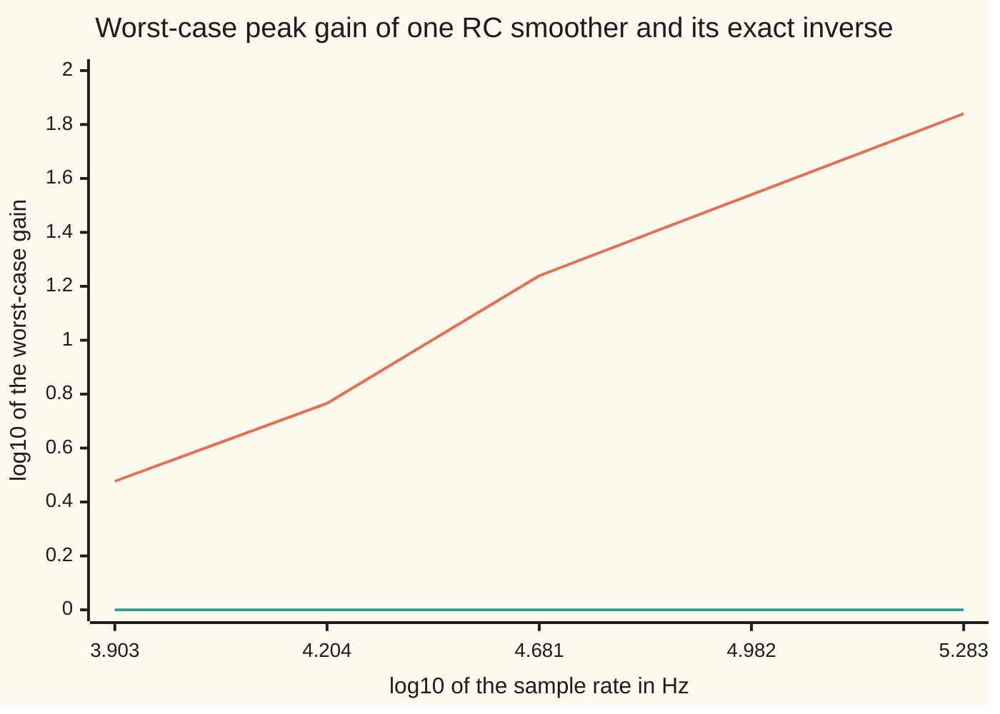

# Bounded operators: for a linear map, no blow-up is the same as continuity

[Syllabus](../../../SYLLABUS.md) → [Functional analysis](../README.md) → [Bounded Operators](../README.md#s03) → Bounded operators

---

## General Overview

A telephone line samples speech 8000 times a second. A simple treble cut smooths it: each output sample is half the new input plus half the previous output. This is the digital form of a resistor-capacitor (RC) filter. Its time constant (the time its memory of a sample takes to fade to about 37%) is 180.34 microseconds. The analog RC filter with that time constant has its corner, where it starts to cut treble, at 1/(2π × 180.34 µs) = 882.5 Hz.

Digital audio clips at full scale, a peak of 1. So the first question about a filter is its **worst-case gain**: the largest factor by which it can raise a clip's peak. For this blur it is 0.9375 on a clip of 4 samples, climbing towards 1 on longer clips. The blur never amplifies a clip.

Now undo the blur. The exact unblur is $`x_n = 2y_n - y_{n-1}`$, where $`y_n`$ is blurred sample $`n`$ and $`x_n`$ the recovered one. A clip within full scale, blurred and then unblurred, comes back exactly. The risk is anything added after the blur, such as noise or an edit. The unblur's worst-case gain is 3: an added signal peaking at 0.4 can come back at 1.2 and clip. So it needs 9.54 dB of headroom (spare level kept below full scale). At 48,000 samples a second its gain is 17.33. In continuous time it has no finite gain, and a faint high tone moves its output by a fixed amount.

The worst-case gain of a linear map is its **operator norm**. This card computes it, bounds outputs with it, and proves two facts about it.

**The operator norm of a linear map is its worst-case gain; the map is continuous exactly when that gain is finite, and the maps with finite gain form a normed space that is complete whenever the output space is.**

**What kind of fact this is:** the operator norm is a definition. Three theorems are proved on this card in Why it works: bounded is the same as continuous for a linear map, the bounded maps into a Banach space form a Banach space, and the blur's gain formula. The audio numbers are computed on clips of N samples; the infinite cases are proved, not computed.

### The picture: the blur stays tame, the unblur does not



The orange line is the unblur at 8, 16, 48, 96 and 192 kHz, on clips of 1 second (N = the sample rate). Its gain roughly doubles each time the rate doubles: 3, 5.83, 17.33, 34.63, 69.25. The green line is the blur, whose gain is 1.000000 at every rate. Every finite rate hides the same fact: in continuous time the unblur has no bound.

---

## The formula

A **normed space** gives every vector a size $`\lVert x \rVert`$. A **Banach space** is a normed space that is **complete**: every Cauchy sequence (one whose terms end up as close together as you like) converges in it ([Normed and Banach spaces](../01-Normed%20and%20Banach%20Spaces/01-normed-spaces-and-banach-spaces.md)).

Here the vectors are clips. A clip is a list of samples $`x = (x_1, x_2, \dots)`$, and its size is its **peak**, $`\lVert x \rVert_\infty = \max_n \lvert x_n \rvert`$, the sup norm. Infinitely long bounded signals form the Banach space $`\ell^\infty`$ ([Sequence spaces](../01-Normed%20and%20Banach%20Spaces/02-sequence-spaces-lp-and-c0.md)).

A **linear map** (an operator) $`T: X \to Y`$ respects sums and multiples: $`T(x + z) = Tx + Tz`$ and $`T(cx) = c\,Tx`$ ([Linear maps](../../03-Algebra/04-Matrices/04-linear-maps-as-matrices.md)). Its size is a supremum, $`\sup`$: the least upper bound of the ratios, which some input may only approach.

```math
\lVert T \rVert = \sup_{x \ne 0} \frac{\lVert Tx \rVert_Y}{\lVert x \rVert_X}, \qquad\text{so}\qquad \lVert Tx \rVert_Y \le \lVert T \rVert\,\lVert x \rVert_X \text{ for every } x
```

**Read it aloud:** the operator norm of T is the largest ratio of output size to input size, so no output is ever bigger than that norm times its input.

$`T`$ is **bounded** when $`\lVert T \rVert`$ is finite. The set of all bounded linear maps from $`X`$ to $`Y`$ is written $`B(X, Y)`$. This card proves:

```math
T \text{ linear}: \quad T \text{ continuous} \iff \lVert T \rVert < \infty, \qquad\text{and then}\qquad \lVert Tx - Tz \rVert_Y \le \lVert T \rVert\,\lVert x - z \rVert_X
```

**Read it aloud:** a linear map is continuous exactly when its worst-case gain is finite, and then two inputs close together give outputs at most that gain times as far apart.

```math
Y \text{ a Banach space} \;\Longrightarrow\; B(X, Y) \text{ is a Banach space under } \lVert T \rVert
```

**Read it aloud:** if the output space has no holes, neither does the space of bounded maps into it.

The blur $`R`$ and its inverse, the unblur $`R^{-1}`$, with smoothing factor $`a`$ between 0 and 1:

```math
(Rx)_n = (1 - a)\,x_n + a\,(Rx)_{n-1}, \qquad \lVert R \rVert = 1 - a^N, \qquad (R^{-1}y)_n = \frac{y_n - a\,y_{n-1}}{1 - a}, \qquad \lVert R^{-1} \rVert = \frac{1 + a}{1 - a}
```

**Read it aloud:** each blurred sample mixes the new input with the last output; on N samples from silence its peak gain is one minus a to the N, and the unblur's is one plus a over one minus a (for N of 2 or more).

The blur in continuous time is an **integral operator** $`K`$: it integrates the signal against a **kernel** $`k(t, s)`$, a weight that says how much the input at time $`s`$ contributes to the output at time $`t`$.

```math
(Kf)(t) = \int_0^t k(t, s)\,f(s)\,ds, \qquad k(t, s) = \frac{1}{\tau}\,e^{-(t - s)/\tau}, \qquad \lVert K \rVert = \sup_t \int_0^t k(t, s)\,ds = 1 - e^{-t_1/\tau}
```

**Read it aloud:** the continuous blur averages the past with weights that fade over the time constant tau; on clips of length t one, measured by their peak, its gain is one minus e to the minus t one over tau.

Sampling every $`h`$ seconds gives $`a = e^{-h/\tau}`$. Then $`a^N = e^{-t_1/\tau}`$ with $`t_1 = Nh`$, so the sampled and continuous blurs have the same gain.

| Symbol | Plain meaning | In our example | Push it up and the answer… |
| --- | --- | --- | --- |
| $`X`$, $`Y`$ | normed spaces of inputs and outputs | clips with the peak norm: $`\ell^\infty`$, $`C[0, t_1]`$ | — |
| $`\lVert x \rVert_\infty`$ | the peak of a clip, full scale 1 | 0.8 for the clip (0.8, −0.5, 0.3, 0.6) | outputs grow in proportion |
| $`T`$, $`S`$, $`Tx`$, $`I`$ | linear maps, an output, the identity map (output = input); $`B(X)`$ is $`B(X, X)`$ | the blur, the unblur | — |
| $`\lVert T \rVert`$ | worst-case gain: the operator norm | 0.9375 (blur, 4 samples), 3 (unblur) | larger gain: more headroom needed |
| $`B(X, Y)`$ | all bounded linear maps from X to Y, with the operator norm | filters on bounded signals | — |
| $`R`$, $`R^{-1}`$ | the sampled blur and its exact inverse | half new input, half last output; $`2y_n - y_{n-1}`$ | — |
| $`a`$, $`\tau`$, $`h`$ | smoothing factor; time constant; sample spacing $`1/f_s`$ | 1/2; 180.34 µs; 1/8000 s | finer sampling: $`a`$ nearer 1, unblur gain about $`2\tau/h`$ |
| $`n`$, $`N`$, $`f_s`$ | sample number; samples in a clip; sample rate | 4 samples; 8000 Hz | blur gain $`1 - a^N`$ rises towards 1 |
| $`K`$, $`k(t, s)`$, $`t_1`$, $`f`$, $`g`$ | the continuous blur, its kernel, the clip length in seconds; a continuous input and its blurred output $`g = Kf`$ | $`e^{-(t-s)/\tau}/\tau`$; 1 ms | longer clip: gain nearer 1 |
| $`R_m`$, $`T_n`$, $`c_{00}`$ | the blur cut to its first $`m`$ weights; a sequence of operators; signals that go silent after some sample | $`\lVert R - R_{10} \rVert = 0.000976562`$ | more weights: closer to $`R`$ |
| $`\ker T`$, $`\mathrm{ran}\, T`$ | kernel: inputs sent to zero; range: outputs reached | $`\ker R = \{0\}`$, $`\mathrm{ran}\, R = \ell^\infty`$ | — |
| $`\varepsilon`$, $`\delta`$ | an output tolerance; an input tolerance that meets it | $`\delta = \varepsilon/3`$ for the unblur at 8 kHz | — |

### When it holds

- **The map must be linear.** Squaring each sample is continuous, yet its ratio $`\lVert x^2 \rVert / \lVert x \rVert`$ is the peak itself: 1.0, 10.0, 100.0 for peaks 1, 10, 100. No single gain exists.
- **The gain belongs to a pair of norms.** Every number here uses the peak norm on both sides. With energy (the 2-norm) the same matrix has another gain, as [Matrix norms and the condition number](../../16-Numerical%20analysis/03-Numerical%20Linear%20Algebra/01-matrix-norms-and-the-condition-number.md) shows.
- **Finite dimensions make every linear map bounded.** A matrix has a finite largest row sum. With infinitely many samples, or continuous time, that guarantee is gone: the continuous unblur $`g + \tau g'`$ has no finite gain.
- **The output space must be complete.** On signals that eventually go silent, the truncated blurs $`R_m`$ close in on a limit that never goes silent, so $`B(X, Y)`$ has a hole.

---

## Why it works

### Step 0: linearity means the behaviour near zero decides everything

A linear map treats a big input as a scaled-up small one: $`T(cx) = c\,Tx`$. And the gap between two outputs is the output of the gap: $`Tx - Tz = T(x - z)`$. So one fact about small inputs near zero becomes a fact about every input, everywhere. Both theorems on this card come from these two lines.

### Step 1: a finite gain gives continuity, with one tolerance for all inputs

Suppose $`\lVert T \rVert`$ is finite. Then

```math
\lVert Tx - Tz \rVert = \lVert T(x - z) \rVert \le \lVert T \rVert\,\lVert x - z \rVert
```

So $`T`$ is Lipschitz with constant $`\lVert T \rVert`$: no output gap is more than that constant times the input gap ([Uniform continuity](../../06-Calculus%20and%20analysis/01-Limits%20and%20Continuity/08-uniform-continuity-and-lipschitz.md)). To keep the output change below a tolerance $`\varepsilon`$, keep the input change below $`\delta = \varepsilon / \lVert T \rVert`$. For the unblur at 8 kHz, $`\delta = \varepsilon/3`$, for every clip at once.

### Step 2: continuity gives a finite gain, by scaling

Suppose $`T`$ is continuous at zero. Take the tolerance $`\varepsilon = 1`$. Some $`\delta > 0`$ works: every input of size at most $`\delta`$ has an output of size at most 1.

Now take any input $`x \ne 0`$ and shrink it to $`u = \delta\,x / \lVert x \rVert`$, which has size exactly $`\delta`$. So $`\lVert Tu \rVert \le 1`$. Linearity scales it back: $`Tx = (\lVert x \rVert / \delta)\,Tu`$, so $`\lVert Tx \rVert \le \lVert x \rVert / \delta`$. The gain is at most $`1/\delta`$.

Continuity at any one point gives continuity at zero, by Step 0. So for a linear map, continuous at one point, continuous everywhere, Lipschitz and bounded are four names for one property.

### Step 3: what an unbounded map does to tiny inputs

Run Step 2 backwards. If the gain is infinite, there are inputs $`x_n`$ with $`\lVert x_n \rVert = 1`$ and $`\lVert T x_n \rVert \ge n`$. Shrink them to $`x_n / n`$: the inputs head to zero, the outputs stay at size 1 or more. Continuity fails at zero.

The continuous unblur shows it. It undoes $`K`$, since $`g = Kf`$ solves $`\tau g' = f - g`$; so $`f = g + \tau g'`$. Feed it a tone (a single sine) of peak $`0.001/n`$ at $`n`$ kHz. The tone shrinks; the output does not:

| Tone | Unblurred peak |
| --- | --- |
| 0.001/1 at 1 kHz | 0.001511 |
| 0.001/4 at 4 kHz | 0.001160 |
| 0.001/16 at 16 kHz | 0.001135 |
| limit, $`0.001 \times 2\pi \times 1000 \times \tau`$ | 0.001133 |

A sine of amplitude (peak) $`A`$ and frequency $`\nu`$ (cycles a second) comes out with peak $`A\sqrt{1 + (2\pi\nu\tau)^2}`$. The frequency rises by the same factor $`n`$ by which the amplitude falls, so the slope, and with it the output, does not shrink. The unblur works only on signals with a slope: it has a **domain**, the subject of [Unbounded operators](../05-Unbounded%20Operators%20and%20Semigroups/01-unbounded-operators-and-domains.md).

### Step 4: computing a norm means a bound plus an input that reaches it

The gain is a supremum, so it takes two halves: an upper bound for every input, and one input that meets it.

**Blur, upper bound.** Unrolled, each output sample is a weighted sum of the inputs so far, with weights $`(1-a)a^k`$ for the input $`k`$ samples back:

```math
\lvert (Rx)_n \rvert \le (1 - a)\,(1 + a + \dots + a^{n-1})\,\lVert x \rVert_\infty = (1 - a^n)\,\lVert x \rVert_\infty \le (1 - a^N)\,\lVert x \rVert_\infty
```

**Blur, an input that reaches it.** A held clip, all samples equal to 1, gives $`(Rx)_N = 1 - a^N`$ exactly. With $`a = 1/2`$ and $`N = 4`$ this is 0.9375; a clip held at 0.8 peaks at 0.7500.

This is the largest absolute row sum of the matrix, the infinity-norm already proved on [Matrix norms and the condition number](../../16-Numerical%20analysis/03-Numerical%20Linear%20Algebra/01-matrix-norms-and-the-condition-number.md). What is new here is the next question: what happens as $`N`$ grows?

**Unblur.** $`\lvert (R^{-1}y)_n \rvert = \lvert y_n - a y_{n-1} \rvert / (1 - a) \le \frac{1 + a}{1 - a}\lVert y \rVert_\infty`$, so the gain is at most $`(1+a)/(1-a)`$. Alternating signs, $`y = (0.4, -0.4, 0.4, -0.4)`$, reach it from the second sample on.

**Continuous blur.** The kernel is never negative, so $`\lvert (Kf)(t) \rvert \le \lVert f \rVert_\infty \int_0^t k(t, s)\,ds = (1 - e^{-t/\tau})\lVert f \rVert_\infty`$, largest at $`t = t_1`$. The constant clip $`f = 1`$ reaches it. A kernel that changes sign needs a sign-matching input instead; [Three model operators](02-integral-operators-and-the-shift.md) treats that case.

### Step 5: what the truncation hides

On a clip of $`N`$ samples, every matrix is bounded, and the blur's gain $`1 - 2^{-N}`$ is reached by the held clip. On the infinite signal space $`\ell^\infty`$, the gain is 1. The endless held clip gives $`1 - 2^{-n}`$ at sample $`n`$: no single sample reaches 1, but the peak, a supremum over all samples, is exactly 1. No finite clip shows this; each stops just short.

The unblur hides more. At every finite sample rate it is bounded, with gain about $`2\tau/h`$. Only the continuous-time limit, the operator $`g + \tau g'`$, has no bound. A trend over $`N`$ that does not settle is how code sees an infinite-dimensional failure.

### Step 6: bounded maps form a normed space, and gains multiply along a chain

Adding two filters adds their outputs, so $`\lVert (S + T)x \rVert \le (\lVert S \rVert + \lVert T \rVert)\lVert x \rVert`$. Scaling a filter scales its gain. Only the zero map has gain zero. So the operator norm obeys the three rules of a norm, and $`B(X, Y)`$ is a normed space.

Chains multiply: $`\lVert STx \rVert \le \lVert S \rVert\,\lVert Tx \rVert \le \lVert S \rVert\,\lVert T \rVert\,\lVert x \rVert`$. Blur then unblur gives the identity, of gain 1, and $`1 \le 0.9375 \times 3`$ as it must.

The **kernel** of $`T`$ (a second meaning of the word, the set $`\ker T`$ of inputs sent to zero) is closed when $`T`$ is bounded: it is the set where a continuous map equals zero. The **range** $`\mathrm{ran}\, T`$ need not be closed. The range of $`K`$ on $`C[0, t_1]`$ is the clips with a continuous slope that start at 0. Their limits include clips with corners, which $`K`$ never produces. That missing piece is why $`K`$'s inverse is unbounded ([Three Banach theorems](../01-Normed%20and%20Banach%20Spaces/08-open-mapping-closed-graph-and-uniform-boundedness.md)).

### Step 7: limits of bounded maps are bounded maps, when Y is complete

Cut the blur to its first $`m`$ weights, $`\tfrac12, \tfrac14, \dots, 2^{-m}`$. This is $`R_m`$, a finite impulse response (FIR) filter: it forgets everything older than $`m`$ samples. The weights it drops add up to $`2^{-m}`$, so $`\lVert R - R_m \rVert = 2^{-m}`$, and $`\lVert R_m - R_n \rVert = 2^{-m} - 2^{-n}`$ for $`m < n`$.

The truncations form a Cauchy sequence in operator norm. Completeness of $`B(X, Y)`$ says such a sequence always has a bounded limit, here the full blur $`R`$. The proof builds the limit one input at a time, then shows the convergence is uniform over the unit ball.

<details>
<summary>Detailed proof: B(X, Y) is complete when Y is complete</summary>

Let $`T_n`$ be Cauchy in operator norm: for each $`\varepsilon > 0`$ there is an $`n_0`$ with $`\lVert T_n - T_m \rVert < \varepsilon`$ whenever $`n, m \ge n_0`$.

1. **A limit at each input.** For a fixed $`x`$,

$`\displaystyle \lVert T_n x - T_m x \rVert \le \lVert T_n - T_m \rVert\,\lVert x \rVert`$

so the outputs $`T_n x`$ form a Cauchy sequence in $`Y`$. Since $`Y`$ is complete, they converge. Call the limit $`Tx`$.

2. **The limit is linear.** Limits respect sums and multiples, so $`T(x + z) = Tx + Tz`$ and $`T(cx) = c\,Tx`$.

3. **The limit is bounded.** A Cauchy sequence is bounded, so $`\lVert T_n \rVert \le C`$ for one constant $`C`$ and every $`n`$. Then $`\lVert Tx \rVert = \lim \lVert T_n x \rVert \le C \lVert x \rVert`$.

4. **The convergence is in operator norm.** For $`n, m \ge n_0`$ and every $`x`$,

$`\displaystyle \lVert T_n x - T_m x \rVert \le \varepsilon\,\lVert x \rVert`$

Let $`m \to \infty`$ with $`n`$ fixed. The left side tends to $`\lVert T_n x - Tx \rVert`$. So $`\lVert T_n x - Tx \rVert \le \varepsilon \lVert x \rVert`$ for every $`x`$, which says $`\lVert T_n - T \rVert \le \varepsilon`$ for all $`n \ge n_0`$.

Only step 1 used completeness, and only of $`Y`$. The input space $`X`$ can be any normed space.

</details>

**Where completeness fails.** Let $`c_{00}`$ be the signals that go silent after some sample, with the peak norm. It is not complete. Each $`R_m`$ maps it into itself, and the $`R_m`$ are still Cauchy. A click, a single 1 then zeros, is silent after sample 10 through $`R_{10}`$. Through $`R`$ it never goes silent: sample 60 is still $`8.674 \times 10^{-19}`$. A limit would have to send the click to $`R`$'s output, outside $`c_{00}`$, so none exists.

---

## Worked numbers, by hand

The 8 kHz blur, $`a = 1/2`$, on the 4-sample clip (0.8, −0.5, 0.3, 0.6), then the unblur on an alternating clip.

| Step | Arithmetic | Value |
| --- | --- | --- |
| blurred sample 1 | $`\tfrac12 \times 0.8 + \tfrac12 \times 0`$ | 0.4000 |
| blurred sample 2 | $`\tfrac12 \times (-0.5) + \tfrac12 \times 0.4`$ | −0.0500 |
| blurred sample 3 | $`\tfrac12 \times 0.3 + \tfrac12 \times (-0.05)`$ | 0.1250 |
| blurred sample 4 | $`\tfrac12 \times 0.6 + \tfrac12 \times 0.125`$ | 0.3625 |
| blur gain, 4 samples | $`\tfrac12 + \tfrac14 + \tfrac18 + \tfrac1{16} = 1 - 2^{-4}`$ | 0.9375 |
| bound on this clip's output | $`0.9375 \times 0.8`$ | 0.7500, above the actual 0.4000 |
| held clip 0.8, the worst case | 0.4000, 0.6000, 0.7000, then $`\tfrac12 \times 0.8 + \tfrac12 \times 0.7`$ | 0.7500, the bound reached |
| unblur gain | $`(1 + \tfrac12)/(1 - \tfrac12)`$ | 3 |
| unblur of (0.4, −0.4, 0.4, −0.4), sample 2 | $`2 \times (-0.4) - 0.4`$ | −1.2, past full scale |
| headroom the unblur needs | $`20 \log_{10} 3`$ | **9.54 dB** |

Whatever reaches the unblur must peak below 1/3 of full scale to be safe: 9.54 dB of headroom, at every clip length. A clean blur of a clip within full scale always comes back within it. The alternating clip above is the blur of (0.8, −1.2, 1.2, −1.2), already past full scale. So the headroom is for noise or edits added after the blur.

As $`N`$ grows, the blur's gain climbs: 0.9960937500 at 8 samples, 0.9999999998 at 32.

The continuous blur on a 1 ms clip has gain $`1 - e^{-t_1/\tau}`$ = 0.99609375, the same as 8 samples at 8 kHz, because $`a^8 = e^{-0.001/\tau}`$.

The same smoother, same $`\tau`$, sampled faster:

| Sample rate (Hz) | $`a`$ | Unblur gain | $`2\tau/h`$ |
| --- | --- | --- | --- |
| 8000 | 0.500000 | 3.000000 | 2.885390 |
| 16000 | 0.707107 | 5.828427 | 5.770780 |
| 48000 | 0.890899 | 17.331590 | 17.312340 |
| 96000 | 0.943874 | 34.634307 | 34.624681 |
| 192000 | 0.971532 | 69.254175 | 69.249362 |

The blur's gain on a 1-second clip is 1.000000 at every rate.

### What breaks if you drop a piece

| Mistake | Comes out at | What went wrong |
| --- | --- | --- |
| Read the gain as the largest matrix entry | unblur entry 2.0, so 0.4 "comes back at 0.8"; it comes back at 1.2 | the gain is the largest row sum of sizes, 3 |
| Trust one sample rate in continuous time | 3 at 8 kHz, 69.254175 at 192 kHz, no bound in the limit | the continuous unblur $`g + \tau g'`$ is unbounded, so discontinuous |
| Drop linearity | squarer: gain 1.0, 10.0, 100.0 on peaks 1, 10, 100 | no single gain for a nonlinear map, though it is continuous |
| Drop completeness of Y | $`R_{10}`$ on a click is silent after sample 10; $`R`$ never is | the $`R_m`$ are Cauchy, but their limit leaves $`c_{00}`$ |

---

## Code, from first principles, and it actually runs

The code builds each filter's matrix from its response to single clicks. It measures each gain by three independent roads: the closed form, the largest row sum of sizes, and a search over every pattern of ±1 (a peak gain is always reached at such a corner). At the faster rates a fourth road inverts the blur matrix by forward substitution, without the unblur formula. A 100,000-strip midpoint integral checks the continuous blur. Two thousand random clips (SplitMix64 generator, seed 2026) never beat the gains.

### Python

```python
# Bounded operators -- the check behind the card.  Standard library only.
# An audio blur: the RC smoother y[n] = (1 - a) x[n] + a y[n-1], starting from silence.
# At 8 kHz, a = 1/2: tau = 1/(8000 ln 2) s.  Sizes are peak sizes (sup norms), full scale 1.
# Code holds a truncation: clips of N samples.  Roads: closed form, max row sum of the
# matrix built from impulses, brute force over every sign pattern, and random clips.
import math

def blur(x, a):                        # the smoother, sample by sample
    y, prev = [], 0.0
    for v in x:
        prev = (1 - a) * v + a * prev
        y.append(prev)
    return y

def unblur(y, a):                      # undoes it exactly: x[n] = (y[n] - a y[n-1]) / (1 - a)
    return [(y[n] - a * (y[n - 1] if n else 0.0)) / (1 - a) for n in range(len(y))]

def matrix(op, n, a):                  # column j = the response to a click at sample j
    cols = [op([1.0 if i == j else 0.0 for i in range(n)], a) for j in range(n)]
    return [[cols[j][i] for j in range(n)] for i in range(n)]

def inverse_lower(m):                  # invert a lower-triangular matrix by forward substitution
    n = len(m)
    inv = [[0.0] * n for _ in range(n)]
    for j in range(n):
        for i in range(n):
            inv[i][j] = ((i == j) - sum(m[i][k] * inv[k][j] for k in range(i))) / m[i][i]
    return inv

def row_sum_norm(m):                   # peak-to-peak gain of a matrix: largest row of |entries|
    return max(sum(abs(v) for v in row) for row in m)

def brute(op, n, a):                   # worst sign pattern: a peak gain is reached at a corner
    best = 0.0
    for mask in range(2 ** n):
        x = [1.0 if mask >> i & 1 else -1.0 for i in range(n)]
        best = max(best, max(abs(v) for v in op(x, a)))
    return best

def peak(x):
    return max(abs(v) for v in x)

def show(x, d):
    return "(" + ", ".join(f"{v:.{d}f}" for v in x) + ")"

print("blur, a = 1/2: N, closed 1 - 2^-N, max row sum, brute force")
for n in [1, 2, 4, 8, 16, 32]:
    closed, rows = 1 - 2.0 ** -n, row_sum_norm(matrix(blur, n, 0.5))
    b = brute(blur, n, 0.5) if n <= 10 else rows
    assert abs(rows - closed) < 1e-12 and abs(b - closed) < 1e-12
    print(f"  {n:2d}  {closed:.10f}  {rows:.10f}  {b:.10f}")
x = [0.8, -0.5, 0.3, 0.6]
y = blur(x, 0.5)
print("clip", show(x, 1), "-> blurred", show(y, 4), f"peak {peak(y):.4f} <= 0.9375 x 0.8 = {0.9375 * 0.8:.4f}")
assert peak(y) <= 0.9375 * peak(x) + 1e-12
w = blur([0.8] * 4, 0.5)
print("worst clip 0.8 held ->", show(w, 4), f"peak {peak(w):.4f}")
assert abs(peak(w) - 0.75) < 1e-12

print("unblur, a = 1/2: N, closed (1+a)/(1-a), max row sum, brute force, max |entry|")
for n in [2, 4, 8]:
    m = matrix(unblur, n, 0.5)
    rows, b, ent = row_sum_norm(m), brute(unblur, n, 0.5), max(abs(v) for r in m for v in r)
    assert abs(rows - 3) < 1e-12 and abs(b - 3) < 1e-12
    print(f"  {n}  3.0000000000  {rows:.10f}  {b:.10f}  {ent:.1f}")
back = blur(unblur([0.3, -0.2, 0.5, 0.1], 0.5), 0.5)
assert max(abs(p - q) for p, q in zip(back, [0.3, -0.2, 0.5, 0.1])) < 1e-12
z = unblur([0.4, -0.4, 0.4, -0.4], 0.5)
print("blurred clip +-0.4 -> unblurred", show(z, 1), f"peak {peak(z):.1f}; headroom 20 log10 3 = {20 * math.log10(3):.2f} dB")
assert abs(peak(z) - 1.2) < 1e-12

print("same smoother, finer sampling: rate (Hz), a, blur gain on 1 s, unblur gain, N=64 inverse rows, 2 tau/h")
tau = 1 / (8000 * math.log(2))
pts = []
for fs in [8000, 16000, 48000, 96000, 192000]:
    a = math.exp(-1 / (fs * tau))
    g, rows = (1 + a) / (1 - a), row_sum_norm(inverse_lower(matrix(blur, 64, a)))
    assert abs(rows - g) < 1e-9 * g and 2 * tau * fs < g < 2 * tau * fs + 1
    pts.append((math.log10(fs), math.log10(g), math.log10(1 - a ** fs)))
    print(f"  {fs:6d}  {a:.6f}  {1 - a ** fs:.6f}  {g:.6f}  {rows:.6f}  {2 * tau * fs:.6f}")
print("chart log10 rate:", ", ".join(f"{p[0]:.3f}" for p in pts))
print("chart log10 unblur gain:", ", ".join(f"{p[1]:.3f}" for p in pts), "; log10 blur gain:", ", ".join(f"{abs(p[2]):.3f}" for p in pts))
print(f"tau = {tau * 1e6:.2f} us, analog corner 1/(2 pi tau) = {1 / (2 * math.pi * tau):.1f} Hz")

# continuous blur K: kernel k(t, s) = exp(-(t - s)/tau)/tau for s <= t; on C[0, T], ||K|| = int_0^T k(T, s) ds
T, M = 0.001, 100000
mid = sum(math.exp(-(T - (i + 0.5) * T / M) / tau) / tau for i in range(M)) * T / M
ns = T * 8000                                    # the same clip as samples at 8 kHz
print(f"K on a {T * 1000:.1f} ms clip: closed 1 - exp(-T/tau) = {1 - math.exp(-T / tau):.8f}, midpoint {mid:.8f}, sampled 1 - 2^-{ns:.0f} = {1 - 2 ** -ns:.8f}")
assert abs(mid - (1 - math.exp(-T / tau))) < 1e-8 and abs(mid - (1 - 2 ** -ns)) < 1e-8

# continuous unblur g + tau g': a tone of peak 0.001/n at n kHz
for n in [1, 4, 16]:
    out = 0.001 / n * math.sqrt(1 + (2 * math.pi * 1000 * n * tau) ** 2)
    print(f"tone 0.001/{n} at {n} kHz -> unblurred peak {out:.6f}")
    assert out > 0.001 * 2 * math.pi * 1000 * tau * 0.999
print(f"limit as n grows: 0.001 x 2 pi x 1000 x tau = {0.001 * 2 * math.pi * 1000 * tau:.6f}")

# completeness: FIR truncations R_m keep the first m taps 2^-(k+1)
print("m, ||R - R_m|| closed 2^-m, tail rows on a 60-sample clip, in dB")
for m in [1, 2, 5, 10, 20]:
    tail = row_sum_norm([[0.5 ** (i - j + 1) if i - j >= m else 0.0 for j in range(60)] for i in range(60)])
    assert abs(tail - (2.0 ** -m - 2.0 ** -60)) < 1e-15
    print(f"  {m:2d}  {2.0 ** -m:.9f}  {tail:.9f}  {20 * math.log10(2.0 ** -m):.1f}")
print(f"||R_5 - R_10|| = 2^-5 - 2^-10 = {2 ** -5 - 2 ** -10:.9f}")
click = [1.0] + [0.0] * 59
R10 = [[0.5 ** (i - j + 1) if 0 <= i - j < 10 else 0.0 for j in range(60)] for i in range(60)]  # the 10-tap FIR
r10 = [sum(R10[i][j] * click[j] for j in range(60)) for i in range(60)]
last = max(i for i, v in enumerate(r10) if v) + 1
assert last == 10 and max(abs(p - q) for p, q in zip(r10[:10], blur(click, 0.5))) < 1e-15 and all(blur(click, 0.5))
print(f"click through R_10: silent after sample {last}; through R: sample 60 is still {blur(click, 0.5)[59]:.3e}, never silent")

# drop linearity: squaring each sample is continuous but has no finite gain
for c in [1.0, 10.0, 100.0]:
    print(f"squarer on a clip of peak {c:.1f}: gain {c * c / c:.1f}")

# random clips never beat the gain (SplitMix64, seed 2026)
s, worst = 2026, [0.0, 0.0]
def rnd():
    global s
    s = (s + 0x9E3779B97F4A7C15) & (2 ** 64 - 1)
    z = s
    z = ((z ^ (z >> 30)) * 0xBF58476D1CE4E5B9) & (2 ** 64 - 1)
    z = ((z ^ (z >> 27)) * 0x94D049BB133111EB) & (2 ** 64 - 1)
    return ((z ^ (z >> 31)) >> 11) / 2.0 ** 53 * 2 - 1
for _ in range(2000):
    x = [rnd() for _ in range(16)]
    worst[0] = max(worst[0], peak(blur(x, 0.5)) / peak(x))
    worst[1] = max(worst[1], peak(unblur(x, 0.5)) / peak(x))
assert worst[0] <= 1 - 2 ** -16 + 1e-12 and worst[1] <= 3 + 1e-12 and worst[1] > 2.5
print(f"2000 random 16-sample clips: worst blur ratio {worst[0]:.6f} <= {1 - 2 ** -16:.6f}, worst unblur ratio {worst[1]:.6f} <= 3")
print("ALL CHECKS PASS")
```

**Ran 2026-11-15 on macOS, Python 3.14.10, standard library only. All checks passed. Output, pasted from the run:**

```
blur, a = 1/2: N, closed 1 - 2^-N, max row sum, brute force
   1  0.5000000000  0.5000000000  0.5000000000
   2  0.7500000000  0.7500000000  0.7500000000
   4  0.9375000000  0.9375000000  0.9375000000
   8  0.9960937500  0.9960937500  0.9960937500
  16  0.9999847412  0.9999847412  0.9999847412
  32  0.9999999998  0.9999999998  0.9999999998
clip (0.8, -0.5, 0.3, 0.6) -> blurred (0.4000, -0.0500, 0.1250, 0.3625) peak 0.4000 <= 0.9375 x 0.8 = 0.7500
worst clip 0.8 held -> (0.4000, 0.6000, 0.7000, 0.7500) peak 0.7500
unblur, a = 1/2: N, closed (1+a)/(1-a), max row sum, brute force, max |entry|
  2  3.0000000000  3.0000000000  3.0000000000  2.0
  4  3.0000000000  3.0000000000  3.0000000000  2.0
  8  3.0000000000  3.0000000000  3.0000000000  2.0
blurred clip +-0.4 -> unblurred (0.8, -1.2, 1.2, -1.2) peak 1.2; headroom 20 log10 3 = 9.54 dB
same smoother, finer sampling: rate (Hz), a, blur gain on 1 s, unblur gain, N=64 inverse rows, 2 tau/h
    8000  0.500000  1.000000  3.000000  3.000000  2.885390
   16000  0.707107  1.000000  5.828427  5.828427  5.770780
   48000  0.890899  1.000000  17.331590  17.331590  17.312340
   96000  0.943874  1.000000  34.634307  34.634307  34.624681
  192000  0.971532  1.000000  69.254175  69.254175  69.249362
chart log10 rate: 3.903, 4.204, 4.681, 4.982, 5.283
chart log10 unblur gain: 0.477, 0.766, 1.239, 1.540, 1.840 ; log10 blur gain: 0.000, 0.000, 0.000, 0.000, 0.000
tau = 180.34 us, analog corner 1/(2 pi tau) = 882.5 Hz
K on a 1.0 ms clip: closed 1 - exp(-T/tau) = 0.99609375, midpoint 0.99609375, sampled 1 - 2^-8 = 0.99609375
tone 0.001/1 at 1 kHz -> unblurred peak 0.001511
tone 0.001/4 at 4 kHz -> unblurred peak 0.001160
tone 0.001/16 at 16 kHz -> unblurred peak 0.001135
limit as n grows: 0.001 x 2 pi x 1000 x tau = 0.001133
m, ||R - R_m|| closed 2^-m, tail rows on a 60-sample clip, in dB
   1  0.500000000  0.500000000  -6.0
   2  0.250000000  0.250000000  -12.0
   5  0.031250000  0.031250000  -30.1
  10  0.000976562  0.000976562  -60.2
  20  0.000000954  0.000000954  -120.4
||R_5 - R_10|| = 2^-5 - 2^-10 = 0.030273438
click through R_10: silent after sample 10; through R: sample 60 is still 8.674e-19, never silent
squarer on a clip of peak 1.0: gain 1.0
squarer on a clip of peak 10.0: gain 10.0
squarer on a clip of peak 100.0: gain 100.0
2000 random 16-sample clips: worst blur ratio 0.930972 <= 0.999985, worst unblur ratio 2.999649 <= 3
ALL CHECKS PASS
```

### Rust

```rust
// Bounded operators -- the check behind the card.  std only.
// An audio blur: the RC smoother y[n] = (1 - a) x[n] + a y[n-1], starting from silence.
// At 8 kHz, a = 1/2: tau = 1/(8000 ln 2) s.  Sizes are peak sizes (sup norms), full scale 1.
// Code holds a truncation: clips of N samples.  Roads: closed form, max row sum of the
// matrix built from impulses, brute force over every sign pattern, and random clips.

fn blur(x: &[f64], a: f64) -> Vec<f64> {
    let mut prev = 0.0;
    x.iter().map(|v| { prev = (1.0 - a) * v + a * prev; prev }).collect()
}

fn unblur(y: &[f64], a: f64) -> Vec<f64> {
    (0..y.len()).map(|n| (y[n] - a * if n > 0 { y[n - 1] } else { 0.0 }) / (1.0 - a)).collect()
}

fn matrix(op: fn(&[f64], f64) -> Vec<f64>, n: usize, a: f64) -> Vec<Vec<f64>> {
    let cols: Vec<Vec<f64>> = (0..n)
        .map(|j| op(&(0..n).map(|i| if i == j { 1.0 } else { 0.0 }).collect::<Vec<f64>>(), a))
        .collect();
    (0..n).map(|i| (0..n).map(|j| cols[j][i]).collect()).collect()
}

fn inverse_lower(m: &[Vec<f64>]) -> Vec<Vec<f64>> {
    let n = m.len();
    let mut inv = vec![vec![0.0; n]; n];
    for j in 0..n {
        for i in 0..n {
            let s: f64 = (0..i).map(|k| m[i][k] * inv[k][j]).sum();
            inv[i][j] = ((if i == j { 1.0 } else { 0.0 }) - s) / m[i][i];
        }
    }
    inv
}

fn row_sum_norm(m: &[Vec<f64>]) -> f64 {
    m.iter().map(|r| r.iter().map(|v| v.abs()).sum::<f64>()).fold(0.0, f64::max)
}

fn brute(op: fn(&[f64], f64) -> Vec<f64>, n: usize, a: f64) -> f64 {
    let mut best: f64 = 0.0;
    for mask in 0..(1u32 << n) {
        let x: Vec<f64> = (0..n).map(|i| if mask >> i & 1 == 1 { 1.0 } else { -1.0 }).collect();
        best = best.max(peak(&op(&x, a)));
    }
    best
}

fn peak(x: &[f64]) -> f64 {
    x.iter().map(|v| v.abs()).fold(0.0, f64::max)
}

fn show(x: &[f64], d: usize) -> String {
    format!("({})", x.iter().map(|v| format!("{:.*}", d, v)).collect::<Vec<_>>().join(", "))
}

struct SplitMix(u64);
impl SplitMix {
    fn next(&mut self) -> f64 {
        self.0 = self.0.wrapping_add(0x9E3779B97F4A7C15);
        let mut z = self.0;
        z = (z ^ (z >> 30)).wrapping_mul(0xBF58476D1CE4E5B9);
        z = (z ^ (z >> 27)).wrapping_mul(0x94D049BB133111EB);
        ((z ^ (z >> 31)) >> 11) as f64 / 2f64.powi(53) * 2.0 - 1.0
    }
}

fn main() {
    println!("blur, a = 1/2: N, closed 1 - 2^-N, max row sum, brute force");
    for n in [1usize, 2, 4, 8, 16, 32] {
        let closed = 1.0 - 2f64.powi(-(n as i32));
        let rows = row_sum_norm(&matrix(blur, n, 0.5));
        let b = if n <= 10 { brute(blur, n, 0.5) } else { rows };
        assert!((rows - closed).abs() < 1e-12 && (b - closed).abs() < 1e-12);
        println!("  {:2}  {:.10}  {:.10}  {:.10}", n, closed, rows, b);
    }
    let x = [0.8, -0.5, 0.3, 0.6];
    let y = blur(&x, 0.5);
    println!("clip {} -> blurred {} peak {:.4} <= 0.9375 x 0.8 = {:.4}", show(&x, 1), show(&y, 4), peak(&y), 0.9375 * 0.8);
    assert!(peak(&y) <= 0.9375 * peak(&x) + 1e-12);
    let w = blur(&[0.8; 4], 0.5);
    println!("worst clip 0.8 held -> {} peak {:.4}", show(&w, 4), peak(&w));
    assert!((peak(&w) - 0.75).abs() < 1e-12);

    println!("unblur, a = 1/2: N, closed (1+a)/(1-a), max row sum, brute force, max |entry|");
    for n in [2usize, 4, 8] {
        let m = matrix(unblur, n, 0.5);
        let (rows, b) = (row_sum_norm(&m), brute(unblur, n, 0.5));
        let ent = m.iter().flatten().map(|v| v.abs()).fold(0.0, f64::max);
        assert!((rows - 3.0).abs() < 1e-12 && (b - 3.0).abs() < 1e-12);
        println!("  {}  3.0000000000  {:.10}  {:.10}  {:.1}", n, rows, b, ent);
    }
    let c = [0.3, -0.2, 0.5, 0.1];
    let back = blur(&unblur(&c, 0.5), 0.5);
    assert!(back.iter().zip(c.iter()).all(|(p, q)| (p - q).abs() < 1e-12));
    let z = unblur(&[0.4, -0.4, 0.4, -0.4], 0.5);
    println!("blurred clip +-0.4 -> unblurred {} peak {:.1}; headroom 20 log10 3 = {:.2} dB", show(&z, 1), peak(&z), 20.0 * 3f64.log10());
    assert!((peak(&z) - 1.2).abs() < 1e-12);

    println!("same smoother, finer sampling: rate (Hz), a, blur gain on 1 s, unblur gain, N=64 inverse rows, 2 tau/h");
    let tau = 1.0 / (8000.0 * 2f64.ln());
    let mut pts = vec![];
    for fs in [8000u32, 16000, 48000, 96000, 192000] {
        let f = fs as f64;
        let a = (-1.0 / (f * tau)).exp();
        let g = (1.0 + a) / (1.0 - a);
        let rows = row_sum_norm(&inverse_lower(&matrix(blur, 64, a)));
        assert!((rows - g).abs() < 1e-9 * g && 2.0 * tau * f < g && g < 2.0 * tau * f + 1.0);
        let bg = 1.0 - a.powf(f);
        pts.push((f.log10(), g.log10(), bg.log10()));
        println!("  {:6}  {:.6}  {:.6}  {:.6}  {:.6}  {:.6}", fs, a, bg, g, rows, 2.0 * tau * f);
    }
    let j = |k: usize| pts.iter().map(|p| format!("{:.3}", [p.0, p.1, p.2.abs()][k])).collect::<Vec<_>>().join(", ");
    println!("chart log10 rate: {}", j(0));
    println!("chart log10 unblur gain: {} ; log10 blur gain: {}", j(1), j(2));
    println!("tau = {:.2} us, analog corner 1/(2 pi tau) = {:.1} Hz", tau * 1e6, 1.0 / (2.0 * std::f64::consts::PI * tau));

    // continuous blur K: kernel k(t, s) = exp(-(t - s)/tau)/tau for s <= t; on C[0, T], ||K|| = int_0^T k(T, s) ds
    let (t, m) = (0.001, 100000);
    let mid = (0..m).map(|i| (-(t - (i as f64 + 0.5) * t / m as f64) / tau).exp() / tau).sum::<f64>() * t / m as f64;
    let ns = t * 8000.0; // the same clip as samples at 8 kHz
    println!("K on a {:.1} ms clip: closed 1 - exp(-T/tau) = {:.8}, midpoint {:.8}, sampled 1 - 2^-{:.0} = {:.8}", t * 1000.0, 1.0 - (-t / tau).exp(), mid, ns, 1.0 - 2f64.powf(-ns));
    assert!((mid - (1.0 - (-t / tau).exp())).abs() < 1e-8 && (mid - (1.0 - 2f64.powf(-ns))).abs() < 1e-8);

    // continuous unblur g + tau g': a tone of peak 0.001/n at n kHz
    let lim = 0.001 * 2.0 * std::f64::consts::PI * 1000.0 * tau;
    for n in [1u32, 4, 16] {
        let nf = n as f64;
        let out = 0.001 / nf * (1.0 + (2.0 * std::f64::consts::PI * 1000.0 * nf * tau).powi(2)).sqrt();
        println!("tone 0.001/{} at {} kHz -> unblurred peak {:.6}", n, n, out);
        assert!(out > lim * 0.999);
    }
    println!("limit as n grows: 0.001 x 2 pi x 1000 x tau = {:.6}", lim);

    // completeness: FIR truncations R_m keep the first m taps 2^-(k+1)
    println!("m, ||R - R_m|| closed 2^-m, tail rows on a 60-sample clip, in dB");
    for m in [1i32, 2, 5, 10, 20] {
        let tail = row_sum_norm(&(0..60i32).map(|i| (0..60i32).map(|j| if i - j >= m { 0.5f64.powi(i - j + 1) } else { 0.0 }).collect()).collect::<Vec<Vec<f64>>>());
        assert!((tail - (2f64.powi(-m) - 2f64.powi(-60))).abs() < 1e-15);
        println!("  {:2}  {:.9}  {:.9}  {:.1}", m, 2f64.powi(-m), tail, 20.0 * 2f64.powi(-m).log10());
    }
    println!("||R_5 - R_10|| = 2^-5 - 2^-10 = {:.9}", 2f64.powi(-5) - 2f64.powi(-10));
    let mut click = vec![0.0; 60];
    click[0] = 1.0;
    let r = blur(&click, 0.5);
    let r10: Vec<f64> = (0..60i32).map(|i| (0..60i32).map(|j| if (0..10).contains(&(i - j)) { 0.5f64.powi(i - j + 1) * click[j as usize] } else { 0.0 }).sum()).collect(); // the 10-tap FIR
    let last = (0..60).filter(|&i| r10[i] != 0.0).max().unwrap() + 1;
    assert!(last == 10 && (0..10).all(|i| (r10[i] - r[i]).abs() < 1e-15) && r.iter().all(|&v| v != 0.0));
    println!("click through R_10: silent after sample {}; through R: sample 60 is still {:.3e}, never silent", last, r[59]);

    // drop linearity: squaring each sample is continuous but has no finite gain
    for c in [1.0f64, 10.0, 100.0] {
        println!("squarer on a clip of peak {:.1}: gain {:.1}", c, c * c / c);
    }

    // random clips never beat the gain (SplitMix64, seed 2026)
    let mut rng = SplitMix(2026);
    let mut worst = [0.0f64, 0.0];
    for _ in 0..2000 {
        let x: Vec<f64> = (0..16).map(|_| rng.next()).collect();
        worst[0] = worst[0].max(peak(&blur(&x, 0.5)) / peak(&x));
        worst[1] = worst[1].max(peak(&unblur(&x, 0.5)) / peak(&x));
    }
    assert!(worst[0] <= 1.0 - 2f64.powi(-16) + 1e-12 && worst[1] <= 3.0 + 1e-12 && worst[1] > 2.5);
    println!("2000 random 16-sample clips: worst blur ratio {:.6} <= {:.6}, worst unblur ratio {:.6} <= 3", worst[0], 1.0 - 2f64.powi(-16), worst[1]);
    println!("ALL CHECKS PASS");
}
```

**Ran 2026-11-15 on macOS, rustc 1.98.1, no crates. All checks passed. Output, pasted from the run:**

```
blur, a = 1/2: N, closed 1 - 2^-N, max row sum, brute force
   1  0.5000000000  0.5000000000  0.5000000000
   2  0.7500000000  0.7500000000  0.7500000000
   4  0.9375000000  0.9375000000  0.9375000000
   8  0.9960937500  0.9960937500  0.9960937500
  16  0.9999847412  0.9999847412  0.9999847412
  32  0.9999999998  0.9999999998  0.9999999998
clip (0.8, -0.5, 0.3, 0.6) -> blurred (0.4000, -0.0500, 0.1250, 0.3625) peak 0.4000 <= 0.9375 x 0.8 = 0.7500
worst clip 0.8 held -> (0.4000, 0.6000, 0.7000, 0.7500) peak 0.7500
unblur, a = 1/2: N, closed (1+a)/(1-a), max row sum, brute force, max |entry|
  2  3.0000000000  3.0000000000  3.0000000000  2.0
  4  3.0000000000  3.0000000000  3.0000000000  2.0
  8  3.0000000000  3.0000000000  3.0000000000  2.0
blurred clip +-0.4 -> unblurred (0.8, -1.2, 1.2, -1.2) peak 1.2; headroom 20 log10 3 = 9.54 dB
same smoother, finer sampling: rate (Hz), a, blur gain on 1 s, unblur gain, N=64 inverse rows, 2 tau/h
    8000  0.500000  1.000000  3.000000  3.000000  2.885390
   16000  0.707107  1.000000  5.828427  5.828427  5.770780
   48000  0.890899  1.000000  17.331590  17.331590  17.312340
   96000  0.943874  1.000000  34.634307  34.634307  34.624681
  192000  0.971532  1.000000  69.254175  69.254175  69.249362
chart log10 rate: 3.903, 4.204, 4.681, 4.982, 5.283
chart log10 unblur gain: 0.477, 0.766, 1.239, 1.540, 1.840 ; log10 blur gain: 0.000, 0.000, 0.000, 0.000, 0.000
tau = 180.34 us, analog corner 1/(2 pi tau) = 882.5 Hz
K on a 1.0 ms clip: closed 1 - exp(-T/tau) = 0.99609375, midpoint 0.99609375, sampled 1 - 2^-8 = 0.99609375
tone 0.001/1 at 1 kHz -> unblurred peak 0.001511
tone 0.001/4 at 4 kHz -> unblurred peak 0.001160
tone 0.001/16 at 16 kHz -> unblurred peak 0.001135
limit as n grows: 0.001 x 2 pi x 1000 x tau = 0.001133
m, ||R - R_m|| closed 2^-m, tail rows on a 60-sample clip, in dB
   1  0.500000000  0.500000000  -6.0
   2  0.250000000  0.250000000  -12.0
   5  0.031250000  0.031250000  -30.1
  10  0.000976562  0.000976562  -60.2
  20  0.000000954  0.000000954  -120.4
||R_5 - R_10|| = 2^-5 - 2^-10 = 0.030273438
click through R_10: silent after sample 10; through R: sample 60 is still 8.674e-19, never silent
squarer on a clip of peak 1.0: gain 1.0
squarer on a clip of peak 10.0: gain 10.0
squarer on a clip of peak 100.0: gain 100.0
2000 random 16-sample clips: worst blur ratio 0.930972 <= 0.999985, worst unblur ratio 2.999649 <= 3
ALL CHECKS PASS
```

### Lean

Lean proves the card's three theorems: the first two for any real normed spaces, the blur's for every clip length.

- Take a linear map $`T: X \to Y`$. Then continuous, continuous at one point, Lipschitz and bounded are four names for one property.
- Suppose $`Y`$ is a Banach space. Then every Cauchy sequence in $`B(X, Y)`$ converges in operator norm to a map in $`B(X, Y)`$.
- Take $`0 < a < 1`$ and clips of $`N`$ samples, sized by their peak. Then the blur $`R`$ has operator norm $`\lVert R \rVert = 1 - a^N`$.
- The hand-worked numbers check as exact fractions, such as the 4-sample gain 0.9375 and the unblur's gain 3.

The unblur's gain formula, the continuous blur, the unblurred tones and the random clips are left to the Python and Rust checks.

```lean
-- Bounded operators: a linear map between real normed spaces is continuous exactly when it has a finite gain, the bounded maps into a complete space form a complete space, and the sampled blur on N samples has peak gain 1 - a^N.
import Mathlib.Analysis.Normed.Operator.Completeness
import Mathlib.Analysis.Matrix.Normed
import Mathlib.Topology.Algebra.Module.FiniteDimension
import Mathlib.Analysis.Normed.Module.FiniteDimension
import Mathlib.Tactic.NormNum

open Matrix

/-- For a linear map `T` between real normed spaces, four properties are the same:
`T` is continuous; `T` is continuous at one point; `T` has a finite gain `C`, so that
`‖T x‖ ≤ C ‖x‖` for every input `x`; and `T` is Lipschitz, so two inputs close together
give outputs at most a fixed constant times as far apart. -/
theorem linear_map_continuous_iff_finite_gain
    {X Y : Type*} [NormedAddCommGroup X] [NormedSpace ℝ X]
    [NormedAddCommGroup Y] [NormedSpace ℝ Y] (T : X →ₗ[ℝ] Y) :
    List.TFAE
      [ Continuous T,
        ∃ x₀ : X, ContinuousAt T x₀,
        ∃ C : ℝ, ∀ x : X, ‖T x‖ ≤ C * ‖x‖,
        ∃ K : NNReal, LipschitzWith K T ] := by
  tfae_have 1 → 2 := fun h => ⟨0, h.continuousAt⟩
  tfae_have 2 → 1 := by
    rintro ⟨x₀, h⟩
    apply continuous_of_continuousAt_zero T
    have h2 : ContinuousAt (fun y : X => T (y + x₀) - T x₀) 0 :=
      (h.comp_of_eq (continuousAt_id.add continuousAt_const) (by simp)).sub continuousAt_const
    have heq : (fun y : X => T (y + x₀) - T x₀) = T := by
      funext y; simp
    rwa [heq] at h2
  tfae_have 1 → 3 := fun h => ⟨‖(⟨T, h⟩ : X →L[ℝ] Y)‖, fun x => (⟨T, h⟩ : X →L[ℝ] Y).le_opNorm x⟩
  tfae_have 3 → 1 := fun ⟨C, hC⟩ => AddMonoidHomClass.continuous_of_bound T C hC
  tfae_have 1 → 4 := fun h => ⟨‖(⟨T, h⟩ : X →L[ℝ] Y)‖₊, (⟨T, h⟩ : X →L[ℝ] Y).lipschitzWith⟩
  tfae_have 4 → 1 := fun ⟨K, hK⟩ => hK.continuous
  tfae_finish

/-- If the output space `Y` is a Banach space (complete), then the space `B(X, Y)` of
bounded linear maps from `X` to `Y`, with the operator norm, is complete: every sequence
of bounded maps that is Cauchy in operator norm converges in operator norm to a bounded map. -/
theorem bounded_operators_complete_of_complete_codomain
    {X Y : Type*} [NormedAddCommGroup X] [NormedSpace ℝ X]
    [NormedAddCommGroup Y] [NormedSpace ℝ Y] [CompleteSpace Y]
    (T : ℕ → X →L[ℝ] Y) (hT : CauchySeq T) :
    ∃ S : X →L[ℝ] Y, Filter.Tendsto T Filter.atTop (nhds S) := by
  exact cauchySeq_tendsto_of_complete hT

/-- The blur on a clip of `N` samples, unrolled: output sample `i` is the weighted sum of the
inputs so far, with weight `(1 - a) a^k` on the input `k` samples back. This is the
recursion `(Rx)_n = (1 - a) x_n + a (Rx)_{n-1}` started from silence. -/
noncomputable def blurMatrix (a : ℝ) (N : ℕ) : Matrix (Fin N) (Fin N) ℝ :=
  fun i j => if j ≤ i then (1 - a) * a ^ (i.val - j.val) else 0

theorem blurMatrix_nonneg (a : ℝ) (ha0 : 0 < a) (ha1 : a < 1) (N : ℕ) (i j : Fin N) :
    0 ≤ blurMatrix a N i j := by
  unfold blurMatrix
  split_ifs
  · exact mul_nonneg (by linarith) (pow_nonneg ha0.le _)
  · exact le_refl 0

#print axioms blurMatrix_nonneg

theorem blurMatrix_row_sum (a : ℝ) (N : ℕ) (i : Fin N) :
    ∑ j, blurMatrix a N i j = 1 - a ^ (i.val + 1) := by
  unfold blurMatrix
  simp only [Fin.le_def]
  rw [Fin.sum_univ_eq_sum_range (fun j => if j ≤ i.val then (1 - a) * a ^ (i.val - j) else 0) N]
  rw [← Finset.sum_filter]
  have hf : (Finset.range N).filter (fun j => j ≤ i.val) = Finset.range (i.val + 1) := by
    ext j; simp only [Finset.mem_filter, Finset.mem_range]; omega
  have hr := Finset.sum_range_reflect (fun k => a ^ k) (i.val + 1)
  simp only [Nat.add_sub_cancel] at hr
  rw [hf, ← Finset.mul_sum, hr]
  have := geom_sum_mul a (i.val + 1)
  linear_combination (-1 : ℝ) * this

#print axioms blurMatrix_row_sum

/-- The blur's gain formula: with smoothing factor `a` between 0 and 1, the blur on clips of
`N` samples, measured by their peak (the sup norm) on both sides, has operator norm
`1 - a^N`. -/
theorem blur_operator_norm (a : ℝ) (ha0 : 0 < a) (ha1 : a < 1) (N : ℕ) :
    ‖LinearMap.toContinuousLinearMap (Matrix.mulVecLin (blurMatrix a N))‖ = 1 - a ^ N := by
  set φ := LinearMap.toContinuousLinearMap (Matrix.mulVecLin (blurMatrix a N)) with hφdef
  have hφ : ∀ x, φ x = blurMatrix a N *ᵥ x := fun x => rfl
  have hpN : a ^ N ≤ 1 := pow_le_one₀ ha0.le ha1.le
  apply ContinuousLinearMap.opNorm_eq_of_bounds
  · linarith
  · intro x
    rw [hφ]
    apply (pi_norm_le_iff_of_nonneg (mul_nonneg (by linarith) (norm_nonneg x))).2
    intro i
    rw [Real.norm_eq_abs]
    calc |(blurMatrix a N *ᵥ x) i| = |∑ j, blurMatrix a N i j * x j| := rfl
      _ ≤ ∑ j, |blurMatrix a N i j * x j| := Finset.abs_sum_le_sum_abs _ _
      _ ≤ ∑ j, blurMatrix a N i j * ‖x‖ := by
          apply Finset.sum_le_sum
          intro j _
          rw [abs_mul, abs_of_nonneg (blurMatrix_nonneg a ha0 ha1 N i j)]
          apply mul_le_mul_of_nonneg_left _ (blurMatrix_nonneg a ha0 ha1 N i j)
          rw [← Real.norm_eq_abs]
          exact norm_le_pi_norm x j
      _ = (1 - a ^ (i.val + 1)) * ‖x‖ := by rw [← Finset.sum_mul, blurMatrix_row_sum]
      _ ≤ (1 - a ^ N) * ‖x‖ := by
          apply mul_le_mul_of_nonneg_right _ (norm_nonneg x)
          have : a ^ N ≤ a ^ (i.val + 1) :=
            pow_le_pow_of_le_one ha0.le ha1.le (by omega)
          linarith
  · intro M hM h
    rcases Nat.eq_zero_or_pos N with rfl | hN
    · simpa using hM
    · let x : Fin N → ℝ := fun _ => 1
      have hx : ‖x‖ ≤ 1 := (pi_norm_le_iff_of_nonneg zero_le_one).2 fun i => by simp [x]
      have h1 := h x
      have h2 := norm_le_pi_norm (φ x) ⟨N - 1, by omega⟩
      have h3 : (φ x) ⟨N - 1, by omega⟩ = 1 - a ^ N := by
        rw [hφ]
        change ∑ j, blurMatrix a N ⟨N - 1, by omega⟩ j * x j = _
        simp only [x, mul_one]
        rw [blurMatrix_row_sum]
        congr 2
        simp only
        omega
      rw [h3, Real.norm_eq_abs, abs_of_nonneg (by linarith)] at h2
      nlinarith

-- The card's worked numbers, as exact fractions.
-- Blur gain on 4 samples with a = 1/2: 1/2 + 1/4 + 1/8 + 1/16 = 1 - 2^-4 = 15/16 (0.9375).
example : (1 : ℚ) / 2 + 1 / 4 + 1 / 8 + 1 / 16 = 1 - (1 / 2) ^ 4 := by norm_num
example : (1 : ℚ) - (1 / 2) ^ 4 = 15 / 16 := by norm_num
-- Bound on the clip (4/5, -1/2, 3/10, 3/5): 15/16 times its peak 4/5 is 3/4 (0.7500).
example : (15 : ℚ) / 16 * (4 / 5) = 3 / 4 := by norm_num
-- Blurring that clip by hand: 2/5, -1/20, 1/8, 29/80 (0.4000, -0.0500, 0.1250, 0.3625).
example : (1 : ℚ) / 2 * (4 / 5) + 1 / 2 * 0 = 2 / 5 := by norm_num
example : (1 : ℚ) / 2 * (-1 / 2) + 1 / 2 * (2 / 5) = -1 / 20 := by norm_num
example : (1 : ℚ) / 2 * (3 / 10) + 1 / 2 * (-1 / 20) = 1 / 8 := by norm_num
example : (1 : ℚ) / 2 * (3 / 5) + 1 / 2 * (1 / 8) = 29 / 80 := by norm_num
-- The held clip at 4/5 reaches the bound: its fourth blurred sample is 3/4.
example : (1 : ℚ) / 2 * (4 / 5) + 1 / 2 * (7 / 10) = 3 / 4 := by norm_num
-- Unblur gain at a = 1/2: (1 + a)/(1 - a) = 3.
example : ((1 : ℚ) + 1 / 2) / (1 - 1 / 2) = 3 := by norm_num
-- Unblur of (2/5, -2/5, ...), sample 2: 2 * (-2/5) - 2/5 = -6/5, past full scale.
example : (2 : ℚ) * (-2 / 5) - 2 / 5 = -6 / 5 := by norm_num
-- Gains multiply along a chain: blur then unblur is the identity, gain 1 <= 15/16 * 3.
example : (1 : ℚ) ≤ 15 / 16 * 3 := by norm_num
-- Truncated blurs: ||R_5 - R_10|| = 2^-5 - 2^-10 = 31/1024.
example : (1 / 2 : ℚ) ^ 5 - (1 / 2) ^ 10 = 31 / 1024 := by norm_num

#print axioms linear_map_continuous_iff_finite_gain
#print axioms bounded_operators_complete_of_complete_codomain
#print axioms blur_operator_norm
```

**Checked 2026-11-15 on macOS, Lean 4.36.0-rc2, Mathlib v4.36.0-rc2. Every proof is complete and uses only Lean's standard axioms. Output, pasted from the run:**

```
'blurMatrix_nonneg' depends on axioms: [propext, Classical.choice, Quot.sound]
'blurMatrix_row_sum' depends on axioms: [propext, Classical.choice, Quot.sound]
'linear_map_continuous_iff_finite_gain' depends on axioms: [propext, Classical.choice, Quot.sound]
'bounded_operators_complete_of_complete_codomain' depends on axioms: [propext, Classical.choice, Quot.sound]
'blur_operator_norm' depends on axioms: [propext, Classical.choice, Quot.sound]
```

> [!TIP]
> **Try changing**
> Guess first, then run it.
> - **A 384 kHz recorder.** Add `384000` to the list of sample rates. Guess the unblur gain from the doubling pattern. It prints 138.501131, with $`2\tau/h`$ = 138.498724.
> - **An alternating clip.** Set `x` to `[0.8, -0.8, 0.8, -0.8]`. Is it the blur's worst case? The blurred clip is (0.4000, −0.2000, 0.3000, −0.2500), peak 0.4000: alternating signs are the unblur's worst case, not the blur's.
> - **Another seed.** Change the seed `2026` to `7`. The worst random ratios become 0.942654 and 2.999836: still under the gains, and random search never quite reaches them.
> - **A half-millisecond clip.** Set the clip length `T` in the code to `0.0005` seconds. The line now reads "K on a 0.5 ms clip", and the continuous gain, the midpoint sum and the sampled $`1 - 2^{-4}`$ all print 0.93750000, the 4-sample gain.

---

## The usual mistake

> [!warning]
> **Thinking that an exact inverse is a safe inverse.** The unblur undoes the blur perfectly on paper. Its gain is still 3 at 8 kHz, 17.331590 at 48 kHz and unbounded in continuous time. A clean blur comes back exactly, but an alternating edit of ±0.4 added after the blur unblurs to 1.2 and clips. Exactness says nothing about noise; the operator norm does.
>
> - **Measuring the gain on one test signal.** The clip (0.8, −0.5, 0.3, 0.6) only reaches 0.4000 through the blur, half the true bound of 0.7500. A gain is a worst case: it needs the input that reaches it.
> - **Taking the largest entry as the gain.** The unblur matrix's largest entry is 2.0; its gain is 3.
> - **Calling a map continuous because every finite version is.** Each sampled unblur is a bounded matrix, yet the gains 3, 5.828427, 17.331590 grow without end, and the tone of peak 0.001/16 still moves the continuous output by 0.001135.

---

## Where you meet it in real life

- **Mastering and headroom.** The peak gain of a digital filter is the sum of the sizes of its impulse response, the response to one click. Engineers leave that many decibels of headroom, as the 9.54 dB here, so a filter cannot push a clip past full scale.
- **Stable systems.** A system is bounded-input, bounded-output (BIBO) stable exactly when its operator norm on bounded signals is finite: the area under the size of its impulse response, as on [Poles and zeros](../../13-Engineering%20mathematics/02-Linear%20Systems%20and%20Transforms/03-poles-zeros-and-stability.md).
- **Filter design.** An infinite impulse response is cut to a finite one by keeping $`m`$ weights. The error is the dropped tail in operator norm: 10 weights put it at −60.2 dB, 20 weights at −120.4 dB, for every input at once.
- **Deblurring images and scans.** Sharpening a photo or a CT scan inverts a blur. Its inverse grows with resolution, as the unblur's gain grows with sample rate, so real deblurring always limits the gain.

> **Say it back**
> The operator norm of a linear map is its worst-case gain: the largest ratio of output size to input size, in named norms. Every output is at most that gain times its input, which is how a filter's headroom is set. For a linear map, a finite gain is the same as continuity, because linearity scales a tolerance near zero into one for every input. The blur has gain at most 1 at every clip length, while its exact inverse has gain 3 at 8 kHz and no bound in continuous time. The bounded maps into a complete space form a complete space, so a Cauchy sequence of filters, such as truncated blurs, always has a bounded filter as its limit.

---

## What this builds on

- [Function spaces C and Lp](../01-Normed%20and%20Banach%20Spaces/03-function-spaces-c-and-lp.md): the peak norm on continuous clips, the space $`C[0, t_1]`$ the continuous blur acts on.
- [Normed and Banach spaces](../01-Normed%20and%20Banach%20Spaces/01-normed-spaces-and-banach-spaces.md): norms and completeness, which Step 6 and Step 7 apply to the operators themselves.
- [Linear maps](../../03-Algebra/04-Matrices/04-linear-maps-as-matrices.md): the two tests of linearity, and a map on finitely many samples as a matrix built from its clicks.
- [Uniform continuity](../../06-Calculus%20and%20analysis/01-Limits%20and%20Continuity/08-uniform-continuity-and-lipschitz.md): the Lipschitz constant, which Step 1 shows is the operator norm.
- [Matrix norms and the condition number](../../16-Numerical%20analysis/03-Numerical%20Linear%20Algebra/01-matrix-norms-and-the-condition-number.md): the finite rehearsal, where the infinity-norm is the largest absolute row sum.

## Where this goes next

- [Three model operators](02-integral-operators-and-the-shift.md): the next card, with integral operators of any kernel, multiplication operators and the shift, and their norms.
- [Compact operators](05-compact-operators.md): operators that are limits in operator norm of finite-rank ones, which the completeness of Step 7 makes possible.
- [Neumann series](06-neumann-series-and-inverting-close-to-the-identity.md): inverting $`I - T`$ by a series of powers that converges because $`B(X)`$ is complete and gains multiply.
- [Unbounded operators](../05-Unbounded%20Operators%20and%20Semigroups/01-unbounded-operators-and-domains.md): maps such as the continuous unblur $`g + \tau g'`$, which work only on a chosen domain.
- [Banach algebras](../06-Banach%20Algebras%20and%20Fixed%20Points/01-banach-algebras-and-the-gelfand-transform.md): $`B(X)`$ as a space where operators can be added, multiplied and measured, with $`\lVert ST \rVert \le \lVert S \rVert\,\lVert T \rVert`$.

The question this card leaves open: when an operator's inverse is unbounded, as the continuous unblur is, how much of the input can still be recovered from a noisy output?

---

## Sources

Verified 2026-11-15: every link below resolves to the publisher's page.

- Banach, S. "Sur les opérations dans les ensembles abstraits et leur application aux équations intégrales." *Fundamenta Mathematicae* 3 (1922): 133–181. [doi:10.4064/fm-3-1-133-181](https://doi.org/10.4064/fm-3-1-133-181). Defines complete normed spaces and the bounded linear operations between them.
- Riesz, F. "Über lineare Funktionalgleichungen." *Acta Mathematica* 41 (1916): 71–98. [doi:10.1007/BF02422940](https://doi.org/10.1007/BF02422940). Studies linear operators on continuous functions, measured by a norm, the setting in which integral equations were first solved this way.
- Brezis, H. *Functional Analysis, Sobolev Spaces and Partial Differential Equations.* Springer, 2011. [doi:10.1007/978-0-387-70914-7](https://doi.org/10.1007/978-0-387-70914-7). Chapters 1 and 2 set out bounded linear operators, their norm and the space they form.
- Conway, J. B. *A Course in Functional Analysis.* Springer, Graduate Texts in Mathematics 96. [doi:10.1007/978-1-4757-4383-8](https://doi.org/10.1007/978-1-4757-4383-8). Chapter III sets out linear operators on normed spaces: bounded is continuous, and the operator norm.
