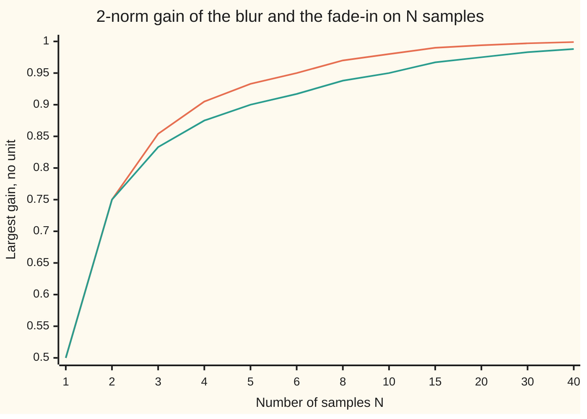

# Three model operators: integrate against a kernel, multiply, shift

[Syllabus](../../../SYLLABUS.md) → [Functional analysis](../README.md) → [Bounded Operators](../README.md#s03) → Three model operators

---

## General Overview

A sound editor runs a one-second audio clip through three effects. A **blur** softens it: each sample is replaced by a quarter of the sample before, half of itself and a quarter of the sample after. A **volume mask** fades it in: the gain (the factor the loudness is multiplied by) rises steadily from 0 at the start to 1 at the end. A **delay line** pushes it later: every sample moves one place along, and the first slot is filled with silence.

Each effect takes in a signal and gives out a signal, and doubling the input doubles the output. So each is a linear operator: a matrix, if the clip is a finite list of samples. The editor's first question is the same for all three: **how much can this effect amplify a signal?** That worst-case gain is the operator's **norm**.

On a short list these are matrix facts: largest row sums and largest entries. Then let the list grow without end. Row-sum facts survive. Other matrix habits break: the blur's energy (2-norm) gain creeps toward 1 and never reaches it, the endless delay loses nothing yet cannot be undone from both sides, and the fade-in has no input it simply rescales.

**The three model operators of analysis are integration against a kernel, multiplication by a function and the shift; their peak gains (sup-norm gains) are the largest row integral, the largest value of the multiplier and exactly 1, and in infinite dimensions they show which matrix habits survive (row-sum bounds) and which fail (a reachable 2-norm gain, an eigenvector, one-to-one meaning onto).**

**What kind of fact this is:** definitions (the three operators), with theorems proved on this card in Why it works: the norm of each, Schur's bound, and each failure of a matrix habit. The running total's norm $`2/\pi`$ is proved in a fold there, using the expansion of [Sturm-Liouville](../../08-Differential%20equations%20and%20dynamics/07-Series%20Solutions%20and%20Boundary%20Problems/09-sturm-liouville-and-orthogonality.md).

### The picture: the 2-norm gain climbs toward 1 and never arrives



Upper line (orange): the blur's largest gain in the 2-norm on N samples, $`\cos^2(\pi/(2N+2))`$. Lower line (green): the fade-in mask's largest gain on N midpoint samples, $`1 - 1/(2N)`$. Both tend to 1 as N grows, and neither reaches it at any N. Both checks print every point.

---

## The formula

Notation first, in words. A signal on the clip is a function $`f(x)`$ of the time $`x`$ in seconds, $`0 \le x \le 1`$; a sampled signal is a list $`u = (u_1, u_2, u_3, \dots)`$ of samples. An **operator** $`T`$ turns signals into signals, linearly. Its **norm** $`\lVert T\rVert`$ is its largest gain, the largest ratio $`\lVert Tf\rVert / \lVert f\rVert`$ over nonzero inputs ([Bounded operators](01-bounded-operators-and-the-operator-norm.md)). The gain depends on how size is measured, so it carries the norm's name: $`\lVert T\rVert_{\infty\to\infty}`$ measures input and output by their peak (the sup norm), $`\lVert T\rVert_{2\to 2}`$ by the 2-norm, the square root of the energy. Below, $`\sup`$ (supremum) means the least upper bound: the largest value, or the value approached when no largest one exists.

The three model operators:

```math
(Kf)(x) = \int k(x, y)\, f(y)\, dy, \qquad (M_g f)(x) = g(x)\, f(x), \qquad S(u_1, u_2, u_3, \dots) = (0, u_1, u_2, \dots)
```

**Read it aloud:** the kernel operator $`K`$ takes, at each time $`x`$, a weighted average of the whole input with weights $`k(x, y)`$; the multiplication operator $`M_g`$ multiplies the input by the gain $`g`$ at each time; the shift $`S`$ moves every sample one place later.

Their norms, the subject of this card:

```math
\lVert K\rVert_{\infty\to\infty} = \alpha = \sup_x \int \lvert k(x, y)\rvert\, dy, \qquad \lVert K\rVert_{2\to 2} \le \sqrt{\alpha\beta}, \qquad \lVert M_g\rVert = \sup \lvert g\rvert, \qquad \lVert S u\rVert_2 = \lVert u\rVert_2
```

**Read it aloud:** a kernel operator's peak gain is its largest row integral $`\alpha`$; its 2-norm gain is at most the square root of $`\alpha`$ times its largest column integral $`\beta`$ (Schur's bound); a mask's gain is its largest gain value; the shift keeps every list's 2-norm exactly.

[Bounded operators](01-bounded-operators-and-the-operator-norm.md) wrote a kernel as $`k(t, s)`$; here $`x`$ and $`y`$ play the roles of $`t`$ and $`s`$. The kernel is the matrix of [Matrix times vector](../../03-Algebra/04-Matrices/02-matrix-times-vector.md) with a row for every output time $`x`$ and a column for every input time $`y`$; the sum along a row becomes an integral. The blur's kernel is a narrow bump $`k(x, y) = \varphi(x - y)`$, here $`\varphi \ge 0`$ with total weight 1. On samples, its row is the weights 1/4, 1/2, 1/4.

| Symbol | Plain meaning | In our example | Push it up and the answer… |
| --- | --- | --- | --- |
| $`f`$, $`x`$, $`y`$ | a signal; output time; input time, in seconds | the 1 s clip | — |
| $`u = (u_1, u_2, \dots)`$, $`N`$ | a sampled signal; how many samples are kept | $`(3, 1, 4, 1, 5)`$, $`N = 5`$ | larger N, gains closer to the endless case |
| $`K`$, $`k(x, y)`$, $`\varphi`$ | kernel operator; its kernel (weight of input time y in output time x); the blur's bump | weights 1/4, 1/2, 1/4 | wider bump, more smoothing; peak gain stays 1 |
| $`\alpha`$, $`\beta`$ | largest row integral (sum); largest column integral (sum) | 1 and 1 | Schur's bound $`\sqrt{\alpha\beta}`$ rises |
| $`M_g`$, $`g`$ | multiplication operator; the gain at each time | fade-in $`g(x) = x`$ | the norm is the largest gain |
| $`S`$, $`S_{\leftarrow}`$ | delay by one sample; advance by one sample (drop the first) | $`S(3, 1, 4, 1, 5) = (0, 3, 1, 4, 1, 5)`$ | — |
| $`V`$ | the running total (the Volterra operator), $`(Vf)(x) = \int_0^x f(y)\, dy`$ | norm $`2/\pi`$ = 0.6366 on [0, 1] | longer clip, larger norm |
| $`T`$, $`\lVert T\rVert_{\infty\to\infty}`$, $`\lVert T\rVert_{2\to 2}`$ | any operator; its largest gain measured by peaks; by 2-norms | blur: 1 and 1 | — |
| $`\lambda`$, $`\varepsilon`$, $`m`$ | an eigenvalue candidate; a window width; a power | $`\varepsilon`$ = 0.1, 0.01, 0.001 | — |
| $`I`$, $`n`$, $`\theta`$, $`a`$, $`b`$ | the identity (output = input); a sample's place; the angle $`\pi/(N+1)`$; constants in a recurrence's solution | $`\theta = \pi/6`$ at N = 5 | — |
| $`\omega_j`$, $`c_j`$, $`s_j`$, $`a_j`$, $`L`$ | fold helpers: mode frequencies $`(j - \tfrac12)\pi`$ for mode number $`j`$, cosine and sine modes, coefficients; a clip length in seconds | $`\omega_1 = \pi/2`$ | larger L, norm $`2L/\pi`$ |

### When it holds

- **The kernel is continuous, or at least measurable (regular enough to integrate) with finite row integrals.** With $`\alpha`$ infinite the operator can be unbounded: the kernel $`1/\lvert x - y\rvert`$ has no finite gain.
- **Sizes are measured the same way in and out.** Mixing norms changes the answer: the peak of $`Kf`$ against the 2-norm of $`f`$ is a different number.
- **The mask's sup ignores single points.** In the 2-norm, changing $`g`$ at one time changes nothing, so its norm is the sup over all but sets of length zero (wing 10's "almost everywhere").
- **The shift runs on an endless list.** Cut to N samples, the last sample falls off: the matrix keeps its norm 1 but loses energy, and $`S^N`$ is zero.

---

## Why it works

### Step 0: an operator is a matrix with a row for every time

Every norm computation here reads one row, or one column, at a time, and survives the step to infinitely many rows. The facts that break are those whose proof counts dimensions: one-to-one implies onto, every square matrix has an eigenvalue, the largest gain is reached by some input. Each leans on finiteness ([Infinite dimensions](../01-Normed%20and%20Banach%20Spaces/05-why-infinite-dimensions-are-different.md)).

### Step 1: the peak gain is the largest row sum

Bound one output time. With $`\lvert f(y)\rvert \le \lVert f\rVert_\infty`$ everywhere,

```math
\lvert (Kf)(x)\rvert \le \int \lvert k(x, y)\rvert\, \lvert f(y)\rvert\, dy \le \Big(\int \lvert k(x, y)\rvert\, dy\Big) \lVert f\rVert_\infty \le \alpha\, \lVert f\rVert_\infty .
```

So the peak gain is at most $`\alpha`$. To reach it, feed in the sign pattern of the largest row: $`+1`$ where $`k(x, y) > 0`$, $`-1`$ where it is negative. The output at that $`x`$ is the full row integral, as [Bounded operators](01-bounded-operators-and-the-operator-norm.md) found for its blur. Here all weights are positive, so the all-ones input gives output 1 in the middle: **the blur's worst-case peak gain is 1.000 at every N from 3 samples on (less below that), so it never amplifies the clip's peak.** The code also checks this by brute force over all 32 sign patterns on 5 samples.

The same argument with a column gives the 1-norm gain: the largest column integral $`\beta`$. For the blur, $`\beta = 1`$ too, so away from the ends blurring keeps the total: the click's sum is 4 before and after.

### Step 2: Schur's bound for the 2-norm, and why the blur never reaches it

For the 2-norm, split each weight as $`\lvert k\rvert = \sqrt{\lvert k\rvert}\cdot\sqrt{\lvert k\rvert}`$ and apply Cauchy–Schwarz ([Inner products](../02-Hilbert%20Spaces/01-inner-products-and-hilbert-spaces.md)) along one row:

```math
\lvert (Kf)(x)\rvert^2 \le \Big(\int \lvert k(x, y)\rvert\, dy\Big) \Big(\int \lvert k(x, y)\rvert\, \lvert f(y)\rvert^2\, dy\Big) \le \alpha \int \lvert k(x, y)\rvert\, \lvert f(y)\rvert^2\, dy .
```

Integrate over $`x`$ and swap the order: the column integral is at most $`\beta`$, so $`\lVert Kf\rVert_2^2 \le \alpha\beta\, \lVert f\rVert_2^2`$. For the blur, $`\lVert K\rVert_{2\to 2} \le 1`$.

**On N samples the bound is not reached.** The smooth bump $`u_n = \sin(n\theta)`$ with $`\theta = \pi/(N+1)`$ is an eigenvector: the addition formula for sines gives $`\tfrac14\sin((n-1)\theta) + \tfrac12\sin(n\theta) + \tfrac14\sin((n+1)\theta) = \cos^2(\theta/2)\sin(n\theta)`$, and the bump is 0 just beyond both ends. Its gain $`\cos^2(\pi/(2N+2))`$ is the largest, as power iteration (apply the blur again and again, rescaling each time) confirms: 0.933013 at N = 5, 0.999624 at N = 80.

**On the endless list the gain is exactly 1 and no input reaches it.** Put any of those bumps at the start of the endless list. The endless blur gives the same N outputs plus one extra nonzero sample after them, so the gain is at least $`\cos^2(\pi/(2N+2))`$ for every N: at least 1. Now suppose some $`u \ne 0`$ reached it. The blur is half the signal plus a quarter delayed plus a quarter advanced, $`K = \tfrac12 I + \tfrac14 S + \tfrac14 S_{\leftarrow}`$. So $`\lVert Ku\rVert_2 \le \tfrac12\lVert u\rVert_2 + \tfrac14\lVert Su\rVert_2 + \tfrac14\lVert S_{\leftarrow}u\rVert_2 \le \lVert u\rVert_2`$. Equality needs $`u`$, $`Su`$ and $`S_{\leftarrow}u`$ to have the same length and point the same way, since a 2-norm of a sum equals the sum of the 2-norms only then. That forces $`u = Su`$: each sample equals the one before, and the first equals the silence in front of it. So $`u = 0`$.

### Step 3: the mask's gain is its largest value, approached and not reached

Pointwise, $`\lvert g(x) f(x)\rvert \le (\sup\lvert g\rvert)\, \lvert f(x)\rvert`$, so $`\lVert M_g f\rVert \le \sup\lvert g\rvert\, \lVert f\rVert`$ in the sup norm and the 2-norm. To approach it, put all the input in a window of width $`\varepsilon`$ where $`g`$ is nearly its largest. For the fade-in, with the input switched on only over the last $`\varepsilon`$ seconds:

```math
\frac{\lVert M_g f\rVert_2}{\lVert f\rVert_2} = \sqrt{\frac{1 - (1-\varepsilon)^3}{3\varepsilon}} .
```

That is 0.950438, 0.995004 and 0.999500 for $`\varepsilon`$ = 0.1, 0.01 and 0.001: the norm is 1. It is never reached, since $`\lVert f\rVert_2^2 - \lVert M_g f\rVert_2^2 = \int (1 - x^2) f(x)^2\, dx > 0`$ for any $`f \ne 0`$.

**No eigenvector.** If $`x f(x) = \lambda f(x)`$ for almost every $`x`$, then $`f`$ vanishes everywhere except at the single time $`\lambda`$, so $`\lVert f\rVert_2 = 0`$. Yet a narrow bump at $`x = 0.5`$ of width $`\varepsilon`$ nearly works: $`\lVert (M_g - 0.5) f\rVert_2 / \lVert f\rVert_2 = \varepsilon/\sqrt{12}`$, 0.0002887 at $`\varepsilon`$ = 0.001. The sampled mask is a diagonal matrix with eigenvalues 0.1, 0.3, 0.5, 0.7, 0.9; the truncation hides that the true mask on the continuous clip keeps only these near-misses.

**One-to-one but not onto.** If $`x f(x) = 0`$ almost everywhere then $`f = 0`$. But the steady signal 1 is no output: it would need $`f = 1/x`$, whose energy $`\int_0^1 x^{-2}\, dx`$ is infinite. On N samples the inverse mask's gain is 2N: 10, 100, 1000 at N = 5, 50, 500.

### Step 4: the delay line keeps every size and still cannot be undone

The endless shift moves samples without changing any of them, so every norm is kept: $`\lVert Su\rVert = \lVert u\rVert`$. An operator that keeps lengths is an **isometry**. Its powers are isometries too: a 0.25 s echo at 48 kHz is $`S^{12000}`$, still gain 1.

**One-to-one but not onto.** Different inputs give different outputs, but no output starts with a nonzero sample: the click $`(1, 0, 0, \dots)`$ is never produced. A square matrix that keeps lengths is invertible; this operator is not.

**A one-sided undo.** The advance $`S_{\leftarrow}`$ drops the first sample. Delay then advance gives the list back, $`S_{\leftarrow} S = I`$. Advance then delay replaces the first sample with silence: $`S S_{\leftarrow}(3, 1, 4, 1, 5) = (0, 1, 4, 1, 5)`$. For square matrices a left inverse is always a right inverse.

**No eigenvector.** If $`Su = \lambda u`$, the first entry gives $`\lambda u_1 = 0`$ and entry $`n+1`$ gives $`u_n = \lambda u_{n+1}`$. With $`\lambda = 0`$ every $`u_n`$ is 0. With $`\lambda \ne 0`$, $`u_1 = 0`$ and then each later sample is 0 too. The advance, by contrast, has many: $`(1, 0.5, 0.25, \dots)`$ is mapped to 0.5 times itself. The cut matrix on N samples has only the eigenvalue 0, while the endless shift's spectrum (the set of $`\lambda`$ where $`S - \lambda I`$ has no bounded inverse) is the closed unit disc; that is [Spectrum](07-spectrum-and-resolvent.md).

### Step 5: a kernel where row sums are not the answer

The running total $`V`$ has kernel 1 when $`y < x`$ and 0 otherwise: a triangle of ones. Its row integrals are at most 1 and so are its column integrals, so Schur's bound says $`\lVert V\rVert_{2\to 2} \le 1`$. The truth is smaller, $`2/\pi`$ = 0.6366, reached by the quarter cosine $`f(x) = \cos(\pi x/2)`$, whose running total is $`(2/\pi)\sin(\pi x/2)`$. On an N-point grid, power iteration gives 0.635310237 at N = 10 and 0.636619453 at N = 640; the gap shrinks like 0.131 divided by $`N^2`$.

$`V`$ is one-to-one, since $`f = (Vf)'`$, but not onto: every output is 0 at time 0, so the steady signal 1 is never produced. It has no eigenvector either. If $`Vf = \lambda f`$ with $`\lambda \ne 0`$, then $`f`$ is differentiable with $`f' = f/\lambda`$ and $`f(0) = 0`$, so $`f = 0`$; with $`\lambda = 0`$, $`f = (Vf)' = 0`$. The grid matrix is triangular with every diagonal entry $`1/(2N)`$, so its only eigenvalue slides to 0 as N grows. Here a matrix habit fails even in finite size: a non-symmetric matrix's norm need not be its largest eigenvalue.

<details>
<summary>Detailed proof: the running total's norm is exactly 2/π</summary>

Write $`\omega_j = (j - \tfrac12)\pi`$ for $`j = 1, 2, 3, \dots`$. The functions $`c_j(x) = \sqrt2\cos(\omega_j x)`$ are the modes of $`-c'' = \omega^2 c`$ with $`c'(0) = 0`$, $`c(1) = 0`$, and $`s_j(x) = \sqrt2\sin(\omega_j x)`$ are the modes with $`s(0) = 0`$, $`s'(1) = 0`$. By [Sturm-Liouville](../../08-Differential%20equations%20and%20dynamics/07-Series%20Solutions%20and%20Boundary%20Problems/09-sturm-liouville-and-orthogonality.md), each family is perpendicular, each has 2-norm 1, and each is complete in the 2-norm on [0, 1].

The running total maps one family to the other:

$`\displaystyle V c_j = \frac{1}{\omega_j}\, s_j .`$

Expand any input as $`f = \sum_j a_j c_j`$, so $`\lVert f\rVert_2^2 = \sum_j a_j^2`$. Then

$`\displaystyle \lVert Vf\rVert_2^2 = \sum_j \frac{a_j^2}{\omega_j^2} \le \frac{1}{\omega_1^2} \sum_j a_j^2 = \frac{4}{\pi^2}\, \lVert f\rVert_2^2 ,`$

with equality when only $`a_1`$ is nonzero. So $`\lVert V\rVert_{2\to 2} = 2/\pi`$, reached at $`f = \cos(\pi x/2)`$. On [0, L] every length scales by L, giving $`2L/\pi`$.

</details>

### Step 6: the scorecard

| Matrix habit | Blur (endless) | Fade-in mask | Delay line | Running total |
| --- | --- | --- | --- | --- |
| Peak gain is the largest row sum | survives: 1 | survives: 1 | survives: 1 | survives: 1 |
| Some input reaches the 2-norm gain | fails | fails | survives: every input | survives: quarter cosine |
| Every operator has an eigenvector | fails | fails | fails | fails |
| One-to-one means onto | fails | fails | fails | fails |

The blur's last two entries take a few more lines. Its eigen-equation $`Ku = \lambda u`$ is the recurrence $`u_{n+1} = (4\lambda - 2)u_n - u_{n-1}`$, started from $`u_0 = 0`$, the silence before the clip. Its two growth rates multiply to 1, and the start $`u_0 = 0`$ needs both, so every solution grows or keeps swinging: none has finite energy. The equation $`Ku = (1, 0, 0, \dots)`$ gives, from the second sample on, the same recurrence with $`\lambda = 0`$, whose solutions $`(a + bn)(-1)^n`$ never fade either. So the blur is one-to-one, yet the first-sample click is the blur of no finite-energy signal: it cannot be un-blurred.

---

## Worked numbers, by hand

The finite rehearsal: five samples, each operator as a 5 by 5 matrix.

| Step | Arithmetic | Value |
| --- | --- | --- |
| blur a click | (0, 0, 4, 0, 0): middle 4/2, neighbours 4/4 | (0, 1, 2, 1, 0) |
| its sizes | sum 4 → 4; 2-norm $`\sqrt{16} = 4`$ → $`\sqrt{1+4+1}`$ | 4 → 2.4495, gain 0.6124 |
| blur's row sums | ends 1/2 + 1/4, middle 1/4 + 1/2 + 1/4 | 0.75, 1, 1, 1, 0.75 |
| blur's peak gain | largest row sum | 1 |
| blur's best input | $`\sin(n\pi/6)`$, scaled | 0.5, 0.8660, 1, 0.8660, 0.5 |
| its gain | $`(1 + \cos(\pi/6))/2 = (1 + 0.8660)/2`$ | 0.9330 |
| mask's diagonal | midpoints (n − 0.5)/5 | 0.1, 0.3, 0.5, 0.7, 0.9 |
| mask's gain; its inverse's gain | largest entry; 1 over smallest | 0.9; 10 |
| delay (3, 1, 4, 1, 5), cut at 5 | energy 9 + 1 + 16 + 1 + 25 = 52 → 52 − 25 | (0, 3, 1, 4, 1), energy 27 |
| delay five times, cut at 5 | every sample has fallen off | (0, 0, 0, 0, 0) |
| delay on the endless list | nothing falls off | (0, 3, 1, 4, 1, 5), energy 52 |
| **gains on 5 samples** | blur peak, blur 2-norm, mask, delay | **1, 0.9330, 0.9, 1** |

On five samples the blur never raises the peak and the delay loses only what falls off the end. In the limit (an endless list for the blur and the delay, the continuous clip for the mask), the blur's and the mask's 2-norm gains rise to exactly 1, and the delay keeps all 52 units of energy.

### What breaks if you drop a piece

| Mistake | Comes out at | What went wrong |
| --- | --- | --- |
| Peak gain read as the largest single weight | 0.5, true 1 | the gain adds a whole row; one weight is one term of it |
| The cut delay line $`S^5`$ taken as the delay | gain 0, true 1 | the truncation is nilpotent (some power is zero); the endless shift keeps every size |
| Schur's bound taken as the running total's norm | 1, true 0.6366 | Schur's bound is a ceiling, reached only when row and column weights line up |
| The 5-sample mask's gain taken as the mask's norm | 0.9, true 1 | the grid misses the last instant; the true gain is the sup, approached by narrow windows |

---

## Code, from first principles, and it actually runs

The code holds only the finite rehearsal: every operator is a matrix on N samples, at several N. It takes four independent roads. Power iteration (apply the operator again and again, rescaling, until the largest gain dominates) matches the closed forms $`\cos^2(\pi/(2N+2))`$ and $`2/\pi`$. Brute force over 32 sign patterns matches the row sum. Exact window integrals match midpoint sums of 100,000 pieces. The endless delay, a list allowed to grow, is set against its cut. What the truncation hides: every matrix reaches its norm and has eigenvalues, so Step 6's failures show only as trends that never close. Every matrix is also compact and has no domain question; for these operators, compactness is [Compact operators](05-compact-operators.md).

### Python

```python
# Three model operators: the check behind the card.  Standard library only.
# A blur (weights 1/4, 1/2, 1/4), a fade-in volume mask g(x) = x, a running
# total and a one-sample delay line, each held as a matrix on N samples: the
# finite rehearsal.  Nothing imported knows a norm: power iteration, row sums
# and a sign-pattern search are written out.  Roads: closed forms against
# power iteration; brute force against row sums; exact window integrals
# against midpoint sums; the endless delay line against its cut.
import math

def l2(x): return math.sqrt(sum(v * v for v in x))
def blur(x, w=(0.25, 0.5, 0.25)):              # zero beyond both ends
    n = len(x)
    return [w[0] * (x[i - 1] if i else 0.0) + w[1] * x[i] + w[2] * (x[i + 1] if i < n - 1 else 0.0)
            for i in range(n)]
def power(apply, n, it):                        # largest |Ax|/|x| of a symmetric map, from all ones
    x = [1.0] * n
    for _ in range(it):
        y = apply(x); s = l2(y); x = [v / s for v in y]
    return l2(apply(x)), x
def blur_exact(N): c = math.cos(math.pi / (2 * N + 2)); return c * c
def mask_gain(N): return max((i + 0.5) / N for i in range(N))
def fmt(xs, d=2): return " ".join(f"{v:.{d}f}" for v in xs)

print("1. blur, N = 5 samples: weights 1/4, 1/2, 1/4, zero beyond the ends")
click = [0.0, 0.0, 4.0, 0.0, 0.0]; out = blur(click)
print(f"   click {fmt(click, 1)} -> {fmt(out, 1)}")
print(f"   sum {sum(click):.1f} -> {sum(out):.1f}; 2-norm {l2(click):.4f} -> {l2(out):.4f}, gain {l2(out) / l2(click):.4f}")
assert out == [0.0, 1.0, 2.0, 1.0, 0.0] and abs(l2(out) ** 2 - 6) < 1e-12
rows = [sum(abs(v) for v in blur([1.0 if j == i else 0.0 for j in range(5)])) for i in range(5)]
print(f"   row sums {fmt(rows)}; peak gain = largest row sum {max(rows):.4f}")
best = max(max(abs(v) for v in blur([1.0 if (k >> j) & 1 else -1.0 for j in range(5)])) for k in range(32))
print(f"   peak gain, brute force over all 32 sign patterns: {best:.4f}")
assert abs(best - max(rows)) < 1e-15                                    # road 2: brute force
g5, v5 = power(blur, 5, 6000)
print(f"   2-norm gain: power iteration {g5:.6f}; cos^2(pi/12) {blur_exact(5):.6f}; Schur bound 1")
print(f"   best input, scaled to peak 1: {fmt([v / max(v5) for v in v5], 4)}")
assert abs(g5 - blur_exact(5)) < 1e-12 and g5 < 1

print("2. as N grows: the gain creeps up to 1 and never reaches it")
for N in (5, 20, 80):
    g, _ = power(blur, N, 6000)
    print(f"   N {N:3d}: blur power iteration {g:.6f}, closed form {blur_exact(N):.6f}, gap {1 - g:.6f}")
    assert abs(g - blur_exact(N)) < 1e-10 and g < 1                     # road 1: closed form
CH = (1, 2, 3, 4, 5, 6, 8, 10, 15, 20, 30, 40)
print("   chart N    " + " ".join(f"{n:5d}" for n in CH))
print("   chart blur " + " ".join(f"{blur_exact(n):.3f}" for n in CH))
print("   chart mask " + " ".join(f"{mask_gain(n):.3f}" for n in CH))

print("3. fade-in mask g(x) = x on a 1 s clip, N midpoint samples")
print(f"   N = 5: diagonal {fmt([(i + 0.5) / 5 for i in range(5)], 1)}; gain {mask_gain(5):.4f}")
for N in (5, 50, 500):
    print(f"   N {N:3d}: gain {mask_gain(N):.6f}; inverse mask gain {1 / min((i + 0.5) / N for i in range(N)):.0f}")
M = 100000
def window(lo, hi, f):                          # midpoint sums of f(t)^2 and 1 over [lo, hi]
    h = (hi - lo) / M; a = b = 0.0
    for i in range(M):
        t = lo + (i + 0.5) * h; a += f(t) * f(t) * h; b += h
    return math.sqrt(a / b)
for e in (0.1, 0.01, 0.001):
    exact = math.sqrt((1 - (1 - e) ** 3) / (3 * e)); q = window(1 - e, 1.0, lambda t: t)
    res = window(0.5 - e / 2, 0.5 + e / 2, lambda t: t - 0.5)
    print(f"   e {e:5.3f}: end window gain {exact:.6f} (midpoint {q:.6f}); "
          f"bump at 0.5 residual {e / math.sqrt(12):.7f} (midpoint {res:.7f})")
    assert abs(exact - q) < 1e-9 and exact < 1                          # road 3: exact integral
    assert abs(res - e / math.sqrt(12)) < 1e-9

print("4. running total (Volterra), N-point midpoint grid on [0, 1]")
def volt(x, L=1.0):                             # (Vx)_i = h(x_1 + ... + x_(i-1) + x_i/2)
    h = L / len(x); y = []; s = 0.0
    for v in x: y.append(h * (s + v / 2)); s += v
    return y
def volt_t(y, L=1.0): return volt(y[::-1], L)[::-1]
for N in (10, 40, 160, 640):
    s2, x = power(lambda x: volt_t(volt(x)), N, 40)
    g = l2(volt(x))
    print(f"   N {N:3d}: gain {g:.9f}; gap x N^2 {(2 / math.pi - g) * N * N:.4f}; every eigenvalue 1/(2N) = {1 / (2 * N):.6f}")
    assert abs(g - 2 / math.pi) < 0.2 / N ** 2 and abs(g * g - s2) < 1e-12
print(f"   2/pi = {2 / math.pi:.6f}; Schur bound = 1.0000")

print("5. delay line S, one sample per step")
x = [3.0, 1.0, 4.0, 1.0, 5.0]
def cut_delay(x): return [0.0] + x[:-1]          # S on 5 samples: last one falls off
def delay(x): return [0.0] + x                   # S on an endless list
def advance(x): return x[1:]                     # the advance: drop the first sample
def cut_pow(v, m):
    for _ in range(m): v = cut_delay(v)
    return v
y = cut_pow(x, 5)
print(f"   cut at N = 5: Sx = {fmt(cut_delay(x), 0)}, energy {l2(x) ** 2:.0f} -> {l2(cut_delay(x)) ** 2:.0f}; S^5 x = {fmt(y, 0)}")
z = x
for m in range(12000): z = delay(z)
print(f"   endless: Sx = {fmt(delay(x), 0)}, energy {l2(delay(x)) ** 2:.0f}; S^12000 x (0.25 s at 48 kHz) energy {l2(z) ** 2:.0f}")
assert y == [0.0] * 5 and l2(z) == l2(x) and z[12000:] == x               # road 4: cut against endless
assert abs(l2(cut_delay(x)) ** 2 - (l2(x) ** 2 - x[-1] ** 2)) < 1e-12    # only the last sample is lost
print(f"   advance after delay {fmt(advance(delay(x)), 0)}; delay after advance {fmt(delay(advance(x)), 0)}")
assert advance(delay(x)) == x and delay(advance(x)) != x
gains = [max(l2(cut_pow([1.0 if j == k else 0.0 for j in range(5)], m)) for k in range(5)) for m in range(1, 7)]
print(f"   cut S^m, m = 1..6, gain {fmt(gains, 0)}; endless S^m gain 1 for every m")
geo = [0.5 ** n for n in range(60)]
print(f"   advance of (1, 0.5, 0.25, ...) = 0.5 x the list; its 2-norm {l2(geo):.4f}, sqrt(4/3) {math.sqrt(4 / 3):.4f}")

print("6. what breaks")
print(f"   largest single blur weight as the peak gain: 0.5000 (true {max(rows):.4f})")
print(f"   the cut delay S^5 as the delay's gain: {gains[4]:.0f} (endless list: 1)")
print(f"   Schur bound as the running total's gain: 1.0000 (true {2 / math.pi:.4f})")
print(f"   the N = 5 mask's gain as the mask's norm: {mask_gain(5):.4f} (true 1)")

print("7. try changing")
box = lambda x: blur(x, (1 / 3, 1 / 3, 1 / 3)); gb, _ = power(box, 5, 6000)
print(f"   box blur 1/3 each, N = 5: peak gain {max(abs(v) for v in box([1.0] * 5)):.4f}, 2-norm gain {gb:.6f}")
assert abs(gb - (1 + 2 * math.cos(math.pi / 6)) / 3) < 1e-12
gm = [0.5 + 0.5 * (i + 0.5) / 500 for i in range(500)]
print(f"   mask 0.5 + 0.5x, N = 500: gain {max(gm):.6f}, inverse mask gain {1 / min(gm):.6f}")
s2, x = power(lambda x: volt_t(volt(x, 2.0), 2.0), 160, 40)
print(f"   running total over 2 s, N = 160: gain {l2(volt(x, 2.0)):.6f}; 4/pi {4 / math.pi:.6f}")
print(f"   blur at N = 1000: 2-norm gain {blur_exact(1000):.8f}")
print("ALL CHECKS PASS")
```

**Ran 2026-11-15 on macOS, Python 3.14.10, standard library only. All checks passed. Output, pasted from the run:**

```
1. blur, N = 5 samples: weights 1/4, 1/2, 1/4, zero beyond the ends
   click 0.0 0.0 4.0 0.0 0.0 -> 0.0 1.0 2.0 1.0 0.0
   sum 4.0 -> 4.0; 2-norm 4.0000 -> 2.4495, gain 0.6124
   row sums 0.75 1.00 1.00 1.00 0.75; peak gain = largest row sum 1.0000
   peak gain, brute force over all 32 sign patterns: 1.0000
   2-norm gain: power iteration 0.933013; cos^2(pi/12) 0.933013; Schur bound 1
   best input, scaled to peak 1: 0.5000 0.8660 1.0000 0.8660 0.5000
2. as N grows: the gain creeps up to 1 and never reaches it
   N   5: blur power iteration 0.933013, closed form 0.933013, gap 0.066987
   N  20: blur power iteration 0.994415, closed form 0.994415, gap 0.005585
   N  80: blur power iteration 0.999624, closed form 0.999624, gap 0.000376
   chart N        1     2     3     4     5     6     8    10    15    20    30    40
   chart blur 0.500 0.750 0.854 0.905 0.933 0.950 0.970 0.980 0.990 0.994 0.997 0.999
   chart mask 0.500 0.750 0.833 0.875 0.900 0.917 0.938 0.950 0.967 0.975 0.983 0.988
3. fade-in mask g(x) = x on a 1 s clip, N midpoint samples
   N = 5: diagonal 0.1 0.3 0.5 0.7 0.9; gain 0.9000
   N   5: gain 0.900000; inverse mask gain 10
   N  50: gain 0.990000; inverse mask gain 100
   N 500: gain 0.999000; inverse mask gain 1000
   e 0.100: end window gain 0.950438 (midpoint 0.950438); bump at 0.5 residual 0.0288675 (midpoint 0.0288675)
   e 0.010: end window gain 0.995004 (midpoint 0.995004); bump at 0.5 residual 0.0028868 (midpoint 0.0028868)
   e 0.001: end window gain 0.999500 (midpoint 0.999500); bump at 0.5 residual 0.0002887 (midpoint 0.0002887)
4. running total (Volterra), N-point midpoint grid on [0, 1]
   N  10: gain 0.635310237; gap x N^2 0.1310; every eigenvalue 1/(2N) = 0.050000
   N  40: gain 0.636537958; gap x N^2 0.1309; every eigenvalue 1/(2N) = 0.012500
   N 160: gain 0.636614659; gap x N^2 0.1309; every eigenvalue 1/(2N) = 0.003125
   N 640: gain 0.636619453; gap x N^2 0.1309; every eigenvalue 1/(2N) = 0.000781
   2/pi = 0.636620; Schur bound = 1.0000
5. delay line S, one sample per step
   cut at N = 5: Sx = 0 3 1 4 1, energy 52 -> 27; S^5 x = 0 0 0 0 0
   endless: Sx = 0 3 1 4 1 5, energy 52; S^12000 x (0.25 s at 48 kHz) energy 52
   advance after delay 3 1 4 1 5; delay after advance 0 1 4 1 5
   cut S^m, m = 1..6, gain 1 1 1 1 0 0; endless S^m gain 1 for every m
   advance of (1, 0.5, 0.25, ...) = 0.5 x the list; its 2-norm 1.1547, sqrt(4/3) 1.1547
6. what breaks
   largest single blur weight as the peak gain: 0.5000 (true 1.0000)
   the cut delay S^5 as the delay's gain: 0 (endless list: 1)
   Schur bound as the running total's gain: 1.0000 (true 0.6366)
   the N = 5 mask's gain as the mask's norm: 0.9000 (true 1)
7. try changing
   box blur 1/3 each, N = 5: peak gain 1.0000, 2-norm gain 0.910684
   mask 0.5 + 0.5x, N = 500: gain 0.999500, inverse mask gain 1.998002
   running total over 2 s, N = 160: gain 1.273229; 4/pi 1.273240
   blur at N = 1000: 2-norm gain 0.99999754
ALL CHECKS PASS
```

### Rust

```rust
// Three model operators: the check behind the card.  Rust std only, no crates.
// A blur (weights 1/4, 1/2, 1/4), a fade-in volume mask g(x) = x, a running
// total and a one-sample delay line, each held as a matrix on N samples: the
// finite rehearsal.  Nothing imported knows a norm: power iteration, row sums
// and a sign-pattern search are written out.  Roads: closed forms against
// power iteration; brute force against row sums; exact window integrals
// against midpoint sums; the endless delay line against its cut.
use std::f64::consts::PI;

fn l2(x: &[f64]) -> f64 { x.iter().fold(0.0, |s, v| s + v * v).sqrt() }
fn blur_w(x: &[f64], w: [f64; 3]) -> Vec<f64> { // zero beyond both ends
    let n = x.len();
    (0..n).map(|i| w[0] * (if i > 0 { x[i - 1] } else { 0.0 }) + w[1] * x[i]
        + w[2] * (if i < n - 1 { x[i + 1] } else { 0.0 })).collect()
}
fn blur(x: &[f64]) -> Vec<f64> { blur_w(x, [0.25, 0.5, 0.25]) }
fn power(apply: &dyn Fn(&[f64]) -> Vec<f64>, n: usize, it: usize) -> (f64, Vec<f64>) {
    let mut x = vec![1.0; n]; // largest |Ax|/|x| of a symmetric map, from all ones
    for _ in 0..it {
        let y = apply(&x); let s = l2(&y); x = y.iter().map(|v| v / s).collect();
    }
    (l2(&apply(&x)), x)
}
fn blur_exact(n: usize) -> f64 { let c = (PI / (2 * n + 2) as f64).cos(); c * c }
fn mask_gain(n: usize) -> f64 { (0..n).map(|i| (i as f64 + 0.5) / n as f64).fold(f64::MIN, f64::max) }
fn fmt(xs: &[f64], d: usize) -> String { xs.iter().map(|v| format!("{:.*}", d, v)).collect::<Vec<_>>().join(" ") }
fn unit(k: usize) -> Vec<f64> { (0..5).map(|j| if j == k { 1.0 } else { 0.0 }).collect() }
fn window(lo: f64, hi: f64, f: &dyn Fn(f64) -> f64) -> f64 { // midpoint sums of f(t)^2 and 1
    let m = 100000; let h = (hi - lo) / m as f64; let (mut a, mut b) = (0.0, 0.0);
    for i in 0..m { let t = lo + (i as f64 + 0.5) * h; a += f(t) * f(t) * h; b += h; }
    (a / b).sqrt()
}
fn volt(x: &[f64], l: f64) -> Vec<f64> { // (Vx)_i = h(x_1 + ... + x_(i-1) + x_i/2)
    let h = l / x.len() as f64; let mut s = 0.0; let mut y = Vec::new();
    for &v in x { y.push(h * (s + v / 2.0)); s += v; }
    y
}
fn volt_t(y: &[f64], l: f64) -> Vec<f64> {
    let r: Vec<f64> = y.iter().rev().cloned().collect(); volt(&r, l).into_iter().rev().collect()
}
fn cut_delay(x: &[f64]) -> Vec<f64> { let mut y = vec![0.0]; y.extend_from_slice(&x[..x.len() - 1]); y }
fn delay(x: &[f64]) -> Vec<f64> { let mut y = vec![0.0]; y.extend_from_slice(x); y }
fn advance(x: &[f64]) -> Vec<f64> { x[1..].to_vec() }
fn cut_pow(v: &[f64], m: usize) -> Vec<f64> { let mut v = v.to_vec(); for _ in 0..m { v = cut_delay(&v); } v }

fn main() {
    println!("1. blur, N = 5 samples: weights 1/4, 1/2, 1/4, zero beyond the ends");
    let click = [0.0, 0.0, 4.0, 0.0, 0.0]; let out = blur(&click);
    println!("   click {} -> {}", fmt(&click, 1), fmt(&out, 1));
    let (sc, so): (f64, f64) = (click.iter().sum(), out.iter().sum());
    println!("   sum {:.1} -> {:.1}; 2-norm {:.4} -> {:.4}, gain {:.4}", sc, so, l2(&click), l2(&out), l2(&out) / l2(&click));
    assert!(out == vec![0.0, 1.0, 2.0, 1.0, 0.0] && (l2(&out) * l2(&out) - 6.0).abs() < 1e-12);
    let rows: Vec<f64> = (0..5).map(|i| blur(&unit(i)).iter().map(|v| v.abs()).sum()).collect();
    let rmax = rows.iter().cloned().fold(f64::MIN, f64::max);
    println!("   row sums {}; peak gain = largest row sum {:.4}", fmt(&rows, 2), rmax);
    let best = (0..32).map(|k: usize| {
        let s: Vec<f64> = (0..5).map(|j| if (k >> j) & 1 == 1 { 1.0 } else { -1.0 }).collect();
        blur(&s).iter().map(|v| v.abs()).fold(f64::MIN, f64::max)
    }).fold(f64::MIN, f64::max);
    println!("   peak gain, brute force over all 32 sign patterns: {:.4}", best);
    assert!((best - rmax).abs() < 1e-15); // road 2: brute force
    let (g5, v5) = power(&blur, 5, 6000);
    println!("   2-norm gain: power iteration {:.6}; cos^2(pi/12) {:.6}; Schur bound 1", g5, blur_exact(5));
    let vm = v5.iter().cloned().fold(f64::MIN, f64::max);
    println!("   best input, scaled to peak 1: {}", fmt(&v5.iter().map(|v| v / vm).collect::<Vec<_>>(), 4));
    assert!((g5 - blur_exact(5)).abs() < 1e-12 && g5 < 1.0);

    println!("2. as N grows: the gain creeps up to 1 and never reaches it");
    for n in [5usize, 20, 80] {
        let (g, _) = power(&blur, n, 6000);
        println!("   N {:3}: blur power iteration {:.6}, closed form {:.6}, gap {:.6}", n, g, blur_exact(n), 1.0 - g);
        assert!((g - blur_exact(n)).abs() < 1e-10 && g < 1.0); // road 1: closed form
    }
    let ch = [1usize, 2, 3, 4, 5, 6, 8, 10, 15, 20, 30, 40];
    println!("   chart N    {}", ch.iter().map(|n| format!("{:5}", n)).collect::<Vec<_>>().join(" "));
    println!("   chart blur {}", fmt(&ch.iter().map(|&n| blur_exact(n)).collect::<Vec<_>>(), 3));
    println!("   chart mask {}", fmt(&ch.iter().map(|&n| mask_gain(n)).collect::<Vec<_>>(), 3));

    println!("3. fade-in mask g(x) = x on a 1 s clip, N midpoint samples");
    println!("   N = 5: diagonal {}; gain {:.4}", fmt(&(0..5).map(|i| (i as f64 + 0.5) / 5.0).collect::<Vec<_>>(), 1), mask_gain(5));
    for n in [5usize, 50, 500] {
        let gmin = (0..n).map(|i| (i as f64 + 0.5) / n as f64).fold(f64::MAX, f64::min);
        println!("   N {:3}: gain {:.6}; inverse mask gain {:.0}", n, mask_gain(n), 1.0 / gmin);
    }
    for e in [0.1f64, 0.01, 0.001] {
        let exact = ((1.0 - (1.0 - e).powi(3)) / (3.0 * e)).sqrt(); let q = window(1.0 - e, 1.0, &|t| t);
        let res = window(0.5 - e / 2.0, 0.5 + e / 2.0, &|t| t - 0.5);
        println!("   e {:5.3}: end window gain {:.6} (midpoint {:.6}); bump at 0.5 residual {:.7} (midpoint {:.7})",
            e, exact, q, e / 12f64.sqrt(), res);
        assert!((exact - q).abs() < 1e-9 && exact < 1.0); // road 3: exact integral
        assert!((res - e / 12f64.sqrt()).abs() < 1e-9);
    }

    println!("4. running total (Volterra), N-point midpoint grid on [0, 1]");
    for n in [10usize, 40, 160, 640] {
        let (s2, x) = power(&|x: &[f64]| volt_t(&volt(x, 1.0), 1.0), n, 40);
        let g = l2(&volt(&x, 1.0)); let nf = n as f64;
        println!("   N {:3}: gain {:.9}; gap x N^2 {:.4}; every eigenvalue 1/(2N) = {:.6}", n, g, (2.0 / PI - g) * nf * nf, 1.0 / (2.0 * nf));
        assert!((g - 2.0 / PI).abs() < 0.2 / (nf * nf) && (g * g - s2).abs() < 1e-12);
    }
    println!("   2/pi = {:.6}; Schur bound = 1.0000", 2.0 / PI);

    println!("5. delay line S, one sample per step");
    let x = vec![3.0, 1.0, 4.0, 1.0, 5.0];
    let y = cut_pow(&x, 5); let sx = cut_delay(&x);
    println!("   cut at N = 5: Sx = {}, energy {:.0} -> {:.0}; S^5 x = {}", fmt(&sx, 0), l2(&x) * l2(&x), l2(&sx) * l2(&sx), fmt(&y, 0));
    let mut z = x.clone();
    for _ in 0..12000 { z = delay(&z); }
    let dx = delay(&x);
    println!("   endless: Sx = {}, energy {:.0}; S^12000 x (0.25 s at 48 kHz) energy {:.0}", fmt(&dx, 0), l2(&dx) * l2(&dx), l2(&z) * l2(&z));
    assert!(y == vec![0.0; 5] && l2(&z) == l2(&x) && z[12000..] == x[..]); // road 4: cut against endless
    assert!((l2(&sx) * l2(&sx) - (l2(&x) * l2(&x) - x[4] * x[4])).abs() < 1e-12); // only the last sample is lost
    println!("   advance after delay {}; delay after advance {}", fmt(&advance(&delay(&x)), 0), fmt(&delay(&advance(&x)), 0));
    assert!(advance(&delay(&x)) == x && delay(&advance(&x)) != x);
    let gains: Vec<f64> = (1..7).map(|m| (0..5).map(|k| l2(&cut_pow(&unit(k), m))).fold(f64::MIN, f64::max)).collect();
    println!("   cut S^m, m = 1..6, gain {}; endless S^m gain 1 for every m", fmt(&gains, 0));
    let geo: Vec<f64> = (0..60).map(|n| 0.5f64.powi(n)).collect();
    println!("   advance of (1, 0.5, 0.25, ...) = 0.5 x the list; its 2-norm {:.4}, sqrt(4/3) {:.4}", l2(&geo), (4.0f64 / 3.0).sqrt());

    println!("6. what breaks");
    println!("   largest single blur weight as the peak gain: 0.5000 (true {:.4})", rmax);
    println!("   the cut delay S^5 as the delay's gain: {:.0} (endless list: 1)", gains[4]);
    println!("   Schur bound as the running total's gain: 1.0000 (true {:.4})", 2.0 / PI);
    println!("   the N = 5 mask's gain as the mask's norm: {:.4} (true 1)", mask_gain(5));

    println!("7. try changing");
    let box3 = |x: &[f64]| blur_w(x, [1.0 / 3.0, 1.0 / 3.0, 1.0 / 3.0]); let (gb, _) = power(&box3, 5, 6000);
    let pb = box3(&[1.0; 5]).iter().map(|v| v.abs()).fold(f64::MIN, f64::max);
    println!("   box blur 1/3 each, N = 5: peak gain {:.4}, 2-norm gain {:.6}", pb, gb);
    assert!((gb - (1.0 + 2.0 * (PI / 6.0).cos()) / 3.0).abs() < 1e-12);
    let gm: Vec<f64> = (0..500).map(|i| 0.5 + 0.5 * (i as f64 + 0.5) / 500.0).collect();
    println!("   mask 0.5 + 0.5x, N = 500: gain {:.6}, inverse mask gain {:.6}",
        gm.iter().cloned().fold(f64::MIN, f64::max), 1.0 / gm.iter().cloned().fold(f64::MAX, f64::min));
    let (_, x2) = power(&|x: &[f64]| volt_t(&volt(x, 2.0), 2.0), 160, 40);
    println!("   running total over 2 s, N = 160: gain {:.6}; 4/pi {:.6}", l2(&volt(&x2, 2.0)), 4.0 / PI);
    println!("   blur at N = 1000: 2-norm gain {:.8}", blur_exact(1000));
    println!("ALL CHECKS PASS");
}
```

**Ran 2026-11-15 on macOS, rustc 1.98.1, no crates. All checks passed. Output, pasted from the run:**

```
1. blur, N = 5 samples: weights 1/4, 1/2, 1/4, zero beyond the ends
   click 0.0 0.0 4.0 0.0 0.0 -> 0.0 1.0 2.0 1.0 0.0
   sum 4.0 -> 4.0; 2-norm 4.0000 -> 2.4495, gain 0.6124
   row sums 0.75 1.00 1.00 1.00 0.75; peak gain = largest row sum 1.0000
   peak gain, brute force over all 32 sign patterns: 1.0000
   2-norm gain: power iteration 0.933013; cos^2(pi/12) 0.933013; Schur bound 1
   best input, scaled to peak 1: 0.5000 0.8660 1.0000 0.8660 0.5000
2. as N grows: the gain creeps up to 1 and never reaches it
   N   5: blur power iteration 0.933013, closed form 0.933013, gap 0.066987
   N  20: blur power iteration 0.994415, closed form 0.994415, gap 0.005585
   N  80: blur power iteration 0.999624, closed form 0.999624, gap 0.000376
   chart N        1     2     3     4     5     6     8    10    15    20    30    40
   chart blur 0.500 0.750 0.854 0.905 0.933 0.950 0.970 0.980 0.990 0.994 0.997 0.999
   chart mask 0.500 0.750 0.833 0.875 0.900 0.917 0.938 0.950 0.967 0.975 0.983 0.988
3. fade-in mask g(x) = x on a 1 s clip, N midpoint samples
   N = 5: diagonal 0.1 0.3 0.5 0.7 0.9; gain 0.9000
   N   5: gain 0.900000; inverse mask gain 10
   N  50: gain 0.990000; inverse mask gain 100
   N 500: gain 0.999000; inverse mask gain 1000
   e 0.100: end window gain 0.950438 (midpoint 0.950438); bump at 0.5 residual 0.0288675 (midpoint 0.0288675)
   e 0.010: end window gain 0.995004 (midpoint 0.995004); bump at 0.5 residual 0.0028868 (midpoint 0.0028868)
   e 0.001: end window gain 0.999500 (midpoint 0.999500); bump at 0.5 residual 0.0002887 (midpoint 0.0002887)
4. running total (Volterra), N-point midpoint grid on [0, 1]
   N  10: gain 0.635310237; gap x N^2 0.1310; every eigenvalue 1/(2N) = 0.050000
   N  40: gain 0.636537958; gap x N^2 0.1309; every eigenvalue 1/(2N) = 0.012500
   N 160: gain 0.636614659; gap x N^2 0.1309; every eigenvalue 1/(2N) = 0.003125
   N 640: gain 0.636619453; gap x N^2 0.1309; every eigenvalue 1/(2N) = 0.000781
   2/pi = 0.636620; Schur bound = 1.0000
5. delay line S, one sample per step
   cut at N = 5: Sx = 0 3 1 4 1, energy 52 -> 27; S^5 x = 0 0 0 0 0
   endless: Sx = 0 3 1 4 1 5, energy 52; S^12000 x (0.25 s at 48 kHz) energy 52
   advance after delay 3 1 4 1 5; delay after advance 0 1 4 1 5
   cut S^m, m = 1..6, gain 1 1 1 1 0 0; endless S^m gain 1 for every m
   advance of (1, 0.5, 0.25, ...) = 0.5 x the list; its 2-norm 1.1547, sqrt(4/3) 1.1547
6. what breaks
   largest single blur weight as the peak gain: 0.5000 (true 1.0000)
   the cut delay S^5 as the delay's gain: 0 (endless list: 1)
   Schur bound as the running total's gain: 1.0000 (true 0.6366)
   the N = 5 mask's gain as the mask's norm: 0.9000 (true 1)
7. try changing
   box blur 1/3 each, N = 5: peak gain 1.0000, 2-norm gain 0.910684
   mask 0.5 + 0.5x, N = 500: gain 0.999500, inverse mask gain 1.998002
   running total over 2 s, N = 160: gain 1.273229; 4/pi 1.273240
   blur at N = 1000: 2-norm gain 0.99999754
ALL CHECKS PASS
```

### Lean

Lean proves the three norm facts for a continuous kernel, any measurable mask and the endless delay line, and checks the five-sample numbers.

- Take a kernel $`k(x, y)`$ that is continuous for $`0 \le x \le 1`$ and $`0 \le y \le 1`$. Then its peak gain over continuous inputs is exactly the largest row integral $`\alpha`$.
- Take any measurable gain $`g`$ on the clip. Then the mask's 2-norm gain is the sup of $`\lvert g\rvert`$, ignoring sets of length zero.
- Take any finite-energy endless list $`u`$. Then the delayed list $`Su`$ has finite energy too, and $`\lVert Su\rVert_2 = \lVert u\rVert_2`$.
- The 5-sample blur sends the click (0, 0, 4, 0, 0) to (0, 1, 2, 1, 0).
- The blur's row sums are 0.75, 1, 1, 1, 0.75, so its peak gain is 1.
- The click's sum is 4 before and after the blur, and its energy falls from 16 to 6.
- The delay cut at 5 samples sends (3, 1, 4, 1, 5) to (0, 3, 1, 4, 1). Its energy falls from 52 to 27.
- Five cut delays turn (3, 1, 4, 1, 5) into silence, (0, 0, 0, 0, 0).
- On the endless list, the delayed (0, 3, 1, 4, 1, 5) keeps energy 52. Advance after delay gives (3, 1, 4, 1, 5) back; delay after advance gives (0, 1, 4, 1, 5).

The 2-norm gains at each N, Schur's bound and the running total's $`2/\pi`$ are left to the Python and Rust checks.

```lean
-- Three model operators: a continuous kernel operator's peak gain on [0, 1] is its largest row integral, a mask's energy gain is the essential sup of its gain function, and the delay line keeps every 2-norm on the endless list.
import Mathlib.MeasureTheory.Integral.IntervalIntegral.Basic
import Mathlib.MeasureTheory.Function.LpSeminorm.Basic
import Mathlib.Analysis.Normed.Lp.lpSpace
import Mathlib.MeasureTheory.Function.LpSeminorm.CompareExp
import Mathlib.MeasureTheory.Function.LpSeminorm.Indicator
import Mathlib.LinearAlgebra.Matrix.Notation
import Mathlib.Data.Matrix.Mul
import Mathlib.Tactic.NormNum
import Mathlib.Tactic.FinCases

open MeasureTheory Matrix
open scoped ENNReal

/-- Clamping `t / ε` to `[-1, 1]` loses at most `ε` against `|t|`. -/
theorem abs_sub_mul_clamp_le (t ε : ℝ) (hε : 0 < ε) :
    |t| - t * max (-1) (min 1 (t / ε)) ≤ ε := by
  rcases le_or_gt ε t with h | h
  · have h1 : 1 ≤ t / ε := by rw [le_div_iff₀ hε]; linarith
    rw [min_eq_left h1, max_eq_right (by norm_num), abs_of_nonneg (by linarith)]
    linarith
  · rcases le_or_gt t (-ε) with h' | h'
    · have h1 : t / ε ≤ -1 := by rw [div_le_iff₀ hε]; linarith
      rw [min_eq_right (by linarith), max_eq_left h1, abs_of_neg (by linarith)]
      linarith
    · have h1 : t / ε ≤ 1 := by rw [div_le_iff₀ hε]; linarith
      have h2 : -1 ≤ t / ε := by rw [le_div_iff₀ hε]; linarith
      rw [min_eq_right h1, max_eq_right h2]
      have : 0 ≤ t * (t / ε) := by
        rw [← mul_div_assoc]; exact div_nonneg (mul_self_nonneg t) hε.le
      have : |t| ≤ ε := abs_le.2 ⟨by linarith, by linarith⟩
      linarith

#print axioms abs_sub_mul_clamp_le

/-- The peak gain of a kernel operator is its largest row integral. Let k(x, y) be a kernel that
is continuous on the square [0, 1] × [0, 1], and let K send a signal f on [0, 1] to
(Kf)(x) = ∫₀¹ k(x, y) f(y) dy. Over all continuous inputs f with peak |f| ≤ 1 on [0, 1] and all
output times x in [0, 1], the least upper bound of the output size |(Kf)(x)| is
α = sup over x in [0, 1] of ∫₀¹ |k(x, y)| dy: the sup-norm gain ‖K‖_{∞→∞} equals α. -/
theorem kernel_peak_gain_eq_largest_row_integral (k : ℝ × ℝ → ℝ)
    (hk : ContinuousOn k (Set.Icc (0 : ℝ) 1 ×ˢ Set.Icc (0 : ℝ) 1)) :
    IsLUB {c : ℝ | ∃ f : ℝ → ℝ, ContinuousOn f (Set.Icc 0 1) ∧
        (∀ y ∈ Set.Icc (0 : ℝ) 1, |f y| ≤ 1) ∧
        ∃ x ∈ Set.Icc (0 : ℝ) 1, c = |∫ y in (0 : ℝ)..1, k (x, y) * f y|}
      (sSup ((fun x => ∫ y in (0 : ℝ)..1, |k (x, y)|) '' Set.Icc 0 1)) := by
  have hI : Set.uIcc (0 : ℝ) 1 = Set.Icc 0 1 := Set.uIcc_of_le zero_le_one
  have hrow : ∀ x ∈ Set.Icc (0 : ℝ) 1, ContinuousOn (fun y => k (x, y)) (Set.Icc 0 1) :=
    fun x hx => hk.comp (continuous_const.prodMk continuous_id).continuousOn
      (fun y hy => ⟨hx, hy⟩)
  obtain ⟨C, hC⟩ := (isCompact_Icc.prod isCompact_Icc).exists_bound_of_continuousOn hk
  have hbdd : BddAbove ((fun x => ∫ y in (0 : ℝ)..1, |k (x, y)|) '' Set.Icc 0 1) := by
    refine ⟨C, ?_⟩
    rintro _ ⟨x, hx, rfl⟩
    have h := intervalIntegral.integral_mono_on (a := 0) (b := 1) (f := fun y => |k (x, y)|)
      (g := fun _ => C) zero_le_one
      (ContinuousOn.intervalIntegrable (by rw [hI]; exact (hrow x hx).abs))
      (intervalIntegrable_const (μ := volume))
      (fun y hy => by simpa [Real.norm_eq_abs] using hC (x, y) ⟨hx, hy⟩)
    simpa using h
  have hne : ((fun x => ∫ y in (0 : ℝ)..1, |k (x, y)|) '' Set.Icc 0 1).Nonempty :=
    ⟨_, ⟨0, ⟨le_rfl, zero_le_one⟩, rfl⟩⟩
  constructor
  · rintro c ⟨f, hf, hf1, x, hx, rfl⟩
    have hkf : IntervalIntegrable (fun y => |k (x, y) * f y|) volume 0 1 :=
      ContinuousOn.intervalIntegrable (by rw [hI]; exact ((hrow x hx).mul hf).abs)
    have hka : IntervalIntegrable (fun y => |k (x, y)|) volume 0 1 :=
      ContinuousOn.intervalIntegrable (by rw [hI]; exact (hrow x hx).abs)
    calc |∫ y in (0 : ℝ)..1, k (x, y) * f y|
        ≤ ∫ y in (0 : ℝ)..1, |k (x, y) * f y| :=
          intervalIntegral.abs_integral_le_integral_abs zero_le_one
      _ ≤ ∫ y in (0 : ℝ)..1, |k (x, y)| := by
          apply intervalIntegral.integral_mono_on zero_le_one hkf hka
          intro y hy
          rw [abs_mul]
          exact mul_le_of_le_one_right (abs_nonneg _) (hf1 y hy)
      _ ≤ _ := le_csSup hbdd ⟨x, hx, rfl⟩
  · intro b hb
    refine csSup_le hne ?_
    rintro _ ⟨x, hx, rfl⟩
    refine le_of_forall_pos_le_add fun ε hε => ?_
    set f : ℝ → ℝ := fun y => max (-1) (min 1 (k (x, y) / ε))
    have hf : ContinuousOn f (Set.Icc 0 1) :=
      (continuous_const.max (continuous_const.min continuous_id)).comp_continuousOn
        ((hrow x hx).div_const ε)
    have hf1 : ∀ y ∈ Set.Icc (0 : ℝ) 1, |f y| ≤ 1 := fun y _ =>
      abs_le.2 ⟨le_max_left _ _, max_le (by norm_num) (min_le_left _ _)⟩
    have hmem := hb ⟨f, hf, hf1, x, hx, rfl⟩
    have hkf : IntervalIntegrable (fun y => k (x, y) * f y) volume 0 1 :=
      ContinuousOn.intervalIntegrable (by rw [hI]; exact (hrow x hx).mul hf)
    have hka : IntervalIntegrable (fun y => |k (x, y)|) volume 0 1 :=
      ContinuousOn.intervalIntegrable (by rw [hI]; exact (hrow x hx).abs)
    have hdiff : ∫ y in (0 : ℝ)..1, (|k (x, y)| - k (x, y) * f y) ≤ ∫ _ in (0 : ℝ)..1, ε :=
      intervalIntegral.integral_mono_on zero_le_one (hka.sub hkf) intervalIntegrable_const
        (fun y _ => abs_sub_mul_clamp_le _ _ hε)
    rw [intervalIntegral.integral_sub hka hkf] at hdiff
    simp only [intervalIntegral.integral_const, sub_zero, smul_eq_mul, one_mul] at hdiff
    have := le_abs_self (∫ y in (0 : ℝ)..1, k (x, y) * f y)
    linarith

/-- The energy gain of a mask is the largest value of its gain function, ignoring sets of length
zero. Let g be a measurable gain function on the clip [0, 1] and let M_g multiply a signal by g.
Over all finite-energy inputs f ≠ 0 on [0, 1], the least upper bound of the ratio
‖g f‖₂ / ‖f‖₂ is the essential sup of |g| on [0, 1] (wing 10's sup "almost everywhere"). -/
theorem mask_gain_eq_ess_sup (g : ℝ → ℝ)
    (hg : AEStronglyMeasurable g (volume.restrict (Set.Icc (0 : ℝ) 1))) :
    IsLUB {c : ℝ≥0∞ | ∃ f : ℝ → ℝ, MemLp f 2 (volume.restrict (Set.Icc (0 : ℝ) 1)) ∧
        eLpNorm f 2 (volume.restrict (Set.Icc (0 : ℝ) 1)) ≠ 0 ∧
        c = eLpNorm (fun x => g x * f x) 2 (volume.restrict (Set.Icc (0 : ℝ) 1)) /
          eLpNorm f 2 (volume.restrict (Set.Icc (0 : ℝ) 1))}
      (eLpNorm g ∞ (volume.restrict (Set.Icc (0 : ℝ) 1))) := by
  set μ := volume.restrict (Set.Icc (0 : ℝ) 1) with hμ
  constructor
  · rintro c ⟨f, -, -, rfl⟩
    apply ENNReal.div_le_of_le_mul
    have := eLpNorm_le_eLpNorm_top_mul_eLpNorm (μ := μ) (f := g) (g := f) 2 (fun a b : ℝ => a * b) 1
      continuous_mul hg (Filter.Eventually.of_forall fun x => by simp [nnnorm_mul])
    simpa using this
  · intro b hb
    by_contra hlt
    rw [not_le] at hlt
    obtain ⟨b', hbb', hb'g⟩ := ENNReal.lt_iff_exists_nnreal_btwn.1 hlt
    set g' := hg.mk g
    have hg'm : StronglyMeasurable g' := hg.stronglyMeasurable_mk
    have hgg' : g =ᵐ[μ] g' := hg.ae_eq_mk
    set A := {x | (b' : ℝ≥0∞) < ‖g' x‖ₑ}
    have hA : MeasurableSet A := measurableSet_lt measurable_const hg'm.measurable.enorm
    have hAμ : μ A ≠ 0 := by
      intro h0
      have hae : ∀ᵐ x ∂μ, ‖g' x‖ₑ ≤ (b' : ℝ≥0∞) := by
        rw [ae_iff]
        simpa [A, not_le] using h0
      have : eLpNorm g ∞ μ ≤ b' := by
        rw [eLpNorm_congr_ae hgg', eLpNorm_exponent_top hg'm.aestronglyMeasurable]
        exact essSup_le_of_ae_le _ hae
      exact absurd hb'g (not_lt.2 this)
    have hAfin : μ A ≠ ∞ := measure_ne_top μ A
    set f : ℝ → ℝ := A.indicator fun _ => (1 : ℝ)
    have hfm : MemLp f 2 μ := memLp_indicator_const 2 hA.nullMeasurableSet 1 (Or.inr hAfin)
    have hfn : eLpNorm f 2 μ = μ A ^ (1 / (2 : ℝ≥0∞).toReal) := by
      simp only [f]
      rw [eLpNorm_indicator_const hA.nullMeasurableSet (by norm_num) (by norm_num)]
      simp
    have hf0 : eLpNorm f 2 μ ≠ 0 := by
      rw [hfn]; exact (ENNReal.rpow_pos (pos_iff_ne_zero.2 hAμ) hAfin).ne'
    have hftop : eLpNorm f 2 μ ≠ ∞ := hfm.eLpNorm_ne_top
    have hlow : (b' : ℝ≥0∞) * eLpNorm f 2 μ ≤ eLpNorm (fun x => g x * f x) 2 μ := by
      have h1 : eLpNorm (fun x => (b' : ℝ) * f x) 2 μ = (b' : ℝ≥0∞) * eLpNorm f 2 μ := by
        have := eLpNorm_const_smul (b' : ℝ) f 2 μ
        rw [show (fun x => (b' : ℝ) * f x) = (b' : ℝ) • f from rfl, this]
        simp
      rw [← h1]
      apply eLpNorm_mono_enorm_ae (by fun_prop)
      filter_upwards [hgg'] with x hx
      rw [hx]
      by_cases hxA : x ∈ A
      · simp only [f, Set.indicator_of_mem hxA, mul_one]
        have : ‖(b' : ℝ)‖ₑ = (b' : ℝ≥0∞) := by simp
        rw [this]; exact le_of_lt hxA
      · simp [f, Set.indicator_of_notMem hxA]
    have hmem := hb ⟨f, hfm, hf0, rfl⟩
    have : (b' : ℝ≥0∞) ≤ eLpNorm (fun x => g x * f x) 2 μ / eLpNorm f 2 μ := by
      rw [ENNReal.le_div_iff_mul_le (Or.inl hf0) (Or.inl hftop)]
      exact hlow
    exact absurd (this.trans hmem) (not_le.2 hbb')

/-- The delay line keeps every size. For every finite-energy endless list u = (u₁, u₂, …) in ℓ²,
the delayed list Su = (0, u₁, u₂, …) is again in ℓ² and has exactly the same 2-norm:
‖Su‖₂ = ‖u‖₂. -/
theorem shift_keeps_two_norm (u : lp (fun _ : ℕ => ℝ) 2) :
    ∃ v : lp (fun _ : ℕ => ℝ) 2, v 0 = 0 ∧ (∀ n, v (n + 1) = u n) ∧ ‖v‖ = ‖u‖ := by
  have hp : (0 : ℝ) < (2 : ℝ≥0∞).toReal := by norm_num
  let w : ℕ → ℝ := fun n => Nat.casesOn n 0 (fun m => u m)
  have hu : Summable fun i => ‖u i‖ ^ (2 : ℝ≥0∞).toReal := (memℓp_gen_iff hp).1 (lp.memℓp u)
  have hw : Summable fun i => ‖w i‖ ^ (2 : ℝ≥0∞).toReal := by
    rw [← summable_nat_add_iff 1]
    simpa [w] using hu
  refine ⟨⟨w, (memℓp_gen_iff hp).2 hw⟩, rfl, fun n => rfl, ?_⟩
  rw [lp.norm_eq_tsum_rpow hp, lp.norm_eq_tsum_rpow hp]
  congr 1
  change ∑' i, ‖w i‖ ^ (2 : ℝ≥0∞).toReal = _
  rw [hw.tsum_eq_zero_add]
  simp [w]

/-- The blur on 5 samples, weights 1/4, 1/2, 1/4 and zero beyond both ends, sends the click
(0, 0, 4, 0, 0) to (0, 1, 2, 1, 0). -/
example : (!![1/2, 1/4, 0, 0, 0; 1/4, 1/2, 1/4, 0, 0; 0, 1/4, 1/2, 1/4, 0;
      0, 0, 1/4, 1/2, 1/4; 0, 0, 0, 1/4, 1/2] : Matrix (Fin 5) (Fin 5) ℚ) *ᵥ ![0, 0, 4, 0, 0] =
    (![0, 1, 2, 1, 0] : Fin 5 → ℚ) := by
  ext i; fin_cases i <;> simp [Matrix.mulVec, dotProduct, Fin.sum_univ_five] <;> norm_num

/-- The 5-sample blur's row sums are 3/4, 1, 1, 1, 3/4, so its peak gain is 1. -/
example : (fun i => ∑ j, (!![1/2, 1/4, 0, 0, 0; 1/4, 1/2, 1/4, 0, 0; 0, 1/4, 1/2, 1/4, 0;
      0, 0, 1/4, 1/2, 1/4; 0, 0, 0, 1/4, 1/2] : Matrix (Fin 5) (Fin 5) ℚ) i j) =
    ![3/4, 1, 1, 1, 3/4] := by
  ext i; fin_cases i <;> simp [Fin.sum_univ_five] <;> norm_num

/-- The click's total is 4 before and after the blur, and its energy falls from 16 to 6. -/
example : ((0 : ℚ) + 0 + 4 + 0 + 0 = 0 + 1 + 2 + 1 + 0) ∧
    ((0 : ℚ) ^ 2 + 0 ^ 2 + 4 ^ 2 + 0 ^ 2 + 0 ^ 2 = 16) ∧
    ((0 : ℚ) ^ 2 + 1 ^ 2 + 2 ^ 2 + 1 ^ 2 + 0 ^ 2 = 6) := by
  norm_num

/-- The cut delay on 5 samples sends (3, 1, 4, 1, 5) to (0, 3, 1, 4, 1): energy 52 falls to 27. -/
example : (0 :: [3, 1, 4, 1, 5]).dropLast = [0, 3, 1, 4, 1] ∧
    ([3, 1, 4, 1, 5].map (· ^ 2)).sum = 52 ∧ ([0, 3, 1, 4, 1].map (· ^ 2)).sum = 27 := by
  decide

/-- Five cut delays on 5 samples give silence: S⁵ (3, 1, 4, 1, 5) = (0, 0, 0, 0, 0). -/
example : (fun l : List ℕ => (0 :: l).dropLast)^[5] [3, 1, 4, 1, 5] = [0, 0, 0, 0, 0] := by
  decide

/-- On the endless list nothing falls off: (0, 3, 1, 4, 1, 5) keeps energy 52; advance after
delay gives the list back, and delay after advance gives (0, 1, 4, 1, 5). -/
example : ([0, 3, 1, 4, 1, 5].map (· ^ 2)).sum = 52 ∧
    (0 :: [3, 1, 4, 1, 5]).tail = [3, 1, 4, 1, 5] ∧
    0 :: [3, 1, 4, 1, 5].tail = [0, 1, 4, 1, 5] := by
  decide

#print axioms kernel_peak_gain_eq_largest_row_integral
#print axioms mask_gain_eq_ess_sup
#print axioms shift_keeps_two_norm
```

**Checked 2026-11-15 on macOS, Lean 4.36.0-rc2, Mathlib v4.36.0-rc2. Every proof is complete and uses only Lean's standard axioms. Output, pasted from the run:**

```
'abs_sub_mul_clamp_le' depends on axioms: [propext, Classical.choice, Quot.sound]
'kernel_peak_gain_eq_largest_row_integral' depends on axioms: [propext, Classical.choice, Quot.sound]
'mask_gain_eq_ess_sup' depends on axioms: [propext, Classical.choice, Quot.sound]
'shift_keeps_two_norm' depends on axioms: [propext, Classical.choice, Quot.sound]
```

> [!TIP]
> **Try changing**
> - **A box blur.** Guess first: does an even three-way average, 1/3 each, raise the peak gain? Change `w` in `blur` to `(1/3, 1/3, 1/3)`. The peak gain stays 1.0000; the 2-norm gain at N = 5 drops to 0.910684.
> - **A fade from half volume.** Guess first: does $`g(x) = 0.5 + 0.5x`$ fix the missing inverse? Section 7 of the code runs it on 500 samples. Its gain is still 1 (0.999500 at N = 500), but the inverse gain stays near 2 (1.998002) instead of growing with N.
> - **A longer clip.** Guess first: what is the running total's norm over 2 s? Pass `L = 2.0` to `volt`. It is $`4/\pi`$ = 1.273240; the N = 160 grid gives 1.273229.
> - **More samples.** Guess first: does the blur's 2-norm gain reach 1 at N = 1000? It is 0.99999754: closer, still below.

---

## The usual mistake

> [!warning]
> **Treating a truncation's answer as the operator's.** Cut the delay line to 5 samples and five delays give silence, gain 0. The endless delay keeps every size, gain 1. The cut mask's gain is 0.9 at N = 5; the mask's is 1. A matrix always reaches its norm and always has an eigenvalue, so the code can only show the infinite failures as trends over N.
>
> - **Peak gain from the largest weight.** The blur's biggest weight is 1/2; a steady signal comes out at gain 1.
> - **Schur's bound as the norm.** For the running total it gives 1; the norm is 0.6366.
> - **Isometry as invertible.** Advance then delay turns (3, 1, 4, 1, 5) into (0, 1, 4, 1, 5).
> - **Invertible at every N taken as invertible in the limit.** Every sampled fade-in has an inverse, but its gain is 2N: 10, 100, 1000 at N = 5, 50, 500, with no bound. The mask on the continuous clip has no bounded inverse.

---

## Where you meet it in real life

- **Image and audio blur.** Gaussian blur and every finite impulse response filter (a fixed weighted sum of nearby samples) are kernel operators. A blur with nonnegative weights summing to 1 never raises the peak, which is why it cannot clip a signal. Step 6's recurrence is why un-blurring (deconvolution) is unstable.
- **Delay effects and digital filters.** A digital echo is a power of the shift; a filter is a sum of shifted copies, the [Linear and time-invariant](../../13-Engineering%20mathematics/02-Linear%20Systems%20and%20Transforms/01-linear-time-invariant-systems-and-convolution.md) convolution read as an operator.
- **Volume automation.** Fades and gain envelopes in a mixing desk are multiplication operators; their gain is the envelope's maximum.
- **Quantum mechanics.** The position operator is multiplication by $`x`$. Like the fade-in, it has no eigenvector of finite energy, which is why physics texts reach for delta functions.

> **Say it back**
> Integrating against a kernel, multiplying by a function and shifting a list are the three model operators. A kernel operator's peak gain is its largest row integral, and Schur's bound caps its 2-norm gain by the square root of the largest row and column integrals. A mask's gain is its largest value, and the shift keeps every size. In infinite dimensions the row-sum facts survive, but a norm need not be reached, an operator need not have an eigenvector, and one-to-one no longer means onto. Every computation is a truncation, so these failures show only as trends over N.

---

## What this builds on

- [Bounded operators](01-bounded-operators-and-the-operator-norm.md): the operator norm, the kernel notation $`k(x, y)`$, and why a finite gain means continuity.
- [Matrix times vector](../../03-Algebra/04-Matrices/02-matrix-times-vector.md): the row reading that becomes an integral along a row of the kernel.
- [Green's function](../../08-Differential%20equations%20and%20dynamics/07-Series%20Solutions%20and%20Boundary%20Problems/10-greens-function-for-a-boundary-problem.md): a kernel operator met before, solving a boundary problem.
- [Linear and time-invariant](../../13-Engineering%20mathematics/02-Linear%20Systems%20and%20Transforms/01-linear-time-invariant-systems-and-convolution.md): output as input convolved with a pulse response; this card reads that convolution as an operator and asks for its norm.

## Where this goes next

- [Adjoints](03-adjoints-self-adjoint-and-unitary-operators.md): the next card. The advance is the delay's adjoint, the kernel $`k(y, x)`$ is $`K`$'s, and a real mask is its own.
- [Plancherel](04-the-fourier-transform-as-a-unitary-operator.md): the Fourier transform turns a blur along the whole time line into a mask, which gives its norm 1 a second proof.
- [Compact operators](05-compact-operators.md): why the running total reaches its norm and the blur does not.
- [Spectrum](07-spectrum-and-resolvent.md): the near-eigenvectors of the mask, and the shift's spectrum, the closed unit disc.
- [Fredholm alternative](09-fredholm-alternative-and-integral-equations.md): solving equations built from kernel operators.

The delay and the advance undo each other from one side only; what exact relation ties an operator to its "transpose" when there is no matrix to flip?

---

## Sources

Verified 2026-11-15: every link below resolves to the publisher's page.

- Halmos, Paul R. *A Hilbert Space Problem Book*, 2nd ed. Springer, 1982. [doi:10.1007/978-1-4684-9330-6](https://doi.org/10.1007/978-1-4684-9330-6). The shift as the model isometry, multiplication operators, and the Volterra operator's norm $`2/\pi`$.
- Halmos, Paul R., and V. S. Sunder. *Bounded Integral Operators on L² Spaces*. Springer, 1978. [doi:10.1007/978-3-642-67016-9](https://doi.org/10.1007/978-3-642-67016-9). Kernel operators in general, and Schur's test for boundedness.
- Conway, John B. *A Course in Functional Analysis*, 2nd ed. Springer. [doi:10.1007/978-1-4757-4383-8](https://doi.org/10.1007/978-1-4757-4383-8). Integral and multiplication operators and the shift as standard examples of bounded operators.
- Kreyszig, Erwin. *Introductory Functional Analysis with Applications*. Wiley, 1978; the link is the Wiley Classics Library paperback reprint. [Publisher page](https://www.wiley.com/en-us/Introductory+Functional+Analysis+with+Applications-p-9780471504597). A gentle first treatment of bounded operators and their norms, with integral operators as examples.
