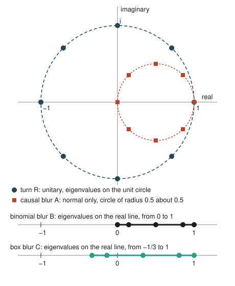

# Adjoints: the mirror operator, and the classes it singles out

[Syllabus](../../../SYLLABUS.md) → [Functional analysis](../README.md) → [Bounded Operators](../README.md#s03) → Adjoints

---

## General Overview

Eight speakers stand in a ring around a listener, 45° apart. This layout is common in studios and in virtual-reality sound. At one instant the sound field is eight numbers, one amplitude per speaker. Take f = (4, 2, 0, 0, 0, 0, 0, 1): a source in front, at speaker 0, spilling onto its two neighbors (illustrative numbers).

A spatial-audio engine does two things to this field all the time:

- **It turns the field.** The listener turns their head, so every amplitude moves one speaker round the ring.
- **It blurs the field.** Each speaker passes part of its signal to its neighbors, to make a source sound wider.

Each operation has a **mirror partner**, its **adjoint**. To measure a field against a probe pattern g, multiply matching amplitudes and add; the result is written $`\langle f, g\rangle`$. Measure the output against g, and you get the same number as measuring the input against a changed probe. The operation that changes the probe is the adjoint. For the turn, the mirror is the turn back. For a symmetric blur, the mirror is the blur itself.

Comparing an operation with its mirror sorts it into classes. Each class has a practical meaning:

- **Self-adjoint** (equal to its mirror): its readings are real numbers.
- **Unitary** (its mirror undoes it): it keeps the field's energy.
- **Normal** (it commutes with its mirror): on the ring, it has perpendicular directions that it only scales.
- **Positive** (self-adjoint, and it never turns a pattern against itself): a gentle blur is positive, a box blur is not.

**The adjoint $`T^*`$ is the one operator with $`\langle Tf, g\rangle = \langle f, T^*g\rangle`$ for every f and g; comparing $`T`$ with $`T^*`$ singles out the self-adjoint, unitary, normal and positive operators.**

**What kind of fact this is:** definitions, plus theorems. Every bounded operator on a Hilbert space has exactly one adjoint; the adjoint rules for kernels and shifts, and the meaning of each class, are proved on this card in Why it works. The uniqueness of the positive square root is stated, with Conway as the source. The code checks the 8-speaker ring and truncations of an endless signal only.

### The picture: where each operator's eigenvalues sit

<p align="center"></p>

To scale, 150 px per unit, in the complex plane. Each class leaves a mark on its eigenvalues (the numbers λ with $`Tv = \lambda v`$ for some non-zero v). The turn R is unitary: its eight eigenvalues sit on the unit circle. The two symmetric blurs are self-adjoint: theirs sit on the real line. The binomial blur B is positive: its eigenvalues stay in [0, 1]. The box blur C dips to −1/3. The causal blur A is only normal: six of its eight eigenvalues sit off the real line, on a circle of radius 0.5 about 0.5.

---

## The formula

Notation first. $`H`$ is a Hilbert space: a space of signals with an inner product $`\langle f, g\rangle`$, complete under its length $`\lVert f\rVert = \sqrt{\langle f, f\rangle}`$ ([Inner products](../02-Hilbert%20Spaces/01-inner-products-and-hilbert-spaces.md)). The inner product conjugates its first slot, as wing 07's $`v^* w`$ does; texts differ on this. $`T`$ is a bounded operator on $`H`$ ([Bounded operators](01-bounded-operators-and-the-operator-norm.md)).

```math
\langle Tf,\, g\rangle = \langle f,\, T^*g\rangle \quad \text{for every } f, g \text{ in } H
```

**Read it aloud:** apply T and then measure against g, or measure against T-star of g: the two readings always agree.

The classes compare $`T`$ with $`T^*`$. Here $`T \ge 0`$ is a new notation, read "T is positive":

```math
\text{self-adjoint: } T^* = T, \qquad \text{unitary: } T^*T = TT^* = I, \qquad \text{normal: } T^*T = TT^*, \qquad T \ge 0: \ \langle f, Tf\rangle \ge 0 \text{ for every } f
```

For an integral operator, the adjoint swaps the kernel's two variables and conjugates:

```math
(Kf)(x) = \int k(x, y)\, f(y)\, dy \quad\Longrightarrow\quad (K^*g)(x) = \int \overline{k(y, x)}\, g(y)\, dy
```

| Symbol | Plain meaning | In our example | Push it up and the answer… |
| --- | --- | --- | --- |
| $`H`$, $`\langle f, g\rangle`$ | the space of fields; the inner product, which multiplies matching amplitudes and adds | 8 numbers; $`\langle Rf, g\rangle = 10`$ | more speakers, longer sums |
| $`f`$, $`g`$, $`h`$ | a field, a probe, and the alternating pattern | (4, 2, 0, 0, 0, 0, 0, 1), (0, 1, 3, 0, 0, 0, 0, 0), (1, −1, 1, …) | readings scale with them |
| $`T`$, $`T^*`$, $`M_u`$ | any bounded operator; its adjoint, the mirror partner; multiplication by a fixed function u | R and R* | — |
| $`I`$ | the identity: changes nothing | the field unchanged | — |
| $`K`$, $`k(x, y)`$, $`w`$ | an integral operator; its kernel, how much of point y lands at point x; on the ring, the weight $`w(j - l)`$ that speaker l sends to speaker j | the blurs, with a sum for the integral | wider kernel, more spread |
| $`R`$, $`\alpha`$, $`\theta`$, $`\varphi`$ | the turn: every amplitude moves one speaker on; on the full circle of directions θ, a turn by the angle α; φ = θ − α, the direction before the turn | Rf = (1, 4, 2, 0, 0, 0, 0, 0); α = 45° | more turns: still unitary |
| $`A`$ | the causal blur: half of each speaker plus half of the one behind | Af = (2.5, 3, 1, 0, 0, 0, 0, 0.5) | — |
| $`B`$, $`C`$ | the binomial blur (1/4, 1/2, 1/4) and the box blur (1/3, 1/3, 1/3) | lowest eigenvalues 0 and −1/3 | larger center weight, more positive |
| $`S`$ | the delay on an endless signal: every sample moves one step later | (1, 1/2, 1/4, …) becomes (0, 1, 1/2, …) | — |
| $`P`$ | the positive square root of B: $`P \ge 0`$ and $`P^2 = B`$ | center weight 0.628417 | — |
| $`D`$, $`q`$, $`c`$ | in the proofs only: an operator being tested for zero; its reading $`q(f) = \langle f, Df\rangle`$; a scalar | $`D = T - T^*`$ | — |
| $`N`$, $`m`$, $`v_m`$, $`\lambda_m`$ | number of speakers; which Fourier mode; the mode, a wave m times round the ring; its eigenvalue | N = 8, m = 0 to 7 | more modes, closer together |

### When it holds

- **T is bounded and H is complete.** The proof that $`T^*`$ exists uses both. An unbounded operator, such as d/dx on $`L^2`$, has an adjoint only on a stated domain; that story is on shelf 05.
- **The scalars are complex for the positive class.** Over complex scalars, $`\langle f, Tf\rangle \ge 0`$ for every f forces $`T^* = T`$. Over real scalars it does not: a quarter turn of a real plane gives $`\langle f, Tf\rangle = 0`$ for every real f, yet it is not self-adjoint.
- **Unitary needs both products to be I in infinite dimensions.** For a matrix, $`T^*T = I`$ already forces $`TT^* = I`$. The delay S has $`S^*S = I`$ but $`SS^* \ne I`$: it keeps energy, yet nothing lands in the first slot.
- **Normal means a perpendicular eigenbasis only for matrices and compact operators.** A general normal operator, such as multiplication by x on $`L^2[0, 1]`$, has no eigenvectors at all. Its spectral theorem uses projections instead ([Bounded and symmetric](10-spectral-theorem-for-bounded-self-adjoint-operators.md)).

---

## Why it works

### Step 0: a fixed probe turns T into a measurement, and a measurement is a vector

Fix a probe g. The rule $`f \mapsto \langle g, Tf\rangle`$ is a linear measurement of f. It is bounded: by Cauchy–Schwarz, its size is at most $`\lVert g\rVert\,\lVert T\rVert\,\lVert f\rVert`$.

[Riesz representation](../02-Hilbert%20Spaces/06-riesz-representation-theorem.md) says that every bounded linear measurement on H is the inner product with exactly one vector. Call that vector $`T^*g`$. Then $`\langle T^*g, f\rangle = \langle g, Tf\rangle`$; conjugate both sides and the defining formula appears.

So the adjoint is not a guess. It is forced, one probe at a time.

<details>
<summary>Detailed proof: T* is linear, unique and the same size as T</summary>

**Unique.** If two operators both satisfy the formula, their difference D has $`\langle f, Dg\rangle = 0`$ for every f. Take f = Dg: then $`\lVert Dg\rVert^2 = 0`$, so D is zero.

**Linear.** For probes $`g_1`$, $`g_2`$ and a scalar c, the vector $`T^*g_1 + cT^*g_2`$ also passes the test for $`g_1 + cg_2`$. By uniqueness of the Riesz vector, it is $`T^*(g_1 + cg_2)`$.

**Same size.** Put $`f = T^*g`$ in the formula:

$`\displaystyle \lVert T^*g\rVert^2 = \langle T(T^*g), g\rangle \le \lVert T\rVert\,\lVert T^*g\rVert\,\lVert g\rVert,`$

so $`\lVert T^*g\rVert \le \lVert T\rVert\,\lVert g\rVert`$ and $`\lVert T^*\rVert \le \lVert T\rVert`$. The same argument run from $`T^*`$, whose adjoint is $`T`$, gives the reverse inequality. So $`\lVert T^*\rVert = \lVert T\rVert`$.

</details>

### Step 1: for a matrix, the adjoint is the conjugate transpose

On the ring, H is just eight complex numbers, and T is an 8 by 8 matrix. Then $`T^*`$ is the conjugate transpose: swap rows and columns, and conjugate every entry. [Complex vectors and matrices](../../07-Complex%20analysis/01-Complex%20Numbers%20and%20the%20Plane/07-complex-vectors-and-matrices.md) proves this and names the matrix cases: Hermitian ($`T^* = T`$) and unitary ($`T^*T = I`$). This card spends its effort on what is new: kernels, shifts, and the normal and positive classes.

### Step 2: for a kernel, swap the two variables

An integral operator K sends f to $`(Kf)(x) = \int k(x, y) f(y)\,dy`$ ([Three model operators](02-integral-operators-and-the-shift.md)). Write out $`\langle Kf, g\rangle`$ as a double integral, and swap the order of integration (Fubini's theorem allows it when the kernel is square-integrable):

```math
\langle Kf, g\rangle = \int\!\!\int \overline{k(x, y)}\,\overline{f(y)}\,g(x)\,dy\,dx = \int \overline{f(y)} \left( \int \overline{k(x, y)}\,g(x)\,dx \right) dy
```

The bracket is $`(K^*g)(y)`$. So $`K^*`$ is the integral operator with the swapped, conjugated kernel $`\overline{k(y, x)}`$.

On the ring, the integral is a sum over the eight speakers. A ring blur has the kernel $`k(j, l) = w(j - l)`$, counted round the ring: speaker l sends the weight $`w(j - l)`$ to speaker j. The adjoint kernel is $`w(l - j)`$: the blur pattern flipped left to right.

- **The binomial blur B** has weights 1/4, 1/2, 1/4, the same on both sides. Flipping changes nothing, so $`B^* = B`$. The box blur C is self-adjoint for the same reason.
- **The causal blur A** sends half of each speaker to itself and half to the next speaker on. Its adjoint sends half to the speaker behind instead. So $`A^* \ne A`$. In time rather than space, this is a filter that looks back, whose adjoint looks ahead.

### Step 3: for a shift, the mirror runs backwards

The turn R moves the amplitude at speaker j − 1 to speaker j. Its kernel is 1 where $`j - l = 1`$. Swap the variables and the 1 sits where $`l - j = 1`$: $`R^*`$ turns the field back one speaker. Turning forward and then back changes nothing, so $`R^*R = RR^* = I`$. The turn is unitary.

On the whole circle of directions the same holds for a turn by any angle α: substitute $`\varphi = \theta - \alpha`$ in the integral, and the adjoint of "turn by α" is "turn by −α".

Two more model operators, in one line each. A multiplication operator $`M_u`$ (multiply by a fixed function u; [Three model operators](02-integral-operators-and-the-shift.md) writes it $`M_g`$, but here g is the probe) has the adjoint $`M_{\bar u}`$, multiplication by the conjugate. The delay S on an endless signal, $`(x_0, x_1, \dots) \mapsto (0, x_0, x_1, \dots)`$, has the adjoint $`S^*: (x_0, x_1, \dots) \mapsto (x_1, x_2, \dots)`$, which drops the first sample: the advance $`S_{\leftarrow}`$ of [Three model operators](02-integral-operators-and-the-shift.md).

### Step 4: what each class buys

Each class is a statement about T and its mirror. Each one has a consequence that a reader can measure.

- **Self-adjoint means real readings.** $`\langle f, Tf\rangle = \langle Tf, f\rangle = \overline{\langle f, Tf\rangle}`$, so the reading is real. If $`Tv = \lambda v`$ with $`\lVert v\rVert = 1`$, then $`\lambda = \langle v, Tv\rangle`$ is real.
- **Unitary means energy is kept and nothing is lost.** $`\lVert Tf\rVert^2 = \langle f, T^*Tf\rangle = \lVert f\rVert^2`$. The condition $`TT^* = I`$ adds that every field is reached. Eigenvalues have $`\lvert\lambda\rvert = 1`$.
- **Normal means T and its mirror are the same size on every field.** $`\lVert Tf\rVert^2 - \lVert T^*f\rVert^2 = \langle f, (T^*T - TT^*)f\rangle`$. This is zero for every f exactly when $`T^*T = TT^*`$ (the fold proves it). For a matrix, normal is the same as having a perpendicular basis of eigenvectors.
- **Positive means no pattern is turned against itself.** $`\langle f, Tf\rangle \ge 0`$: the output never points away from the input. Over complex scalars this forces self-adjoint (fold), and then every eigenvalue is at least 0.

The fastest way to build a positive operator is $`A^*A`$ for any A, because

```math
\langle f, A^*Af\rangle = \langle Af, Af\rangle = \lVert Af\rVert^2 \ge 0
```

The binomial blur is one of these: $`B = A^*A`$, the causal blur followed by its mirror. A quarter from each side and a half from the center is exactly "half forward" composed with "half back". So B is positive without computing a single eigenvalue.

<details>
<summary>Detailed proof: a quadratic form that vanishes kills a complex operator, and positive implies self-adjoint</summary>

**The polarization step.** Over complex scalars, the quadratic form $`q(f) = \langle f, Df\rangle`$ determines D. Expand q at $`f + g`$ and at $`f + ig`$:

$`\displaystyle q(f + g) - q(f) - q(g) = \langle f, Dg\rangle + \langle g, Df\rangle,`$

$`\displaystyle q(f + ig) - q(f) - q(g) = i\langle f, Dg\rangle - i\langle g, Df\rangle.`$

Multiply the second line by −i and add it to the first: $`2\langle f, Dg\rangle`$ is a combination of values of q. So if q is zero everywhere, $`\langle f, Dg\rangle = 0`$ for all f and g, and D = 0.

**Normal.** Take $`D = T^*T - TT^*`$. Its form is $`\lVert Tf\rVert^2 - \lVert T^*f\rVert^2`$. That form is zero for every f exactly when D = 0, which is $`T^*T = TT^*`$.

**Positive implies self-adjoint.** Take $`D = T - T^*`$. Its form is $`\langle f, Tf\rangle - \overline{\langle f, Tf\rangle}`$, which is zero when every reading is real. So D = 0.

**Why the real case fails.** The step "multiply by i" has no real counterpart. A real quarter turn has a zero quadratic form and is not zero.

</details>

### Step 5: on the ring, every operator that commutes with the turn is normal

All four ring operators commute with the turn R: blurring and then turning is the same as turning and then blurring. Such an operator acts on each **Fourier mode** (the pattern $`v_m(j) = e^{2\pi i m j/N}`$, a wave that goes m times round the ring) by one number:

```math
\lambda_m(R) = e^{-2\pi i m/N}, \quad \lambda_m(A) = \tfrac12\bigl(1 + e^{-2\pi i m/N}\bigr), \quad \lambda_m(B) = \cos^2\!\frac{\pi m}{N}, \quad \lambda_m(C) = \frac{1 + 2\cos(2\pi m/N)}{3}
```

The eight modes are perpendicular, so all four operators share one perpendicular eigenbasis. That makes all four normal. The picture shows the consequence: the classes are read off where the eigenvalues sit.

- Unitary R: every $`\lvert\lambda_m\rvert = 1`$.
- Self-adjoint B and C: every $`\lambda_m`$ is real.
- Positive B: every $`\lambda_m \ge 0`$. The lowest, 0, sits on the alternating pattern m = 4, which B wipes out.
- Not positive C: $`\lambda_4 = -1/3`$, so C flips the alternating pattern and shrinks it to a third.

### Step 6: square roots of positive operators

A positive operator has exactly one positive square root: one P with $`P \ge 0`$ and $`P^2 = B`$ (Conway proves this for every bounded positive operator; [Bounded and symmetric](10-spectral-theorem-for-bounded-self-adjoint-operators.md) builds it from the spectral theorem). On the ring it is easy to build: keep B's Fourier modes and take the square root of each eigenvalue, $`\lvert\cos(\pi m/N)\rvert`$.

The result is a ring blur with center weight 0.628417, neighbor weight 0.220671, and small weights of alternating sign further out. The causal blur A also gives B, as $`A^*A`$, but A is not self-adjoint, so it is not the positive square root.

### Step 7: what changes in infinite dimensions

The delay S on an endless signal keeps energy: $`\lVert Sx\rVert = \lVert x\rVert`$, so $`S^*S = I`$. An operator with this property is an **isometry**. But $`SS^*`$ drops the first sample and puts a 0 in its place, so $`SS^* \ne I`$. S is an isometry that is not unitary, and it is not normal.

No matrix can do this. Cut S to its first N samples, and the truncation loses the last sample instead: $`S^*S`$ misses I in the last slot. For the signal (1, 1/2, 1/4, …), that miss is $`2^{-(N-1)}`$, which shrinks to zero as N grows. The miss of $`SS^*`$ stays exactly 1 at every N. The first trend closes; the second never does, and it is the real infinite-dimensional fact.

A size test shows the same thing. For a normal matrix, the eigenvalues' squared sizes add up to the entries' squared sizes: a perpendicular eigenbasis turns the matrix diagonal without changing the sum of squared entries. The code runs this test on all four ring operators. The truncated delay has every eigenvalue 0 but N − 1 entries equal to 1. It is far from normal at every N.

---

## Worked numbers, by hand

The field is f = (4, 2, 0, 0, 0, 0, 0, 1), the probe g = (0, 1, 3, 0, 0, 0, 0, 0), and N = 8.

| Step | Arithmetic | Value |
| --- | --- | --- |
| turn the field | Rf = (1, 4, 2, 0, 0, 0, 0, 0) | — |
| measure it against g | $`\langle Rf, g\rangle = 4 \times 1 + 2 \times 3`$ | 10 |
| turn the probe back | $`R^*g`$ = (1, 3, 0, 0, 0, 0, 0, 0) | — |
| measure f against it | $`\langle f, R^*g\rangle = 4 \times 1 + 2 \times 3`$ | 10 |
| energy before and after | $`16 + 4 + 1`$ for both f and Rf | 21 |
| causal blur | Af = (2.5, 3, 1, 0, 0, 0, 0, 0.5) | — |
| its mirror test | $`\langle Af, g\rangle = 3 \times 1 + 1 \times 3`$; $`A^*g`$ = (0.5, 2, 1.5, 0, …) gives $`4 \times 0.5 + 2 \times 2`$ | 6 and 6 |
| binomial blur | Bf = (2.75, 2, 0.5, 0, 0, 0, 0.25, 1.5) | — |
| B's reading of f | $`\langle f, Bf\rangle = 4 \times 2.75 + 2 \times 2 + 1 \times 1.5`$ | 16.5 |
| the same, as $`\lVert Af\rVert^2`$ | $`6.25 + 9 + 1 + 0.25`$ | 16.5 |
| box blur on h = (1, −1, 1, …) | entry 0 is $`(-1 + 1 - 1)/3 = -1/3`$, and every entry flips the same way, so Ch = −h/3 | — |
| C's reading of h | $`8 \times (-1/3)`$ | **−2.666667** |

So the turn passes the mirror test with its reverse and keeps the energy at 21: unitary. The binomial blur's reading 16.5 is a squared length, so it can never be negative. The box blur gives the alternating pattern a negative reading: it is symmetric but not positive.

### What breaks if you drop a piece

| Mistake | Comes out at | What went wrong |
| --- | --- | --- |
| Take $`R^* = R`$ | $`\langle f, Rg\rangle = 0`$, not 10 | The mirror of a turn is the turn back, not a second turn forward |
| Forget to swap the kernel: $`A^* = A`$ | $`\langle f, Ag\rangle = 1`$, not 6 | The causal blur looks back; its mirror looks ahead |
| Call a symmetric blur with positive weights positive | $`\langle h, Ch\rangle = -2.666667`$ | Positive weights do not give positive eigenvalues; C has −1/3 |
| Take $`S^*S = I`$ to mean unitary | $`\lVert SS^*x - x\rVert = 1`$ at every N | The delay keeps energy but never reaches the first slot |

The hypothesis that fails in the last row is "finite dimensions". Every matrix with $`T^*T = I`$ is unitary; the endless delay is not.

---

## Code, from first principles, and it actually runs

The code builds the four ring operators from their weights, and builds each adjoint from the swapped-kernel rule, never by transposing a matrix. It takes three roads to each adjoint and its class. Road 1 tests $`\langle Tf, g\rangle = \langle f, T^*g\rangle`$ on every pair of basis fields, which pins $`T^*`$ down. Road 2 compares the result with the transposed matrix. Road 3 computes the eigenvalues from the closed form and checks each against the residual $`\lVert Tv - \lambda v\rVert`$, the trace and the size sum. It then checks $`B = A^*A`$ and $`P^2 = B`$, and runs the delay at N = 4 to 64. Every number on the card is printed.

### Python

```python
# Adjoints -- the check behind the card.  Standard library only.
# An 8-speaker ring: turn R, causal blur A, binomial blur B, box blur C.
# Each adjoint is built from the swapped-kernel formula, never by transposing,
# then tested against <Tf, g> = <f, T*g>.  Eigenvalues come from a closed form
# and are checked by residuals and by the trace and size sums.
from math import cos, sin, pi, sqrt

def clean(x): return 0.0 if abs(x) < 5e-13 else x
def ring(n, taps):          # kernel k(j, l) = taps[(j - l) mod n]
    return [[taps.get((j - l) % n, 0.0) for l in range(n)] for j in range(n)]
def adj_taps(n, taps):      # swapped kernel: k*(j, l) = k(l, j), real entries
    return {(-d) % n: v for d, v in taps.items()}
def apply(T, f): return [sum(T[j][l] * f[l] for l in range(len(f))) for j in range(len(T))]
def ip(f, g): return sum(a.conjugate() * b for a, b in zip(f, g))   # conjugates the first slot
def mul(S, T): return [[sum(S[j][k] * T[k][l] for k in range(len(T))) for l in range(len(T))] for j in range(len(S))]
def tr(T): return [[T[l][j] for l in range(len(T))] for j in range(len(T))]
def same(S, T): return max(abs(S[j][l] - T[j][l]) for j in range(len(S)) for l in range(len(S))) < 1e-12
def eig(n, taps, m):        # closed form: the Fourier mode m is an eigenvector of every ring operator
    return sum(v * complex(cos(2 * pi * m * d / n), -sin(2 * pi * m * d / n)) for d, v in taps.items())

N = 8
I = ring(N, {0: 1.0})
ops = {"turn R": {1: 1.0}, "causal blur A": {0: 0.5, 1: 0.5},
       "binomial blur B": {0: 0.5, 1: 0.25, N - 1: 0.25}, "box blur C": {0: 1 / 3, 1: 1 / 3, N - 1: 1 / 3}}
f = [4.0, 2.0, 0.0, 0.0, 0.0, 0.0, 0.0, 1.0]
g = [0.0, 1.0, 3.0, 0.0, 0.0, 0.0, 0.0, 0.0]
print(f"ring N = {N}; f = 4 2 0 0 0 0 0 1; g = 0 1 3 0 0 0 0 0")
print("operator            <Tf,g>   <f,T*g>    <f,Tg>  T*=T  unitary  normal    min eig  max |eig|")
for name, t in ops.items():
    T, Ts = ring(N, t), ring(N, adj_taps(N, t))
    for j in range(N):      # the defining identity on every pair of basis vectors pins T* down
        for l in range(N):
            e, h = [float(k == j) for k in range(N)], [float(k == l) for k in range(N)]
            assert abs(ip(apply(T, e), h) - ip(e, apply(Ts, h))) < 1e-15
    assert same(Ts, tr(T))  # road 2: the swapped kernel is the transpose
    lam = [eig(N, t, m) for m in range(N)]
    for m in range(N):      # road 3: residual |T v - lam v| for each Fourier mode
        v = [complex(cos(2 * pi * m * k / N), sin(2 * pi * m * k / N)) for k in range(N)]
        assert max(abs(a - lam[m] * b) for a, b in zip(apply(T, v), v)) < 1e-12
    assert abs(sum(lam) - sum(T[k][k] for k in range(N))) < 1e-12          # trace
    assert abs(sum(abs(z) ** 2 for z in lam) - sum(x * x for r in T for x in r)) < 1e-12  # normal: sizes match
    sa, un = same(Ts, T), same(mul(Ts, T), I) and same(mul(T, Ts), I)
    nm = same(mul(Ts, T), mul(T, Ts))
    mn = f"{clean(min(z.real for z in lam)):9.6f}" if sa else "    -    "
    print(f"{name:<16}{ip(apply(T, f), g):10.6f}{ip(f, apply(Ts, g)):10.6f}{ip(f, apply(T, g)):10.6f}"
          f"  {'yes' if sa else 'no '}   {'yes' if un else 'no '}      {'yes' if nm else 'no '} {mn}  {max(abs(z) for z in lam):8.6f}")
    assert nm and sa == (name[-1] in "BC") and un == (name[-1] == "R")

R, A, B, C = (ring(N, t) for t in ops.values())
As = ring(N, adj_taps(N, ops["causal blur A"]))
assert same(mul(As, A), B)                       # B = A*A, so <f, Bf> = |Af|^2 >= 0
Bf, Af, Rf = apply(B, f), apply(A, f), apply(R, f)
print("Bf =", " ".join(f"{x:g}" for x in Bf), "; Af =", " ".join(f"{x:g}" for x in Af))
print("Rf =", " ".join(f"{x:g}" for x in Rf), "; R*g =", " ".join(f"{x:g}" for x in apply(tr(R), g)),
      "; A*g =", " ".join(f"{x:g}" for x in apply(As, g)))
print(f"<f,Bf> = {ip(f, Bf):.6f}; |Af|^2 = {ip(Af, Af):.6f}; |f|^2 = {ip(f, f):.6f}; |Rf|^2 = {ip(Rf, Rf):.6f}")
assert abs(ip(f, Bf) - ip(Af, Af)) < 1e-12 and abs(ip(Rf, Rf) - ip(f, f)) < 1e-12
alt = [(-1.0) ** k for k in range(N)]          # neighboring speakers in opposite phase
print(f"alternating h: <h,Ch> = {ip(alt, apply(C, alt)):.6f}; <h,Bh> = {clean(ip(alt, apply(B, alt))):.6f}; |h|^2 = {ip(alt, alt):.6f}")
assert abs(ip(alt, apply(C, alt)) + 8 / 3) < 1e-12

# the positive square root of B: keep B's Fourier modes, take square roots of its eigenvalues
p = {k: sum(abs(cos(pi * m / N)) * cos(2 * pi * m * k / N) for m in range(N)) / N for k in range(N)}
P = ring(N, p)
assert same(mul(P, P), B) and same(P, tr(P)) and min(eig(N, p, m).real for m in range(N)) > -1e-12
assert not same(P, A)                          # A*A = B too, but A is not self-adjoint
print("square root P of B, taps k = 0..4:", " ".join(f"{clean(p[k]):.6f}" for k in range(5)))

# infinite dimensions: the delay S on an endless signal, cut to its first N samples
print("N    |S*Sf - f|   |SS*f - f|   sum|eig|^2   sum|entry|^2   (f = 1, 1/2, 1/4, ...)")
for n in (4, 8, 16, 32, 64):
    S = [[float(j == l + 1) for l in range(n)] for j in range(n)]
    fn = [0.5 ** k for k in range(n)]
    d1 = sqrt(sum(x * x for x in (a - b for a, b in zip(apply(tr(S), apply(S, fn)), fn))))
    d2 = sqrt(sum(x * x for x in (a - b for a, b in zip(apply(S, apply(tr(S), fn)), fn))))
    fro, eigs = sum(x * x for r in S for x in r), sum(S[k][k] ** 2 for k in range(n))  # triangular: eigs on diagonal
    print(f"{n:<4} 2^-{n - 1:<9} {d2:10.6f}   {eigs:10.6f}   {fro:12.6f}")
    assert d1 == 0.5 ** (n - 1) and abs(d2 - 1.0) < 1e-15 and fro == n - 1

# what breaks, and the try-changing box
print(f"wrong: R* = R gives <f,Rg> = {ip(f, apply(R, g)):.6f}; wrong: A* = A gives <f,Ag> = {ip(f, apply(A, g)):.6f}")
for n in (8, 9):
    print(f"N = {n}: min eig box C = {min((1 + 2 * cos(2 * pi * m / n)) / 3 for m in range(n)):.6f}; "
          f"binomial B = {clean(min(cos(pi * m / n) ** 2 for m in range(n))):.6f}")
print(f"weights 0.3 0.4 0.3: min eig = {min(eig(N, {0: 0.4, 1: 0.3, N - 1: 0.3}, m).real for m in range(N)):.6f}")
print(f"turn by 2 speakers: eigenvalues of R^2 have |eig| = {max(abs(eig(N, {2: 1.0}, m)) for m in range(N)):.6f}")
lamA = [eig(N, ops["causal blur A"], m) for m in range(N)]
assert max(abs(abs(z - 0.5) - 0.5) for z in lamA) < 1e-12   # A's eigenvalues sit on a circle
print("figure, R on |z| = 1; A on |z - 0.5| = 0.5; B in [0, 1]; C in [-0.333333, 1]; A at m = 2:",
      f"{lamA[2].real:.6f} {lamA[2].imag:.6f}")
print("ALL CHECKS PASS")
```

**Ran 2026-11-15 on macOS, Python 3.14.10, standard library only. All checks passed. Output, pasted from the run:**

```
ring N = 8; f = 4 2 0 0 0 0 0 1; g = 0 1 3 0 0 0 0 0
operator            <Tf,g>   <f,T*g>    <f,Tg>  T*=T  unitary  normal    min eig  max |eig|
turn R           10.000000 10.000000  0.000000  no    yes      yes     -      1.000000
causal blur A     6.000000  6.000000  1.000000  no    no       yes     -      1.000000
binomial blur B   3.500000  3.500000  3.500000  yes   no       yes  0.000000  1.000000
box blur C        4.000000  4.000000  4.000000  yes   no       yes -0.333333  1.000000
Bf = 2.75 2 0.5 0 0 0 0.25 1.5 ; Af = 2.5 3 1 0 0 0 0 0.5
Rf = 1 4 2 0 0 0 0 0 ; R*g = 1 3 0 0 0 0 0 0 ; A*g = 0.5 2 1.5 0 0 0 0 0
<f,Bf> = 16.500000; |Af|^2 = 16.500000; |f|^2 = 21.000000; |Rf|^2 = 21.000000
alternating h: <h,Ch> = -2.666667; <h,Bh> = 0.000000; |h|^2 = 8.000000
square root P of B, taps k = 0..4: 0.628417 0.220671 -0.051777 0.029329 -0.024864
N    |S*Sf - f|   |SS*f - f|   sum|eig|^2   sum|entry|^2   (f = 1, 1/2, 1/4, ...)
4    2^-3           1.000000     0.000000       3.000000
8    2^-7           1.000000     0.000000       7.000000
16   2^-15          1.000000     0.000000      15.000000
32   2^-31          1.000000     0.000000      31.000000
64   2^-63          1.000000     0.000000      63.000000
wrong: R* = R gives <f,Rg> = 0.000000; wrong: A* = A gives <f,Ag> = 1.000000
N = 8: min eig box C = -0.333333; binomial B = 0.000000
N = 9: min eig box C = -0.293128; binomial B = 0.030154
weights 0.3 0.4 0.3: min eig = -0.200000
turn by 2 speakers: eigenvalues of R^2 have |eig| = 1.000000
figure, R on |z| = 1; A on |z - 0.5| = 0.5; B in [0, 1]; C in [-0.333333, 1]; A at m = 2: 0.500000 -0.500000
ALL CHECKS PASS
```

### Rust

```rust
// Adjoints -- the check behind the card.  Rust std only, no crates.
// An 8-speaker ring: turn R, causal blur A, binomial blur B, box blur C.
// Each adjoint is built from the swapped-kernel formula, never by transposing,
// then tested against <Tf, g> = <f, T*g>.  Eigenvalues come from a closed form
// and are checked by residuals and by the trace and size sums.
use std::f64::consts::PI;
type M = Vec<Vec<f64>>;
#[derive(Clone, Copy)]
struct Cx { re: f64, im: f64 }
impl Cx {
    fn abs(self) -> f64 { (self.re * self.re + self.im * self.im).sqrt() }
}

fn clean(x: f64) -> f64 { if x.abs() < 5e-13 { 0.0 } else { x } }
fn ring(n: usize, taps: &[(usize, f64)]) -> M {      // kernel k(j, l) = taps[(j - l) mod n]
    let mut t = vec![vec![0.0; n]; n];
    for j in 0..n { for &(d, v) in taps { t[j][(j + n - d) % n] += v; } }
    t
}
fn adj_taps(n: usize, taps: &[(usize, f64)]) -> Vec<(usize, f64)> {   // swapped kernel
    taps.iter().map(|&(d, v)| ((n - d) % n, v)).collect()
}
fn apply(t: &M, f: &[f64]) -> Vec<f64> { t.iter().map(|r| r.iter().zip(f).map(|(a, b)| a * b).sum()).collect() }
fn ip(f: &[f64], g: &[f64]) -> f64 { f.iter().zip(g).map(|(a, b)| a * b).sum() }
fn mul(s: &M, t: &M) -> M {
    let n = t.len();
    (0..n).map(|j| (0..n).map(|l| (0..n).map(|k| s[j][k] * t[k][l]).sum()).collect()).collect()
}
fn tr(t: &M) -> M { let n = t.len(); (0..n).map(|j| (0..n).map(|l| t[l][j]).collect()).collect() }
fn same(s: &M, t: &M) -> bool {
    let n = s.len();
    (0..n).all(|j| (0..n).all(|l| (s[j][l] - t[j][l]).abs() < 1e-12))
}
fn eig(n: usize, taps: &[(usize, f64)], m: usize) -> Cx {   // closed form on Fourier mode m
    let (mut re, mut im) = (0.0, 0.0);
    for &(d, v) in taps {
        let a = 2.0 * PI * (m * d) as f64 / n as f64;
        re += v * a.cos(); im -= v * a.sin();
    }
    Cx { re, im }
}
fn g6(x: f64) -> String {   // like Python's :g for these short numbers
    let s = format!("{:.6}", x);
    s.trim_end_matches('0').trim_end_matches('.').to_string()
}
fn yn(b: bool) -> &'static str { if b { "yes" } else { "no " } }

fn main() {
    let n = 8usize;
    let id = ring(n, &[(0, 1.0)]);
    let ops: Vec<(&str, Vec<(usize, f64)>)> = vec![
        ("turn R", vec![(1, 1.0)]), ("causal blur A", vec![(0, 0.5), (1, 0.5)]),
        ("binomial blur B", vec![(0, 0.5), (1, 0.25), (n - 1, 0.25)]),
        ("box blur C", vec![(0, 1.0 / 3.0), (1, 1.0 / 3.0), (n - 1, 1.0 / 3.0)])];
    let f = vec![4.0, 2.0, 0.0, 0.0, 0.0, 0.0, 0.0, 1.0];
    let g = vec![0.0, 1.0, 3.0, 0.0, 0.0, 0.0, 0.0, 0.0];
    println!("ring N = {}; f = 4 2 0 0 0 0 0 1; g = 0 1 3 0 0 0 0 0", n);
    println!("operator            <Tf,g>   <f,T*g>    <f,Tg>  T*=T  unitary  normal    min eig  max |eig|");
    for (name, t) in &ops {
        let (tm, ts) = (ring(n, t), ring(n, &adj_taps(n, t)));
        for j in 0..n { for l in 0..n {     // the defining identity on every pair of basis vectors
            let e: Vec<f64> = (0..n).map(|k| if k == j { 1.0 } else { 0.0 }).collect();
            let h: Vec<f64> = (0..n).map(|k| if k == l { 1.0 } else { 0.0 }).collect();
            assert!((ip(&apply(&tm, &e), &h) - ip(&e, &apply(&ts, &h))).abs() < 1e-15);
        } }
        assert!(same(&ts, &tr(&tm)));      // road 2: the swapped kernel is the transpose
        let lam: Vec<Cx> = (0..n).map(|m| eig(n, t, m)).collect();
        for m in 0..n {                     // road 3: residual |T v - lam v| for each Fourier mode
            let a: Vec<f64> = (0..n).map(|k| 2.0 * PI * (m * k) as f64 / n as f64).collect();
            let (vr, vi): (Vec<f64>, Vec<f64>) = (a.iter().map(|x| x.cos()).collect(), a.iter().map(|x| x.sin()).collect());
            let (tr_, ti_) = (apply(&tm, &vr), apply(&tm, &vi));
            for k in 0..n {
                let (er, ei) = (tr_[k] - (lam[m].re * vr[k] - lam[m].im * vi[k]), ti_[k] - (lam[m].re * vi[k] + lam[m].im * vr[k]));
                assert!((er * er + ei * ei).sqrt() < 1e-12);
            }
        }
        let trace: f64 = (0..n).map(|k| tm[k][k]).sum();
        assert!((lam.iter().map(|z| z.re).sum::<f64>() - trace).abs() < 1e-12);
        let fro: f64 = tm.iter().flatten().map(|x| x * x).sum();
        assert!((lam.iter().map(|z| z.abs().powi(2)).sum::<f64>() - fro).abs() < 1e-12);
        let sa = same(&ts, &tm);
        let un = same(&mul(&ts, &tm), &id) && same(&mul(&tm, &ts), &id);
        let nm = same(&mul(&ts, &tm), &mul(&tm, &ts));
        let mn = if sa { format!("{:9.6}", clean(lam.iter().map(|z| z.re).fold(f64::MAX, f64::min))) } else { "    -    ".to_string() };
        let mx = lam.iter().map(|z| z.abs()).fold(0.0, f64::max);
        println!("{:<16}{:10.6}{:10.6}{:10.6}  {}   {}      {} {}  {:8.6}", name, ip(&apply(&tm, &f), &g),
            ip(&f, &apply(&ts, &g)), ip(&f, &apply(&tm, &g)), yn(sa), yn(un), yn(nm), mn, mx);
        let last = name.chars().last().unwrap();
        assert!(nm && sa == (last == 'B' || last == 'C') && un == (last == 'R'));
    }
    let (r, a, b, c) = (ring(n, &ops[0].1), ring(n, &ops[1].1), ring(n, &ops[2].1), ring(n, &ops[3].1));
    let a_s = ring(n, &adj_taps(n, &ops[1].1));
    assert!(same(&mul(&a_s, &a), &b));     // B = A*A, so <f, Bf> = |Af|^2 >= 0
    let (bf, af, rf) = (apply(&b, &f), apply(&a, &f), apply(&r, &f));
    let js = |v: &[f64]| v.iter().map(|x| g6(*x)).collect::<Vec<_>>().join(" ");
    println!("Bf = {} ; Af = {}", js(&bf), js(&af));
    println!("Rf = {} ; R*g = {} ; A*g = {}", js(&rf), js(&apply(&tr(&r), &g)), js(&apply(&a_s, &g)));
    println!("<f,Bf> = {:.6}; |Af|^2 = {:.6}; |f|^2 = {:.6}; |Rf|^2 = {:.6}", ip(&f, &bf), ip(&af, &af), ip(&f, &f), ip(&rf, &rf));
    assert!((ip(&f, &bf) - ip(&af, &af)).abs() < 1e-12 && (ip(&rf, &rf) - ip(&f, &f)).abs() < 1e-12);
    let alt: Vec<f64> = (0..n).map(|k| if k % 2 == 0 { 1.0 } else { -1.0 }).collect();
    println!("alternating h: <h,Ch> = {:.6}; <h,Bh> = {:.6}; |h|^2 = {:.6}", ip(&alt, &apply(&c, &alt)), clean(ip(&alt, &apply(&b, &alt))), ip(&alt, &alt));
    assert!((ip(&alt, &apply(&c, &alt)) + 8.0 / 3.0).abs() < 1e-12);

    // the positive square root of B: keep B's Fourier modes, take square roots of its eigenvalues
    let p: Vec<(usize, f64)> = (0..n).map(|k| (k, (0..n).map(|m| (PI * m as f64 / n as f64).cos().abs()
        * (2.0 * PI * (m * k) as f64 / n as f64).cos()).sum::<f64>() / n as f64)).collect();
    let pm = ring(n, &p);
    assert!(same(&mul(&pm, &pm), &b) && same(&pm, &tr(&pm)) && (0..n).all(|m| eig(n, &p, m).re > -1e-12));
    assert!(!same(&pm, &a));               // A*A = B too, but A is not self-adjoint
    println!("square root P of B, taps k = 0..4: {}", (0..5).map(|k| format!("{:.6}", clean(p[k].1))).collect::<Vec<_>>().join(" "));

    // infinite dimensions: the delay S on an endless signal, cut to its first N samples
    println!("N    |S*Sf - f|   |SS*f - f|   sum|eig|^2   sum|entry|^2   (f = 1, 1/2, 1/4, ...)");
    for &nn in &[4usize, 8, 16, 32, 64] {
        let s: M = (0..nn).map(|j| (0..nn).map(|l| if j == l + 1 { 1.0 } else { 0.0 }).collect()).collect();
        let fv: Vec<f64> = (0..nn).map(|k| 0.5f64.powi(k as i32)).collect();
        let diff = |u: Vec<f64>| u.iter().zip(&fv).map(|(a, b)| (a - b) * (a - b)).sum::<f64>().sqrt();
        let d1 = diff(apply(&tr(&s), &apply(&s, &fv)));
        let d2 = diff(apply(&s, &apply(&tr(&s), &fv)));
        let fro: f64 = s.iter().flatten().map(|x| x * x).sum();
        let eigs: f64 = (0..nn).map(|k| s[k][k] * s[k][k]).sum();   // triangular: eigs on diagonal
        println!("{:<4} 2^-{:<9} {:10.6}   {:10.6}   {:12.6}", nn, nn - 1, d2, eigs, fro);
        assert!(d1 == 0.5f64.powi(nn as i32 - 1) && (d2 - 1.0).abs() < 1e-15 && fro == (nn - 1) as f64);
    }

    // what breaks, and the try-changing box
    println!("wrong: R* = R gives <f,Rg> = {:.6}; wrong: A* = A gives <f,Ag> = {:.6}", ip(&f, &apply(&r, &g)), ip(&f, &apply(&a, &g)));
    for &nn in &[8usize, 9] {
        let cmin = (0..nn).map(|m| (1.0 + 2.0 * (2.0 * PI * m as f64 / nn as f64).cos()) / 3.0).fold(f64::MAX, f64::min);
        let bmin = (0..nn).map(|m| (PI * m as f64 / nn as f64).cos().powi(2)).fold(f64::MAX, f64::min);
        println!("N = {}: min eig box C = {:.6}; binomial B = {:.6}", nn, cmin, clean(bmin));
    }
    let w = [(0usize, 0.4), (1, 0.3), (n - 1, 0.3)];
    println!("weights 0.3 0.4 0.3: min eig = {:.6}", (0..n).map(|m| eig(n, &w, m).re).fold(f64::MAX, f64::min));
    println!("turn by 2 speakers: eigenvalues of R^2 have |eig| = {:.6}", (0..n).map(|m| eig(n, &[(2, 1.0)], m).abs()).fold(0.0, f64::max));
    let lam_a: Vec<Cx> = (0..n).map(|m| eig(n, &ops[1].1, m)).collect();
    assert!(lam_a.iter().all(|z| ((Cx { re: z.re - 0.5, im: z.im }).abs() - 0.5).abs() < 1e-12));
    println!("figure, R on |z| = 1; A on |z - 0.5| = 0.5; B in [0, 1]; C in [-0.333333, 1]; A at m = 2: {:.6} {:.6}", lam_a[2].re, lam_a[2].im);
    println!("ALL CHECKS PASS");
}
```

**Ran 2026-11-15 on macOS, rustc 1.98.1, no crates. All checks passed. Output, pasted from the run:**

```
ring N = 8; f = 4 2 0 0 0 0 0 1; g = 0 1 3 0 0 0 0 0
operator            <Tf,g>   <f,T*g>    <f,Tg>  T*=T  unitary  normal    min eig  max |eig|
turn R           10.000000 10.000000  0.000000  no    yes      yes     -      1.000000
causal blur A     6.000000  6.000000  1.000000  no    no       yes     -      1.000000
binomial blur B   3.500000  3.500000  3.500000  yes   no       yes  0.000000  1.000000
box blur C        4.000000  4.000000  4.000000  yes   no       yes -0.333333  1.000000
Bf = 2.75 2 0.5 0 0 0 0.25 1.5 ; Af = 2.5 3 1 0 0 0 0 0.5
Rf = 1 4 2 0 0 0 0 0 ; R*g = 1 3 0 0 0 0 0 0 ; A*g = 0.5 2 1.5 0 0 0 0 0
<f,Bf> = 16.500000; |Af|^2 = 16.500000; |f|^2 = 21.000000; |Rf|^2 = 21.000000
alternating h: <h,Ch> = -2.666667; <h,Bh> = 0.000000; |h|^2 = 8.000000
square root P of B, taps k = 0..4: 0.628417 0.220671 -0.051777 0.029329 -0.024864
N    |S*Sf - f|   |SS*f - f|   sum|eig|^2   sum|entry|^2   (f = 1, 1/2, 1/4, ...)
4    2^-3           1.000000     0.000000       3.000000
8    2^-7           1.000000     0.000000       7.000000
16   2^-15          1.000000     0.000000      15.000000
32   2^-31          1.000000     0.000000      31.000000
64   2^-63          1.000000     0.000000      63.000000
wrong: R* = R gives <f,Rg> = 0.000000; wrong: A* = A gives <f,Ag> = 1.000000
N = 8: min eig box C = -0.333333; binomial B = 0.000000
N = 9: min eig box C = -0.293128; binomial B = 0.030154
weights 0.3 0.4 0.3: min eig = -0.200000
turn by 2 speakers: eigenvalues of R^2 have |eig| = 1.000000
figure, R on |z| = 1; A on |z - 0.5| = 0.5; B in [0, 1]; C in [-0.333333, 1]; A at m = 2: 0.500000 -0.500000
ALL CHECKS PASS
```

### Lean

Lean proves three facts for every Hilbert space, and checks the card's worked numbers on the 8-speaker ring.

- Take a bounded operator $`T`$ on a Hilbert space. Then exactly one bounded operator $`T^*`$ has $`\langle Tf, g\rangle = \langle f, T^*g\rangle`$ for every f and g.
- Take complex scalars and a bounded operator $`T`$ with $`\langle f, Tf\rangle \ge 0`$ for every f. Then $`T^* = T`$.
- Take a bounded operator $`T`$ on a Hilbert space. Then $`T^*T = TT^*`$ exactly when $`\lVert Tf\rVert = \lVert T^*f\rVert`$ for every f.
- Take the worked field f and probe g. Then $`\langle Rf, g\rangle = \langle f, R^*g\rangle = 10`$, while the wrong mirror gives $`\langle f, Rg\rangle = 0`$.
- Take the same f. Then $`\lVert f\rVert^2 = \lVert Rf\rVert^2 = 21`$, so the turn keeps the energy.
- Take the same f and g. Then $`\langle Af, g\rangle = \langle f, A^*g\rangle = 6`$, while the wrong mirror gives $`\langle f, Ag\rangle = 1`$.
- Take the same f. Then $`\langle f, Bf\rangle = \lVert Af\rVert^2 = 33/2`$, which is 16.5.
- Take the alternating pattern h. Then $`\langle h, Ch\rangle = -8/3`$, about −2.666667.

The eigenvalues, the square root P and the delay S are left to the Python and Rust checks.

```lean
-- Adjoints: every bounded operator on a Hilbert space has exactly one mirror partner T* with ⟨Tf, g⟩ = ⟨f, T*g⟩, a positive operator on a complex Hilbert space is self-adjoint, and T is normal exactly when T and T* give every field the same size.
import Mathlib.Analysis.InnerProductSpace.Adjoint
import Mathlib.Tactic.NormNum

open scoped InnerProductSpace ComplexOrder

/-- The adjoint exists and is unique. Let `H` be a Hilbert space (complete, with real or complex
scalars `𝕜`) and `T` a bounded operator on it. Then there is exactly one bounded operator `T*`
with `⟨T f, g⟩ = ⟨f, T* g⟩` for every field `f` and every probe `g`. -/
theorem bounded_operator_has_unique_adjoint
    {𝕜 H : Type*} [RCLike 𝕜] [NormedAddCommGroup H] [InnerProductSpace 𝕜 H] [CompleteSpace H]
    (T : H →L[𝕜] H) :
    ∃! S : H →L[𝕜] H, ∀ f g : H, ⟪T f, g⟫_𝕜 = ⟪f, S g⟫_𝕜 := by
  refine ⟨ContinuousLinearMap.adjoint T, fun f g => ?_, fun S hS => ?_⟩
  · exact (ContinuousLinearMap.adjoint_inner_right T f g).symm
  · have h : T = ContinuousLinearMap.adjoint S := (ContinuousLinearMap.eq_adjoint_iff T S).mpr hS
    rw [h, ContinuousLinearMap.adjoint_adjoint]

/-- Positive implies self-adjoint, over complex scalars. If `T` is a bounded operator on a
complex Hilbert space and every reading `⟨f, T f⟩` is a nonnegative real number, then
`T* = T`. Here `0 ≤ z` on complex numbers means `z` is real and at least 0. (Over real scalars this fails: a quarter turn of the plane has every reading 0.) -/
theorem positive_operator_is_self_adjoint
    {H : Type*} [NormedAddCommGroup H] [InnerProductSpace ℂ H] [CompleteSpace H]
    (T : H →L[ℂ] H) (hpos : ∀ f : H, 0 ≤ ⟪f, T f⟫_ℂ) :
    ContinuousLinearMap.adjoint T = T := by
  have hsym : (T : H →ₗ[ℂ] H).IsSymmetric := by
    rw [LinearMap.isSymmetric_iff_inner_map_self_real]
    intro v
    have h := hpos v
    have him : (⟪v, T v⟫_ℂ).im = 0 := ((Complex.nonneg_iff.mp h).2).symm
    have hconj : (starRingEnd ℂ) ⟪v, T v⟫_ℂ = ⟪v, T v⟫_ℂ := Complex.conj_eq_iff_im.mpr him
    simp only [ContinuousLinearMap.coe_coe]
    rw [← inner_conj_symm (T v) v, hconj, hconj]
  exact hsym.isSelfAdjoint

/-- Normal means the operator and its mirror are the same size on every field. For a bounded
operator `T` on a Hilbert space, `T* T = T T*` exactly when `‖T f‖ = ‖T* f‖` for every `f`. -/
theorem normal_iff_norm_eq_norm_adjoint
    {𝕜 H : Type*} [RCLike 𝕜] [NormedAddCommGroup H] [InnerProductSpace 𝕜 H] [CompleteSpace H]
    (T : H →L[𝕜] H) :
    (ContinuousLinearMap.adjoint T).comp T = T.comp (ContinuousLinearMap.adjoint T) ↔
      ∀ f : H, ‖T f‖ = ‖ContinuousLinearMap.adjoint T f‖ := by
  rw [← ContinuousLinearMap.isStarNormal_iff_norm_eq_adjoint, isStarNormal_iff, Commute,
    SemiconjBy, ContinuousLinearMap.star_eq_adjoint]
  rfl


/- The card's worked numbers on the 8-speaker ring, N = 8, indices counted round the ring
(`Fin 8` wraps). The field is f = (4, 2, 0, 0, 0, 0, 0, 1), the probe g = (0, 1, 3, 0, 0, 0, 0, 0).
The turn is (Rf)(j) = f(j - 1) and its mirror (R*g)(j) = g(j + 1). -/

-- ⟨Rf, g⟩ = 10.
example :
    (∑ j : Fin 8, (![4, 2, 0, 0, 0, 0, 0, 1] : Fin 8 → ℤ) (j - 1) * (![0, 1, 3, 0, 0, 0, 0, 0] : Fin 8 → ℤ) j)
      = 10 := by decide
-- ⟨f, R*g⟩ = 10.
example :
    (∑ j : Fin 8, (![4, 2, 0, 0, 0, 0, 0, 1] : Fin 8 → ℤ) j * (![0, 1, 3, 0, 0, 0, 0, 0] : Fin 8 → ℤ) (j + 1))
      = 10 := by decide
-- Energy kept: ‖f‖² = ‖Rf‖² = 21.
example : (∑ j : Fin 8, ((![4, 2, 0, 0, 0, 0, 0, 1] : Fin 8 → ℤ) j) ^ 2) = 21 := by decide
example : (∑ j : Fin 8, ((![4, 2, 0, 0, 0, 0, 0, 1] : Fin 8 → ℤ) (j - 1)) ^ 2) = 21 := by decide
-- What breaks: taking R* = R gives ⟨f, Rg⟩ = 0, not 10.
example :
    (∑ j : Fin 8, (![4, 2, 0, 0, 0, 0, 0, 1] : Fin 8 → ℤ) j * (![0, 1, 3, 0, 0, 0, 0, 0] : Fin 8 → ℤ) (j - 1))
      = 0 := by decide

/- The causal blur (Af)(j) = (f(j) + f(j - 1))/2, its mirror (A*g)(j) = (g(j) + g(j + 1))/2, the
binomial blur (Bf)(j) = f(j - 1)/4 + f(j)/2 + f(j + 1)/4, and the box blur
(Cf)(j) = (f(j - 1) + f(j) + f(j + 1))/3, on the same f and g. -/

-- ⟨Af, g⟩ = 6.
example :
    (∑ j : Fin 8, ((![4, 2, 0, 0, 0, 0, 0, 1] : Fin 8 → ℚ) j + (![4, 2, 0, 0, 0, 0, 0, 1] : Fin 8 → ℚ) (j - 1)) / 2
        * (![0, 1, 3, 0, 0, 0, 0, 0] : Fin 8 → ℚ) j) = 6 := by
  norm_num [Fin.sum_univ_eight]
-- ⟨f, A*g⟩ = 6.
example :
    (∑ j : Fin 8, (![4, 2, 0, 0, 0, 0, 0, 1] : Fin 8 → ℚ) j
        * (((![0, 1, 3, 0, 0, 0, 0, 0] : Fin 8 → ℚ) j + (![0, 1, 3, 0, 0, 0, 0, 0] : Fin 8 → ℚ) (j + 1)) / 2))
      = 6 := by
  norm_num [Fin.sum_univ_eight]
-- What breaks: taking A* = A gives ⟨f, Ag⟩ = 1, not 6.
example :
    (∑ j : Fin 8, (![4, 2, 0, 0, 0, 0, 0, 1] : Fin 8 → ℚ) j
        * (((![0, 1, 3, 0, 0, 0, 0, 0] : Fin 8 → ℚ) j + (![0, 1, 3, 0, 0, 0, 0, 0] : Fin 8 → ℚ) (j - 1)) / 2))
      = 1 := by
  norm_num [Fin.sum_univ_eight]
-- ⟨f, Bf⟩ = 33/2 (16.5).
example :
    (∑ j : Fin 8, (![4, 2, 0, 0, 0, 0, 0, 1] : Fin 8 → ℚ) j
        * ((![4, 2, 0, 0, 0, 0, 0, 1] : Fin 8 → ℚ) (j - 1) / 4 + (![4, 2, 0, 0, 0, 0, 0, 1] : Fin 8 → ℚ) j / 2
          + (![4, 2, 0, 0, 0, 0, 0, 1] : Fin 8 → ℚ) (j + 1) / 4)) = 33 / 2 := by
  norm_num [Fin.sum_univ_eight]
-- ‖Af‖² = 33/2 (16.5), the same number, since B = A*A.
example :
    (∑ j : Fin 8, (((![4, 2, 0, 0, 0, 0, 0, 1] : Fin 8 → ℚ) j
        + (![4, 2, 0, 0, 0, 0, 0, 1] : Fin 8 → ℚ) (j - 1)) / 2) ^ 2) = 33 / 2 := by
  norm_num [Fin.sum_univ_eight]
-- The box blur on the alternating pattern h = (1, -1, 1, ...): ⟨h, Ch⟩ = -8/3 (-2.666667).
example :
    (∑ j : Fin 8, (![1, -1, 1, -1, 1, -1, 1, -1] : Fin 8 → ℚ) j
        * (((![1, -1, 1, -1, 1, -1, 1, -1] : Fin 8 → ℚ) (j - 1) + (![1, -1, 1, -1, 1, -1, 1, -1] : Fin 8 → ℚ) j
          + (![1, -1, 1, -1, 1, -1, 1, -1] : Fin 8 → ℚ) (j + 1)) / 3)) = -8 / 3 := by
  norm_num [Fin.sum_univ_eight]

#print axioms bounded_operator_has_unique_adjoint
#print axioms positive_operator_is_self_adjoint
#print axioms normal_iff_norm_eq_norm_adjoint
```

**Checked 2026-11-15 on macOS, Lean 4.36.0-rc2, Mathlib v4.36.0-rc2. Every proof is complete and uses only Lean's standard axioms. Output, pasted from the run:**

```
'bounded_operator_has_unique_adjoint' depends on axioms: [propext, Classical.choice, Quot.sound]
'positive_operator_is_self_adjoint' depends on axioms: [propext, Classical.choice, Quot.sound]
'normal_iff_norm_eq_norm_adjoint' depends on axioms: [propext, Classical.choice, Quot.sound]
```

> [!TIP]
> **Try changing**
> Guess first, then read the line the checks print.
> - **Nine speakers.** Change N from 8 to 9; the checks print this case. Guess first: does the box blur still flip a pattern? Yes: its lowest eigenvalue is −0.293128. The binomial blur's lowest becomes 0.030154, so at odd N it no longer wipes out any pattern.
> - **A flatter blur.** Change the binomial weights to 0.3, 0.4, 0.3. Guess first: positive or not? Not: the lowest eigenvalue is −0.200000. On a ring with an even number of speakers, a blur with weights a, b, a (a above 0) is positive exactly when $`b \ge 2a`$.
> - **Turn by two speakers.** Replace R by $`R^2`$, a 90° turn. Guess first: still unitary? Yes: every eigenvalue has size 1.000000.
> - **A longer delay.** Cut the delay at N = 64 instead of 4. Guess first: does $`SS^*`$ approach I? No: its miss is still 1.000000, while the miss of $`S^*S`$ is $`2^{-63}`$.

---

## The usual mistake

> [!warning]
> **Reading the adjoint as the inverse.** $`T^* = T^{-1}`$ holds only for unitary operators. The binomial blur is its own adjoint, yet it has no inverse at N = 8: its reading of the alternating pattern is 0.000000, because B wipes that pattern out.
>
> - **Symmetric taken as positive.** The box blur C is symmetric with positive weights, yet $`\langle h, Ch\rangle = -2.666667`$.
> - **Keeps energy taken as unitary.** The delay S keeps every signal's energy, yet $`\lVert SS^*x - x\rVert = 1.000000`$ at every N.
> - **Kernel not swapped.** Treating the causal blur as its own mirror gives 1 where the true mirror test gives 6.
> - **Turn not reversed.** Using R for $`R^*`$ gives 0 where the true value is 10.

---

## Where you meet it in real life

- **Head-tracked spatial audio.** Virtual-reality headsets turn an encoded sound field as the head turns. The turning matrices are unitary, so loudness does not change as the listener looks around (Zotter and Frank, *Ambisonics*).
- **Image and audio smoothing.** Gaussian and binomial blurs are positive, so they shrink detail without flipping it. A box blur has negative eigenvalues: it turns the finest stripes into stripes of opposite sign, an artifact called contrast reversal.
- **Neural networks.** A convolution layer's adjoint is the "transposed convolution". Backpropagation carries gradients backwards through each layer by its adjoint ([Adjoint differentiation](../../12-Financial%20mathematics/07-Greeks%20by%20Numbers%20and%20Calibration/03-adjoint-differentiation-in-outline.md)).
- **Quantum mechanics.** Measurable quantities are self-adjoint, so their outcomes are real. Time evolution is unitary, so probabilities keep adding up to 1 ([States as vectors](../../13-Engineering%20mathematics/09-Quantum%20Mechanics%20in%20Outline/02-state-vectors-operators-and-measurement.md)).
- **Covariance.** A covariance operator is positive: no combination of signals can have negative variance. Its positive square root turns white noise into noise with that covariance.

> **Say it back**
> The adjoint of T is the one operator with $`\langle Tf, g\rangle = \langle f, T^*g\rangle`$; Riesz representation forces it to exist. For a kernel, swap the two variables and conjugate; for a shift, run it backwards. Self-adjoint operators give real readings, unitary ones keep energy and reach everything, normal ones are the same size as their mirror, and positive ones never turn a pattern against itself. The binomial blur is $`A^*A`$, so it is positive; the box blur is symmetric but not positive. In infinite dimensions, keeping energy is not enough for unitary: the endless delay keeps energy but never fills its first slot.

---

## What this builds on

- [Three model operators](02-integral-operators-and-the-shift.md): the integral operator with a kernel, the multiplication operator and the shift, whose adjoints this card computes.
- [Inner products](../02-Hilbert%20Spaces/01-inner-products-and-hilbert-spaces.md): the inner product, Cauchy–Schwarz and the Hilbert space H that the adjoint needs.
- [The spectral theorem](../../03-Algebra/07-Eigenvalues%20and%20Symmetric%20Matrices/04-spectral-theorem.md): a symmetric matrix has real eigenvalues on perpendicular axes, the finite case of a self-adjoint operator.
- [Complex vectors and matrices](../../07-Complex%20analysis/01-Complex%20Numbers%20and%20the%20Plane/07-complex-vectors-and-matrices.md): the conjugate transpose, Hermitian and unitary matrices: the adjoint and two of its classes for matrices.

## Where this goes next

- [Plancherel](04-the-fourier-transform-as-a-unitary-operator.md): the Fourier transform, scaled, is unitary on $`L^2`$, the infinite version of this card's turn and Fourier modes.
- [Compact and symmetric](08-spectral-theorem-for-compact-self-adjoint-operators.md): a compact self-adjoint operator has a perpendicular basis of eigenvectors, as the ring blurs do.
- [C-star algebras](../06-Banach%20Algebras%20and%20Fixed%20Points/03-c-star-algebras-in-outline.md): the identity $`\lVert T^*T\rVert = \lVert T\rVert^2`$ turned into the axioms of an algebra with a star.
- [Polar decomposition](11-polar-decomposition-and-partial-isometries.md): every operator is a stretch followed by a partial turn.
- [Numerical range](16-numerical-range-and-spectral-gap.md): the set of averages <x, Tx> is convex, holds the spectrum, and bounds how fast an evolution settles.

Along the shelf, [Spectrum](07-spectrum-and-resolvent.md) replaces eigenvalues by the spectrum: the numbers λ at which $`\lambda I - T`$ has no bounded inverse. The question this card leaves open: when an operator such as multiplication by x has no eigenvectors at all, what replaces the perpendicular eigenbasis?

---

## Sources

Verified 2026-11-15: every link below resolves to the publisher's page.

- Conway, John B. *A Course in Functional Analysis*, 2nd ed. Springer, 1990. [doi:10.1007/978-1-4757-4383-8](https://doi.org/10.1007/978-1-4757-4383-8). The adjoint of a bounded operator, the normal, unitary and positive classes, and the positive square root.
- Halmos, Paul R. *A Hilbert Space Problem Book*, 2nd ed. Springer, 1982. [doi:10.1007/978-1-4684-9330-6](https://doi.org/10.1007/978-1-4684-9330-6). The unilateral shift as an isometry that is not unitary, and its adjoint.
- Gray, Robert M. "Toeplitz and Circulant Matrices: A Review." *Foundations and Trends in Communications and Information Theory* 2, no. 3 (2006): 155–239. [doi:10.1561/0100000006](https://doi.org/10.1561/0100000006). Circulant matrices share the Fourier eigenvectors; their eigenvalues in closed form.
- Zotter, Franz, and Matthias Frank. *Ambisonics*. Springer, 2019. [doi:10.1007/978-3-030-17207-7](https://doi.org/10.1007/978-3-030-17207-7). Sound fields on a ring and a sphere, and their rotation for head-tracked playback.
- Higham, Nicholas J. *Functions of Matrices: Theory and Computation*. SIAM, 2008. [doi:10.1137/1.9780898717778](https://doi.org/10.1137/1.9780898717778). The matrix square root and its unique positive version.
