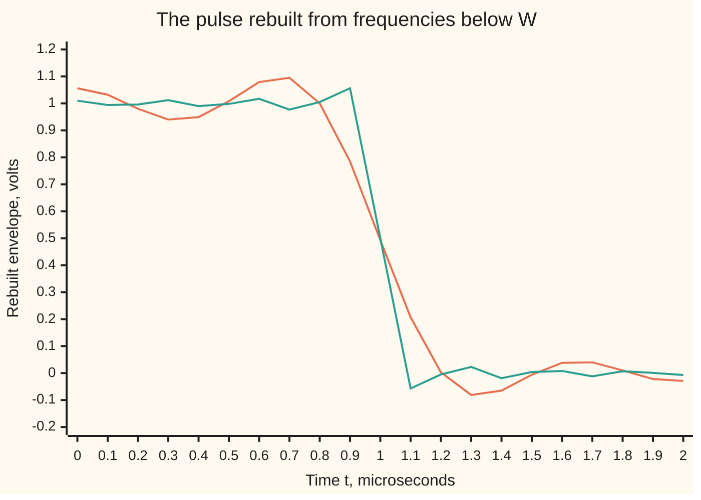

# Plancherel: the Fourier transform is a rigid rotation of the space of signals

[Syllabus](../../../SYLLABUS.md) → [Functional analysis](../README.md) → [Bounded Operators](../README.md#s03) → Plancherel

---

## General Overview

A radar transmitter keys its carrier on for 2 microseconds (µs). Its envelope is a rectangle: the carrier's RMS level (root-mean-square, the steady voltage that would deliver the same power) is 1 V for −1 < t < 1 µs, 0 at every other time. Into a 1-ohm load it delivers 1 V² × 2 µs / 1 Ω = 2 microjoules (µJ). The numbers are illustrative.

The same pulse, seen as frequencies, is the curve F(ω) = 2 sin ω / ω, worked out on [The complex form](../../08-Differential%20equations%20and%20dynamics/09-Fourier%20Series/05-complex-fourier-series-and-the-transform-in-outline.md). A receiver engineer asks how much of the 2 µJ each band of frequencies carries. The answer must add back to 2 µJ, or energy would appear or vanish in the change of view.

It does add back, once the frequency side is divided by 2π. The band |ω| < π radians per µs carries 1.805647 µJ, which is 90.2823%. Every finite-energy signal behaves the same way. This is **Plancherel's theorem**, the term used from here on.

### The picture: where the pulse's 2 µJ sits in frequency

```
band |ω| below     energy in the band
  π/2 rad/µs      ███████████████████████████████           1.547390 µJ  (77.3695 %)
  π   rad/µs      ████████████████████████████████████      1.805647 µJ  (90.2823 %)
  2π  rad/µs      ██████████████████████████████████████    1.899879 µJ  (94.9939 %)
  4π  rad/µs      ███████████████████████████████████████   1.949497 µJ  (97.4748 %)
  all             ████████████████████████████████████████  2.000000 µJ  (100 %)
```

Each bar is (1/2π) times the area under |F(ω)|² over the band. The full bar is the time-side energy, 2 µJ, reached only in the limit.

Two facts make the transform more than a bookkeeping trick. It keeps the angle between any two signals, not only their sizes. And it is defined on every finite-energy signal, even those where the transform integral itself fails, by a limit from nice signals.

**Divided by √(2π), the Fourier transform keeps every signal's energy and every angle between signals, and it can be undone: it is a rigid rotation of the space of finite-energy signals, defined first on nice signals and then on all of them by taking limits.**

**What kind of fact this is:** a theorem (Plancherel's), proved on this card in Why it works, resting on the inversion theorem proved on [The Fourier transform](../../07-Complex%20analysis/08-Transforms%20in%20Outline/03-fourier-transform.md). The extension step uses the bounded-extension theorem, also proved here, in a fold.

---

## The formula

Notation first, in words.

- $`L^2`$ is the space of signals with finite energy: $`\int |f(t)|^2\,dt`$ is finite. Its norm is $`\|f\|_2`$, the square root of that energy.
- The inner product conjugates its first slot, as wing 07's $`v^* w`$ does: $`\langle f, g\rangle = \int \overline{f(t)}\,g(t)\,dt`$. Texts differ on which slot.
- The hat is wing 07's transform, $`\hat f(\omega) = \int f(t)\,e^{-i\omega t}\,dt`$. For the pulse, $`\hat f = F`$.
- $`\mathcal{F}`$ is the **energy-keeping transform**, the hat divided by √(2π). This card introduces it.

Plancherel's identity, for every f in $`L^2`$:

```math
\int_{-\infty}^{\infty} |\hat f(\omega)|^2\, d\omega \;=\; 2\pi \int_{-\infty}^{\infty} |f(t)|^2\, dt
```

**Read it aloud:** the energy counted over all frequencies is 2π times the energy counted over all time.

The same fact, written as an operator:

```math
\mathcal{F}f = \frac{\hat f}{\sqrt{2\pi}}, \qquad \langle \mathcal{F}f,\, \mathcal{F}g\rangle = \langle f,\, g\rangle, \qquad \mathcal{F}^*\mathcal{F} = \mathcal{F}\mathcal{F}^* = I
```

**Read it aloud:** the energy-keeping transform keeps every inner product, and its adjoint undoes it from either side.

An operator with that last property is **unitary**: it keeps lengths and angles and maps the space onto itself ([Adjoints](03-adjoints-self-adjoint-and-unitary-operators.md)).

For a signal whose transform integral does not converge, $`\mathcal{F}`$ is a limit of cut-off signals, where $`\mathbf{1}_{[-L,L]}`$ is 1 on the interval and 0 outside:

```math
\mathcal{F}f = \lim_{L\to\infty} \mathcal{F}\big(f\,\mathbf{1}_{[-L,L]}\big) \qquad \text{in the norm } \|\cdot\|_2
```

**Read it aloud:** cut the signal to a finite stretch, transform that, and let the stretch grow; the answers settle in energy.

The harmonic-analysis wing uses the hertz form $`\int f(t)\,e^{-2\pi i \xi t}\,dt`$, with ξ in cycles per µs (MHz) here. That is this card's transform read at ω = 2πξ, and it keeps energy with no factor.

| Symbol | Plain meaning | In our example | Push it up and the answer… |
| --- | --- | --- | --- |
| $`t`$, $`\omega`$, $`\xi`$ | time in µs; frequency in radians per µs; frequency in cycles per µs (hertz form) | pulse on −1 < t < 1 | — |
| $`f`$, $`\hat f = F`$ | the pulse's envelope, its RMS level in volts; its transform in V·µs | $`F(\omega) = 2\sin\omega/\omega`$ | — |
| $`\mathcal{F}`$, $`\mathcal{F}^*`$, $`I`$ | the energy-keeping transform; its adjoint; the identity | $`F/\sqrt{2\pi}`$ | — |
| $`\lVert f\rVert_2`$, $`\langle f, g\rangle`$ | square root of the energy; the inner product | $`\lVert f\rVert_2^2 = 2`$ µJ | — |
| $`L^2`$, $`L^1`$ | finite-energy signals; signals with finite area under the size | the pulse is in both; F is in $`L^2`$ only | — |
| $`d`$, $`f_d`$, $`\theta`$ | echo delay in µs; the echo, the pulse delayed by d; angle between pulse and echo | 1 µs, 60° | overlap 2 − d falls, angle opens |
| $`W`$, $`f_W`$ | spectrum cut-off in rad/µs; the pulse rebuilt from the band below W | W = 10: error 0.066400 µJ | error falls like 2/(πW) |
| $`L`$, $`\mathbf{1}_{[-L,L]}`$ | time cut-off in µs; the cut-off switch | — | the cut signal nears f in energy |
| $`g(s)`$, $`\varepsilon`$, $`b_\varepsilon`$ | autocorrelation at lag s; a damping width and its bell, in the proof | $`g(s) = 2 - \lvert s\rvert`$ | — |
| $`N`$, $`\Delta t`$, $`U`$, $`X_k`$ | samples; spacing in µs; the DFT matrix over √N; the DFT values | 8 samples, 1 µs apart | sampled spectrum nears F |
| $`\mathrm{Si}`$ | the sine integral, $`\mathrm{Si}(x) = \int_0^x \sin u / u\,du`$ | Si(π)/π + 1/2 = 1.089490 | Si(x) nears π/2 |
| $`D, X, Y, T, C, x_n`$; $`S`$, $`\ell^2`$ | in the extension proof: dense subspace, spaces, map, bound, approximating sequence; the shift on square-summable lists | D = nice signals, C = 1 | — |

### When it holds

- **The signal has finite energy.** A carrier left on for ever has infinite energy, so neither side is finite. Its spectrum is a pair of spikes, at plus and minus the carrier frequency, handled on the planned card Tempered distributions.
- **One transform convention, with its factor.** Drop the 1/√(2π) and the pulse's frequency-side energy reads 12.566371, not 2. In the hertz form there is no factor to drop.
- **"Converges" means in energy, not uniformly (not in the largest gap).** The rebuilt pulse's error energy falls to 0, and at each fixed time it settles too (to 0.5 at the edge). Yet its largest gap from the pulse never shrinks: the overshoot just inside the edge tends to 1.089490 V, not 1 V.
- **The integral formula needs finite area under |f| too.** The pulse's own spectrum F has finite energy, 4π, but the area under |F| grows without end. Its inverse exists only as a limit.

---

## Why it works

### Step 0: energy is the overlap of a signal with itself

Slide a copy of the signal past itself by a lag s and add up the product. That is the **autocorrelation**, $`g(s) = \int \overline{f(t)}\,f(t+s)\,dt`$. At lag 0 it is the energy.

The transform of g is $`|\hat f(\omega)|^2`$, the energy at each frequency. Undo the transform at lag 0, and the inverse formula reads: energy = (1/2π) × the area under $`|\hat f|^2`$. That is the whole theorem. The rest makes it rigorous and then extends it to every finite-energy signal.

### Step 1: the finite rehearsal, eight samples

Sample the 8 µs window −4 to 4 at N = 8 points, Δt = 1 µs apart, at the middle of each slot. The pulse becomes the list 0 0 0 1 1 0 0 0.

Its **discrete Fourier transform** (DFT) is $`X_k = \sum_n x_n e^{-2\pi i k n/N}`$, where $`x_n`$ is sample n ([The discrete Fourier transform](../../07-Complex%20analysis/08-Transforms%20in%20Outline/02-discrete-fourier-transform.md)). Divide the DFT matrix by √N and call it U. Its columns are orthonormal: two different columns multiply to a sum of equally spaced points on the unit circle, which is 0. So $`U^*U = I`$ ([Orthonormal bases](../02-Hilbert%20Spaces/03-orthonormal-bases-and-parseval.md)).

So U keeps length. The code checks it at three sizes:

| N | Δt | energy in time | energy in frequency | $`\Delta t\,\lvert X_1\rvert`$ against F(π/4) = 1.800633 |
| --- | --- | --- | --- | --- |
| 8 | 1 µs | 2.000000 µJ | 2.000000 µJ | 1.847759 |
| 32 | 0.25 µs | 2.000000 µJ | 2.000000 µJ | 1.803528 |
| 128 | 0.0625 µs | 2.000000 µJ | 2.000000 µJ | 1.800813 |

The energies agree exactly at every N. The sampled spectrum closes on the true one as the grid refines.

U is also a rotation in a stronger sense. Apply it twice and the list comes back reversed: entry n moves to entry −n, counted round the list; apply it four times and it comes back unchanged. So every eigenvalue is a quarter turn: 1, −i, −1 or i.

A rigid rotation makes operators easy to measure. The shelf's house example, a blur averaging each sample with weights 1/4, 1/2, 1/4, here wrapped round a ring of 8 samples as on [Adjoints](03-adjoints-self-adjoint-and-unitary-operators.md), becomes a list of gains in the rotated frame: 1.000 0.854 0.500 0.146 0.000 0.146 0.500 0.854. Its worst-case gain is 1.000, so the ring blur never amplifies, at this N or any other. Adjoints reads the same gains as this blur's eigenvalues.

What the truncation hides: on a list every sum is finite, so every vector has a transform. The question of which signals the integral even applies to only appears in infinite dimensions.

### Step 2: Plancherel for nice signals

Call a signal **nice** when it has both finite energy and finite area under |f|: it lies in $`L^1 \cap L^2`$. The pulse is nice. For a nice signal the transform integral converges at every ω.

For the pulse, the autocorrelation is a triangle: g(s) = 2 − |s| for |s| < 2, and 0 beyond. Its transform, by one integration, is $`4\sin^2\omega/\omega^2 = |F(\omega)|^2`$. The code checks it at ω = 1 (2.832294 both ways) and ω = 2.5 (0.229228 both ways).

Undo the transform at lag 0:

```math
\frac{1}{2\pi}\int_{-\infty}^{\infty} \frac{4\sin^2\omega}{\omega^2}\, d\omega = g(0) = 2
```

The code adds the band below W by Simpson's rule to the tail beyond W in closed form, $`(4/\pi)\big(\sin^2 W/W + \pi/2 - \mathrm{Si}(2W)\big)`$:

| W | inside | tail | total |
| --- | --- | --- | --- |
| 10 | 1.933600 | 0.066400 | 2.000000 µJ |
| 100 | 1.993662 | 0.006338 | 2.000000 µJ |
| 1000 | 1.999363 | 0.000637 | 2.000000 µJ |

For a general nice signal the same argument works. The catch is that wing 07's inversion theorem needs $`|\hat f|^2`$ to have finite area, which is what is being proved. A damping factor removes the circle.

<details>
<summary>Detailed proof: Plancherel for signals in L¹ ∩ L²</summary>

Let f be in $`L^1 \cap L^2`$. Its autocorrelation g is bounded by $`\|f\|_2^2`$ (Cauchy–Schwarz) and continuous, because sliding a finite-energy signal by a small lag changes it by little energy. The convolution theorem gives $`\hat g = |\hat f|^2`$, since g is f convolved with its reversed conjugate.

Damp the inverse integral by a bell. For ε > 0,

$`\displaystyle \frac{1}{2\pi}\int |\hat f(\omega)|^2\, e^{-\varepsilon^2\omega^2/2}\, d\omega = \int g(s)\, b_\varepsilon(s)\, ds, \qquad b_\varepsilon(s) = \frac{e^{-s^2/(2\varepsilon^2)}}{\varepsilon\sqrt{2\pi}}.`$

This swap of integrals is allowed because f is in $`L^1`$, so the double integral converges absolutely. The bell $`b_\varepsilon`$ is the inverse transform of the damping, from wing 07's Gaussian pair, and has area 1.

As ε shrinks, the right side tends to g(0) = $`\|f\|_2^2`$, because g is continuous and bounded. On the left, the damping rises to 1 and $`|\hat f|^2 \ge 0`$, so by monotone convergence the left side tends to the full integral. So the full integral is finite and equals $`2\pi\|f\|_2^2`$.

</details>

### Step 3: keeping lengths means keeping angles

Inner products can be rebuilt from lengths alone. This is the **polarisation identity**:

```math
\langle f, g\rangle = \tfrac14\Big(\|f+g\|^2 - \|f-g\|^2 - i\,\|f+ig\|^2 + i\,\|f-ig\|^2\Big)
```

So if $`\mathcal{F}`$ keeps every length, it keeps every inner product. Angles are inner products over lengths, so it keeps angles too.

Take the pulse f and its echo $`f_d`$, the same pulse d = 1 µs later. In time they overlap for 1 µs, so $`\langle f, f_d\rangle = 1`$ and the angle is arccos(1/2) = 60°. In frequency the echo is $`e^{-i\omega}F(\omega)`$, and (1/2π) × the area under $`F(\omega)^2 \cos\omega`$ gives 1.000000. The angle is 60.0000° on both sides.

### Step 4: extending by density

Nice signals are **dense** in $`L^2`$: every finite-energy signal is an energy-limit of nice ones. Cutting f to −L < t < L works. The cut signal has finite area, at most √(2L) × $`\|f\|_2`$ by Cauchy–Schwarz, and its distance from f in energy falls to 0.

On the nice signals, $`\mathcal{F}`$ keeps distances. So a sequence of nice signals settling in energy is sent to a sequence settling in energy, and the limit names $`\mathcal{F}f`$. This is the **bounded-extension theorem**: a bounded linear map (one with a finite worst-case gain, as on [Bounded operators](01-bounded-operators-and-the-operator-norm.md)) on a dense subspace has exactly one continuous extension, with the same norm.

<details>
<summary>Detailed proof: the bounded-extension theorem</summary>

Let D be a dense subspace of a normed space X, Y a complete normed space, and T: D → Y linear with $`\|Tx\| \le C\|x\|`$.

Take x in X and $`x_n`$ in D with $`x_n \to x`$. Then $`\|Tx_n - Tx_m\| \le C\|x_n - x_m\|`$, so $`(Tx_n)`$ is Cauchy and converges in Y. Define Tx as its limit.

The limit does not depend on the sequence. If $`y_n \to x`$ too, then $`\|Tx_n - Ty_n\| \le C\|x_n - y_n\| \to 0`$. Linearity passes to the limit, and so does the bound: $`\|Tx\| = \lim \|Tx_n\| \le C\lim\|x_n\| = C\|x\|`$.

Any continuous extension must agree with this one, since it is fixed on D and D is dense. For $`\mathcal{F}`$, C = 1 with equality, so the extension keeps every length on all of $`L^2`$.

</details>

The pulse's own spectrum shows why the extension is needed. F has finite energy, 4π, but the area under |F| has no limit:

| band | area under \|F\| |
| --- | --- |
| \|ω\| < 10π | 13.230668 |
| \|ω\| < 100π | 19.093700 |
| \|ω\| < 1000π | 24.957180 |

Each tenfold widening adds about (8/π) ln 10 = 5.863485; the last step adds 5.863480. So wing 07's inversion integral, which needs finite area under |F|, does not apply to F as it stands.

Plancherel's limit does. Cut F to the band |ω| < W, a nice signal, and invert: the rebuild is $`f_W(t) = (\mathrm{Si}(W(1+t)) + \mathrm{Si}(W(1-t)))/\pi`$. At t = 0.5 µs and W = 10 this gives 1.008446, and the inverse integral by Simpson's rule gives 1.008446.

The error energy $`\|f - f_W\|_2^2`$ is the tail energy beyond W, by Plancherel. The code also measures it directly in time, out to 100 µs:

| W, rad/µs | error energy in time | in frequency (tail) | W × error |
| --- | --- | --- | --- |
| 10 | 0.066388 | 0.066400 | 0.664001 |
| 20 | 0.032440 | 0.032448 | 0.648962 |
| 40 | 0.015717 | 0.015718 | 0.628740 |

The two columns differ by the error beyond 100 µs. W × error hovers near 2/π = 0.636620, so the error falls like 2/(πW).

### The picture: the rebuild sharpens, the overshoot stays



Orange: W = 10 rad/µs. Green: W = 40 rad/µs. The true pulse is 1 V up to t = 1 µs and 0 V after; both rebuilds pass near 0.5 at the edge (0.493 and 0.500). The pulse is symmetric, so only t ≥ 0 is drawn.

The edge sharpens as W grows, but the first ripple inside it does not shrink. At t = 1 − π/W the rebuild reads 1.098145, 1.083912, 1.088979, 1.087513 for W = 10, 20, 40, 80. The limit is 1/2 + Si(π)/π = 1.089490: about 9% of the 1 V jump, the overshoot met on [Convergence](../../08-Differential%20equations%20and%20dynamics/09-Fourier%20Series/02-convergence-jumps-and-gibbs.md). The ripple survives by moving: its time 1 − π/W closes in on the edge. At any fixed time the rebuild does settle, because Si(x) nears π/2. At t = 0.9 µs it reads 0.784543, 1.027749, 0.997404 for W = 10, 100, 1000, and at the edge 0.492821, 0.499232, 0.500058, the midpoint of the jump. So the rebuild converges in energy and at each time, but not uniformly: its largest gap from the pulse never shrinks.

### Step 5: the inverse, and why the rotation is rigid

The inverse transform without its 1/(2π), divided by √(2π), extends by the same argument and also keeps energy. Wing 07's inversion theorem says the two undo each other on smooth, fast-fading signals such as the Gaussian bell, and these are dense too. Both maps are continuous, so they undo each other everywhere.

So $`\mathcal{F}`$ keeps every length and maps $`L^2`$ onto itself. That is exactly unitary: $`\mathcal{F}^* = \mathcal{F}^{-1}`$.

As in the rehearsal, $`\mathcal{F}^2 f(t) = f(-t)`$, so $`\mathcal{F}^4 = I`$. The Gaussian bell $`e^{-t^2/2}`$ is sent to itself, wing 07's pair divided by √(2π): eigenvalue 1. The transform rotates the space of signals by quarter turns.

---

## Worked numbers, by hand

| Step | Arithmetic | Value |
| --- | --- | --- |
| Energy in time | 1 V² × 2 µs / 1 Ω | 2 µJ |
| Energy density at ω = 1 | $`\lvert F(1)\rvert^2 = 4\sin^2 1`$ | 2.832294 |
| Same, from the triangle | $`2\int_0^2 (2-s)\cos s\,ds`$ | 2.832294 |
| Band below 10 rad/µs | (1/2π) × area under $`\lvert F\rvert^2`$, Simpson | 1.933600 µJ |
| Tail beyond 10 rad/µs | $`(4/\pi)(\sin^2 10/10 + \pi/2 - \mathrm{Si}(20))`$ | 0.066400 µJ |
| **Energy in frequency** | 1.933600 + 0.066400 | **2.000000 µJ** |

The pulse carries 2 µJ whether it is counted second by second or band by band. A receiver that passes only |ω| < 10 rad/µs loses 0.066400 µJ, and that is also the energy of the error $`f - f_W`$ in time.

### What breaks if you drop a piece

| Mistake | Comes out at | What went wrong |
| --- | --- | --- |
| Leaving out the 1/√(2π) | 12.566371 µJ, not 2 | the hat alone stretches energy by 2π |
| Inverting F by the integral as if it had finite area | area 13.230668, 19.093700, 24.957180, no limit | F is in $`L^2`$ but not $`L^1`$; only the limit defines its inverse |
| Expecting the rebuild's largest gap to shrink | overshoot 1.098145, 1.083912, 1.088979, 1.087513 | convergence holds in energy and at each fixed time, not uniformly: the overshoot moves toward the edge |
| Sampling the pulse too coarsely | 1.847759 against F(π/4) = 1.800633 at N = 8 | the DFT keeps energy exactly but only approximates F |

The code prints all four.

---

## Code, from first principles, and it actually runs

The code holds only rehearsals: lists, bands of finite width, and a time window of 100 µs. It takes four roads to the energy balance. The DFT matrix is checked unitary and the sampled pulse's two energies compared with each other and with 2 µJ at N = 8, 32, 128, where the sampled spectrum's gap to F(π/4) must shrink. The triangle's transform is checked against $`|F|^2`$. The band energy by Simpson's rule plus the tail in closed form makes 2. The error of the rebuild is measured in time from a table of the sine integral and matched against the tail in frequency. The angle to the echo is computed on both sides.

What the truncation hides: every band is finite, so every cut spectrum here is a nice signal. The infinite-dimensional point, that F itself has no absolutely convergent inverse, shows only as the growing area under |F|.

### Python

```python
# Plancherel -- the check behind the card.  Standard library only; the DFT,
# Simpson's rule and the sine integral Si are written out here.  The signal is a
# radar pulse: 1 V RMS for |t| < 1 microsecond into 1 ohm, so energies are in uJ.
# Its transform is F(w) = 2 sin(w)/w, with w in radians per microsecond.
import math
PI = math.pi

def simpson(f, a, b, n):                       # Simpson's rule, n even
    h = (b - a) / n
    s = f(a) + f(b) + sum((4 if k % 2 else 2) * f(a + k * h) for k in range(1, n))
    return s * h / 3

def sinc(u):
    return 1.0 if u == 0 else math.sin(u) / u

def si(x):                                     # sine integral Si(x), step at most 0.01
    return simpson(sinc, 0, x, 2 * max(50, int(abs(x) * 50)))

def F(w, a=1.0):                               # transform of the pulse 1 on |t| < a
    return 2 * a * sinc(a * w)

def dft(x):                                    # sum x_n e^(-2 pi i k n / N)
    N = len(x)
    return [sum(x[n] * complex(math.cos(2 * PI * k * n / N), -math.sin(2 * PI * k * n / N))
                for n in range(N)) for k in range(N)]

def inside(W, a=1.0):                          # energy (1/2 pi) * integral of |F|^2 over |w| < W
    return 2 * simpson(lambda w: F(w, a) ** 2, 0, W, 2 * max(50, int(W * 50))) / (2 * PI)

def tail(W):                                   # energy beyond |w| = W, closed form
    return 4 / PI * (math.sin(W) ** 2 / W + PI / 2 - si(2 * W))

# ---- finite rehearsal: the DFT divided by sqrt(N) is a rigid rotation ----
N = 8
U = [[complex(math.cos(2 * PI * k * n / N), -math.sin(2 * PI * k * n / N)) / math.sqrt(N)
      for n in range(N)] for k in range(N)]
e1 = max(abs(sum(U[j][k].conjugate() * U[j][m] for j in range(N)) - (k == m))
         for k in range(N) for m in range(N))
e2 = max(abs(sum(U[k][j] * U[j][m] for j in range(N)) - ((k + m) % N == 0))
         for k in range(N) for m in range(N))
print(f"N=8: U*U = I to within 1e-12: {'yes' if e1 < 1e-12 else 'no'}; "
      f"U^2 reverses the list, so U^4 = I: {'yes' if e2 < 1e-12 else 'no'}")
assert e1 < 1e-12
assert e2 < 1e-12
errs = []
for N in (8, 32, 128):                          # the pulse sampled on a window of 8 us
    dt = 8 / N
    x = [1.0 if abs(-4 + (n + 0.5) * dt) < 1 else 0.0 for n in range(N)]
    X = dft(x)
    et, ef = dt * sum(v * v for v in x), dt * sum(abs(c) ** 2 for c in X) / N
    print(f"N={N:3d}, dt={dt:.4f} us: time energy {et:.6f} uJ, frequency energy {ef:.6f} uJ, "
          f"|dt X_1| {dt * abs(X[1]):.6f} against F(pi/4) {F(PI / 4):.6f}")
    assert abs(et - ef) < 1e-12 and abs(et - 2) < 1e-12
    errs.append(abs(dt * abs(X[1]) - F(PI / 4)))
assert all(b < a / 10 for a, b in zip(errs, errs[1:]))   # the sampled spectrum closes on F
x = [1 / (1 + n) for n in range(8)]             # the blur (1/4, 1/2, 1/4) on 8 samples
bx = [x[n - 1] / 4 + x[n] / 2 + x[(n + 1) % 8] / 4 for n in range(8)]
gain = [math.cos(PI * k / 8) ** 2 for k in range(8)]
gap = max(abs(b - g * c) for b, g, c in zip(dft(bx), gain, dft(x)))
print("blur gains by frequency:", " ".join(f"{g:.3f}" for g in gain), f"| worst case {max(gain):.3f}")
assert gap < 1e-12

# ---- Plancherel for the pulse: 2 uJ in time, 2 uJ in frequency ----
for W in (PI / 2, PI, 2 * PI, 4 * PI):
    print(f"share of the energy in |w| < {W / PI:g} pi: {inside(W):.6f} uJ = {50 * inside(W):.4f} %")
for W in (10, 100, 1000):
    i, t = inside(W), tail(W)
    print(f"|w| < {W:4d}: inside {i:.6f}, tail (closed form) {t:.6f}, total {i + t:.6f} uJ")
    assert abs(i + t - 2) < 1e-7
print(f"without the 1/sqrt(2 pi): integral of |F|^2 = {2 * PI * 2:.6f}, not 2")
for w in (1.0, 2.5):                            # the triangle 2 - |s| transforms to |F|^2
    tri = 2 * simpson(lambda s: (2 - s) * math.cos(w * s), 0, 2, 2000)
    print(f"autocorrelation triangle at w = {w}: transform {tri:.6f}, |F|^2 {F(w) ** 2:.6f}")
    assert abs(tri - F(w) ** 2) < 1e-10
for d in (1.0, 0.5):                            # the pulse and its echo d us later
    Wc = 128 * PI
    ip = 2 * simpson(lambda w: F(w) ** 2 * math.cos(w * d), 0, Wc, 80000) / (2 * PI)
    ang = math.degrees(math.acos(ip / 2))
    print(f"echo after {d} us: overlap in time {2 - d:.6f}, in frequency {ip:.6f}, angle {ang:.4f} degrees")
    assert abs(ip - (2 - d)) < 1e-6

# ---- the extension by density: cut the spectrum at W, invert, let W grow ----
for M in (10, 100, 1000):                       # area under |F| has no limit
    area = 2 * sum(simpson(lambda w: abs(F(w)), j * PI, (j + 1) * PI, 400) for j in range(M))
    print(f"area under |F| for |w| < {M} pi: {area:.6f}")
    if M == 1000:
        print(f"last tenfold step adds {area - prev:.6f}; (8/pi) ln 10 = {8 / PI * math.log(10):.6f}")
        assert abs(area - prev - 8 / PI * math.log(10)) < 0.01
    prev = area
fW = lambda t, W: (si(W * (1 + t)) + si(W * (1 - t))) / PI
direct = simpson(lambda w: F(w) * math.cos(0.5 * w), 0, 10, 2000) / PI
print(f"rebuilt pulse W = 10 at t = 0.5: Si formula {fW(0.5, 10):.6f}, inverse integral {direct:.6f}")
assert abs(direct - fW(0.5, 10)) < 1e-8
d, R = 0.005, 100                               # Si table, step 0.005, by Simpson per step
S = [0.0]
for j in range(int(40 * (R + 1) / d) + 1):
    S.append(S[-1] + d / 6 * (sinc(j * d) + 4 * sinc((j + 0.5) * d) + sinc((j + 1) * d)))
Si = lambda j: S[j] if j >= 0 else -S[-j]
for W in (10, 20, 40):                           # error energy in time, grid 0.005 us
    g = [(Si(m * W + 200 * W) - Si(m * W - 200 * W)) / PI for m in range(200 * R + 1)]
    sv = lambda v: d / 3 * (v[0] + v[-1] + sum((4 if k % 2 else 2) * v[k] for k in range(1, len(v) - 1)))
    Et = 2 * (sv([(1 - y) ** 2 for y in g[:201]]) + sv([y * y for y in g[200:]]))
    print(f"W = {W}: error energy in time {Et:.6f}, in frequency {tail(W):.6f}, W x error {W * tail(W):.6f}")
    assert abs(Et - tail(W)) < 5e-5
for W in (10, 20, 40, 80):
    print(f"W = {W}: rebuild at t = 1 - pi/W, just inside the edge: {fW(1 - PI / W, W):.6f}")
    assert abs(fW(1 - PI / W, W) - (0.5 + si(PI) / PI)) < 0.02
print(f"its limit: 1/2 + Si(pi)/pi = {0.5 + si(PI) / PI:.6f}; 2/pi = {2 / PI:.6f}")
print("chart W=10:", ", ".join(f"{fW(k / 10, 10):.3f}" for k in range(21)))
print("chart W=40:", ", ".join(f"{fW(k / 10, 40):.3f}" for k in range(21)))
print("fixed times, W = 10, 100, 1000: t = 0.9 ->", " ".join(f"{fW(0.9, W):.6f}" for W in (10, 100, 1000)),
      "; edge t = 1 ->", " ".join(f"{fW(1.0, W):.6f}" for W in (10, 100, 1000)))
assert abs(fW(0.9, 1000) - 1) < abs(fW(0.9, 100) - 1) < abs(fW(0.9, 10) - 1) and abs(fW(1.0, 1000) - 0.5) < 1e-3

# ---- try changing ----
x = [1.0 if abs(-4 + (n + 0.5) * 8 / 512) < 1 else 0.0 for n in range(512)]
print(f"N=512: |dt X_1| {8 / 512 * abs(dft(x)[1]):.6f} against F(pi/4) {F(PI / 4):.6f}")
print(f"pulse 4 us long: main lobe |w| < pi/2 holds {inside(PI / 2, 2.0):.6f} of 4 uJ, "
      f"share {inside(PI / 2, 2.0) / 4:.6f}; W = 160: error energy {tail(160):.6f} uJ")
print("ALL CHECKS PASS")
```

**Ran 2026-11-15 on macOS, Python 3.14.10, standard library only. All checks passed. Output, pasted from the run:**

```
N=8: U*U = I to within 1e-12: yes; U^2 reverses the list, so U^4 = I: yes
N=  8, dt=1.0000 us: time energy 2.000000 uJ, frequency energy 2.000000 uJ, |dt X_1| 1.847759 against F(pi/4) 1.800633
N= 32, dt=0.2500 us: time energy 2.000000 uJ, frequency energy 2.000000 uJ, |dt X_1| 1.803528 against F(pi/4) 1.800633
N=128, dt=0.0625 us: time energy 2.000000 uJ, frequency energy 2.000000 uJ, |dt X_1| 1.800813 against F(pi/4) 1.800633
blur gains by frequency: 1.000 0.854 0.500 0.146 0.000 0.146 0.500 0.854 | worst case 1.000
share of the energy in |w| < 0.5 pi: 1.547390 uJ = 77.3695 %
share of the energy in |w| < 1 pi: 1.805647 uJ = 90.2823 %
share of the energy in |w| < 2 pi: 1.899879 uJ = 94.9939 %
share of the energy in |w| < 4 pi: 1.949497 uJ = 97.4748 %
|w| <   10: inside 1.933600, tail (closed form) 0.066400, total 2.000000 uJ
|w| <  100: inside 1.993662, tail (closed form) 0.006338, total 2.000000 uJ
|w| < 1000: inside 1.999363, tail (closed form) 0.000637, total 2.000000 uJ
without the 1/sqrt(2 pi): integral of |F|^2 = 12.566371, not 2
autocorrelation triangle at w = 1.0: transform 2.832294, |F|^2 2.832294
autocorrelation triangle at w = 2.5: transform 0.229228, |F|^2 0.229228
echo after 1.0 us: overlap in time 1.000000, in frequency 1.000000, angle 60.0000 degrees
echo after 0.5 us: overlap in time 1.500000, in frequency 1.500000, angle 41.4096 degrees
area under |F| for |w| < 10 pi: 13.230668
area under |F| for |w| < 100 pi: 19.093700
area under |F| for |w| < 1000 pi: 24.957180
last tenfold step adds 5.863480; (8/pi) ln 10 = 5.863485
rebuilt pulse W = 10 at t = 0.5: Si formula 1.008446, inverse integral 1.008446
W = 10: error energy in time 0.066388, in frequency 0.066400, W x error 0.664001
W = 20: error energy in time 0.032440, in frequency 0.032448, W x error 0.648962
W = 40: error energy in time 0.015717, in frequency 0.015718, W x error 0.628740
W = 10: rebuild at t = 1 - pi/W, just inside the edge: 1.098145
W = 20: rebuild at t = 1 - pi/W, just inside the edge: 1.083912
W = 40: rebuild at t = 1 - pi/W, just inside the edge: 1.088979
W = 80: rebuild at t = 1 - pi/W, just inside the edge: 1.087513
its limit: 1/2 + Si(pi)/pi = 1.089490; 2/pi = 0.636620
chart W=10: 1.056, 1.032, 0.980, 0.940, 0.949, 1.008, 1.079, 1.095, 1.000, 0.785, 0.493, 0.207, 0.003, -0.081, -0.065, -0.006, 0.038, 0.040, 0.010, -0.022, -0.029
chart W=40: 1.010, 0.994, 0.996, 1.012, 0.990, 0.998, 1.017, 0.977, 1.005, 1.056, 0.500, -0.057, -0.005, 0.023, -0.019, 0.004, 0.008, -0.012, 0.007, 0.001, -0.007
fixed times, W = 10, 100, 1000: t = 0.9 -> 0.784543 1.027749 0.997404 ; edge t = 1 -> 0.492821 0.499232 0.500058
N=512: |dt X_1| 1.800644 against F(pi/4) 1.800633
pulse 4 us long: main lobe |w| < pi/2 holds 3.611293 of 4 uJ, share 0.902823; W = 160: error energy 0.003973 uJ
ALL CHECKS PASS
```

### Rust

```rust
// Plancherel -- the check behind the card.  Rust std only; the DFT, Simpson's
// rule and the sine integral Si are written out here.  The signal is a radar
// pulse: 1 V RMS for |t| < 1 microsecond into 1 ohm, so energies are in uJ.  Its
// transform is F(w) = 2 sin(w)/w, with w in radians per microsecond.
use std::f64::consts::PI;

#[derive(Clone, Copy)]
struct C { re: f64, im: f64 }
impl C {
    fn add(self, o: C) -> C { C { re: self.re + o.re, im: self.im + o.im } }
    fn mul(self, o: C) -> C { C { re: self.re * o.re - self.im * o.im, im: self.re * o.im + self.im * o.re } }
    fn conj(self) -> C { C { re: self.re, im: -self.im } }
    fn abs(self) -> f64 { self.re.hypot(self.im) }
}
fn cis(a: f64) -> C { C { re: a.cos(), im: -a.sin() } }

fn simpson<G: Fn(f64) -> f64>(f: G, a: f64, b: f64, n: usize) -> f64 {
    let h = (b - a) / n as f64;
    let mut s = 0.0;
    for k in 1..n { s += (if k % 2 == 1 { 4.0 } else { 2.0 }) * f(a + k as f64 * h); }
    (f(a) + f(b) + s) * h / 3.0
}
fn sinc(u: f64) -> f64 { if u == 0.0 { 1.0 } else { u.sin() / u } }
fn si(x: f64) -> f64 { simpson(sinc, 0.0, x, 2 * 50usize.max((x.abs() * 50.0) as usize)) }
fn ff(w: f64, a: f64) -> f64 { 2.0 * a * sinc(a * w) }
fn dft(x: &[f64]) -> Vec<C> {
    let n = x.len();
    (0..n).map(|k| {
        let mut s = C { re: 0.0, im: 0.0 };
        for j in 0..n { s = s.add(C { re: x[j], im: 0.0 }.mul(cis(2.0 * PI * k as f64 * j as f64 / n as f64))); }
        s
    }).collect()
}
fn inside(w: f64, a: f64) -> f64 {
    2.0 * simpson(|v| ff(v, a).powi(2), 0.0, w, 2 * 50usize.max((w * 50.0) as usize)) / (2.0 * PI)
}
fn tail(w: f64) -> f64 { 4.0 / PI * (w.sin().powi(2) / w + PI / 2.0 - si(2.0 * w)) }
fn fw(t: f64, w: f64) -> f64 { (si(w * (1.0 + t)) + si(w * (1.0 - t))) / PI }

fn main() {
    // ---- finite rehearsal: the DFT divided by sqrt(N) is a rigid rotation ----
    let n = 8;
    let u: Vec<Vec<C>> = (0..n).map(|k| (0..n).map(|j| {
        let c = cis(2.0 * PI * k as f64 * j as f64 / n as f64);
        C { re: c.re / (n as f64).sqrt(), im: c.im / (n as f64).sqrt() }
    }).collect()).collect();
    let (mut e1, mut e2) = (0.0f64, 0.0f64);
    for k in 0..n { for m in 0..n {
        let (mut a, mut b) = (C { re: 0.0, im: 0.0 }, C { re: 0.0, im: 0.0 });
        for j in 0..n { a = a.add(u[j][k].conj().mul(u[j][m])); b = b.add(u[k][j].mul(u[j][m])); }
        e1 = e1.max(C { re: a.re - if k == m { 1.0 } else { 0.0 }, im: a.im }.abs());
        e2 = e2.max(C { re: b.re - if (k + m) % n == 0 { 1.0 } else { 0.0 }, im: b.im }.abs());
    }}
    println!("N=8: U*U = I to within 1e-12: {}; U^2 reverses the list, so U^4 = I: {}",
             if e1 < 1e-12 { "yes" } else { "no" }, if e2 < 1e-12 { "yes" } else { "no" });
    assert!(e1 < 1e-12);
    assert!(e2 < 1e-12);
    let mut errs: Vec<f64> = vec![];
    for &nn in &[8usize, 32, 128] {
        let dt = 8.0 / nn as f64;
        let x: Vec<f64> = (0..nn).map(|j| if (-4.0 + (j as f64 + 0.5) * dt).abs() < 1.0 { 1.0 } else { 0.0 }).collect();
        let xx = dft(&x);
        let et = dt * x.iter().map(|v| v * v).sum::<f64>();
        let ef = dt * xx.iter().map(|c| c.abs().powi(2)).sum::<f64>() / nn as f64;
        println!("N={:3}, dt={:.4} us: time energy {:.6} uJ, frequency energy {:.6} uJ, |dt X_1| {:.6} against F(pi/4) {:.6}",
                 nn, dt, et, ef, dt * xx[1].abs(), ff(PI / 4.0, 1.0));
        assert!((et - ef).abs() < 1e-12 && (et - 2.0).abs() < 1e-12);
        errs.push((dt * xx[1].abs() - ff(PI / 4.0, 1.0)).abs());
    }
    assert!(errs.windows(2).all(|p| p[1] < p[0] / 10.0)); // the sampled spectrum closes on F
    let x: Vec<f64> = (0..8).map(|j| 1.0 / (1.0 + j as f64)).collect();
    let bx: Vec<f64> = (0..8).map(|j| x[(j + 7) % 8] / 4.0 + x[j] / 2.0 + x[(j + 1) % 8] / 4.0).collect();
    let gain: Vec<f64> = (0..8).map(|k| (PI * k as f64 / 8.0).cos().powi(2)).collect();
    let (db, dx) = (dft(&bx), dft(&x));
    let gap = (0..8).map(|k| C { re: db[k].re - gain[k] * dx[k].re, im: db[k].im - gain[k] * dx[k].im }.abs()).fold(0.0, f64::max);
    let gs: Vec<String> = gain.iter().map(|g| format!("{:.3}", g)).collect();
    println!("blur gains by frequency: {} | worst case {:.3}", gs.join(" "), gain.iter().cloned().fold(0.0, f64::max));
    assert!(gap < 1e-12);

    // ---- Plancherel for the pulse: 2 uJ in time, 2 uJ in frequency ----
    for &(lab, w) in &[("0.5", PI / 2.0), ("1", PI), ("2", 2.0 * PI), ("4", 4.0 * PI)] {
        let i = inside(w, 1.0);
        println!("share of the energy in |w| < {} pi: {:.6} uJ = {:.4} %", lab, i, 50.0 * i);
    }
    for &w in &[10usize, 100, 1000] {
        let (i, t) = (inside(w as f64, 1.0), tail(w as f64));
        println!("|w| < {:4}: inside {:.6}, tail (closed form) {:.6}, total {:.6} uJ", w, i, t, i + t);
        assert!((i + t - 2.0).abs() < 1e-7);
    }
    println!("without the 1/sqrt(2 pi): integral of |F|^2 = {:.6}, not 2", 2.0 * PI * 2.0);
    for &w in &[1.0f64, 2.5] {
        let tri = 2.0 * simpson(|s| (2.0 - s) * (w * s).cos(), 0.0, 2.0, 2000);
        println!("autocorrelation triangle at w = {:.1}: transform {:.6}, |F|^2 {:.6}", w, tri, ff(w, 1.0).powi(2));
        assert!((tri - ff(w, 1.0).powi(2)).abs() < 1e-10);
    }
    for &d in &[1.0f64, 0.5] {
        let ip = 2.0 * simpson(|w| ff(w, 1.0).powi(2) * (w * d).cos(), 0.0, 128.0 * PI, 80000) / (2.0 * PI);
        let ang = (ip / 2.0).acos().to_degrees();
        println!("echo after {:.1} us: overlap in time {:.6}, in frequency {:.6}, angle {:.4} degrees", d, 2.0 - d, ip, ang);
        assert!((ip - (2.0 - d)).abs() < 1e-6);
    }

    // ---- the extension by density: cut the spectrum at W, invert, let W grow ----
    let mut prev = 0.0;
    for &m in &[10usize, 100, 1000] {
        let mut area = 0.0;
        for j in 0..m { area += simpson(|w| ff(w, 1.0).abs(), j as f64 * PI, (j + 1) as f64 * PI, 400); }
        area *= 2.0;
        println!("area under |F| for |w| < {} pi: {:.6}", m, area);
        if m == 1000 {
            println!("last tenfold step adds {:.6}; (8/pi) ln 10 = {:.6}", area - prev, 8.0 / PI * 10f64.ln());
            assert!((area - prev - 8.0 / PI * 10f64.ln()).abs() < 0.01);
        }
        prev = area;
    }
    let direct = simpson(|w| ff(w, 1.0) * (0.5 * w).cos(), 0.0, 10.0, 2000) / PI;
    println!("rebuilt pulse W = 10 at t = 0.5: Si formula {:.6}, inverse integral {:.6}", fw(0.5, 10.0), direct);
    assert!((direct - fw(0.5, 10.0)).abs() < 1e-8);
    let (d, r) = (0.005f64, 100usize);
    let mut s = vec![0.0f64];
    for j in 0..((40.0 * (r as f64 + 1.0) / d) as usize + 1) {
        let jf = j as f64;
        let last = *s.last().unwrap();
        s.push(last + d / 6.0 * (sinc(jf * d) + 4.0 * sinc((jf + 0.5) * d) + sinc((jf + 1.0) * d)));
    }
    let sit = |j: i64| if j >= 0 { s[j as usize] } else { -s[(-j) as usize] };
    let sv = |v: &[f64]| {
        let mut acc = 0.0;
        for k in 1..v.len() - 1 { acc += (if k % 2 == 1 { 4.0 } else { 2.0 }) * v[k]; }
        d / 3.0 * (v[0] + v[v.len() - 1] + acc)
    };
    for &w in &[10i64, 20, 40] {
        let g: Vec<f64> = (0..(200 * r as i64 + 1)).map(|m| (sit(m * w + 200 * w) - sit(m * w - 200 * w)) / PI).collect();
        let a: Vec<f64> = g[..201].iter().map(|y| (1.0 - y).powi(2)).collect();
        let b: Vec<f64> = g[200..].iter().map(|y| y * y).collect();
        let et = 2.0 * (sv(&a) + sv(&b));
        let wf = w as f64;
        println!("W = {}: error energy in time {:.6}, in frequency {:.6}, W x error {:.6}", w, et, tail(wf), wf * tail(wf));
        assert!((et - tail(wf)).abs() < 5e-5);
    }
    for &w in &[10.0f64, 20.0, 40.0, 80.0] {
        println!("W = {}: rebuild at t = 1 - pi/W, just inside the edge: {:.6}", w, fw(1.0 - PI / w, w));
        assert!((fw(1.0 - PI / w, w) - (0.5 + si(PI) / PI)).abs() < 0.02);
    }
    println!("its limit: 1/2 + Si(pi)/pi = {:.6}; 2/pi = {:.6}", 0.5 + si(PI) / PI, 2.0 / PI);
    for &w in &[10.0f64, 40.0] {
        let pts: Vec<String> = (0..21).map(|k| format!("{:.3}", fw(k as f64 / 10.0, w))).collect();
        println!("chart W={}: {}", w, pts.join(", "));
    }
    let ws = [10.0f64, 100.0, 1000.0];
    let js = |t: f64| ws.iter().map(|&w| format!("{:.6}", fw(t, w))).collect::<Vec<_>>().join(" ");
    println!("fixed times, W = 10, 100, 1000: t = 0.9 -> {} ; edge t = 1 -> {}", js(0.9), js(1.0));
    let e9: Vec<f64> = ws.iter().map(|&w| (fw(0.9, w) - 1.0).abs()).collect();
    assert!(e9[2] < e9[1] && e9[1] < e9[0] && (fw(1.0, 1000.0) - 0.5).abs() < 1e-3);

    // ---- try changing ----
    let x: Vec<f64> = (0..512).map(|j| if (-4.0 + (j as f64 + 0.5) * 8.0 / 512.0).abs() < 1.0 { 1.0 } else { 0.0 }).collect();
    println!("N=512: |dt X_1| {:.6} against F(pi/4) {:.6}", 8.0 / 512.0 * dft(&x)[1].abs(), ff(PI / 4.0, 1.0));
    println!("pulse 4 us long: main lobe |w| < pi/2 holds {:.6} of 4 uJ, share {:.6}; W = 160: error energy {:.6} uJ",
             inside(PI / 2.0, 2.0), inside(PI / 2.0, 2.0) / 4.0, tail(160.0));
    println!("ALL CHECKS PASS");
}
```

**Ran 2026-11-15 on macOS, rustc 1.98.1, no crates. All checks passed. Output, pasted from the run:**

```
N=8: U*U = I to within 1e-12: yes; U^2 reverses the list, so U^4 = I: yes
N=  8, dt=1.0000 us: time energy 2.000000 uJ, frequency energy 2.000000 uJ, |dt X_1| 1.847759 against F(pi/4) 1.800633
N= 32, dt=0.2500 us: time energy 2.000000 uJ, frequency energy 2.000000 uJ, |dt X_1| 1.803528 against F(pi/4) 1.800633
N=128, dt=0.0625 us: time energy 2.000000 uJ, frequency energy 2.000000 uJ, |dt X_1| 1.800813 against F(pi/4) 1.800633
blur gains by frequency: 1.000 0.854 0.500 0.146 0.000 0.146 0.500 0.854 | worst case 1.000
share of the energy in |w| < 0.5 pi: 1.547390 uJ = 77.3695 %
share of the energy in |w| < 1 pi: 1.805647 uJ = 90.2823 %
share of the energy in |w| < 2 pi: 1.899879 uJ = 94.9939 %
share of the energy in |w| < 4 pi: 1.949497 uJ = 97.4748 %
|w| <   10: inside 1.933600, tail (closed form) 0.066400, total 2.000000 uJ
|w| <  100: inside 1.993662, tail (closed form) 0.006338, total 2.000000 uJ
|w| < 1000: inside 1.999363, tail (closed form) 0.000637, total 2.000000 uJ
without the 1/sqrt(2 pi): integral of |F|^2 = 12.566371, not 2
autocorrelation triangle at w = 1.0: transform 2.832294, |F|^2 2.832294
autocorrelation triangle at w = 2.5: transform 0.229228, |F|^2 0.229228
echo after 1.0 us: overlap in time 1.000000, in frequency 1.000000, angle 60.0000 degrees
echo after 0.5 us: overlap in time 1.500000, in frequency 1.500000, angle 41.4096 degrees
area under |F| for |w| < 10 pi: 13.230668
area under |F| for |w| < 100 pi: 19.093700
area under |F| for |w| < 1000 pi: 24.957180
last tenfold step adds 5.863480; (8/pi) ln 10 = 5.863485
rebuilt pulse W = 10 at t = 0.5: Si formula 1.008446, inverse integral 1.008446
W = 10: error energy in time 0.066388, in frequency 0.066400, W x error 0.664001
W = 20: error energy in time 0.032440, in frequency 0.032448, W x error 0.648962
W = 40: error energy in time 0.015717, in frequency 0.015718, W x error 0.628740
W = 10: rebuild at t = 1 - pi/W, just inside the edge: 1.098145
W = 20: rebuild at t = 1 - pi/W, just inside the edge: 1.083912
W = 40: rebuild at t = 1 - pi/W, just inside the edge: 1.088979
W = 80: rebuild at t = 1 - pi/W, just inside the edge: 1.087513
its limit: 1/2 + Si(pi)/pi = 1.089490; 2/pi = 0.636620
chart W=10: 1.056, 1.032, 0.980, 0.940, 0.949, 1.008, 1.079, 1.095, 1.000, 0.785, 0.493, 0.207, 0.003, -0.081, -0.065, -0.006, 0.038, 0.040, 0.010, -0.022, -0.029
chart W=40: 1.010, 0.994, 0.996, 1.012, 0.990, 0.998, 1.017, 0.977, 1.005, 1.056, 0.500, -0.057, -0.005, 0.023, -0.019, 0.004, 0.008, -0.012, 0.007, 0.001, -0.007
fixed times, W = 10, 100, 1000: t = 0.9 -> 0.784543 1.027749 0.997404 ; edge t = 1 -> 0.492821 0.499232 0.500058
N=512: |dt X_1| 1.800644 against F(pi/4) 1.800633
pulse 4 us long: main lobe |w| < pi/2 holds 3.611293 of 4 uJ, share 0.902823; W = 160: error energy 0.003973 uJ
ALL CHECKS PASS
```

### Lean

Lean proves Plancherel's theorem on all of $`L^2`$ and the bounded-extension theorem, and checks the pulse's 2 µJ.

- Some unitary operator $`\mathcal{F}`$ on $`L^2`$ matches the transform on nice signals. Take a nice signal f. Then $`\mathcal{F}f`$ and $`\hat f/\sqrt{2\pi}`$ differ by a signal of zero energy.
- Take a nice signal f. Then $`\int |\hat f(\omega)|^2\,d\omega = 2\pi \int |f(t)|^2\,dt`$.
- Take T linear from D, dense in X, to a complete space Y, with $`\lVert Tx\rVert \le C\lVert x\rVert`$. Then exactly one continuous linear map on X extends T and keeps the bound C.
- The sampled list 0 0 0 1 1 0 0 0 has energy 2 µJ, at 1 µs spacing.
- The pulse itself has energy $`\int_{-1}^{1} 1^2\,dt = 2`$ µJ.

The DFT sizes, the band energies, the rebuild's error and overshoot, and the echo's angle are left to the Python and Rust checks.

```lean
-- Plancherel: the Fourier transform divided by √(2π) extends from nice signals to a unitary operator on finite-energy signals, keeping energy.
import Mathlib.Analysis.Fourier.LpSpace

open MeasureTheory Complex

noncomputable section

/-- The card's transform, wing 07's form: `f̂(ω) = ∫ f(t) e^(−iωt) dt`. -/
def hat (f : ℝ → ℂ) (ω : ℝ) : ℂ :=
  ∫ t : ℝ, Complex.exp (-(Complex.I * (ω : ℂ) * (t : ℂ))) * f t

lemma dil_mp {a : ℝ} (ha : a ≠ 0) :
    MeasurePreserving (fun x : ℝ => a * x) volume (ENNReal.ofReal |a⁻¹| • volume) :=
  ⟨measurable_const_mul a, Real.map_volume_mul_left ha⟩

lemma dil_qmp {a : ℝ} (ha : a ≠ 0) :
    QuasiMeasurePreserving (fun x : ℝ => a * x) volume volume :=
  ⟨measurable_const_mul a, by rw [Real.map_volume_mul_left ha]; exact Measure.smul_absolutelyContinuous⟩

def dilFun (a : ℝ) (h : ℝ → ℂ) : ℝ → ℂ := fun x => ((Real.sqrt |a| : ℝ) : ℂ) * h (a * x)

lemma dilFun_memLp {a : ℝ} (ha : a ≠ 0) {h : ℝ → ℂ} (hh : MemLp h 2 volume) :
    MemLp (dilFun a h) 2 volume :=
  ((hh.smul_measure ENNReal.ofReal_ne_top).comp_measurePreserving (dil_mp ha)).const_mul _

lemma dilFun_eLpNorm {a : ℝ} (ha : a ≠ 0) {h : ℝ → ℂ} (hh : MemLp h 2 volume) :
    eLpNorm (dilFun a h) 2 volume = eLpNorm h 2 volume := by
  have h1 : eLpNorm (dilFun a h) 2 volume
      = ‖((Real.sqrt |a| : ℝ) : ℂ)‖ₑ * eLpNorm (h ∘ fun x : ℝ => a * x) 2 volume :=
    eLpNorm_const_smul (((Real.sqrt |a| : ℝ) : ℂ)) (h ∘ fun x : ℝ => a * x) 2 volume
  rw [h1, eLpNorm_comp_measurePreserving (hh.smul_measure ENNReal.ofReal_ne_top).aestronglyMeasurable (dil_mp ha),
    eLpNorm_smul_measure_of_ne_top (by norm_num) h _ hh.aestronglyMeasurable]
  rw [smul_eq_mul, ← mul_assoc]
  convert one_mul _
  rw [← ofReal_norm, Complex.norm_real, Real.norm_of_nonneg (Real.sqrt_nonneg _),
    ENNReal.ofReal_rpow_of_nonneg (by positivity) (by norm_num), ← ENNReal.ofReal_mul (by positivity)]
  rw [show (1 / (2 : ENNReal)).toReal = 1/2 by norm_num, ← Real.sqrt_eq_rpow, ← Real.sqrt_mul (abs_nonneg _), abs_inv,
    mul_inv_cancel₀ (abs_ne_zero.2 ha)]
  simp

lemma dilFun_congr {a : ℝ} (ha : a ≠ 0) {g h : ℝ → ℂ} (hgh : g =ᵐ[volume] h) :
    dilFun a g =ᵐ[volume] dilFun a h := by
  filter_upwards [(dil_qmp ha).ae_eq_comp hgh] with x hx
  simp only [dilFun, Function.comp_apply] at hx ⊢
  rw [hx]

def dilₗ {a : ℝ} (ha : a ≠ 0) : Lp ℂ 2 (volume : Measure ℝ) →ₗ[ℂ] Lp ℂ 2 (volume : Measure ℝ) where
  toFun h := (dilFun_memLp ha (Lp.memLp h)).toLp _
  map_add' g h := by
    rw [← MemLp.toLp_add]
    apply MemLp.toLp_congr
    filter_upwards [dilFun_congr ha (Lp.coeFn_add g h)] with x hx
    rw [hx]; simp only [dilFun, Pi.add_apply]; ring
  map_smul' c h := by
    rw [RingHom.id_apply, ← MemLp.toLp_const_smul]
    apply MemLp.toLp_congr
    filter_upwards [dilFun_congr ha (Lp.coeFn_smul c h)] with x hx
    rw [hx]; simp only [dilFun, Pi.smul_apply, smul_eq_mul]; ring

lemma dilₗ_coe {a : ℝ} (ha : a ≠ 0) (h : Lp ℂ 2 (volume : Measure ℝ)) :
    (dilₗ ha h : ℝ → ℂ) =ᵐ[volume] dilFun a h :=
  MemLp.coeFn_toLp (dilFun_memLp ha (Lp.memLp h))

def dilᵢ {a : ℝ} (ha : a ≠ 0) : Lp ℂ 2 (volume : Measure ℝ) →ₗᵢ[ℂ] Lp ℂ 2 (volume : Measure ℝ) where
  toLinearMap := dilₗ ha
  norm_map' h := by
    change ‖(dilFun_memLp ha (Lp.memLp h)).toLp _‖ = ‖h‖
    rw [Lp.norm_toLp (dilFun a h) (dilFun_memLp ha (Lp.memLp h)), dilFun_eLpNorm ha (Lp.memLp h), Lp.norm_def]

lemma dilᵢ_coe {a : ℝ} (ha : a ≠ 0) (h : Lp ℂ 2 (volume : Measure ℝ)) :
    (dilᵢ ha h : ℝ → ℂ) =ᵐ[volume] dilFun a h :=
  dilₗ_coe ha h

lemma dilᵢ_surj {a : ℝ} (ha : a ≠ 0) : Function.Surjective (dilᵢ ha) := by
  intro h
  refine ⟨dilᵢ (inv_ne_zero ha) h, ?_⟩
  apply Lp.ext
  filter_upwards [dilᵢ_coe ha (dilᵢ (inv_ne_zero ha) h),
    (dil_qmp ha).ae_eq_comp (dilᵢ_coe (inv_ne_zero ha) h)] with x h1 h2
  rw [h1]
  simp only [dilFun, Function.comp_apply] at h2 ⊢
  rw [h2, ← mul_assoc, ← Complex.ofReal_mul, ← Real.sqrt_mul (abs_nonneg _), abs_inv,
    mul_inv_cancel₀ (abs_ne_zero.2 ha), inv_mul_cancel_left₀ ha]
  simp

def dilE {a : ℝ} (ha : a ≠ 0) : Lp ℂ 2 (volume : Measure ℝ) ≃ₗᵢ[ℂ] Lp ℂ 2 (volume : Measure ℝ) :=
  LinearIsometryEquiv.ofSurjective (dilᵢ ha) (dilᵢ_surj ha)

lemma dilE_coe {a : ℝ} (ha : a ≠ 0) (h : Lp ℂ 2 (volume : Measure ℝ)) :
    (dilE ha h : ℝ → ℂ) =ᵐ[volume] dilFun a h :=
  dilₗ_coe ha h

open FourierTransform ContDiff in
lemma l2_fourier_ae_eq (f : ℝ → ℂ) (hf1 : Integrable f) (hf2 : MemLp f 2) :
    ((Lp.fourierTransformₗᵢ ℝ ℂ (hf2.toLp f) : Lp ℂ 2 (volume : Measure ℝ)) : ℝ → ℂ)
      =ᵐ[volume] 𝓕 f := by
  set g := Lp.fourierTransformₗᵢ ℝ ℂ (hf2.toLp f) with hg_def
  have hT : Lp.toTemperedDistribution g =
      𝓕 (Lp.toTemperedDistribution (hf2.toLp f)) := by
    rw [Lp.fourier_toTemperedDistribution_eq]; rfl
  have hcont : Continuous (𝓕 f) :=
    VectorFourier.fourierIntegral_continuous Real.continuous_fourierChar
      (innerSL ℝ).continuous₂ hf1
  have hgl : LocallyIntegrable (g : ℝ → ℂ) volume :=
    (Lp.memLp g).locallyIntegrable (by norm_num)
  have hloc : LocallyIntegrable (fun x => (g : ℝ → ℂ) x - 𝓕 f x) volume :=
    hgl.sub hcont.locallyIntegrable
  have hz := ae_eq_zero_of_integral_contDiff_smul_eq_zero hloc ?_
  · filter_upwards [hz] with x hx
    exact sub_eq_zero.1 hx
  intro φ hφ hφc
  have hg₁ : HasCompactSupport (Complex.ofRealCLM ∘ φ) := hφc.comp_left rfl
  have hg₂ : ContDiff ℝ ∞ (Complex.ofRealCLM ∘ φ) := by fun_prop
  set ψ := hg₁.toSchwartzMap hg₂ with hψ
  have hψφ : ∀ x, ψ x = (φ x : ℂ) := fun x => rfl
  have e1 : ∫ x, ψ x • (g : ℝ → ℂ) x = ∫ x, 𝓕 ψ x • f x := by
    have := congrArg (fun T => T ψ) hT
    simp only [Lp.toTemperedDistribution_apply, TemperedDistribution.fourier_apply] at this
    rw [this]
    apply integral_congr_ae
    filter_upwards [hf2.coeFn_toLp] with x hx
    rw [hx]
  have e2 : ∫ x, ψ x • 𝓕 f x = ∫ x, 𝓕 ψ x • f x := by
    have := VectorFourier.integral_fourierIntegral_smul_eq_flip (L := innerₗ ℝ)
      Real.continuous_fourierChar continuous_inner (ψ.integrable (μ := volume)) hf1
    simpa using! this.symm
  have i1 : Integrable (fun x => φ x • (g : ℝ → ℂ) x) volume :=
    hgl.integrable_smul_left_of_hasCompactSupport hφ.continuous hφc
  have i2 : Integrable (fun x => φ x • 𝓕 f x) volume :=
    hcont.locallyIntegrable.integrable_smul_left_of_hasCompactSupport hφ.continuous hφc
  simp_rw [smul_sub]
  rw [integral_sub i1 i2]
  have r1 : ∫ x, φ x • (g : ℝ → ℂ) x = ∫ x, ψ x • (g : ℝ → ℂ) x := by
    simp [hψφ, Complex.real_smul]
  have r2 : ∫ x, φ x • 𝓕 f x = ∫ x, ψ x • 𝓕 f x := by
    simp [hψφ, Complex.real_smul]
  rw [r1, r2, e1, e2, sub_self]

open FourierTransform in
lemma hat_eq_fourier (f : ℝ → ℂ) (ω : ℝ) : hat f ω = 𝓕 f ((2 * Real.pi)⁻¹ * ω) := by
  rw [Real.fourier_real_eq_integral_exp_smul]
  unfold hat
  congr 1
  ext v
  rw [smul_eq_mul]
  congr 2
  have hpi : (Real.pi : ℂ) ≠ 0 := by exact_mod_cast Real.pi_ne_zero
  push_cast
  field_simp

open FourierTransform in
lemma continuous_hat (f : ℝ → ℂ) (hf1 : Integrable f) : Continuous (hat f) := by
  have hcont : Continuous (𝓕 f) :=
    VectorFourier.fourierIntegral_continuous Real.continuous_fourierChar
      (innerSL ℝ).continuous₂ hf1
  have : hat f = fun ω => 𝓕 f ((2 * Real.pi)⁻¹ * ω) := funext (hat_eq_fourier f)
  rw [this]
  exact hcont.comp (continuous_const_mul _)

/-- Plancherel's theorem, operator form: there is a unitary operator `𝓕` on the space `L²` of
finite-energy signals (a linear map onto `L²` that keeps every length, hence every angle, and can
be undone) which, on every nice signal (finite energy and finite area under `|f|`), is the
transform `f̂` divided by `√(2π)`. On the other signals it is defined by limits in energy. -/
theorem fourier_transform_is_unitary :
    ∃ 𝓕 : Lp ℂ 2 (volume : Measure ℝ) ≃ₗᵢ[ℂ] Lp ℂ 2 (volume : Measure ℝ),
      ∀ (f : ℝ → ℂ) (hf1 : Integrable f) (hf2 : MemLp f 2),
        (𝓕 (hf2.toLp f) : ℝ → ℂ) =ᵐ[volume]
          fun ω => ((Real.sqrt (2 * Real.pi) : ℝ) : ℂ)⁻¹ * hat f ω := by
  have ha : (2 * Real.pi)⁻¹ ≠ 0 := by positivity
  refine ⟨(Lp.fourierTransformₗᵢ ℝ ℂ).trans (dilE ha), ?_⟩
  intro f hf1 hf2
  rw [LinearIsometryEquiv.trans_apply]
  filter_upwards [dilE_coe ha (Lp.fourierTransformₗᵢ ℝ ℂ (hf2.toLp f)),
    (dil_qmp ha).ae_eq_comp (l2_fourier_ae_eq f hf1 hf2)] with ω h1 h2
  rw [h1]
  simp only [dilFun, Function.comp_apply] at h2 ⊢
  rw [h2, hat_eq_fourier, abs_of_pos (by positivity), Real.sqrt_inv, Complex.ofReal_inv]

/-- Plancherel's identity for a nice signal `f` (finite energy and finite area under `|f|`):
the energy counted over all frequencies is `2π` times the energy counted over all time,
`∫ |f̂(ω)|² dω = 2π ∫ |f(t)|² dt`. -/
theorem plancherel_identity_nice_signals (f : ℝ → ℂ) (hf1 : Integrable f) (hf2 : MemLp f 2) :
    ∫⁻ ω : ℝ, ‖hat f ω‖ₑ ^ 2 = ENNReal.ofReal (2 * Real.pi) * ∫⁻ t : ℝ, ‖f t‖ₑ ^ 2 := by
  obtain ⟨U, hU⟩ := fourier_transform_is_unitary
  have h := hU f hf1 hf2
  have hn : ‖U (hf2.toLp f)‖ = ‖hf2.toLp f‖ := U.norm_map _
  rw [Lp.norm_def, Lp.norm_def, ENNReal.toReal_eq_toReal_iff' (Lp.eLpNorm_ne_top _)
    (Lp.eLpNorm_ne_top _), eLpNorm_congr_ae h, eLpNorm_congr_ae hf2.coeFn_toLp] at hn
  set c : ℂ := ((Real.sqrt (2 * Real.pi) : ℝ) : ℂ)⁻¹ with hc
  have hsm : eLpNorm (fun ω => c * hat f ω) 2 volume = ‖c‖ₑ * eLpNorm (hat f) 2 volume :=
    eLpNorm_const_smul c (hat f) 2 volume
  rw [hsm, eLpNorm_eq_lintegral_rpow_enorm_toReal (by norm_num) (by norm_num)
      (continuous_hat f hf1).aestronglyMeasurable,
    eLpNorm_eq_lintegral_rpow_enorm_toReal (by norm_num) (by norm_num) hf2.aestronglyMeasurable]
    at hn
  have sq : ∀ y : ENNReal, (y ^ (1 / (2 : ENNReal).toReal)) ^ 2 = y := by
    intro y
    rw [← ENNReal.rpow_natCast, ← ENNReal.rpow_mul]
    norm_num
  have hn2 := congrArg (fun y : ENNReal => y ^ 2) hn
  simp only [mul_pow, sq] at hn2
  simp only [ENNReal.toReal_ofNat, ENNReal.rpow_two] at hn2
  have hc2 : ‖c‖ₑ ^ 2 = ENNReal.ofReal (2 * Real.pi)⁻¹ := by
    rw [hc, ← ofReal_norm, norm_inv, Complex.norm_real, Real.norm_of_nonneg (Real.sqrt_nonneg _),
      ← ENNReal.ofReal_pow (by positivity), inv_pow, Real.sq_sqrt (by positivity)]
  rw [← hn2, hc2, ← mul_assoc, ← ENNReal.ofReal_mul (by positivity),
    mul_inv_cancel₀ (by positivity), ENNReal.ofReal_one, one_mul]

/-- The bounded-extension theorem: a linear map `T` from a dense subspace `D` of a normed space
`X` into a complete normed space `Y`, with `‖T x‖ ≤ C ‖x‖`, has exactly one continuous linear
extension to all of `X`, and that extension keeps the same bound `C`. -/
theorem bounded_extension_theorem {𝕜 X Y : Type*} [RCLike 𝕜]
    [NormedAddCommGroup X] [NormedSpace 𝕜 X]
    [NormedAddCommGroup Y] [NormedSpace 𝕜 Y] [CompleteSpace Y]
    (D : Submodule 𝕜 X) (hD : Dense (D : Set X)) (T : D →ₗ[𝕜] Y) (C : ℝ)
    (hT : ∀ x : D, ‖T x‖ ≤ C * ‖(x : X)‖) :
    ∃! S : X →L[𝕜] Y, (∀ x : D, S x = T x) ∧ ∀ x : X, ‖S x‖ ≤ C * ‖x‖ := by
  classical
  let T' : D →L[𝕜] Y := T.mkContinuous C hT
  have hd : DenseRange (D.subtypeL) := by
    simpa [DenseRange] using hD
  have hu : IsUniformInducing (D.subtypeL) := isUniformInducing_val _
  set S := T'.extend D.subtypeL with hS_def
  have hS : ∀ x : D, S x = T x := fun x => ContinuousLinearMap.extend_eq T' hd hu x
  refine ⟨S, ⟨hS, ?_⟩, ?_⟩
  · intro x
    have hcl : IsClosed {x : X | ‖S x‖ ≤ C * ‖x‖} :=
      isClosed_le (by fun_prop) (by fun_prop)
    have hsub : (D : Set X) ⊆ {x : X | ‖S x‖ ≤ C * ‖x‖} := by
      intro y hy
      have := hS ⟨y, hy⟩
      show ‖S y‖ ≤ C * ‖y‖
      rw [show S y = S (⟨y, hy⟩ : D) from rfl, this]
      exact hT ⟨y, hy⟩
    exact hcl.closure_subset_iff.2 hsub (hD x)
  · rintro S' ⟨h1, -⟩
    refine (ContinuousLinearMap.extend_unique T' hd hu S' ?_).symm
    ext x
    simp only [ContinuousLinearMap.comp_apply, Submodule.subtypeL_apply, h1]
    rfl

/-- The sampled pulse 0 0 0 1 1 0 0 0 at spacing 1 µs carries energy 2 (µJ into 1 Ω). -/
example : (([0, 0, 0, 1, 1, 0, 0, 0] : List ℕ).map (· ^ 2)).sum = 2 := by decide

/-- The pulse, 1 V on −1 < t < 1 µs, carries 1 V² × 2 µs = 2 µJ into 1 Ω. -/
example : ∫ _t in (-1 : ℝ)..1, (1 : ℝ) ^ 2 = 2 := by norm_num

end

#print axioms dil_mp
#print axioms dil_qmp
#print axioms dilFun
#print axioms dilFun_memLp
#print axioms dilFun_eLpNorm
#print axioms dilFun_congr
#print axioms dilₗ
#print axioms dilₗ_coe
#print axioms dilᵢ
#print axioms dilᵢ_coe
#print axioms dilᵢ_surj
#print axioms dilE
#print axioms dilE_coe
#print axioms l2_fourier_ae_eq
#print axioms hat_eq_fourier
#print axioms continuous_hat
#print axioms fourier_transform_is_unitary
#print axioms plancherel_identity_nice_signals
#print axioms bounded_extension_theorem
```

**Checked 2026-11-15 on macOS, Lean 4.36.0-rc2, Mathlib v4.36.0-rc2. Every proof is complete and uses only Lean's standard axioms. Output, pasted from the run:**

```
'dil_mp' depends on axioms: [propext, Classical.choice, Quot.sound]
'dil_qmp' depends on axioms: [propext, Classical.choice, Quot.sound]
'dilFun' depends on axioms: [propext, Classical.choice, Quot.sound]
'dilFun_memLp' depends on axioms: [propext, Classical.choice, Quot.sound]
'dilFun_eLpNorm' depends on axioms: [propext, Classical.choice, Quot.sound]
'dilFun_congr' depends on axioms: [propext, Classical.choice, Quot.sound]
'dilₗ' depends on axioms: [propext, Classical.choice, Quot.sound]
'dilₗ_coe' depends on axioms: [propext, Classical.choice, Quot.sound]
'dilᵢ' depends on axioms: [propext, Classical.choice, Quot.sound]
'dilᵢ_coe' depends on axioms: [propext, Classical.choice, Quot.sound]
'dilᵢ_surj' depends on axioms: [propext, Classical.choice, Quot.sound]
'dilE' depends on axioms: [propext, Classical.choice, Quot.sound]
'dilE_coe' depends on axioms: [propext, Classical.choice, Quot.sound]
'l2_fourier_ae_eq' depends on axioms: [propext, Classical.choice, Quot.sound]
'hat_eq_fourier' depends on axioms: [propext, Classical.choice, Quot.sound]
'continuous_hat' depends on axioms: [propext, Classical.choice, Quot.sound]
'fourier_transform_is_unitary' depends on axioms: [propext, Classical.choice, Quot.sound]
'plancherel_identity_nice_signals' depends on axioms: [propext, Classical.choice, Quot.sound]
'bounded_extension_theorem' depends on axioms: [propext, Classical.choice, Quot.sound]
```

> [!TIP]
> **Try changing**
> - Guess first: if the echo comes 0.5 µs after the pulse, is the angle wider or narrower? Set `d` to 0.5. The overlap is 1.500000 on both sides and the angle narrows to 41.4096°.
> - Guess first: does a pulse twice as long keep the same share of its energy in its main lobe? Use `inside(PI / 2, 2.0)`. The band |ω| < π/2 holds 3.611293 of 4 µJ, a share of 0.902823, the same as before.
> - Guess first: what is the rebuild's error energy at W = 160? Call `tail(160)`. It is 0.003973 µJ, close to 2/(160π).
> - Guess first: how close does N = 512 bring the sampled spectrum to F(π/4)? Change the list `(8, 32, 128)` to `(8, 32, 128, 512)`. The new line reads 1.800644 against 1.800633: the gap keeps closing as N grows.

---

## The usual mistake

> [!warning]
> **Treating the transform integral as the definition on all finite-energy signals.** The integral needs finite area under the size of the signal. The pulse's spectrum F has energy 4π but its area grows without end: 13.230668, 19.093700, 24.957180 over 10π, 100π, 1000π. On such a signal the transform is the energy-limit of Step 4, not an integral.
>
> - **Dropping the 2π.** The frequency side alone reads 12.566371 µJ for a 2 µJ pulse. Divide by 2π, or use the hertz form, which needs no factor.
> - **Reading convergence in energy as convergence in the largest gap.** The rebuilt pulse's error energy falls to 0.015718 µJ at W = 40, but its overshoot is still 1.088979 V.
> - **Thinking that keeping energy is enough to be unitary.** The shift S on $`\ell^2`$ keeps every length but misses the first slot, so it is not onto ([Adjoints](03-adjoints-self-adjoint-and-unitary-operators.md)). $`\mathcal{F}`$ is unitary because inversion makes it onto.
> - **Trusting a coarse DFT as the spectrum.** At N = 8 the DFT keeps energy exactly yet reads 1.847759 where F(π/4) is 1.800633.

---

## Where you meet it in real life

- **Radar and radio receivers.** Bandwidth is chosen by energy. The 2 µs pulse's main lobe, |ω| < π rad/µs or 0.5 MHz either side of the carrier, holds 90.2823% of its energy; twice that band holds 94.9939%.
- **Filter design.** A filter's least-squares error in time equals its lost energy in frequency. Cutting the pulse at 10 rad/µs costs 0.066400 µJ, read straight off the spectrum.
- **Spectrum analysers.** A power spectrum, the energy per band, adds up to the signal's total power. This is Plancherel on sampled data, the DFT rows of Step 1.
- **Blurs and filters as operators.** In the rotated frame a blur is a list of gains, so its worst-case gain is the largest gain: 1.000 for the (1/4, 1/2, 1/4) blur on a ring.
- **Quantum mechanics.** A particle's position and momentum wavefunctions are energy-keeping transforms of each other, so total probability is 1 in both. The planned card Two evolutions uses this.

> **Say it back**
> A radar pulse of 2 µJ carries 2 µJ in frequency too, once the frequency side is divided by 2π. The reason is the autocorrelation: its value at lag 0 is the energy, and its transform is the energy at each frequency. Keeping lengths forces keeping angles, so the transform divided by √(2π) is unitary. It is first proved on nice signals, then extended to every finite-energy signal by limits in energy. Those limits hold in energy, not in the largest gap.

---

## What this builds on

- [Adjoints](03-adjoints-self-adjoint-and-unitary-operators.md): the adjoint and the definition of unitary, $`U^*U = UU^* = I`$, which Step 5 checks for $`\mathcal{F}`$.
- [Orthonormal bases](../02-Hilbert%20Spaces/03-orthonormal-bases-and-parseval.md): the discrete Parseval identity behind Step 1's orthonormal DFT columns.
- [The Fourier transform](../../07-Complex%20analysis/08-Transforms%20in%20Outline/03-fourier-transform.md): the transform, the Gaussian pair and the inversion theorem used in Steps 2 and 5.
- [Parseval's identity](../../08-Differential%20equations%20and%20dynamics/09-Fourier%20Series/03-parsevals-identity.md): energy equals coefficient energy for a repeating signal. This card is its continuous version.
- [The complex form](../../08-Differential%20equations%20and%20dynamics/09-Fourier%20Series/05-complex-fourier-series-and-the-transform-in-outline.md): the radar pulse and its transform 2 sin ω/ω, used here unchanged.

## Where this goes next

- [Tempered distributions](../04-Distributions%20and%20Sobolev%20Spaces/05-tempered-distributions-and-the-fourier-transform.md): the transform of signals with infinite energy, such as a constant or a spike, defined through probes.
- [Two evolutions](../05-Unbounded%20Operators%20and%20Semigroups/09-the-heat-and-schrodinger-semigroups.md): the heat and Schrödinger flows, where $`\mathcal{F}`$ turns each into multiplication, one shrinking and one rotating.
- [Plancherel](../../20-Harmonic%20analysis/02-The%20Fourier%20Transform/05-plancherel-and-l2.md): the harmonic-analysis wing's version on the hertz form, with the theory of $`L^p`$ transforms.
- [Bounded and symmetric](10-spectral-theorem-for-bounded-self-adjoint-operators.md): the spectral theorem says every self-adjoint operator becomes multiplication after a unitary change of frame, as the blur did here.
- [Spectrum](07-spectrum-and-resolvent.md): the spectrum of $`\mathcal{F}`$ is the four points 1, −i, −1, i.

The question this card leaves open: the transform keeps energy, but what does it do to the area under |f| or to the largest value, the other norms of $`L^p`$?

---

## Sources

Verified 2026-11-15: every link below resolves to the publisher's page.

- Plancherel, Michel. "Contribution à l'étude de la représentation d'une fonction arbitraire par des intégrales définies." *Rendiconti del Circolo Matematico di Palermo* 30 (1910): 289–335. [doi:10.1007/BF03014877](https://doi.org/10.1007/BF03014877). The original proof that the transform keeps energy on all finite-energy signals.
- Stein, Elias M., and Rami Shakarchi. *Fourier Analysis: An Introduction*. Princeton University Press, 2003. [Publisher page](https://press.princeton.edu/books/hardcover/9780691113845/fourier-analysis). Chapter 5: the Plancherel formula on nice signals, at a first-course level.
- Katznelson, Yitzhak. *An Introduction to Harmonic Analysis*. Cambridge University Press, 2004. [doi:10.1017/CBO9781139165372](https://doi.org/10.1017/CBO9781139165372). Chapter VI: the transform on the line and its extension to $`L^2`$.
- Reed, Michael, and Barry Simon. *Methods of Modern Mathematical Physics I: Functional Analysis*. Academic Press, 1972. [doi:10.1016/B978-0-12-585001-8.X5001-6](https://doi.org/10.1016/B978-0-12-585001-8.X5001-6). Chapter I: the bounded-extension theorem for a linear map defined on a dense subspace.
