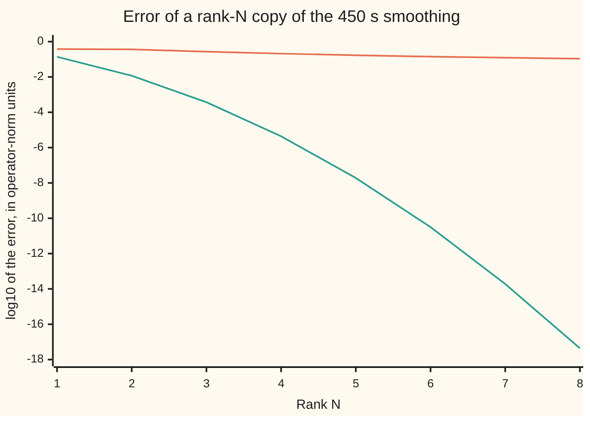

# Compact operators: the maps that still behave like finite matrices

[Syllabus](../../../SYLLABUS.md) → [Functional analysis](../README.md) → [Bounded Operators](../README.md#s03) → Compact operators

---

## General Overview

A copper rod 1 m long comes out of an oven. Its ends sit in iced water, held at 0 °C. Heat spreads along the rod, and after about 450 s every bump in the start temperature has been smoothed. A start that was a flat 100 °C has its middle at 77.23 °C.

Write down every start whose root-mean-square (rms) temperature is at most 100 °C. That is an endless family of profiles: steps, spikes, wiggles of every frequency. Now smooth each one for 450 s. The smoothed family is nearly a three-number family. Every member sits within 0.0372 °C rms of a profile built from just three fixed shapes.

The smoothing is a linear operator: a rule that takes a start profile to an end profile and respects sums and multiples ([Bounded operators](01-bounded-operators-and-the-operator-norm.md)). On a grid of 100 points it would be a 100-by-100 matrix. On the real rod it acts on functions, an infinite-dimensional space, where most operators lose the habits of matrices. **Compact** operators keep them: to any accuracy, they act like a matrix of fixed finite size.

The card proves the smoothing compact, then uses the **closed-ideal rule** to show that no bounded operator can undo it.

**A kernel operator is compact because finite-rank operators approach it in the operator norm, and compact operators form a closed ideal: sums, norm limits and products with bounded operators stay compact, so the identity, which is not compact, can never be a bounded operator times the smoothing.**

**What kind of fact this is:** theorems, proved on this card in Why it works: finite-rank operators are compact, norm limits of compact operators are compact, the Hilbert-Schmidt bound, the ideal rule, and the missing bounded inverse. That every compact operator on a Hilbert space is a norm limit of finite-rank ones is stated with a named source. So is Enflo's 1973 Banach space where this fails.

### The picture: two ways to cut the smoothing down to rank N



The upper line averages the kernel over an N-by-N grid and plots the rms gap between the two kernels, an upper bound on the operator-norm error (Step 3); it falls like 0.85/N. The lower line keeps the N slowest-fading sine modes; its error is the fraction of mode N + 1 that survives, and it plunges. Both close in on the smoothing, so both prove it compact.

---

## The formula

Notation first, in words.

- $`H = L^2(0, 1)`$ is the space of temperature profiles $`f`$ on the rod, with size $`\|f\|_2`$: the square root of the integral of $`f^2`$. On a 1 m rod this is the rms temperature, in °C.
- An **integral operator** $`K`$ with **kernel** $`k(x, y)`$ mixes the start values at every point $`y`$ into the end value at $`x`$ ([Three model operators](02-integral-operators-and-the-shift.md)).
- The **operator norm** $`\|T\|`$ is the largest gain of an operator $`T`$: the most it multiplies the size of any profile.
- An operator has **finite rank** N when all its outputs lie in an N-dimensional space ([Rank and nullity](../../03-Algebra/05-Solving%20Systems/05-rank-nullity.md)).
- An operator $`T`$ is **compact** when every bounded list of inputs has a sub-list whose outputs converge in $`\|\cdot\|_2`$. Put another way, the outputs of all inputs of size at most 1 can be covered by finitely many balls of any radius ([Compactness three ways](../../17-Topology/01-Metric%20Spaces/06-compactness-in-metric-spaces.md)).

The smoothing for time $`t`$, with $`\kappa`$ the rod's thermal diffusivity. Lengths are in metres, so on the 1 m rod $`\kappa t`$ in m^2 is read as a plain number:

```math
(Kf)(x) = \int_0^1 k(x, y)\, f(y)\, dy, \qquad k(x, y) = \sum_{n=1}^{\infty} 2\lambda_n \sin(n\pi x)\sin(n\pi y), \qquad \lambda_n = e^{-n^2\pi^2\kappa t}
```

**Read it aloud:** the end temperature at x is a weighted blend of the start temperatures; the weights are sine shapes, and shape n survives only the fraction $`\lambda_n`$.

The theorem the card proves:

```math
\mathrm{rank}\, K_N \le N \ \text{ and } \ \|K - K_N\| \to 0 \implies K \text{ is compact}, \qquad \|K - K_N\| \le \|k - k_N\|_{L^2([0,1]^2)}
```

**Read it aloud:** if operators with N-dimensional outputs come as close as wanted to K in the operator norm, K is compact; and the gap in operator norm is at most the root-mean-square gap between the two kernels over the square.

The rule the card uses, for compact $`K`$ and $`L`$ and bounded $`A`$ and $`B`$:

```math
K + L, \quad \alpha K, \quad A K B \ \text{ are compact}; \qquad \|K_j - K\| \to 0 \text{ with each } K_j \text{ compact} \implies K \text{ compact}
```

**Read it aloud:** compact operators are closed under adding, scaling, and squeezing between bounded operators, and a limit of them in the operator norm is compact too.

The **Hilbert-Schmidt norm** $`\|K\|_{HS}`$ is the rms size of the kernel over the square, $`\|k\|_{L^2([0,1]^2)}`$. Here it is 0.626213, just above $`\|K\|`$ = 0.610498.

| Symbol | Plain meaning | In our example | Push it up and the answer… |
| --- | --- | --- | --- |
| $`x`$, $`y`$ | positions along the rod, in m | the middle, 0.5 | — |
| $`H`$, $`f`$, $`\Vert f\Vert_2`$ | the profile space; a start profile in °C; its rms size | the flat start; 100 °C | outputs scale with it |
| $`\kappa`$, $`t`$ | thermal diffusivity in m^2/s; smoothing time in s | 1.11e-4 (illustrative) and 450.5; only κt = 0.05 m^2 enters the numbers | more smoothing, fewer modes needed |
| $`k(x, y)`$, $`K`$, $`L`$ | the kernel, per m; the smoothing operator; a second compact operator | heat from y reaching x | — |
| $`v_n`$, $`c_n`$ | mode n, $`\sqrt{2}\sin(n\pi x)`$, of rms 1; the start's amount of it, in °C | $`c_1`$ = 90.0316 | — |
| $`\lambda_n`$ | the fraction of mode n that survives | 0.6105, 0.1389, 0.01178, 3.7235e-04 | — |
| $`N`$, $`K_N`$, $`k_N`$ | a rank; a finite-rank copy of $`K`$; its kernel | N = 3 | smaller error |
| $`P_N`$ | keeps a profile's first N modes, smoothing nothing | N = 9: 20.10 °C missed | — |
| $`T`$, $`F`$, $`\Vert T\Vert`$ | any operator; any finite-rank operator; its largest gain | $`\Vert K\Vert`$ = 0.610498 | — |
| $`\Vert K\Vert_{HS}`$ | rms size of the kernel over the square | 0.626213 | — |
| $`A`$, $`B`$, $`I`$, $`\alpha`$ | bounded operators; the identity, which changes nothing; a number | $`B`$ a would-be un-smoother | — |
| $`\varepsilon`$ | a target accuracy, as a fraction of the input size | 1% needs 3 modes | more modes |

### When it holds

- **Convergence in the operator norm.** Keeping N modes, $`P_N`$, approaches the identity one profile at a time: the flat start misses 43.52, 20.10, 6.37, 2.01 °C rms at N = 1, 9, 99, 999. Yet mode N + 1 is always missed by 1.000000 in full, so $`\|I - P_N\|`$ stays 1. No finite-rank cut does better: a finite-rank $`F`$ sends some profile of size 1 to 0, and $`I - F`$ leaves that profile whole, so $`\|I - F\| \ge 1`$ for every such $`F`$. The identity is no norm limit of finite-rank operators, and Step 6 shows it is not compact.
- **Some smoothing, $`t > 0`$.** At $`t = 0`$ the smoothing is the identity. As κt shrinks from 0.05 to 0.005 to 0.0005 m^2, a 1% copy needs 3, then 9, then 30 modes; at 0, no number of modes is enough.
- **A square-integrable kernel, for the Hilbert-Schmidt bound.** The bound needs $`\|k\|_{L^2}`$ finite. The identity's "kernel" is a spike on the diagonal with no finite rms size.
- **A finite rod.** The audio blur on an endless clip is not compact: it treats a click far down the clip exactly like a click at the start, so clicks moving away stay apart ([Three model operators](02-integral-operators-and-the-shift.md)).
- **Bounded partners in the ideal rule.** An unbounded partner can undo compactness. Running the heat equation backwards is unbounded, and after the smoothing it gives back the identity.

---

## Why it works

### Step 0: the idea, finitely many numbers at every accuracy

A matrix of size N sends the unit ball into an N-dimensional space. There, closed and bounded means compact, so the outputs crowd together.

An operator close to such a matrix, within ε in the operator norm, sends the unit ball to within ε of a crowded set. Do this for every ε and the outputs can be covered by finitely many small balls at every radius. That is compactness. So the whole proof is: find finite-rank operators as close as wanted.

### Step 1: finite rank means compact

A bounded operator of rank N sends inputs of size at most 1 to outputs of size at most its norm, all inside one N-dimensional space. In N dimensions a closed bounded set is compact (Heine-Borel, on [Compactness three ways](../../17-Topology/01-Metric%20Spaces/06-compactness-in-metric-spaces.md)). So every bounded list of inputs has a sub-list whose outputs converge.

The rank-3 mode copy of the smoothing sends every start into the span of $`v_1`$, $`v_2`$, $`v_3`$. Each output is three numbers.

### Step 2: a limit in the operator norm stays compact

Suppose $`\|K - K_N\|`$ is below ε/3. Cover the outputs of $`K_N`$ by finitely many balls of radius ε/3. Each true output $`Kf`$ is within ε/3 of $`K_N f`$, so doubling the radius covers it. Every radius works, so the outputs of $`K`$ are totally bounded (coverable by finitely many balls at every radius). In the complete space $`H`$ their closure is compact.

<details>
<summary>Detailed proof: the norm limit of compact operators is compact</summary>

Let each $`K_j`$ be compact and $`\|K_j - K\| \to 0`$. Take ε > 0 and choose $`j`$ with $`\|K_j - K\| < \varepsilon/3`$.

The set of outputs $`K_j f`$ with $`\|f\|_2 \le 1`$ has compact closure, so finitely many points $`g_1, \dots, g_m`$ come within ε/3 of every one of those outputs.

Now take any $`f`$ of size at most 1. Pick $`g_i`$ within ε/3 of $`K_j f`$. Then

$`\displaystyle \|Kf - g_i\|_2 \le \|Kf - K_j f\|_2 + \|K_j f - g_i\|_2 < \tfrac{\varepsilon}{3} + \tfrac{\varepsilon}{3} < \varepsilon .`$

So finitely many balls of radius ε cover the outputs of $`K`$, for every ε. A totally bounded set in a complete space has compact closure ([Compactness three ways](../../17-Topology/01-Metric%20Spaces/06-compactness-in-metric-spaces.md)), so $`K`$ is compact. The limit is bounded to begin with: $`K = K_j + (K - K_j)`$ is a sum of two bounded operators ([Bounded operators](01-bounded-operators-and-the-operator-norm.md)).

</details>

### Step 3: the kernel's rms size bounds the operator norm

Write $`(Kf)(x)`$ as an integral against $`k(x, \cdot)`$. The Cauchy-Schwarz inequality bounds it by the rms size of that row of the kernel times $`\|f\|_2`$. Square and integrate over $`x`$:

```math
\|Kf\|_2 \le \|k\|_{L^2([0,1]^2)}\, \|f\|_2, \qquad \text{so} \qquad \|K\| \le \|K\|_{HS}
```

**Read it aloud:** an integral operator's gain is at most the rms size of its kernel over the square.

On the rod, $`\|K\|`$ = 0.610498 and $`\|K\|_{HS}`$ = 0.626213. Apply the bound to the difference $`K - K_N`$, whose kernel is $`k - k_N`$: a small kernel gap means a small operator gap.

<details>
<summary>Detailed proof: the Hilbert-Schmidt bound</summary>

For each fixed $`x`$, the Cauchy-Schwarz inequality on $`L^2(0, 1)`$ gives

$`\displaystyle |(Kf)(x)|^2 = \Big|\int_0^1 k(x, y) f(y)\, dy\Big|^2 \le \int_0^1 k(x, y)^2\, dy \cdot \int_0^1 f(y)^2\, dy .`$

Integrate over $`x`$ from 0 to 1:

$`\displaystyle \|Kf\|_2^2 \le \int_0^1\!\!\int_0^1 k(x, y)^2\, dy\, dx \cdot \|f\|_2^2 = \|K\|_{HS}^2\, \|f\|_2^2 .`$

Taking square roots gives the bound. Since $`K - K_N`$ is the integral operator with kernel $`k - k_N`$, the same line gives $`\|K - K_N\| \le \|k - k_N\|_{L^2}`$.

</details>

### Step 4: any continuous kernel is a limit of grid kernels

Cut the square into N-by-N equal cells. On each cell, replace $`k`$ by its average there; call the result $`k_N`$. The operator with kernel $`k_N`$ gives outputs that are constant on each of N strips of the rod, so its rank is at most N.

A continuous kernel on a closed square is uniformly continuous: it varies little inside any small enough cell. So $`\|k - k_N\|_{L^2}`$ shrinks to 0, and Step 3 turns that into $`\|K - K_N\| \to 0`$. Step 2 then makes $`K`$ compact.

On the rod the grid cut's kernel gap is 0.3824 at N = 1 and 0.1067 at N = 8, by quadrature and again from closed-form integrals of the sine modes over each cell. N times the error settles near 0.85, so the error falls like 1/N. The argument used only continuity: it works for any continuous kernel, and with a little more care for any square-integrable kernel.

### Step 5: keeping modes is the best cut

The heat smoothing has a better cut. Separation of variables ([Separation of variables](../../08-Differential%20equations%20and%20dynamics/10-The%20Classical%20PDEs/04-separation-of-variables-for-the-heat-equation.md)) writes the smoothing as: take the start's amount $`c_n`$ of each mode, multiply it by $`\lambda_n`$, add up. Keep only modes 1 to N and the error is exactly the largest dropped factor:

```math
\|K - K_N\| = \lambda_{N+1} = e^{-(N+1)^2\pi^2\kappa t}
```

**Read it aloud:** the worst profile for the N-mode copy is mode N + 1, and it misses that mode's surviving fraction in full.

For N = 3 that is 3.7235e-04: any 100 °C start is copied to within 0.0372 °C rms. Power iteration on the 120-point matrix of $`K - K_3`$ measures the same 3.7235e-04. No rank-N copy does better. The matrix version of that claim is Eckart-Young on [Singular value decomposition](../../16-Numerical%20analysis/03-Numerical%20Linear%20Algebra/08-svd-and-the-pseudoinverse.md), where dropping the smallest singular values gives the closest low-rank table. Here the factors $`\lambda_n`$ are the operator's singular values and the modes its singular functions, made general on [Compact and symmetric](08-spectral-theorem-for-compact-self-adjoint-operators.md).

At N = 8 the grid cut misses by at most 0.1067 and the mode cut by exactly 4.369e-18. The grid cut ignores the kernel's structure; the mode cut follows it. Either proves compactness, because either error goes to 0.

The largest gain, 0.6105, is reached: mode 1 comes out at exactly 0.6105 times its size. A compact symmetric operator always reaches its largest gain at an eigenvector, proved on [Compact and symmetric](08-spectral-theorem-for-compact-self-adjoint-operators.md). The endless blur of [Three model operators](02-integral-operators-and-the-shift.md) never reaches its gain.

### Step 6: the closed-ideal rule

Three closure facts, each a line.

1. **Sums and multiples.** If $`K`$ and $`L`$ are compact, take a bounded list, pick a sub-list where the $`K`$ outputs converge, then a further sub-list where the $`L`$ outputs converge. Then $`K + L`$ converges on it too.
2. **Products with bounded operators.** A bounded $`A`$ is continuous, so it sends a converging sub-list of outputs to a converging list: $`AK`$ is compact. A bounded $`B`$ sends bounded lists to bounded lists, so $`KB`$ is compact.
3. **Limits.** Step 2.

Together these make the compact operators a **closed two-sided ideal** of the bounded operators: closed under limits in the operator norm, and absorbing products from either side.

A sharp use follows. Suppose a bounded $`B`$ undid the smoothing, $`BK = I`$. The rule makes $`I`$ compact. But the identity sends modes 1 and 2, of size 1, to themselves, and they stay 1.414214 apart, as all distinct modes do. No sub-list of the modes converges ([Infinite dimensions](../01-Normed%20and%20Banach%20Spaces/05-why-infinite-dimensions-are-different.md)). So no bounded un-smoother exists.

The numbers show the same thing. Un-smoothing mode n means multiplying it by $`1/\lambda_n`$: 1.6380 for mode 1, 84.887 for mode 3, 2.2798e+05 for mode 5. Those factors grow without bound, so the inverse has no finite gain.

### What the truncation hides, and the converse

Every computation on this card is a truncation: a grid, or a finite list of modes. On a grid, every matrix is compact, and the invertible ones have a bounded inverse. Compactness only shows as a trend over N: the error of a rank-N copy closes to 0. For the identity it stays at 1 for every N.

On a Hilbert space the converse holds: every compact operator is a norm limit of finite-rank ones (Conway, Chapter II). On some Banach spaces it fails. Enflo built one in 1973: a Banach space where some compact operators are not norm limits of finite-rank ones.

---

## Worked numbers, by hand

The flat 100 °C start, smoothed with κt = 0.05 m^2. Only odd modes appear in a flat start, and $`\sin(n\pi/2)`$ is +1, −1, +1 for n = 1, 3, 5.

| Step | Arithmetic | Value |
| --- | --- | --- |
| survival of mode 1 | $`e^{-\pi^2 \times 0.05}`$ | 0.6105 |
| survival of modes 3, 4, 5 | $`e^{-9\pi^2 \times 0.05}`$, $`e^{-16\pi^2 \times 0.05}`$, $`e^{-25\pi^2 \times 0.05}`$ | 0.01178, 3.7235e-04, 4.3864e-06 |
| amounts of modes 1, 3, 5 | $`2\sqrt{2} \times 100/(n\pi)`$ | 90.0316, 30.0105, 18.0063 °C |
| after smoothing | $`\lambda_n c_n`$ | 54.964, 0.35353, 7.8983e-05 °C |
| middle of the rod | $`\sqrt{2} \times (54.964 - 0.35353 + 7.8983 \times 10^{-5})`$ | **77.23 °C** |
| rank-3 copy, worst case for any 100 °C start | $`100 \times \lambda_4`$ | **0.0372 °C rms** |
| rank-3 copy, the flat start itself | mode 5 onwards, $`\lambda_5 c_5`$ and smaller | 7.8983e-05 °C rms |
| un-smoothing 0.001 °C of noise in mode 5 | $`0.001/\lambda_5`$ | **228.0 °C** |

Seven and a half minutes after the ends go into ice, the middle is at 77.23 °C, the value [Separation of variables](../../08-Differential%20equations%20and%20dynamics/10-The%20Classical%20PDEs/04-separation-of-variables-for-the-heat-equation.md) finds. Three numbers describe any smoothed 100 °C start to within 0.0372 °C. Running the clock backwards turns a thousandth of a degree into 228 °C.

### What breaks if you drop a piece

| Mistake | Comes out at | What went wrong |
| --- | --- | --- |
| No smoothing, κt shrinking to 0 | modes for 1%: 3, 9, 30, then none up to a million | the identity is not compact |
| Pointwise taken for operator-norm convergence | flat start missed by 43.52, 20.10, 6.37, 2.01 °C rms, yet mode N + 1 missed by 1.000000 at every N | $`P_N`$ approaches $`I`$ one profile at a time only |
| Undoing the smoothing | 0.001 °C of noise in mode 5 becomes 228.0 °C | the inverse is unbounded, as the ideal rule forces |

The code prints all three.

---

## Code, from first principles, and it actually runs

The code smooths the rod and checks each claim by two roads that share no arithmetic.

- **The kernel:** sine modes, and bell curves with mirror images ([The heat kernel](../../08-Differential%20equations%20and%20dynamics/10-The%20Classical%20PDEs/10-the-heat-kernel.md)).
- **The middle temperature:** modes, and quadrature (adding the kernel times the start over 2000 small pieces).
- **The norms:** formulas, against power iteration on a 120-point matrix and quadrature on an 840-by-840 grid. The mode cut's error $`\|K - K_3\|`$ is measured the same way, by power iteration on that matrix minus its three-mode part.
- **The grid cut:** quadrature on the 840-by-840 grid, against closed-form integrals of the sine modes over each cell. It must also land between the best rank-N error and the full kernel size.
- **The missed mode:** $`I - P_N`$ applied to mode N + 1 on a 2000-point grid, by subtracting its overlap with each kept mode.

### Python

```python
# Compact operators -- the check behind the card.  Standard library only.
# A copper rod 1 m long, ends held at 0 C, smooths for about 450 s.  K maps the start
# profile f to the profile 450 s later: (Kf)(x) = integral of k(x, y) f(y) dy.
# Roads: the kernel two ways (sine modes, mirror images); finite-rank cuts two
# ways (keep N modes, average k on an N-by-N grid); norms by formula, power
# iteration and quadrature.  Every computation is a truncation of the rod.
import math

KAPPA, KT = 1.11e-4, 0.05                # m^2/s (copper, illustrative); kappa*t, m^2
T = KT / KAPPA                            # seconds of smoothing, about 450

def lam(n):                               # factor by which mode n survives
    return math.exp(-n * n * math.pi ** 2 * KT)

def k_modes(x, y, terms=30):              # road one: sum of sine modes
    return sum(2 * lam(n) * math.sin(n * math.pi * x) * math.sin(n * math.pi * y)
               for n in range(1, terms + 1))

def k_images(x, y):                       # road two: bell curves and mirror images
    g = lambda z: math.exp(-z * z / (4 * KT)) / math.sqrt(4 * math.pi * KT)
    return sum(g(x - y + 2 * m) - g(x + y + 2 * m) for m in range(-2, 3))

def sci(v, d):                            # one fixed scientific format
    return f"{v:.{d}e}"

print(f"kappa*t = {KAPPA:.3e} m^2/s x {T:.1f} s = {KT:.2f} m^2")
for n in range(1, 10):
    print(f"mode {n}: lambda = {sci(lam(n), 4)}")
grid = [i / 20 for i in range(21)]
gap = max(abs(k_modes(x, y) - k_images(x, y)) for x in grid for y in grid)
print(f"kernel, sine modes against mirror images, 21 x 21 grid, worst gap below 1e-12 per m: {'yes' if gap < 1e-12 else 'no'}")

# The flat 100 C start: middle of the rod after 450 s, two roads.
c = {n: (math.sqrt(2) * 100 * 2 / (n * math.pi) if n % 2 else 0.0) for n in range(1, 2001)}
mid_modes = sum(lam(n) * c[n] * math.sqrt(2) * math.sin(n * math.pi / 2) for n in range(1, 40))
Q = 2000
mid_quad = sum(k_images(0.5, (j + 0.5) / Q) * 100 / Q for j in range(Q))
print(f"flat 100 C start, middle after 450 s: modes {mid_modes:.4f} C, quadrature {mid_quad:.4f} C")
for n in (1, 3, 5):
    print(f"mode {n}: amount c = {c[n]:.4f} C, after smoothing lambda*c = {sci(lam(n) * c[n], 4)} C")
for N in (1, 2, 3):
    tail = math.sqrt(sum((lam(n) * c[n]) ** 2 for n in range(N + 1, 60)))
    print(f"modes kept {N}: rms error {sci(tail, 4)} C, bound lambda_{N + 1} x 100 C = {sci(lam(N + 1) * 100, 4)} C")
    assert tail <= lam(N + 1) * 100                              # the norm bound holds

# Norms: ||K|| by power iteration, ||K||_HS by quadrature, against the formulas.
P = 120
xs = [(i + 0.5) / P for i in range(P)]
A = [[k_images(x, y) / P for y in xs] for x in xs]
v = [1.0] * P
for _ in range(60):
    w = [sum(a * b for a, b in zip(row, v)) for row in A]
    s = math.sqrt(sum(t * t for t in w))
    v = [t / s for t in w]
rq = sum(vi * sum(a * b for a, b in zip(row, v)) for vi, row in zip(v, A))
print(f"||K||: formula lambda_1 = {lam(1):.6f}, power iteration on {P} points = {rq:.6f}")
B = [[a - sum(2 * lam(n) * math.sin(n * math.pi * x) * math.sin(n * math.pi * y) for n in (1, 2, 3)) / P
      for a, y in zip(row, xs)] for row, x in zip(A, xs)]                # K - K_3 on the grid
v = list(xs)                              # a start holding every mode, odd and even
for _ in range(30):
    w = [sum(a * b for a, b in zip(row, v)) for row in B]
    s = math.sqrt(sum(t * t for t in w))
    v = [t / s for t in w]
cut3 = sum(vi * sum(a * b for a, b in zip(row, v)) for vi, row in zip(v, B))
print(f"||K - K_3||: formula lambda_4 = {sci(lam(4), 4)}, power iteration on {P} points = {sci(cut3, 4)}")
M = 840                                   # fine grid; 840 is divisible by 1..8
h = 1.0 / M
fx = [(i + 0.5) * h for i in range(M)]
F = [[0.0] * M for _ in range(M)]
for i in range(M):
    for j in range(i, M):
        F[i][j] = F[j][i] = k_images(fx[i], fx[j])
hs_quad = math.sqrt(sum(t * t for row in F for t in row) * h * h)
hs_form = math.sqrt(sum(lam(n) ** 2 for n in range(1, 40)))
print(f"||K||_HS: formula sqrt(sum lambda^2) = {hs_form:.6f}, quadrature on {M} x {M} = {hs_quad:.6f}")

# Finite-rank cuts: average k over an N-by-N grid (rank <= N), against keeping N modes.
S = [[0.0] * (M + 1) for _ in range(M + 1)]         # running sums for block sums
for i in range(M):
    for j in range(M):
        S[i + 1][j + 1] = F[i][j] + S[i][j + 1] + S[i + 1][j] - S[i][j]
sq = sum(t * t for row in F for t in row)
errs, errs_cf = {}, {}
for N in range(1, 9):
    b = M // N
    cell = {n: [(math.cos(n * math.pi * I / N) - math.cos(n * math.pi * (I + 1) / N)) / (n * math.pi)
                for I in range(N)] for n in range(1, 40)}          # integrals of mode n over strips
    kept = sum(sum(2 * lam(n) * cell[n][I] * cell[n][J] for n in cell) ** 2
               for I in range(N) for J in range(N)) * N * N
    errs_cf[N] = math.sqrt(hs_form ** 2 - kept)                    # second road, no quadrature
    lost = sum((S[(I + 1) * b][(J + 1) * b] - S[I * b][(J + 1) * b] - S[(I + 1) * b][J * b]
                + S[I * b][J * b]) ** 2 / (b * b) for I in range(N) for J in range(N))
    errs[N] = math.sqrt(max(sq - lost, 0.0) * h * h)
    print(f"N = {N}: grid cut rank <= {N}, HS error {errs[N]:.4f} (log10 {math.log10(errs[N]):.2f});"
          f" mode cut error lambda_{N + 1} = {sci(lam(N + 1), 3)} (log10 {math.log10(lam(N + 1)):.2f})")
print(f"grid cut, N x error: N=2 {2 * errs[2]:.4f}, N=4 {4 * errs[4]:.4f}, N=8 {8 * errs[8]:.4f}")
gap_cf = max(abs(errs[N] - errs_cf[N]) for N in errs)
print(f"grid cut from closed-form cell integrals: N=1 {errs_cf[1]:.4f}, N=8 {errs_cf[8]:.4f};"
      f" every N within 1e-4 of the quadrature: {'yes' if gap_cf < 1e-4 else 'no'}")

# The closed-ideal rule: an inverse would make the identity compact.
for n in (1, 3, 5):
    print(f"undo mode {n}: multiply by 1/lambda = {sci(1 / lam(n), 4)}")
print(f"0.001 C of noise in mode 5, smoothing undone: {1e-3 / lam(5):.1f} C")

# What breaks: no smoothing.  Modes needed for 1% worst-case error as t shrinks.
for kt in (KT, KT / 10, KT / 100, 0.0):
    n = 1
    while math.exp(-n * n * math.pi ** 2 * kt) >= 0.01 and n < 10 ** 6:
        n += 1
    need = f"{n - 1}" if n < 10 ** 6 else "none up to a million"
    print(f"kappa*t = {kt:.7f} m^2: lambda_4 = {math.exp(-16 * math.pi ** 2 * kt):.4f}, modes for 1%: {need}")
mode_gap = math.sqrt(sum((math.sqrt(2) * (math.sin(math.pi * x) - math.sin(2 * math.pi * x))) ** 2
                         for x in fx) * h)
print(f"no smoothing: modes 1 and 2 stay {mode_gap:.6f} apart, as sqrt(2) = {math.sqrt(2):.6f}")
gq = [(j + 0.5) / Q for j in range(Q)]    # 2000 points keep modes up to 1999 apart
for N in (1, 9, 99, 999):
    rest = math.sqrt(max(100 ** 2 - sum(c[n] ** 2 for n in range(1, N + 1)), 0.0))
    u = [math.sqrt(2) * math.sin((N + 1) * math.pi * x) for x in gq]
    for n in range(1, N + 1):                                    # apply I - P_N to mode N+1
        vn = [math.sqrt(2) * math.sin(n * math.pi * x) for x in gq]
        d = sum(a * b for a, b in zip(u, vn)) / Q
        u = [a - d * b for a, b in zip(u, vn)]
    left = math.sqrt(sum(a * a for a in u) / Q)
    print(f"no smoothing, modes kept {N}: flat start misses {rest:.4f} C rms; mode {N + 1} misses {left:.6f}")
    assert abs(left - 1) < 1e-9                                  # mode N+1 missed in full

assert gap < 1e-12                                               # two kernels agree
assert abs(mid_modes - mid_quad) < 1e-4 and round(mid_quad, 2) == 77.23   # midpoint error ~ h^2
assert abs(rq - lam(1)) < 1e-4                                   # power iteration finds ||K||
assert abs(cut3 - lam(4)) < 1e-9                                 # measured ||K - K_3|| = lambda_4
assert abs(hs_quad - hs_form) < 1e-5                             # HS norm two roads
assert gap_cf < 1e-4                                             # grid cut two roads
assert all(errs[N + 1] < errs[N] for N in range(1, 8)) and 1.8 < errs[4] / errs[8] < 2.2
assert all(math.sqrt(sum(lam(n) ** 2 for n in range(N + 1, 40))) <= errs[N] <= hs_quad
           for N in range(1, 9))                                 # best rank-N cut, and a projection
assert abs(mode_gap - math.sqrt(2)) < 1e-9 and 1e-3 / lam(5) > 100
print("ALL CHECKS PASS")
```

**Ran 2026-11-15 on macOS, Python 3.14.10, standard library only. All checks passed. Output, pasted from the run:**

```
kappa*t = 1.110e-04 m^2/s x 450.5 s = 0.05 m^2
mode 1: lambda = 6.1050e-01
mode 2: lambda = 1.3891e-01
mode 3: lambda = 1.1780e-02
mode 4: lambda = 3.7235e-04
mode 5: lambda = 4.3864e-06
mode 6: lambda = 1.9259e-08
mode 7: lambda = 3.1516e-11
mode 8: lambda = 1.9222e-14
mode 9: lambda = 4.3694e-18
kernel, sine modes against mirror images, 21 x 21 grid, worst gap below 1e-12 per m: yes
flat 100 C start, middle after 450 s: modes 77.2312 C, quadrature 77.2312 C
mode 1: amount c = 90.0316 C, after smoothing lambda*c = 5.4964e+01 C
mode 3: amount c = 30.0105 C, after smoothing lambda*c = 3.5353e-01 C
mode 5: amount c = 18.0063 C, after smoothing lambda*c = 7.8983e-05 C
modes kept 1: rms error 3.5353e-01 C, bound lambda_2 x 100 C = 1.3891e+01 C
modes kept 2: rms error 3.5353e-01 C, bound lambda_3 x 100 C = 1.1780e+00 C
modes kept 3: rms error 7.8983e-05 C, bound lambda_4 x 100 C = 3.7235e-02 C
||K||: formula lambda_1 = 0.610498, power iteration on 120 points = 0.610498
||K - K_3||: formula lambda_4 = 3.7235e-04, power iteration on 120 points = 3.7235e-04
||K||_HS: formula sqrt(sum lambda^2) = 0.626213, quadrature on 840 x 840 = 0.626213
N = 1: grid cut rank <= 1, HS error 0.3824 (log10 -0.42); mode cut error lambda_2 = 1.389e-01 (log10 -0.86)
N = 2: grid cut rank <= 2, HS error 0.3654 (log10 -0.44); mode cut error lambda_3 = 1.178e-02 (log10 -1.93)
N = 3: grid cut rank <= 3, HS error 0.2704 (log10 -0.57); mode cut error lambda_4 = 3.723e-04 (log10 -3.43)
N = 4: grid cut rank <= 4, HS error 0.2081 (log10 -0.68); mode cut error lambda_5 = 4.386e-06 (log10 -5.36)
N = 5: grid cut rank <= 5, HS error 0.1685 (log10 -0.77); mode cut error lambda_6 = 1.926e-08 (log10 -7.72)
N = 6: grid cut rank <= 6, HS error 0.1414 (log10 -0.85); mode cut error lambda_7 = 3.152e-11 (log10 -10.50)
N = 7: grid cut rank <= 7, HS error 0.1217 (log10 -0.91); mode cut error lambda_8 = 1.922e-14 (log10 -13.72)
N = 8: grid cut rank <= 8, HS error 0.1067 (log10 -0.97); mode cut error lambda_9 = 4.369e-18 (log10 -17.36)
grid cut, N x error: N=2 0.7308, N=4 0.8323, N=8 0.8539
grid cut from closed-form cell integrals: N=1 0.3824, N=8 0.1067; every N within 1e-4 of the quadrature: yes
undo mode 1: multiply by 1/lambda = 1.6380e+00
undo mode 3: multiply by 1/lambda = 8.4887e+01
undo mode 5: multiply by 1/lambda = 2.2798e+05
0.001 C of noise in mode 5, smoothing undone: 228.0 C
kappa*t = 0.0500000 m^2: lambda_4 = 0.0004, modes for 1%: 3
kappa*t = 0.0050000 m^2: lambda_4 = 0.4540, modes for 1%: 9
kappa*t = 0.0005000 m^2: lambda_4 = 0.9241, modes for 1%: 30
kappa*t = 0.0000000 m^2: lambda_4 = 1.0000, modes for 1%: none up to a million
no smoothing: modes 1 and 2 stay 1.414214 apart, as sqrt(2) = 1.414214
no smoothing, modes kept 1: flat start misses 43.5236 C rms; mode 2 misses 1.000000
no smoothing, modes kept 9: flat start misses 20.0986 C rms; mode 10 misses 1.000000
no smoothing, modes kept 99: flat start misses 6.3661 C rms; mode 100 misses 1.000000
no smoothing, modes kept 999: flat start misses 2.0132 C rms; mode 1000 misses 1.000000
ALL CHECKS PASS
```

### Rust

Same numbers, same labels, built with `rustc --edition 2021 -O`.

```rust
// Compact operators -- the same check as the Python, in Rust.  No crates.
// A copper rod 1 m long, ends held at 0 C, smooths for about 450 s.  K maps the start
// profile f to the profile 450 s later: (Kf)(x) = integral of k(x, y) f(y) dy.
// Roads: the kernel two ways (sine modes, mirror images); finite-rank cuts two
// ways (keep N modes, average k on an N-by-N grid); norms by formula, power
// iteration and quadrature.  Every computation is a truncation of the rod.
use std::f64::consts::PI;

const KAPPA: f64 = 1.11e-4; // m^2/s (copper, illustrative)
const KT: f64 = 0.05; // kappa*t, m^2

fn lam(n: f64) -> f64 { (-n * n * PI * PI * KT).exp() } // factor by which mode n survives

fn k_modes(x: f64, y: f64) -> f64 { // road one: sum of sine modes
    (1..=30).map(|n| { let n = n as f64; 2.0 * lam(n) * (n * PI * x).sin() * (n * PI * y).sin() }).sum()
}

fn k_images(x: f64, y: f64) -> f64 { // road two: bell curves and mirror images
    let g = |z: f64| (-z * z / (4.0 * KT)).exp() / (4.0 * PI * KT).sqrt();
    (-2..=2).map(|m| { let m = m as f64; g(x - y + 2.0 * m) - g(x + y + 2.0 * m) }).sum()
}

fn sci(v: f64, d: usize) -> String { // the Python format: mantissa e sign two-digit exponent
    let s = format!("{:.*e}", d, v);
    let (m, e) = s.split_once('e').unwrap();
    let e: i32 = e.parse().unwrap();
    format!("{}e{}{:02}", m, if e < 0 { '-' } else { '+' }, e.abs())
}

fn main() {
    let t = KT / KAPPA; // seconds of smoothing, about 450
    println!("kappa*t = {} m^2/s x {:.1} s = {:.2} m^2", sci(KAPPA, 3), t, KT);
    for n in 1..10 { println!("mode {}: lambda = {}", n, sci(lam(n as f64), 4)); }
    let mut gap: f64 = 0.0;
    for i in 0..21 { for j in 0..21 {
        let (x, y) = (i as f64 / 20.0, j as f64 / 20.0);
        gap = gap.max((k_modes(x, y) - k_images(x, y)).abs());
    } }
    println!("kernel, sine modes against mirror images, 21 x 21 grid, worst gap below 1e-12 per m: {}", if gap < 1e-12 { "yes" } else { "no" });

    // The flat 100 C start: middle of the rod after 450 s, two roads.
    let c = |n: usize| if n % 2 == 1 { 2f64.sqrt() * 100.0 * 2.0 / (n as f64 * PI) } else { 0.0 };
    let mid_modes: f64 = (1..40).map(|n| lam(n as f64) * c(n) * 2f64.sqrt() * (n as f64 * PI / 2.0).sin()).sum();
    let q = 2000;
    let mid_quad: f64 = (0..q).map(|j| k_images(0.5, (j as f64 + 0.5) / q as f64) * 100.0 / q as f64).sum();
    println!("flat 100 C start, middle after 450 s: modes {:.4} C, quadrature {:.4} C", mid_modes, mid_quad);
    for n in [1usize, 3, 5] {
        println!("mode {}: amount c = {:.4} C, after smoothing lambda*c = {} C", n, c(n), sci(lam(n as f64) * c(n), 4));
    }
    for nn in 1..4usize {
        let tail = (nn + 1..60).map(|n| (lam(n as f64) * c(n)).powi(2)).sum::<f64>().sqrt();
        let bound = lam((nn + 1) as f64) * 100.0;
        println!("modes kept {}: rms error {} C, bound lambda_{} x 100 C = {} C", nn, sci(tail, 4), nn + 1, sci(bound, 4));
        assert!(tail <= bound); // the norm bound holds
    }

    // Norms: ||K|| by power iteration, ||K||_HS by quadrature, against the formulas.
    let p = 120;
    let xs: Vec<f64> = (0..p).map(|i| (i as f64 + 0.5) / p as f64).collect();
    let a: Vec<Vec<f64>> = xs.iter().map(|&x| xs.iter().map(|&y| k_images(x, y) / p as f64).collect()).collect();
    let mv = |v: &Vec<f64>| -> Vec<f64> { a.iter().map(|row| row.iter().zip(v).map(|(r, s)| r * s).sum()).collect() };
    let mut v = vec![1.0; p];
    for _ in 0..60 {
        let w = mv(&v);
        let s = w.iter().map(|t| t * t).sum::<f64>().sqrt();
        v = w.iter().map(|t| t / s).collect();
    }
    let rq: f64 = v.iter().zip(mv(&v)).map(|(x, y)| x * y).sum();
    println!("||K||: formula lambda_1 = {:.6}, power iteration on {} points = {:.6}", lam(1.0), p, rq);
    let bm: Vec<Vec<f64>> = (0..p).map(|i| (0..p).map(|j| a[i][j] - [1.0, 2.0, 3.0].iter()
        .map(|&n| 2.0 * lam(n) * (n * PI * xs[i]).sin() * (n * PI * xs[j]).sin()).sum::<f64>() / p as f64).collect()).collect(); // K - K_3
    let bv = |v: &Vec<f64>| -> Vec<f64> { bm.iter().map(|row| row.iter().zip(v).map(|(r, s)| r * s).sum()).collect() };
    let mut v = xs.clone(); // a start holding every mode, odd and even
    for _ in 0..30 {
        let w = bv(&v);
        let s = w.iter().map(|t| t * t).sum::<f64>().sqrt();
        v = w.iter().map(|t| t / s).collect();
    }
    let cut3: f64 = v.iter().zip(bv(&v)).map(|(x, y)| x * y).sum();
    println!("||K - K_3||: formula lambda_4 = {}, power iteration on {} points = {}", sci(lam(4.0), 4), p, sci(cut3, 4));
    let m = 840; // fine grid; 840 is divisible by 1..8
    let h = 1.0 / m as f64;
    let fx: Vec<f64> = (0..m).map(|i| (i as f64 + 0.5) * h).collect();
    let mut f = vec![vec![0.0; m]; m];
    for i in 0..m { for j in i..m { let k = k_images(fx[i], fx[j]); f[i][j] = k; f[j][i] = k; } }
    let sq: f64 = f.iter().map(|row| row.iter().map(|t| t * t).sum::<f64>()).sum();
    let hs_quad = (sq * h * h).sqrt();
    let hs_form = (1..40).map(|n| lam(n as f64).powi(2)).sum::<f64>().sqrt();
    println!("||K||_HS: formula sqrt(sum lambda^2) = {:.6}, quadrature on {} x {} = {:.6}", hs_form, m, m, hs_quad);

    // Finite-rank cuts: average k over an N-by-N grid (rank <= N), against keeping N modes.
    let mut s = vec![vec![0.0; m + 1]; m + 1]; // running sums for block sums
    for i in 0..m { for j in 0..m { s[i + 1][j + 1] = f[i][j] + s[i][j + 1] + s[i + 1][j] - s[i][j]; } }
    let mut errs = vec![0.0; 9];
    let mut errs_cf = vec![0.0; 9];
    for nn in 1..9usize {
        let b = m / nn;
        let cell: Vec<Vec<f64>> = (1..40).map(|n| { let n = n as f64; (0..nn).map(|i| ((n * PI * i as f64 / nn as f64).cos()
            - (n * PI * (i + 1) as f64 / nn as f64).cos()) / (n * PI)).collect() }).collect(); // integrals of mode n over strips
        let mut kept = 0.0;
        for i in 0..nn { for j in 0..nn {
            let t: f64 = (0..39).map(|k| 2.0 * lam((k + 1) as f64) * cell[k][i] * cell[k][j]).sum();
            kept += t * t;
        } }
        errs_cf[nn] = (hs_form * hs_form - kept * (nn * nn) as f64).sqrt(); // second road, no quadrature
        let mut lost = 0.0;
        for bi in 0..nn { for bj in 0..nn {
            let blk = s[(bi + 1) * b][(bj + 1) * b] - s[bi * b][(bj + 1) * b] - s[(bi + 1) * b][bj * b] + s[bi * b][bj * b];
            lost += blk * blk / (b * b) as f64;
        } }
        errs[nn] = ((sq - lost).max(0.0) * h * h).sqrt();
        let lm = lam((nn + 1) as f64);
        println!("N = {}: grid cut rank <= {}, HS error {:.4} (log10 {:.2}); mode cut error lambda_{} = {} (log10 {:.2})",
                 nn, nn, errs[nn], errs[nn].log10(), nn + 1, sci(lm, 3), lm.log10());
    }
    println!("grid cut, N x error: N=2 {:.4}, N=4 {:.4}, N=8 {:.4}", 2.0 * errs[2], 4.0 * errs[4], 8.0 * errs[8]);
    let gap_cf = (1..9).map(|n| (errs[n] - errs_cf[n]).abs()).fold(0.0, f64::max);
    println!("grid cut from closed-form cell integrals: N=1 {:.4}, N=8 {:.4}; every N within 1e-4 of the quadrature: {}",
             errs_cf[1], errs_cf[8], if gap_cf < 1e-4 { "yes" } else { "no" });

    // The closed-ideal rule: an inverse would make the identity compact.
    for n in [1.0, 3.0, 5.0] { println!("undo mode {}: multiply by 1/lambda = {}", n as i32, sci(1.0 / lam(n), 4)); }
    println!("0.001 C of noise in mode 5, smoothing undone: {:.1} C", 1e-3 / lam(5.0));

    // What breaks: no smoothing.  Modes needed for 1% worst-case error as t shrinks.
    for kt in [KT, KT / 10.0, KT / 100.0, 0.0] {
        let mut n: u64 = 1;
        while (-((n * n) as f64) * PI * PI * kt).exp() >= 0.01 && n < 1_000_000 { n += 1; }
        let need = if n < 1_000_000 { format!("{}", n - 1) } else { "none up to a million".to_string() };
        println!("kappa*t = {:.7} m^2: lambda_4 = {:.4}, modes for 1%: {}", kt, (-16.0 * PI * PI * kt).exp(), need);
    }
    let mode_gap = (fx.iter().map(|&x| (2f64.sqrt() * ((PI * x).sin() - (2.0 * PI * x).sin())).powi(2)).sum::<f64>() * h).sqrt();
    println!("no smoothing: modes 1 and 2 stay {:.6} apart, as sqrt(2) = {:.6}", mode_gap, 2f64.sqrt());
    let gq: Vec<f64> = (0..q).map(|j| (j as f64 + 0.5) / q as f64).collect(); // 2000 points keep modes up to 1999 apart
    for nn in [1usize, 9, 99, 999] {
        let rest = (100f64.powi(2) - (1..=nn).map(|n| c(n).powi(2)).sum::<f64>()).max(0.0).sqrt();
        let mut u: Vec<f64> = gq.iter().map(|&x| 2f64.sqrt() * (((nn + 1) as f64) * PI * x).sin()).collect();
        for n in 1..=nn { // apply I - P_N to mode N+1
            let vn: Vec<f64> = gq.iter().map(|&x| 2f64.sqrt() * (n as f64 * PI * x).sin()).collect();
            let d = u.iter().zip(&vn).map(|(a, b)| a * b).sum::<f64>() / q as f64;
            for (a, b) in u.iter_mut().zip(&vn) { *a -= d * b; }
        }
        let left = (u.iter().map(|a| a * a).sum::<f64>() / q as f64).sqrt();
        println!("no smoothing, modes kept {}: flat start misses {:.4} C rms; mode {} misses {:.6}", nn, rest, nn + 1, left);
        assert!((left - 1.0).abs() < 1e-9); // mode N+1 missed in full
    }

    assert!(gap < 1e-12); // two kernels agree
    assert!((mid_modes - mid_quad).abs() < 1e-4 && (mid_quad * 100.0).round() == 7723.0); // midpoint error ~ h^2
    assert!((rq - lam(1.0)).abs() < 1e-4); // power iteration finds ||K||
    assert!((cut3 - lam(4.0)).abs() < 1e-9); // measured ||K - K_3|| = lambda_4
    assert!((hs_quad - hs_form).abs() < 1e-5); // HS norm two roads
    assert!(gap_cf < 1e-4); // grid cut two roads
    assert!((1..8).all(|n| errs[n + 1] < errs[n]) && 1.8 < errs[4] / errs[8] && errs[4] / errs[8] < 2.2);
    assert!((1..9).all(|nn| (nn + 1..40).map(|n| lam(n as f64).powi(2)).sum::<f64>().sqrt() <= errs[nn]
                           && errs[nn] <= hs_quad)); // best rank-N cut, and a projection
    assert!((mode_gap - 2f64.sqrt()).abs() < 1e-9 && 1e-3 / lam(5.0) > 100.0);
    println!("ALL CHECKS PASS");
}
```

**Ran 2026-11-15 on macOS, rustc 1.98.1, no crates. All checks passed. Output, pasted from the run:**

```
kappa*t = 1.110e-04 m^2/s x 450.5 s = 0.05 m^2
mode 1: lambda = 6.1050e-01
mode 2: lambda = 1.3891e-01
mode 3: lambda = 1.1780e-02
mode 4: lambda = 3.7235e-04
mode 5: lambda = 4.3864e-06
mode 6: lambda = 1.9259e-08
mode 7: lambda = 3.1516e-11
mode 8: lambda = 1.9222e-14
mode 9: lambda = 4.3694e-18
kernel, sine modes against mirror images, 21 x 21 grid, worst gap below 1e-12 per m: yes
flat 100 C start, middle after 450 s: modes 77.2312 C, quadrature 77.2312 C
mode 1: amount c = 90.0316 C, after smoothing lambda*c = 5.4964e+01 C
mode 3: amount c = 30.0105 C, after smoothing lambda*c = 3.5353e-01 C
mode 5: amount c = 18.0063 C, after smoothing lambda*c = 7.8983e-05 C
modes kept 1: rms error 3.5353e-01 C, bound lambda_2 x 100 C = 1.3891e+01 C
modes kept 2: rms error 3.5353e-01 C, bound lambda_3 x 100 C = 1.1780e+00 C
modes kept 3: rms error 7.8983e-05 C, bound lambda_4 x 100 C = 3.7235e-02 C
||K||: formula lambda_1 = 0.610498, power iteration on 120 points = 0.610498
||K - K_3||: formula lambda_4 = 3.7235e-04, power iteration on 120 points = 3.7235e-04
||K||_HS: formula sqrt(sum lambda^2) = 0.626213, quadrature on 840 x 840 = 0.626213
N = 1: grid cut rank <= 1, HS error 0.3824 (log10 -0.42); mode cut error lambda_2 = 1.389e-01 (log10 -0.86)
N = 2: grid cut rank <= 2, HS error 0.3654 (log10 -0.44); mode cut error lambda_3 = 1.178e-02 (log10 -1.93)
N = 3: grid cut rank <= 3, HS error 0.2704 (log10 -0.57); mode cut error lambda_4 = 3.723e-04 (log10 -3.43)
N = 4: grid cut rank <= 4, HS error 0.2081 (log10 -0.68); mode cut error lambda_5 = 4.386e-06 (log10 -5.36)
N = 5: grid cut rank <= 5, HS error 0.1685 (log10 -0.77); mode cut error lambda_6 = 1.926e-08 (log10 -7.72)
N = 6: grid cut rank <= 6, HS error 0.1414 (log10 -0.85); mode cut error lambda_7 = 3.152e-11 (log10 -10.50)
N = 7: grid cut rank <= 7, HS error 0.1217 (log10 -0.91); mode cut error lambda_8 = 1.922e-14 (log10 -13.72)
N = 8: grid cut rank <= 8, HS error 0.1067 (log10 -0.97); mode cut error lambda_9 = 4.369e-18 (log10 -17.36)
grid cut, N x error: N=2 0.7308, N=4 0.8323, N=8 0.8539
grid cut from closed-form cell integrals: N=1 0.3824, N=8 0.1067; every N within 1e-4 of the quadrature: yes
undo mode 1: multiply by 1/lambda = 1.6380e+00
undo mode 3: multiply by 1/lambda = 8.4887e+01
undo mode 5: multiply by 1/lambda = 2.2798e+05
0.001 C of noise in mode 5, smoothing undone: 228.0 C
kappa*t = 0.0500000 m^2: lambda_4 = 0.0004, modes for 1%: 3
kappa*t = 0.0050000 m^2: lambda_4 = 0.4540, modes for 1%: 9
kappa*t = 0.0005000 m^2: lambda_4 = 0.9241, modes for 1%: 30
kappa*t = 0.0000000 m^2: lambda_4 = 1.0000, modes for 1%: none up to a million
no smoothing: modes 1 and 2 stay 1.414214 apart, as sqrt(2) = 1.414214
no smoothing, modes kept 1: flat start misses 43.5236 C rms; mode 2 misses 1.000000
no smoothing, modes kept 9: flat start misses 20.0986 C rms; mode 10 misses 1.000000
no smoothing, modes kept 99: flat start misses 6.3661 C rms; mode 100 misses 1.000000
no smoothing, modes kept 999: flat start misses 2.0132 C rms; mode 1000 misses 1.000000
ALL CHECKS PASS
```

The two outputs match line for line.

### Lean

Lean proves the card's three theorems on any complete space with a norm, not only on $`H`$.

- Suppose each bounded $`K_N`$ has rank at most $`N`$, and $`\|K - K_N\| \to 0`$. Then $`K`$ is compact.
- Take compact $`K`$ and $`L`$, bounded $`A`$ and $`B`$, and a number $`\alpha`$. Then $`K + L`$, $`\alpha K`$ and $`A K B`$ are compact.
- A limit of compact operators in the operator norm is compact.
- Suppose $`H`$ is infinite-dimensional and $`K`$ is compact. Then no bounded $`B`$ gives $`B K = I`$.
- Take modes 1 and 2, each of size 1. Then their squared distance is exactly 2, so they stay 1.414214 apart.

The smoothing's own compactness, the Hilbert-Schmidt bound and the other printed numbers are left to the Python and Rust checks.

```lean
-- Compact operators: a norm limit of finite-rank operators is compact, compact operators form a closed two-sided ideal, and so on an infinite-dimensional space no bounded operator can undo a compact one.
import Mathlib.Analysis.Normed.Operator.Compact.FiniteDimension
import Mathlib.Analysis.InnerProductSpace.PiL2
import Mathlib.Tactic.NormNum

open Filter Topology

/-- A norm limit of finite-rank operators is compact. Let `E` be a real normed space and `H` a
complete real normed space (on the card, both are the profile space L²(0, 1)). Suppose each
`K_N : E → H` is a bounded operator of rank at most `N`: its outputs fill a finite-dimensional
space of dimension at most `N`. If the operator-norm gap `‖K - K_N‖` tends to 0 as `N` grows,
then `K` is compact. -/
theorem compact_of_norm_limit_of_finite_rank
    {E H : Type*} [NormedAddCommGroup E] [NormedSpace ℝ E]
    [NormedAddCommGroup H] [NormedSpace ℝ H] [CompleteSpace H]
    (K : E →L[ℝ] H) (KN : ℕ → E →L[ℝ] H)
    (hfin : ∀ N, FiniteDimensional ℝ (LinearMap.range (KN N : E →ₗ[ℝ] H)))
    (hrank : ∀ N, Module.finrank ℝ (LinearMap.range (KN N : E →ₗ[ℝ] H)) ≤ N)
    (hlim : Tendsto (fun N => ‖K - KN N‖) atTop (𝓝 0)) :
    IsCompactOperator K := by
  have hcomp : ∀ N, IsCompactOperator (KN N) := by
    intro N
    have := hfin N
    let R := LinearMap.range (KN N : E →ₗ[ℝ] H)
    let T : E →L[ℝ] R := (KN N).codRestrict R (fun x => LinearMap.mem_range_self _ x)
    have hT : IsCompactOperator T := isCompactOperator_of_locallyCompactSpace_dom T
    have h2 := hT.clm_comp (R.subtypeL)
    convert h2 using 1
    rfl
  have ht : Tendsto KN atTop (𝓝 K) := by
    rw [tendsto_iff_norm_sub_tendsto_zero]
    simpa [norm_sub_rev] using hlim
  exact isCompactOperator_of_tendsto ht (Eventually.of_forall hcomp)

/-- The closed-ideal rule. On a complete real normed space `H` (on the card, L²(0, 1)), take
compact operators `K` and `L`, bounded operators `A` and `B`, and a number `α`. Then `K + L`,
`α K` and `A K B` are compact; and a limit, in the operator norm, of compact operators is
compact: the set of compact operators is closed among the bounded ones. -/
theorem compact_operators_closed_ideal
    {H : Type*} [NormedAddCommGroup H] [NormedSpace ℝ H] [CompleteSpace H]
    (K L A B : H →L[ℝ] H) (α : ℝ) (hK : IsCompactOperator K) (hL : IsCompactOperator L) :
    IsCompactOperator (K + L) ∧ IsCompactOperator (α • K) ∧
      IsCompactOperator (A.comp (K.comp B)) ∧
      IsClosed {T : H →L[ℝ] H | IsCompactOperator T} := by
  refine ⟨hK.add hL, hK.smul α, ?_, isClosed_setOfPred_isCompactOperator⟩
  exact (hK.comp_clm B).clm_comp A

/-- No bounded un-smoother. On an infinite-dimensional complete real normed space `H` (such as
L²(0, 1)), a compact operator `K` has no bounded left inverse: there is no bounded `B` with
`B K = I`, because that would make the identity compact. -/
theorem no_bounded_left_inverse_of_compact
    {H : Type*} [NormedAddCommGroup H] [NormedSpace ℝ H] [CompleteSpace H]
    (hinf : ¬ FiniteDimensional ℝ H) (K : H →L[ℝ] H) (hK : IsCompactOperator K) :
    ¬ ∃ B : H →L[ℝ] H, B.comp K = ContinuousLinearMap.id ℝ H := by
  rintro ⟨B, hB⟩
  apply hinf
  have h : IsCompactOperator (B.comp K) := hK.clm_comp B
  rw [hB] at h
  exact FiniteDimensional.of_isCompactOperator_id h

/-- Modes 1 and 2 have size 1 and stay √2 = 1.414214 apart: in two coordinates, the squared
distance between the unit vectors e₁ and e₂ is exactly 2. -/
example : ‖(EuclideanSpace.single 0 1 - EuclideanSpace.single 1 1 : EuclideanSpace ℝ (Fin 2))‖ ^ 2
    = 2 := by
  rw [EuclideanSpace.real_norm_sq_eq]
  norm_num [Fin.sum_univ_two]

#print axioms compact_of_norm_limit_of_finite_rank
#print axioms compact_operators_closed_ideal
#print axioms no_bounded_left_inverse_of_compact
```

**Checked 2026-11-15 on macOS, Lean 4.36.0-rc2, Mathlib v4.36.0-rc2. Every proof is complete and uses only Lean's standard axioms. Output, pasted from the run:**

```
'compact_of_norm_limit_of_finite_rank' depends on axioms: [propext, Classical.choice, Quot.sound]
'compact_operators_closed_ideal' depends on axioms: [propext, Classical.choice, Quot.sound]
'no_bounded_left_inverse_of_compact' depends on axioms: [propext, Classical.choice, Quot.sound]
```

> [!TIP]
> **Try changing**
> Guess first, then run it. The asserts are pinned to κt = 0.05 m^2, so some experiments stop the program at an assert.
> - **Smooth for 45 s.** Set `KT` to `0.005`. Guess the middle temperature and the rank-3 error. The middle stays at 99.9999 °C, the rank-3 copy now misses the flat start by 5.3706 °C rms, and the 77.23 assert stops the run.
> - **A stricter target.** Change `0.01` in the modes-for-1% loop to `0.001`. Guess the counts. They become 3, 11 and 37 modes, and still none at κt = 0.
> - **Finer grid cuts.** Replace `range(1, 9)` in the grid-cut loop with `(1, 2, 4, 8, 12, 20, 28)` and remove the two grid asserts. The error at N = 28 is 0.0307, still near 0.85/N, while the mode cut is already below 1e-180.

---

## The usual mistake

> [!warning]
> **Thinking that every operator is compact because every operator can be truncated.** Any operator can be cut to an N-by-N matrix, $`P_N T P_N`$, and every matrix is compact. That proves nothing. Compactness needs the cut to approach $`T`$ in the operator norm. For the identity it never does: the worst profile, mode N + 1, is missed by 1.000000 at every N.
>
> - **Convergence one profile at a time.** $`P_N f`$ approaches $`f`$ for the flat start (2.01 °C rms missed at N = 999), but the worst case does not move. The closed-ideal rule needs norm limits, not pointwise ones.
> - **Reading a grid matrix's rank as the operator's.** The grid cut at N = 8 has rank at most 8, but $`K`$ itself has infinite rank: every $`\lambda_n`$ is positive, even $`\lambda_9`$ = 4.3694e-18.
> - **Inverting a compact operator as if it were a matrix.** Each grid matrix has an inverse, but its gain grows without end with N. The true inverse multiplies mode n by $`1/\lambda_n`$, so it turns 0.001 °C of noise in mode 5 into 228.0 °C.
> - **Expecting the range to be closed.** The smoothed profiles are a dense part of $`H`$ but not all of it. A profile with a sharp corner is the smoothing of no start, so "solve $`Kf = g`$" can fail outright.

---

## Where you meet it in real life

- **Inverse heat conduction.** Estimating a furnace wall's past temperature from today's readings undoes a smoothing. No bounded method exists, so engineers keep only the modes above the noise, as in truncated SVD.
- **Image deblurring.** A camera blur on a finite sensor is a kernel operator. Its fine detail fades like the high modes here, and sharpening it back multiplies the noise.
- **Reduced-order models.** Heat and flow simulations with a million grid points are often run on a few modes. Compactness is why a handful suffice: here, three modes to 0.0372 °C.
- **Integral equations.** Equations of the form $`f - Kf = g`$, with $`K`$ compact, behave like matrix equations: either a unique solution or a finite list of conditions. That is the Fredholm alternative.

> **Say it back**
> A compact operator is one that finite-rank operators approach in the operator norm, so to any accuracy it acts like a fixed-size matrix. Heat smoothing on a rod is compact: grid averages of its kernel close in like 0.85/N, and keeping three modes copies any 100 °C start to within 0.0372 °C. Sums, norm limits and products with bounded operators stay compact. So the identity, which is not compact, is never a bounded operator times the smoothing, and running the heat backwards blows up noise.

---

## What this builds on

- [Bounded operators](01-bounded-operators-and-the-operator-norm.md): the operator norm, and the completeness that makes a norm limit of operators an operator.
- [Infinite dimensions](../01-Normed%20and%20Banach%20Spaces/05-why-infinite-dimensions-are-different.md): the unit ball is not compact, which is why the identity fails here.
- [Compactness three ways](../../17-Topology/01-Metric%20Spaces/06-compactness-in-metric-spaces.md): sequences with converging sub-lists, and finite covers at every radius.
- [Rank and nullity](../../03-Algebra/05-Solving%20Systems/05-rank-nullity.md): rank as the dimension of the outputs.
- [Singular value decomposition](../../16-Numerical%20analysis/03-Numerical%20Linear%20Algebra/08-svd-and-the-pseudoinverse.md): the finite rehearsal, dropping small singular values for the best low-rank table.

## Where this goes next

- [Compact and symmetric](08-spectral-theorem-for-compact-self-adjoint-operators.md): a compact symmetric operator has a perpendicular basis of eigenvectors, with eigenvalues dying away like the $`\lambda_n`$ here.
- [Boundary values and compactness](../04-Distributions%20and%20Sobolev%20Spaces/10-trace-and-rellich-kondrachov-in-outline.md): compact inverses of differential operators give their eigenfunction expansions.
- [Schauder](../06-Banach%20Algebras%20and%20Fixed%20Points/05-schauder-fixed-point-theorem.md): a compact map of a closed convex set into itself has a fixed point.
- [The Fredholm alternative](../../19-Partial%20differential%20equations/07-Nonlinear%20PDE%20and%20Fluids/08-fredholm-alternative-and-compact-operators.md): the identity minus a compact operator behaves like a square matrix.
- [Trace class](12-trace-class-and-schatten-operators.md): the operators small enough to have a trace, and Lidskii's theorem that the trace adds the eigenvalues.
- [Fredholm index](15-fredholm-operators-and-the-index.md): dimension of the kernel minus the dimension of what the range misses, and compact changes cannot move it.

Nearby on this shelf, [Spectrum](07-spectrum-and-resolvent.md) gives the missing inverse a name: 0 lies in the spectrum of every compact operator on an infinite-dimensional space. The question left open: for a compact operator that is symmetric, are the modes always there to cut along, as they were for the rod?

---

## Sources

Verified 2026-11-15: every link below resolves to the publisher's page.

- Brezis, Haim. *Functional Analysis, Sobolev Spaces and Partial Differential Equations*. Springer, 2011. [doi:10.1007/978-0-387-70914-7](https://doi.org/10.1007/978-0-387-70914-7). Chapter 6: compact operators, finite-rank limits and the ideal rules.
- Kreyszig, Erwin. *Introductory Functional Analysis with Applications*. Wiley Classics Library, 1991 (first published 1978). [Publisher page](https://www.wiley.com/en-us/Introductory+Functional+Analysis+with+Applications-p-9780471504597). Chapter 8: compact operators on normed spaces, with integral-operator examples.
- Conway, John B. *A Course in Functional Analysis*, 2nd ed. Springer, 1990. [doi:10.1007/978-1-4757-4383-8](https://doi.org/10.1007/978-1-4757-4383-8). Chapter II: on a Hilbert space every compact operator is a norm limit of finite-rank ones.
- Enflo, Per. "A counterexample to the approximation problem in Banach spaces." *Acta Mathematica* 130 (1973): 309–317. [doi:10.1007/BF02392270](https://doi.org/10.1007/BF02392270). The first Banach space where compact operators need not be norm limits of finite-rank ones.
- Schmidt, Erhard. "Zur Theorie der linearen und nichtlinearen Integralgleichungen." *Mathematische Annalen* 63 (1907): 433–476. [doi:10.1007/BF01449770](https://doi.org/10.1007/BF01449770). Integral operators with square-integrable kernels, expanded in the modes now called singular functions.
