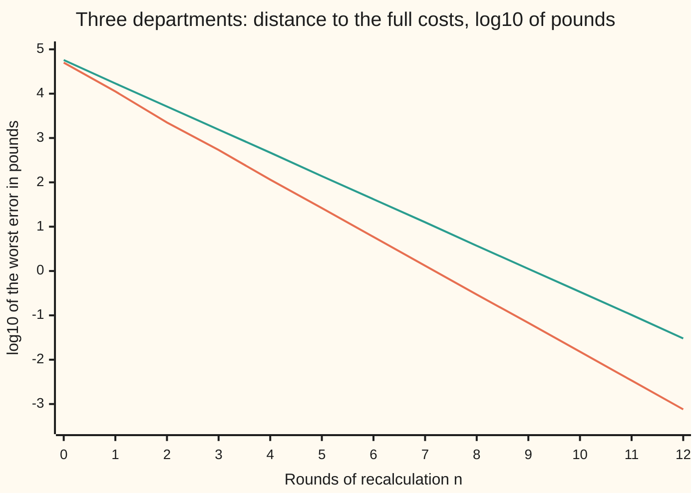

# Neumann series: a geometric series that inverts an operator near the identity

[Syllabus](../../../SYLLABUS.md) → [Functional analysis](../README.md) → [Bounded Operators](../README.md#s03) → Neumann series

---

## General Overview

A small company runs three support departments: IT, HR and Facilities. Each month IT spends £40,000 of its own, HR £20,000 and Facilities £30,000. The departments also serve each other. IT uses some of HR's time and some of Facilities' floor space, and so on.

The finance team wants each department's **full cost**: its own spending plus its share of the others' full costs. That definition points back at itself. IT's full cost needs HR's full cost, and HR's full cost needs IT's. In a spreadsheet this is a **circular reference**: a cell whose formula depends, through other cells, on itself.

Spreadsheet programs handle this by recalculating in rounds. The plainest layout gives each round its own column: start with blank cells, compute every cell from the last round's values, and repeat. Here the shares are small, so the loop is **weak**. Each round changes the answer less than the round before. After 8 rounds every full cost is within £1 of the truth: IT £50,234.01, HR £31,097.24, Facilities £35,621.42.

This card explains why the rounds settle, and how many rounds a given accuracy needs before the first round runs. The rounds add up a geometric series, like 1 + r + r² + …, except that each "power of r" is a whole round of the circular reference. That series is the **Neumann series**. It works for a table of three cells and, unchanged, for a signal with infinitely many values.

**If a linear map K never stretches an input by more than a factor ‖K‖ below 1, then x = b + Kx has exactly one solution, x = b + Kb + K²b + …, and the error after n terms is at most ‖K‖ⁿ ‖b‖ / (1 − ‖K‖).**

**What kind of fact this is:** a theorem, proved on this card in Why it works. The code checks it on a 3 × 3 spreadsheet and on a blur at five grid sizes; only the proof covers the infinite-dimensional case.

### The picture: the error and the promise, round by round



The lower line (orange) is the true worst error over the three departments, after n rounds from blank cells, one column per round. The upper line (green) is the promise, 0.3ⁿ × £40,000 / 0.7, written down before any round runs. One unit down the axis is a factor of 10, and 0 on the axis is £1. The truth drops below £1 at round 8; the promise does so at round 10. The promise always sits above the truth.

---

## The formula

Notation first, in words. A list of three costs is a vector $`x`$. Its **size** $`\lVert x\rVert`$ is its largest entry, ignoring signs: the worst-case size. A linear map $`K`$ (a rule that turns lists into lists and respects sums and multiples) has an **operator norm** $`\lVert K\rVert`$: the most it can stretch the size of any list, $`\lVert Kx\rVert \le \lVert K\rVert\, \lVert x\rVert`$ ([Bounded operators](01-bounded-operators-and-the-operator-norm.md)). For the worst-case size, $`\lVert K\rVert`$ is the largest row sum of absolute values. $`I`$ is the **identity**, the map that leaves every list alone.

The circular reference is one equation, and the Neumann series solves it:

```math
x = b + Kx \quad\Longleftrightarrow\quad (I - K)\,x = b, \qquad x = \sum_{k=0}^{\infty} K^k b = b + Kb + K^2 b + \cdots
```

```math
\lVert K\rVert = q < 1 \;\Longrightarrow\; \lVert x - S_n\rVert \le \frac{q^n}{1 - q}\, \lVert b\rVert, \qquad S_n = \sum_{k=0}^{n-1} K^k b, \qquad \lVert (I-K)^{-1}\rVert \le \frac{1}{1-q}
```

**Read it aloud:** if the loop stretches nothing by more than q, a number below 1, then the full costs are the direct costs, plus one pass round the loop, plus two passes, and so on; stopping after n terms leaves an error of at most q to the n, over one minus q, times the largest direct cost.

The partial sum $`S_n`$ is exactly what a sheet with one column per round holds after n rounds from blank cells. Round 1 gives $`b`$. Round 2 gives $`b + Kb`$, and each round adds one more pass round the loop.

A sheet left to iterate on its own may instead update the loop's cells in place, top to bottom. Then HR already reads IT's new value within the same round. That is Gauss-Seidel's variant of the rounds, and it no longer holds $`S_n`$. On this sheet it is within £1 after 5 rounds instead of 8, and the error bound above still covers it: [Iterating instead of factoring](../../16-Numerical%20analysis/03-Numerical%20Linear%20Algebra/09-iterative-methods-jacobi-gauss-seidel-and-conjugate-gradient.md) proves the same factor q per round under the same row-sum condition.

For the three departments, row i of $`K`$ lists the shares of the other departments' full costs that department i absorbs:

```math
K = \begin{pmatrix} 0 & 0.10 & 0.20 \\ 0.15 & 0 & 0.10 \\ 0.05 & 0.10 & 0 \end{pmatrix}, \qquad b = \begin{pmatrix} 40{,}000 \\ 20{,}000 \\ 30{,}000 \end{pmatrix}
```

**Read it aloud:** IT's full cost is £40,000 plus 10% of HR's full cost plus 20% of Facilities' full cost; the other two rows read the same way.

The row sums are 0.30, 0.25 and 0.15, so $`q = \lVert K\rVert = 0.30`$.

| Symbol | Plain meaning | In our example | Push it up and the answer… |
| --- | --- | --- | --- |
| $`x`$ | the unknowns: full costs, or a signal's values | £50,234.01, £31,097.24, £35,621.42 | — |
| $`b`$, $`d`$ | the fixed part: direct costs, or the input signal; an economy's demand list | £40,000, £20,000, £30,000 | the answer grows in proportion |
| $`K`$; $`T`$, $`\lambda`$ | the loop: a bounded linear map from the space to itself; any bounded map and a number, as in Spectrum's $`\lambda I - T`$ | the shares matrix above | stronger feedback, larger answer |
| $`I`$; $`A`$, $`D`$, $`E`$ | the identity map, leaving every input alone; a matrix or map to invert, its diagonal, a small change to it (in What breaks, A and B name two cells) | the 3 × 3 identity matrix; $`A = I - K`$ | — |
| $`\lVert v\rVert`$ | size: the largest entry, ignoring signs | $`\lVert b\rVert`$ = £40,000 | — |
| $`q = \lVert K\rVert`$ | operator norm: the most the loop can stretch | 0.30 | more rounds; at 1 the promise is lost |
| $`n`$, $`k`$ | rounds of recalculation, or terms of the series; k counts passes round the loop | 3 in the hand example | the error falls by a factor q per round |
| $`S_n`$ | the partial sum after n rounds | $`S_3`$ = £49,700, £30,600, £35,300 | — |
| $`X`$ | the space the lists or signals live in, with its size rule | lists of 3 costs; later, signals on 0 to 1 | — |
| $`G(s, t)`$; $`s`$, $`t`$ | the blur kernel (a smoothing, or Green's, kernel: the weights given to each value); positions from 0 to 1 | $`\min(s,t)\,(1 - \max(s,t))`$ | — |
| $`c`$ | the blur's feedback strength | 4 | at 8 the norm test fails; at π² no solution exists |
| $`N`$ | grid points in a finite rehearsal of the blur | 3, 9, 27, 81, 243 | closer to the true signal |

### When it holds

- **The loop is linear.** Shares of costs add and scale, so passes round the loop can be stacked as powers. A loop with a cap or a threshold has no powers to sum; use [Banach's fixed point theorem](../../17-Topology/01-Metric%20Spaces/08-banach-fixed-point-in-metric-spaces.md) instead.
- **$`\lVert K\rVert < 1`$ in some norm.** This guarantees the series converges. It is a sufficient test, not a necessary one: the matrix `[[0, 2], [0.1, 0]]` has norm 2, yet its square is 0.2 times the identity and the series still converges, to 3.7500 and 1.3750. The exact condition uses the spectrum ([Spectrum](07-spectrum-and-resolvent.md)).
- **The space is complete.** In infinite dimensions the partial sums only bunch up; completeness supplies the limit. Step 4 below shows a space without it, where the series has nowhere to land.
- **The error is measured in the same norm as q.** The bound holds for the worst-case size because q was computed for it. Mixing norms, for example a column-sum q with a worst-case error, can break the promise.

---

## Why it works

### Step 0: the idea, a geometric series with maps for numbers

For a number r between −1 and 1, $`1/(1 - r) = 1 + r + r^2 + \cdots`$. Multiply the right side by $`1 - r`$ and everything cancels except 1. The same cancellation works when r is a linear map, because maps can be composed ($`K^2`$ means "apply K twice") and composition distributes over sums. The only question is whether the infinite sum makes sense. The operator norm answers it: $`\lVert K^k\rVert \le q^k`$, so the terms shrink like a geometric series.

### Step 1: the sum telescopes

Apply $`I - K`$ to a partial sum. Every term cancels the next except the first and the last:

```math
(I - K)\,S_n = (b + Kb + \cdots + K^{n-1}b) - (Kb + K^2b + \cdots + K^n b) = b - K^n b
```

So $`S_n`$ solves the equation up to the leftover $`K^n b`$. Its size is at most $`q^n \lVert b\rVert`$, which tends to 0.

### Step 2: the partial sums bunch up

Each pass multiplies a list's size by at most q, so $`\lVert K^k b\rVert \le q^k \lVert b\rVert`$. For m beyond n, the gap between two partial sums is a stretch of the tail:

```math
\lVert S_m - S_n\rVert \le \sum_{k=n}^{m-1} q^k \lVert b\rVert \le \frac{q^n}{1 - q}\,\lVert b\rVert
```

The right side does not depend on m and tends to 0. A sequence like this, whose terms end up as close together as any tolerance, is a **Cauchy sequence**. In a **complete** space every Cauchy sequence has a limit in the space. Lists of three numbers are complete, and so is the space of continuous signals under the worst-case size. Call the limit $`x`$.

### Step 3: the limit solves the equation, and nothing else does

Let n grow in Step 1. The left side tends to $`(I - K)x`$, because a bounded map sends nearby lists to nearby lists. The right side tends to $`b`$. So $`(I - K)x = b`$.

Uniqueness: if $`(I - K)y = 0`$, then $`y = Ky`$, so $`\lVert y\rVert \le q \lVert y\rVert`$. With q below 1 this forces $`\lVert y\rVert = 0`$. Two solutions would differ by such a $`y`$, so there is only one.

Now let m grow in Step 2: the left side tends to $`\lVert x - S_n\rVert`$, which gives the error bound. With n = 0 it gives $`\lVert x\rVert \le \lVert b\rVert / (1 - q)`$, the bound on the inverse.

<details>
<summary>Detailed proof: the series of maps itself converges, and is the inverse</summary>

The steps above sum lists. The same argument sums the maps. In the space of bounded maps from $`X`$ to itself, with the operator norm, the partial sums $`T_n = I + K + \cdots + K^{n-1}`$ satisfy

$`\displaystyle \lVert T_m - T_n\rVert \le \sum_{k=n}^{m-1} \lVert K\rVert^k \le \frac{q^n}{1-q}.`$

That space is complete whenever $`X`$ is, so $`T_n`$ has a limit $`T`$. The telescoping of Step 1 gives

$`\displaystyle (I-K)\,T_n = T_n\,(I-K) = I - K^n,`$

and $`\lVert K^n\rVert \le q^n`$ tends to 0, so $`(I-K)T = T(I-K) = I`$. Thus $`T`$ is a two-sided inverse of $`I - K`$, and $`\lVert T\rVert \le \sum q^k = 1/(1-q)`$.

A consequence: if $`A`$ has a bounded inverse and $`\lVert E\rVert < 1/\lVert A^{-1}\rVert`$, then $`A + E = A\,(I + A^{-1}E)`$ is invertible too, since $`\lVert A^{-1}E\rVert < 1`$. Small changes never destroy an inverse. [Spectrum](07-spectrum-and-resolvent.md) builds on exactly this.

</details>

The same bound, read another way: the rule "new x = b + Kx" is a contraction with factor q. [Banach's fixed point theorem](../../17-Topology/01-Metric%20Spaces/08-banach-fixed-point-in-metric-spaces.md) already iterates a contraction and bounds the error after n steps. What is new here is linearity: the iterates are partial sums of one series, and the series defines the inverse map $`(I - K)^{-1}`$ for every right-hand side at once.

For a matrix, Jacobi's method is this series. Split A into its diagonal D and the rest; then $`Ax = b`$ becomes $`x = D^{-1}b + Kx`$ with $`K = -D^{-1}(A - D)`$. A strictly diagonally dominant A by rows (each diagonal entry bigger in size than the rest of its row added up) has $`\lVert K\rVert < 1`$ in the worst-case size ([Iterating instead of factoring](../../16-Numerical%20analysis/03-Numerical%20Linear%20Algebra/09-iterative-methods-jacobi-gauss-seidel-and-conjugate-gradient.md)).

### Step 4: what changes in infinite dimensions, shown on a blur

Replace the three departments by a signal on the interval from 0 to 1. A **blur** replaces each value by a weighted sum of all the signal's values, heaviest at the point itself: an integral operator with kernel $`G`$ ([Three model operators](02-integral-operators-and-the-shift.md)). Here the weights are the tent $`G(s, t) = \min(s,t)\,(1 - \max(s,t))`$, a smoothing (Green's) kernel whose weights total $`s(1-s)/2`$, at most 1/8, so it is not an average. The signal feeds back through the blur with strength $`c = 4`$:

```math
x(s) = 1 + 4 \int_0^1 G(s, t)\, x(t)\, dt
```

**Read it aloud:** the signal at position s is 1 plus four times its own blurred value there.

In the worst-case size, $`\lVert 4G\rVert = 4 \max_s \int_0^1 G(s,t)\,dt = 4 \max_s s(1-s)/2 = 4 \times 1/8 = 0.5`$. So q = 0.5 and the series converges, with no reference to how many values the signal has. The exact answer is $`x(s) = \cos(2s - 1)/\cos 1`$, so the middle value is $`1/\cos 1 = 1.85081572`$.

<details>
<summary>Why the answer is cos(2s − 1) / cos 1</summary>

The tent kernel undoes a second derivative: $`y(s) = \int_0^1 G(s,t)\, f(t)\, dt`$ is the one function with $`-y'' = f`$ and $`y(0) = y(1) = 0`$. Put $`y = (x - 1)/4`$. The equation says $`-y'' = x`$, which is $`-x'' = 4x`$, with $`x(0) = x(1) = 1`$. The solution symmetric about $`s = 1/2`$ is

$`\displaystyle x(s) = \frac{\cos\big(2(s - \tfrac12)\big)}{\cos 1}.`$

</details>

The code can only hold a finite rehearsal: N grid points at $`s_i = (i + 1/2)/N`$, with the integral replaced by an average over the grid. That turns the blur into an N × N matrix, and the Neumann series runs on it exactly as on the spreadsheet.

| Grid points N | Norm $`q_N`$ | Rounds the bound needs for 10⁻⁶ | Middle value after 40 rounds | Minus 1/cos 1 |
| --- | --- | --- | --- | --- |
| 3 | 0.555556 | 25 | 2.02500000 | 0.17418428 |
| 9 | 0.506173 | 22 | 1.86837217 | 0.01755646 |
| 27 | 0.500686 | 21 | 1.85274659 | 0.00193087 |
| 81 | 0.500076 | 21 | 1.85103002 | 0.00021430 |
| 243 | 0.500008 | 21 | 1.85083953 | 0.00002381 |

Two things to read off. The rounds needed stay at 21 as N grows: the series cost depends on q, not on the dimension. And the grid error falls by a factor of about 9 each time N triples, so it closes like $`1/N^2`$.

What the grid hides: every grid matrix is invertible, which elimination confirms. Whether the true operator $`I - 4G`$ is invertible is a statement about infinitely many values, which only the proof covers. It also hides completeness. On the polynomials, with the same worst-case size, the blur sends polynomials to polynomials and q is still 0.5. Every partial sum is a polynomial, yet the limit $`\cos(2s - 1)/\cos 1`$ is not one. In that incomplete space the equation has no solution at all.

---

## Worked numbers, by hand

The three departments, three terms of the series.

| Step | Arithmetic | Value |
| --- | --- | --- |
| loop strength q | largest row sum: 0.10 + 0.20 | 0.30 |
| first term, $`b`$ | the direct costs | £40,000, £20,000, £30,000 |
| second term, $`Kb`$ | IT: 0.10 × 20,000 + 0.20 × 30,000; HR: 0.15 × 40,000 + 0.10 × 30,000; Facilities: 0.05 × 40,000 + 0.10 × 20,000 | £8,000, £9,000, £4,000 |
| third term, $`K^2b`$ | IT: 0.10 × 9,000 + 0.20 × 4,000; HR: 0.15 × 8,000 + 0.10 × 4,000; Facilities: 0.05 × 8,000 + 0.10 × 9,000 | £1,700, £1,600, £1,300 |
| $`S_3`$, after 3 rounds | add the three terms | £49,700, £30,600, £35,300 |
| promised error after 3 rounds | 0.3³ × 40,000 / 0.7 | £1,542.86 |
| true error after 3 rounds | 50,234.01 − 49,700 | £534.01 |
| rounds the promise needs for £1 | smallest n with 0.3ⁿ × 40,000 / 0.7 ≤ 1 | 10 |
| **full costs** | the limit, also by elimination | **£50,234.01, £31,097.24, £35,621.42** |

Each pass round the loop adds less than a third of the last one, so ten rounds are enough for the pound, and the finance team can fix that number before opening the sheet.

A separate check uses no series. Column j of $`K`$ lists the shares of department j's full cost that the other support departments absorb. The rest goes to the departments that earn money. Charging those rests out recovers £90,000.00 of the £90,000.00 spent, to the penny.

### What breaks if you drop a piece

| Mistake | Comes out at | What went wrong |
| --- | --- | --- |
| A loop too strong: A = 100 + 1.25 B, B = 0.9 A, loop gain 1.125 | A = 641.63 after 10 rounds, 1,797.86 after 20; elimination gives −800.00 | the round trip multiplies by 1.25 × 0.9 = 1.125 > 1: the rounds grow without end, and the only solution is negative, meaningless as a cost |
| Stop when a round changes x by under £1, with q = 0.9 (x = 100 + 0.9x, truth 1,000) | stops at round 45 with error £8.73 | the last change understates the error by a factor of up to q / (1 − q) |
| Bound the error by $`q^n \lVert b\rVert`$, without $`1/(1-q)`$ | promises £0.87 at round 45 | the tail is a whole geometric series, not its first term; the true error is £8.73 |
| Trust a 100-round cap when q = 0.99 (x = 100 + 0.99x) | £6,339.68 of £10,000.00 | the rounds creep up by 1% of the gap each time; 100 of them stop far short |

The code prints all four.

---

## Code, from first principles, and it actually runs

The code builds the spreadsheet and the blur as plain lists and takes three independent roads to the answer. Road 1 is the Neumann series: repeat $`K`$ and add. Road 2 solves $`(I - K)x = b`$ by Gaussian elimination with row swaps, which never repeats $`K`$. Road 3 is the charging-out identity, which checks the answer against the total spend. The code also runs the rounds in place, top to bottom, and checks that the same bound holds every round. The blur adds a fourth road, the closed form $`1/\cos 1`$, which the grid answers approach as N grows.

### Python

```python
# Neumann series -- the check behind the card.  Standard library only.
# A sheet with a weak circular reference: three support departments whose
# full costs depend on each other, x = b + Kx, in pounds a month.
# Road 1 repeats K and adds up (the Neumann series).  Road 2 solves
# (I - K)x = b by elimination.  Road 3 is an invariant: every pound of
# direct cost is charged out exactly once.  Then the same series on a blur.
import math

def matvec(A, v):
    return [sum(a * t for a, t in zip(row, v)) for row in A]

def size(v):                                   # worst-case size of a list
    return max(abs(t) for t in v)

def opnorm(A):                                 # largest row sum: the most K can stretch
    return max(sum(abs(a) for a in row) for row in A)

def neumann(A, b, n):                          # b + Ab + ... + A^(n-1) b: n rounds
    s, term = [0.0] * len(b), list(b)
    for _ in range(n):
        s = [t + u for t, u in zip(s, term)]
        term = matvec(A, term)
    return s

def solve(A, b):                               # (I - A)x = b by elimination, row swaps
    n = len(b)
    M = [[(1.0 if i == j else 0.0) - A[i][j] for j in range(n)] + [b[i]] for i in range(n)]
    for c in range(n):
        p = c
        for r in range(c + 1, n):
            if abs(M[r][c]) > abs(M[p][c]):
                p = r
        M[c], M[p] = M[p], M[c]
        for r in range(c + 1, n):
            f = M[r][c] / M[c][c]
            for k in range(c, n + 1):
                M[r][k] -= f * M[c][k]
    x = [0.0] * n
    for r in range(n - 1, -1, -1):
        x[r] = (M[r][n] - sum(M[r][k] * x[k] for k in range(r + 1, n))) / M[r][r]
    return x

def rounds_for(q, nb, tol):                    # first n with q^n / (1 - q) * |b| <= tol
    n = 0
    while q ** n / (1 - q) * nb > tol:
        n += 1
    return n

def f2(v, d=2):
    return ", ".join(f"{t:.{d}f}" for t in v)

def yn(claim):
    return "yes" if claim else "no"

K = [[0.0, 0.10, 0.20], [0.15, 0.0, 0.10], [0.05, 0.10, 0.0]]   # rows: IT, HR, Facilities
b = [40000.0, 20000.0, 30000.0]
q, nb = opnorm(K), size(b)
x = solve(K, b)
print(f"sheet: row sums {f2([sum(r) for r in K])}; q = {q:.2f}; |b| = {nb:.2f}")
print(f"road 2, elimination: IT {x[0]:.2f}, HR {x[1]:.2f}, Facilities {x[2]:.2f}")
Kb = matvec(K, b)
print(f"Kb = {f2(Kb)}; K^2 b = {f2(matvec(K, Kb))}")
errs = [size([s - t for s, t in zip(neumann(K, b, n), x)]) for n in range(13)]
bnds = [q ** n / (1 - q) * nb for n in range(13)]
print(f"S_3 = {f2(neumann(K, b, 3))}; true error {errs[3]:.2f}; bound {bnds[3]:.2f}")
print("chart n = 0..12, log10 true error:", ", ".join(f"{math.log10(e):.2f}" for e in errs))
print("chart n = 0..12, log10 bound:     ", ", ".join(f"{math.log10(e):.2f}" for e in bnds))
first_true = min(n for n in range(13) if errs[n] < 1)
print(f"rounds for 1 pound: promised by the bound {rounds_for(q, nb, 1.0)}; needed in fact {first_true}")
v, ip = [0.0] * 3, [size(x)]                    # a sheet updating its cells in place, top to bottom
for _ in range(12):
    for i in range(3):
        v[i] = b[i] + sum(K[i][j] * v[j] for j in range(3))
    ip.append(size([s - t for s, t in zip(v, x)]))
print(f"in place (Gauss-Seidel): worst error after rounds 1-5 {f2(ip[1:6])}; "
      f"first under 1 pound at round {min(n for n in range(13) if ip[n] < 1)}")
s30 = neumann(K, b, 30)
print(f"road 1, 30 rounds: {f2(s30)}; gap to road 2 below 1e-6: {yn(size([s - t for s, t in zip(s30, x)]) < 1e-6)}")
charged = sum((1 - sum(K[i][j] for i in range(3))) * x[j] for j in range(3))
print(f"road 3, charged out to the earning departments: {charged:.2f} of {sum(b):.2f}")
print(f"residual |x - b - Kx| below 1e-9: {yn(size([x[i] - b[i] - t for i, t in enumerate(matvec(K, x))]) < 1e-9)}")
print(f"size of the answer {size(x):.2f}; inverse bound |b| / (1 - q) = {nb / (1 - q):.2f}")
K2 = [[0.0, 2.0], [0.1, 0.0]]                   # norm 2, yet K2 squared = 0.2 I
y2, s2 = solve(K2, [1.0, 1.0]), neumann(K2, [1.0, 1.0], 60)
print(f"norm above 1, series still converges: q = {opnorm(K2):.2f}; 60 rounds {f2(s2, 4)}; elimination {f2(y2, 4)}")
L = [[0.0, 1.25], [0.9, 0.0]]                   # A = 100 + 1.25 B, B = 0.9 A
print(f"mistake 1, loop gain {L[0][1] * L[1][0]:.3f}: A after 10 rounds {neumann(L, [100.0, 0.0], 10)[0]:.2f}, "
      f"after 20 {neumann(L, [100.0, 0.0], 20)[0]:.2f}; elimination gives A = {solve(L, [100.0, 0.0])[0]:.2f}")
one, n = [[0.9]], 1                              # x = 100 + 0.9x, truth 1000
while 100 * 0.9 ** (n - 1) >= 1:                 # stop once a round changes x by under 1 pound
    n += 1
err9 = 1000 - neumann(one, [100.0], n)[0]
print(f"mistake 2, q = 0.9, stop when the change is under 1 pound: round {n}, true error {err9:.2f}")
print(f"mistake 3, bound without 1/(1 - q): {0.9 ** n * 100:.2f}, below the true error {err9:.2f}")
print(f"mistake 4, q = 0.99, the sheet's 100-round cap: {neumann([[0.99]], [100.0], 100)[0]:.2f} of 10000.00")
xd = solve([[2 * a for a in r] for r in K], b)
print(f"try: shares doubled, q = {2 * q:.2f}; rounds for 1 pound by the bound {rounds_for(2 * q, nb, 1.0)}; IT {xd[0]:.2f}")
exact, mids = 1 / math.cos(1), []              # blur: x(s) = 1 + 4 * integral of G(s, t) x(t) dt
for N in (3, 9, 27, 81, 243):
    s = [(i + 0.5) / N for i in range(N)]
    A = [[4.0 * min(u, v) * (1 - max(u, v)) / N for v in s] for u in s]
    ser, el = neumann(A, [1.0] * N, 40)[N // 2], solve(A, [1.0] * N)[N // 2]
    mids.append(ser)
    print(f"blur N = {N:3d}: q_N = {opnorm(A):.6f}; rounds for 1e-6 {rounds_for(opnorm(A), 1.0, 1e-6)}; "
          f"x(1/2) {ser:.8f}; minus 1/cos 1 = {ser - exact:.8f}; series = elimination: {yn(abs(ser - el) < 1e-9)}")
print(f"library: 1/cos 1 = {exact:.8f}")
print(f"limits: q = 4 x 1/8 = {4 / 8:.6f}; c = 8 gives 8 / pi^2 = {8 / (math.pi * math.pi):.4f}, below 1")
s81 = [(i + 0.5) / 81 for i in range(81)]
A8 = [[8.0 * min(u, v) * (1 - max(u, v)) / 81 for v in s81] for u in s81]
print(f"try: c = 8, N = 81: q_N = {opnorm(A8):.4f}; x(1/2) after 300 rounds "
      f"{neumann(A8, [1.0] * 81, 300)[40]:.6f}; elimination {solve(A8, [1.0] * 81)[40]:.6f}")
assert size([s - t for s, t in zip(s30, x)]) < 1e-6           # road 1 meets road 2
assert abs(charged - sum(b)) < 1e-6                           # road 3: 90000 charged out
assert all(errs[n] <= bnds[n] for n in range(13))             # the bound holds every round
assert all(ip[n] <= bnds[n] for n in range(13))               # and for the in-place sheet
assert size([s - t for s, t in zip(v, x)]) < 1e-6             # which settles on road 2 too
assert size([s - t for s, t in zip(s2, y2)]) < 1e-9           # series meets elimination
assert opnorm(K2) > 1                                         # though the norm test fails
assert abs(neumann(L, [100.0, 0.0], 20)[0]) > 1000 and abs(solve(L, [100.0, 0.0])[0] + 800) < 1e-9
assert n == math.ceil(1 + math.log(0.01) / math.log(0.9))     # stop round, closed form
assert abs(err9 - 1000 * 0.9 ** n) < 1e-9                     # true error 1000 x 0.9^n
assert abs(mids[-1] - exact) < 3e-5                           # grid meets 1/cos 1
assert all(8 < (mids[i] - exact) / (mids[i + 1] - exact) < 10 for i in range(4))  # error / 9 per step
print("ALL CHECKS PASS")
```

**Ran 2026-11-15 on macOS, Python 3.14.10, standard library only. All checks passed. Output, pasted from the run:**

```
sheet: row sums 0.30, 0.25, 0.15; q = 0.30; |b| = 40000.00
road 2, elimination: IT 50234.01, HR 31097.24, Facilities 35621.42
Kb = 8000.00, 9000.00, 4000.00; K^2 b = 1700.00, 1600.00, 1300.00
S_3 = 49700.00, 30600.00, 35300.00; true error 534.01; bound 1542.86
chart n = 0..12, log10 true error: 4.70, 4.05, 3.35, 2.73, 2.06, 1.42, 0.77, 0.12, -0.53, -1.17, -1.82, -2.47, -3.12
chart n = 0..12, log10 bound:      4.76, 4.23, 3.71, 3.19, 2.67, 2.14, 1.62, 1.10, 0.57, 0.05, -0.47, -0.99, -1.52
rounds for 1 pound: promised by the bound 10; needed in fact 8
in place (Gauss-Seidel): worst error after rounds 1-5 10234.01, 714.01, 32.25, 1.58, 0.08; first under 1 pound at round 5
road 1, 30 rounds: 50234.01, 31097.24, 35621.42; gap to road 2 below 1e-6: yes
road 3, charged out to the earning departments: 90000.00 of 90000.00
residual |x - b - Kx| below 1e-9: yes
size of the answer 50234.01; inverse bound |b| / (1 - q) = 57142.86
norm above 1, series still converges: q = 2.00; 60 rounds 3.7500, 1.3750; elimination 3.7500, 1.3750
mistake 1, loop gain 1.125: A after 10 rounds 641.63, after 20 1797.86; elimination gives A = -800.00
mistake 2, q = 0.9, stop when the change is under 1 pound: round 45, true error 8.73
mistake 3, bound without 1/(1 - q): 0.87, below the true error 8.73
mistake 4, q = 0.99, the sheet's 100-round cap: 6339.68 of 10000.00
try: shares doubled, q = 0.60; rounds for 1 pound by the bound 23; IT 68750.00
blur N =   3: q_N = 0.555556; rounds for 1e-6 25; x(1/2) 2.02500000; minus 1/cos 1 = 0.17418428; series = elimination: yes
blur N =   9: q_N = 0.506173; rounds for 1e-6 22; x(1/2) 1.86837217; minus 1/cos 1 = 0.01755646; series = elimination: yes
blur N =  27: q_N = 0.500686; rounds for 1e-6 21; x(1/2) 1.85274659; minus 1/cos 1 = 0.00193087; series = elimination: yes
blur N =  81: q_N = 0.500076; rounds for 1e-6 21; x(1/2) 1.85103002; minus 1/cos 1 = 0.00021430; series = elimination: yes
blur N = 243: q_N = 0.500008; rounds for 1e-6 21; x(1/2) 1.85083953; minus 1/cos 1 = 0.00002381; series = elimination: yes
library: 1/cos 1 = 1.85081572
limits: q = 4 x 1/8 = 0.500000; c = 8 gives 8 / pi^2 = 0.8106, below 1
try: c = 8, N = 81: q_N = 1.0002; x(1/2) after 300 rounds 6.416469; elimination 6.416469
ALL CHECKS PASS
```

### Rust

Same numbers, same labels, built with `rustc --edition 2021 -O`.

```rust
// Neumann series -- the same check as the Python, in Rust.  No crates.
// A sheet with a weak circular reference: three support departments whose
// full costs depend on each other, x = b + Kx, in pounds a month.
// Road 1 repeats K and adds up (the Neumann series).  Road 2 solves
// (I - K)x = b by elimination.  Road 3 is an invariant: every pound of
// direct cost is charged out exactly once.  Then the same series on a blur.
type Mat = Vec<Vec<f64>>;

fn matvec(a: &Mat, v: &[f64]) -> Vec<f64> {
    a.iter().map(|row| row.iter().zip(v).fold(0.0, |s, (x, t)| s + x * t)).collect()
}

fn size(v: &[f64]) -> f64 { v.iter().fold(0.0, |m: f64, t| m.max(t.abs())) } // worst-case size

fn opnorm(a: &Mat) -> f64 {                     // largest row sum: the most K can stretch
    a.iter().map(|row| row.iter().fold(0.0, |s, x| s + x.abs())).fold(0.0, f64::max)
}

fn neumann(a: &Mat, b: &[f64], n: usize) -> Vec<f64> { // b + Ab + ... + A^(n-1) b
    let (mut s, mut term) = (vec![0.0; b.len()], b.to_vec());
    for _ in 0..n {
        s = s.iter().zip(&term).map(|(t, u)| t + u).collect();
        term = matvec(a, &term);
    }
    s
}

fn solve(a: &Mat, b: &[f64]) -> Vec<f64> {     // (I - A)x = b by elimination, row swaps
    let n = b.len();
    let mut m: Mat = (0..n).map(|i| {
        let mut row: Vec<f64> = (0..n).map(|j| (if i == j { 1.0 } else { 0.0 }) - a[i][j]).collect();
        row.push(b[i]);
        row
    }).collect();
    for c in 0..n {
        let mut p = c;
        for r in c + 1..n { if m[r][c].abs() > m[p][c].abs() { p = r } }
        m.swap(c, p);
        for r in c + 1..n {
            let f = m[r][c] / m[c][c];
            for k in c..n + 1 { let v = m[c][k]; m[r][k] -= f * v }
        }
    }
    let mut x = vec![0.0; n];
    for r in (0..n).rev() {
        let s = (r + 1..n).fold(0.0, |s, k| s + m[r][k] * x[k]);
        x[r] = (m[r][n] - s) / m[r][r];
    }
    x
}

fn rounds_for(q: f64, nb: f64, tol: f64) -> usize { // first n with q^n / (1 - q) * |b| <= tol
    let mut n = 0;
    while q.powf(n as f64) / (1.0 - q) * nb > tol { n += 1 }
    n
}

fn fmt(v: &[f64], d: usize) -> String {
    v.iter().map(|t| format!("{:.*}", d, t)).collect::<Vec<_>>().join(", ")
}
fn f2(v: &[f64]) -> String { fmt(v, 2) }
fn yn(claim: bool) -> &'static str { if claim { "yes" } else { "no" } }
fn gap(a: &[f64], b: &[f64]) -> f64 { size(&a.iter().zip(b).map(|(s, t)| s - t).collect::<Vec<_>>()) }

fn blur(c: f64, n: usize) -> Mat {             // c * G(s, t) / N on the midpoint grid
    let s: Vec<f64> = (0..n).map(|i| (i as f64 + 0.5) / n as f64).collect();
    s.iter().map(|&u| s.iter().map(|&v| c * u.min(v) * (1.0 - u.max(v)) / n as f64).collect()).collect()
}

fn main() {
    let k: Mat = vec![vec![0.0, 0.10, 0.20], vec![0.15, 0.0, 0.10], vec![0.05, 0.10, 0.0]];
    let b = vec![40000.0, 20000.0, 30000.0];
    let (q, nb) = (opnorm(&k), size(&b));
    let x = solve(&k, &b);
    let rows: Vec<f64> = k.iter().map(|r| r.iter().fold(0.0, |s, a| s + a)).collect();
    println!("sheet: row sums {}; q = {:.2}; |b| = {:.2}", f2(&rows), q, nb);
    println!("road 2, elimination: IT {:.2}, HR {:.2}, Facilities {:.2}", x[0], x[1], x[2]);
    let kb = matvec(&k, &b);
    println!("Kb = {}; K^2 b = {}", f2(&kb), f2(&matvec(&k, &kb)));
    let errs: Vec<f64> = (0..13).map(|n| gap(&neumann(&k, &b, n), &x)).collect();
    let bnds: Vec<f64> = (0..13).map(|n| q.powf(n as f64) / (1.0 - q) * nb).collect();
    println!("S_3 = {}; true error {:.2}; bound {:.2}", f2(&neumann(&k, &b, 3)), errs[3], bnds[3]);
    let lg = |v: &Vec<f64>| fmt(&v.iter().map(|e| e.log10()).collect::<Vec<_>>(), 2);
    println!("chart n = 0..12, log10 true error: {}", lg(&errs));
    println!("chart n = 0..12, log10 bound:      {}", lg(&bnds));
    let first_true = (0..13).find(|&n| errs[n] < 1.0).unwrap();
    println!("rounds for 1 pound: promised by the bound {}; needed in fact {}", rounds_for(q, nb, 1.0), first_true);
    let (mut v, mut ip) = (vec![0.0; 3], vec![size(&x)]); // a sheet updating its cells in place, top to bottom
    for _ in 0..12 {
        for i in 0..3 { v[i] = b[i] + (0..3).fold(0.0, |s, j| s + k[i][j] * v[j]); }
        ip.push(gap(&v, &x));
    }
    println!("in place (Gauss-Seidel): worst error after rounds 1-5 {}; first under 1 pound at round {}",
             f2(&ip[1..6]), (0..13).find(|&n| ip[n] < 1.0).unwrap());
    let s30 = neumann(&k, &b, 30);
    println!("road 1, 30 rounds: {}; gap to road 2 below 1e-6: {}", f2(&s30), yn(gap(&s30, &x) < 1e-6));
    let charged = (0..3).fold(0.0, |s, j| s + (1.0 - (0..3).fold(0.0, |c, i| c + k[i][j])) * x[j]);
    let total = b.iter().fold(0.0, |s, t| s + t);
    println!("road 3, charged out to the earning departments: {:.2} of {:.2}", charged, total);
    let kx = matvec(&k, &x);
    let res: Vec<f64> = (0..3).map(|i| x[i] - b[i] - kx[i]).collect();
    println!("residual |x - b - Kx| below 1e-9: {}", yn(size(&res) < 1e-9));
    println!("size of the answer {:.2}; inverse bound |b| / (1 - q) = {:.2}", size(&x), nb / (1.0 - q));
    let k2: Mat = vec![vec![0.0, 2.0], vec![0.1, 0.0]]; // norm 2, yet K2 squared = 0.2 I
    let (y2, s2) = (solve(&k2, &[1.0, 1.0]), neumann(&k2, &[1.0, 1.0], 60));
    println!("norm above 1, series still converges: q = {:.2}; 60 rounds {}; elimination {}",
             opnorm(&k2), fmt(&s2, 4), fmt(&y2, 4));
    let l: Mat = vec![vec![0.0, 1.25], vec![0.9, 0.0]]; // A = 100 + 1.25 B, B = 0.9 A
    let (a20, al) = (neumann(&l, &[100.0, 0.0], 20)[0], solve(&l, &[100.0, 0.0])[0]);
    println!("mistake 1, loop gain {:.3}: A after 10 rounds {:.2}, after 20 {:.2}; elimination gives A = {:.2}",
             l[0][1] * l[1][0], neumann(&l, &[100.0, 0.0], 10)[0], a20, al);
    let one: Mat = vec![vec![0.9]];               // x = 100 + 0.9x, truth 1000
    let mut n = 1;
    while 100.0 * 0.9f64.powf((n - 1) as f64) >= 1.0 { n += 1 } // stop once a round changes x by under 1 pound
    let err9 = 1000.0 - neumann(&one, &[100.0], n)[0];
    let naive = 0.9f64.powf(n as f64) * 100.0;
    println!("mistake 2, q = 0.9, stop when the change is under 1 pound: round {}, true error {:.2}", n, err9);
    println!("mistake 3, bound without 1/(1 - q): {:.2}, below the true error {:.2}", naive, err9);
    println!("mistake 4, q = 0.99, the sheet's 100-round cap: {:.2} of 10000.00", neumann(&vec![vec![0.99]], &[100.0], 100)[0]);
    let kd: Mat = k.iter().map(|r| r.iter().map(|a| 2.0 * a).collect()).collect();
    let xd = solve(&kd, &b);
    println!("try: shares doubled, q = {:.2}; rounds for 1 pound by the bound {}; IT {:.2}", 2.0 * q, rounds_for(2.0 * q, nb, 1.0), xd[0]);
    let exact = 1.0 / 1f64.cos();                 // blur: x(s) = 1 + 4 * integral of G(s, t) x(t) dt
    let mut mids: Vec<f64> = Vec::new();
    for &nn in &[3usize, 9, 27, 81, 243] {
        let a = blur(4.0, nn);
        let ones = vec![1.0; nn];
        let (ser, el) = (neumann(&a, &ones, 40)[nn / 2], solve(&a, &ones)[nn / 2]);
        mids.push(ser);
        println!("blur N = {:3}: q_N = {:.6}; rounds for 1e-6 {}; x(1/2) {:.8}; minus 1/cos 1 = {:.8}; series = elimination: {}",
                 nn, opnorm(&a), rounds_for(opnorm(&a), 1.0, 1e-6), ser, ser - exact, yn((ser - el).abs() < 1e-9));
    }
    println!("library: 1/cos 1 = {:.8}", exact);
    let pi = std::f64::consts::PI;
    println!("limits: q = 4 x 1/8 = {:.6}; c = 8 gives 8 / pi^2 = {:.4}, below 1", 4.0 / 8.0, 8.0 / (pi * pi));
    let a8 = blur(8.0, 81);
    println!("try: c = 8, N = 81: q_N = {:.4}; x(1/2) after 300 rounds {:.6}; elimination {:.6}",
             opnorm(&a8), neumann(&a8, &vec![1.0; 81], 300)[40], solve(&a8, &vec![1.0; 81])[40]);
    assert!(gap(&s30, &x) < 1e-6);                                   // road 1 meets road 2
    assert!((charged - total).abs() < 1e-6);                         // road 3: 90000 charged out
    assert!((0..13).all(|n| errs[n] <= bnds[n]));                    // the bound holds every round
    assert!((0..13).all(|n| ip[n] <= bnds[n]));                      // and for the in-place sheet
    assert!(gap(&v, &x) < 1e-6);                                     // which settles on road 2 too
    assert!(gap(&s2, &y2) < 1e-9);                                   // series meets elimination
    assert!(opnorm(&k2) > 1.0);                                      // though the norm test fails
    assert!(a20.abs() > 1000.0 && (al + 800.0).abs() < 1e-9);
    assert!(n == (1.0 + 0.01f64.ln() / 0.9f64.ln()).ceil() as usize); // stop round, closed form
    assert!((err9 - 1000.0 * 0.9f64.powf(n as f64)).abs() < 1e-9);   // true error 1000 x 0.9^n
    assert!((mids[4] - exact).abs() < 3e-5);                         // grid meets 1/cos 1
    assert!((0..4).all(|i| { let r = (mids[i] - exact) / (mids[i + 1] - exact); 8.0 < r && r < 10.0 }));
    println!("ALL CHECKS PASS");
}
```

**Ran 2026-11-15 on macOS, rustc 1.98.1, no crates. All checks passed. Output, pasted from the run:**

```
sheet: row sums 0.30, 0.25, 0.15; q = 0.30; |b| = 40000.00
road 2, elimination: IT 50234.01, HR 31097.24, Facilities 35621.42
Kb = 8000.00, 9000.00, 4000.00; K^2 b = 1700.00, 1600.00, 1300.00
S_3 = 49700.00, 30600.00, 35300.00; true error 534.01; bound 1542.86
chart n = 0..12, log10 true error: 4.70, 4.05, 3.35, 2.73, 2.06, 1.42, 0.77, 0.12, -0.53, -1.17, -1.82, -2.47, -3.12
chart n = 0..12, log10 bound:      4.76, 4.23, 3.71, 3.19, 2.67, 2.14, 1.62, 1.10, 0.57, 0.05, -0.47, -0.99, -1.52
rounds for 1 pound: promised by the bound 10; needed in fact 8
in place (Gauss-Seidel): worst error after rounds 1-5 10234.01, 714.01, 32.25, 1.58, 0.08; first under 1 pound at round 5
road 1, 30 rounds: 50234.01, 31097.24, 35621.42; gap to road 2 below 1e-6: yes
road 3, charged out to the earning departments: 90000.00 of 90000.00
residual |x - b - Kx| below 1e-9: yes
size of the answer 50234.01; inverse bound |b| / (1 - q) = 57142.86
norm above 1, series still converges: q = 2.00; 60 rounds 3.7500, 1.3750; elimination 3.7500, 1.3750
mistake 1, loop gain 1.125: A after 10 rounds 641.63, after 20 1797.86; elimination gives A = -800.00
mistake 2, q = 0.9, stop when the change is under 1 pound: round 45, true error 8.73
mistake 3, bound without 1/(1 - q): 0.87, below the true error 8.73
mistake 4, q = 0.99, the sheet's 100-round cap: 6339.68 of 10000.00
try: shares doubled, q = 0.60; rounds for 1 pound by the bound 23; IT 68750.00
blur N =   3: q_N = 0.555556; rounds for 1e-6 25; x(1/2) 2.02500000; minus 1/cos 1 = 0.17418428; series = elimination: yes
blur N =   9: q_N = 0.506173; rounds for 1e-6 22; x(1/2) 1.86837217; minus 1/cos 1 = 0.01755646; series = elimination: yes
blur N =  27: q_N = 0.500686; rounds for 1e-6 21; x(1/2) 1.85274659; minus 1/cos 1 = 0.00193087; series = elimination: yes
blur N =  81: q_N = 0.500076; rounds for 1e-6 21; x(1/2) 1.85103002; minus 1/cos 1 = 0.00021430; series = elimination: yes
blur N = 243: q_N = 0.500008; rounds for 1e-6 21; x(1/2) 1.85083953; minus 1/cos 1 = 0.00002381; series = elimination: yes
library: 1/cos 1 = 1.85081572
limits: q = 4 x 1/8 = 0.500000; c = 8 gives 8 / pi^2 = 0.8106, below 1
try: c = 8, N = 81: q_N = 1.0002; x(1/2) after 300 rounds 6.416469; elimination 6.416469
ALL CHECKS PASS
```

The two outputs match line for line.

### Lean

Lean proves the three theorems for every complete space $`X`$, under any size rule, and checks the worked numbers exactly.

- Take a bounded linear map $`K`$ from $`X`$ to itself, with $`q = \lVert K\rVert < 1`$. Then $`x = b + Kx`$ has exactly one solution, and $`b + Kb + K^2 b + \cdots`$ sums to it.
- Take the same $`K`$ and $`b`$. Then after n terms the error $`\lVert x - S_n\rVert`$ is at most $`q^n \lVert b\rVert / (1 - q)`$.
- Take the same $`K`$. Then the maps $`I + K + K^2 + \cdots`$ sum, in the operator norm, to a two-sided inverse of $`I - K`$.
- Take the same $`K`$. Then that inverse has operator norm at most $`1 / (1 - q)`$.
- Take $`A`$ with a bounded two-sided inverse, and a change $`E`$ with $`\lVert E\rVert < 1 / \lVert A^{-1}\rVert`$. Then $`A + E`$ has a two-sided inverse too.
- Take the shares and direct costs as exact fractions. Then the row sums are 0.30, 0.25 and 0.15, and $`Kb`$, $`K^2 b`$ and $`S_3`$ match the hand table.
- Take the exact full costs, about £50,234.01, £31,097.24 and £35,621.42. Then they solve $`x = b + Kx`$, and charging them out recovers exactly £90,000.
- Take the promise 0.3ⁿ × £40,000 / 0.7. Then it is at most £1 at n = 10, but not at n = 9.
- Take the matrix `[[0, 2], [0.1, 0]]`. Then its square is 0.2 times the identity, and 3.75 and 1.375 solve its equation with b = (1, 1).
- Take the strong loop A = 100 + 1.25 B, B = 0.9 A. Then its loop gain is 1.125, and A = −800, B = −720 solves it.
- Take x = 100 + 0.9x. Then a round's change, 100 × 0.9ⁿ⁻¹, first drops below £1 at round 45.

The rounds in floating point, the in-place sheet, the blur on its grids and the true errors are left to the Python and Rust checks.

```lean
-- Neumann series: if a bounded linear map K on a complete normed space has ‖K‖ < 1, then x = b + Kx has exactly one solution, the sum b + Kb + K²b + ⋯, and after n terms the error is at most ‖K‖ⁿ‖b‖ / (1 − ‖K‖).
import Mathlib.Analysis.Normed.Operator.NormedSpace
import Mathlib.Analysis.SpecificLimits.Normed
import Mathlib.Data.Matrix.Mul
import Mathlib.LinearAlgebra.Matrix.Notation
import Mathlib.Tactic.NormNum
import Mathlib.Tactic.FinCases
import Mathlib.Analysis.Normed.Ring.Units
import Mathlib.Topology.Algebra.InfiniteSum.Module

open Finset Matrix

/-- If a linear map `K` on a complete normed space never stretches an input by more than a
factor `‖K‖ < 1`, then `x = b + K x` has exactly one solution `x`, the series
`b + K b + K² b + ⋯` adds up to it, and after `n` terms the error is at most
`‖K‖ⁿ ‖b‖ / (1 − ‖K‖)`. -/
theorem neumann_series_solves_with_error_bound
    {X : Type*} [NormedAddCommGroup X] [NormedSpace ℝ X] [CompleteSpace X]
    (K : X →L[ℝ] X) (hK : ‖K‖ < 1) (b : X) :
    ∃ x : X, x = b + K x ∧ (∀ y : X, y = b + K y → y = x) ∧
      HasSum (fun k : ℕ => (K ^ k) b) x ∧
      ∀ n : ℕ, ‖x - ∑ k ∈ range n, (K ^ k) b‖ ≤ ‖K‖ ^ n * ‖b‖ / (1 - ‖K‖) := by
  have hn0 : 0 ≤ ‖K‖ := norm_nonneg K
  set g : ℕ → X := fun k => (K ^ k) b with hg
  have hbound : ∀ k, ‖g k‖ ≤ ‖K‖ ^ k * ‖b‖ := by
    intro k
    induction k with
    | zero => simp [g]
    | succ k ih =>
      have : g (k + 1) = K (g k) := by
        simp only [g, pow_succ']; rfl
      rw [this, pow_succ', mul_assoc]
      exact (K.le_opNorm _).trans (mul_le_mul_of_nonneg_left ih hn0)
  have hgeo : Summable (fun k : ℕ => ‖K‖ ^ k * ‖b‖) :=
    (summable_geometric_of_lt_one hn0 hK).mul_right _
  have hsum : Summable g := Summable.of_norm_bounded hgeo hbound
  refine ⟨∑' k, g k, ?_, ?_, hsum.hasSum, ?_⟩
  · have h1 : K (∑' k, g k) = ∑' k, g (k + 1) := by
      rw [K.map_tsum hsum]
      congr 1
      funext k
      simp only [g, pow_succ']; rfl
    rw [h1, hsum.tsum_eq_zero_add]
    simp [g]
  · intro y hy
    have hfix : (∑' k, g k) = b + K (∑' k, g k) := by
      have h1 : K (∑' k, g k) = ∑' k, g (k + 1) := by
        rw [K.map_tsum hsum]
        congr 1
        funext k
        simp only [g, pow_succ']; rfl
      rw [h1, hsum.tsum_eq_zero_add]
      simp [g]
    have hd : y - ∑' k, g k = K (y - ∑' k, g k) := by
      rw [map_sub]
      nth_rewrite 1 [hy, hfix]
      abel
    have hle : ‖y - ∑' k, g k‖ ≤ ‖K‖ * ‖y - ∑' k, g k‖ := by
      nth_rewrite 1 [hd]
      exact K.le_opNorm _
    have hz : ‖y - ∑' k, g k‖ = 0 := by
      have := norm_nonneg (y - ∑' k, g k)
      nlinarith
    exact sub_eq_zero.mp (norm_eq_zero.mp hz)
  · intro n
    rw [← hsum.sum_add_tsum_nat_add n, add_sub_cancel_left]
    have hs : HasSum (fun k : ℕ => ‖K‖ ^ (k + n) * ‖b‖) (‖K‖ ^ n * ‖b‖ / (1 - ‖K‖)) := by
      have := (hasSum_geometric_of_lt_one hn0 hK).mul_left (‖K‖ ^ n * ‖b‖)
      convert this using 1
      · funext k
        rw [pow_add]
        ring
      · field_simp
    exact tsum_of_norm_bounded hs (fun k => hbound (k + n))

/-- The series of maps `I + K + K² + ⋯` itself converges in the operator norm, its sum is a
two-sided inverse of `I − K`, and that inverse has norm at most `1 / (1 − ‖K‖)`. -/
theorem neumann_series_inverts_one_sub
    {X : Type*} [NormedAddCommGroup X] [NormedSpace ℝ X] [CompleteSpace X]
    (K : X →L[ℝ] X) (hK : ‖K‖ < 1) :
    ∃ T : X →L[ℝ] X, HasSum (fun k : ℕ => K ^ k) T ∧
      (1 - K) * T = 1 ∧ T * (1 - K) = 1 ∧ ‖T‖ ≤ 1 / (1 - ‖K‖) := by
  have hs : Summable (fun k : ℕ => K ^ k) := summable_geometric_of_norm_lt_one hK
  refine ⟨∑' k, K ^ k, hs.hasSum, mul_neg_geom_series K hK, geom_series_mul_neg K hK, ?_⟩
  have h := tsum_geometric_le_of_norm_lt_one K hK
  have h1 : ‖(1 : X →L[ℝ] X)‖ ≤ 1 := ContinuousLinearMap.norm_id_le
  rw [one_div]
  linarith

/-- Small changes never destroy an inverse: if `A` has a bounded inverse `A⁻¹` and
`‖E‖ < 1 / ‖A⁻¹‖`, then `A + E` has a bounded two-sided inverse too. -/
theorem invertible_of_small_perturbation
    {X : Type*} [NormedAddCommGroup X] [NormedSpace ℝ X] [CompleteSpace X]
    (A Ainv E : X →L[ℝ] X) (hright : A * Ainv = 1) (hleft : Ainv * A = 1)
    (hE : ‖E‖ < 1 / ‖Ainv‖) :
    ∃ B : X →L[ℝ] X, (A + E) * B = 1 ∧ B * (A + E) = 1 := by
  have hpos : 0 < ‖Ainv‖ := by
    by_contra h
    have h0 : ‖Ainv‖ = 0 := le_antisymm (not_lt.mp h) (norm_nonneg _)
    rw [h0, div_zero] at hE
    exact absurd hE (not_lt.mpr (norm_nonneg _))
  let u : (X →L[ℝ] X)ˣ := ⟨A, Ainv, hright, hleft⟩
  have hE' : ‖E‖ < ‖(↑u⁻¹ : X →L[ℝ] X)‖⁻¹ := by
    simpa [u, one_div] using hE
  let v := u.add E hE'
  have hv : (v : X →L[ℝ] X) = A + E := by simp [v, u]
  refine ⟨↑v⁻¹, ?_, ?_⟩
  · rw [← hv]; exact v.mul_inv
  · rw [← hv]; exact v.inv_mul

/-! ### The card's worked numbers, exactly, with shares as fractions -/

/-- The three departments' shares: rows IT, HR, Facilities. -/
abbrev shares : Matrix (Fin 3) (Fin 3) ℚ :=
  !![0, 1/10, 1/5; 3/20, 0, 1/10; 1/20, 1/10, 0]

/-- The direct costs in pounds. -/
abbrev direct : Fin 3 → ℚ := ![40000, 20000, 30000]

-- The loop strength q: the row sums are 0.30, 0.25 and 0.15.
example : (∑ j, |shares 0 j|, ∑ j, |shares 1 j|, ∑ j, |shares 2 j|)
    = ((3 : ℚ)/10, (1 : ℚ)/4, (3 : ℚ)/20) := by
  simp [shares, Fin.sum_univ_three]; norm_num

-- Second term: Kb = (8000, 9000, 4000).
example : shares *ᵥ direct = ![8000, 9000, 4000] := by
  ext i; fin_cases i <;> simp [shares, direct, Matrix.mulVec, dotProduct, Fin.sum_univ_three] <;>
    norm_num

-- Third term: K²b = (1700, 1600, 1300).
example : shares *ᵥ (shares *ᵥ direct) = ![1700, 1600, 1300] := by
  ext i; fin_cases i <;> simp [shares, direct, Matrix.mulVec, dotProduct, Fin.sum_univ_three] <;>
    norm_num

-- S₃ = b + Kb + K²b = (49700, 30600, 35300).
example : direct + shares *ᵥ direct + shares *ᵥ (shares *ᵥ direct)
    = ![49700, 30600, 35300] := by
  ext i; fin_cases i <;> simp [shares, direct, dotProduct, Fin.sum_univ_three, vecHead, vecTail] <;>
    norm_num

/-- The full costs exactly, as fractions of a pound: about 50234.01, 31097.24 and 35621.42. -/
abbrev fullCosts : Fin 3 → ℚ := ![32200000/641, 59800000/1923, 68500000/1923]

-- The full costs solve x = b + Kx.
example : fullCosts = direct + shares *ᵥ fullCosts := by
  ext i; fin_cases i <;> simp [fullCosts, shares, direct, vecHead, vecTail] <;> norm_num

-- Charging out: each department keeps 1 minus its column sum of its full cost for the
-- earning departments, and these add back to the 90000 pounds spent.
example : ∑ j, (1 - ∑ i, shares i j) * fullCosts j = ∑ j, direct j := by
  simp [fullCosts, shares, direct, Fin.sum_univ_three]; norm_num

-- Rounds the promise needs for £1: 0.3ⁿ × 40000 / 0.7 ≤ 1 first at n = 10.
example : ((3 : ℚ)/10) ^ 10 * 40000 / (7/10) ≤ 1 ∧ 1 < ((3 : ℚ)/10) ^ 9 * 40000 / (7/10) := by
  norm_num

-- Norm 2, yet the series converges: K₂ = [[0, 2], [1/10, 0]] squares to (1/5) I,
-- and x = (15/4, 11/8) = (3.75, 1.375) solves x = (1, 1) + K₂ x.
example : (!![0, 2; 1/10, 0] : Matrix (Fin 2) (Fin 2) ℚ) * !![0, 2; 1/10, 0]
    = !![1/5, 0; 0, 1/5] := by
  ext i j; fin_cases i <;> fin_cases j <;> simp [Matrix.mul_apply, Fin.sum_univ_two] <;> norm_num

example : (![15/4, 11/8] : Fin 2 → ℚ)
    = ![1, 1] + (!![0, 2; 1/10, 0] : Matrix (Fin 2) (Fin 2) ℚ) *ᵥ ![15/4, 11/8] := by
  ext i; fin_cases i <;> simp [vecHead, vecTail] <;> norm_num

-- A loop too strong: A = 100 + 1.25 B, B = 0.9 A has loop gain 1.125 and only the solution
-- A = −800, B = −720.
example : ((5 : ℚ)/4) * (9/10) = 9/8 ∧ (-800 : ℚ) = 100 + 5/4 * (-720) ∧ (-720 : ℚ) = 9/10 * (-800) := by
  norm_num

-- Stopping when a round changes x = 100 + 0.9x by under £1: the change 100 × 0.9ⁿ⁻¹ first
-- drops below 1 at round n = 45.
example : (100 : ℚ) * (9/10) ^ 44 < 1 ∧ 1 ≤ (100 : ℚ) * (9/10) ^ 43 := by
  norm_num

#print axioms neumann_series_solves_with_error_bound
#print axioms neumann_series_inverts_one_sub
#print axioms invertible_of_small_perturbation
```

**Checked 2026-11-15 on macOS, Lean 4.36.0-rc2, Mathlib v4.36.0-rc2. Every proof is complete and uses only Lean's standard axioms. Output, pasted from the run:**

```
'neumann_series_solves_with_error_bound' depends on axioms: [propext, Classical.choice, Quot.sound]
'neumann_series_inverts_one_sub' depends on axioms: [propext, Classical.choice, Quot.sound]
'invertible_of_small_perturbation' depends on axioms: [propext, Classical.choice, Quot.sound]
```

> [!TIP]
> **Try changing**
> - **Double every share.** Guess first: how many rounds does the promise now need for £1? The `try: shares doubled` line answers: q = 0.60, 23 rounds, and IT's full cost rises to £68,750.00.
> - **Turn up the blur.** Guess first: with $`c = 8`$ the 81-point grid's norm is 1.0002, so the promise is gone. Does the series still settle? The `try: c = 8` line says yes: after 300 rounds it agrees with elimination at 6.416469. The true test is the spectrum: the largest eigenvalue of $`cG`$ is $`c/\pi^2`$, here $`8/\pi^2 = 0.8106`$, below 1.
> - **Cut the rounds.** Guess first: change the blur's `40` rounds to `10`. After 10 rounds the bound is far above the 10⁻⁹ the flag asks for, so every `series = elimination` flag turns to `no`, and the assert on the N = 243 value stops the run.
> - **Weaken the strong loop.** Guess first: change `0.9` in `L` to `0.7`. The `mistake 1` line now reads loop gain 0.875, below 1, and elimination gives A = 800.00. The rounds no longer run away, but they creep: 389.67 after 10 rounds, 589.54 after 20, because each round trip keeps 87.5% of the gap. The mistake-1 assert then stops the run.

---

## The usual mistake

> [!warning]
> **Reading a small last change as a small error.** A spreadsheet stops when no cell moves by more than a threshold. The distance still to go can be q / (1 − q) times that last move. With q = 0.9 the sheet stops at round 45, its last move under £1, and is still £8.73 short.
>
> - **Dropping the 1/(1 − q).** The bound $`q^n \lVert b\rVert`$ looks natural but is false: it promises £0.87 where the true error is £8.73.
> - **Trusting the round cap.** With q = 0.99, 100 rounds reach £6,339.68 of £10,000.00, and the sheet shows no warning.
> - **A loop that is too strong.** With loop gain 1.125 the rounds climb to 1,797.86 after 20 rounds, while the only solution is −800.00. Spreadsheets will happily iterate this.
> - **Concluding "no inverse" from $`\lVert K\rVert \ge 1`$.** The test is one-way. The matrix `[[0, 2], [0.1, 0]]` has norm 2, yet its series converges to 3.7500 and 1.3750.

---

## Where you meet it in real life

- **Management accounting.** Support departments that serve each other are costed by the reciprocal method, exactly the system on this card. Small shares make the loop weak and the series fast.
- **Spreadsheet iterative calculation.** Excel's iterative setting repeats the recalculation, by default stopping after 100 rounds or when no value changes by more than 0.001. Interest on a balance that depends on that interest is the classic case.
- **Input-output economics.** An economy's total output to meet a demand d is $`(I - A)^{-1}d = d + Ad + A^2d + \cdots`$, where A lists what each industry buys from the others. Each term is one more ripple of supply orders.
- **Integral equations of the second kind.** Equations of the form x = b + Kx, with K an integral operator, describe potentials, radiative transfer and light bouncing between surfaces. Each term of the series is one more bounce, and grid solvers are judged by the bound on this card.
- **Perturbation of matrices and operators.** An invertible matrix stays invertible under any change smaller than 1 / ‖A⁻¹‖. Numerical analysts use this to say how much rounding a computed inverse can survive.

> **Say it back**
> A circular reference x = b + Kx is solved by repeating the loop and adding up: b + Kb + K²b and so on. If the loop stretches nothing by more than q, with q below 1, the terms shrink like a geometric series and the sum converges. After n terms the error is at most qⁿ times ‖b‖, over 1 − q, known before any work starts. The proof needs only a norm and completeness, so it holds for a three-cell sheet and for a blurred signal alike. For the three departments, q = 0.3 and ten rounds guarantee every full cost to within £1.

---

## What this builds on

- [Bounded operators](01-bounded-operators-and-the-operator-norm.md): the operator norm, the largest stretch of a linear map, and why $`\lVert K^k\rVert \le \lVert K\rVert^k`$.
- [Fixed points](../../06-Calculus%20and%20analysis/03-What%20Derivatives%20Tell%20You/07-fixed-point-iteration-and-the-contraction-principle.md): repeating a rule until it stops moving, on the number line.
- [Banach's fixed point theorem](../../17-Topology/01-Metric%20Spaces/08-banach-fixed-point-in-metric-spaces.md): the same error bound for any contraction on a complete space; the series is its linear case.
- [Iterating instead of factoring](../../16-Numerical%20analysis/03-Numerical%20Linear%20Algebra/09-iterative-methods-jacobi-gauss-seidel-and-conjugate-gradient.md): Jacobi's method, the matrix case, converging for diagonally dominant systems.

## Where this goes next

- [Spectrum](07-spectrum-and-resolvent.md): the numbers λ for which λI − T has no inverse. The series shows every λ with |λ| > ‖T‖ is safe, and that the safe set is open.
- The Fredholm alternative (planned): what happens to x = b + Kx when the loop is too strong for the series, for compact K: either one solution for every b, or finitely many obstructions.

The norm test is one-way: the c = 8 blur converges with norm above 1. The exact dividing line between loops that settle and loops that run away is the question this card leaves open.

---

## Sources

Verified 2026-11-15: every link below resolves to the publisher's page.

- Kreyszig, Erwin. *Introductory Functional Analysis with Applications*. Wiley Classics Library, 1991. [Publisher page](https://www.wiley.com/en-us/Introductory+Functional+Analysis+with+Applications-p-9780471504597). The geometric series for $`(I - T)^{-1}`$ in a Banach space, and its use in spectral theory.
- Kress, Rainer. *Linear Integral Equations*, 3rd ed. Springer, 2014. [doi:10.1007/978-1-4614-9593-2](https://doi.org/10.1007/978-1-4614-9593-2). The Neumann series for integral equations of the second kind, with its error bound.
- Atkinson, Kendall E. *The Numerical Solution of Integral Equations of the Second Kind*. Cambridge University Press, 1997. [doi:10.1017/CBO9780511626340](https://doi.org/10.1017/CBO9780511626340). Grid (Nyström) solutions of x = b + Kx and how their error falls with N.
- Microsoft. "Remove or allow a circular reference in Excel." Microsoft Support. [Support page](https://support.microsoft.com/en-us/office/remove-or-allow-a-circular-reference-8540bd0f-6e97-4483-bcf7-1b49cd50d123). The iterative-calculation setting and its defaults: 100 rounds, or a change below 0.001.
