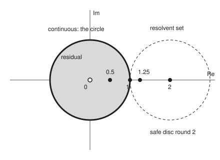
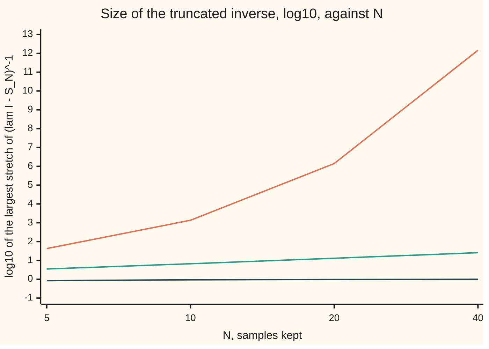

# Spectrum: the numbers at which an operator cannot be inverted

[Syllabus](../../../SYLLABUS.md) → [Functional analysis](../README.md) → [Bounded Operators](../README.md#s03) → Spectrum

---

## General Overview

An echo pedal on a guitar holds a **delay line**: it plays back each sample of the signal one step later. Turn up its feedback knob and every echo is fed back in. With feedback 0.5, a single click comes back as 0.5, then 0.25, then 0.125: the echoes die away. With feedback 1 they never fade. With feedback 2 each echo is twice the last, and the speaker screams.

That knob is a question about inverting an operator (a linear map on signals). Write S for the delay line, y for the input and x for the output. With feedback 1/λ, the loop sets the output to 1/λ times (input plus delayed output). Rearranged, that says λ times the output, minus its delayed copy, equals the input. So finding the output means inverting λI − S, where I is the identity, the map that changes nothing. (A pedal that passes the input through unscaled gives λ times the same output.) The pedal is stable exactly when that inverse exists and has a size limit.

The **spectrum** of an operator is the set of numbers λ where λI − T cannot be inverted. For a matrix that set is the eigenvalues. The delay line has no eigenvalues at all, yet its spectrum is the whole closed unit disc: every complex λ with size at most 1. The disc splits into two kinds of failure. Inside, some outputs can never be reached. On the edge circle, every output can be reached approximately but the inverse has no size limit.

**The spectrum of a bounded operator is the set of complex numbers λ at which λI − T has no bounded inverse; it is always a nonempty closed bounded set, it can hold no eigenvalues at all, and the delay line's spectrum is the closed unit disc, residual inside and continuous on the circle.**

**What kind of fact this is:** theorems. The delay line's spectrum and its split are proved on this card in Why it works, and so are compactness and nonemptiness. The spectral radius formula is stated with its sources and sketched in a fold. The code checks instances on truncations only.

### The picture: the delay line's spectrum

<p align="center"></p>

To scale, 80 px per unit, centre 0 at (180, 160). Shaded: the open disc, the residual spectrum. Heavy circle: the continuous spectrum. Outside: the resolvent set, where the echo dies away. The dashed disc round λ = 2 has radius 1/‖R(2)‖ = 1, and it touches the spectrum at λ = 1. The hollow dot at 0 is the whole spectrum of every finite truncation.

---

## The formula

Notation first, in words.

- A **signal** is a one-sided list $`x = (x_0, x_1, x_2, \dots)`$ of complex numbers with finite energy $`\sum \lvert x_n\rvert^2`$. These signals form the space $`\ell^2`$ ([Sequence spaces](../01-Normed%20and%20Banach%20Spaces/02-sequence-spaces-lp-and-c0.md)). Its size is $`\lVert x\rVert = (\sum \lvert x_n\rvert^2)^{1/2}`$.
- $`e_n`$ is the click at sample n: 1 there, 0 elsewhere.
- The inner product $`\langle v, x\rangle = \sum \overline{v_n}\,x_n`$ conjugates its first slot, like wing 07's $`v^*w`$; texts differ.
- A **bounded operator** T is a linear map with $`\lVert Tx\rVert \le C\lVert x\rVert`$ for one fixed C. Its **norm** $`\lVert T\rVert`$ is the smallest such C ([Bounded operators](01-bounded-operators-and-the-operator-norm.md)).
- The delay line is the **shift** $`S(x_0, x_1, \dots) = (0, x_0, x_1, \dots)`$ ([Three model operators](02-integral-operators-and-the-shift.md)). Its mirror, the **adjoint** $`S^*(x_0, x_1, \dots) = (x_1, x_2, \dots)`$, drops the first sample ([Adjoints](03-adjoints-self-adjoint-and-unitary-operators.md)). The model-operators card calls it the advance.

This card introduces four symbols. The **resolvent set** $`\rho(T)`$ is where inversion works; the **spectrum** $`\sigma(T)`$ is the rest; the **resolvent** $`R(\lambda, T)`$ is the inverse itself; the **spectral radius** $`r(T)`$ is the spectrum's reach. Wing 16 wrote a spectral radius as ρ(G); here ρ is the resolvent set, so the radius is r(T).

```math
\rho(T) = \{\lambda \in \mathbb{C} : \lambda I - T \text{ has a bounded inverse}\}, \qquad \sigma(T) = \mathbb{C} \setminus \rho(T), \qquad R(\lambda, T) = (\lambda I - T)^{-1}
```

**Read it aloud:** the resolvent set is the complex numbers where lambda times the identity minus T has a bounded inverse; the spectrum is every other complex number; the resolvent is that inverse.

The spectrum splits by how $`\lambda I - T`$ fails:

| Part | Name | How $`\lambda I - T`$ fails |
| --- | --- | --- |
| $`\sigma_p(T)`$ | point spectrum | not one-to-one: some $`x \ne 0`$ has $`Tx = \lambda x`$, an eigenvalue |
| $`\sigma_c(T)`$ | continuous spectrum | one-to-one, its range (set of outputs) is **dense** (comes arbitrarily close to every signal, in energy) but misses some |
| $`\sigma_r(T)`$ | residual spectrum | one-to-one, its range is not dense: a whole region of signals is out of reach |

For the delay line the card proves:

```math
\sigma(S) = \{\lvert\lambda\rvert \le 1\}, \quad \sigma_p(S) = \varnothing, \quad \sigma_r(S) = \{\lvert\lambda\rvert < 1\}, \quad \sigma_c(S) = \{\lvert\lambda\rvert = 1\}, \quad \lVert R(\lambda, S)\rVert = \frac{1}{\lvert\lambda\rvert - 1}
```

**Read it aloud:** the delay line's spectrum is the closed unit disc; it has no eigenvalues; the open disc is residual and the circle is continuous; outside, the inverse stretches by one over the distance from lambda to the circle.

Two general facts tie the resolvent together. The **resolvent identity** and **Gelfand's spectral radius formula**:

```math
R(\lambda, T) - R(\mu, T) = (\mu - \lambda)\,R(\lambda, T)\,R(\mu, T), \qquad r(T) = \max_{\lambda \in \sigma(T)} \lvert\lambda\rvert = \lim_{n \to \infty} \lVert T^n\rVert^{1/n}
```

**Read it aloud:** two resolvents differ by the gap between their points times their product; the farthest point of the spectrum from 0 is the limit of the n-th root of the size of T applied n times.

| Symbol | Plain meaning | In our example | Push it up and the answer… |
| --- | --- | --- | --- |
| $`x`$, $`y`$, $`u`$; $`e_n`$ | signals of finite energy, y the input; the click at sample n | $`e_0 = (1, 0, 0, \dots)`$ | — |
| $`T`$, $`A`$; $`S`$, $`S^*`$, $`L`$ | any bounded operator, A a matrix; the delay line; its adjoint, which drops sample 0; the delay's name in statistics, the lag operator | $`T = S`$, $`\lVert S\rVert = 1`$ | — |
| $`I`$ | the identity: changes nothing | — | — |
| $`\lambda`$, $`\mu`$; $`a`$ | complex numbers being tested, the pedal's feedback being $`1/\lambda`$; a time-series coefficient | 0.5, 1, 1.25, 2 | outside the disc, the inverse shrinks |
| $`\rho(T)`$ | resolvent set: where $`\lambda I - T`$ has a bounded inverse | $`\lvert\lambda\rvert > 1`$ | — |
| $`\sigma(T)`$ | spectrum: where it does not | the closed unit disc | — |
| $`\sigma_p`$, $`\sigma_c`$, $`\sigma_r`$ | point, continuous and residual parts | empty; circle; open disc | — |
| $`R(\lambda, T)`$; $`f`$, $`\varphi`$ | resolvent: $`(\lambda I - T)^{-1}`$; in Step 5, the number $`\langle y, R(\lambda, T)x\rangle`$ as λ varies, and a bounded functional that replaces $`\langle y, \cdot\rangle`$ | the echo with feedback $`1/\lambda`$ | — |
| $`\lVert\cdot\rVert`$, $`\langle\cdot,\cdot\rangle`$, $`\mathrm{dist}`$ | energy size of a signal, largest stretch of an operator; the inner product, conjugating its first slot; the distance from a point to a set | $`\lVert R(2, S)\rVert = 1`$, $`\lVert R(1.25, S)\rVert = 4`$; $`\mathrm{dist}(e_0, \mathrm{range}) = 0.866025`$ at λ = 0.5 | — |
| $`r(T)`$ | spectral radius: the farthest spectrum point from 0 | 1 | — |
| $`v_\lambda`$ | the obstruction: $`(1, \bar\lambda, \bar\lambda^2, \dots)`$ | $`(1, 0.5, 0.25, \dots)`$ at $`\lambda = 0.5`$ | — |
| $`N`$, $`S_N`$, $`M`$ | truncation size; the delay line cut to its first N samples; input length in a test | 5 to 40; $`S_8`$; 2 to 20000 | closer to the infinite case |

### When it holds

- **Complex scalars.** Nonemptiness needs complex λ. The quarter turn `[[0, -1], [1, 0]]` has $`\det(\lambda I - A) = \lambda^2 + 1 \ge 1`$ for every real λ, so its real spectrum is empty; its spectrum is i and −i.
- **A complete space and a bounded operator.** Then a one-to-one, onto $`\lambda I - T`$ has a bounded inverse automatically ([Three Banach theorems](../01-Normed%20and%20Banach%20Spaces/08-open-mapping-closed-graph-and-uniform-boundedness.md)), so the spectrum is exactly where $`\lambda I - T`$ is not a one-to-one, onto map. For an unbounded operator the spectrum can be empty or the whole plane, and the domain decides.
- **A nonzero space.** On the space $`\{0\}`$ every λ inverts trivially and the spectrum is empty.
- **One-sided signals.** The two-sided delay on $`(\dots, x_{-1}, x_0, x_1, \dots)`$ has an inverse, the advance. Its spectrum is only the unit circle, all continuous. The disc comes from the hard start at sample 0.

---

## Why it works

### Step 0: in infinite dimensions, one-to-one and onto come apart

A square matrix that loses no direction also reaches every output: the dimensions balance. So a matrix fails to invert at λ only by squashing a direction, and its spectrum is its eigenvalues ([Eigenvalues and eigenvectors](../../03-Algebra/07-Eigenvalues%20and%20Symmetric%20Matrices/02-eigenvalues-and-eigenvectors.md)).

In $`\ell^2`$ the balance is gone. The delay line loses nothing, since it keeps every sample. Yet it never outputs $`e_0`$, because its output always starts with 0. That gap between "loses nothing" and "reaches everything" is where the new kinds of spectrum live.

### Step 1: the spectrum is closed and bounded

Far from 0, the [Neumann series](06-neumann-series-and-inverting-close-to-the-identity.md) inverts. For $`\lvert\lambda\rvert > \lVert T\rVert`$:

```math
R(\lambda, T) = \frac{1}{\lambda}\Big(I - \frac{T}{\lambda}\Big)^{-1} = \sum_{n=0}^{\infty} \frac{T^n}{\lambda^{n+1}}, \qquad \lVert R(\lambda, T)\rVert \le \frac{1}{\lvert\lambda\rvert - \lVert T\rVert}
```

**Read it aloud:** outside the disc of radius the norm of T, the resolvent is a geometric series in T over lambda, and its size is at most one over the gap.

So the spectrum sits inside the disc of radius $`\lVert T\rVert`$. For the delay line, that is the unit disc. The series is the echo itself: $`S^n/\lambda^{n+1}`$ is the n-th echo, delayed n samples, at strength $`1/\lambda^{n+1}`$.

The same trick works round any point $`\lambda_0`$ of the resolvent set. Write $`\mu I - T = (\lambda_0 I - T)\big(I - (\lambda_0 - \mu) R(\lambda_0, T)\big)`$. The second bracket inverts by the Neumann series when $`\lvert\mu - \lambda_0\rvert < 1/\lVert R(\lambda_0, T)\rVert`$. So every resolvent point has a **safe disc** round it, and the resolvent set is open. Its complement, the spectrum, is closed. Closed and bounded in the plane means **compact**.

The safe disc also gives a bound: $`\lVert R(\lambda, T)\rVert \ge 1/\mathrm{dist}(\lambda, \sigma(T))`$. The inverse must blow up as λ approaches the spectrum.

### Step 2: the delay line has no eigenvalues

[Three model operators](02-integral-operators-and-the-shift.md) proves this; in short, suppose $`Sx = \lambda x`$. Sample 0 reads $`0 = \lambda x_0`$. Sample n reads $`x_{n-1} = \lambda x_n`$.

- If $`\lambda = 0`$: then $`x_{n-1} = 0`$ for every n, so $`x = 0`$.
- If $`\lambda \ne 0`$: then $`x_0 = 0`$, and each later sample is $`x_n = x_{n-1}/\lambda = 0`$ in turn.

Only the zero signal survives, so no λ is an eigenvalue. A truncation lies about this: the delay on the first 8 samples pushes $`e_7`$ off the end, so 0 is its eigenvalue. The true S sends $`e_7`$ to $`e_8`$, of size 1.

### Step 3: inside the disc, a region of outputs is out of reach

Take $`\lvert\lambda\rvert < 1`$, say $`\lambda = 0.5`$. Try to reach the click $`e_0`$. The equation $`0.5x_n - x_{n-1} = y_n`$ forces $`x_n = (y_n + x_{n-1})/0.5`$, sample by sample: 2, 4, 8, 16, 32. Each echo doubles, the energy is infinite, and no signal in $`\ell^2`$ reaches $`e_0`$.

The reason is one vector. The obstruction $`v_\lambda = (1, \bar\lambda, \bar\lambda^2, \dots)`$ has finite energy when $`\lvert\lambda\rvert < 1`$: $`\lVert v_{0.5}\rVert^2 = 1/(1 - 0.25) = 4/3`$. It satisfies $`S^* v_\lambda = \bar\lambda v_\lambda`$, so

```math
\langle v_\lambda, (\lambda I - S)x\rangle = \langle (\bar\lambda I - S^*)v_\lambda, x\rangle = 0 \quad \text{for every } x
```

**Read it aloud:** every output of lambda I minus S is at right angles to the obstruction vector.

So every output is at right angles to $`v_\lambda`$. Two more facts make the range exactly the signals at right angles to $`v_\lambda`$.

First, $`\lambda I - S`$ is **bounded below**: since $`\lVert Sx\rVert = \lVert x\rVert`$, the reverse triangle inequality gives $`\lVert(\lambda I - S)x\rVert \ge (1 - \lvert\lambda\rvert)\lVert x\rVert`$. So if outputs $`(\lambda I - S)x_n`$ converge, the inputs $`x_n`$ converge too, and the limit is itself an output: the range is closed.

Second, a signal u at right angles to every output satisfies $`S^* u = \bar\lambda u`$, so $`u_{n+1} = \bar\lambda u_n`$ and u is a multiple of $`v_\lambda`$. The range's perpendicular is exactly the multiples of $`v_\lambda`$.

By [Projection](../02-Hilbert%20Spaces/02-projection-theorem-and-orthogonal-complements.md), the click splits into its nearest point in the closed range plus a leftover at right angles to the range. The leftover is a multiple of $`v_\lambda`$, the click's shadow on it, so the click sits exactly this far from the range:

```math
\mathrm{dist}(e_0, \mathrm{range}) = \frac{\lvert\langle v_\lambda, e_0\rangle\rvert}{\lVert v_\lambda\rVert} = \sqrt{1 - \lvert\lambda\rvert^2}
```

At $`\lambda = 0.5`$ that is $`\sqrt{0.75} = 0.866025`$, which least squares confirms. The range is not dense, so $`\lambda`$ is in the residual spectrum. It is one-to-one by Step 2. Nothing is squashed; the trouble is purely the missed direction.

Note the mirror: $`v_\lambda`$ is an eigenvector of the adjoint $`S^*`$. In general, on a Hilbert space, λ is in the residual spectrum of T exactly when λ is not an eigenvalue of T but its conjugate $`\bar\lambda`$ is an eigenvalue of $`T^*`$.

### Step 4: on the circle, the range is dense but the inverse is unbounded

Take $`\lvert\lambda\rvert = 1`$, say $`\lambda = 1`$. The echo of $`e_0`$ is $`(1, 1, 1, \dots)`$: it never decays, and its energy is infinite. A signal at right angles to every output must satisfy $`S^*u = \bar\lambda u`$, which forces u to be a multiple of the obstruction. But now the obstruction $`v_1 = (1, 1, 1, \dots)`$ has infinite energy, so no nonzero signal in $`\ell^2`$ is at right angles to every output. The range is dense: least squares (the best input among those using only the first M samples) reaches within $`1/\sqrt{M + 1}`$ of $`e_0`$, which tends to 0.

The inverse cannot be bounded. The block of M ones has energy M, and $`(I - S)`$ maps it to $`e_0 - e_M`$, of energy 2. The ratio $`\sqrt{2/M}`$ tends to 0, so the inverse would have to stretch by $`\sqrt{M/2}`$, without limit. One-to-one, dense range, no bounded inverse: λ = 1 is continuous spectrum. The same blocks, twisted by powers of λ, work at every point of the circle.

Steps 1 to 4 together prove the formula: outside the disc the echo dies away; inside, the click is out of reach; on the circle, it is reachable only in the limit.

### Step 5: every bounded operator has a nonempty spectrum

The [Liouville's theorem](../../07-Complex%20analysis/03-Contour%20Integrals%20and%20Cauchy%27s%20Theorem/07-liouville-and-the-fundamental-theorem-of-algebra.md) card proves every polynomial has a root by applying Liouville to one over the polynomial. Run the same argument on the resolvent.

1. Suppose the spectrum were empty. Then $`R(\lambda, T)`$ exists at every complex λ.
2. Fix signals x and y and set $`f(\lambda) = \langle y, R(\lambda, T)x\rangle`$. The resolvent identity makes f differentiable in the complex sense, with derivative $`-\langle y, R(\lambda, T)^2 x\rangle`$. So f is **entire** (complex-differentiable everywhere).
3. Step 1's bound gives $`\lvert f(\lambda)\rvert \le \lVert y\rVert\,\lVert x\rVert / (\lvert\lambda\rvert - \lVert T\rVert)`$ for large λ, which tends to 0. So f is bounded, and by Liouville it is constant, hence 0.
4. Every such f is 0, so $`R(\lambda, T)x = 0`$ for every x. But an inverse cannot send everything to 0 on a nonzero space. Contradiction.

On a general Banach space (a complete normed space), a bounded functional φ from [Hahn-Banach](../01-Normed%20and%20Banach%20Spaces/06-hahn-banach-theorem.md) replaces $`\langle y, \cdot\rangle`$. For a matrix the argument is the polynomial one: $`\det(\lambda I - A)`$ has a root.

<details>
<summary>Detailed proof: the resolvent identity, and why it makes the resolvent differentiable</summary>

Write $`\lambda I - T`$ and $`\mu I - T`$ for the two maps. Their difference is $`(\lambda - \mu)I`$. Multiply on the left by $`R(\lambda, T)`$ and on the right by $`R(\mu, T)`$:

$`\displaystyle R(\lambda, T)\big[(\mu I - T) - (\lambda I - T)\big]R(\mu, T) = R(\lambda, T) - R(\mu, T).`$

The bracket is $`(\mu - \lambda)I`$, which gives the identity. Divide by $`\mu - \lambda`$ and let μ tend to λ. Step 1's safe disc keeps $`R(\mu, T)`$ close to $`R(\lambda, T)`$, so

$`\displaystyle \lim_{\mu \to \lambda} \frac{R(\mu, T) - R(\lambda, T)}{\mu - \lambda} = -R(\lambda, T)^2.`$

Applying $`\langle y, \cdot\, x\rangle`$ turns this into an ordinary complex derivative of f.

</details>

### Step 6: the spectral radius, read off a Laurent series

The Neumann series $`\sum T^n/\lambda^{n+1}`$ is a series in negative powers of λ: a [Laurent series](../../07-Complex%20analysis/05-Laurent%20Series%2C%20Singularities%20and%20Residues/01-laurent-series.md) of the resolvent round infinity. A Laurent series converges on the largest ring free of singularities. Here the singularities are the spectrum, so the series converges exactly for $`\lvert\lambda\rvert > r(T)`$. The root test on the series gives the radius as $`\lim \lVert T^n\rVert^{1/n}`$.

<details>
<summary>Sketch: Gelfand's formula</summary>

The root test makes the series converge where $`\lvert\lambda\rvert > \limsup \lVert T^n\rVert^{1/n}`$. So $`r(T) \le \limsup \lVert T^n\rVert^{1/n}`$.

For the reverse, apply a functional to get a scalar Laurent series $`\sum \varphi(T^n)/\lambda^{n+1}`$, holomorphic for $`\lvert\lambda\rvert > r(T)`$. Its terms are bounded on every circle of radius greater than r(T). Uniform boundedness ([Three Banach theorems](../01-Normed%20and%20Banach%20Spaces/08-open-mapping-closed-graph-and-uniform-boundedness.md)) then bounds $`\lVert T^n\rVert`$ by a constant times that radius to the n, which gives $`\limsup \lVert T^n\rVert^{1/n} \le r(T)`$. The full argument, including that the limit exists, is in Conway, chapter VII, and Kreyszig, chapter 7.

</details>

For the delay line, $`\lVert S^n x\rVert = \lVert x\rVert`$ for every signal, so $`\lVert S^n\rVert = 1`$ and $`r(S) = 1`$: the disc's edge. For the truncation $`S_8`$, eight delays push every sample off the end, so $`S_8^8 = 0`$ and $`r(S_8) = 0`$.

---

## Worked numbers, by hand

Three test points, one from each region.

| Step | Arithmetic | Value |
| --- | --- | --- |
| λ = 2: echo of $`e_0`$ | $`x_n = (y_n + x_{n-1})/2`$ | 0.5, 0.25, 0.125, 0.0625, 0.03125 |
| its energy size | $`\sqrt{1/4 + 1/16 + \cdots} = \sqrt{1/3}`$ | 0.577350 |
| largest stretch of $`R(2, S)`$ | $`1/(2 - 1)`$ | 1 |
| λ = 1.25: largest stretch | $`1/(1.25 - 1)`$ | 4 |
| resolvent identity, top-left entry | $`1/2 - 1/1.25 = -0.75 \times 0.5 \times 0.8`$ | −0.3 |
| λ = 0.5: echo of $`e_0`$ | $`x_n = (y_n + x_{n-1})/0.5`$ | 2, 4, 8, 16, 32 |
| obstruction energy | $`1 + 0.25 + 0.0625 + \cdots = 1/0.75`$ | 4/3 |
| distance from $`e_0`$ to the range | $`1/\sqrt{4/3} = \sqrt{0.75}`$ | **0.866025** |
| λ = 1: echo of $`e_0`$ | $`x_n = y_n + x_{n-1}`$ | 1, 1, 1, 1, 1 |
| distance from $`e_0`$, M = 99 samples | $`1/\sqrt{100}`$ | **0.1, tending to 0** |
| block of 20000 ones: output over input | $`\sqrt{2/20000}`$ | 0.01, tending to 0 |

Outside the disc the echo dies and the inverse is bounded; at 0.5 the click stays 0.866 away from every reachable output; at 1 it can be approached as closely as wanted, but only by inputs of ever larger energy.

### What breaks if you drop a piece

| Mistake | Comes out at | What went wrong |
| --- | --- | --- |
| Read the spectrum off a truncation $`S_8`$ | spectrum {0}, $`r = 0`$ | the truncation is nilpotent ($`S_8^8 = 0`$); the true spectrum is the disc, $`r = 1`$ |
| Look only for eigenvalues | no eigenvalues, "empty spectrum" | the delay line fails to invert without squashing any signal |
| Use the Neumann series inside the disc, λ = 0.5 | ten terms on $`e_0`$: size 1182.4, growing | the series needs $`\lvert\lambda\rvert > \lVert S\rVert = 1`$ |
| Use real scalars only | quarter turn: $`\lambda^2 + 1 \ge 1`$, no real spectrum | Liouville's argument needs complex λ; the spectrum is ±i |

The code prints all four.

---

## Code, from first principles, and it actually runs

The code holds truncations only: the first N samples of a signal. It takes three independent roads. Formulas: the echo recursion, the obstruction vector and the closed forms $`1/(\lvert\lambda\rvert - 1)`$, $`\sqrt{1 - \lambda^2}`$ and $`1/\sqrt{M+1}`$. Brute force: least squares by elimination on the normal equations, and operator norms by power iteration (repeatedly applying $`A^{\mathsf T}A`$ and renormalising, which settles on the largest stretch). Invariants: the resolvent identity, the adjoint's eigenvector and the bounded-below ratio. The last block shows the truncation's honesty problem: $`\lVert(\lambda I - S_N)^{-1}\rVert`$ against N.

### Python

```python
# Spectrum and resolvent -- the check behind the card.  Standard library only.
# The delay line S moves a signal one sample later: S(x0, x1, ...) = (0, x0, x1, ...).
# Code holds only truncations, the first N samples.  Inverses, norms and least
# squares are written out here; nothing imported already knows the answer.
from math import sqrt, log10, sin, pi

def f6(t): return f"{t:.6f}"
def dot(a, b):                       # plain running sum, so Python and Rust add in the same order
    s = 0.0
    for p, q in zip(a, b):
        s += p * q
    return s
def size(x): return sqrt(dot(x, x))

def minus_shift(lam, x):             # (lam I - S) x; the delayed copy spills one sample
    return [lam * a - b for a, b in zip(x + [0.0], [0.0] + x)]

def echo(lam, y, steps):             # solve (lam I - S) x = y sample by sample: x_n = (y_n + x_{n-1}) / lam
    x, prev = [], 0.0
    for n in range(steps):
        prev = ((y[n] if n < len(y) else 0.0) + prev) / lam
        x.append(prev)
    return x

def trunc_inverse(lam, N):           # (lam I - S_N)^-1 by forward substitution, one column at a time
    X = [[0.0] * N for _ in range(N)]
    for k in range(N):
        for j in range(N):
            X[j][k] = ((1.0 if j == k else 0.0) + (X[j - 1][k] if j > 0 else 0.0)) / lam
    return X

def matmul(A, B): return [[dot(A[i], [r[j] for r in B]) for j in range(len(B[0]))] for i in range(len(A))]

def opnorm(A, iters=300):            # largest stretch of A: power iteration on A^T A
    n, x = len(A), [1.0] * len(A)
    for _ in range(iters):
        y = [dot(A[i], x) for i in range(n)]
        z = [dot([A[i][j] for i in range(n)], y) for j in range(n)]
        s = size(z)
        x = [t / s for t in z]
    return size([dot(A[i], x) for i in range(n)])

def distance_to_range(lam, M):       # least squares: min ||(lam I - S) x - e0||, x on M samples
    d, o = lam * lam + 1.0, -lam     # normal equations: tridiagonal, solved by elimination (Thomas)
    b = [lam] + [0.0] * (M - 1)
    c, r = [0.0] * M, [0.0] * M
    c[0], r[0] = o / d, b[0] / d
    for i in range(1, M):
        m = d - o * c[i - 1]
        c[i], r[i] = o / m, (b[i] - o * r[i - 1]) / m
    x = [0.0] * M
    x[M - 1] = r[M - 1]
    for i in range(M - 2, -1, -1):
        x[i] = r[i] - c[i] * x[i + 1]
    res = minus_shift(lam, x)
    res[0] -= 1.0
    return size(res)

def ones_ratio(lam, M): return size(minus_shift(lam, [1.0] * M)) / sqrt(M)
def echo_ratio(lam, M): return size(echo(lam, [1.0] * M, M + 400)) / sqrt(M)

print("delay line S on l2: one-sided signals of finite energy; code holds the first N samples")
print("-- outside the disc: a feedback echo with gain 1/lam")
r2 = echo(2.0, [1.0], 60)
print("lam = 2.00, R(2) e0 first five samples:", " ".join(f"{t:.5f}" for t in r2[:5]), "| size", f6(size(r2)), "| sqrt(1/3)", f6(sqrt(1 / 3)))
for lam in (2.0, 1.25):
    bound = 1 / (lam - 1)
    tests = [echo_ratio(lam, M) for M in (10, 100, 1000)]
    print(f"lam = {lam:.2f}: Neumann bound 1/(|lam| - 1) = {f6(bound)}; ones-block test M = 10, 100, 1000:", " ".join(f6(t) for t in tests))
    assert all(t <= bound + 1e-12 for t in tests) and bound - tests[-1] < 0.02 * bound
N = 6
Ra, Rb = trunc_inverse(2.0, N), trunc_inverse(1.25, N)
P = matmul(Ra, Rb)
gap = max(abs(Ra[i][j] - Rb[i][j] - (1.25 - 2.0) * P[i][j]) for i in range(N) for j in range(N))
closed = max(abs(Ra[j][k] - (2.0 ** -(j - k + 1) if j >= k else 0.0)) for j in range(N) for k in range(N))
print(f"resolvent identity, N = 6: R(2) - R(1.25) at (0,0) = {f6(Ra[0][0] - Rb[0][0])}; (1.25 - 2) R(2) R(1.25) = {f6(-0.75 * P[0][0])}; gap below 1e-14: {'yes' if gap < 1e-14 else 'no'}")
print(f"forward substitution against the formula lam^-(j-k+1): gap below 1e-15: {'yes' if closed < 1e-15 else 'no'}")
assert gap < 1e-14 and closed < 1e-15
print("-- no eigenvalues")
x0 = [0.0] * 8
x0[7] = 1.0
print(f"truncated S_8 sends e7 to {f6(size(minus_shift(0.0, x0)[:8]))}, so 0 is its eigenvalue; the true S sends e7 to size {f6(size(minus_shift(0.0, x0)))}")
assert size(minus_shift(0.0, x0)[:8]) == 0.0 and size(minus_shift(0.0, x0)) == 1.0
print("-- inside the disc, lam = 0.5: residual spectrum")
blow = echo(0.5, [1.0], 5)
print("echo of e0 at lam = 0.5:", " ".join(f"{t:.0f}" for t in blow), "... doubling, infinite energy")
v = [0.5 ** n for n in range(60)]
w = minus_shift(0.5, [3.0, -1.0, 4.0, 1.0, -5.0])
print(f"obstruction v = (1, 0.5, 0.25, ...): <v, (0.5 I - S) x> for x = (3, -1, 4, 1, -5) = {f6(dot(v, w))}")
adj = max(abs(v[n + 1] - 0.5 * v[n]) for n in range(59))
print(f"left shift S* v - 0.5 v, largest entry = {f6(adj)}; ||v||^2 = {f6(size(v) ** 2)}")
dists = [distance_to_range(0.5, M) for M in (3, 24, 99)]
print("distance from e0 to the range, least squares M = 3, 24, 99:", " ".join(f6(t) for t in dists), "| closed form sqrt(1 - lam^2) =", f6(sqrt(0.75)))
assert abs(dists[-1] - sqrt(0.75)) < 1e-12 and abs(dot(v, w)) < 1e-15 and adj < 1e-15 and abs(size(v) ** 2 - 4 / 3) < 1e-12
low = [ones_ratio(0.5, M) for M in (2, 200, 20000)]
print("bounded below: ||(0.5 I - S) x|| / ||x|| on ones blocks M = 2, 200, 20000:", " ".join(f6(t) for t in low), "| never below 1 - |lam| = 0.5")
assert all(t >= 0.5 for t in low)
print("-- on the circle, lam = 1: continuous spectrum")
print("echo of e0 at lam = 1:", " ".join(f"{t:.0f}" for t in echo(1.0, [1.0], 5)), "... never decays, infinite energy")
d1 = [distance_to_range(1.0, M) for M in (3, 24, 99)]
print("distance from e0 to the range, least squares M = 3, 24, 99:", " ".join(f6(t) for t in d1), "| 1/sqrt(M + 1) =", " ".join(f6(1 / sqrt(M + 1)) for M in (3, 24, 99)))
assert all(abs(d - 1 / sqrt(M + 1)) < 1e-12 for d, M in zip(d1, (3, 24, 99)))
c1 = [ones_ratio(1.0, M) for M in (2, 200, 20000)]
print("||(I - S) x|| / ||x|| on ones blocks M = 2, 200, 20000:", " ".join(f6(t) for t in c1), "| sqrt(2/M) ->", f6(sqrt(2 / 20000)))
assert abs(c1[-1] - 0.01) < 1e-12
print("-- the truncation's honesty: ||(lam I - S_N)^-1|| by power iteration")
Ns, table = (5, 10, 20, 40), {}
for lam in (0.5, 1.0, 1.25, 2.0):
    table[lam] = [opnorm(trunc_inverse(lam, n)) for n in Ns]
    print(f"lam = {lam:.2f}, N = 5, 10, 20, 40:", " ".join(f"{t:.4f}" if t < 1e9 else f"{t:.6e}" for t in table[lam]))
    print(f"   log10:", " ".join(f"{log10(t):.3f}" for t in table[lam]))
sine = [1 / (2 * sin(pi / (4 * n + 2))) for n in Ns]
print("lam = 1 closed form 1/(2 sin(pi/(4N + 2))):", " ".join(f"{t:.4f}" for t in sine))
assert all(abs(a - b) < 1e-9 * b for a, b in zip(table[1.0], sine))
assert all(abs(t / (4 / 3 * 2.0 ** n) - 1) < 0.01 for t, n in zip(table[0.5], Ns))
assert all(a < b <= 1.0 for a, b in zip(table[2.0], table[2.0][1:]))
print("-- spectral radius r = lim ||T^n||^(1/n)")
sig = [1.0, -2.0, 0.5]
grown = sig
for n in range(5):
    grown = [0.0] + grown
print(f"S is an isometry: ||S^5 x|| / ||x|| = {f6(size(grown) / size(sig))}, so ||S^n||^(1/n) = 1 and r(S) = 1")
last = [1.0] * 8
for n in range(8):
    last = minus_shift(0.0, last)[:8]
print(f"truncated S_8: eight delays push every sample off the end, ||S_8^8 x|| = {f6(size(last))}, so r(S_8) = 0")
assert abs(size(grown) / size(sig) - 1) < 1e-15 and size(last) == 0.0
print("-- what breaks")
tail = size(echo(0.5, [1.0], 10))
print(f"Neumann series at lam = 0.5, ten terms on e0: size {tail:.1f}, and growing")
dets = [(t / 100) ** 2 + 1 for t in range(-300, 301)]   # det(lam I - A) for the quarter turn A
print(f"quarter turn [[0, -1], [1, 0]]: smallest det(lam I - A) = lam^2 + 1 over real lam in [-3, 3] is {f6(min(dets))}; roots i and -i")
assert min(dets) == 1.0
assert abs(tail - sqrt(4 * (4 ** 10 - 1) / 3)) < 1e-9
print("figure, unit 80 px, centre and lam = 0 at (180, 160); lam = 0.5 at (220, 160), 1 at (260, 160), 1.25 at (280, 160), 2 at (340, 160); safe disc round 2, radius 1/||R(2)|| = 80 px")
print("ALL CHECKS PASS")
```

**Ran 2026-11-15 on macOS, Python 3.14.10, standard library only. All checks passed. Output, pasted from the run:**

```
delay line S on l2: one-sided signals of finite energy; code holds the first N samples
-- outside the disc: a feedback echo with gain 1/lam
lam = 2.00, R(2) e0 first five samples: 0.50000 0.25000 0.12500 0.06250 0.03125 | size 0.577350 | sqrt(1/3) 0.577350
lam = 2.00: Neumann bound 1/(|lam| - 1) = 1.000000; ones-block test M = 10, 100, 1000: 0.931019 0.993311 0.999333
lam = 1.25: Neumann bound 1/(|lam| - 1) = 4.000000; ones-block test M = 10, 100, 1000: 3.106837 3.910101 3.991101
resolvent identity, N = 6: R(2) - R(1.25) at (0,0) = -0.300000; (1.25 - 2) R(2) R(1.25) = -0.300000; gap below 1e-14: yes
forward substitution against the formula lam^-(j-k+1): gap below 1e-15: yes
-- no eigenvalues
truncated S_8 sends e7 to 0.000000, so 0 is its eigenvalue; the true S sends e7 to size 1.000000
-- inside the disc, lam = 0.5: residual spectrum
echo of e0 at lam = 0.5: 2 4 8 16 32 ... doubling, infinite energy
obstruction v = (1, 0.5, 0.25, ...): <v, (0.5 I - S) x> for x = (3, -1, 4, 1, -5) = 0.000000
left shift S* v - 0.5 v, largest entry = 0.000000; ||v||^2 = 1.333333
distance from e0 to the range, least squares M = 3, 24, 99: 0.867722 0.866025 0.866025 | closed form sqrt(1 - lam^2) = 0.866025
bounded below: ||(0.5 I - S) x|| / ||x|| on ones blocks M = 2, 200, 20000: 0.866025 0.504975 0.500050 | never below 1 - |lam| = 0.5
-- on the circle, lam = 1: continuous spectrum
echo of e0 at lam = 1: 1 1 1 1 1 ... never decays, infinite energy
distance from e0 to the range, least squares M = 3, 24, 99: 0.500000 0.200000 0.100000 | 1/sqrt(M + 1) = 0.500000 0.200000 0.100000
||(I - S) x|| / ||x|| on ones blocks M = 2, 200, 20000: 1.000000 0.100000 0.010000 | sqrt(2/M) -> 0.010000
-- the truncation's honesty: ||(lam I - S_N)^-1|| by power iteration
lam = 0.50, N = 5, 10, 20, 40: 42.5200 1365.3239 1398101.3333 1.466016e+12
   log10: 1.629 3.135 6.146 12.166
lam = 1.00, N = 5, 10, 20, 40: 3.5133 6.6907 13.0539 25.7847
   log10: 0.546 0.825 1.116 1.411
lam = 1.25, N = 5, 10, 20, 40: 2.0349 2.8298 3.4736 3.8172
   log10: 0.309 0.452 0.541 0.582
lam = 2.00, N = 5, 10, 20, 40: 0.8405 0.9375 0.9802 0.9945
   log10: -0.075 -0.028 -0.009 -0.002
lam = 1 closed form 1/(2 sin(pi/(4N + 2))): 3.5133 6.6907 13.0539 25.7847
-- spectral radius r = lim ||T^n||^(1/n)
S is an isometry: ||S^5 x|| / ||x|| = 1.000000, so ||S^n||^(1/n) = 1 and r(S) = 1
truncated S_8: eight delays push every sample off the end, ||S_8^8 x|| = 0.000000, so r(S_8) = 0
-- what breaks
Neumann series at lam = 0.5, ten terms on e0: size 1182.4, and growing
quarter turn [[0, -1], [1, 0]]: smallest det(lam I - A) = lam^2 + 1 over real lam in [-3, 3] is 1.000000; roots i and -i
figure, unit 80 px, centre and lam = 0 at (180, 160); lam = 0.5 at (220, 160), 1 at (260, 160), 1.25 at (280, 160), 2 at (340, 160); safe disc round 2, radius 1/||R(2)|| = 80 px
ALL CHECKS PASS
```

### Rust

Same numbers, same labels, built with `rustc --edition 2021 -O`.

```rust
// Spectrum and resolvent -- the same check as the Python, in Rust.  No crates.
// The delay line S moves a signal one sample later: S(x0, x1, ...) = (0, x0, x1, ...).
// Code holds only truncations, the first N samples.  Inverses, norms and least
// squares are written out here; nothing used already knows the answer.
fn f6(t: f64) -> String { format!("{:.6}", t) }
fn size(x: &[f64]) -> f64 { x.iter().fold(0.0, |s, t| s + t * t).sqrt() }
fn join(x: &[f64], d: usize) -> String { x.iter().map(|t| format!("{:.*}", d, t)).collect::<Vec<_>>().join(" ") }
fn yn(c: bool) -> &'static str { if c { "yes" } else { "no" } }

fn minus_shift(lam: f64, x: &[f64]) -> Vec<f64> {   // (lam I - S) x; the delayed copy spills one sample
    (0..=x.len()).map(|n| lam * (if n < x.len() { x[n] } else { 0.0 }) - (if n > 0 { x[n - 1] } else { 0.0 })).collect()
}

fn echo(lam: f64, y: &[f64], steps: usize) -> Vec<f64> {   // x_n = (y_n + x_{n-1}) / lam
    let mut x = Vec::new();
    let mut prev = 0.0;
    for n in 0..steps {
        prev = ((if n < y.len() { y[n] } else { 0.0 }) + prev) / lam;
        x.push(prev);
    }
    x
}

fn trunc_inverse(lam: f64, n: usize) -> Vec<Vec<f64>> {   // (lam I - S_N)^-1 by forward substitution
    let mut x = vec![vec![0.0; n]; n];
    for k in 0..n {
        for j in 0..n {
            x[j][k] = ((if j == k { 1.0 } else { 0.0 }) + (if j > 0 { x[j - 1][k] } else { 0.0 })) / lam;
        }
    }
    x
}

fn matmul(a: &[Vec<f64>], b: &[Vec<f64>]) -> Vec<Vec<f64>> {
    (0..a.len()).map(|i| (0..b[0].len()).map(|j| (0..b.len()).fold(0.0, |s, t| s + a[i][t] * b[t][j])).collect()).collect()
}

fn opnorm(a: &[Vec<f64>]) -> f64 {   // largest stretch of A: power iteration on A^T A
    let n = a.len();
    let apply = |x: &[f64]| -> Vec<f64> { (0..n).map(|i| (0..n).fold(0.0, |s, j| s + a[i][j] * x[j])).collect() };
    let mut x = vec![1.0; n];
    for _ in 0..300 {
        let y = apply(&x);
        let z: Vec<f64> = (0..n).map(|j| (0..n).fold(0.0, |s, i| s + a[i][j] * y[i])).collect();
        let s = size(&z);
        x = z.iter().map(|t| t / s).collect();
    }
    size(&apply(&x))
}

fn distance_to_range(lam: f64, m: usize) -> f64 {   // least squares by tridiagonal normal equations
    let (d, o) = (lam * lam + 1.0, -lam);
    let mut b = vec![0.0; m];
    b[0] = lam;
    let (mut c, mut r) = (vec![0.0; m], vec![0.0; m]);
    c[0] = o / d;
    r[0] = b[0] / d;
    for i in 1..m {
        let mm = d - o * c[i - 1];
        c[i] = o / mm;
        r[i] = (b[i] - o * r[i - 1]) / mm;
    }
    let mut x = vec![0.0; m];
    x[m - 1] = r[m - 1];
    for i in (0..m - 1).rev() { x[i] = r[i] - c[i] * x[i + 1]; }
    let mut res = minus_shift(lam, &x);
    res[0] -= 1.0;
    size(&res)
}

fn ones_ratio(lam: f64, m: usize) -> f64 { size(&minus_shift(lam, &vec![1.0; m])) / (m as f64).sqrt() }
fn echo_ratio(lam: f64, m: usize) -> f64 { size(&echo(lam, &vec![1.0; m], m + 400)) / (m as f64).sqrt() }

fn main() {
    println!("delay line S on l2: one-sided signals of finite energy; code holds the first N samples");
    println!("-- outside the disc: a feedback echo with gain 1/lam");
    let r2 = echo(2.0, &[1.0], 60);
    println!("lam = 2.00, R(2) e0 first five samples: {} | size {} | sqrt(1/3) {}", join(&r2[..5], 5), f6(size(&r2)), f6((1.0f64 / 3.0).sqrt()));
    for lam in [2.0, 1.25] {
        let bound = 1.0 / (lam - 1.0);
        let tests: Vec<f64> = [10, 100, 1000].iter().map(|&m| echo_ratio(lam, m)).collect();
        println!("lam = {:.2}: Neumann bound 1/(|lam| - 1) = {}; ones-block test M = 10, 100, 1000: {}", lam, f6(bound), join(&tests, 6));
        assert!(tests.iter().all(|&t| t <= bound + 1e-12) && bound - tests[2] < 0.02 * bound);
    }
    let n = 6;
    let (ra, rb) = (trunc_inverse(2.0, n), trunc_inverse(1.25, n));
    let p = matmul(&ra, &rb);
    let (mut gap, mut closed) = (0.0f64, 0.0f64);
    for i in 0..n {
        for j in 0..n {
            gap = gap.max((ra[i][j] - rb[i][j] - (1.25 - 2.0) * p[i][j]).abs());
            let f = if i >= j { 2.0f64.powi(-((i - j + 1) as i32)) } else { 0.0 };
            closed = closed.max((ra[i][j] - f).abs());
        }
    }
    println!("resolvent identity, N = 6: R(2) - R(1.25) at (0,0) = {}; (1.25 - 2) R(2) R(1.25) = {}; gap below 1e-14: {}",
             f6(ra[0][0] - rb[0][0]), f6(-0.75 * p[0][0]), yn(gap < 1e-14));
    println!("forward substitution against the formula lam^-(j-k+1): gap below 1e-15: {}", yn(closed < 1e-15));
    assert!(gap < 1e-14 && closed < 1e-15);
    println!("-- no eigenvalues");
    let mut x0 = vec![0.0; 8];
    x0[7] = 1.0;
    println!("truncated S_8 sends e7 to {}, so 0 is its eigenvalue; the true S sends e7 to size {}",
             f6(size(&minus_shift(0.0, &x0)[..8])), f6(size(&minus_shift(0.0, &x0))));
    assert!(size(&minus_shift(0.0, &x0)[..8]) == 0.0 && size(&minus_shift(0.0, &x0)) == 1.0);
    println!("-- inside the disc, lam = 0.5: residual spectrum");
    println!("echo of e0 at lam = 0.5: {} ... doubling, infinite energy", join(&echo(0.5, &[1.0], 5), 0));
    let v: Vec<f64> = (0..60).map(|k| 0.5f64.powi(k)).collect();
    let w = minus_shift(0.5, &[3.0, -1.0, 4.0, 1.0, -5.0]);
    let ip = v.iter().zip(w.iter()).fold(0.0, |s, (a, b)| s + a * b);
    println!("obstruction v = (1, 0.5, 0.25, ...): <v, (0.5 I - S) x> for x = (3, -1, 4, 1, -5) = {}", f6(ip));
    let adj = (0..59).fold(0.0f64, |s, k| s.max((v[k + 1] - 0.5 * v[k]).abs()));
    println!("left shift S* v - 0.5 v, largest entry = {}; ||v||^2 = {}", f6(adj), f6(size(&v).powi(2)));
    let dists: Vec<f64> = [3, 24, 99].iter().map(|&m| distance_to_range(0.5, m)).collect();
    println!("distance from e0 to the range, least squares M = 3, 24, 99: {} | closed form sqrt(1 - lam^2) = {}", join(&dists, 6), f6(0.75f64.sqrt()));
    assert!((dists[2] - 0.75f64.sqrt()).abs() < 1e-12 && ip.abs() < 1e-15 && adj < 1e-15 && (size(&v).powi(2) - 4.0 / 3.0).abs() < 1e-12);
    let low: Vec<f64> = [2, 200, 20000].iter().map(|&m| ones_ratio(0.5, m)).collect();
    println!("bounded below: ||(0.5 I - S) x|| / ||x|| on ones blocks M = 2, 200, 20000: {} | never below 1 - |lam| = 0.5", join(&low, 6));
    assert!(low.iter().all(|&t| t >= 0.5));
    println!("-- on the circle, lam = 1: continuous spectrum");
    println!("echo of e0 at lam = 1: {} ... never decays, infinite energy", join(&echo(1.0, &[1.0], 5), 0));
    let ms = [3usize, 24, 99];
    let d1: Vec<f64> = ms.iter().map(|&m| distance_to_range(1.0, m)).collect();
    let inv: Vec<f64> = ms.iter().map(|&m| 1.0 / ((m + 1) as f64).sqrt()).collect();
    println!("distance from e0 to the range, least squares M = 3, 24, 99: {} | 1/sqrt(M + 1) = {}", join(&d1, 6), join(&inv, 6));
    assert!(d1.iter().zip(inv.iter()).all(|(d, e)| (d - e).abs() < 1e-12));
    let c1: Vec<f64> = [2, 200, 20000].iter().map(|&m| ones_ratio(1.0, m)).collect();
    println!("||(I - S) x|| / ||x|| on ones blocks M = 2, 200, 20000: {} | sqrt(2/M) -> {}", join(&c1, 6), f6((2.0f64 / 20000.0).sqrt()));
    assert!((c1[2] - 0.01).abs() < 1e-12);
    println!("-- the truncation's honesty: ||(lam I - S_N)^-1|| by power iteration");
    let ns = [5usize, 10, 20, 40];
    let mut table: Vec<Vec<f64>> = Vec::new();
    for lam in [0.5, 1.0, 1.25, 2.0] {
        let row: Vec<f64> = ns.iter().map(|&k| opnorm(&trunc_inverse(lam, k))).collect();
        let big = row.iter().map(|&t| if t < 1e9 { format!("{:.4}", t) } else { format!("{:.6e}", t).replace('e', "e+") }).collect::<Vec<_>>();
        println!("lam = {:.2}, N = 5, 10, 20, 40: {}", lam, big.join(" "));
        println!("   log10: {}", join(&row.iter().map(|t| t.log10()).collect::<Vec<_>>(), 3));
        table.push(row);
    }
    let sine: Vec<f64> = ns.iter().map(|&k| 1.0 / (2.0 * (std::f64::consts::PI / (4 * k + 2) as f64).sin())).collect();
    println!("lam = 1 closed form 1/(2 sin(pi/(4N + 2))): {}", join(&sine, 4));
    assert!(table[1].iter().zip(sine.iter()).all(|(a, b)| (a - b).abs() < 1e-9 * b));
    assert!(table[0].iter().zip(ns.iter()).all(|(t, &k)| (t / (4.0 / 3.0 * 2.0f64.powi(k as i32)) - 1.0).abs() < 0.01));
    assert!(table[3].windows(2).all(|p| p[0] < p[1] && p[1] <= 1.0));
    println!("-- spectral radius r = lim ||T^n||^(1/n)");
    let sig = vec![1.0, -2.0, 0.5];
    let mut grown = sig.clone();
    for _ in 0..5 { grown.insert(0, 0.0); }
    println!("S is an isometry: ||S^5 x|| / ||x|| = {}, so ||S^n||^(1/n) = 1 and r(S) = 1", f6(size(&grown) / size(&sig)));
    let mut last = vec![1.0; 8];
    for _ in 0..8 { last = minus_shift(0.0, &last)[..8].to_vec(); }
    println!("truncated S_8: eight delays push every sample off the end, ||S_8^8 x|| = {}, so r(S_8) = 0", f6(size(&last)));
    assert!((size(&grown) / size(&sig) - 1.0).abs() < 1e-15 && size(&last) == 0.0);
    println!("-- what breaks");
    let tail = size(&echo(0.5, &[1.0], 10));
    println!("Neumann series at lam = 0.5, ten terms on e0: size {:.1}, and growing", tail);
    let dets: Vec<f64> = (-300..=300).map(|t| (t as f64 / 100.0).powi(2) + 1.0).collect();
    let dmin = dets.iter().cloned().fold(f64::INFINITY, f64::min);
    println!("quarter turn [[0, -1], [1, 0]]: smallest det(lam I - A) = lam^2 + 1 over real lam in [-3, 3] is {}; roots i and -i", f6(dmin));
    assert!(dmin == 1.0);
    assert!((tail - (4.0 * (4.0f64.powi(10) - 1.0) / 3.0).sqrt()).abs() < 1e-9);
    println!("figure, unit 80 px, centre and lam = 0 at (180, 160); lam = 0.5 at (220, 160), 1 at (260, 160), 1.25 at (280, 160), 2 at (340, 160); safe disc round 2, radius 1/||R(2)|| = 80 px");
    println!("ALL CHECKS PASS");
}
```

**Ran 2026-11-15 on macOS, rustc 1.98.1, no crates. All checks passed. Output, pasted from the run:**

```
delay line S on l2: one-sided signals of finite energy; code holds the first N samples
-- outside the disc: a feedback echo with gain 1/lam
lam = 2.00, R(2) e0 first five samples: 0.50000 0.25000 0.12500 0.06250 0.03125 | size 0.577350 | sqrt(1/3) 0.577350
lam = 2.00: Neumann bound 1/(|lam| - 1) = 1.000000; ones-block test M = 10, 100, 1000: 0.931019 0.993311 0.999333
lam = 1.25: Neumann bound 1/(|lam| - 1) = 4.000000; ones-block test M = 10, 100, 1000: 3.106837 3.910101 3.991101
resolvent identity, N = 6: R(2) - R(1.25) at (0,0) = -0.300000; (1.25 - 2) R(2) R(1.25) = -0.300000; gap below 1e-14: yes
forward substitution against the formula lam^-(j-k+1): gap below 1e-15: yes
-- no eigenvalues
truncated S_8 sends e7 to 0.000000, so 0 is its eigenvalue; the true S sends e7 to size 1.000000
-- inside the disc, lam = 0.5: residual spectrum
echo of e0 at lam = 0.5: 2 4 8 16 32 ... doubling, infinite energy
obstruction v = (1, 0.5, 0.25, ...): <v, (0.5 I - S) x> for x = (3, -1, 4, 1, -5) = 0.000000
left shift S* v - 0.5 v, largest entry = 0.000000; ||v||^2 = 1.333333
distance from e0 to the range, least squares M = 3, 24, 99: 0.867722 0.866025 0.866025 | closed form sqrt(1 - lam^2) = 0.866025
bounded below: ||(0.5 I - S) x|| / ||x|| on ones blocks M = 2, 200, 20000: 0.866025 0.504975 0.500050 | never below 1 - |lam| = 0.5
-- on the circle, lam = 1: continuous spectrum
echo of e0 at lam = 1: 1 1 1 1 1 ... never decays, infinite energy
distance from e0 to the range, least squares M = 3, 24, 99: 0.500000 0.200000 0.100000 | 1/sqrt(M + 1) = 0.500000 0.200000 0.100000
||(I - S) x|| / ||x|| on ones blocks M = 2, 200, 20000: 1.000000 0.100000 0.010000 | sqrt(2/M) -> 0.010000
-- the truncation's honesty: ||(lam I - S_N)^-1|| by power iteration
lam = 0.50, N = 5, 10, 20, 40: 42.5200 1365.3239 1398101.3333 1.466016e+12
   log10: 1.629 3.135 6.146 12.166
lam = 1.00, N = 5, 10, 20, 40: 3.5133 6.6907 13.0539 25.7847
   log10: 0.546 0.825 1.116 1.411
lam = 1.25, N = 5, 10, 20, 40: 2.0349 2.8298 3.4736 3.8172
   log10: 0.309 0.452 0.541 0.582
lam = 2.00, N = 5, 10, 20, 40: 0.8405 0.9375 0.9802 0.9945
   log10: -0.075 -0.028 -0.009 -0.002
lam = 1 closed form 1/(2 sin(pi/(4N + 2))): 3.5133 6.6907 13.0539 25.7847
-- spectral radius r = lim ||T^n||^(1/n)
S is an isometry: ||S^5 x|| / ||x|| = 1.000000, so ||S^n||^(1/n) = 1 and r(S) = 1
truncated S_8: eight delays push every sample off the end, ||S_8^8 x|| = 0.000000, so r(S_8) = 0
-- what breaks
Neumann series at lam = 0.5, ten terms on e0: size 1182.4, and growing
quarter turn [[0, -1], [1, 0]]: smallest det(lam I - A) = lam^2 + 1 over real lam in [-3, 3] is 1.000000; roots i and -i
figure, unit 80 px, centre and lam = 0 at (180, 160); lam = 0.5 at (220, 160), 1 at (260, 160), 1.25 at (280, 160), 2 at (340, 160); safe disc round 2, radius 1/||R(2)|| = 80 px
ALL CHECKS PASS
```

The two outputs match line for line.

### What the truncation hides

Every truncation $`S_N`$ has spectrum {0}. The size of its inverse tells the truth instead: at each λ it either settles or runs away as N grows.



Top line: λ = 0.5, inside the disc, growing like $`(4/3)\,2^N`$. Middle: λ = 1, on the circle, growing in step with N, matching $`1/(2\sin(\pi/(4N+2)))`$. Bottom: λ = 2, outside, settling at log10 1 = 0. A trend over N that does not close marks the spectrum; one that closes marks the resolvent set.

### Lean

Lean proves the general facts on every nonzero complete space, the delay line's spectrum and its split, and the hand numbers exactly.

- Take a bounded operator T on a nonzero complete space, with complex scalars. Then its spectrum $`\sigma(T)`$ is nonempty and compact.
- Take the delay line S on $`\ell^2`$. Then $`Sx = \lambda x`$ forces $`x = 0`$, so S has no eigenvalues.
- Take the same S. Then $`\sigma(S)`$ is the closed unit disc, every complex λ with $`\lvert\lambda\rvert \le 1`$.
- Take $`\lvert\lambda\rvert < 1`$. Then $`\lambda I - S`$ is one-to-one, but its range is not dense: residual spectrum.
- Take $`\lvert\lambda\rvert = 1`$. Then $`\lambda I - S`$ is one-to-one with dense range. Yet no constant C gives $`\lVert x\rVert \le C\lVert(\lambda I - S)x\rVert`$ for every x: continuous spectrum.
- Take the click $`e_0`$ as the input. Then its echo is 2, 4, 8, 16, 32 at λ = 0.5, and 1, 1, 1, 1, 1 at λ = 1.
- Take λ = 0.5 and x = (3, −1, 4, 1, −5). Then $`(\lambda I - S)x`$ is at right angles to the obstruction $`v_{0.5}`$.
- Take the block of 5 ones, of energy 5. Then $`I - S`$ sends it to $`e_0 - e_5`$, of energy 2.
- Take the truncation $`S_8`$. Then it sends $`e_7`$ to 0, and eight applications of $`S_8`$ send the block of 8 ones to 0.
- Take the quarter turn `[[0, -1], [1, 0]]` as A, and a real λ. Then $`\det(\lambda I - A) = \lambda^2 + 1 \ge 1`$.
- Take λ = i or λ = −i instead. Then $`\det(\lambda I - A) = 0`$.

Resolvent sizes, the resolvent identity, Gelfand's formula, distances and truncated inverses are left to the Python and Rust checks.

```lean
-- Spectrum: every bounded operator on a nonzero complex Banach space has a nonempty, closed and bounded spectrum, and the delay line on ℓ² has no eigenvalues, its spectrum is the closed unit disc, residual inside and continuous on the circle.
import Mathlib.Analysis.Normed.Algebra.Spectrum
import Mathlib.Analysis.Normed.Lp.lpSpace
import Mathlib.Analysis.Normed.Operator.NormedSpace
import Mathlib.LinearAlgebra.Matrix.Determinant.Basic
import Mathlib.LinearAlgebra.Matrix.Notation
import Mathlib.Tactic.NormNum
import Mathlib.Analysis.Normed.Algebra.GelfandFormula
import Mathlib.Analysis.InnerProductSpace.l2Space
import Mathlib.Analysis.Normed.Operator.Banach
import Mathlib.Analysis.SpecificLimits.Basic

open scoped ENNReal

theorem delay_single (S : lp (fun _ : ℕ => ℂ) 2 →L[ℂ] lp (fun _ : ℕ => ℂ) 2) (hS0 : ∀ x, S x 0 = 0) (hS : ∀ x n, S x (n + 1) = x n)
    (n : ℕ) (c : ℂ) : S (lp.single 2 n c) = lp.single 2 (n + 1) c := by
  ext m
  cases m with
  | zero => simp [hS0]
  | succ m => rw [hS]; simp [Pi.single_apply]

theorem delay_norm (S : lp (fun _ : ℕ => ℂ) 2 →L[ℂ] lp (fun _ : ℕ => ℂ) 2) (hS0 : ∀ x, S x 0 = 0) (hS : ∀ x n, S x (n + 1) = x n)
    (x : lp (fun _ : ℕ => ℂ) 2) : ‖S x‖ = ‖x‖ := by
  have hp : 0 < (2 : ℝ≥0∞).toReal := by norm_num
  have h1 := lp.norm_rpow_eq_tsum hp (S x)
  have h2 := lp.norm_rpow_eq_tsum hp x
  have hsum := (lp.memℓp (S x)).summable hp
  rw [hsum.tsum_eq_zero_add] at h1
  simp only [hS0, hS, norm_zero] at h1
  rw [Real.zero_rpow hp.ne', zero_add, ← h2] at h1
  simp only [ENNReal.toReal_ofNat, Real.rpow_two] at h1
  exact (pow_left_inj₀ (norm_nonneg _) (norm_nonneg _) two_ne_zero).1 h1

theorem delay_eigen (S : lp (fun _ : ℕ => ℂ) 2 →L[ℂ] lp (fun _ : ℕ => ℂ) 2) (hS0 : ∀ x, S x 0 = 0) (hS : ∀ x n, S x (n + 1) = x n)
    (μ : ℂ) (x : lp (fun _ : ℕ => ℂ) 2) (h : S x = μ • x) : x = 0 := by
  have key : ∀ n, x n = 0 := by
    by_cases hμ : μ = 0
    · intro n
      have := congrArg (fun y : lp (fun _ : ℕ => ℂ) 2 => y (n + 1)) h
      simpa [hS, hμ] using this
    · intro n
      induction n with
      | zero =>
        have := congrArg (fun y : lp (fun _ : ℕ => ℂ) 2 => y 0) h
        simp [hS0, hμ] at this
        exact this
      | succ n ih =>
        have := congrArg (fun y : lp (fun _ : ℕ => ℂ) 2 => y (n + 1)) h
        simp [hS, ih, hμ] at this
        exact this
  ext n
  simpa using key n

theorem delay_sub_single (S : lp (fun _ : ℕ => ℂ) 2 →L[ℂ] lp (fun _ : ℕ => ℂ) 2) (hS0 : ∀ x, S x 0 = 0)
    (hS : ∀ x n, S x (n + 1) = x n) (μ : ℂ) (n : ℕ) (c : ℂ) :
    (μ • (1 : lp (fun _ : ℕ => ℂ) 2 →L[ℂ] lp (fun _ : ℕ => ℂ) 2) - S) (lp.single 2 n c) = μ • lp.single 2 n c - lp.single 2 (n + 1) c := by
  simp [delay_single S hS0 hS]

theorem delay_not_dense (S : lp (fun _ : ℕ => ℂ) 2 →L[ℂ] lp (fun _ : ℕ => ℂ) 2) (hS0 : ∀ x, S x 0 = 0)
    (hS : ∀ x n, S x (n + 1) = x n) (μ : ℂ) (hμ : ‖μ‖ < 1) :
    ¬ Dense (Set.range (μ • (1 : lp (fun _ : ℕ => ℂ) 2 →L[ℂ] lp (fun _ : ℕ => ℂ) 2) - S)) := by
  set T := μ • (1 : lp (fun _ : ℕ => ℂ) 2 →L[ℂ] lp (fun _ : ℕ => ℂ) 2) - S with hT
  have hmem : Memℓp (fun n : ℕ => (starRingEnd ℂ μ) ^ n) 2 := by
    apply memℓp_gen
    have : (fun n : ℕ => ‖(starRingEnd ℂ μ) ^ n‖ ^ (2 : ℝ≥0∞).toReal) = fun n => (‖μ‖ ^ 2) ^ n := by
      funext n
      simp only [ENNReal.toReal_ofNat, Real.rpow_two, norm_pow, Complex.norm_conj]
      ring
    rw [this]
    exact summable_geometric_of_lt_one (sq_nonneg _) (by nlinarith [norm_nonneg μ])
  set v : lp (fun _ : ℕ => ℂ) 2 := ⟨_, hmem⟩ with hv
  have hv0 : v 0 = 1 := by simp [hv]
  have horth : v ∈ (LinearMap.range (T : lp (fun _ : ℕ => ℂ) 2 →ₗ[ℂ] lp (fun _ : ℕ => ℂ) 2))ᗮ := by
    rw [Submodule.mem_orthogonal]
    rintro u ⟨x, rfl⟩
    have hsum := (lp.hasSum_single (p := 2) (by norm_num) x).mapL ((innerSL ℂ v).comp T)
    have hzero : ∀ n, ((innerSL ℂ v).comp T) (lp.single 2 n (x n)) = 0 := by
      intro n
      simp only [ContinuousLinearMap.comp_apply, innerSL_apply_apply, hT,
        delay_sub_single S hS0 hS, inner_sub_right, inner_smul_right, lp.inner_single_right]
      simp [hv, pow_succ]
      ring
    simp only [hzero] at hsum
    have h0 := hsum.unique hasSum_zero
    simp only [ContinuousLinearMap.comp_apply, innerSL_apply_apply] at h0
    have h1 : inner ℂ (T x) v = 0 := by rw [← inner_conj_symm, h0, map_zero]
    exact h1
  intro hd
  have htop : (LinearMap.range (T : lp (fun _ : ℕ => ℂ) 2 →ₗ[ℂ] lp (fun _ : ℕ => ℂ) 2)).topologicalClosure = ⊤ :=
    (Submodule.dense_iff_topologicalClosure_eq_top).1 hd
  rw [Submodule.topologicalClosure_eq_top_iff] at htop
  rw [htop, Submodule.mem_bot] at horth
  have := congrArg (fun y : lp (fun _ : ℕ => ℂ) 2 => y 0) horth
  simp [hv0] at this

theorem delay_injective (S : lp (fun _ : ℕ => ℂ) 2 →L[ℂ] lp (fun _ : ℕ => ℂ) 2) (hS0 : ∀ x, S x 0 = 0)
    (hS : ∀ x n, S x (n + 1) = x n) (μ : ℂ) :
    Function.Injective (μ • (1 : lp (fun _ : ℕ => ℂ) 2 →L[ℂ] lp (fun _ : ℕ => ℂ) 2) - S) := by
  intro x y hxy
  have h : (μ • (1 : lp (fun _ : ℕ => ℂ) 2 →L[ℂ] lp (fun _ : ℕ => ℂ) 2) - S) (x - y) = 0 := by rw [map_sub, hxy, sub_self]
  have h2 : μ • (x - y) - S (x - y) = 0 := by simpa using h
  exact sub_eq_zero.1 (delay_eigen S hS0 hS μ (x - y) (sub_eq_zero.1 h2).symm)

theorem delay_spectrum (S : lp (fun _ : ℕ => ℂ) 2 →L[ℂ] lp (fun _ : ℕ => ℂ) 2) (hS0 : ∀ x, S x 0 = 0)
    (hS : ∀ x n, S x (n + 1) = x n) :
    spectrum ℂ S = Metric.closedBall (0 : ℂ) 1 := by
  apply le_antisymm
  · have : Nontrivial (lp (fun _ : ℕ => ℂ) 2) := nontrivial_of_ne (lp.single 2 0 1) 0 (by
      intro h
      have := congrArg (fun y : lp (fun _ : ℕ => ℂ) 2 => y 0) h
      simp at this)
    have hn : ‖S‖ ≤ 1 :=
      ContinuousLinearMap.opNorm_le_bound S zero_le_one
        (fun x => by rw [delay_norm S hS0 hS x, one_mul])
    exact (spectrum.subset_closedBall_norm S).trans (Metric.closedBall_subset_closedBall hn)
  · have hball : Metric.ball (0 : ℂ) 1 ⊆ spectrum ℂ S := by
      intro μ hμ
      rw [Metric.mem_ball, dist_zero_right] at hμ
      rw [spectrum.mem_iff, Algebra.algebraMap_eq_smul_one]
      intro hu
      rw [ContinuousLinearMap.isUnit_iff_bijective] at hu
      apply delay_not_dense S hS0 hS μ hμ
      rw [hu.2.range_eq]
      exact dense_univ
    rw [← closure_ball (0 : ℂ) one_ne_zero]
    exact (spectrum.isClosed S).closure_subset_iff.2 hball

theorem delay_dense (S : lp (fun _ : ℕ => ℂ) 2 →L[ℂ] lp (fun _ : ℕ => ℂ) 2) (hS0 : ∀ x, S x 0 = 0)
    (hS : ∀ x n, S x (n + 1) = x n) (μ : ℂ) (hμ : ‖μ‖ = 1) :
    Dense (Set.range (μ • (1 : lp (fun _ : ℕ => ℂ) 2 →L[ℂ] lp (fun _ : ℕ => ℂ) 2) - S)) := by
  set T := μ • (1 : lp (fun _ : ℕ => ℂ) 2 →L[ℂ] lp (fun _ : ℕ => ℂ) 2) - S with hT
  have hd : Dense ((LinearMap.range (T : lp (fun _ : ℕ => ℂ) 2 →ₗ[ℂ] lp (fun _ : ℕ => ℂ) 2) : Submodule ℂ (lp (fun _ : ℕ => ℂ) 2)) : Set (lp (fun _ : ℕ => ℂ) 2)) := by
    rw [Submodule.dense_iff_topologicalClosure_eq_top, Submodule.topologicalClosure_eq_top_iff,
      Submodule.eq_bot_iff]
    intro w hw
    rw [Submodule.mem_orthogonal] at hw
    have hrec : ∀ n, w (n + 1) = (starRingEnd ℂ μ) * w n := by
      intro n
      have h := hw (T (lp.single 2 n 1)) ⟨_, rfl⟩
      simp only [hT, delay_sub_single S hS0 hS, inner_sub_left, inner_smul_left,
        lp.inner_single_left] at h
      simp at h
      linear_combination -h
    have hconst : ∀ n, ‖w n‖ = ‖w 0‖ := by
      intro n
      induction n with
      | zero => rfl
      | succ n ih => rw [hrec, norm_mul, Complex.norm_conj, hμ, one_mul, ih]
    have hp : 0 < (2 : ℝ≥0∞).toReal := by norm_num
    have hsum := (lp.memℓp w).summable hp
    simp only [hconst] at hsum
    rw [summable_const_iff] at hsum
    have h0 : ‖w 0‖ = 0 := by
      simp only [ENNReal.toReal_ofNat, Real.rpow_two] at hsum
      exact pow_eq_zero_iff two_ne_zero |>.1 hsum
    ext n
    have h1 : ‖w n‖ = 0 := by rw [hconst n, h0]
    simpa using h1
  exact hd

theorem delay_not_bounded_below (S : lp (fun _ : ℕ => ℂ) 2 →L[ℂ] lp (fun _ : ℕ => ℂ) 2) (hS0 : ∀ x, S x 0 = 0)
    (hS : ∀ x n, S x (n + 1) = x n) (μ : ℂ) (hμ : ‖μ‖ = 1) :
    ¬ ∃ C : ℝ, ∀ x : lp (fun _ : ℕ => ℂ) 2, ‖x‖ ≤ C * ‖(μ • (1 : lp (fun _ : ℕ => ℂ) 2 →L[ℂ] lp (fun _ : ℕ => ℂ) 2) - S) x‖ := by
  rintro ⟨C, hC⟩
  set T := μ • (1 : lp (fun _ : ℕ => ℂ) 2 →L[ℂ] lp (fun _ : ℕ => ℂ) 2) - S with hT
  have hspec : μ ∈ spectrum ℂ S := by
    rw [delay_spectrum S hS0 hS, Metric.mem_closedBall, dist_zero_right, hμ]
  have hK : ∀ x : lp (fun _ : ℕ => ℂ) 2, ‖x‖ ≤ (Real.toNNReal C : ℝ) * ‖T x‖ := by
    intro x
    refine (hC x).trans ?_
    exact mul_le_mul_of_nonneg_right (Real.le_coe_toNNReal C) (norm_nonneg _)
  have hanti := ContinuousLinearMap.antilipschitz_of_bound T hK
  have hclosed := hanti.isClosed_range T.uniformContinuous
  have hrange : Set.range T = Set.univ := by
    rw [← hclosed.closure_eq]
    exact (delay_dense S hS0 hS μ hμ).closure_eq
  have hbij : Function.Bijective T :=
    ⟨delay_injective S hS0 hS μ, Set.range_eq_univ.1 hrange⟩
  rw [spectrum.mem_iff, Algebra.algebraMap_eq_smul_one] at hspec
  exact hspec (ContinuousLinearMap.isUnit_iff_bijective.2 hbij)

#print axioms delay_single
#print axioms delay_norm
#print axioms delay_eigen
#print axioms delay_sub_single
#print axioms delay_not_dense
#print axioms delay_injective
#print axioms delay_spectrum
#print axioms delay_dense
#print axioms delay_not_bounded_below

/-- Every bounded operator has a nonempty, closed and bounded spectrum. Let `E` be a nonzero
complex Banach space (complete normed space) and `T` a bounded operator on it. The spectrum
`σ(T)`, the complex numbers `λ` at which `λI − T` has no bounded inverse, is nonempty and
compact (closed and bounded in the plane). -/
theorem spectrum_nonempty_and_compact
    {E : Type*} [NormedAddCommGroup E] [NormedSpace ℂ E] [CompleteSpace E] [Nontrivial E]
    (T : E →L[ℂ] E) :
    (spectrum ℂ T).Nonempty ∧ IsCompact (spectrum ℂ T) := by
  exact ⟨spectrum.nonempty T, spectrum.isCompact T⟩

/-- The delay line has no eigenvalues, yet its spectrum is the closed unit disc. Let `S` be the
bounded operator on one-sided complex signals of finite energy, `ℓ²`, that delays every sample by
one step: `(Sx)₀ = 0` and `(Sx)ₙ₊₁ = xₙ`. Then `Sx = λx` forces `x = 0` for every complex `λ`, and
the spectrum `σ(S)` is exactly the set of complex `λ` with `|λ| ≤ 1`. -/
theorem delay_line_spectrum_eq_closed_unit_disc
    (S : lp (fun _ : ℕ => ℂ) 2 →L[ℂ] lp (fun _ : ℕ => ℂ) 2)
    (hS0 : ∀ x, S x 0 = 0) (hS : ∀ x n, S x (n + 1) = x n) :
    (∀ (μ : ℂ) (x : lp (fun _ : ℕ => ℂ) 2), S x = μ • x → x = 0) ∧
      spectrum ℂ S = Metric.closedBall (0 : ℂ) 1 := by
  exact ⟨delay_eigen S hS0 hS, delay_spectrum S hS0 hS⟩

/-- The delay line's spectrum splits into a residual inside and a continuous circle. For the
delay line `S` on `ℓ²`: when `|λ| < 1`, the map `λI − S` is one-to-one but its range is not dense
(residual spectrum); when `|λ| = 1`, the map `λI − S` is one-to-one with dense range, yet no
constant `C` gives `‖x‖ ≤ C ‖(λI − S)x‖` for all `x`, so it has no bounded inverse (continuous
spectrum). -/
theorem delay_line_residual_inside_continuous_on_circle
    (S : lp (fun _ : ℕ => ℂ) 2 →L[ℂ] lp (fun _ : ℕ => ℂ) 2)
    (hS0 : ∀ x, S x 0 = 0) (hS : ∀ x n, S x (n + 1) = x n) :
    (∀ μ : ℂ, ‖μ‖ < 1 →
        Function.Injective (μ • (1 : lp (fun _ : ℕ => ℂ) 2 →L[ℂ] lp (fun _ : ℕ => ℂ) 2) - S) ∧
          ¬ Dense (Set.range (μ • (1 : lp (fun _ : ℕ => ℂ) 2 →L[ℂ] lp (fun _ : ℕ => ℂ) 2) - S))) ∧
    (∀ μ : ℂ, ‖μ‖ = 1 →
        Function.Injective (μ • (1 : lp (fun _ : ℕ => ℂ) 2 →L[ℂ] lp (fun _ : ℕ => ℂ) 2) - S) ∧
          Dense (Set.range (μ • (1 : lp (fun _ : ℕ => ℂ) 2 →L[ℂ] lp (fun _ : ℕ => ℂ) 2) - S)) ∧
          ¬ ∃ C : ℝ, ∀ x : lp (fun _ : ℕ => ℂ) 2,
              ‖x‖ ≤ C * ‖(μ • (1 : lp (fun _ : ℕ => ℂ) 2 →L[ℂ] lp (fun _ : ℕ => ℂ) 2) - S) x‖) := by
  exact ⟨fun μ hμ => ⟨delay_injective S hS0 hS μ, delay_not_dense S hS0 hS μ hμ⟩,
    fun μ hμ => ⟨delay_injective S hS0 hS μ, delay_dense S hS0 hS μ hμ,
      delay_not_bounded_below S hS0 hS μ hμ⟩⟩

/-- Inside the disc, at λ = 1/2, solving (λI − S)x = e₀ sample by sample gives
xₙ = 2 (yₙ + xₙ₋₁): the echo 2, 4, 8, 16, 32, doubling. -/
example : List.scanl (fun x y => 2 * (y + x)) 0 [1, 0, 0, 0, 0] = [0, 2, 4, 8, 16, 32] := by
  decide

/-- On the circle, at λ = 1, the same recursion xₙ = yₙ + xₙ₋₁ gives the echo 1, 1, 1, 1, 1:
it never decays. -/
example : List.scanl (fun x y => y + x) 0 [1, 0, 0, 0, 0] = [0, 1, 1, 1, 1, 1] := by
  decide

/-- The obstruction at λ = 1/2: for x = (3, −1, 4, 1, −5), the output (λI − S)x is
(3/2, −7/2, 3, −7/2, −7/2, 5), and its inner product with v = (1, 1/2, 1/4, …) is 0. -/
example :
    ((1 : ℚ) / 2 * 3 - 0 = 3 / 2) ∧ ((1 : ℚ) / 2 * (-1) - 3 = -7 / 2) ∧
    ((1 : ℚ) / 2 * 4 - (-1) = 3) ∧ ((1 : ℚ) / 2 * 1 - 4 = -7 / 2) ∧
    ((1 : ℚ) / 2 * (-5) - 1 = -7 / 2) ∧ ((1 : ℚ) / 2 * 0 - (-5) = 5) ∧
    (1 * (3 / 2 : ℚ) + 1 / 2 * (-7 / 2) + 1 / 4 * 3 + 1 / 8 * (-7 / 2) + 1 / 16 * (-7 / 2)
      + 1 / 32 * 5 = 0) := by
  norm_num

/-- On the circle, at λ = 1, the block of M = 5 ones (energy 5) is sent by I − S to
e₀ − e₅ = (1, 0, 0, 0, 0, −1), of energy 2. -/
example :
    List.zipWith (· - ·) [1, 1, 1, 1, 1, 0] [0, 1, 1, 1, 1, 1] = ([1, 0, 0, 0, 0, -1] : List ℤ) ∧
    ([1, 1, 1, 1, 1].map (· ^ 2)).sum = (5 : ℤ) ∧
    ([1, 0, 0, 0, 0, -1].map (· ^ 2)).sum = (2 : ℤ) := by
  decide

/-- The truncation lies: the delay cut to 8 samples sends e₇ to 0, so 0 is its eigenvalue, and
eight cut delays push every sample of (1, …, 1) off the end. -/
example : (0 :: [0, 0, 0, 0, 0, 0, 0, 1]).dropLast = [0, 0, 0, 0, 0, 0, 0, 0] ∧
    (fun l : List ℕ => (0 :: l).dropLast)^[8] [1, 1, 1, 1, 1, 1, 1, 1] =
      [0, 0, 0, 0, 0, 0, 0, 0] := by
  decide

/-- What breaks over real scalars: the quarter turn A = [[0, −1], [1, 0]] has
det(λI − A) = λ² + 1, which is at least 1 for every real λ. -/
example (l : ℝ) : Matrix.det (!![l, 1; -1, l]) = l ^ 2 + 1 ∧ 1 ≤ l ^ 2 + 1 := by
  constructor
  · rw [Matrix.det_fin_two_of]; ring
  · nlinarith [sq_nonneg l]

/-- Over complex scalars the quarter turn's spectrum is i and −i: det(λI − A) = 0 there. -/
example : Matrix.det (!![Complex.I, 1; -1, Complex.I]) = 0 ∧
    Matrix.det (!![-Complex.I, 1; -1, -Complex.I]) = 0 := by
  rw [Matrix.det_fin_two_of, Matrix.det_fin_two_of]
  constructor <;> ring_nf <;> simp [Complex.I_sq]

#print axioms spectrum_nonempty_and_compact
#print axioms delay_line_spectrum_eq_closed_unit_disc
#print axioms delay_line_residual_inside_continuous_on_circle
```

**Checked 2026-11-15 on macOS, Lean 4.36.0-rc2, Mathlib v4.36.0-rc2. Every proof is complete and uses only Lean's standard axioms. Output, pasted from the run:**

```
'delay_single' depends on axioms: [propext, Classical.choice, Quot.sound]
'delay_norm' depends on axioms: [propext, Classical.choice, Quot.sound]
'delay_eigen' depends on axioms: [propext, Classical.choice, Quot.sound]
'delay_sub_single' depends on axioms: [propext, Classical.choice, Quot.sound]
'delay_not_dense' depends on axioms: [propext, Classical.choice, Quot.sound]
'delay_injective' depends on axioms: [propext, Classical.choice, Quot.sound]
'delay_spectrum' depends on axioms: [propext, Classical.choice, Quot.sound]
'delay_dense' depends on axioms: [propext, Classical.choice, Quot.sound]
'delay_not_bounded_below' depends on axioms: [propext, Classical.choice, Quot.sound]
'spectrum_nonempty_and_compact' depends on axioms: [propext, Classical.choice, Quot.sound]
'delay_line_spectrum_eq_closed_unit_disc' depends on axioms: [propext, Classical.choice, Quot.sound]
'delay_line_residual_inside_continuous_on_circle' depends on axioms: [propext, Classical.choice, Quot.sound]
```

> [!TIP]
> **Try changing**
> - **Guess first:** at λ = 1.5, what does the ones-block test approach? Set `(2.0, 1.25)` to `(2.0, 1.5)` in the first loop. Answer: 1.997599 at M = 1000, closing on the new bound 2.000000, which is 1/(1.5 − 1).
> - **Guess first:** move the residual test to λ = 0.8. Change `0.5` to `0.8` in the `distance_to_range(0.5, M)` call. Answer: 0.600000, which is $`\sqrt{1 - 0.64}`$; the first assert in that block then stops the run, since it still expects $`\sqrt{0.75}`$.
> - **Guess first:** does the truncated inverse at λ = 1.25 reach 4 by N = 40? Add 160 to `Ns`. Answer: 3.9856 at N = 160, still short of 4: near the circle the truncation closes slowly.
> - **Guess first:** what does the echo of $`e_0`$ look like at λ = −2? Change `echo(2.0, [1.0], 60)` to `echo(-2.0, [1.0], 60)`. Answer: −0.5, 0.25, −0.125: the same sizes with alternating signs, still size 0.577350.

---

## The usual mistake

> [!warning]
> **Trusting the eigenvalues of a truncation.** Every $`N \times N`$ truncation of the delay line has the single eigenvalue 0, at every N. The true spectrum is the whole unit disc, with no eigenvalues at all. Watch the size of the truncated inverse instead: at λ = 0.5 it is 1.466016 × 10¹² by N = 40.
>
> - **Spectrum means eigenvalues.** True for matrices only. The delay line has none, and its spectrum is still the whole disc.
> - **Mixing up the delay and its adjoint.** The adjoint $`S^*`$ drops sample 0. Every λ with $`\lvert\lambda\rvert < 1`$ is its eigenvalue, with eigenvector $`(1, \lambda, \lambda^2, \dots)`$. Same disc, opposite split: point spectrum inside, not residual.
> - **Using the series outside its disc.** At λ = 0.5 the Neumann series on $`e_0`$ has size 1182.4 after ten terms and keeps growing.
> - **Bounded below means invertible.** At λ = 0.5 the map never shrinks a signal below half its size, ratio 0.500050 at M = 20000, yet it misses $`e_0`$ by 0.866025.

---

## Where you meet it in real life

- **Echo and feedback in audio.** A feedback delay is the resolvent of the delay line, up to the factor λ: a pedal that passes the input through unscaled computes $`x = y + Sx/\lambda`$, which is $`\lambda R(\lambda, S)\,y`$. It is stable exactly when λ lies outside the unit disc, which is feedback below 1. The card [The z-transform](../../13-Engineering%20mathematics/02-Linear%20Systems%20and%20Transforms/08-z-transform-and-discrete-time-systems.md) reads the same fact as poles inside the unit circle.
- **Time series.** Statisticians write the delay as the lag operator. Inverting $`1 - aL`$ as $`\sum a^n L^n`$ requires $`\lvert a\rvert < 1`$, the same Neumann series ([Autoregression](../../09-Probability%20and%20statistics/12-Time%20Series/02-ar-models.md)).
- **Numerical linear algebra.** Large nonnormal matrices (ones that do not commute with their adjoint), such as discretised flows, have eigenvalues that mislead. Analysts plot the size of the resolvent instead, as the chart above does; Trefethen and Embree call the regions it outlines pseudospectra.
- **Quantum mechanics.** A free particle's energy operator is unbounded, so it lies outside this card's definition and needs a domain. Its spectrum is continuous: every energy at or above zero is allowed, but no energy has a normalisable eigenstate (one of finite total probability), just as λ = 1 has no eigenvector here.
- **The blur.** The shelf's blur, integrating against a smoothing kernel, is compact: 0 is always in its spectrum on an infinite-dimensional space, though usually not as an eigenvalue ([Compact operators](05-compact-operators.md)).

> **Say it back**
> The spectrum of a bounded operator is where λI − T has no bounded inverse. It is closed, bounded by the norm, and never empty, by Liouville's theorem run on the resolvent. In infinite dimensions it can contain no eigenvalues: the delay line's spectrum is the whole closed unit disc. Inside, the range misses a direction (residual); on the circle, the range is dense but the inverse is unbounded (continuous). Outside, the inverse is the dying echo $`\sum S^n/\lambda^{n+1}`$, of size 1/(|λ| − 1).

---

## What this builds on

- [Neumann series](06-neumann-series-and-inverting-close-to-the-identity.md): the geometric series that inverts outside the disc and gives every resolvent point its safe disc.
- [Eigenvalues and eigenvectors](../../03-Algebra/07-Eigenvalues%20and%20Symmetric%20Matrices/02-eigenvalues-and-eigenvectors.md): the finite case, where the spectrum is exactly the eigenvalues.
- [Laurent series](../../07-Complex%20analysis/05-Laurent%20Series%2C%20Singularities%20and%20Residues/01-laurent-series.md): the resolvent's expansion at infinity, whose ring of convergence gives the spectral radius.
- [Liouville's theorem](../../07-Complex%20analysis/03-Contour%20Integrals%20and%20Cauchy%27s%20Theorem/07-liouville-and-the-fundamental-theorem-of-algebra.md): the argument that forces a root, here forcing a point of spectrum.

## Where this goes next

- [Compact and symmetric](08-spectral-theorem-for-compact-self-adjoint-operators.md): for compact self-adjoint operators the spectrum is eigenvalues dying away to 0, with an orthonormal basis of eigenvectors.
- [Hille-Yosida](../05-Unbounded%20Operators%20and%20Semigroups/05-hille-yosida-and-generators.md): an unbounded generator is tested by the size of its resolvent on a half-line of λ.
- [Banach algebras](../06-Banach%20Algebras%20and%20Fixed%20Points/01-banach-algebras-and-the-gelfand-transform.md): spectrum and Gelfand's formula for any element of an algebra with a norm.

The delay line is not self-adjoint, and its spectrum alone does not describe it; the open question is which operators are fully described by their spectrum, answered for symmetric ones by [Bounded and symmetric](10-spectral-theorem-for-bounded-self-adjoint-operators.md).

---

## Sources

Verified 2026-11-15: every link below resolves to the publisher's page.

- Kreyszig, Erwin. *Introductory Functional Analysis with Applications*. Wiley Classics Library, 1991. [Publisher page](https://www.wiley.com/en-us/Introductory+Functional+Analysis+with+Applications-p-9780471504597). Chapter 7: resolvent, the three parts of the spectrum, compactness, nonemptiness and the spectral radius.
- Conway, John B. *A Course in Functional Analysis*, 2nd ed. Springer, 1990. [doi:10.1007/978-1-4757-4383-8](https://doi.org/10.1007/978-1-4757-4383-8). Chapter VII: the resolvent identity, nonemptiness and Gelfand's formula.
- Halmos, Paul R. *A Hilbert Space Problem Book*, 2nd ed. Springer, 1982. [doi:10.1007/978-1-4684-9330-6](https://doi.org/10.1007/978-1-4684-9330-6). The shift's spectrum and its parts, worked as problems.
- Trefethen, Lloyd N., and Mark Embree. *Spectra and Pseudospectra*. Princeton University Press, 2005. [doi:10.1515/9780691213101](https://doi.org/10.1515/9780691213101). Truncated Toeplitz matrices, why their eigenvalues mislead, and resolvent norms as the remedy.
- Hamilton, James D. *Time Series Analysis*. Princeton University Press, 1994. [doi:10.1515/9780691218632](https://doi.org/10.1515/9780691218632). The lag operator and the inversion of $`1 - aL`$.
