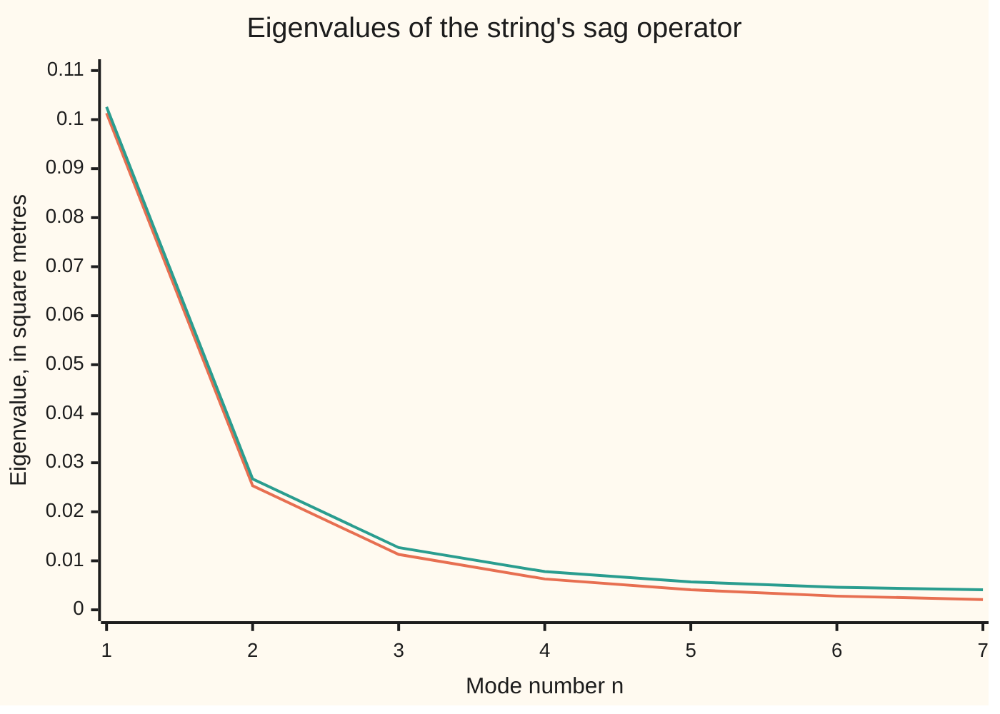

# Compact and symmetric: an orthonormal basis of eigenvectors, eigenvalues dying away

[Syllabus](../../../SYLLABUS.md) → [Functional analysis](../README.md) → [Bounded Operators](../README.md#s03) → Compact and symmetric

---

## General Overview

A string 1 m long is pinned at both ends and pulled to a tension of 100 N (illustrative numbers). Ripples run along it at 220 m/s. Plucked, it sounds 110 Hz, the low A.

Push the string sideways with 1 N at its middle and the middle moves 2.500 mm. Hang any spread-out load on it and it sags into one shape. The rule "load in, sag shape out" is a linear operator, the **sag operator**. It is a blur in the sense of this shelf: each point's sag mixes the load from everywhere along the string.

Some loads come back as their own shape, only scaled. Those shapes are the string's vibration modes: one arch, two arches, three. Each mode's scale factor fixes its note. The scale factors shrink fast, 0.101321, then 0.025330, then 0.011258, and so on toward zero. A wiggly load produces almost no sag.

This card proves the general fact behind that picture. It holds for operators that are **compact** (they act almost like a finite matrix) and **symmetric** (a push at y moves point x as much as a push at x moves point y). The card also reads the top scale factor, and so the lowest note, off one ratio of two integrals.

**A compact symmetric operator on a Hilbert space (a complete space with lengths and angles, like the string's loads) has real eigenvalues that die away to zero and perpendicular eigenvectors that, with its null space (the loads it sends to zero), form an orthonormal basis; for a positive operator, the largest eigenvalue is the top of the ratio of load-times-sag to load-times-load.**

**What kind of fact this is:** a theorem, proved on this card in Why it works for positive operators such as the string's. The general case, with negative eigenvalues allowed, runs the same proof on the largest size of the ratio, and is stated with Brezis as the source. The code checks the string on grids of 7 to 63 points only.

### The picture: eigenvalues dying away



The lower line is the true list, $`1/(n^2\pi^2)`$. The upper line is the operator cut down to a grid of N = 7 points, a 7-by-7 matrix: close at mode 1, high at the wiggly modes that 7 points cannot follow. Both fall toward zero: the "dying away" in the title.

---

## The formula

Notation first, in words.

- Position $`x`$ or $`y`$ runs in metres from 0 to 1. A **load** $`f`$ is a sideways push spread along the string, in N/m.
- $`L^2(0, 1)`$ holds every load with a finite integral of its square. Its **inner product** is $`\langle f, g\rangle = \int_0^1 f\,g\,dx`$ (real here; complex values conjugate the first slot), and the size is $`\lVert f\rVert = \sqrt{\langle f, f\rangle}`$.
- The **sag operator** $`K`$ is an integral operator ([Three model operators](02-integral-operators-and-the-shift.md)). Its kernel $`k(x, y)`$ is the string's [Green's function](../../08-Differential%20equations%20and%20dynamics/07-Series%20Solutions%20and%20Boundary%20Problems/10-greens-function-for-a-boundary-problem.md): the sag at $`x`$ per newton at $`y`$, per newton of tension.
- An **eigenvalue** $`\mu`$ (Greek mu) has $`Ke = \mu e`$ for a nonzero **eigenfunction** $`e`$. The null space $`\ker K`$ holds every load that $`K`$ sends to zero.
- **Self-adjoint** (symmetric): $`\langle Kf, g\rangle = \langle f, Kg\rangle`$ for all loads ([Adjoints](03-adjoints-self-adjoint-and-unitary-operators.md)). **Positive**, written $`K \ge 0`$: also $`\langle f, Kf\rangle \ge 0`$.
- **Compact**: every bounded list of loads has a sub-list whose sags converge in $`\lVert\cdot\rVert`$ ([Compact operators](05-compact-operators.md)).

The operator:

```math
(Kf)(x) = \int_0^1 k(x, y)\, f(y)\, dy, \qquad k(x, y) = \min(x, y)\,\big(1 - \max(x, y)\big)
```

**Read it aloud:** the sag at x is the load at every point y, weighted by the tent-shaped response to a push at y, added up.

The theorem, for any compact self-adjoint $`K`$:

```math
Kf = \sum_{n} \mu_n \,\langle e_n, f\rangle\, e_n, \qquad \lvert\mu_1\rvert \ge \lvert\mu_2\rvert \ge \cdots, \qquad \mu_n \to 0
```

**Read it aloud:** to apply K, measure the load along each perpendicular mode, scale each amount by that mode's eigenvalue, and add the modes back up; the eigenvalues shrink to zero.

The $`e_n`$ are orthonormal: perpendicular, each of size 1. With an orthonormal basis of $`\ker K`$ they make an orthonormal basis of the whole space ([Orthonormal bases](../02-Hilbert%20Spaces/03-orthonormal-bases-and-parseval.md)). The list is finite if only finitely many eigenvalues are nonzero.

The ratio that reads off the top eigenvalue, for positive $`K`$:

```math
\mu_1 = \max_{f \ne 0} R(f), \qquad R(f) = \frac{\langle f, Kf\rangle}{\langle f, f\rangle}
```

**Read it aloud:** the largest eigenvalue is the largest value of load-times-sag over load-times-load, and the load that reaches it is the top mode.

$`R`$ is the **Rayleigh ratio**. For the string the theorem gives

```math
\mu_n = \frac{1}{n^2\pi^2}, \qquad e_n(x) = \sqrt{2}\,\sin(n\pi x), \qquad \nu_n = \frac{c}{2\pi\sqrt{\mu_n}} = \frac{n\,c}{2}
```

**Read it aloud:** mode n has eigenvalue one over n squared pi squared, an n-arch sine as its shape, and n times half the wave speed as its note.

| Symbol | Plain meaning | In our example | Push it up and the answer… |
| --- | --- | --- | --- |
| $`x`$, $`y`$, $`x_i`$ | positions along the string, in m: $`x`$ where the sag is read, $`y`$ where the load sits; $`x_i`$ the i-th grid point | 0 to 1 | — |
| $`k(x, y)`$ | the kernel: sag at $`x`$ per newton at $`y`$, per newton of tension, in m | $`k(0.5, 0.5) = 1/4`$: 2.500 mm at 100 N | a push nearer the middle sags more |
| $`K`$, $`\ker K`$, $`\sigma(K)`$ | the sag operator, load in, shape out; its null space; its spectrum | $`\ker K`$ holds only the zero load | — |
| $`f`$, $`g`$, $`u`$ | loads, in N/m, or trial shapes; $`u`$ a sag shape | 1, $`x(1 - x)`$, $`x(1 - x)(1 - 2x)`$ | the sag grows in proportion |
| $`\langle f, g\rangle`$, $`\lVert f\rVert`$, $`L^2(0, 1)`$ | inner product (multiply, integrate over the string); size; the space of finite-energy loads | $`\langle x(1-x), x(1-x)\rangle = 1/30`$ | — |
| $`\mu_n`$, $`e_n`$, $`n`$, $`\lambda_n`$ | the n-th eigenvalue of $`K`$, in m², and its orthonormal eigenfunction, the n-th mode; mode number; $`\lambda_n = 1/\mu_n`$, the bending eigenvalue of [Eigenvalue problems](../../08-Differential%20equations%20and%20dynamics/07-Series%20Solutions%20and%20Boundary%20Problems/08-eigenvalues-and-eigenfunctions.md) | 0.101321, 0.025330, 0.011258; $`\sqrt2\sin(n\pi x)`$ | higher n: smaller $`\mu_n`$, higher note |
| $`R(f)`$ | the Rayleigh ratio of a trial load | $`R(x(1 - x)) = 17/168`$ = 0.101190 | closer to the top mode's shape, closer to $`\mu_1`$ |
| $`c`$, $`\nu_n`$ | wave speed, set by the 100 N tension; the n-th note, in Hz | 220 m/s; $`\nu_1`$ = 110.0000 Hz | faster waves, higher notes |
| $`N`$, $`h`$, $`K_N`$, $`Q`$, $`D`$, $`I`$ | grid points; spacing $`1/(N+1)`$; the N-by-N grid matrix $`h\,k(x_i, x_j)`$; its eigenvectors as columns, its eigenvalues on a diagonal; the identity | N = 63, h = 1/64 | $`\mu_1`$ error falls by 4 per doubling |
| $`V`$, $`\sigma_1`$ | the running total, $`(Vf)(x) = \int_0^x f`$; its largest singular value, the square root of the top eigenvalue of $`V^*V`$; also multiplication by $`x`$, which sends $`f(x)`$ to $`x f(x)`$ | $`\sigma_1 = 2/\pi`$ = 0.636620; multiplication by $`x`$ has 1, 3, 7, 13 grid eigenvalues in [0.4, 0.6] | — |
| $`M`$, $`W`$, $`\varepsilon`$, $`\lVert K\rVert_{HS}`$ | in the proof: the top of the ratio; the loads perpendicular to every mode; a small positive number; the Hilbert-Schmidt norm, $`\sqrt{\iint k^2}`$ | $`\lVert K\rVert_{HS}^2 = 1/90`$ | — |

### When it holds

- **Symmetric.** The running total $`V`$ is compact but not symmetric. Its best ratio is 0.500000. Its norm is its largest **singular value** $`\sigma_1`$, the square root of the top eigenvalue of $`V^*V`$ (singular values $`\sigma_n`$ are not the spectrum $`\sigma(V)`$): $`\sigma_1 = 2/\pi`$ = 0.636620. It has no eigenvalue: its 63-point grid's eigenvalues are all 0.007937, shrinking to 0 as N grows.
- **Compact.** Multiplication by $`x`$ is symmetric and bounded but not compact. It has no eigenfunction in $`L^2(0, 1)`$: on grids of 7, 15, 31 and 63 points it has 1, 3, 7 and 13 eigenvalues in [0.4, 0.6], a count that never settles.
- **An inner product.** "Perpendicular" and "orthonormal basis" need one. In a Banach space without one, "perpendicular" has no meaning.
- **Positive, for the ratio as written.** With negative eigenvalues too, the list is ordered by size $`\lvert\mu_n\rvert`$; the top of $`R`$ gives the largest positive one, its bottom the most negative.
- **A zero null space, for a basis of modes alone.** Otherwise a basis of $`\ker K`$ must fill the gap. The string's $`\ker K`$ is zero, so its sines alone are a basis.

---

## Why it works

### Step 0: the top of the ratio is an eigenvalue, and compactness makes the top exist

Picture the ratio $`R(f)`$ as a height over all loads. At a highest point, any small change of load fails to raise it, and for a symmetric operator that condition says exactly $`Kf = R(f)\,f`$. So a top is an eigenvector.

In finite dimensions a top always exists. In infinite dimensions the unit sphere is not compact, so a climb can go on forever without arriving ([Infinite dimensions](../01-Normed%20and%20Banach%20Spaces/05-why-infinite-dimensions-are-different.md)). A compact operator rescues the climb. Symmetry then sets the top mode aside, and the climb repeats in what is left. Compactness once more forces the tops down to zero.

### Step 1: the finite rehearsal, a symmetric matrix

Sample the string at $`N`$ points $`x_i = ih`$, with spacing $`h = 1/(N+1)`$. The grid matrix $`K_N`$ has entries $`h\,k(x_i, x_j)`$. It is symmetric, so [The spectral theorem](../../03-Algebra/07-Eigenvalues%20and%20Symmetric%20Matrices/04-spectral-theorem.md) splits it as $`Q D Q^{\mathsf T}`$, with perpendicular eigenvectors as the columns of $`Q`$ and eigenvalues down the diagonal of $`D`$.

The code diagonalises $`K_N`$ with Jacobi rotations: small turns, each zeroing one off-diagonal pair. At N = 63:

- $`Q^{\mathsf T} Q = I`$ and $`Q D Q^{\mathsf T} = K_{63}`$, both within $`10^{-12}`$.
- The top eigenvector equals the sampled $`\sqrt{2h}\,\sin(\pi x_i)`$ to within $`10^{-9}`$.
- The top five eigenvalues are 0.101342, 0.025351, 0.011278, 0.006353, 0.004073, against the true 0.101321, 0.025330, 0.011258, 0.006333, 0.004053.

$`K_N`$ is exactly the inverse of the second-difference matrix $`(1/h^2)\,(-1, 2, -1)`$ used in [Eigenvalue problems](../../08-Differential%20equations%20and%20dynamics/07-Series%20Solutions%20and%20Boundary%20Problems/08-eigenvalues-and-eigenfunctions.md). So its eigenvalues have a closed form, $`1/\big(4(N+1)^2\sin^2(n\pi/(2N+2))\big)`$, and Jacobi matches it to $`10^{-12}`$ at every N.

| N | $`\mu_1`$ of $`K_N`$ | minus $`1/\pi^2`$ |
| ---: | ---: | ---: |
| 7 | 0.10263337 | 0.00131218 |
| 15 | 0.10164733 | 0.00032615 |
| 31 | 0.10140260 | 0.00008142 |
| 63 | 0.10134153 | 0.00002035 |

The error shrinks by 4.023, 4.006 and 4.001 as N doubles: like $`h^2`$. What the grid hides: a matrix always has N eigenvalues and always reaches its top. An operator on $`L^2(0, 1)`$ need not.

### Step 2: the top of the ratio is reached, and is an eigenvalue

Take loads of size 1 whose ratios climb toward the top value $`M`$. The loads themselves need not converge. But $`K`$ is compact, so a sub-list of their sags does converge. A short calculation shows that the loads then converge too, to a load $`e_1`$ with $`Ke_1 = M e_1`$. So $`\mu_1 = M`$ is reached, and it is an eigenvalue.

<details>
<summary>Detailed proof: the climb arrives, for positive compact K</summary>

Let $`M`$ be the top of $`\langle f, Kf\rangle`$ over loads of size 1, and assume $`M > 0`$. Positivity gives a Cauchy–Schwarz inequality for the form $`[a, b] = \langle a, Kb\rangle`$. Applied to $`a = f`$ and $`b = Kf`$:

$`\displaystyle \lVert Kf\rVert^4 = [f, Kf]^2 \le [f, f]\,[Kf, Kf] \le \langle f, Kf\rangle\, M\,\lVert Kf\rVert^2 .`$

So $`\lVert Kf\rVert^2 \le M\,\langle f, Kf\rangle`$ for every $`f`$. Now take $`\lVert f_j\rVert = 1`$ with $`\langle f_j, Kf_j\rangle \to M`$. Then

$`\displaystyle \lVert Kf_j - M f_j\rVert^2 = \lVert Kf_j\rVert^2 - 2M\langle f_j, Kf_j\rangle + M^2 \le M^2 - M\langle f_j, Kf_j\rangle \to 0 .`$

Compactness gives a sub-list with $`Kf_j \to g`$. Along it $`M f_j \to g`$, so $`f_j \to g/M`$, which has size 1, and $`Kg = \lim M\,Kf_j = Mg`$. The unit load $`e_1 = g/M`$ is an eigenfunction with eigenvalue $`M`$. Without compactness the last step fails: multiplication by $`x`$ has top ratio 1, approached by loads crowding toward $`x = 1`$, but no load reaches it.

</details>

The ratio climbs toward $`\mu_1`$ from below, so every trial gives a lower bound. In exact fractions: $`R(1) = 1/12`$ = 0.083333, $`R(x(1-x)) = 17/168`$ = 0.101190, and one more pass of the operator, $`R(K\,x(1-x)) = 691/6820`$ = 0.10131965. The top is $`1/\pi^2`$ = 0.10132118.

### Step 3: set the top mode aside and climb again

If a load $`f`$ is perpendicular to $`e_1`$, so is its sag. Symmetry moves $`K`$ across the inner product: $`\langle e_1, Kf\rangle = \langle Ke_1, f\rangle = \mu_1\langle e_1, f\rangle = 0`$.

So $`K`$ maps the loads perpendicular to $`e_1`$ into themselves, and it is still compact and symmetric there. Step 2 again gives $`e_2`$ and $`\mu_2 \le \mu_1`$, the top of $`R`$ over loads perpendicular to $`e_1`$. Repeating gives orthonormal $`e_1, e_2, e_3, \ldots`$ with $`\mu_1 \ge \mu_2 \ge \mu_3 \ge \cdots`$. Reading $`\mu_2`$ as a top over a restricted set is the seed of the **min-max principle** (also called Courant–Fischer), which finds $`\mu_2`$ without knowing $`e_1`$.

The trial load $`x(1-x)(1-2x)`$ has a node at the middle. It is perpendicular to the one-arch mode by symmetry about the middle, so its ratio is a lower bound for $`\mu_2`$: $`1/40`$ = 0.025000, against $`\mu_2`$ = 0.025330.

### Step 4: the eigenvalues die away

Suppose infinitely many eigenvalues stayed above some $`\varepsilon > 0`$. Their sags $`Ke_n = \mu_n e_n`$ are perpendicular, so any two are at least $`\sqrt2\,\varepsilon`$ apart:

```math
\lVert \mu_m e_m - \mu_n e_n\rVert^2 = \mu_m^2 + \mu_n^2 \ge 2\varepsilon^2
```

**Read it aloud:** two scaled perpendicular modes are at least root two times epsilon apart.

No sub-list of those sags converges, yet the loads $`e_n`$ all have size 1. That contradicts compactness. So only finitely many eigenvalues sit above any $`\varepsilon`$, and $`\mu_n \to 0`$.

The code counts eigenvalues above 0.001. The string has 10. The grids give 7, 14, 10 and 10 at N = 7, 15, 31 and 63: the 15-point grid overstates its wiggly modes, then the count settles. Multiplication by $`x`$ has no such settling count.

### Step 5: nothing is left over

Let $`W`$ be every load perpendicular to all the $`e_n`$. By Step 3, $`K`$ maps $`W`$ into itself. The top of $`R`$ on $`W`$ is at most every $`\mu_n`$, because $`W`$ sits inside each set Step 3 climbed over. Those fall to zero, so the top on $`W`$ is zero.

A positive operator with zero ratio sends each load to zero: the inequality in the fold gives $`\lVert Kf\rVert^2 \le 0`$. So $`W`$ lies in $`\ker K`$, and every load is its modes plus a piece $`K`$ ignores. Applying $`K`$ term by term gives the expansion in The formula.

For the string, $`Kf = 0`$ means zero sag, and bending zero sag gives zero load. So $`\ker K`$ is zero and the modes alone are an orthonormal basis of $`L^2(0, 1)`$. This is the completeness that [Sturm-Liouville](../../08-Differential%20equations%20and%20dynamics/07-Series%20Solutions%20and%20Boundary%20Problems/09-sturm-liouville-and-orthogonality.md) states and leaves to this card.

### Step 6: the modes are the string's sines

If $`Ke = \mu e`$ with $`\mu \ne 0`$, then $`e = K(e/\mu)`$ is a sag. Bending it gives back its load: $`-e'' = e/\mu`$, with $`e(0) = e(1) = 0`$. That is the problem of [Eigenvalue problems](../../08-Differential%20equations%20and%20dynamics/07-Series%20Solutions%20and%20Boundary%20Problems/08-eigenvalues-and-eigenfunctions.md) with $`\lambda = 1/\mu`$. So $`\mu_n = 1/(n^2\pi^2)`$ and $`e_n = \sqrt2\sin(n\pi x)`$.

This is the route for any Sturm-Liouville problem. The bending operator $`-d^2/dx^2`$ is unbounded, so the theorem cannot touch it. Its inverse, the sag operator, is compact and symmetric, and the two share their eigenfunctions.

Two checks on the whole list, each an exact sum:

- The eigenvalues add up to the kernel's diagonal integral, $`\int_0^1 x(1-x)\,dx = 1/6`$ (Mercer's theorem, for continuous positive kernels). The 63-point grid gives 0.166626, equal to its trace.
- Their squares add up to $`\lVert K\rVert_{HS}^2 = \iint k^2 = 1/90`$, the Hilbert-Schmidt norm of [Compact operators](05-compact-operators.md). The grid gives 0.011118.

So $`\sum 1/n^2 = \pi^2/6`$ and $`\sum 1/n^4 = \pi^4/90`$ fall out of the string.

---

## Worked numbers, by hand

The lowest note, read off one ratio. Trial load $`f = x(1-x)`$, a single arch.

| Step | Arithmetic | Value |
| --- | --- | --- |
| the sag | solve $`-u'' = x(1-x)`$, $`u(0) = u(1) = 0`$ | $`Kf = (x - 2x^3 + x^4)/12`$ |
| top of the ratio | $`\int_0^1 f \cdot Kf\,dx`$ | 17/5040 |
| bottom of the ratio | $`\int_0^1 f^2\,dx`$ | 1/30 |
| the ratio | 17/5040 × 30 | 17/168 = 0.101190 |
| true top eigenvalue | $`1/\pi^2`$ | 0.101321; the ratio is 0.129 % short |
| the note | $`\nu = (c/2\pi)/\sqrt{R}`$ = 35.0141 × $`\sqrt{168/17}`$ | **110.07 Hz** |
| one more pass | $`R(Kf)`$ | 691/6820, giving 110.0008 Hz |

A guessed arch reads the low A as 110.07 Hz against the true 110.0000 Hz. The guess can only err high, because the ratio never passes $`\mu_1`$.

The expansion at work: a uniform load of 1 N/m at 100 N tension sags the middle by exactly 1.2500 mm. The load's mode amounts fall like $`1/n`$; the sag's fall like $`1/n^3`$, since each is also multiplied by $`\mu_n`$. Modes 1, then 1 and 3, then 1, 3 and 5 give 1.2901, 1.2423 and 1.2526 mm. (The even modes are zero for a load symmetric about the middle.)

### What breaks if you drop a piece

| Mistake | Comes out at | What went wrong |
| --- | --- | --- |
| Running total $`V`$: not symmetric | best ratio 0.500000; norm 0.636587 at N = 63 (true 0.636620); every grid eigenvalue 0.007937 | the ratio reads neither the norm nor an eigenvalue, and the eigenvalues vanish as N grows |
| Multiplication by $`x`$: not compact | 1, 3, 7, 13 eigenvalues in [0.4, 0.6] at N = 7, 15, 31, 63 | no isolated eigenvalue, no eigenfunction, a count that never settles |
| Trial load with a node at the middle | 1/40 = 0.025000, a note of 221.45 Hz | perpendicular to mode 1, so it reads mode 2 |
| Ratio left undivided | 17/5040 = 0.003373, a note of 602.88 Hz | the top alone depends on the load's size |

---

## Code, from first principles, and it actually runs

The code takes five independent roads to the eigenvalues:

1. Exact-fraction Rayleigh ratios on polynomial loads.
2. Jacobi rotations, written out, on the grid matrix at N = 7, 15, 31 and 63.
3. The grid's closed form.
4. Power iteration: apply $`K_N`$ again and again, rescaling.
5. The trace and sum of squares, against 1/6 and 1/90.

What the truncation hides: a grid matrix has finitely many eigenvalues, so the infinite list and its pile-up at 0 show only as trends over N.

### Python

```python
# Compact and symmetric -- the check behind the card.  Standard library only;
# fractions does exact rational arithmetic, math gives sqrt, sin and pi.
# The sag operator of a 1 m string, K f(x) = integral of k(x, y) f(y) dy with
# k(x, y) = min(x, y)(1 - max(x, y)), is diagonalised three ways: the Rayleigh
# ratio on polynomials in exact rationals, a written-out Jacobi eigenvalue
# solver on an N-point grid, and the grid's closed form 1/(4(N+1)^2 sin^2(.)).
from fractions import Fraction as Fr
import math

C, TENSION, MU1 = 220.0, 100.0, 1 / math.pi ** 2   # wave speed m/s, tension N (illustrative)
def note(mu): return C / (2 * math.pi * math.sqrt(mu))     # Hz, since mu = 1/lambda

def pmul(a, b):                       # polynomials: lists of Fractions, index = power
    out = [Fr(0)] * (len(a) + len(b) - 1)
    for i, x in enumerate(a):
        for j, y in enumerate(b): out[i + j] += x * y
    return out
def integ(a): return [Fr(0)] + [c / (k + 1) for k, c in enumerate(a)]
def at1(a): return sum(a)
def inner(a, b): return at1(integ(pmul(a, b)))     # <a, b> = integral over [0, 1]
def sag(f):                           # K f: solve -u'' = f with u(0) = u(1) = 0
    p = integ(integ(f))
    u = [-c for c in p]; u[1] += at1(p)
    return u
def ratio(f): return inner(f, sag(f)) / inner(f, f)

def kern(x, y): return min(x, y) * (1 - max(x, y))
def grid(n):                          # K_N = h k(x_i, x_j) at x_i = i h, h = 1/(N+1)
    h = 1 / (n + 1)
    return [[h * kern(i * h, j * h) for j in range(1, n + 1)] for i in range(1, n + 1)]
def jacobi(a):                        # cyclic Jacobi rotations until off-diagonal is ~0
    n = len(a); a = [r[:] for r in a]
    v = [[1.0 if i == j else 0.0 for j in range(n)] for i in range(n)]
    for _ in range(60):
        off = sum(a[i][j] ** 2 for i in range(n) for j in range(i + 1, n))
        if off < 1e-30: break
        for p in range(n - 1):
            for q in range(p + 1, n):
                if a[p][q] == 0.0: continue
                th = (a[q][q] - a[p][p]) / (2 * a[p][q])
                t = (1.0 if th >= 0 else -1.0) / (abs(th) + math.sqrt(th * th + 1))
                c = 1 / math.sqrt(t * t + 1); s = t * c
                for m in (a, v):
                    for k in range(n):
                        x, y = m[k][p], m[k][q]; m[k][p] = c * x - s * y; m[k][q] = s * x + c * y
                for k in range(n):
                    x, y = a[p][k], a[q][k]; a[p][k] = c * x - s * y; a[q][k] = s * x + c * y
    order = sorted(range(n), key=lambda i: -a[i][i])
    return [a[i][i] for i in order], [[v[k][i] for k in range(n)] for i in order]
def closed(n, j):                     # exact eigenvalues of K_N (it inverts the second difference)
    return 1 / (4 * (n + 1) ** 2 * math.sin(j * math.pi / (2 * (n + 1))) ** 2)
def fr(q): return f"{q.numerator}/{q.denominator}"

one, bump = [Fr(1)], [Fr(0), Fr(1), Fr(-1)]          # trial loads 1 and x(1 - x)
r1, r2, r3 = ratio(one), ratio(bump), ratio(sag(bump))
print(f"string kernel min(x,y)(1-max(x,y)); c = {C:.0f} m/s; tension {TENSION:.0f} N")
print(f"push 1 N at the middle: middle moves {1000 * kern(0.5, 0.5) / TENSION:.3f} mm")
print(f"R(1) = {fr(r1)} = {float(r1):.6f} -> note {note(float(r1)):.2f} Hz")
print(f"R(x(1-x)) = {fr(r2)} = {float(r2):.6f} -> note {note(float(r2)):.2f} Hz")
print(f"R(K x(1-x)) = {fr(r3)} = {float(r3):.8f} -> note {note(float(r3)):.4f} Hz")
print(f"true top eigenvalue 1/pi^2 = {MU1:.8f} -> note {note(MU1):.4f} Hz")
errs, mats = [], {}
for n in (7, 15, 31, 63):
    vals, vecs = jacobi(grid(n)); mats[n] = (vals, vecs); errs.append(vals[0] - MU1)
    print(f"N {n:2d}: mu1 by Jacobi {vals[0]:.8f}, closed form {closed(n, 1):.8f}, "
          f"minus 1/pi^2 {vals[0] - MU1:.8f}")
    assert all(abs(vals[j] - closed(n, j + 1)) < 1e-12 for j in range(n))
shrink = [errs[i] / errs[i + 1] for i in range(3)]
print("error shrinks by " + ", ".join(f"{s:.3f}" for s in shrink) + " per doubling of N")
vals, vecs = mats[63]; h = 1 / 64; A = grid(63)
print("N 63, top five: " + ", ".join(f"{m:.6f}" for m in vals[:5]))
print("true, 1/(n pi)^2: " + ", ".join(f"{1 / (n * math.pi) ** 2:.6f}" for n in range(1, 6)))
e1 = vecs[0] if sum(vecs[0]) > 0 else [-x for x in vecs[0]]
gap = max(abs(e1[i] - math.sqrt(2 * h) * math.sin(math.pi * (i + 1) * h)) for i in range(63))
orth = max(abs(sum(vecs[a][k] * vecs[b][k] for k in range(63)) - (a == b))
           for a in range(63) for b in range(63))
rebuild = max(abs(sum(vals[m] * vecs[m][i] * vecs[m][j] for m in range(63)) - A[i][j])
              for i in range(63) for j in range(63))
print(f"top vector against sampled sqrt(2) sin(pi x): within 1e-9: {'yes' if gap < 1e-9 else 'no'}")
print(f"Q^T Q = I and Q D Q^T = K_63 within 1e-12: {'yes' if max(orth, rebuild) < 1e-12 else 'no'}")
w = [i * h * (1 - i * h) for i in range(1, 64)]          # power iteration, a second road
for _ in range(200):
    kw = [sum(A[i][j] * w[j] for j in range(63)) for i in range(63)]
    pw = sum(a * b for a, b in zip(w, kw)) / sum(a * a for a in w)
    w = [x / math.sqrt(sum(b * b for b in kw)) for x in kw]
print(f"power iteration, ratio of K_63 w to w: {pw:.8f}")
tr, hs = sum(A[i][i] for i in range(63)), sum(x * x for r in A for x in r)
print(f"N 63: sum of eigenvalues {sum(vals):.6f}, trace {tr:.6f}; limit 1/6 = {1 / 6:.6f}")
print(f"N 63: sum of squares {sum(m * m for m in vals):.6f}, of entries {hs:.6f}; limit 1/90 = {1 / 90:.6f}")
ck = [sum(1 for m in mats[n][0] if m > 0.001) for n in (7, 15, 31, 63)]
cm = [sum(1 for i in range(1, n + 1) if 0.4 <= i / (n + 1) <= 0.6) for n in (7, 15, 31, 63)]
print(f"eigenvalues above 0.001, N 7/15/31/63: {ck}; true {sum(1 for n in range(1, 99) if MU1 / n ** 2 > 0.001)}")
print(f"multiplication by x, eigenvalues in [0.4, 0.6], N 7/15/31/63: {cm}")
sums, s = [], 0.0                                         # uniform load: 1 N/m on the string
for n in (1, 3, 5):
    s += MU1 / n ** 2 * (2 * math.sqrt(2) / (n * math.pi)) * math.sqrt(2) * math.sin(n * math.pi / 2)
    sums.append(1000 * s / TENSION)
print("midpoint sag, modes 1 / 1,3 / 1,3,5: " + ", ".join(f"{x:.4f}" for x in sums)
      + f" mm; exact {1000 * float(sag(one)[1] / 2 + sag(one)[2] / 4) / TENSION:.4f} mm")
vol1 = inner(one, integ(one)) / inner(one, one)           # Volterra V f(x) = integral 0..x of f
vw = [1.0] * 63; hv = 1 / 63
V = [[hv if j < i else (hv / 2 if j == i else 0.0) for j in range(63)] for i in range(63)]
for _ in range(300):
    y = [sum(V[i][j] * vw[j] for j in range(63)) for i in range(63)]
    z = [sum(V[i][j] * y[i] for i in range(63)) for j in range(63)]
    vn = math.sqrt(sum(a * a for a in z) / sum(a * a for a in vw))
    vw = [x / math.sqrt(sum(b * b for b in z)) for x in z]
print(f"running total V: best ratio {fr(vol1)} = {float(vol1):.6f}; norm at N 63 {math.sqrt(vn):.6f}, "
      f"2/pi = {2 / math.pi:.6f}; every grid eigenvalue {hv / 2:.6f}")
node = [Fr(0), Fr(1), Fr(-3), Fr(2)]                      # x(1 - x)(1 - 2x), a node at 1/2
r4 = ratio(node); raw = inner(bump, sag(bump))
print(f"trial with a node at the middle: R = {fr(r4)} = {float(r4):.6f} -> note {note(float(r4)):.2f} Hz")
print(f"top of the ratio left undivided: {fr(raw)} = {float(raw):.6f} -> note {note(float(raw)):.2f} Hz")
print("hand steps: K x(1-x) coefficients, x^0 to x^4: " + ", ".join(fr(c) for c in sag(bump)))
print(f"hand steps: <f,f> = {fr(inner(bump, bump))}; c/(2 pi) = {C / (2 * math.pi):.4f}; "
      f"17/168 falls short of 1/pi^2 by {100 * (MU1 - float(r2)) / MU1:.3f} %")
print("chart, n: true 1/(n pi)^2 | N 7 grid")
for n in range(1, 8):
    print(f"chart, {n}: {MU1 / n ** 2:.4f} | {mats[7][0][n - 1]:.4f}")
assert r1 < r2 < r3 < MU1 and r2 == Fr(17, 168)           # ratios climb to mu1 from below
assert all(3.9 < x < 4.1 for x in shrink) and gap < 1e-9 and max(orth, rebuild) < 1e-12
assert abs(pw - closed(63, 1)) < 1e-10 and abs(sum(vals) - tr) < 1e-12
assert abs(tr - 1 / 6) < 1e-4 and abs(hs - 1 / 90) < 2e-5 and ck[2:] == [10, 10]
assert cm[-1] > cm[0] and abs(sums[-1] - 1.25) < 0.003 and abs(math.sqrt(vn) - 2 / math.pi) < 1e-4
assert abs(float(r4) - MU1 / 4) < 0.001 and vol1 == Fr(1, 2)
print("ALL CHECKS PASS")
```

**Ran 2026-11-15 on macOS, Python 3.14.10, standard library only. All checks passed. Output, pasted from the run:**

```
string kernel min(x,y)(1-max(x,y)); c = 220 m/s; tension 100 N
push 1 N at the middle: middle moves 2.500 mm
R(1) = 1/12 = 0.083333 -> note 121.29 Hz
R(x(1-x)) = 17/168 = 0.101190 -> note 110.07 Hz
R(K x(1-x)) = 691/6820 = 0.10131965 -> note 110.0008 Hz
true top eigenvalue 1/pi^2 = 0.10132118 -> note 110.0000 Hz
N  7: mu1 by Jacobi 0.10263337, closed form 0.10263337, minus 1/pi^2 0.00131218
N 15: mu1 by Jacobi 0.10164733, closed form 0.10164733, minus 1/pi^2 0.00032615
N 31: mu1 by Jacobi 0.10140260, closed form 0.10140260, minus 1/pi^2 0.00008142
N 63: mu1 by Jacobi 0.10134153, closed form 0.10134153, minus 1/pi^2 0.00002035
error shrinks by 4.023, 4.006, 4.001 per doubling of N
N 63, top five: 0.101342, 0.025351, 0.011278, 0.006353, 0.004073
true, 1/(n pi)^2: 0.101321, 0.025330, 0.011258, 0.006333, 0.004053
top vector against sampled sqrt(2) sin(pi x): within 1e-9: yes
Q^T Q = I and Q D Q^T = K_63 within 1e-12: yes
power iteration, ratio of K_63 w to w: 0.10134153
N 63: sum of eigenvalues 0.166626, trace 0.166626; limit 1/6 = 0.166667
N 63: sum of squares 0.011118, of entries 0.011118; limit 1/90 = 0.011111
eigenvalues above 0.001, N 7/15/31/63: [7, 14, 10, 10]; true 10
multiplication by x, eigenvalues in [0.4, 0.6], N 7/15/31/63: [1, 3, 7, 13]
midpoint sag, modes 1 / 1,3 / 1,3,5: 1.2901, 1.2423, 1.2526 mm; exact 1.2500 mm
running total V: best ratio 1/2 = 0.500000; norm at N 63 0.636587, 2/pi = 0.636620; every grid eigenvalue 0.007937
trial with a node at the middle: R = 1/40 = 0.025000 -> note 221.45 Hz
top of the ratio left undivided: 17/5040 = 0.003373 -> note 602.88 Hz
hand steps: K x(1-x) coefficients, x^0 to x^4: 0/1, 1/12, 0/1, -1/6, 1/12
hand steps: <f,f> = 1/30; c/(2 pi) = 35.0141; 17/168 falls short of 1/pi^2 by 0.129 %
chart, n: true 1/(n pi)^2 | N 7 grid
chart, 1: 0.1013 | 0.1026
chart, 2: 0.0253 | 0.0267
chart, 3: 0.0113 | 0.0127
chart, 4: 0.0063 | 0.0078
chart, 5: 0.0041 | 0.0057
chart, 6: 0.0028 | 0.0046
chart, 7: 0.0021 | 0.0041
ALL CHECKS PASS
```

### Rust

Same numbers, same labels, built with `rustc --edition 2021 -O`.

```rust
// Compact and symmetric -- the same check as the Python, in Rust.  No crates.
// The sag operator of a 1 m string, K f(x) = integral of k(x, y) f(y) dy with
// k(x, y) = min(x, y)(1 - max(x, y)), is diagonalised three ways: the Rayleigh
// ratio on polynomials in exact rationals (a small struct), a written-out Jacobi
// eigenvalue solver on an N-point grid, and the grid's closed form.
use std::f64::consts::PI;
const C: f64 = 220.0;        // wave speed, m/s
const TENSION: f64 = 100.0;  // N, illustrative

#[derive(Clone, Copy, PartialEq)]
struct Q { n: i128, d: i128 }  // an exact fraction n/d, d > 0, in lowest terms
fn gcd(a: i128, b: i128) -> i128 { if b == 0 { a.abs() } else { gcd(b, a % b) } }
fn q(n: i128, d: i128) -> Q { let g = gcd(n, d).max(1) * d.signum(); Q { n: n / g, d: d / g } }
fn add(a: Q, b: Q) -> Q { q(a.n * b.d + b.n * a.d, a.d * b.d) }
fn mul(a: Q, b: Q) -> Q { q(a.n * b.n, a.d * b.d) }
fn div(a: Q, b: Q) -> Q { q(a.n * b.d, a.d * b.n) }
fn lt(a: Q, b: Q) -> bool { a.n * b.d < b.n * a.d }
fn fl(a: Q) -> f64 { a.n as f64 / a.d as f64 }
fn fr(a: Q) -> String { format!("{}/{}", a.n, a.d) }

fn pmul(a: &[Q], b: &[Q]) -> Vec<Q> {  // polynomials: index = power
    let mut out = vec![q(0, 1); a.len() + b.len() - 1];
    for (i, &x) in a.iter().enumerate() { for (j, &y) in b.iter().enumerate() { out[i + j] = add(out[i + j], mul(x, y)) } }
    out
}
fn integ(a: &[Q]) -> Vec<Q> {
    let mut out = vec![q(0, 1)];
    for (k, &c) in a.iter().enumerate() { out.push(div(c, q(k as i128 + 1, 1))) }
    out
}
fn at1(a: &[Q]) -> Q { a.iter().fold(q(0, 1), |s, &c| add(s, c)) }
fn inner(a: &[Q], b: &[Q]) -> Q { at1(&integ(&pmul(a, b))) }
fn sag(f: &[Q]) -> Vec<Q> {            // K f: solve -u'' = f with u(0) = u(1) = 0
    let p = integ(&integ(f));
    let mut u: Vec<Q> = p.iter().map(|c| q(-c.n, c.d)).collect();
    u[1] = add(u[1], at1(&p));
    u
}
fn ratio(f: &[Q]) -> Q { div(inner(f, &sag(f)), inner(f, f)) }
fn note(mu: f64) -> f64 { C / (2.0 * PI * mu.sqrt()) }
fn kern(x: f64, y: f64) -> f64 { x.min(y) * (1.0 - x.max(y)) }
fn grid(n: usize) -> Vec<Vec<f64>> {   // K_N = h k(x_i, x_j) at x_i = i h, h = 1/(N+1)
    let h = 1.0 / (n as f64 + 1.0);
    (1..=n).map(|i| (1..=n).map(|j| h * kern(i as f64 * h, j as f64 * h)).collect()).collect()
}
fn jacobi(a0: &[Vec<f64>]) -> (Vec<f64>, Vec<Vec<f64>>) {  // cyclic Jacobi rotations
    let n = a0.len();
    let mut a = a0.to_vec();
    let mut v: Vec<Vec<f64>> = (0..n).map(|i| (0..n).map(|j| if i == j { 1.0 } else { 0.0 }).collect()).collect();
    for _ in 0..60 {
        let mut off = 0.0;
        for i in 0..n { for j in i + 1..n { off += a[i][j] * a[i][j] } }
        if off < 1e-30 { break }
        for p in 0..n - 1 {
            for qq in p + 1..n {
                if a[p][qq] == 0.0 { continue }
                let th = (a[qq][qq] - a[p][p]) / (2.0 * a[p][qq]);
                let t = (if th >= 0.0 { 1.0 } else { -1.0 }) / (th.abs() + (th * th + 1.0).sqrt());
                let c = 1.0 / (t * t + 1.0).sqrt(); let s = t * c;
                for m in [&mut a, &mut v] {
                    for k in 0..n { let (x, y) = (m[k][p], m[k][qq]); m[k][p] = c * x - s * y; m[k][qq] = s * x + c * y }
                }
                for k in 0..n { let (x, y) = (a[p][k], a[qq][k]); a[p][k] = c * x - s * y; a[qq][k] = s * x + c * y }
            }
        }
    }
    let mut order: Vec<usize> = (0..n).collect();
    order.sort_by(|&i, &j| a[j][j].partial_cmp(&a[i][i]).unwrap());
    (order.iter().map(|&i| a[i][i]).collect(), order.iter().map(|&i| (0..n).map(|k| v[k][i]).collect()).collect())
}
fn closed(n: usize, j: usize) -> f64 {  // exact eigenvalues of K_N
    let s = (j as f64 * PI / (2.0 * (n as f64 + 1.0))).sin();
    1.0 / (4.0 * ((n + 1) * (n + 1)) as f64 * (s * s))
}
fn join(v: &[f64], dp: usize) -> String { v.iter().map(|x| format!("{:.*}", dp, x)).collect::<Vec<_>>().join(", ") }
fn yn(b: bool) -> &'static str { if b { "yes" } else { "no" } }

fn main() {
    let mu1 = 1.0 / (PI * PI);
    let one = vec![q(1, 1)];
    let bump = vec![q(0, 1), q(1, 1), q(-1, 1)];
    let (r1, r2, r3) = (ratio(&one), ratio(&bump), ratio(&sag(&bump)));
    println!("string kernel min(x,y)(1-max(x,y)); c = {:.0} m/s; tension {:.0} N", C, TENSION);
    println!("push 1 N at the middle: middle moves {:.3} mm", 1000.0 * kern(0.5, 0.5) / TENSION);
    println!("R(1) = {} = {:.6} -> note {:.2} Hz", fr(r1), fl(r1), note(fl(r1)));
    println!("R(x(1-x)) = {} = {:.6} -> note {:.2} Hz", fr(r2), fl(r2), note(fl(r2)));
    println!("R(K x(1-x)) = {} = {:.8} -> note {:.4} Hz", fr(r3), fl(r3), note(fl(r3)));
    println!("true top eigenvalue 1/pi^2 = {:.8} -> note {:.4} Hz", mu1, note(mu1));
    let sizes = [7usize, 15, 31, 63];
    let (mut errs, mut mats) = (vec![], vec![]);
    for &n in &sizes {
        let (vals, vecs) = jacobi(&grid(n));
        println!("N {:2}: mu1 by Jacobi {:.8}, closed form {:.8}, minus 1/pi^2 {:.8}", n, vals[0], closed(n, 1), vals[0] - mu1);
        assert!((0..n).all(|j| (vals[j] - closed(n, j + 1)).abs() < 1e-12));
        errs.push(vals[0] - mu1);
        mats.push((vals, vecs));
    }
    let shrink: Vec<f64> = (0..3).map(|i| errs[i] / errs[i + 1]).collect();
    println!("error shrinks by {} per doubling of N", join(&shrink, 3));
    let (vals, vecs) = &mats[3];
    let (h, a): (f64, Vec<Vec<f64>>) = (1.0 / 64.0, grid(63));
    println!("N 63, top five: {}", join(&vals[..5], 6));
    let tru: Vec<f64> = (1..6).map(|n| 1.0 / (n as f64 * PI).powi(2)).collect();
    println!("true, 1/(n pi)^2: {}", join(&tru, 6));
    let sgn = if vecs[0].iter().sum::<f64>() > 0.0 { 1.0 } else { -1.0 };
    let gap = (0..63).map(|i| (sgn * vecs[0][i] - (2.0 * h).sqrt() * (PI * (i + 1) as f64 * h).sin()).abs()).fold(0.0, f64::max);
    let (mut orth, mut rebuild): (f64, f64) = (0.0, 0.0);
    for x in 0..63 {
        for y in 0..63 {
            let dot: f64 = (0..63).map(|k| vecs[x][k] * vecs[y][k]).sum();
            orth = orth.max((dot - if x == y { 1.0 } else { 0.0 }).abs());
            let r: f64 = (0..63).map(|m| vals[m] * vecs[m][x] * vecs[m][y]).sum();
            rebuild = rebuild.max((r - a[x][y]).abs());
        }
    }
    println!("top vector against sampled sqrt(2) sin(pi x): within 1e-9: {}", yn(gap < 1e-9));
    println!("Q^T Q = I and Q D Q^T = K_63 within 1e-12: {}", yn(orth.max(rebuild) < 1e-12));
    let (mut w, mut pw): (Vec<f64>, f64) = ((1..64).map(|i| i as f64 * h * (1.0 - i as f64 * h)).collect(), 0.0);
    for _ in 0..200 {
        let kw: Vec<f64> = (0..63).map(|i| (0..63).map(|j| a[i][j] * w[j]).sum()).collect();
        pw = w.iter().zip(&kw).map(|(x, y)| x * y).sum::<f64>() / w.iter().map(|x| x * x).sum::<f64>();
        let nk = kw.iter().map(|x| x * x).sum::<f64>().sqrt();
        w = kw.iter().map(|x| x / nk).collect();
    }
    println!("power iteration, ratio of K_63 w to w: {:.8}", pw);
    let tr: f64 = (0..63).map(|i| a[i][i]).sum();
    let hs: f64 = a.iter().flatten().map(|x| x * x).sum();
    println!("N 63: sum of eigenvalues {:.6}, trace {:.6}; limit 1/6 = {:.6}", vals.iter().sum::<f64>(), tr, 1.0 / 6.0);
    println!("N 63: sum of squares {:.6}, of entries {:.6}; limit 1/90 = {:.6}", vals.iter().map(|m| m * m).sum::<f64>(), hs, 1.0 / 90.0);
    let ck: Vec<usize> = mats.iter().map(|(v, _)| v.iter().filter(|&&m| m > 0.001).count()).collect();
    let cm: Vec<usize> = sizes.iter().map(|&n| (1..=n).filter(|&i| { let x = i as f64 / (n as f64 + 1.0); 0.4 <= x && x <= 0.6 }).count()).collect();
    println!("eigenvalues above 0.001, N 7/15/31/63: {:?}; true {}", ck, (1..99).filter(|&n| mu1 / ((n * n) as f64) > 0.001).count());
    println!("multiplication by x, eigenvalues in [0.4, 0.6], N 7/15/31/63: {:?}", cm);
    let (mut sums, mut s) = (vec![], 0.0);   // uniform load: 1 N/m on the string
    for n in [1.0f64, 3.0, 5.0] {
        s += mu1 / (n * n) * (2.0 * 2f64.sqrt() / (n * PI)) * 2f64.sqrt() * (n * PI / 2.0).sin();
        sums.push(1000.0 * s / TENSION);
    }
    let exact = 1000.0 * fl(add(div(sag(&one)[1], q(2, 1)), div(sag(&one)[2], q(4, 1)))) / TENSION;
    println!("midpoint sag, modes 1 / 1,3 / 1,3,5: {} mm; exact {:.4} mm", join(&sums, 4), exact);
    let vol1 = div(inner(&one, &integ(&one)), inner(&one, &one));   // Volterra: integral 0..x
    let hv = 1.0 / 63.0;
    let vm: Vec<Vec<f64>> = (0..63).map(|i| (0..63).map(|j| if j < i { hv } else if j == i { hv / 2.0 } else { 0.0 }).collect()).collect();
    let (mut vw, mut vn) = (vec![1.0f64; 63], 0.0);
    for _ in 0..300 {
        let y: Vec<f64> = (0..63).map(|i| (0..63).map(|j| vm[i][j] * vw[j]).sum()).collect();
        let z: Vec<f64> = (0..63).map(|j| (0..63).map(|i| vm[i][j] * y[i]).sum()).collect();
        vn = (z.iter().map(|x| x * x).sum::<f64>() / vw.iter().map(|x| x * x).sum::<f64>()).sqrt();
        let nz = z.iter().map(|x| x * x).sum::<f64>().sqrt();
        vw = z.iter().map(|x| x / nz).collect();
    }
    println!("running total V: best ratio {} = {:.6}; norm at N 63 {:.6}, 2/pi = {:.6}; every grid eigenvalue {:.6}",
             fr(vol1), fl(vol1), vn.sqrt(), 2.0 / PI, hv / 2.0);
    let node = vec![q(0, 1), q(1, 1), q(-3, 1), q(2, 1)];   // x(1 - x)(1 - 2x), a node at 1/2
    let (r4, raw) = (ratio(&node), inner(&bump, &sag(&bump)));
    println!("trial with a node at the middle: R = {} = {:.6} -> note {:.2} Hz", fr(r4), fl(r4), note(fl(r4)));
    println!("top of the ratio left undivided: {} = {:.6} -> note {:.2} Hz", fr(raw), fl(raw), note(fl(raw)));
    println!("hand steps: K x(1-x) coefficients, x^0 to x^4: {}", sag(&bump).iter().map(|&c| fr(c)).collect::<Vec<_>>().join(", "));
    println!("hand steps: <f,f> = {}; c/(2 pi) = {:.4}; 17/168 falls short of 1/pi^2 by {:.3} %",
             fr(inner(&bump, &bump)), C / (2.0 * PI), 100.0 * (mu1 - fl(r2)) / mu1);
    println!("chart, n: true 1/(n pi)^2 | N 7 grid");
    for n in 1..8 { println!("chart, {}: {:.4} | {:.4}", n, mu1 / ((n * n) as f64), mats[0].0[n - 1]) }
    assert!(lt(r1, r2) && lt(r2, r3) && fl(r3) < mu1 && r2 == q(17, 168));   // ratios climb to mu1
    assert!(shrink.iter().all(|&x| 3.9 < x && x < 4.1) && gap < 1e-9 && orth.max(rebuild) < 1e-12);
    assert!((pw - closed(63, 1)).abs() < 1e-10 && (vals.iter().sum::<f64>() - tr).abs() < 1e-12);
    assert!((tr - 1.0 / 6.0).abs() < 1e-4 && (hs - 1.0 / 90.0).abs() < 2e-5 && ck[2..] == [10, 10]);
    assert!(cm[3] > cm[0] && (sums[2] - 1.25).abs() < 0.003 && (vn.sqrt() - 2.0 / PI).abs() < 1e-4);
    assert!((fl(r4) - mu1 / 4.0).abs() < 0.001 && vol1 == q(1, 2));
    println!("ALL CHECKS PASS");
}
```

**Ran 2026-11-15 on macOS, rustc 1.98.1, no crates. All checks passed. Output, pasted from the run:**

```
string kernel min(x,y)(1-max(x,y)); c = 220 m/s; tension 100 N
push 1 N at the middle: middle moves 2.500 mm
R(1) = 1/12 = 0.083333 -> note 121.29 Hz
R(x(1-x)) = 17/168 = 0.101190 -> note 110.07 Hz
R(K x(1-x)) = 691/6820 = 0.10131965 -> note 110.0008 Hz
true top eigenvalue 1/pi^2 = 0.10132118 -> note 110.0000 Hz
N  7: mu1 by Jacobi 0.10263337, closed form 0.10263337, minus 1/pi^2 0.00131218
N 15: mu1 by Jacobi 0.10164733, closed form 0.10164733, minus 1/pi^2 0.00032615
N 31: mu1 by Jacobi 0.10140260, closed form 0.10140260, minus 1/pi^2 0.00008142
N 63: mu1 by Jacobi 0.10134153, closed form 0.10134153, minus 1/pi^2 0.00002035
error shrinks by 4.023, 4.006, 4.001 per doubling of N
N 63, top five: 0.101342, 0.025351, 0.011278, 0.006353, 0.004073
true, 1/(n pi)^2: 0.101321, 0.025330, 0.011258, 0.006333, 0.004053
top vector against sampled sqrt(2) sin(pi x): within 1e-9: yes
Q^T Q = I and Q D Q^T = K_63 within 1e-12: yes
power iteration, ratio of K_63 w to w: 0.10134153
N 63: sum of eigenvalues 0.166626, trace 0.166626; limit 1/6 = 0.166667
N 63: sum of squares 0.011118, of entries 0.011118; limit 1/90 = 0.011111
eigenvalues above 0.001, N 7/15/31/63: [7, 14, 10, 10]; true 10
multiplication by x, eigenvalues in [0.4, 0.6], N 7/15/31/63: [1, 3, 7, 13]
midpoint sag, modes 1 / 1,3 / 1,3,5: 1.2901, 1.2423, 1.2526 mm; exact 1.2500 mm
running total V: best ratio 1/2 = 0.500000; norm at N 63 0.636587, 2/pi = 0.636620; every grid eigenvalue 0.007937
trial with a node at the middle: R = 1/40 = 0.025000 -> note 221.45 Hz
top of the ratio left undivided: 17/5040 = 0.003373 -> note 602.88 Hz
hand steps: K x(1-x) coefficients, x^0 to x^4: 0/1, 1/12, 0/1, -1/6, 1/12
hand steps: <f,f> = 1/30; c/(2 pi) = 35.0141; 17/168 falls short of 1/pi^2 by 0.129 %
chart, n: true 1/(n pi)^2 | N 7 grid
chart, 1: 0.1013 | 0.1026
chart, 2: 0.0253 | 0.0267
chart, 3: 0.0113 | 0.0127
chart, 4: 0.0063 | 0.0078
chart, 5: 0.0041 | 0.0057
chart, 6: 0.0028 | 0.0046
chart, 7: 0.0021 | 0.0041
ALL CHECKS PASS
```

The two outputs match line for line.

### Lean

Lean proves the theorem for every compact self-adjoint operator on a Hilbert space, and checks the string's modes and hand numbers.

- Take a compact self-adjoint $`K`$ on a Hilbert space. Then the space has an orthonormal basis of eigenvectors of $`K`$, each with a real eigenvalue.
- Take any $`\varepsilon > 0`$. Then only finitely many of those eigenvalues have size $`\varepsilon`$ or more: they die away to zero.
- Take any load $`f`$. Then $`Kf = \sum_n \mu_n \langle e_n, f\rangle e_n`$, summed over that whole basis, null space included.
- Take a positive, compact, self-adjoint $`K`$ on a space with a nonzero load. Then some nonzero load reaches $`M`$, the top of $`R`$, and $`M`$ is an eigenvalue.
- Take any eigenvalue $`\mu`$ of that $`K`$. Then $`\lvert\mu\rvert \le M`$, so $`M`$ is the largest eigenvalue.
- Take the sag operator and any $`n \ge 1`$. Then the mode $`e_n = \sqrt2\sin(n\pi x)`$ has size 1.
- Take $`n \ge 1`$ and any point $`x`$ of the string. Then $`(Ke_n)(x) = e_n(x)/(n^2\pi^2)`$.
- Take a 1 N push at the middle, at 100 N tension. Then $`k(1/2, 1/2) = 1/4`$ gives a 2.5 mm move.
- The arithmetic behind the uniform load's 1.25 mm sag at the middle is exact.
- Take $`f = x(1-x)`$ and the card's sag $`Kf = (x - 2x^3 + x^4)/12`$. Then $`\int_0^1 f^2 = 1/30`$ and $`\int_0^1 f\,Kf = 17/5040`$.
- Take those two integrals. Then their ratio is $`R(f) = 17/168`$.
- Take the three trial ratios on the card. Then their values climb: $`1/12 < 17/168 < 691/6820`$.
- Take the kernel's diagonal, $`k(x, x) = x(1-x)`$. Then $`\int_0^1 x(1-x)\,dx = 1/6`$.

The grid matrices, the sags of trial loads, and the two failing operators are left to the Python and Rust checks.

```lean
-- Compact and symmetric: a compact self-adjoint operator on a Hilbert space has an orthonormal basis of eigenvectors with real eigenvalues dying away to zero, a positive one has the top of its Rayleigh ratio as its largest eigenvalue, and the string's sag operator has the modes √2 sin(nπx) with eigenvalues 1/(n²π²).
import Mathlib.Analysis.InnerProductSpace.Spectrum
import Mathlib.Analysis.InnerProductSpace.Rayleigh
import Mathlib.Analysis.InnerProductSpace.l2Space
import Mathlib.Analysis.SpecialFunctions.Integrals.Basic
import Mathlib.Tactic.NormNum

open scoped InnerProductSpace Topology
open Filter Real

universe u

/-- The spectral theorem for compact self-adjoint operators. Let `E` be a Hilbert space (complete,
with real or complex scalars `𝕜`) and `K` a bounded operator on it that is compact and
self-adjoint. Then `E` has an orthonormal basis `e i` made of eigenvectors of `K`
(`K (e i) = μ i • e i`; the ones with `μ i = 0` are a basis of the null space `ker K`). Every
eigenvalue `μ i` is real, the eigenvalues die away to zero (for each `ε > 0` only finitely many
have `|μ i| ≥ ε`), and `K f = ∑ μ i ⟨e i, f⟩ e i` for every `f`. -/
theorem compact_self_adjoint_has_orthonormal_eigenbasis
    {𝕜 : Type*} {E : Type u} [RCLike 𝕜] [NormedAddCommGroup E] [InnerProductSpace 𝕜 E]
    [CompleteSpace E]
    (K : E →L[𝕜] E) (hK : IsCompactOperator K) (hsa : IsSelfAdjoint K) :
    ∃ (ι : Type u) (e : HilbertBasis ι 𝕜 E) (μ : ι → ℝ),
      (∀ i, K (e i) = (μ i : 𝕜) • e i) ∧
      Tendsto μ cofinite (𝓝 0) ∧
      ∀ f : E, HasSum (fun i => ((μ i : 𝕜) * ⟪e i, f⟫_𝕜) • e i) (K f) := by
  classical
  have hsym : (K : E →ₗ[𝕜] E).IsSymmetric := hsa.isSymmetric
  let P : Set (Set E) :=
    {s | Orthonormal 𝕜 (Subtype.val : s → E) ∧ ∀ v ∈ s, ∃ c : 𝕜, K v = c • v}
  obtain ⟨w, -, hwmax⟩ := zorn_subset_nonempty P (fun c hc cc _ => ⟨⋃₀ c,
      ⟨orthonormal_sUnion_of_directed cc.directedOn fun x xc => (hc xc).1,
       fun v hv => by
         obtain ⟨s, hs, hvs⟩ := Set.mem_sUnion.1 hv
         exact (hc hs).2 v hvs⟩,
      fun _ => Set.subset_sUnion_of_mem⟩) ∅ ⟨by simp, by simp⟩
  obtain ⟨hw_on, hw_eig⟩ := hwmax.prop
  have hinv : Submodule.span 𝕜 w ≤ (Submodule.span 𝕜 w).comap (K : E →ₗ[𝕜] E) := by
    refine Submodule.span_le.mpr fun v hv => ?_
    obtain ⟨c, hc⟩ := hw_eig v hv
    show K v ∈ Submodule.span 𝕜 w
    rw [hc]
    exact Submodule.smul_mem _ _ (Submodule.subset_span hv)
  set V := (Submodule.span 𝕜 w)ᗮ with hVdef
  have hVinv : ∀ x ∈ V, K x ∈ V := by
    intro x hx
    rw [Submodule.mem_orthogonal] at hx ⊢
    intro u hu
    have h := hsym u x
    simp only [ContinuousLinearMap.coe_coe] at h
    rw [← h]
    exact hx _ (hinv hu)
  have hVbot : V = ⊥ := by
    by_contra hV
    have hex : ∃ x ∈ V, x ≠ 0 ∧ ∃ c : 𝕜, K x = c • x := by
      by_contra! hne
      let S : V →L[𝕜] V := K.restrict hVinv
      have hSc : IsCompactOperator S := hK.restrict' hVinv
      have hSs : (S : V →ₗ[𝕜] V).IsSymmetric := hsym.restrict_invariant hVinv
      have hall : ∀ μ, Module.End.HasEigenvalue (S : Module.End 𝕜 V) μ → μ = 0 := by
        intro μ hμ
        obtain ⟨x, hx⟩ := hμ.exists_hasEigenvector
        exfalso
        refine hne x x.2 (by simpa using hx.2) μ ?_
        have := congrArg Subtype.val hx.apply_eq_smul
        simpa [S] using this
      have hS0 : S = 0 := (ContinuousLinearMap.eq_zero_of_forall_hasEigenvalue_eq_zero hSc hSs).1 hall
      obtain ⟨x, hxV, hx0⟩ := (Submodule.ne_bot_iff V).1 hV
      have hKx : K x = 0 := by
        have := congrArg (fun T : V →L[𝕜] V => ((T ⟨x, hxV⟩ : V) : E)) hS0
        simpa [S] using this
      exact hne x hxV hx0 0 (by simp [hKx])
    obtain ⟨x, hxV, hx0, c, hc⟩ := hex
    let y := ((‖x‖⁻¹ : ℝ) : 𝕜) • x
    have hy1 : ‖y‖ = 1 := by simp [y, norm_smul_inv_norm hx0]
    have hyV : y ∈ V := V.smul_mem _ hxV
    have hyc : K y = c • y := by simp only [y, map_smul, hc, smul_comm c]
    have h_end : ∀ a ∈ w, ⟪a, y⟫_𝕜 = 0 := fun a ha =>
      (Submodule.mem_orthogonal _ _).1 hyV a (Submodule.subset_span ha)
    have hins : insert y w ∈ P := by
      refine ⟨⟨?_, ?_⟩, ?_⟩
      · rintro ⟨a, ha'⟩
        rcases Set.eq_or_mem_of_mem_insert ha' with ha | ha
        · simp [ha, hy1]
        · exact hw_on.1 ⟨a, ha⟩
      · rintro ⟨a, ha'⟩ ⟨b, hb'⟩ hab'
        rcases Set.eq_or_mem_of_mem_insert ha' with ha | ha <;>
          rcases Set.eq_or_mem_of_mem_insert hb' with hb | hb
        · exact absurd (Subtype.ext (ha.trans hb.symm)) hab'
        · simp only
          rw [ha, inner_eq_zero_symm]
          exact h_end b hb
        · simp only
          rw [hb]
          exact h_end a ha
        · have : (⟨a, ha⟩ : w) ≠ ⟨b, hb⟩ := fun h => hab' (Subtype.ext (show a = b from congrArg Subtype.val h))
          exact hw_on.2 this
      · intro v hv
        rcases Set.eq_or_mem_of_mem_insert hv with h | h
        · exact ⟨c, h ▸ hyc⟩
        · exact hw_eig v h
    have hyw : y ∈ w := hwmax.2 hins (Set.subset_insert y w) (Set.mem_insert y w)
    have : y ∈ Submodule.span 𝕜 w ⊓ V := ⟨Submodule.subset_span hyw, hyV⟩
    rw [(Submodule.span 𝕜 w).inf_orthogonal_eq_bot] at this
    have : y = 0 := by simpa using this
    simp [this] at hy1
  let e : HilbertBasis w 𝕜 E :=
    HilbertBasis.mkOfOrthogonalEqBot hw_on (by simpa [Subtype.range_coe] using hVbot)
  have he : ∀ i, e i = (i : E) := fun i => by simp [e]
  let c : w → 𝕜 := fun i => Classical.choose (hw_eig i i.2)
  have hc : ∀ i : w, K (i : E) = c i • (i : E) := fun i => Classical.choose_spec (hw_eig i i.2)
  let μ : w → ℝ := fun i => RCLike.re (c i)
  have hμc : ∀ i, (μ i : 𝕜) = c i := by
    intro i
    have hev : Module.End.HasEigenvalue (K : Module.End 𝕜 E) (c i) :=
      Module.End.hasEigenvalue_of_hasEigenvector
        ⟨by simpa [Module.End.mem_eigenspace_iff] using hc i, hw_on.ne_zero i⟩
    exact RCLike.conj_eq_iff_re.1 (hsym.conj_eigenvalue_eq_self hev)
  have hμ : ∀ i, K (e i) = (μ i : 𝕜) • e i := fun i => by rw [he, hμc, hc]
  refine ⟨w, e, μ, hμ, ?_, ?_⟩
  · have key : ∀ i j, i ≠ j → |μ i| ≤ dist (K (e i)) (K (e j)) := by
      intro i j hij
      have h1 : ⟪e i, K (e i) - K (e j)⟫_𝕜 = (μ i : 𝕜) := by
        rw [inner_sub_right, hμ i, hμ j, inner_smul_right, inner_smul_right,
          e.orthonormal.2 hij, inner_self_eq_norm_sq_to_K, e.orthonormal.1 i]
        simp
      calc |μ i| = ‖(μ i : 𝕜)‖ := (RCLike.norm_ofReal _).symm
        _ = ‖⟪e i, K (e i) - K (e j)⟫_𝕜‖ := by rw [h1]
        _ ≤ ‖e i‖ * ‖K (e i) - K (e j)‖ := norm_inner_le_norm _ _
        _ = dist (K (e i)) (K (e j)) := by rw [e.orthonormal.1 i, one_mul, dist_eq_norm]
    rw [Metric.tendsto_nhds]
    intro ε hε
    rw [Filter.eventually_cofinite]
    by_contra hinf
    let f := Set.Infinite.natEmbedding _ hinf
    obtain ⟨C, hC, hsub⟩ :=
      IsCompactOperator.image_closedBall_subset_compact (f := (K : E →ₗ[𝕜] E)) hK 1
    have hxC : ∀ n, K (e (f n)) ∈ C := fun n =>
      hsub ⟨e (f n), by simp [e.orthonormal.1], rfl⟩
    obtain ⟨a, -, φ, hφ, hlim⟩ := hC.tendsto_subseq hxC
    obtain ⟨N, hN⟩ := Metric.cauchySeq_iff'.1 hlim.cauchySeq ε hε
    have h1 := hN (N + 1) (by omega)
    have hne : ((f (φ (N + 1)) : w)) ≠ f (φ N) := by
      intro h
      have := f.injective (Subtype.ext h)
      exact absurd (hφ.injective this) (by omega)
    have h2 := key _ _ hne
    have h3 := (f (φ (N + 1))).2
    simp only [Set.mem_ofPred_eq, not_lt, Real.dist_0_eq_abs] at h3
    simp only [Function.comp] at h1
    linarith
  · intro f
    have := (e.hasSum_repr f).mapL K
    convert this using 1
    funext i
    simp only [map_smul, hμ i, smul_smul, HilbertBasis.repr_apply_apply]
    rw [mul_comm]

/-- The top of the Rayleigh ratio is the largest eigenvalue. Let `K` be a compact, self-adjoint,
positive (`⟨f, K f⟩ ≥ 0` for every `f`) operator on a nonzero Hilbert space, and let `M` be the
top of the ratio `R(f) = ⟨f, K f⟩ / ⟨f, f⟩` over nonzero `f`. Then the top is reached by some
nonzero load, `M` is an eigenvalue of `K`, and every eigenvalue of `K` has size at most `M`. -/
theorem rayleigh_top_is_largest_eigenvalue
    {𝕜 E : Type*} [RCLike 𝕜] [NormedAddCommGroup E] [InnerProductSpace 𝕜 E] [CompleteSpace E]
    [Nontrivial E]
    (K : E →L[𝕜] E) (hK : IsCompactOperator K) (hsa : IsSelfAdjoint K)
    (hpos : ∀ f : E, 0 ≤ RCLike.re ⟪f, K f⟫_𝕜) :
    (∃ e : E, e ≠ 0 ∧ K.rayleighQuotient e = ⨆ f : {f : E // f ≠ 0}, K.rayleighQuotient f) ∧
    Module.End.HasEigenvalue (K : Module.End 𝕜 E)
      ((⨆ f : {f : E // f ≠ 0}, K.rayleighQuotient f : ℝ) : 𝕜) ∧
    ∀ μ : 𝕜, Module.End.HasEigenvalue (K : Module.End 𝕜 E) μ →
      ‖μ‖ ≤ ⨆ f : {f : E // f ≠ 0}, K.rayleighQuotient f := by
  have hsym : (K : E →ₗ[𝕜] E).IsSymmetric := hsa.isSymmetric
  obtain ⟨y0, hy0⟩ := exists_ne (0 : E)
  have : Nonempty {f : E // f ≠ 0} := ⟨⟨y0, hy0⟩⟩
  have hR0 : ∀ x, 0 ≤ K.rayleighQuotient x := by
    intro x
    apply div_nonneg _ (by positivity)
    rw [ContinuousLinearMap.reApplyInnerSelf_apply, inner_re_symm]
    exact hpos x
  have hbdd : BddAbove (Set.range fun x : E => K.rayleighQuotient x) :=
    ⟨‖K‖, fun _ ⟨y, h⟩ => h ▸ (le_abs_self _).trans (K.rayleighQuotient_le_norm y)⟩
  have hbdd' : BddAbove (Set.range fun f : {f : E // f ≠ 0} => K.rayleighQuotient f) :=
    ⟨‖K‖, fun _ ⟨y, h⟩ => h ▸ (le_abs_self _).trans (K.rayleighQuotient_le_norm y)⟩
  have hMnorm : (⨆ f : {f : E // f ≠ 0}, K.rayleighQuotient f) = ‖K‖ := by
    rw [K.norm_eq_iSup_rayleighQuotient hsym]
    simp_rw [abs_of_nonneg (hR0 _)]
    apply le_antisymm
    · exact ciSup_le fun f => le_ciSup hbdd (f : E)
    · refine ciSup_le fun x => ?_
      by_cases hx : x = 0
      · rw [hx, K.rayleighQuotient_apply_zero]
        exact (hR0 y0).trans (le_ciSup hbdd' ⟨y0, hy0⟩)
      · exact le_ciSup hbdd' ⟨x, hx⟩
  rw [hMnorm]
  have hev : Module.End.HasEigenvalue (K : Module.End 𝕜 E) ((‖K‖ : ℝ) : 𝕜) := by
    by_cases hK0 : K = 0
    · subst hK0
      simp only [norm_zero, RCLike.ofReal_zero]
      exact Module.End.hasEigenvalue_of_hasEigenvector
        ⟨by simp, hy0⟩
    · have hn : ((‖K‖ : ℝ) : 𝕜) ≠ 0 := by simpa using hK0
      rw [hK.hasEigenvalue_iff_mem_spectrum hn]
      by_contra hns
      have hres : algebraMap ℝ 𝕜 ‖K‖ ∈ resolventSet 𝕜 K := by
        rw [spectrum.mem_resolventSet_iff, ← spectrum.notMem_iff]
        simpa [RCLike.algebraMap_eq_ofReal] using hns
      obtain ⟨ε, hε, hle⟩ := K.rayleighQuotient_le_of_norm_mem_resolventSet hres
      have : (⨆ f : {f : E // f ≠ 0}, K.rayleighQuotient f) ≤ ‖K‖ - ε :=
        ciSup_le fun f => hle f
      linarith
  refine ⟨?_, hev, ?_⟩
  · obtain ⟨v, hv⟩ := hev.exists_hasEigenvector
    refine ⟨v, hv.2, ?_⟩
    have hv0 : ‖v‖ ≠ 0 := norm_ne_zero_iff.2 hv.2
    rw [ContinuousLinearMap.rayleighQuotient, ContinuousLinearMap.reApplyInnerSelf_apply]
    have : K v = ((‖K‖ : ℝ) : 𝕜) • v := hv.apply_eq_smul
    rw [this, inner_smul_real_left, RCLike.smul_re, inner_self_eq_norm_sq]
    field_simp
  · intro μ hμ
    obtain ⟨v, hv⟩ := hμ.exists_hasEigenvector
    have hvpos : 0 < ‖v‖ := norm_pos_iff.2 hv.2
    have h1 : ‖K v‖ = ‖μ‖ * ‖v‖ := by
      have : K v = μ • v := hv.apply_eq_smul
      rw [this, norm_smul]
    have h2 := K.le_opNorm v
    rw [h1] at h2
    exact le_of_mul_le_mul_right h2 hvpos

/-- The string's modes. For the sag operator of a 1 m string,
`(K f)(x) = ∫₀¹ min(x, y) (1 - max(x, y)) f(y) dy`, the n-th mode `e_n(x) = √2 sin(nπx)` has size 1
in `L²(0, 1)` and is an eigenfunction with eigenvalue `1/(n²π²)`, for every `n ≥ 1` and every
point `x` of the string. -/
theorem string_modes_are_unit_eigenfunctions (n : ℕ) (hn : 1 ≤ n) :
    (∫ y in (0 : ℝ)..1, (√2 * sin (n * π * y)) ^ 2) = 1 ∧
    ∀ x ∈ Set.Icc (0 : ℝ) 1,
      (∫ y in (0 : ℝ)..1, min x y * (1 - max x y) * (√2 * sin (n * π * y))) =
        1 / (n ^ 2 * π ^ 2) * (√2 * sin (n * π * x)) := by
  have hk : (n : ℝ) * π ≠ 0 := by
    have : (1 : ℝ) ≤ n := by exact_mod_cast hn
    positivity
  have hsk : sin (n * π) = 0 := Real.sin_nat_mul_pi n
  set k : ℝ := n * π with hkdef
  have h2 : (√2) ^ 2 = 2 := Real.sq_sqrt (by norm_num)
  -- derivatives of the basic pieces
  have dsin : ∀ y, HasDerivAt (fun y => sin (k * y)) (k * cos (k * y)) y := fun y => by
    refine (((hasDerivAt_id y).const_mul k).sin).congr_deriv ?_
    simp only [id]; ring
  have dcos : ∀ y, HasDerivAt (fun y => cos (k * y)) (-(k * sin (k * y))) y := fun y => by
    refine (((hasDerivAt_id y).const_mul k).cos).congr_deriv ?_
    simp only [id]; ring
  constructor
  · have hF : ∀ y, HasDerivAt (fun y => y - sin (k * y) * cos (k * y) / k)
        ((√2 * sin (k * y)) ^ 2) y := fun y => by
      refine ((hasDerivAt_id y).sub (((dsin y).mul (dcos y)).div_const k)).congr_deriv ?_
      field_simp
      rw [h2]
      nlinarith [sin_sq_add_cos_sq (k * y)]
    rw [intervalIntegral.integral_eq_sub_of_hasDerivAt (fun y _ => hF y)
      (by apply Continuous.intervalIntegrable; fun_prop)]
    simp [hsk]
  · intro x hx
    have hcont : Continuous fun y : ℝ => min x y * (1 - max x y) * (√2 * sin (k * y)) := by
      fun_prop
    rw [← intervalIntegral.integral_add_adjacent_intervals (b := x)
      (hcont.intervalIntegrable _ _) (hcont.intervalIntegrable _ _)]
    have e1 : (∫ y in (0 : ℝ)..x, min x y * (1 - max x y) * (√2 * sin (k * y))) =
        ∫ y in (0 : ℝ)..x, (1 - x) * √2 * (y * sin (k * y)) := by
      apply intervalIntegral.integral_congr
      intro y hy
      rw [Set.uIcc_of_le hx.1] at hy
      simp only [min_eq_right hy.2, max_eq_left hy.2]
      ring
    have e2 : (∫ y in x..1, min x y * (1 - max x y) * (√2 * sin (k * y))) =
        ∫ y in x..1, x * √2 * ((1 - y) * sin (k * y)) := by
      apply intervalIntegral.integral_congr
      intro y hy
      rw [Set.uIcc_of_le hx.2] at hy
      simp only [min_eq_left hy.1, max_eq_right hy.1]
      ring
    have hG1 : ∀ y, HasDerivAt (fun y => (1 - x) * √2 * (-(y * cos (k * y)) / k + sin (k * y) / k ^ 2))
        ((1 - x) * √2 * (y * sin (k * y))) y := fun y => by
      refine (((((hasDerivAt_id y).mul (dcos y)).neg.div_const k).add ((dsin y).div_const (k ^ 2))).const_mul ((1 - x) * √2)).congr_deriv ?_
      simp only [id]
      field_simp
      ring
    have hG2 : ∀ y, HasDerivAt (fun y => x * √2 * (-((1 - y) * cos (k * y)) / k - sin (k * y) / k ^ 2))
        (x * √2 * ((1 - y) * sin (k * y))) y := fun y => by
      refine ((((((hasDerivAt_id y).const_sub 1).mul (dcos y)).neg.div_const k).sub ((dsin y).div_const (k ^ 2))).const_mul (x * √2)).congr_deriv ?_
      simp only [id]
      field_simp
      ring
    rw [e1, e2, intervalIntegral.integral_eq_sub_of_hasDerivAt (fun y _ => hG1 y)
      (by apply Continuous.intervalIntegrable; fun_prop),
      intervalIntegral.integral_eq_sub_of_hasDerivAt (fun y _ => hG2 y)
      (by apply Continuous.intervalIntegrable; fun_prop)]
    simp only [mul_one, mul_zero, hsk, sin_zero, cos_zero]
    rw [hkdef] at *
    field_simp
    ring


/- The card's exact worked numbers. -/

-- Push 1 N at the middle at 100 N tension: k(1/2, 1/2) = 1/4, so the middle moves 2.5 mm.
example : min (1 / 2 : ℚ) (1 / 2) * (1 - max (1 / 2 : ℚ) (1 / 2)) = 1 / 4 := by norm_num
example : 1000 * (min (1 / 2 : ℚ) (1 / 2) * (1 - max (1 / 2 : ℚ) (1 / 2))) / 100 = 5 / 2 := by
  norm_num
-- Uniform load of 1 N/m: the middle sags by (1/2)(1/2)/2 per newton of tension, 1.25 mm at 100 N.
example : 1000 * ((1 / 2 : ℚ) * (1 - 1 / 2) / 2) / 100 = 5 / 4 := by norm_num
-- Hand steps for f = x(1 - x), with K f = (x - 2x³ + x⁴)/12:
-- the bottom of the ratio, ∫ f² = 1/30.
example : (∫ x in (0 : ℝ)..1, (x * (1 - x)) ^ 2) = 1 / 30 := by
  have hF : ∀ x : ℝ, HasDerivAt (fun x => x ^ 3 / 3 - x ^ 4 / 2 + x ^ 5 / 5) ((x * (1 - x)) ^ 2) x :=
    fun x => by
      have := (((hasDerivAt_pow 3 x).div_const 3).sub ((hasDerivAt_pow 4 x).div_const 2)).add
        ((hasDerivAt_pow 5 x).div_const 5)
      convert this using 1
      push_cast
      ring
  rw [intervalIntegral.integral_eq_sub_of_hasDerivAt (fun y _ => hF y)
    (by apply Continuous.intervalIntegrable; fun_prop)]
  norm_num
-- the top of the ratio, ∫ f · K f = 17/5040.
example : (∫ x in (0 : ℝ)..1, x * (1 - x) * ((x - 2 * x ^ 3 + x ^ 4) / 12)) = 17 / 5040 := by
  -- x(1-x)(x - 2x³ + x⁴)/12 = (x² - x³ - 2x⁴ + 3x⁵ - x⁶)/12
  have hF : ∀ x : ℝ, HasDerivAt
      (fun x => (x ^ 3 / 3 - x ^ 4 / 4 - 2 * x ^ 5 / 5 + x ^ 6 / 2 - x ^ 7 / 7) / 12)
      (x * (1 - x) * ((x - 2 * x ^ 3 + x ^ 4) / 12)) x :=
    fun x => by
      have := (((((hasDerivAt_pow 3 x).div_const 3).sub ((hasDerivAt_pow 4 x).div_const 4)).sub
        (((hasDerivAt_pow 5 x).const_mul 2).div_const 5)).add
        ((hasDerivAt_pow 6 x).div_const 2)).sub ((hasDerivAt_pow 7 x).div_const 7) |>.div_const 12
      convert this using 1
      push_cast
      ring
  rw [intervalIntegral.integral_eq_sub_of_hasDerivAt (fun y _ => hF y)
    (by apply Continuous.intervalIntegrable; fun_prop)]
  norm_num
-- the ratio, 17/5040 × 30 = 17/168.
example : (17 / 5040 : ℚ) / (1 / 30) = 17 / 168 := by norm_num
-- The trial ratios climb toward 1/π²: R(1) = 1/12 < 17/168 < 691/6820.
example : (1 / 12 : ℚ) < 17 / 168 ∧ (17 / 168 : ℚ) < 691 / 6820 := by norm_num
-- The trace: the eigenvalues add up to ∫₀¹ x(1 - x) dx = 1/6.
example : (∫ x in (0 : ℝ)..1, x * (1 - x)) = 1 / 6 := by
  have hF : ∀ x : ℝ, HasDerivAt (fun x => x ^ 2 / 2 - x ^ 3 / 3) (x * (1 - x)) x :=
    fun x => by
      have := ((hasDerivAt_pow 2 x).div_const 2).sub ((hasDerivAt_pow 3 x).div_const 3)
      convert this using 1
      push_cast
      ring
  rw [intervalIntegral.integral_eq_sub_of_hasDerivAt (fun y _ => hF y)
    (by apply Continuous.intervalIntegrable; fun_prop)]
  norm_num

#print axioms compact_self_adjoint_has_orthonormal_eigenbasis
#print axioms rayleigh_top_is_largest_eigenvalue
#print axioms string_modes_are_unit_eigenfunctions
```

**Checked 2026-11-15 on macOS, Lean 4.36.0-rc2, Mathlib v4.36.0-rc2. Every proof is complete and uses only Lean's standard axioms. Output, pasted from the run:**

```
'compact_self_adjoint_has_orthonormal_eigenbasis' depends on axioms: [propext, Classical.choice, Quot.sound]
'rayleigh_top_is_largest_eigenvalue' depends on axioms: [propext, Classical.choice, Quot.sound]
'string_modes_are_unit_eigenfunctions' depends on axioms: [propext, Classical.choice, Quot.sound]
```

> [!TIP]
> **Try changing**
> Guess first, then run it.
> - **A finer grid.** Add 127 to the list `(7, 15, 31, 63)`. Guess the new error in $`\mu_1`$. It is close to a quarter of 0.00002035, since the error falls like $`h^2`$.
> - **A tighter threshold.** Change both `0.001`s on the two count lines to `0.0001`. The true count becomes the largest n with $`n^2\pi^2`$ below 10,000, which is 31. The 31-point grid finds all 31, but the 63-point grid overcounts its wiggly modes, 36 against 31, and the count assert, pinned to 10, stops the run.
> - **Break the symmetry.** In `kern`, return `min(x, y) * (1 - max(x, y)) + 0.05 * x`. The matrix is no longer symmetric, Jacobi no longer finds its eigenvalues, and the first assert in the grid loop stops the run.
> - **A better guess.** Change `ratio(sag(bump))` to `ratio(sag(sag(bump)))`. Guess whether the note moves above or below 110.0008 Hz. It moves closer to 110 Hz, from above: each pass of $`K`$ strips more of the higher modes.

---

## The usual mistake

> [!warning]
> **Reading the theorem as true for every symmetric operator.** It needs compactness. Multiplication by $`x`$ is symmetric and bounded, yet it has no eigenfunction at all; its grids show 1, 3, 7 and 13 eigenvalues crowding into [0.4, 0.6]. For such operators the sum over modes becomes an integral, on [Bounded and symmetric](10-spectral-theorem-for-bounded-self-adjoint-operators.md).
>
> - **Taking a trial ratio as the eigenvalue.** It is a lower bound: 17/168 = 0.101190 sits below 0.101321, so the estimated note, 110.07 Hz, is high, never low.
> - **A trial load with a node.** $`x(1-x)(1-2x)`$ is perpendicular to the top mode and reads 1/40, a note of 221.45 Hz: the octave, not the fundamental.
> - **Calling 0 an eigenvalue.** The eigenvalues pile up at 0, so 0 is in the spectrum $`\sigma(K)`$ ([Spectrum](07-spectrum-and-resolvent.md)): $`K`$ has no bounded inverse. But no nonzero load gives zero sag, so 0 is not an eigenvalue here.
> - **Trusting a grid's wiggly modes.** At N = 15 the grid has 14 eigenvalues above 0.001; the string has 10. A grid's error grows with the mode number.

---

## Where you meet it in real life

- **Instruments and structures.** Engineers estimate a structure's lowest frequency from one guessed shape, as in Worked numbers, knowing the estimate errs high ([Vibration modes](../../13-Engineering%20mathematics/07-Mechanics%20and%20Structures/06-vibration-modes-and-resonance.md)).
- **Random paths pinned at both ends.** The string's kernel, $`\min(s, t) - st`$, is the covariance of the [Brownian bridge](../../11-Stochastic%20processes%20and%20calculus/05-Brownian%20Motion/05-brownian-bridge.md) on one second. Its modes are the bridge's principal components, so the bridge is a sum of random multiples of $`\sqrt2\sin(n\pi t)`$, the largest carrying variance 0.101321 out of 1/6 ([Principal components](../../09-Probability%20and%20statistics/09-Regression/07-principal-components.md)).
- **Quantum mechanics.** A particle in a box has the same sines as its states, and their energies grow like $`n^2`$ ([Schrodinger's equation](../../13-Engineering%20mathematics/09-Quantum%20Mechanics%20in%20Outline/03-schrodinger-equation-and-the-particle-in-a-box.md)).
- **Kernel methods in machine learning.** A symmetric positive kernel expands as $`\sum \mu_n e_n(x)\,e_n(y)`$ (Mercer's theorem). Cutting the sum where the eigenvalues have died away leaves a few features that carry most of the kernel ([Reproducing kernels](../02-Hilbert%20Spaces/08-reproducing-kernel-hilbert-spaces.md)).

> **Say it back**
> The sag operator of a string is compact and symmetric. Compactness makes the top of the Rayleigh ratio a real eigenvalue with a mode that reaches it; symmetry lets that mode be set aside so the climb can repeat. Compactness again forces the eigenvalues to die away to zero, and what the modes miss is crushed to zero. For the string the modes are sines with eigenvalues $`1/(n^2\pi^2)`$, a complete basis, and one guessed arch reads the low A as 110.07 Hz.

---

## What this builds on

- [Compact operators](05-compact-operators.md): the definition, and the Hilbert-Schmidt norm checked by the sum of squares.
- [Adjoints](03-adjoints-self-adjoint-and-unitary-operators.md): self-adjoint and positive, the two properties the proof spends.
- [Spectrum](07-spectrum-and-resolvent.md): why 0 belongs to the spectrum without being an eigenvalue.
- [The spectral theorem](../../03-Algebra/07-Eigenvalues%20and%20Symmetric%20Matrices/04-spectral-theorem.md): the finite rehearsal, a symmetric matrix split along perpendicular axes.
- [Sturm-Liouville](../../08-Differential%20equations%20and%20dynamics/07-Series%20Solutions%20and%20Boundary%20Problems/09-sturm-liouville-and-orthogonality.md): real eigenvalues and perpendicular modes, with completeness left to this card.
- [Eigenvalue problems](../../08-Differential%20equations%20and%20dynamics/07-Series%20Solutions%20and%20Boundary%20Problems/08-eigenvalues-and-eigenfunctions.md): the string's modes $`\sin(n\pi x)`$ and eigenvalues $`n^2\pi^2`$.

## Where this goes next

- [Fredholm alternative](09-fredholm-alternative-and-integral-equations.md): solving $`f - Kf = g`$ mode by mode, and when it has no solution.
- [Bounded and symmetric](10-spectral-theorem-for-bounded-self-adjoint-operators.md): the theorem without compactness, with the sum over modes replaced by an integral.
- [Helmholtz](../../19-Partial%20differential%20equations/04-Laplace%2C%20Poisson%20and%20Potentials/08-helmholtz-and-eigenfunctions.md): the same theorem for a drum or a room, in two and three dimensions.
- [The Fredholm alternative](../../19-Partial%20differential%20equations/07-Nonlinear%20PDE%20and%20Fluids/08-fredholm-alternative-and-compact-operators.md): the solvability test for boundary problems in the PDE wing.
- [Trace class](12-trace-class-and-schatten-operators.md): the operators small enough to have a trace, and Lidskii's theorem that the trace adds the eigenvalues.
- [Numerical range](16-numerical-range-and-spectral-gap.md): the set of averages <x, Tx> is convex, holds the spectrum, and bounds how fast an evolution settles.
- [Weyl's law](../../19-Partial%20differential%20equations/06-Weak%20Solutions%20and%20Free%20Boundaries/13-weyls-law.md): a drum's area can be heard in how fast its notes pile up.
- [Peter-Weyl](../../20-Harmonic%20analysis/08-Harmonic%20Analysis%20on%20Groups/04-peter-weyl-theorem.md): Fourier series on a compact group, with the matrix entries of its representations as the waves.

This card leaves one question open: when a symmetric operator has no eigenvectors at all, like multiplication by $`x`$, what takes the place of the modes?

---

## Sources

Verified 2026-11-15: every link below resolves to the publisher's page.

- Schmidt, Erhard. "Zur Theorie der linearen und nichtlinearen Integralgleichungen." *Mathematische Annalen* 63 (1907), 433–476. [DOI 10.1007/BF01449770](https://doi.org/10.1007/BF01449770). The expansion of symmetric integral operators in orthonormal eigenfunctions.
- Mercer, James. "Functions of positive and negative type, and their connection with the theory of integral equations." *Philosophical Transactions of the Royal Society A* 209 (1909), 415–446. [DOI 10.1098/rsta.1909.0016](https://doi.org/10.1098/rsta.1909.0016). The kernel expansion and the trace as the diagonal integral.
- Strutt, John William (Lord Rayleigh). *The Theory of Sound*, Volume 1. Cambridge University Press, reissued 2011. [DOI 10.1017/CBO9781139058087](https://doi.org/10.1017/CBO9781139058087). The ratio as an estimate of the lowest frequency.
- Courant, R., and D. Hilbert. *Methods of Mathematical Physics*, Volume I. Wiley, 1989. [DOI 10.1002/9783527617210](https://doi.org/10.1002/9783527617210). Integral equations, the min-max principle and vibrating strings in one place.
- Brezis, Haim. *Functional Analysis, Sobolev Spaces and Partial Differential Equations*. Springer, 2011. [DOI 10.1007/978-0-387-70914-7](https://doi.org/10.1007/978-0-387-70914-7). Chapter 6: the spectral decomposition of compact self-adjoint operators, in the general case.
