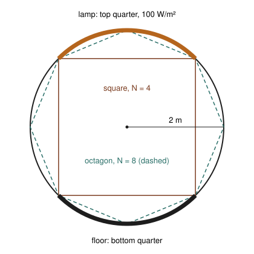
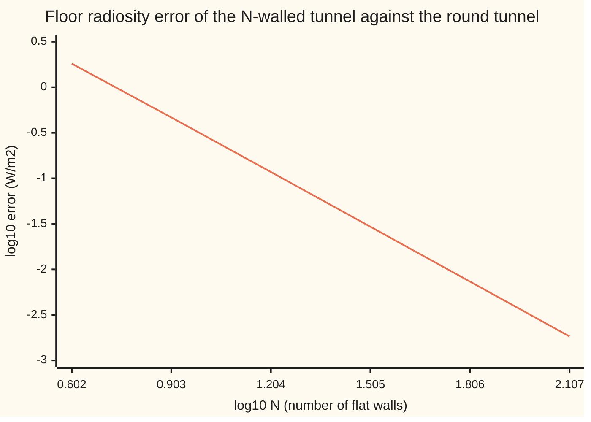

# Fredholm alternative: either always solvable, or finitely many obstructions

[Syllabus](../../../SYLLABUS.md) → [Functional analysis](../README.md) → [Bounded Operators](../README.md#s03) → Fredholm alternative

---

## General Overview

A long road tunnel is round, 2 m in radius. The top quarter of its wall is a glowing panel that gives off 100 W/m² of light. The whole wall, lamp included, is painted white and reflects 80% of the light that lands on it. All these numbers are illustrative.

Light bounces from wall to wall until it settles. Far from the ends, every cross-section looks the same, so the whole question lives on the circle in the picture. In the settled state, the light leaving each point of the wall is its own glow plus 80% of the light arriving there. The light arriving is a sum over the whole wall of the light leaving it.

The unknown, the light leaving each point, appears on both sides, once inside that sum. An equation like this is an **integral equation**. For this tunnel it has exactly one answer: the floor quarter sends out 107.6109 W/m² on average, the ceiling quarter 190.3072 W/m².

Now change what is known. Heat engineers often know each surface's **net output** (light sent out minus light received), not its paint. Then the same balance has no 80% in it, and something new happens. A uniform glow, with every point sending exactly what it receives, solves the equation with no lamp at all. Because of that one extra solution, an answer exists only when the net outputs add up to zero around the wall. If the lamp's light has nowhere to go, the light keeps piling up and never settles.

In symbols, write $`u`$ for the light leaving, $`f`$ for the glow and $`K`$ for the sum over the wall, so the painted tunnel's balance is $`u - 0.8Ku = f`$. This $`K`$ is **compact**: it squeezes any bounded set of inputs into a nearly finite-dimensional set of outputs. Its **adjoint** $`K^*`$ is the same sum with sender and receiver swapped.

**For an equation u − Ku = f with K compact, there are two cases: either u − Ku = 0 has only the answer u = 0, and then every f has exactly one answer; or it has a finite number d of independent answers, and then f has an answer exactly when it is perpendicular to the d independent answers of the adjoint equation v − K*v = 0.**

**What kind of fact this is:** a theorem. On this card it is proved for matrices, from rank and nullity, and for compact operators with a symmetric kernel, from the spectral theorem. The general compact case is stated, with the shape of its proof, and proved in *Linear Integral Equations* (Sources). The code checks finite truncations only.

### The picture: the round tunnel and its rehearsals

<p align="center"></p>

To scale: 80 px per metre. The thick top arc is the lamp, the thick bottom arc the floor. The square (N = 4 flat walls) and the octagon (N = 8) are the finite rehearsals: tunnels with flat walls, where the integral becomes a matrix. As N grows, the flat-walled tunnel becomes the round one.

---

## The formula

Measure position on the wall by the angle $`x`$ from the top, in radians, from $`-\pi`$ to $`\pi`$. The top quarter, $`|x| < \pi/4`$, is the lamp. The bottom quarter, $`|x| > 3\pi/4`$, is the floor.

The light arriving at $`x`$ is an **integral operator** $`K`$ (an operator built from a kernel function, as on [Three model operators](02-integral-operators-and-the-shift.md)) applied to the light leaving:

```math
(Ku)(x) = \int_{-\pi}^{\pi} k(x, y)\, u(y)\, dy, \qquad k(x, y) = \tfrac14 \left|\sin\tfrac{x - y}{2}\right|.
```

The kernel $`k(x, y)`$ is the share of light leaving the wall near $`y`$, per radian, that lands at $`x`$. A **view factor** is the share of light leaving one piece of wall that lands on another. This kernel is the view factor for a round cross-section, and it integrates to 1 over $`y`$: in a closed tunnel every ray lands somewhere.

The tunnel's balance and the theorem:

```math
u - \rho K u = f
```

```math
\text{either } \ker(I - \rho K) = \{0\} \text{ and every } f \text{ has exactly one } u, \quad\text{or}\quad u - \rho K u = f \text{ has an answer} \iff \langle v, f\rangle = 0 \text{ for every } v \in \ker(I - \rho K^*).
```

**Read it aloud:** the light leaving equals the lamp plus the reflected share of the light arriving; either nothing but zero balances an empty tunnel, and then every lamp has one answer, or a few patterns balance it, and then a lamp has an answer only if it is perpendicular to each balancing pattern of the adjoint.

Here $`I`$ is the identity operator, which leaves every $`u`$ unchanged. $`\ker T`$ (the null space of $`T`$) is the set of all $`u`$ with $`Tu = 0`$, and $`\langle v, f\rangle = \int v f\, dx`$ is the inner product of [Adjoints](03-adjoints-self-adjoint-and-unitary-operators.md). The adjoint $`K^*`$ is the operator with $`\langle Ku, v\rangle = \langle u, K^*v\rangle`$; for an integral operator its kernel is $`k(y, x)`$, the original kernel with its arguments swapped.

| Symbol | Plain meaning | In our example | Push it up and the answer… |
| --- | --- | --- | --- |
| $`x`$, $`y`$ | positions on the wall, as angles from the top, in radians | floor quarter: $`\lvert x\rvert > 3\pi/4`$ | — |
| $`k(x, y)`$ | the kernel: share of light per radian leaving $`y`$ that lands at $`x`$ | $`\tfrac14\lvert\sin\tfrac{x-y}{2}\rvert`$ | — |
| $`K`$, $`K^*`$, $`S`$, $`P`$ | light arriving, as an operator; its adjoint; in Step 5, $`K = S + P`$, a small part with $`\lVert S\rVert < 1`$ plus a part of finite rank | the same operator here, because $`k(x, y) = k(y, x)`$ | — |
| $`\rho`$ | reflectance: the share of arriving light that is sent back out | 0.8 for paint; 1 in the net-output problem | every value rises; at 1, an obstruction appears |
| $`f`$ | the data: lamp glow $`E`$, or net output $`q`$, in W/m² | 100 on the top quarter | the answer rises in proportion |
| $`u`$ | the unknown: light leaving, called **radiosity**, $`B`$ or $`J`$, in W/m² | floor quarter 107.6109 at $`\rho`$ = 0.8 | — |
| $`\ker T`$ | null space: all $`u`$ with $`Tu = 0`$ | $`\{0\}`$ at $`\rho`$ = 0.8; the constants at $`\rho`$ = 1 | — |
| $`I`$, $`\langle v, f\rangle`$ | the identity operator; the inner product $`\int v f\, dx`$ | $`\langle 1, q\rangle`$ = total net output | — |
| $`d`$, $`a`$, $`A`$, $`r`$ | the number of obstructions, the dimension of $`\ker(I - \rho K^*)`$; $`a`$, the adjoint's null vector in a rehearsal; in Step 1, a square matrix $`A`$ and its rank $`r`$ | $`d`$ = 0 at $`\rho`$ = 0.8; $`d`$ = 1 at $`\rho`$ = 1, with $`a`$ = (1, 1, 1, 1) for the square | more conditions on $`f`$ |
| $`\lambda_n`$, $`e_n`$, $`u_n`$, $`f_n`$, $`\delta`$ | eigenvalues of $`K`$, on the pattern $`\cos nx`$; its orthonormal eigenvectors; the amounts $`\langle e_n, u\rangle`$ and $`\langle e_n, f\rangle`$; the smallest size $`\lvert 1 - \rho\lambda_n\rvert`$ of a factor | $`1/(1 - 4n^2)`$: 1, −0.333333, −0.066667 | — |
| $`N`$, $`F`$, $`F_m`$, $`c_k`$ | number of flat walls in a rehearsal; its matrix of view factors; the view factor to the wall m steps away; $`c_k = \sin(k\pi/N)`$, the chord across k walls divided by the diameter, which the crossed-strings rule uses | N = 4: $`F_1`$ = 0.292893 to the next wall, $`F_2`$ = 0.414214 opposite | $`F`$ approaches $`K`$ |
| $`\mu_n`$ | eigenvalues of $`F`$ | N = 4: $`\mu_1`$ = −0.414214 | approach $`\lambda_n`$ |

### When it holds

- **K is compact** (it squeezes bounded sets into nearly finite-dimensional ones; see [Compact operators](05-compact-operators.md)). Without it, one-to-one no longer means onto. Multiplying by $`x`$ on $`[0, 1]`$ is not compact: $`u - xu = 0`$ has only $`u = 0`$, yet $`u - xu = 1`$ needs $`u = 1/(1 - x)`$, whose square integral is infinite (What breaks, row 3).
- **The test uses the adjoint's null space.** When $`K`$ is not symmetric, its own null space is the wrong test. A square-cornered corridor passes the wrong test and fails the right one (What breaks, row 1).
- **One inner product throughout.** "Perpendicular" must use the inner product in which the adjoint was taken. With unequal wall widths, a plain sum is the wrong inner product.
- **The equation has the form identity minus compact.** An equation with only $`Ku = f`$, called first kind, is a different problem: its answers can fail to depend continuously on $`f`$.

---

## Why it works

### Step 0: one-to-one and onto come together, apart from finitely many directions

For a square matrix, an equation with exactly one answer for one right side has exactly one answer for every right side. Compactness makes $`I - K`$ behave like a matrix, apart from an error that is small in operator norm. So the matrix fact survives, and the only way to fail is through finitely many directions, which the adjoint names.

### Step 1: the matrix case is rank and nullity

Take an $`N`$ by $`N`$ matrix $`A`$. If $`A^{\top} v = 0`$ and $`Ax = b`$, then

```math
v \cdot b = v \cdot Ax = (A^{\top} v) \cdot x = 0.
```

So every right side that has an answer is perpendicular to the null space of $`A^{\top}`$. The converse is a count. [Rank and nullity](../../03-Algebra/05-Solving%20Systems/05-rank-nullity.md) gives the range of $`A`$ dimension $`r`$, the rank, and gives $`\ker A^{\top}`$ dimension $`N - r`$, because $`A`$ and $`A^{\top}`$ have the same rank. The vectors perpendicular to $`\ker A^{\top}`$ form a space of dimension $`r`$ that contains the range. Equal dimensions make them equal.

Both null spaces have dimension $`N - r`$. So if $`Ax = 0`$ has only $`x = 0`$, then $`r = N`$ and every $`b`$ has exactly one answer. That is the alternative for matrices, and [Solving A x = b](../../03-Algebra/05-Solving%20Systems/01-matrix-equation-ax-b.md) reads the same three cases off the columns.

### Step 2: what infinite dimensions break, and what they keep

The first half survives for any bounded operator $`T`$. If $`T^* v = 0`$ and $`Tu = f`$, then $`\langle v, f\rangle = \langle T^*v, u\rangle = 0`$. So the adjoint's null space is always a necessary test.

The counting half fails. A one-to-one operator can miss right sides. Multiplication by $`x`$ on $`[0, 1]`$ gives $`u - xu = (1 - x)u`$, which is zero only for $`u = 0`$. Yet $`(1 - x)u = 1`$ needs $`u = 1/(1 - x)`$, whose square integral is infinite. Compactness of $`K`$ is what restores the count.

### Step 3: a compact symmetric kernel splits into separate number equations

Let $`K`$ be compact and self-adjoint. The spectral theorem of [Compact and symmetric](08-spectral-theorem-for-compact-self-adjoint-operators.md) gives an orthonormal list $`e_n`$ and real eigenvalues $`\lambda_n \to 0`$ with $`Ke_n = \lambda_n e_n`$ (that card writes them $`\mu_n`$; here $`\mu_n`$ is kept for the flat-walled matrix $`F`$), while $`K`$ sends the part of $`u`$ perpendicular to every $`e_n`$ to zero. Write $`u_n = \langle e_n, u\rangle`$ and $`f_n = \langle e_n, f\rangle`$. Then $`u - \rho Ku = f`$ becomes one equation per pattern:

```math
(1 - \rho\lambda_n)\, u_n = f_n \quad\text{for each } n, \qquad\text{and } u = f \text{ on the part that } K \text{ sends to zero.}
```

- **Case A: no $`\rho\lambda_n`$ equals 1.** Then $`u_n = f_n / (1 - \rho\lambda_n)`$. Because $`\lambda_n \to 0`$, the factors $`1 - \rho\lambda_n`$ approach 1, and none is 0, so their sizes stay above some $`\delta > 0`$: $`\lvert 1 - \rho\lambda_n\rvert \ge \delta`$. Then $`\lVert u\rVert \le \lVert f\rVert / \delta`$, and the answer exists, is unique, and depends continuously on $`f`$.
- **Case B: $`\rho\lambda_n = 1`$ for some $`n`$.** Only finitely many $`n`$ qualify, because $`\lambda_n \to 0`$ and each nonzero eigenvalue of a compact operator repeats only finitely often. Those equations read $`0 \cdot u_n = f_n`$. They need $`f_n = 0`$: $`f`$ perpendicular to those $`e_n`$, which span $`\ker(I - \rho K) = \ker(I - \rho K^*)`$. Their $`u_n`$ are free, so the answers form a family of dimension $`d`$.

<details>
<summary>Why the factors stay away from zero in Case A</summary>

Only finitely many $`\lambda_n`$ satisfy $`|\rho\lambda_n| > \tfrac12`$, because $`\lambda_n \to 0`$. Each of those finitely many factors $`1 - \rho\lambda_n`$ is nonzero by assumption. Every other factor is at least $`\tfrac12`$. So the smallest size of a factor, $`\delta = \min_n \lvert 1 - \rho\lambda_n\rvert`$, is positive. On the part that $`K`$ sends to zero, the factor is exactly 1. Summing squares with Parseval's identity:

$`\displaystyle \lVert u\rVert^2 = \sum_n \frac{f_n^2}{(1 - \rho\lambda_n)^2} + \lVert f_{\text{rest}}\rVert^2 \le \frac{\lVert f\rVert^2}{\delta^2}.`$

</details>

### Step 4: the round tunnel's patterns

The kernel depends only on $`x - y`$, so each $`\cos nx`$ and $`\sin nx`$ is an eigenvector. Its eigenvalue has a closed form:

```math
\lambda_n = \int_{-\pi}^{\pi} \tfrac14 \left|\sin\tfrac{t}{2}\right| \cos nt\, dt = \frac{1}{1 - 4n^2}: \qquad 1,\ -0.333333,\ -0.066667,\ \dots
```

The kernel is continuous, so $`K`$ is compact, and it is symmetric, so $`K^* = K`$. Now read Step 3.

- **Painted walls, $`\rho`$ = 0.8.** The product $`\rho\lambda_0`$ is 0.8, and every other $`\rho\lambda_n`$ is negative. None is 1: Case A. Every lamp has exactly one answer.
- **Net outputs, $`\rho`$ = 1.** Then $`\lambda_0 = 1`$ gives $`\rho\lambda_0 = 1`$: Case B, with $`d`$ = 1. The obstruction is $`e_0`$, the constant pattern. The condition is $`\int q\, dx = 0`$: the net outputs add to zero around the wall.
- **Other obstructions?** Case B also occurs at $`\rho = 1/\lambda_n = 1 - 4n^2`$, each time with two patterns, $`\cos nx`$ and $`\sin nx`$. For $`n \ge 1`$ that reflectance is negative, which no paint has, so the tunnel never meets them.

The condition has a physical meaning. The adjoint's null vector is the constant 1, and testing against it adds up net power over the wall. The obstruction is conservation of energy.

<details>
<summary>The integral for the eigenvalues</summary>

By periodicity the integral over $`(-\pi, \pi)`$ equals the integral over $`(0, 2\pi)`$, where $`\sin(t/2) \ge 0`$. Use $`\sin a \cos b = \tfrac12[\sin(a + b) + \sin(a - b)]`$ and $`\int_0^{2\pi} \sin(mt)\, dt = 2/m`$ for $`m = n + \tfrac12`$ and $`m = \tfrac12 - n`$:

$`\displaystyle \int_0^{2\pi} \sin\tfrac{t}{2}\cos nt\, dt = \frac{1}{n + \frac12} + \frac{1}{\frac12 - n} = \frac{1}{\frac14 - n^2}.`$

Multiply by $`\tfrac14`$ to get $`1/(1 - 4n^2)`$. At $`n = 0`$ this is 1: every ray lands somewhere.

</details>

### Step 5: the general compact case

When $`K`$ is compact but not symmetric, there is no list of eigenvectors to split along. The proof instead reduces to Step 1.

1. A compact operator on a Hilbert space is a limit, in operator norm, of finite-rank operators (operators whose range is finite-dimensional). Write $`K = S + P`$ with $`\lVert S\rVert < 1`$ and $`P`$ of finite rank.
2. $`I - S`$ is invertible by the [Neumann series](06-neumann-series-and-inverting-close-to-the-identity.md). So $`(I - K)u = f`$ is the same as $`(I - P(I - S)^{-1})w = f`$ with $`w = (I - S)u`$.
3. The operator $`P(I - S)^{-1}`$ has finite rank. On its finite-dimensional range, the equation is a square matrix equation, and Step 1 applies.

This gives the full statement: $`\ker(I - K)`$ and $`\ker(I - K^*)`$ have the same finite dimension, and the range of $`I - K`$ is exactly the set of $`f`$ perpendicular to $`\ker(I - K^*)`$. The careful version is in *Linear Integral Equations*, chapters 3 and 4 (Sources). Seen through [Spectrum](07-spectrum-and-resolvent.md), it says that every nonzero point of the spectrum of a compact operator is an eigenvalue.

### Step 6: the rehearsal converges

The flat-walled tunnels make all of this a matrix problem. With $`N`$ equal walls, the view factor from one wall to the wall $`m`$ steps away follows from the crossed-strings rule (a classical formula for view factors between long strips):

```math
F_m = \frac{2c_m - c_{m+1} - c_{m-1}}{2c_1}, \qquad c_k = \sin\frac{k\pi}{N}.
```

The eigenvalues $`\mu_n`$ of $`F`$ approach $`\lambda_n`$, and the answers approach the round tunnel's answers.

| N | floor, $`\rho`$ = 0.8 | ceiling, $`\rho`$ = 0.8 | $`\mu_1`$ | ceiling minus floor, net outputs |
| ---: | ---: | ---: | ---: | ---: |
| 4 | 109.4274 | 184.5380 | −0.414214 | 141.4214 |
| 8 | 108.0774 | 188.8307 | −0.351153 | 154.3277 |
| 16 | 107.7283 | 189.9360 | −0.337659 | 157.7276 |
| 32 | 107.6403 | 190.2143 | −0.334407 | 158.5886 |
| 64 | 107.6183 | 190.2840 | −0.333601 | 158.8046 |
| 128 | 107.6128 | 190.3014 | −0.333400 | 158.8586 |
| round | 107.6109 | 190.3072 | −0.333333 | 158.8766 |

All values are quarter averages in W/m². At every $`N`$ the null space at $`\rho`$ = 1 has dimension exactly 1, and the adjoint's null vector is all 1s.



The line is the floor-quarter error at $`\rho`$ = 0.8 for N = 4 to 128. Its slope is −2: doubling $`N`$ divides the error by about 4. What the rehearsal hides: a matrix with $`N`$ walls has only $`N`$ eigenvalues, and the pattern $`n`$ cannot be told apart from $`N - n`$. The round tunnel has infinitely many eigenvalues, crowding toward 0.

---

## Worked numbers, by hand

The square tunnel, N = 4: ceiling, side wall, floor, side wall. Each wall is $`2 \times 2 \sin(\pi/4)`$ = 2.8284 m wide. The view factors from the crossed-strings rule are $`1 - 1/\sqrt2`$ to each next wall and $`\sqrt2 - 1`$ to the opposite wall.

| Step | Arithmetic | Value |
| --- | --- | --- |
| 1. View factor, next wall | $`1 - 1/\sqrt2`$ | 0.292893 |
| 2. View factor, opposite wall | $`\sqrt2 - 1`$ | 0.414214 |
| 3. Each row of $`F`$ | $`2 \times 0.292893 + 0.414214`$ | 1.000000 |
| 4. Null space at $`\rho`$ = 1 | rows sum to 1, so $`(1, 1, 1, 1)`$ has $`J - FJ = 0`$ | rank 3 of 4 |
| 5. Adjoint's null vector | $`F`$ is symmetric, so its columns also sum to 1 | $`a`$ = (1, 1, 1, 1) |
| 6. Test the balanced data $`q`$ = (100, 0, −100, 0) | $`a \cdot q = 100 + 0 - 100 + 0`$ | 0: an answer exists |
| 7. Solve for ceiling minus floor | ceiling row minus floor row: $`(1 + 0.414214)(c - f) = 200`$ | 141.4214 W/m² |
| 8. Test unbalanced data, floor at −80 | $`a \cdot q \times`$ 2.8284 m $`= 20 \times 2.8284`$ | 56.5685 W/m: no answer |
| 9. Painted walls, $`\rho`$ = 0.8: mean | Case A; energy: $`0.2 \times \text{mean} = 100/4`$ | 125.0000 W/m² |
| 10. Painted walls: ceiling minus floor | $`100 / (1 + 0.8 \times 0.414214)`$ | 75.1106 W/m² |

**With the net outputs balanced, the square tunnel's ceiling sends out 141.4214 W/m² more than its floor; with the floor absorbing only 80 W/m², 56.5685 W per metre of tunnel has nowhere to go and no steady state exists.**

In step 7 only the difference is fixed. Adding the same constant to every wall still solves the equation, because the constants are the null space. One more measurement, such as the floor's absorptance, pins the level.

### What breaks if you drop a piece

| Mistake | Comes out at | What went wrong |
| --- | --- | --- |
| Test against the operator's own null space. A 4 m by 3 m corridor; $`q`$ = (0, −100, 100, 0) for floor, right wall, ceiling, left wall | plain sum 0.0, "solvable"; true test 100.0 W/m, rank 3 vs 4, no answer | The corridor's $`F`$ is not symmetric. Its rows (0, 0.2500, 0.5000, 0.2500) and (0.3333, 0, 0.3333, 0.3333) sum to 1, but its columns do not. The adjoint's null vector is the wall widths, (4, 3, 4, 3). |
| Ignore the condition, unbalanced square, and bounce light until it settles | mean $`J`$ 50.0, 500.0, 5000.0 after 10, 100, 1000 bounces | The mismatch is added again on every bounce and never absorbed, so the mean climbs by the same step each time. No steady state exists. |
| Drop compactness: solve $`u - xu = 1`$ on a grid of $`N`$ points | size of $`u`$: 6.9533, 22.1919, 70.2410, 222.1419 at N = 10 to 10,000 | Multiplying by $`x`$ is not compact. Only zero balances it, yet the size grows like 2.2214 $`\sqrt N`$, which is $`\pi/\sqrt2`$, and never settles. |

---

## Code, from first principles, and it actually runs

The code builds the view-factor matrix of an $`N`$-walled tunnel from crossed strings, then solves every case above. Each answer is reached by at least two independent roads:

- **Elimination:** row reduction, which also counts ranks.
- **Eigenpatterns:** the matrix's own eigenvalues, from cosine sums, at every $`N`$.
- **The round tunnel's series:** built from the closed form $`\lambda_n = 1/(1 - 4n^2)`$, the limit that the truncations must approach at rate $`1/N^2`$.
- **Bounce by bounce:** light added one reflection at a time.
- **Energy:** absorbed light equals emitted light.

The adjoint's null vector is found by elimination on the transpose and compared with the constants, or with the corridor's wall widths.

### Python

```python
# Fredholm alternative for the light balance in a long round tunnel, standard library only.
# Rehearsal: the tunnel as an N-sided prism; form factors by crossed strings; the round tunnel is N -> infinity.
import math

RHO, E0, R, PI = 0.8, 100.0, 2.0, math.pi  # paint reflectance, lamp output W/m2, radius m
def form_factors(N):  # F[i][j]: share of light leaving wall i that lands on wall j
    c = [math.sin(k * PI / N) for k in range(N + 1)]
    F = [[0.0] * N for _ in range(N)]
    for i in range(N):
        for j in range(N):
            m = (j - i) % N
            if m > 0:
                F[i][j] = (2 * c[m] - c[m + 1] - c[m - 1]) / (2 * c[1])
    return F
def eliminate(M):  # row reduction with partial pivoting; returns rank and reduced rows
    M = [r[:] for r in M]
    rank, rows, cols = 0, len(M), len(M[0])
    for col in range(cols):
        p = max(range(rank, rows), key=lambda r: abs(M[r][col]), default=None)
        if p is None or abs(M[p][col]) < 1e-9:
            continue
        M[rank], M[p] = M[p], M[rank]
        for r in range(rows):
            if r != rank:
                f = M[r][col] / M[rank][col]
                M[r] = [a - f * b for a, b in zip(M[r], M[rank])]
        rank += 1
    return rank, M
def solve(A, b):  # A square and invertible
    rank, M = eliminate([row + [v] for row, v in zip(A, b)])
    assert rank == len(A)
    return [M[i][-1] / M[i][i] for i in range(len(A))]
def minus(F, s):  # the matrix I - s F
    return [[(i == j) - s * F[i][j] for j in range(len(F))] for i in range(len(F))]
def null_vector(M):  # one-dimensional null space: fix the first entry at 1
    n = len(M)
    return solve(M[:n - 1] + [[1.0] + [0.0] * (n - 1)], [0.0] * (n - 1) + [1.0])
def quarter(v, k):  # average over quarter k of the wall: 0 ceiling, 1 and 3 sides, 2 floor
    q = len(v) // 4
    return sum(v[k * q:(k + 1) * q]) / q
def lam(n):  # eigenvalues of the round tunnel's kernel |sin((x - y)/2)|/4, on cos(n x)
    return 1.0 / (1.0 - 4.0 * n * n)
def arc_avg(n, a, b):  # average of cos(n x) over a < x < b
    return (math.sin(n * b) - math.sin(n * a)) / (n * (b - a))

print("Round tunnel, radius 2 m; the top quarter of the wall emits 100 W/m2 (illustrative)")
F4 = form_factors(4)
print(f"N=4 form factors: next wall {F4[0][1]:.6f}, opposite wall {F4[0][2]:.6f}, row sum {sum(F4[0]):.6f}")
assert abs(F4[0][1] - (1 - 1 / math.sqrt(2))) < 1e-12 and abs(F4[0][2] - (math.sqrt(2) - 1)) < 1e-12
print(f"round kernel eigenvalues: n=0 {lam(0):.6f}, n=1 {lam(1):.6f}, n=2 {lam(2):.6f}")
print("Painted walls, rho = 0.8: quarter averages of radiosity B, W/m2")
floors, gaps, Ns = [], [], [4, 8, 16, 32, 64, 128]
for N in Ns:
    F = form_factors(N)
    E = [E0 if i < N // 4 else 0.0 for i in range(N)]
    B = solve(minus(F, RHO), E)
    mu = [sum(F[0][m] * math.cos(2 * PI * n * m / N) for m in range(N)) for n in range(N)]
    cs = [[(math.cos(2 * PI * n * m / N), math.sin(2 * PI * n * m / N)) for m in range(N)] for n in range(N)]
    Ec = [sum(E[m] * cs[n][m][0] for m in range(N)) / N for n in range(N)]
    Es = [sum(E[m] * cs[n][m][1] for m in range(N)) / N for n in range(N)]
    B2 = [sum((Ec[n] * cs[n][i][0] + Es[n] * cs[n][i][1]) / (1 - RHO * mu[n]) for n in range(N)) for i in range(N)]
    assert max(abs(x - y) for x, y in zip(B, B2)) < 1e-9          # road 2: the eigenmodes
    assert abs((1 - RHO) * sum(B) - sum(E)) < 1e-9                # absorbed = emitted
    floors.append(quarter(B, 2))
    print(f"N={N:<4} floor {quarter(B, 2):.4f} ceiling {quarter(B, 0):.4f} mean {sum(B) / N:.4f}"
          f"  mu1 {mu[1]:.6f} mu2 {mu[2]:.6f}")
fl, ce = E0 * RHO / (1 - RHO) / 4, E0 + E0 * RHO / (1 - RHO) / 4
for n in range(1, 4000):
    En = 2 * E0 * math.sin(n * PI / 4) / (n * PI)
    g = En * RHO * lam(n) / (1 - RHO * lam(n))
    fl, ce = fl + g * arc_avg(n, 3 * PI / 4, 5 * PI / 4), ce + g * arc_avg(n, -PI / 4, PI / 4)
print(f"round floor {fl:.4f} ceiling {ce:.4f} mean {E0 / 4 / (1 - RHO):.4f}  (eigen series)")
errs = [f - fl for f in floors]
assert all(0.2 < errs[k + 1] / errs[k] < 0.3 for k in range(5))  # error falls like 1/N^2
print("log10 N:", " ".join(f"{math.log10(N):.3f}" for N in Ns), "| log10 floor error:", " ".join(f"{math.log10(e):.3f}" for e in errs))
B, E = [0.0] * 4, [E0, 0.0, 0.0, 0.0]
gap = E0 / (1 + RHO * (math.sqrt(2) - 1))  # by hand: ceiling row minus floor row
for _ in range(200):  # road 3: bounce by bounce, B <- E + rho F B
    B = [E[i] + RHO * sum(F4[i][j] * B[j] for j in range(4)) for i in range(4)]
assert abs(B[2] - floors[0]) < 1e-9 and abs(B[0] - B[2] - gap) < 1e-9
print(f"N=4 after 200 bounces: floor {B[2]:.4f}, side {B[1]:.4f}, ceiling minus floor {B[0] - B[2]:.4f} = by hand {gap:.4f}")
print("White walls, (I - K) J = q with q the net output of each wall, W/m2")
for N in Ns:
    F, q4 = form_factors(N), N // 4
    a = null_vector([list(col) for col in zip(*minus(F, 1.0))])  # adjoint null space
    assert max(abs(x - 1) for x in a) < 1e-9
    q = [E0 if i < q4 else (-E0 if 2 * q4 <= i < 3 * q4 else 0.0) for i in range(N)]
    r1 = eliminate(minus(F, 1.0))[0]
    r2 = eliminate([row + [v] for row, v in zip(minus(F, 1.0), q)])[0]
    assert r1 == r2 == N - 1
    J = solve(minus(F, 1.0)[:N - 1] + [[1.0] * N], q[:N - 1] + [0.0])
    assert abs(J[-1] - sum(F[-1][k] * J[k] for k in range(N)) - q[-1]) < 1e-9  # the dropped row holds
    gaps.append(quarter(J, 0) - quarter(J, 2))
    print(f"N={N:<4} rank {r1} of {N}, adjoint null vector all 1s, ceiling minus floor {quarter(J, 0) - quarter(J, 2):.4f}")
cf = 2 * E0
for n in range(1, 4000, 2):
    qn = 4 * E0 * math.sin(n * PI / 4) / (n * PI)
    cf += qn * lam(n) / (1 - lam(n)) * (arc_avg(n, -PI / 4, PI / 4) - arc_avg(n, 3 * PI / 4, 5 * PI / 4))
print(f"round ceiling minus floor {cf:.4f}  (eigen series, J_n = q_n / (1 - lambda_n) for n >= 1)")
assert all(0.2 < (gaps[k + 1] - cf) / (gaps[k] - cf) < 0.3 for k in range(5))  # N-gon gap closes on cf like 1/N^2
qbad = [E0, 0.0, -80.0, 0.0]
side = 2 * R * math.sin(PI / 4)
r1, r2 = eliminate(minus(F4, 1.0))[0], eliminate([row + [v] for row, v in zip(minus(F4, 1.0), qbad)])[0]
assert (r1, r2) == (3, 4)
print(f"floor absorbs only 80: N=4 wall {side:.4f} m, mismatch {sum(qbad) * side:.4f} W/m, round {20 * PI * R / 2:.4f} W/m; rank {r1} vs {r2}")
J, means = [0.0] * 4, []
for k in range(1, 1001):
    J = [qbad[i] + sum(F4[i][j] * J[j] for j in range(4)) for i in range(4)]
    if k in (10, 100, 1000):
        means.append(sum(J) / 4)
assert all(abs(m - 5 * k) < 1e-6 for m, k in zip(means, (10, 100, 1000)))
print("mean J after 10, 100, 1000 bounces:", " ".join(f"{m:.1f}" for m in means))
w, h = 4.0, 3.0  # square-cornered corridor: floor, right wall, ceiling, left wall
d = math.hypot(w, h)
s = (w + h - d) / 2
Fc = [[0, s / w, (2 * d - 2 * h) / (2 * w), s / w], [s / h, 0, s / h, (2 * d - 2 * w) / (2 * h)],
      [(2 * d - 2 * h) / (2 * w), s / w, 0, s / w], [s / h, (2 * d - 2 * w) / (2 * h), s / h, 0]]
ac = null_vector([list(col) for col in zip(*minus(Fc, 1.0))])
assert max(abs(x * w - y) for x, y in zip(ac, (w, h, w, h))) < 1e-9
qc = [0.0, -E0, E0, 0.0]
rc = (eliminate(minus(Fc, 1.0))[0], eliminate([row + [v] for row, v in zip(minus(Fc, 1.0), qc)])[0])
assert rc == (3, 4)
print(f"corridor {w:.0f} m x {h:.0f} m: rows of F {Fc[0][1]:.4f} {Fc[0][2]:.4f} | {Fc[1][0]:.4f} {Fc[1][3]:.4f}; adjoint null vector "
      + " ".join(f"{x * w:.4f}" for x in ac))
print(f"q = (0, -100, 100, 0): plain sum {sum(qc):.1f}, width-weighted sum {sum(x * w * y for x, y in zip(ac, qc)):.1f} W/m; rank {rc[0]} vs {rc[1]}")
ratios = []
for N in (10, 100, 1000, 10000):  # multiply by x on [0, 1]: (I - M_x) u = 1 gives u = 1/(1 - x)
    norm = math.sqrt(sum(1 / (1 - (i + 0.5) / N) ** 2 for i in range(N)) / N)
    ratios.append(norm / math.sqrt(N))
    print(f"multiply by x, N={N:<6} norm of u {norm:.4f}, divided by sqrt(N) {norm / math.sqrt(N):.4f}")
assert abs(ratios[-1] - PI / math.sqrt(2)) < 1e-3
print(f"figure, radius 160 px = 2 m, square vertex {210 + 160 * math.sin(PI / 4):.3f} {210 - 160 * math.cos(PI / 4):.3f}, octagon vertex {210 + 160 * math.sin(0.0):.3f} {210 - 160 * math.cos(0.0):.3f}")
print("ALL CHECKS PASS")
```

**Ran 2026-11-15 on macOS, Python 3.14.10, standard library only. All checks passed. Output, pasted from the run:**

```
Round tunnel, radius 2 m; the top quarter of the wall emits 100 W/m2 (illustrative)
N=4 form factors: next wall 0.292893, opposite wall 0.414214, row sum 1.000000
round kernel eigenvalues: n=0 1.000000, n=1 -0.333333, n=2 -0.066667
Painted walls, rho = 0.8: quarter averages of radiosity B, W/m2
N=4    floor 109.4274 ceiling 184.5380 mean 125.0000  mu1 -0.414214 mu2 -0.171573
N=8    floor 108.0774 ceiling 188.8307 mean 125.0000  mu1 -0.351153 mu2 -0.082392
N=16   floor 107.7283 ceiling 189.9360 mean 125.0000  mu1 -0.337659 mu2 -0.070209
N=32   floor 107.6403 ceiling 190.2143 mean 125.0000  mu1 -0.334407 mu2 -0.067530
N=64   floor 107.6183 ceiling 190.2840 mean 125.0000  mu1 -0.333601 mu2 -0.066881
N=128  floor 107.6128 ceiling 190.3014 mean 125.0000  mu1 -0.333400 mu2 -0.066720
round floor 107.6109 ceiling 190.3072 mean 125.0000  (eigen series)
log10 N: 0.602 0.903 1.204 1.505 1.806 2.107 | log10 floor error: 0.259 -0.331 -0.930 -1.532 -2.134 -2.736
N=4 after 200 bounces: floor 109.4274, side 103.0173, ceiling minus floor 75.1106 = by hand 75.1106
White walls, (I - K) J = q with q the net output of each wall, W/m2
N=4    rank 3 of 4, adjoint null vector all 1s, ceiling minus floor 141.4214
N=8    rank 7 of 8, adjoint null vector all 1s, ceiling minus floor 154.3277
N=16   rank 15 of 16, adjoint null vector all 1s, ceiling minus floor 157.7276
N=32   rank 31 of 32, adjoint null vector all 1s, ceiling minus floor 158.5886
N=64   rank 63 of 64, adjoint null vector all 1s, ceiling minus floor 158.8046
N=128  rank 127 of 128, adjoint null vector all 1s, ceiling minus floor 158.8586
round ceiling minus floor 158.8766  (eigen series, J_n = q_n / (1 - lambda_n) for n >= 1)
floor absorbs only 80: N=4 wall 2.8284 m, mismatch 56.5685 W/m, round 62.8319 W/m; rank 3 vs 4
mean J after 10, 100, 1000 bounces: 50.0 500.0 5000.0
corridor 4 m x 3 m: rows of F 0.2500 0.5000 | 0.3333 0.3333; adjoint null vector 4.0000 3.0000 4.0000 3.0000
q = (0, -100, 100, 0): plain sum 0.0, width-weighted sum 100.0 W/m; rank 3 vs 4
multiply by x, N=10     norm of u 6.9533, divided by sqrt(N) 2.1988
multiply by x, N=100    norm of u 22.1919, divided by sqrt(N) 2.2192
multiply by x, N=1000   norm of u 70.2410, divided by sqrt(N) 2.2212
multiply by x, N=10000  norm of u 222.1419, divided by sqrt(N) 2.2214
figure, radius 160 px = 2 m, square vertex 323.137 96.863, octagon vertex 210.000 50.000
ALL CHECKS PASS
```

### Rust

```rust
// Fredholm alternative for the light balance in a long round tunnel, std only.
// Rehearsal: the tunnel as an N-sided prism; form factors by crossed strings; the round tunnel is N -> infinity.
use std::f64::consts::PI;
type Mat = Vec<Vec<f64>>;
const RHO: f64 = 0.8; // paint reflectance
const E0: f64 = 100.0; // lamp output, W/m2
const R: f64 = 2.0; // tunnel radius, m

fn form_factors(n: usize) -> Mat { // F[i][j]: share of light leaving wall i that lands on wall j
    let c: Vec<f64> = (0..=n).map(|k| (k as f64 * PI / n as f64).sin()).collect();
    let mut f = vec![vec![0.0; n]; n];
    for i in 0..n { for j in 0..n {
        let m = (j + n - i) % n;
        if m > 0 { f[i][j] = (2.0 * c[m] - c[m + 1] - c[m - 1]) / (2.0 * c[1]); }
    } }
    f
}
fn eliminate(m0: &Mat) -> (usize, Mat) { // row reduction with partial pivoting; rank and reduced rows
    let mut m = m0.clone();
    let (rows, cols) = (m.len(), m[0].len());
    let mut rank = 0;
    for col in 0..cols {
        if rank == rows { break; }
        let mut p = rank;
        for r in rank..rows { if m[r][col].abs() > m[p][col].abs() { p = r; } }
        if m[p][col].abs() < 1e-9 { continue; }
        m.swap(rank, p);
        for r in 0..rows { if r != rank {
            let f = m[r][col] / m[rank][col];
            let piv = m[rank].clone();
            for (a, b) in m[r].iter_mut().zip(piv.iter()) { *a -= f * b; }
        } }
        rank += 1;
    }
    (rank, m)
}
fn augment(a: &Mat, b: &[f64]) -> Mat {
    a.iter().zip(b).map(|(row, v)| { let mut r = row.clone(); r.push(*v); r }).collect()
}
fn solve(a: &Mat, b: &[f64]) -> Vec<f64> { // a square and invertible
    let (rank, m) = eliminate(&augment(a, b));
    assert!(rank == a.len());
    (0..a.len()).map(|i| m[i][a.len()] / m[i][i]).collect()
}
fn minus(f: &Mat, s: f64) -> Mat { // the matrix I - s F
    let n = f.len();
    (0..n).map(|i| (0..n).map(|j| (if i == j { 1.0 } else { 0.0 }) - s * f[i][j]).collect()).collect()
}
fn transpose(m: &Mat) -> Mat { (0..m[0].len()).map(|j| m.iter().map(|r| r[j]).collect()).collect() }
fn null_vector(m: &Mat) -> Vec<f64> { // one-dimensional null space: fix the first entry at 1
    let n = m.len();
    let mut a: Mat = m[..n - 1].to_vec();
    let mut e = vec![0.0; n]; e[0] = 1.0; a.push(e);
    let mut b = vec![0.0; n]; b[n - 1] = 1.0;
    solve(&a, &b)
}
fn quarter(v: &[f64], k: usize) -> f64 { // average over quarter k: 0 ceiling, 1 and 3 sides, 2 floor
    let q = v.len() / 4;
    v[k * q..(k + 1) * q].iter().sum::<f64>() / q as f64
}
fn lam(n: f64) -> f64 { 1.0 / (1.0 - 4.0 * n * n) } // round kernel |sin((x - y)/2)|/4 on cos(n x)
fn arc_avg(n: f64, a: f64, b: f64) -> f64 { ((n * b).sin() - (n * a).sin()) / (n * (b - a)) }
fn rank_pair(f: &Mat, q: &[f64]) -> (usize, usize) {
    (eliminate(&minus(f, 1.0)).0, eliminate(&augment(&minus(f, 1.0), q)).0)
}

fn main() {
    println!("Round tunnel, radius 2 m; the top quarter of the wall emits 100 W/m2 (illustrative)");
    let f4 = form_factors(4);
    println!("N=4 form factors: next wall {:.6}, opposite wall {:.6}, row sum {:.6}", f4[0][1], f4[0][2], f4[0].iter().sum::<f64>());
    assert!((f4[0][1] - (1.0 - 1.0 / 2f64.sqrt())).abs() < 1e-12 && (f4[0][2] - (2f64.sqrt() - 1.0)).abs() < 1e-12);
    println!("round kernel eigenvalues: n=0 {:.6}, n=1 {:.6}, n=2 {:.6}", lam(0.0), lam(1.0), lam(2.0));
    println!("Painted walls, rho = 0.8: quarter averages of radiosity B, W/m2");
    let ns = [4usize, 8, 16, 32, 64, 128];
    let (mut floors, mut gaps) = (vec![], vec![]);
    for &n in &ns {
        let f = form_factors(n);
        let e: Vec<f64> = (0..n).map(|i| if i < n / 4 { E0 } else { 0.0 }).collect();
        let b = solve(&minus(&f, RHO), &e);
        let ang = |k: usize, m: usize| 2.0 * PI * k as f64 * m as f64 / n as f64;
        let mu: Vec<f64> = (0..n).map(|k| (0..n).map(|m| f[0][m] * ang(k, m).cos()).sum()).collect();
        let ec: Vec<f64> = (0..n).map(|k| (0..n).map(|m| e[m] * ang(k, m).cos()).sum::<f64>() / n as f64).collect();
        let es: Vec<f64> = (0..n).map(|k| (0..n).map(|m| e[m] * ang(k, m).sin()).sum::<f64>() / n as f64).collect();
        let b2: Vec<f64> = (0..n).map(|i| (0..n).map(|k| (ec[k] * ang(k, i).cos() + es[k] * ang(k, i).sin()) / (1.0 - RHO * mu[k])).sum()).collect();
        assert!(b.iter().zip(&b2).all(|(x, y)| (x - y).abs() < 1e-9)); // road 2: the eigenmodes
        assert!(((1.0 - RHO) * b.iter().sum::<f64>() - e.iter().sum::<f64>()).abs() < 1e-9); // absorbed = emitted
        floors.push(quarter(&b, 2));
        println!("N={:<4} floor {:.4} ceiling {:.4} mean {:.4}  mu1 {:.6} mu2 {:.6}", n, quarter(&b, 2), quarter(&b, 0), b.iter().sum::<f64>() / n as f64, mu[1], mu[2]);
    }
    let (mut fl, mut ce) = (E0 * RHO / (1.0 - RHO) / 4.0, E0 + E0 * RHO / (1.0 - RHO) / 4.0);
    for k in 1..4000 {
        let n = k as f64;
        let en = 2.0 * E0 * (n * PI / 4.0).sin() / (n * PI);
        let g = en * RHO * lam(n) / (1.0 - RHO * lam(n));
        fl += g * arc_avg(n, 3.0 * PI / 4.0, 5.0 * PI / 4.0);
        ce += g * arc_avg(n, -PI / 4.0, PI / 4.0);
    }
    println!("round floor {:.4} ceiling {:.4} mean {:.4}  (eigen series)", fl, ce, E0 / 4.0 / (1.0 - RHO));
    let errs: Vec<f64> = floors.iter().map(|x| x - fl).collect();
    assert!((0..5).all(|k| errs[k + 1] / errs[k] > 0.2 && errs[k + 1] / errs[k] < 0.3)); // error falls like 1/N^2
    println!("log10 N: {} | log10 floor error: {}", ns.iter().map(|&n| format!("{:.3}", (n as f64).log10())).collect::<Vec<_>>().join(" "), errs.iter().map(|x| format!("{:.3}", x.log10())).collect::<Vec<_>>().join(" "));
    let (mut b, e) = (vec![0.0; 4], [E0, 0.0, 0.0, 0.0]);
    let gap = E0 / (1.0 + RHO * (2f64.sqrt() - 1.0)); // by hand: ceiling row minus floor row
    for _ in 0..200 { // road 3: bounce by bounce, B <- E + rho F B
        b = (0..4).map(|i| e[i] + RHO * (0..4).map(|j| f4[i][j] * b[j]).sum::<f64>()).collect();
    }
    assert!((b[2] - floors[0]).abs() < 1e-9 && (b[0] - b[2] - gap).abs() < 1e-9);
    println!("N=4 after 200 bounces: floor {:.4}, side {:.4}, ceiling minus floor {:.4} = by hand {:.4}", b[2], b[1], b[0] - b[2], gap);
    println!("White walls, (I - K) J = q with q the net output of each wall, W/m2");
    for &n in &ns {
        let (f, q4) = (form_factors(n), n / 4);
        let a = null_vector(&transpose(&minus(&f, 1.0))); // adjoint null space
        assert!(a.iter().all(|x| (x - 1.0).abs() < 1e-9));
        let q: Vec<f64> = (0..n).map(|i| if i < q4 { E0 } else if 2 * q4 <= i && i < 3 * q4 { -E0 } else { 0.0 }).collect();
        let (r1, r2) = rank_pair(&f, &q);
        assert!(r1 == n - 1 && r2 == n - 1);
        let mut a1: Mat = minus(&f, 1.0)[..n - 1].to_vec();
        a1.push(vec![1.0; n]);
        let mut rhs = q[..n - 1].to_vec(); rhs.push(0.0);
        let j = solve(&a1, &rhs);
        assert!((j[n - 1] - (0..n).map(|k| f[n - 1][k] * j[k]).sum::<f64>() - q[n - 1]).abs() < 1e-9); // the dropped row holds
        gaps.push(quarter(&j, 0) - quarter(&j, 2));
        println!("N={:<4} rank {} of {}, adjoint null vector all 1s, ceiling minus floor {:.4}", n, r1, n, quarter(&j, 0) - quarter(&j, 2));
    }
    let mut cf = 2.0 * E0;
    for k in (1..4000).step_by(2) {
        let n = k as f64;
        let qn = 4.0 * E0 * (n * PI / 4.0).sin() / (n * PI);
        cf += qn * lam(n) / (1.0 - lam(n)) * (arc_avg(n, -PI / 4.0, PI / 4.0) - arc_avg(n, 3.0 * PI / 4.0, 5.0 * PI / 4.0));
    }
    println!("round ceiling minus floor {:.4}  (eigen series, J_n = q_n / (1 - lambda_n) for n >= 1)", cf);
    assert!((0..5).all(|k| (gaps[k + 1] - cf) / (gaps[k] - cf) > 0.2 && (gaps[k + 1] - cf) / (gaps[k] - cf) < 0.3)); // like 1/N^2
    let qbad = [E0, 0.0, -80.0, 0.0];
    let side = 2.0 * R * (PI / 4.0).sin();
    let (r1, r2) = rank_pair(&f4, &qbad);
    assert!((r1, r2) == (3, 4));
    println!("floor absorbs only 80: N=4 wall {:.4} m, mismatch {:.4} W/m, round {:.4} W/m; rank {} vs {}", side, qbad.iter().sum::<f64>() * side, 20.0 * PI * R / 2.0, r1, r2);
    let (mut j, mut means) = (vec![0.0; 4], vec![]);
    for k in 1..=1000 {
        j = (0..4).map(|i| qbad[i] + (0..4).map(|l| f4[i][l] * j[l]).sum::<f64>()).collect();
        if k == 10 || k == 100 || k == 1000 { means.push(j.iter().sum::<f64>() / 4.0); }
    }
    assert!(means.iter().zip([10.0, 100.0, 1000.0]).all(|(m, k)| (m - 5.0 * k).abs() < 1e-6));
    println!("mean J after 10, 100, 1000 bounces: {}", means.iter().map(|m| format!("{:.1}", m)).collect::<Vec<_>>().join(" "));
    let (w, h) = (4.0f64, 3.0f64); // square-cornered corridor: floor, right wall, ceiling, left wall
    let d = w.hypot(h);
    let s = (w + h - d) / 2.0;
    let fc: Mat = vec![vec![0.0, s / w, (2.0 * d - 2.0 * h) / (2.0 * w), s / w], vec![s / h, 0.0, s / h, (2.0 * d - 2.0 * w) / (2.0 * h)],
        vec![(2.0 * d - 2.0 * h) / (2.0 * w), s / w, 0.0, s / w], vec![s / h, (2.0 * d - 2.0 * w) / (2.0 * h), s / h, 0.0]];
    let ac = null_vector(&transpose(&minus(&fc, 1.0)));
    assert!(ac.iter().zip([w, h, w, h]).all(|(x, y)| (x * w - y).abs() < 1e-9));
    let qc = [0.0, -E0, E0, 0.0];
    let rc = rank_pair(&fc, &qc);
    assert!(rc == (3, 4));
    println!("corridor {:.0} m x {:.0} m: rows of F {:.4} {:.4} | {:.4} {:.4}; adjoint null vector {}", w, h, fc[0][1], fc[0][2], fc[1][0], fc[1][3],
        ac.iter().map(|x| format!("{:.4}", x * w)).collect::<Vec<_>>().join(" "));
    let wsum: f64 = ac.iter().zip(qc).map(|(x, y)| x * w * y).sum();
    println!("q = (0, -100, 100, 0): plain sum {:.1}, width-weighted sum {:.1} W/m; rank {} vs {}", qc.iter().sum::<f64>(), wsum, rc.0, rc.1);
    let mut ratio = 0.0;
    for n in [10usize, 100, 1000, 10000] { // multiply by x on [0, 1]: (I - M_x) u = 1 gives u = 1/(1 - x)
        let norm = ((0..n).map(|i| 1.0 / (1.0 - (i as f64 + 0.5) / n as f64).powi(2)).sum::<f64>() / n as f64).sqrt();
        ratio = norm / (n as f64).sqrt();
        println!("multiply by x, N={:<6} norm of u {:.4}, divided by sqrt(N) {:.4}", n, norm, ratio);
    }
    assert!((ratio - PI / 2f64.sqrt()).abs() < 1e-3);
    println!("figure, radius 160 px = 2 m, square vertex {:.3} {:.3}, octagon vertex {:.3} {:.3}", 210.0 + 160.0 * (PI / 4.0).sin(), 210.0 - 160.0 * (PI / 4.0).cos(), 210.0 + 160.0 * 0f64.sin(), 210.0 - 160.0 * 0f64.cos());
    println!("ALL CHECKS PASS");
}
```

**Ran 2026-11-15 on macOS, rustc 1.98.1, no crates. All checks passed. Output, pasted from the run:**

```
Round tunnel, radius 2 m; the top quarter of the wall emits 100 W/m2 (illustrative)
N=4 form factors: next wall 0.292893, opposite wall 0.414214, row sum 1.000000
round kernel eigenvalues: n=0 1.000000, n=1 -0.333333, n=2 -0.066667
Painted walls, rho = 0.8: quarter averages of radiosity B, W/m2
N=4    floor 109.4274 ceiling 184.5380 mean 125.0000  mu1 -0.414214 mu2 -0.171573
N=8    floor 108.0774 ceiling 188.8307 mean 125.0000  mu1 -0.351153 mu2 -0.082392
N=16   floor 107.7283 ceiling 189.9360 mean 125.0000  mu1 -0.337659 mu2 -0.070209
N=32   floor 107.6403 ceiling 190.2143 mean 125.0000  mu1 -0.334407 mu2 -0.067530
N=64   floor 107.6183 ceiling 190.2840 mean 125.0000  mu1 -0.333601 mu2 -0.066881
N=128  floor 107.6128 ceiling 190.3014 mean 125.0000  mu1 -0.333400 mu2 -0.066720
round floor 107.6109 ceiling 190.3072 mean 125.0000  (eigen series)
log10 N: 0.602 0.903 1.204 1.505 1.806 2.107 | log10 floor error: 0.259 -0.331 -0.930 -1.532 -2.134 -2.736
N=4 after 200 bounces: floor 109.4274, side 103.0173, ceiling minus floor 75.1106 = by hand 75.1106
White walls, (I - K) J = q with q the net output of each wall, W/m2
N=4    rank 3 of 4, adjoint null vector all 1s, ceiling minus floor 141.4214
N=8    rank 7 of 8, adjoint null vector all 1s, ceiling minus floor 154.3277
N=16   rank 15 of 16, adjoint null vector all 1s, ceiling minus floor 157.7276
N=32   rank 31 of 32, adjoint null vector all 1s, ceiling minus floor 158.5886
N=64   rank 63 of 64, adjoint null vector all 1s, ceiling minus floor 158.8046
N=128  rank 127 of 128, adjoint null vector all 1s, ceiling minus floor 158.8586
round ceiling minus floor 158.8766  (eigen series, J_n = q_n / (1 - lambda_n) for n >= 1)
floor absorbs only 80: N=4 wall 2.8284 m, mismatch 56.5685 W/m, round 62.8319 W/m; rank 3 vs 4
mean J after 10, 100, 1000 bounces: 50.0 500.0 5000.0
corridor 4 m x 3 m: rows of F 0.2500 0.5000 | 0.3333 0.3333; adjoint null vector 4.0000 3.0000 4.0000 3.0000
q = (0, -100, 100, 0): plain sum 0.0, width-weighted sum 100.0 W/m; rank 3 vs 4
multiply by x, N=10     norm of u 6.9533, divided by sqrt(N) 2.1988
multiply by x, N=100    norm of u 22.1919, divided by sqrt(N) 2.2192
multiply by x, N=1000   norm of u 70.2410, divided by sqrt(N) 2.2212
multiply by x, N=10000  norm of u 222.1419, divided by sqrt(N) 2.2214
figure, radius 160 px = 2 m, square vertex 323.137 96.863, octagon vertex 210.000 50.000
ALL CHECKS PASS
```

### Lean

Lean proves the alternative for every compact operator on a Hilbert space, the matrix case, and the round tunnel's eigenvalues.

- Take $`K`$ compact on a Hilbert space, with $`u - Ku = 0`$ only for $`u = 0`$. Then every $`f`$ has exactly one answer $`u`$.
- Suppose instead that $`u - Ku = 0`$ has answers other than 0. Then it has a finite number $`d`$ of independent answers, and $`v - K^*v = 0`$ has exactly $`d`$.
- Suppose again that $`u - Ku = 0`$ has answers other than 0. Then $`f`$ has an answer exactly when $`\langle v, f\rangle = 0`$ for every $`v`$ with $`v - K^*v = 0`$.
- Take a square real matrix $`A`$. Then $`Ax = 0`$ and $`A^{\top} v = 0`$ have the same number of independent answers.
- Take the same $`A`$. Then $`Ax = b`$ has an answer exactly when $`v \cdot b = 0`$ for every $`v`$ with $`A^{\top} v = 0`$.
- Suppose $`Ax = 0`$ has only the answer $`x = 0`$. Then every $`b`$ has exactly one answer.
- Take the round tunnel's kernel and any whole number $`n \ge 0`$. Then $`K`$ sends $`\cos nx`$ to $`\lambda_n \cos nx`$, with $`\lambda_n = 1/(1 - 4n^2)`$.
- The first three eigenvalues are exactly 1, −1/3 and −1/15.
- Take the square tunnel and $`a`$ = (1, 1, 1, 1). Then $`a \cdot q`$ is 0 for $`q`$ = (100, 0, −100, 0), and 20 with the floor at −80.
- Take the square tunnel with painted walls, $`\rho`$ = 0.8. Then the energy balance gives a mean radiosity of exactly 125 W/m².
- Take the 4 m by 3 m corridor's view factors $`F`$. Then $`I - F`$ sends (1, 1, 1, 1) to 0.
- Take the same corridor. Then $`(I - F)^{\top}`$ sends the wall widths (4, 3, 4, 3) to 0.
- Take $`q`$ = (0, −100, 100, 0) in the corridor. Then the plain sum is 0, but the width-weighted sum is 100 W/m.

The flat-walled tunnels at each $`N`$, their approach to the round tunnel, the bounce counts and the multiply-by-$`x`$ failure are left to the Python and Rust checks.

```lean
-- Fredholm alternative: for a compact operator K on a Hilbert space, either u - Ku = f has exactly one answer for every f, or u - Ku = 0 has d > 0 independent answers, the adjoint equation v - K*v = 0 has the same number d, and f has an answer exactly when it is perpendicular to every answer of the adjoint equation.
import Mathlib.Analysis.InnerProductSpace.Adjoint
import Mathlib.Analysis.Normed.Operator.Compact.Basic
import Mathlib.LinearAlgebra.Matrix.ToLin
import Mathlib.LinearAlgebra.Dimension.Finrank
import Mathlib.MeasureTheory.Integral.IntervalIntegral.Basic
import Mathlib.Analysis.SpecialFunctions.Trigonometric.Basic
import Mathlib.Data.Matrix.Mul
import Mathlib.Tactic.NormNum
import Mathlib.Tactic.FinCases

import Mathlib.Analysis.InnerProductSpace.Spectrum
import Mathlib.Analysis.InnerProductSpace.PiL2
import Mathlib.Analysis.Normed.Operator.Compact.FredholmAlternative
import Mathlib.MeasureTheory.Integral.IntervalIntegral.Periodic
import Mathlib.MeasureTheory.Integral.IntervalIntegral.FundThmCalculus
import Mathlib.Analysis.SpecialFunctions.Trigonometric.Deriv
import Mathlib.LinearAlgebra.Matrix.Rank
import Mathlib.LinearAlgebra.Matrix.DotProduct
import Mathlib.LinearAlgebra.FiniteDimensional.Lemmas
open scoped InnerProductSpace

section FredholmHelpers

variable {𝕜 E : Type*} [RCLike 𝕜] [NormedAddCommGroup E] [InnerProductSpace 𝕜 E] [CompleteSpace E]

/-- The adjoint of a compact operator on a Hilbert space is compact. -/
theorem fa_adjoint_isCompactOperator (K : E →L[𝕜] E) (hK : IsCompactOperator K) :
    IsCompactOperator (ContinuousLinearMap.adjoint K) := by
  set A := ContinuousLinearMap.adjoint K with hA
  have hKA : IsCompactOperator (K.comp A) := hK.comp_clm A
  obtain ⟨C, hC, hCsub⟩ := hKA.image_closedBall_subset_compact 1
  have htb : TotallyBounded ((K.comp A) '' Metric.closedBall 0 1) := hC.totallyBounded.subset hCsub
  have key : ∀ w : E, ‖A w‖ ^ 2 ≤ ‖w‖ * ‖K (A w)‖ := by
    intro w
    rw [@norm_sq_eq_re_inner 𝕜, hA, ContinuousLinearMap.adjoint_inner_left]
    exact (RCLike.re_le_norm _).trans (norm_inner_le_norm _ _)
  have hAtb : TotallyBounded (A '' Metric.closedBall 0 1) := by
    rw [Metric.totallyBounded_iff]
    intro ε hε
    obtain ⟨t, hts, htfin, htcov⟩ := Metric.finite_approx_of_totallyBounded htb (ε ^ 2 / 4)
      (by positivity)
    have hpre : ∀ y ∈ t, ∃ x ∈ Metric.closedBall (0 : E) 1, K (A x) = y := by
      intro y hy
      obtain ⟨x, hx, rfl⟩ := hts hy
      exact ⟨x, hx, rfl⟩
    choose! g hgB hg using hpre
    refine ⟨(fun y => A (g y)) '' t, htfin.image _, ?_⟩
    rintro _ ⟨x, hx, rfl⟩
    have hmem : K (A x) ∈ (K.comp A) '' Metric.closedBall 0 1 := ⟨x, hx, rfl⟩
    have := htcov hmem
    simp only [Set.mem_iUnion] at this
    obtain ⟨y, hy, hdist⟩ := this
    simp only [Set.mem_iUnion]
    refine ⟨A (g y), ⟨y, hy, rfl⟩, ?_⟩
    rw [Metric.mem_ball, dist_eq_norm] at hdist ⊢
    have hk := key (x - g y)
    have hxn : ‖x‖ ≤ 1 := by simpa using hx
    have hgn : ‖g y‖ ≤ 1 := by simpa using hgB y hy
    have hwn : ‖x - g y‖ ≤ 2 := (norm_sub_le _ _).trans (by linarith)
    rw [map_sub, map_sub, hg y hy] at hk
    have h2 : ‖A x - A (g y)‖ ^ 2 < ε ^ 2 := by
      calc ‖A x - A (g y)‖ ^ 2 ≤ ‖x - g y‖ * ‖K (A x) - y‖ := hk
        _ ≤ 2 * (ε ^ 2 / 4) := by
          apply mul_le_mul hwn hdist.le (norm_nonneg _) (by norm_num)
        _ < ε ^ 2 := by nlinarith
    exact lt_of_pow_lt_pow_left₀ 2 hε.le h2
  exact (isCompactOperator_iff_isCompact_closure_image_closedBall (A : E →ₗ[𝕜] E) one_pos).mpr
    (hAtb.closure.isCompact_of_isClosed isClosed_closure)

/-- A compact operator plus a finite-rank piece: if `1 - K - F` has no kernel, it is onto. -/
theorem fa_surj {ι : Type*} [Fintype ι] (K : E →L[𝕜] E) (hK : IsCompactOperator K)
    (e f : ι → E) (hf : Orthonormal 𝕜 f)
    (hfN : ∀ j, ContinuousLinearMap.adjoint K (f j) = f j)
    (he : ∀ x, K x = x → (∀ j, ⟪e j, x⟫_𝕜 = 0) → x = 0) (y : E) :
    ∃ x, x - K x - ∑ j, ⟪e j, x⟫_𝕜 • f j = y := by
  classical
  let F : E →L[𝕜] E := ∑ j, (innerSL 𝕜 (e j)).smulRight (f j)
  have hF : ∀ x, F x = ∑ j, ⟪e j, x⟫_𝕜 • f j := by
    intro x; simp [F]
  have hrank : ∀ j, IsCompactOperator ((innerSL 𝕜 (e j)).smulRight (f j)) := by
    intro j
    have := ((isCompactOperator_id (E := 𝕜)).comp_clm (innerSL 𝕜 (e j))).continuous_comp
      (g := fun c : 𝕜 => c • f j) (by fun_prop)
    convert this using 1
    ext x
    simp
  have hFc : IsCompactOperator F := by
    have : ∀ s : Finset ι, IsCompactOperator (∑ j ∈ s, (innerSL 𝕜 (e j)).smulRight (f j)) := by
      intro s
      induction s using Finset.induction_on with
      | empty => simpa using (isCompactOperator_zero : IsCompactOperator (0 : E → E))
      | insert a s ha ih =>
        rw [Finset.sum_insert ha]
        exact (hrank a).add ih
    have hcoe : (F : E → E) = ∑ j, ⇑((innerSL 𝕜 (e j)).smulRight (f j)) := FunLike.coe_sum _ _
    rw [hcoe]
    exact this Finset.univ
  have hT : IsCompactOperator (K + F) := by
    rw [FunLike.coe_add]; exact hK.add hFc
  rcases IsCompactOperator.hasEigenvalue_or_mem_resolventSet hT (μ := (1 : 𝕜)) one_ne_zero with
    h | h
  · exfalso
    obtain ⟨x, hx⟩ := h.exists_hasEigenvector
    apply hx.2
    have hTx : K x + F x = x := by
      have := hx.apply_eq_smul
      simpa using this
    have hsF : x - K x = F x := by
      calc x - K x = (K x + F x) - K x := by rw [hTx]
        _ = F x := by abel
    have hfs : ∀ j, ⟪f j, x - K x⟫_𝕜 = 0 := by
      intro j
      rw [inner_sub_right, ← ContinuousLinearMap.adjoint_inner_left, hfN j, sub_self]
    have hFF : ⟪F x, F x⟫_𝕜 = 0 := by
      calc ⟪F x, F x⟫_𝕜 = ⟪F x, x - K x⟫_𝕜 := by rw [hsF]
        _ = 0 := by
          rw [hF, sum_inner]
          simp [inner_smul_left, hfs]
    have hF0 : F x = 0 := inner_self_eq_zero.mp hFF
    apply he x
    · have := hsF; rw [hF0, sub_eq_zero] at this; exact this.symm
    · intro i
      have := hf.inner_right_fintype (fun j => ⟪e j, x⟫_𝕜) i
      rw [← hF, hF0, inner_zero_right] at this
      exact this.symm
  · rw [spectrum.mem_resolventSet_iff, ContinuousLinearMap.isUnit_iff_bijective] at h
    obtain ⟨x, hx⟩ := h.2 y
    refine ⟨x, ?_⟩
    rw [← hx, ← hF]
    simp only [map_one, ContinuousLinearMap.sub_apply, ContinuousLinearMap.add_apply,
      ContinuousLinearMap.one_apply]
    abel

/-- Under the same hypotheses, every `y` perpendicular to the fixed points of the adjoint is
in the range of `1 - K`. -/
theorem fa_range {ι : Type*} [Fintype ι] (K : E →L[𝕜] E) (hK : IsCompactOperator K)
    (e f : ι → E) (hf : Orthonormal 𝕜 f)
    (hfN : ∀ j, ContinuousLinearMap.adjoint K (f j) = f j)
    (he : ∀ x, K x = x → (∀ j, ⟪e j, x⟫_𝕜 = 0) → x = 0) (y : E)
    (hy : ∀ v, ContinuousLinearMap.adjoint K v = v → ⟪v, y⟫_𝕜 = 0) :
    ∃ x, x - K x = y := by
  obtain ⟨x, hx⟩ := fa_surj K hK e f hf hfN he y
  set Fx := ∑ j, ⟪e j, x⟫_𝕜 • f j with hFx
  have hfs : ∀ j, ⟪f j, x - K x⟫_𝕜 = 0 := by
    intro j
    rw [inner_sub_right, ← ContinuousLinearMap.adjoint_inner_left, hfN j, sub_self]
  have h1 : ⟪Fx, x - K x⟫_𝕜 = 0 := by
    rw [hFx, sum_inner]
    simp [inner_smul_left, hfs]
  have hFxN : ContinuousLinearMap.adjoint K Fx = Fx := by
    rw [hFx, map_sum]
    simp [hfN]
  have h2 : ⟪Fx, y⟫_𝕜 = 0 := hy Fx hFxN
  have h3 : Fx = x - K x - y := by rw [← hx]; abel
  have hFF : ⟪Fx, Fx⟫_𝕜 = 0 := by
    conv_lhs => arg 3; rw [h3]
    rw [inner_sub_right, h1, h2, sub_zero]
  have hF0 : Fx = 0 := inner_self_eq_zero.mp hFF
  refine ⟨x, ?_⟩
  rw [← hx, hF0, sub_zero]

/-- The fixed points of the adjoint are no more numerous than those of `K`. -/
theorem fa_finrank_le (K : E →L[𝕜] E) (hK : IsCompactOperator K) (V W : Submodule 𝕜 E)
    [FiniteDimensional 𝕜 V] [FiniteDimensional 𝕜 W] (hV : ∀ x, K x = x → x ∈ V)
    (hW : ∀ w ∈ W, ContinuousLinearMap.adjoint K w = w) :
    Module.finrank 𝕜 W ≤ Module.finrank 𝕜 V := by
  by_contra hlt
  push Not at hlt
  let bV := stdOrthonormalBasis 𝕜 V
  let bW := stdOrthonormalBasis 𝕜 W
  let e : Fin (Module.finrank 𝕜 V) → E := fun j => (bV j : E)
  have hbW : Orthonormal 𝕜 (fun i => (bW i : E)) := bW.orthonormal.comp_linearIsometry W.subtypeₗᵢ
  let f : Fin (Module.finrank 𝕜 V) → E := fun j => (bW (Fin.castLE hlt.le j) : E)
  have hf : Orthonormal 𝕜 f := hbW.comp _ (Fin.castLE_injective _)
  have hfN : ∀ j, ContinuousLinearMap.adjoint K (f j) = f j := fun j => hW _ (bW _).2
  have he : ∀ x, K x = x → (∀ j, ⟪e j, x⟫_𝕜 = 0) → x = 0 := by
    intro x hx hc
    have hxV := hV x hx
    have hrep : bV.repr ⟨x, hxV⟩ = 0 := by
      ext j
      rw [bV.repr_apply_apply]
      simpa [e, Submodule.coe_inner] using hc j
    have := bV.repr.injective (hrep.trans (map_zero _).symm)
    simpa using congrArg Subtype.val this
  let g : E := bW ⟨Module.finrank 𝕜 V, hlt⟩
  obtain ⟨x, hx⟩ := fa_surj K hK e f hf hfN he g
  have hgN : ContinuousLinearMap.adjoint K g = g := hW _ (bW _).2
  have hgf : ∀ j, ⟪g, f j⟫_𝕜 = 0 := by
    intro j
    have := orthonormal_iff_ite.mp hbW ⟨Module.finrank 𝕜 V, hlt⟩ (Fin.castLE hlt.le j)
    rw [if_neg] at this
    · exact this
    · intro h
      have := congrArg Fin.val h
      simp at this
      omega
  have hgg : ⟪g, g⟫_𝕜 = 0 := by
    conv_lhs => arg 3; rw [← hx]
    rw [inner_sub_right, inner_sub_right, inner_sum, ← ContinuousLinearMap.adjoint_inner_left, hgN]
    simp [inner_smul_right, hgf]
  have hg0 : g = 0 := inner_self_eq_zero.mp hgg
  have hn : ‖g‖ = 1 := hbW.1 _
  rw [hg0, norm_zero] at hn
  exact zero_ne_one hn

end FredholmHelpers

#print axioms fa_adjoint_isCompactOperator
#print axioms fa_surj
#print axioms fa_range
#print axioms fa_finrank_le

/-- The Fredholm alternative. Let K be a compact operator on a Hilbert space and look at the
equation u - Ku = f. Either u - Ku = 0 has only the answer u = 0, and then every f has exactly
one answer u; or u - Ku = 0 has a finite number d > 0 of independent answers, the adjoint
equation v - K*v = 0 has the same number d of independent answers, and f has an answer exactly
when f is perpendicular to every answer v of the adjoint equation. -/
theorem fredholm_alternative {𝕜 E : Type*} [RCLike 𝕜] [NormedAddCommGroup E]
    [InnerProductSpace 𝕜 E] [CompleteSpace E] (K : E →L[𝕜] E) (hK : IsCompactOperator K) :
    (LinearMap.ker (((1 : E →L[𝕜] E) - K : E →L[𝕜] E) : E →ₗ[𝕜] E) = ⊥ ∧ ∀ f : E, ∃! u : E, u - K u = f) ∨
    (∃ d : ℕ, 0 < d ∧
      Module.finrank 𝕜 (LinearMap.ker (((1 : E →L[𝕜] E) - K : E →L[𝕜] E) : E →ₗ[𝕜] E)) = d ∧
      Module.finrank 𝕜
          (LinearMap.ker
            (((1 : E →L[𝕜] E) - ContinuousLinearMap.adjoint K : E →L[𝕜] E) : E →ₗ[𝕜] E)) = d ∧
      ∀ f : E, (∃ u : E, u - K u = f) ↔
        ∀ v : E, v - ContinuousLinearMap.adjoint K v = 0 → ⟪v, f⟫_𝕜 = 0) := by
  set N := LinearMap.ker (((1 : E →L[𝕜] E) - K : E →L[𝕜] E) : E →ₗ[𝕜] E) with hNdef
  set N' := LinearMap.ker
    (((1 : E →L[𝕜] E) - ContinuousLinearMap.adjoint K : E →L[𝕜] E) : E →ₗ[𝕜] E) with hN'def
  have memN : ∀ x, x ∈ N ↔ K x = x := by
    intro x; simp only [N, LinearMap.mem_ker, ContinuousLinearMap.coe_coe]
    simp
    rw [sub_eq_zero, eq_comm]
  have memN' : ∀ x, x ∈ N' ↔ ContinuousLinearMap.adjoint K x = x := by
    intro x; simp only [N', LinearMap.mem_ker, ContinuousLinearMap.coe_coe]
    simp
    rw [sub_eq_zero, eq_comm]
  have hKa := fa_adjoint_isCompactOperator K hK
  have hNe : N = Module.End.eigenspace (K : E →ₗ[𝕜] E) 1 := by
    ext x; rw [memN, Module.End.mem_eigenspace_iff, one_smul]; rfl
  have hN'e : N' = Module.End.eigenspace
      ((ContinuousLinearMap.adjoint K : E →L[𝕜] E) : E →ₗ[𝕜] E) 1 := by
    ext x; rw [memN', Module.End.mem_eigenspace_iff, one_smul]; rfl
  have : FiniteDimensional 𝕜 N := by
    rw [hNe]; exact ContinuousLinearMap.finite_dimensional_eigenspace hK 1 one_ne_zero
  have : FiniteDimensional 𝕜 N' := by
    rw [hN'e]; exact ContinuousLinearMap.finite_dimensional_eigenspace hKa 1 one_ne_zero
  have hle1 : Module.finrank 𝕜 N' ≤ Module.finrank 𝕜 N :=
    fa_finrank_le K hK N N' (fun x hx => (memN x).2 hx) (fun w hw => (memN' w).1 hw)
  have hle2 : Module.finrank 𝕜 N ≤ Module.finrank 𝕜 N' :=
    fa_finrank_le (ContinuousLinearMap.adjoint K) hKa N' N (fun x hx => (memN' x).2 hx)
      (fun w hw => by rw [ContinuousLinearMap.adjoint_adjoint]; exact (memN w).1 hw)
  by_cases h0 : N = ⊥
  · left
    refine ⟨h0, fun y => ?_⟩
    have hf0 : Orthonormal 𝕜 (Fin.elim0 : Fin 0 → E) := ⟨fun i => i.elim0, fun i => i.elim0⟩
    obtain ⟨x, hx⟩ := fa_surj K hK (Fin.elim0 : Fin 0 → E) Fin.elim0 hf0 (fun i => i.elim0)
      (fun x hx _ => by
        have : x ∈ N := (memN x).2 hx
        rw [h0] at this; exact this) y
    simp only [Finset.univ_eq_empty, Finset.sum_empty, sub_zero] at hx
    refine ⟨x, hx, fun u hu => ?_⟩
    have hmem : u - x ∈ N := by
      rw [memN, map_sub]
      have h3 : (u - K u) - (x - K x) = 0 := by rw [hu, hx, sub_self]
      rw [eq_comm, ← sub_eq_zero, ← h3]
      abel
    rw [h0, Submodule.mem_bot, sub_eq_zero] at hmem
    exact hmem
  · right
    refine ⟨Module.finrank 𝕜 N, ?_, rfl, le_antisymm hle1 hle2, ?_⟩
    · exact Nat.pos_of_ne_zero (fun h => h0 (Submodule.finrank_eq_zero.mp h))
    · intro y
      constructor
      · rintro ⟨u, rfl⟩ v hv
        rw [inner_sub_right, ← ContinuousLinearMap.adjoint_inner_left, (sub_eq_zero.mp hv).symm,
          sub_self]
      · intro hy
        let bN := stdOrthonormalBasis 𝕜 N
        let bN' := stdOrthonormalBasis 𝕜 N'
        have hbN' : Orthonormal 𝕜 (fun i => (bN' i : E)) :=
          bN'.orthonormal.comp_linearIsometry N'.subtypeₗᵢ
        let e : Fin (Module.finrank 𝕜 N) → E := fun j => (bN j : E)
        let f : Fin (Module.finrank 𝕜 N) → E := fun j => (bN' (Fin.castLE hle2 j) : E)
        have hf : Orthonormal 𝕜 f := hbN'.comp _ (Fin.castLE_injective _)
        have hfN : ∀ j, ContinuousLinearMap.adjoint K (f j) = f j :=
          fun j => (memN' _).1 (bN' _).2
        have he : ∀ x, K x = x → (∀ j, ⟪e j, x⟫_𝕜 = 0) → x = 0 := by
          intro x hx hc
          have hxN := (memN x).2 hx
          have hrep : bN.repr ⟨x, hxN⟩ = 0 := by
            ext j
            rw [bN.repr_apply_apply]
            simpa [e, Submodule.coe_inner] using hc j
          have := bN.repr.injective (hrep.trans (map_zero _).symm)
          simpa using congrArg Subtype.val this
        exact fa_range K hK e f hf hfN he y (fun v hv => hy v (by rw [hv, sub_self]))

/-- The matrix case, proved on the card from rank and nullity. For a square N by N real matrix
A: the equations A x = 0 and Aᵀ v = 0 have the same number of independent answers; A x = b has
an answer exactly when b is perpendicular to every v with Aᵀ v = 0; and if A x = 0 has only the
answer x = 0, then every b has exactly one answer. -/
theorem matrix_fredholm_alternative {N : ℕ} (A : Matrix (Fin N) (Fin N) ℝ) :
    Module.finrank ℝ (LinearMap.ker A.mulVecLin) =
        Module.finrank ℝ (LinearMap.ker A.transpose.mulVecLin) ∧
      (∀ b : Fin N → ℝ, (∃ x, A.mulVec x = b) ↔
        ∀ v : Fin N → ℝ, A.transpose.mulVec v = 0 → v ⬝ᵥ b = 0) ∧
      ((∀ x : Fin N → ℝ, A.mulVec x = 0 → x = 0) →
        ∀ b : Fin N → ℝ, ∃! x, A.mulVec x = b) := by
  have h1 := LinearMap.finrank_range_add_finrank_ker A.mulVecLin
  have h2 := LinearMap.finrank_range_add_finrank_ker A.transpose.mulVecLin
  have hr : Module.finrank ℝ (LinearMap.range A.transpose.mulVecLin) =
      Module.finrank ℝ (LinearMap.range A.mulVecLin) := A.rank_transpose
  have hdim : Module.finrank ℝ (LinearMap.ker A.mulVecLin) =
      Module.finrank ℝ (LinearMap.ker A.transpose.mulVecLin) := by
    simp only [Module.finrank_fin_fun] at h1 h2
    omega
  refine ⟨hdim, ?_, ?_⟩
  · intro b
    constructor
    · rintro ⟨x, rfl⟩ v hv
      rw [Matrix.dotProduct_mulVec, ← Matrix.mulVec_transpose, hv, zero_dotProduct]
    · intro hb
      have hdisj : Disjoint (LinearMap.range A.mulVecLin) (LinearMap.ker A.transpose.mulVecLin) := by
        rw [Submodule.disjoint_def]
        rintro v ⟨x, rfl⟩ hv
        rw [LinearMap.mem_ker, Matrix.mulVecLin_apply] at hv
        simp only [Matrix.mulVecLin_apply] at hv ⊢
        rw [← dotProduct_self_eq_zero, Matrix.dotProduct_mulVec, ← Matrix.mulVec_transpose, hv,
          zero_dotProduct]
      have hcompl : IsCompl (LinearMap.range A.mulVecLin) (LinearMap.ker A.transpose.mulVecLin) := by
        rw [Submodule.isCompl_iff_disjoint]
        · exact hdisj
        · simp only [Module.finrank_fin_fun] at h1 h2 ⊢
          omega
      have hb' : b ∈ LinearMap.range A.mulVecLin ⊔ LinearMap.ker A.transpose.mulVecLin := by
        rw [hcompl.sup_eq_top]; trivial
      obtain ⟨y, ⟨x, rfl⟩, v, hv, hsum⟩ := Submodule.mem_sup.mp hb'
      rw [LinearMap.mem_ker, Matrix.mulVecLin_apply] at hv
      have hvb := hb v hv
      have hv0 : v = 0 := by
        rw [← hsum, dotProduct_add, Matrix.mulVecLin_apply,
          Matrix.dotProduct_mulVec, ← Matrix.mulVec_transpose, hv, zero_dotProduct, zero_add,
          dotProduct_self_eq_zero] at hvb
        exact hvb
      refine ⟨x, ?_⟩
      rw [← hsum, hv0, add_zero, Matrix.mulVecLin_apply]
  · intro hinj b
    have hi : Function.Injective A.mulVecLin := by
      rw [← LinearMap.ker_eq_bot, LinearMap.ker_eq_bot']
      intro x hx
      exact hinj x hx
    have hs : Function.Surjective A.mulVecLin := LinearMap.injective_iff_surjective.mp hi
    obtain ⟨x, hx⟩ := hs b
    refine ⟨x, hx, fun y hy => hi ?_⟩
    simp only [Matrix.mulVecLin_apply]
    rw [hy, ← hx, Matrix.mulVecLin_apply]

/-- The round tunnel's patterns. The view-factor kernel k(x, y) = (1/4)|sin((x - y)/2)| sends the
pattern cos(n y) to 1/(1 - 4n²) times cos(n x): each cos(n x) is an eigenvector of K with
eigenvalue λ_n = 1/(1 - 4n²), so λ_0 = 1, λ_1 = -1/3, λ_2 = -1/15. -/
theorem round_tunnel_eigenvalue (n : ℕ) (x : ℝ) :
    ∫ y in (-Real.pi)..Real.pi, (1 / 4 : ℝ) * |Real.sin ((x - y) / 2)| * Real.cos (n * y) =
      1 / (1 - 4 * (n : ℝ) ^ 2) * Real.cos (n * x) := by
  have hn1 : ((n : ℝ) - 1 / 2) ≠ 0 := by
    rcases n with _ | n
    · norm_num
    · push_cast; have := n.cast_nonneg (α := ℝ); intro h; linarith
  have hn2 : ((n : ℝ) + 1 / 2) ≠ 0 := by
    have := n.cast_nonneg (α := ℝ); intro h; linarith
  have hper : Function.Periodic
      (fun y : ℝ => (1 / 4 : ℝ) * |Real.sin ((x - y) / 2)| * Real.cos (n * y)) (2 * Real.pi) := by
    intro y
    simp only
    have h1 : (x - (y + 2 * Real.pi)) / 2 = (x - y) / 2 - Real.pi := by ring
    have h2 : (n : ℝ) * (y + 2 * Real.pi) = n * y + n * (2 * Real.pi) := by ring
    rw [h1, h2, Real.sin_sub_pi, abs_neg, Real.cos_add_nat_mul_two_pi]
  have hshift := hper.intervalIntegral_add_eq (-Real.pi) (x - 2 * Real.pi)
  rw [show -Real.pi + 2 * Real.pi = Real.pi by ring,
    show x - 2 * Real.pi + 2 * Real.pi = x by ring] at hshift
  rw [hshift]
  have hcongr : ∫ y in (x - 2 * Real.pi)..x,
      (1 / 4 : ℝ) * |Real.sin ((x - y) / 2)| * Real.cos (n * y) =
      ∫ y in (x - 2 * Real.pi)..x, (1 / 4 : ℝ) * Real.sin ((x - y) / 2) * Real.cos (n * y) := by
    apply intervalIntegral.integral_congr
    intro y hy
    rw [Set.uIcc_of_le (by linarith [Real.pi_pos])] at hy
    simp only
    rw [abs_of_nonneg]
    apply Real.sin_nonneg_of_nonneg_of_le_pi
    · linarith [hy.2]
    · linarith [hy.1]
  rw [hcongr]
  let G : ℝ → ℝ := fun y => (1 / 8 : ℝ) *
    (-Real.cos (x / 2 + ((n : ℝ) - 1 / 2) * y) / ((n : ℝ) - 1 / 2) +
      Real.cos (x / 2 - ((n : ℝ) + 1 / 2) * y) / ((n : ℝ) + 1 / 2))
  have hderiv : ∀ y, HasDerivAt G ((1 / 4 : ℝ) * Real.sin ((x - y) / 2) * Real.cos (n * y)) y := by
    intro y
    have hA : HasDerivAt (fun y : ℝ => x / 2 + ((n : ℝ) - 1 / 2) * y) ((n : ℝ) - 1 / 2) y := by
      simpa using ((hasDerivAt_id y).const_mul ((n : ℝ) - 1 / 2)).const_add (x / 2)
    have hB : HasDerivAt (fun y : ℝ => x / 2 - ((n : ℝ) + 1 / 2) * y) (-((n : ℝ) + 1 / 2)) y := by
      simpa using ((hasDerivAt_id y).const_mul ((n : ℝ) + 1 / 2)).const_sub (x / 2)
    have := ((hA.cos.neg.div_const ((n : ℝ) - 1 / 2)).add (hB.cos.div_const ((n : ℝ) + 1 / 2))).const_mul (1 / 8 : ℝ)
    convert this using 1
    have e1 : x / 2 + ((n : ℝ) - 1 / 2) * y = (x - y) / 2 + n * y := by ring
    have e2 : x / 2 - ((n : ℝ) + 1 / 2) * y = (x - y) / 2 - n * y := by ring
    have k1 : -(-Real.sin (x / 2 + ((n : ℝ) - 1 / 2) * y) * ((n : ℝ) - 1 / 2)) / ((n : ℝ) - 1 / 2)
        = Real.sin (x / 2 + ((n : ℝ) - 1 / 2) * y) := by
      rw [neg_mul, neg_neg, mul_div_cancel_right₀ _ hn1]
    have k2 : -Real.sin (x / 2 - ((n : ℝ) + 1 / 2) * y) * -((n : ℝ) + 1 / 2) / ((n : ℝ) + 1 / 2)
        = Real.sin (x / 2 - ((n : ℝ) + 1 / 2) * y) := by
      rw [neg_mul_neg, mul_div_cancel_right₀ _ hn2]
    rw [k1, k2, e1, e2, Real.sin_add, Real.sin_sub]
    ring
  rw [intervalIntegral.integral_eq_sub_of_hasDerivAt (fun y _ => hderiv y)
    ((by fun_prop : Continuous fun y : ℝ =>
      (1 / 4 : ℝ) * Real.sin ((x - y) / 2) * Real.cos (n * y)).intervalIntegrable _ _)]
  simp only [G]
  have e3 : x / 2 + ((n : ℝ) - 1 / 2) * x = n * x := by ring
  have e4 : x / 2 - ((n : ℝ) + 1 / 2) * x = -(n * x) := by ring
  have e5 : x / 2 + ((n : ℝ) - 1 / 2) * (x - 2 * Real.pi) = (n * x + Real.pi) - (n : ℝ) * (2 * Real.pi) := by
    ring
  have e6 : x / 2 - ((n : ℝ) + 1 / 2) * (x - 2 * Real.pi) = (-(n * x) + Real.pi) + (n : ℝ) * (2 * Real.pi) := by
    ring
  rw [e3, e4, e5, e6, Real.cos_sub_nat_mul_two_pi, Real.cos_add_nat_mul_two_pi, Real.cos_add_pi,
    Real.cos_add_pi, Real.cos_neg]
  have h4 : (1 - 4 * (n : ℝ) ^ 2) ≠ 0 := by
    have : (1 - 4 * (n : ℝ) ^ 2) = -4 * (((n : ℝ) - 1 / 2) * ((n : ℝ) + 1 / 2)) := by ring
    rw [this]; exact mul_ne_zero (by norm_num) (mul_ne_zero hn1 hn2)
  have hc1 : (n : ℝ) - 1 / 2 = (2 * n - 1) / 2 := by ring
  have hc2 : (n : ℝ) + 1 / 2 = (2 * n + 1) / 2 := by ring
  have hc3 : (1 - 4 * (n : ℝ) ^ 2) = -((2 * n - 1) * (2 * n + 1)) := by ring
  have ha : (2 * (n : ℝ) - 1) ≠ 0 := by rw [hc1] at hn1; intro h; apply hn1; rw [h]; norm_num
  have hb : (2 * (n : ℝ) + 1) ≠ 0 := by rw [hc2] at hn2; intro h; apply hn2; rw [h]; norm_num
  have ha' : (-1 + (n : ℝ) * 2) ≠ 0 := by intro h; apply ha; linarith
  have hb' : (1 + (n : ℝ) * 2) ≠ 0 := by intro h; apply hb; linarith
  rw [hc1, hc2, hc3]
  generalize Real.cos (n * x) = c
  rw [show 2 * (n : ℝ) + 1 = (2 * n - 1) + 2 by ring] at hb ⊢
  generalize 2 * (n : ℝ) - 1 = a at ha hb ⊢
  field_simp
  ring

-- The first three eigenvalues 1/(1 - 4n²) of the round tunnel.
example : (1 : ℚ) / (1 - 4 * 0 ^ 2) = 1 := by norm_num
example : (1 : ℚ) / (1 - 4 * 1 ^ 2) = -1 / 3 := by norm_num
example : (1 : ℚ) / (1 - 4 * 2 ^ 2) = -1 / 15 := by norm_num

-- Square tunnel, by hand. Balanced net outputs q = (100, 0, -100, 0) pass the test against
-- a = (1, 1, 1, 1); with the floor at -80 the sum is 20 W/m², an obstruction.
example : ![(1 : ℚ), 1, 1, 1] ⬝ᵥ ![100, 0, -100, 0] = 0 := by
  simp [dotProduct, Fin.sum_univ_four]
example : ![(1 : ℚ), 1, 1, 1] ⬝ᵥ ![100, 0, -80, 0] = 20 := by
  simp [dotProduct, Fin.sum_univ_four]; norm_num

-- Square tunnel, painted walls (ρ = 4/5): absorbed equals emitted, (1/5) · mean = 100/4,
-- so the mean radiosity is 125 W/m².
example : ((100 : ℚ) / 4) / (1 - 4 / 5) = 125 := by norm_num

/-- The 4 m by 3 m corridor's view factors (floor, right wall, ceiling, left wall), from the
crossed-strings rule with diagonal 5 m. -/
def corridorF : Matrix (Fin 4) (Fin 4) ℚ :=
  !![0, 1/4, 1/2, 1/4;
     1/3, 0, 1/3, 1/3;
     1/2, 1/4, 0, 1/4;
     1/3, 1/3, 1/3, 0]

-- The corridor's own null vector is all 1s: every row of F sums to 1.
example : (1 - corridorF).mulVec ![1, 1, 1, 1] = 0 := by
  ext i; fin_cases i <;>
    simp [corridorF, Matrix.mulVec, dotProduct, Fin.sum_univ_four, Matrix.one_apply] <;> norm_num

-- The adjoint's null vector is the wall widths (4, 3, 4, 3), not all 1s.
example : (1 - corridorF).transpose.mulVec ![4, 3, 4, 3] = 0 := by
  ext i; fin_cases i <;>
    simp [corridorF, Matrix.mulVec, dotProduct, Fin.sum_univ_four, Matrix.one_apply] <;> norm_num

-- q = (0, -100, 100, 0): the wrong test (plain sum) gives 0, the true test gives 100 W/m.
example : ![(1 : ℚ), 1, 1, 1] ⬝ᵥ ![0, -100, 100, 0] = 0 := by
  simp [dotProduct, Fin.sum_univ_four]
example : ![(4 : ℚ), 3, 4, 3] ⬝ᵥ ![0, -100, 100, 0] = 100 := by
  simp [dotProduct, Fin.sum_univ_four]; norm_num

#print axioms fredholm_alternative
#print axioms matrix_fredholm_alternative
#print axioms round_tunnel_eigenvalue
```

**Checked 2026-11-15 on macOS, Lean 4.36.0-rc2, Mathlib v4.36.0-rc2. Every proof is complete and uses only Lean's standard axioms. Output, pasted from the run:**

```
'fa_adjoint_isCompactOperator' depends on axioms: [propext, Classical.choice, Quot.sound]
'fa_surj' depends on axioms: [propext, Classical.choice, Quot.sound]
'fa_range' depends on axioms: [propext, Classical.choice, Quot.sound]
'fa_finrank_le' depends on axioms: [propext, Classical.choice, Quot.sound]
'fredholm_alternative' depends on axioms: [propext, Classical.choice, Quot.sound]
'matrix_fredholm_alternative' depends on axioms: [propext, Classical.choice, Quot.sound]
'round_tunnel_eigenvalue' depends on axioms: [propext, Classical.choice, Quot.sound]
```

> [!TIP]
> **Try changing**
> - Guess first: whiter paint, `RHO = 0.9`. The mean radiosity doubles to 250.0000 W/m², because only 10% is absorbed per bounce. The round tunnel's floor quarter rises to 233.3231. Still Case A: $`0.9 \times 1`$ is not 1. The 200-bounce assert now fails: at 0.9 the light fades more slowly, so 200 bounces fall short and 400 are needed.
> - Guess first: let the floor absorb the full 100, `qbad = [E0, 0.0, -100.0, 0.0]`. The ranks become 3 and 3, so the rank assert fails on purpose: the system now has an answer, and the bounce mean stays at 0.
> - Guess first: make the corridor square, `w, h = 3.0, 3.0`, and put `#` in front of `assert rc == (3, 4)`, which would otherwise stop the run on purpose before the corridor's print. The adjoint's null vector becomes (3, 3, 3, 3), the weighted sum becomes 0.0 and the ranks 3 and 3. With equal walls, the plain sum is the right test.
> - Guess first: solve $`u - xu = 1 - x`$ instead of $`u - xu = 1`$, by replacing `1 / (1 - (i + 0.5) / N) ** 2` with `1` in the last loop. Then $`u = 1`$ and its size is 1.0000 at every $`N`$, and the $`\pi/\sqrt2`$ assert stops the run on purpose. Some right sides do have answers; the trouble is that not all of them do.

---

## The usual mistake

> [!warning]
> **Testing the right side against the wrong null space.** The obstruction lives in the adjoint's null space, $`\ker(I - K^*)`$, not in $`\ker(I - K)`$. They coincide only when the kernel is symmetric in the inner product being used. In the 4 m by 3 m corridor, $`\ker(I - F)`$ is the constants, which says a plain sum must vanish. It does: 0.0. Yet no answer exists, because the adjoint's test, with wall widths (4, 3, 4, 3), gives 100.0 W/m.
>
> Smaller traps:
> - **Uniqueness taken as existence.** In finite dimensions one implies the other. Without compactness it does not: $`u - xu = 1`$ has a unique candidate whose size grows like 2.2214 $`\sqrt N`$.
> - **An answer read as the answer.** In Case B the answers form a family. The square tunnel fixes ceiling minus floor at 141.4214 W/m², not the level of either.
> - **Trusting a solver that returns numbers.** A solver that drops one equation, to get around the singular matrix, returns numbers for the unbalanced square too. The dropped equation is then wrong by 20 W/m², the whole 56.5685 W/m mismatch spread over that one 2.8284 m wall. Check the ranks of the matrix and of the matrix with $`f`$ added as an extra column: 3 against 4 means no answer.
> - **Reading the alternative as a fact about one equation.** It is decided at each $`\rho`$. The painted tunnel at 0.8 is Case A, and the same tunnel at 1 is Case B.

---

## Where you meet it in real life

- **Lighting design.** Lighting software solves this balance, called the radiosity equation, to predict how bright each surface of a room looks. Real paint has $`\rho < 1`$, so Case A always applies, and bounce-by-bounce iteration converges.
- **Furnaces and spacecraft.** Radiative heat transfer between surfaces uses the same view factors. When every surface's net heat flux is prescribed, the equations are solvable only if the fluxes add to zero, and the temperature level stays undetermined until one surface temperature is fixed.
- **A rod with insulated ends.** Steady heat flow, $`-u'' = f`$ with zero slope at both ends, has the constants as its null space. It is solvable only when $`\int f = 0`$: the heat put in must equal the heat taken out. These are the sliding ends of [Green's function](../../08-Differential%20equations%20and%20dynamics/07-Series%20Solutions%20and%20Boundary%20Problems/10-greens-function-for-a-boundary-problem.md), where no Green's function exists.
- **Electrostatics.** Fredholm built this theory in 1903 to solve potential problems by integral equations of exactly this second-kind form, $`u - Ku = f`$.
- **Long-run shares in a chain of states.** A transition matrix has rows that sum to 1, like $`F`$. Its long-run shares are the null vector of $`I - F^{\top}`$: the adjoint's null space again.

> **Say it back**
> An integral equation $`u - Ku = f`$ with a compact $`K`$ behaves like a square matrix equation. Either only zero solves it with $`f = 0`$, and then every $`f`$ has exactly one answer, or a finite number of patterns solve it. In the second case, $`f`$ has an answer exactly when it is perpendicular to the adjoint's null space, and the answers differ by those patterns. In the tunnel, painted walls give the first case, and prescribed net outputs give the second, where the test is conservation of energy. Without compactness, as for multiplying by $`x`$, a unique candidate can still fail to exist.

---

## What this builds on

- [Compact and symmetric](08-spectral-theorem-for-compact-self-adjoint-operators.md): the eigenvectors and eigenvalues tending to zero that split the equation into separate numbers in Step 3.
- [Rank and nullity](../../03-Algebra/05-Solving%20Systems/05-rank-nullity.md): the dimension count in Step 1, and why a matrix and its transpose have null spaces of the same size.
- [Green's function](../../08-Differential%20equations%20and%20dynamics/07-Series%20Solutions%20and%20Boundary%20Problems/10-greens-function-for-a-boundary-problem.md): a boundary problem turned into an integral, and a case (sliding ends) where the null space blocks it.
- [Solving A x = b](../../03-Algebra/05-Solving%20Systems/01-matrix-equation-ax-b.md): one answer, none, or a line of answers, decided by the columns; this card is its integral-equation version.

## Where this goes next

- [Bounded and symmetric](10-spectral-theorem-for-bounded-self-adjoint-operators.md): the next card, the spectral theorem without compactness, where a spectrum can be a whole interval and Step 3's list of eigenvalues is gone.
- [Integral equations](../../19-Partial%20differential%20equations/07-Nonlinear%20PDE%20and%20Fluids/07-integral-equations-fredholm-and-volterra.md): numerical methods for second-kind equations, and first-kind equations, where the answer can jump when the data move slightly.
- [The Fredholm alternative](../../19-Partial%20differential%20equations/07-Nonlinear%20PDE%20and%20Fluids/08-fredholm-alternative-and-compact-operators.md): the PDE wing's solvability test for boundary problems, with either exactly one solution or extra free ones.

The question this card leaves open: when $`I - K`$ is replaced by an operator that is not identity minus compact, can the two null spaces have different dimensions, and what does the difference measure?

---

## Sources

Verified 2026-11-15: every link below resolves to the publisher's page.

- Fredholm, Ivar. "Sur une classe d'équations fonctionnelles." *Acta Mathematica* 27 (1903): 365–390. [doi:10.1007/BF02421317](https://doi.org/10.1007/BF02421317). The original paper: second-kind integral equations and the alternative.
- Kress, Rainer. *Linear Integral Equations*, 3rd ed. Applied Mathematical Sciences 82. Springer, 2014. [doi:10.1007/978-1-4614-9593-2](https://doi.org/10.1007/978-1-4614-9593-2). Riesz theory and the Fredholm alternative for compact operators, the general case of Step 5.
- Atkinson, Kendall E. *The Numerical Solution of Integral Equations of the Second Kind*. Cambridge University Press, 1997. [doi:10.1017/CBO9780511626340](https://doi.org/10.1017/CBO9780511626340). Truncating a second-kind equation to a matrix, and why the truncations converge.
- Goral, Cindy M., Kenneth E. Torrance, Donald P. Greenberg, and Bennett Battaile. "Modeling the Interaction of Light Between Diffuse Surfaces." *ACM SIGGRAPH Computer Graphics* 18, no. 3 (1984): 213–222. [doi:10.1145/964965.808601](https://doi.org/10.1145/964965.808601). The radiosity equation for lighting a room.
- Modest, Michael F., and Sandip Mazumder. "View Factors." Chapter 4 of *Radiative Heat Transfer*, 4th ed. Academic Press, 2022. [doi:10.1016/B978-0-12-818143-0.00012-2](https://doi.org/10.1016/B978-0-12-818143-0.00012-2). View factors between surfaces, including the crossed-strings rule used for the flat-walled tunnels.
