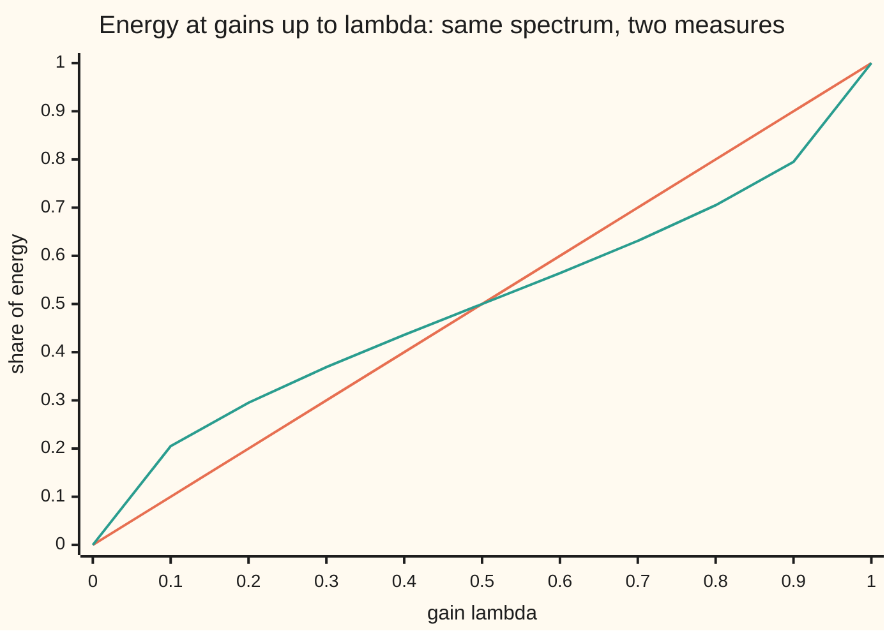

# Bounded and symmetric: diagonal against a family of projections, not eigenvectors

[Syllabus](../../../SYLLABUS.md) → [Functional analysis](../README.md) → [Bounded Operators](../README.md#s03) → Bounded and symmetric

---

## General Overview

Take a one-second audio clip and apply a **fade-in**. The sample at t seconds is multiplied by t. At 0 s the clip is silent, at 0.5 s it plays at half volume, at 1 s at full volume. Feed in the constant level 1, with energy 1: call it the steady note, a stand-in for a note held at one loudness. The faded clip keeps 0.333333 of that energy.

On a CD the second holds 44,100 samples, so the fade is a 44,100 × 44,100 diagonal matrix: sample k is multiplied by its own time. Each single sample is an **eigenvector**, a direction the operator only stretches. On the real clip, a signal in continuous time, that list disappears. A signal that the fade only stretches would have to be zero everywhere except at one instant, and one instant holds no energy. The fade has no eigenvectors at all.

Something does survive. For any set of gains, say 0.5 to 1, the fade has a "keep only that part" operation: keep the part of the clip where the gain lies in the set, silence the rest. For gains 0.5 to 1 that is the second half of the clip, and it holds 0.500000 of the steady note's energy. These keep-operations are the **spectral projections**. They do the job the eigenvectors did.

The **spectral theorem** says every bounded symmetric operator works the same way. After a change of variables it multiplies by a real function, exactly as the fade multiplies by t. The blur that averages each sample with its neighbours becomes multiplication by a function of frequency. Then a function of the operator is a function of the multiplier. The square root of the fade is the "equal-power" fade with gain $`\sqrt t`$. The square root of the blur is a half-blur, which gives the full blur when applied twice.

**A bounded self-adjoint operator is multiplication by a real function after a change of variables; its spectral projections, one for each set of values, replace the eigenvectors, and any bounded function of the operator is that function applied to the multiplier.**

**What kind of fact this is:** a theorem. It is proved on this card, in Why it works, for the fade and for the blur. The general case is stated, its proof is outlined in a fold, and the full proof is in Reed and Simon and in Hall (Sources).

### The picture: where the energy sits, by gain

Two operators with the same spectrum, the gains 0 to 1, spread a signal's energy differently over those gains. The fade acts on the steady note. The blur acts on a single click, one sample of size 1 and silence elsewhere. Each bar is the energy that a spectral projection keeps.

```
energy kept, by band of gains
[0.00, 0.25)  fade  ##########      0.250000
              blur  #############   0.333333
[0.25, 0.50)  fade  ##########      0.250000
              blur  #######         0.166667
[0.50, 0.75)  fade  ##########      0.250000
              blur  #######         0.166667
[0.75, 1.00)  fade  ##########      0.250000
              blur  #############   0.333333
```

The fade spreads the steady note evenly over its gains. The blur piles the click's energy near gain 0 and gain 1. Both totals are 1: every bit of energy sits at some gain.

---

## The formula

Notation first, in words:

- H is a **Hilbert space**: a space with an inner product $`\langle u, v\rangle`$, which conjugates its first slot, and no missing limits (it is complete). Here H is $`L^2(0,1)`$, the signals on the 1 s clip with finite **energy** $`\lVert u\rVert^2 = \int_0^1 \lvert u(t)\rvert^2\,dt`$.
- An operator T is **bounded** when $`\lVert Tu\rVert \le C\lVert u\rVert`$ for one constant C ([Bounded operators](01-bounded-operators-and-the-operator-norm.md)).
- T is **self-adjoint**, or symmetric, when $`\langle u, Tv\rangle = \langle Tu, v\rangle`$ for all signals ([Adjoints](03-adjoints-self-adjoint-and-unitary-operators.md)).
- Its **spectrum** $`\sigma(T)`$ is the set of numbers λ for which $`T - \lambda I`$ has no bounded inverse; I is the identity, which leaves every signal alone ([Spectrum](07-spectrum-and-resolvent.md)).

The theorem has two faces. The multiplication form:

```math
U\,T\,U^{-1} = M_g, \qquad (M_g\psi)(\theta) = g(\theta)\,\psi(\theta)
```

**Read it aloud:** change variables with U, and T becomes "multiply by the real function g".

The projection form, with what it says about one signal u:

```math
T = \int_{\sigma(T)} \lambda\, dP(\lambda), \qquad f(T) = \int_{\sigma(T)} f(\lambda)\, dP(\lambda), \qquad \langle u, f(T)\,u\rangle = \int_{\sigma(T)} f(\lambda)\, d\mu_u(\lambda)
```

**Read it aloud:** T is the sum of its values λ, each weighted by the projection that keeps the part of the space where T's value lies in a small band around λ; to apply f to T, apply f to each value instead; and the average of f(T) on a signal is the average of f against that signal's energy spread.

The two faces are linked by one rule. The projection for a set A of values is "keep the points θ where g(θ) lies in A":

```math
P_A = U^{-1} M_{\mathbf 1_A \circ g}\, U, \qquad \mu_u(A) = \langle u, P_A u\rangle = \lVert P_A u\rVert^2
```

Here $`\mathbf 1_A`$ is the indicator of A: 1 on A, 0 off it. A family $`P_A`$ like this is a **projection-valued measure**: each $`P_A`$ is a projection, and they add over disjoint sets just as a measure does.

| Symbol | Plain meaning | In our example | Push it up and the answer… |
| --- | --- | --- | --- |
| $`t`$ | position along the clip, in seconds | 0 to 1 s | the fade's gain rises with it |
| $`u`$, $`\varphi`$, $`\lVert u\rVert^2`$, $`\langle u, v\rangle`$ | signals; φ is a test spike of width w; energy; inner product | steady note u = 1, energy 1 | more energy, every $`\mu_u`$ scales up |
| $`T`$, $`M`$ | a bounded self-adjoint operator; M is the fade, $`(Mu)(t) = t\,u(t)`$ | the fade; the blur | — |
| $`\lambda`$ | a value of T: a gain | 0 to 1 | — |
| $`\sigma(T)`$, $`R(\lambda, T)`$ | the spectrum; the resolvent $`(\lambda I - T)^{-1}`$ off it | [0, 1] for the fade and the blur; $`\lVert R(1.2, M)\rVert = 5`$ | the resolvent grows near the spectrum |
| $`A`$, $`\mathbf 1_A`$, $`h`$ | a set of values; its indicator; the width of one band of values | the gains 0.5 to 1; bands of width h in Step 2 | bigger A, more energy kept |
| $`P_A`$, $`dP(\lambda)`$ | spectral projection: keeps the part where the value lies in A; $`dP(\lambda)`$, the projection for a thin band of values at λ, the piece the integral adds up | for the fade: multiply by 1 on the second half, 0 on the first | — |
| $`\mu_u`$ | spectral measure of u: the energy of u at each value | length on [0, 1] for the steady note; $`\mu_u([0.5, 1]) = 0.5`$ | — |
| $`f`$, $`f(T)`$, $`f_1`$, $`f_2`$ | a bounded function on the spectrum, and the operator it makes; $`f_1`$, $`f_2`$, two such functions in Step 3 | $`\sqrt\lambda`$: the equal-power fade, gain $`\sqrt t`$ | must stay bounded on $`\sigma(T)`$ |
| $`U`$, $`g`$, $`\Omega`$, $`\theta`$, $`\psi`$ | the change of variables (unitary: it keeps energy); the real multiplier; the space it lives on; a point of it; a function on it | blur: Fourier series, $`g(\xi) = \cos^2(\xi/2)`$ on $`\Omega = (-\pi, \pi)`$ | — |
| $`B`$, $`\xi`$, $`k`$ | the blur $`(u_{n-1} + 2u_n + u_{n+1})/4`$ on endless samples; frequency in radians per sample; number of blur passes | $`\langle \text{click}, B^{10}\,\text{click}\rangle = 0.176197`$ | more passes, smoother output |
| $`N`$, $`c_n`$ | samples in a truncation; the half-blur's weights | 44,100; $`c_0 = 0.636620`$ | — |

### When it holds

- **Self-adjoint.** The 2 × 2 matrix `[[0, 1], [0, 0]]` has spectrum {0}. Reading it through its spectrum alone says it is the zero operator. Its norm is 1.000000. Non-symmetric operators keep information the spectrum does not see.
- **Bounded.** The theorem as stated needs $`\lVert Tu\rVert \le C\lVert u\rVert`$. Minus the second derivative is unbounded: a fast wiggle of energy 1 comes out as large as wanted. It also has a spectral theorem, but only once its domain (the signals it may act on) is settled: that is [Self-adjoint extensions](../05-Unbounded%20Operators%20and%20Semigroups/02-self-adjoint-extensions-and-the-spectral-theorem.md).
- **f bounded on the spectrum.** The "unblur" $`f(\lambda) = 1/\lambda`$ blows up at gain 0. On the click, its average grows from 12.72 to 127.32 to 1273.24 as the cut-off moves closer to ξ = π, the frequency where the blur's gain is 0. No bounded unblur exists.
- **Real values.** Self-adjoint makes g real. A complex g gives a normal operator, one that commutes with its adjoint; its theorem has the same shape with σ(T) in the complex plane (Conway, Sources).

---

## Why it works

### Step 0: group the eigenvectors, then drop them

A symmetric matrix is $`Q D Q^{T}`$ ([Diagonalisation](../../03-Algebra/07-Eigenvalues%20and%20Symmetric%20Matrices/03-diagonalisation-and-matrix-powers.md)), with eigenvectors in the columns of Q and eigenvalues on the diagonal of D. Group the eigenvectors by eigenvalue. Each group spans a subspace, and the matrix is the sum of "eigenvalue times projection onto its subspace". A power of the matrix raises each eigenvalue to that power and keeps the projections.

In infinite dimensions single eigenvectors may not exist, as the fade shows. Projections onto "the part where the value lies in A" still exist for every set A. So the sum over eigenvalues becomes an integral over values, weighted by projections.

[Compact and symmetric](08-spectral-theorem-for-compact-self-adjoint-operators.md) is the middle step. A compact symmetric operator still has a list of eigenvectors, with eigenvalues falling to 0. This card drops compactness, and with it the list.

### Step 1: the fade has a spectrum but no eigenvalues

No eigenvalue. If $`t\,u(t) = \lambda\,u(t)`$ for almost every t (every t outside a set of length 0), then $`u(t) = 0`$ wherever $`t \ne \lambda`$. That leaves one instant, of length 0, so u has energy 0.

Every gain in [0, 1] is still in the spectrum. Take φ, a spike of width w centred at t = 0.5 with energy 1. Then $`\lVert (M - 0.5)\varphi\rVert = w/(2\sqrt 3)`$. The checks print 2.887e-02, 2.887e-03 and 2.887e-04 for widths 0.1, 0.01 and 0.001. Since φ has energy 1 and its image can be made as small as wanted, $`M - 0.5I`$ has no bounded inverse. The spike is an **approximate eigenvector**: the residual falls with the width but never reaches 0.

Outside [0, 1] the inverse exists. For λ = 1.2 the inverse multiplies by $`1/(1.2 - t)`$, which is at most 1/0.200000. So $`\lVert R(1.2, M)\rVert = 5.000000`$, and 1.2 is not in the spectrum.

### Step 2: the fade's projections form a measure

For a set A of gains, $`P_A`$ multiplies by $`\mathbf 1_A(t)`$. The rules are checked one line each:

- $`P_A^2 = P_A`$, since $`\mathbf 1_A^2 = \mathbf 1_A`$: keeping a part twice is keeping it once.
- $`P_A`$ is self-adjoint, since $`\mathbf 1_A`$ is real.
- $`P_A P_B = P_{A \cap B}`$, and $`P_{[0,1]} = I`$.
- For disjoint sets $`A_1, A_2, \dots`$, $`P_{\cup A_i} u = \sum P_{A_i} u`$ for every signal u.

The last rule makes $`\mu_u(A) = \lVert P_A u\rVert^2 = \int_A \lvert u(t)\rvert^2\,dt`$ a **measure** ([Measures](../../10-Measure%20and%20integration/01-Sets%20You%20Can%20Measure/04-measures.md)): a size that adds over countably many disjoint pieces. Its total is $`\lVert u\rVert^2`$. For the steady note it is length on [0, 1].

Cut [0, 1] into bands $`A_j`$ of width h, starting at $`\lambda_j`$. The sum $`\sum_j \lambda_j P_{A_j}`$ multiplies by a staircase that sits within h of t. So it is within h of M in operator norm. Letting h shrink is the integral $`M = \int \lambda\, dP(\lambda)`$.

### Step 3: functions of the fade

Now $`f(M)`$ multiplies by $`f(t)`$, for any bounded function f. The rules follow from the multiplier:

- $`(f_1 f_2)(M) = f_1(M)\,f_2(M)`$, since multipliers multiply.
- $`\lVert f(M)\rVert = \sup_{0 \le \lambda \le 1} \lvert f(\lambda)\rvert`$ for continuous f, the largest gain f gives on the spectrum.
- $`\langle u, f(M)\,u\rangle = \int_0^1 f(t)\,\lvert u(t)\rvert^2\,dt = \int f\, d\mu_u`$.

With $`f(\lambda) = \sqrt\lambda`$, $`\sqrt M`$ is the equal-power fade. It is the only positive operator, one with $`\langle u, Tu\rangle \ge 0`$ for every u, whose square is M. On the steady note, $`\lVert \sqrt M\,u\rVert^2 = \langle u, M u\rangle = 0.500000`$.

### Step 4: the blur is a fade in disguise

The blur B acts on endless sampled signals, sequences $`u_n`$ with finite energy $`\sum \lvert u_n\rvert^2`$. It is not a multiplication. Change variables with a Fourier series, $`(Uu)(\xi) = \sum_n u_n e^{-in\xi}/\sqrt{2\pi}`$, which keeps energy because sines and cosines are complete ([Completeness of sines and cosines](../02-Hilbert%20Spaces/04-completeness-of-the-trigonometric-system.md); [Plancherel](04-the-fourier-transform-as-a-unitary-operator.md) is the same fact for the transform on the line). A shift by one sample multiplies by $`e^{\pm i\xi}`$, so

```math
(U B u)(\xi) = \frac{e^{-i\xi} + 2 + e^{i\xi}}{4}\,(Uu)(\xi) = \cos^2(\xi/2)\,(Uu)(\xi)
```

**Read it aloud:** in frequency, the blur multiplies by cos squared of half the frequency: gain 1 at ξ = 0, gain 0 at ξ = ±π.

So $`g(\xi) = \cos^2(\xi/2)`$, and the spectrum is its range, [0, 1]. The blur has no eigenvector at gain 1 either: the constant signal it keeps has infinite energy.

The click has $`Uu = 1/\sqrt{2\pi}`$, flat in frequency. Its spectral measure is the share of frequencies whose gain lies in A. That is the arcsine law, with $`\mu([0, \lambda]) = (2/\pi)\arcsin\sqrt\lambda`$. Then $`\langle \text{click}, B^k\,\text{click}\rangle = \frac{1}{2\pi}\int_{-\pi}^{\pi} \cos^{2k}(\xi/2)\,d\xi = \binom{2k}{k}/4^k`$.



The straight line is the fade on the steady note: length on [0, 1]. The S-shaped line is the blur on the click: the arcsine law, steep at both ends.

Functions of the blur come for free. The half-blur $`\sqrt B`$ multiplies by $`\lvert\cos(\xi/2)\rvert`$. Its weights are the Fourier coefficients of that function:

```math
c_n = \frac{1}{2\pi}\int_{-\pi}^{\pi} \cos(\xi/2)\cos(n\xi)\,d\xi = \frac{2}{\pi}\cdot\frac{(-1)^n}{1 - 4n^2}
```

**Read it aloud:** the half-blur's weight n samples away is two over pi, times plus or minus one, over one minus four n squared.

The weights are 0.636620, 0.212207, −0.042441, 0.018189 for n = 0 to 3. They never stop and they change sign, though the blur's own weights are three positive numbers.

### Step 5: the general case

<details>
<summary>Outline of the proof for any bounded self-adjoint operator</summary>

The outline follows Reed and Simon, chapter VII, and Hall, chapters 7 and 8.

1. **Polynomials.** For a real polynomial p, $`p(T)`$ is self-adjoint and its spectrum is the set of values $`p(\lambda)`$ with λ in σ(T). For a self-adjoint operator the norm equals the largest $`\lvert\lambda\rvert`$ in the spectrum. So $`\lVert p(T)\rVert = \max \lvert p\rvert`$ on σ(T).

2. **Continuous functions.** By Weierstrass, polynomials approximate any continuous f on the closed bounded set σ(T). Item 1 makes the matching $`p(T)`$ converge in operator norm. Call the limit f(T).

3. **The measure.** For a fixed u, $`f \mapsto \langle u, f(T)u\rangle`$ is linear and non-negative on non-negative f. The Riesz-Markov theorem turns such a map into a measure $`\mu_u`$ on σ(T):

$`\displaystyle \langle u, f(T)\,u\rangle = \int_{\sigma(T)} f(\lambda)\,d\mu_u(\lambda).`$

4. **The change of variables.** Send $`f(T)u`$ to the function f in $`L^2(\sigma(T), \mu_u)`$. Item 3 with $`\lvert f\rvert^2`$ shows this keeps energy. There, T becomes multiplication by λ. That covers the closed span of the $`f(T)u`$; pick a new u perpendicular to it and repeat. The pieces are countable when H has a countable basis. Ω is their side-by-side union, and g is λ on each piece.

5. **Projections.** Define $`P_A`$ by multiplying by $`\mathbf 1_A(g)`$, and f(T) for any bounded measurable f by multiplying by $`f(g)`$.

</details>

The fade and the blur skip items 1 to 4 of the outline: each is already a multiplication, once U is known.

---

## Worked numbers, by hand

The steady note through the fade, then the click through the blur.

| Step | Arithmetic | Value |
| --- | --- | --- |
| fade's average gain on the steady note | $`\langle u, Mu\rangle = \int_0^1 t\,dt = 1/2`$ | 0.500000 |
| energy kept by $`P_{[0.5,1]}`$ | $`\mu_u([0.5, 1]) = \int_{0.5}^{1} 1\,dt`$ | 0.500000 |
| energy after the equal-power fade | $`\lVert\sqrt M u\rVert^2 = \int_0^1 (\sqrt t)^2\,dt`$ | 0.500000 |
| energy after the fade, 10 samples | $`(0.05^2 + 0.15^2 + \dots + 0.95^2)/10`$ | 0.332500 |
| energy after the fade, exact | $`\lVert Mu\rVert^2 = \int_0^1 t^2\,dt = 1/3`$ | **0.333333** |
| one blur on the click, centre | weights 1/4, 1/2, 1/4 | 0.500000 |
| energy after one blur | $`(1 + 4 + 1)/16 = \langle \text{click}, B^2\,\text{click}\rangle`$ | **0.375000** |
| the same by the multiplier | $`\frac{1}{2\pi}\int \cos^4(\xi/2)\,d\xi = \binom{4}{2}/16 = 6/16`$ | 0.375000 |
| half-blur centre weight | $`c_0 = 2/\pi`$ | 0.636620 |

The fade keeps a third of a steady note's energy. The blur keeps three eighths of a click's energy. The two operators share the spectrum [0, 1], so the spectrum alone cannot give these numbers. The spectral measure of the chosen signal does.

On 10 samples the fade's energy is short by exactly $`1/(12N^2)`$: 8.333e-04. At 44,100 samples the shortfall is 4.285e-11.

### What breaks if you drop a piece

| Mistake | Comes out at | What went wrong |
| --- | --- | --- |
| Hunting for an eigenvector of the fade at gain 0.5 | residual 2.887e-04 at width 0.001, and never 0 | The fade has none. Use the projections $`P_A`$ |
| Unblurring with $`f(\lambda) = 1/\lambda`$ | 12.72, 127.32, 1273.24 as the cut-off nears ξ = π | f is unbounded on the spectrum |
| Reading a non-symmetric matrix by its spectrum | `[[0, 1], [0, 0]]` looks like 0, but its norm is 1.000000 | The theorem needs self-adjoint |
| Using length on [0, 1] as the click's measure | $`\langle \text{click}, B^2\,\text{click}\rangle = 0.333333`$, not 0.375000 | The spectrum does not fix the measure |

---

## Code, from first principles, and it actually runs

The code holds only finite rehearsals: the fade on N samples, the blur on a click, the blur on N samples with silence past the ends. It takes four independent roads. Sums over samples are checked against closed-form integrals, with the error falling at the rate $`1/(12N^2)`$. The blur is applied by direct convolution, by a written-out integral of the multiplier and by the binomial formula. The half-blur's weights come from a numerical Fourier integral, against the closed form, and against the invariant "half-blur twice is the blur". The truncated blur matrix is diagonalised by a Jacobi eigenvalue solver, written out. Its eigenvalues are checked against $`\cos^2(j\pi/(2(N+1)))`$, and $`f(B) = Q f(D) Q^{T}`$ is checked against $`B \cdot B`$ and against $`(\sqrt B)^2 = B`$. The Jordan block is built in code: its trace and determinant are 0, so its spectrum is {0}, and Jacobi on the block's transpose times the block, multiplied out, gives its norm.

**What the truncation hides.** Every matrix here is diagonal in some basis: it has a full set of eigenvectors, and its spectrum is a finite list. The truncated blur's top eigenvalue is 0.969846, 0.991487 and 0.997736 at N = 8, 16 and 32: always an eigenvalue, always below 1. Only the trend shows the endless blur's spectrum filling [0, 1] with no eigenvector at 1. The spike residuals do the same for the fade.

### Python

```python
# Spectral theorem for bounded self-adjoint operators: the check behind the card.
# Standard library only. The code holds finite rehearsals: the fade on N samples,
# the blur on a click, the blur on N samples. Integrals and the eigen solver are written out.
import math

def close(a, b, tol, what):
    assert abs(a - b) <= tol, (what, a, b)

def sci(x):
    e = math.floor(math.log10(abs(x)))
    m = x / 10.0 ** e
    if abs(m) >= 9.9995:
        m, e = m / 10, e + 1
    return f"{m:.3f}e{e:+03d}"

def dot(xs, ys):  # a plain loop, so the additions run in the same order as in Rust
    s = 0.0
    for x, y in zip(xs, ys):
        s += x * y
    return s

def jacobi(a):  # eigenvalues, and eigenvectors as the columns of q, of a symmetric matrix
    n, a = len(a), [r[:] for r in a]
    q = [[1.0 if i == j else 0.0 for j in range(n)] for i in range(n)]
    for sweep in range(12):
        for p in range(n - 1):
            for r in range(p + 1, n):
                if abs(a[p][r]) < 1e-300:
                    continue
                th = (a[r][r] - a[p][p]) / (2 * a[p][r])
                t = (1.0 if th >= 0 else -1.0) / (abs(th) + math.sqrt(th * th + 1))
                c = 1 / math.sqrt(t * t + 1)
                s = t * c
                for m in (a, q):  # rotate columns p and r
                    for k in range(n):
                        m[k][p], m[k][r] = c * m[k][p] - s * m[k][r], s * m[k][p] + c * m[k][r]
                for k in range(n):  # rotate rows p and r of a
                    a[p][k], a[r][k] = c * a[p][k] - s * a[r][k], s * a[p][k] + c * a[r][k]
    return [a[i][i] for i in range(n)], q

blur = lambda N: [[0.5 if i == j else 0.25 if abs(i - j) == 1 else 0.0 for j in range(N)] for i in range(N)]

print("fade-in M: (M u)(t) = t u(t) on a 1 s clip; steady note u = 1, energy 1")
print("N      <u, M u>   |M u|^2    |P u|^2 (gains in [0.5, 1])   |M u|^2 - 1/3")
for N in (10, 100, 1000, 44100):
    a = b = c = 0.0
    for k in range(N):
        t = (k + 0.5) / N  # sample k sits mid-slot; each slot holds energy 1/N
        a += t / N
        b += t * t / N
        c += 1.0 / N if t >= 0.5 else 0.0
    print(f"{N:<6} {a:.6f}   {b:.6f}   {c:.6f}                      {sci(b - 1 / 3)}")
    close(b - 1 / 3, -1 / (12 * N * N), 1e-12, "midpoint error is -1/(12 N^2)")
    close(c, 0.5, 1e-9, "upper half of the gains holds half the energy")

print("no eigenvector: spike phi of width w at t = 0.5, energy 1; residual |(M - 0.5) phi|")
for w in (0.1, 0.01, 0.001):
    ts = [(k + 0.5) * w / 1000 - w / 2 for k in range(1000)]  # t - 0.5 across the spike
    r = math.sqrt(dot(ts, ts) / 1000)  # phi^2 = 1/w on the spike, slot width w/1000
    print(f"w = {w:<6} residual {sci(r)} (closed form w/(2 sqrt3) = {sci(w / (2 * math.sqrt(3)))})")
    close(r / (w / (2 * math.sqrt(3))), 1.0, 1e-5, "spike residual")
d = min(abs(k / 1000 - 1.2) for k in range(1001))
print(f"lambda = 1.2: distance to the gains [0, 1] = {d:.6f}, so |R(1.2, M)| = {1 / d:.6f}")
close(1 / d, 5.0, 1e-9, "resolvent norm outside the spectrum")

G = 60000  # midpoint grid on the frequency circle (-pi, pi); the click has flat energy 1/G per point
xi = [-math.pi + (j + 0.5) * 2 * math.pi / G for j in range(G)]
g = [math.cos(x / 2) * math.cos(x / 2) for x in xi]  # the blur's multiplier cos^2(xi/2)
print("energy by gain band   fade, steady note   blur, click (grid)   blur, click (exact)")
for lo, hi in ((0, 0.25), (0.25, 0.5), (0.5, 0.75), (0.75, 1.0)):
    grid = len([v for v in g if lo <= v < hi or v == hi == 1.0])
    exact = 2 / math.pi * (math.asin(math.sqrt(hi)) - math.asin(math.sqrt(lo)))
    print(f"[{lo:.2f}, {hi:.2f})         {hi - lo:.6f}            {grid / G:.6f}             {exact:.6f}")
    close(grid / G, exact, 1e-4, "click's spectral measure is the arcsine law")

print("blur B: (B u)_n = (u_(n-1) + 2 u_n + u_(n+1))/4 on a click; <click, B^k click>")
print("k    direct conv.   spectral integral   C(2k,k)/4^k")
for k in (1, 2, 10):
    u = [1.0]
    for _ in range(k):
        u = [0.0, 0.0] + u + [0.0, 0.0]
        u = [(u[i - 1] + 2 * u[i] + u[i + 1]) / 4 for i in range(1, len(u) - 1)]
    spec = 0.0
    for v in g:
        spec += v ** k / G
    binom = math.comb(2 * k, k) / 4 ** k
    print(f"{k:<4} {u[len(u) // 2]:.6f}       {spec:.6f}            {binom:.6f}")
    close(u[len(u) // 2], binom, 1e-12, "convolution vs binomial")
    close(spec, binom, 1e-9, "spectral integral vs binomial")

print("half-blur sqrt(B): kernel c_n = (1/2pi) int sqrt(g) cos(n xi) dxi")
c = lambda n: 2 / math.pi * (-1) ** n / (1 - 4 * n * n)
for n in range(4):
    num = dot([math.sqrt(v) / G for v in g], [math.cos(n * x) for x in xi])
    print(f"c_{n} = {num:.6f} (closed form (2/pi)(-1)^n/(1 - 4n^2) = {c(n):.6f})")
    close(num, c(n), 1e-8, "half-blur kernel")
print("K      (c*c)_0 - 1/2   (c*c)_1 - 1/4   (kernel cut to |n| <= K)")
for K in (10, 100, 1000):
    s0 = dot([c(n) for n in range(-K, K + 1)], [c(n) for n in range(-K, K + 1)])
    s1 = dot([c(n) for n in range(1 - K, K + 1)], [c(1 - n) for n in range(1 - K, K + 1)])
    print(f"{K:<6} {sci(s0 - 0.5)}      {sci(s1 - 0.25)}")
    close(s0, 0.5, 1 / K ** 3, "half-blur twice is the blur, centre")
    close(s1, 0.25, 1 / K ** 3, "half-blur twice is the blur, neighbour")

print("blur on N samples, zero past the ends: Jacobi eigenvalues against cos^2(j pi/(2(N+1)))")
for N in (8, 16, 32):
    lam, Q = jacobi(blur(N))
    exact = sorted(math.cos(j * math.pi / (2 * N + 2)) ** 2 for j in range(1, N + 1))
    close(max(abs(x - y) for x, y in zip(sorted(lam), exact)), 0.0, 1e-12, "Jacobi vs closed form")
    print(f"N = {N:<3} top {max(lam):.6f}, 1 - top {1 - max(lam):.6f}, every eigenvalue matches to 1e-12")
f = lambda h: [[dot([Q[i][k] * h(lam[k]) for k in range(N)], [Q[j][k] for k in range(N)]) for j in range(N)] for i in range(N)]
mul = lambda X, Y: [[dot(X[i], [Y[k][j] for k in range(N)]) for j in range(N)] for i in range(N)]
B, R, F2 = blur(N), f(math.sqrt), f(lambda x: x * x)
BB, RR = mul(B, B), mul(R, R)
err = max(abs(F2[i][j] - BB[i][j]) + abs(RR[i][j] - B[i][j]) for i in range(N) for j in range(N))
close(err, 0.0, 1e-12, "functions through the eigenvectors")
print(f"N = 32: Q L^2 Q^T = B B and (Q sqrt(L) Q^T)^2 = B to 1e-12; half-blur centre {R[15][15]:.6f}")

print("what breaks")
for eps in (0.1, 0.01, 0.001):
    n, top, s = 400000, math.pi - eps, 0.0
    for j in range(n):
        x = (j + 0.5) * top / n
        s += 1 / (math.cos(x / 2) ** 2) * top / n / math.pi
    exact = 2 / math.pi / math.tan(eps / 2)
    print(f"unblur 1/lambda, cut {eps} from xi = pi: {s:.2f} (closed form (2/pi)cot(eps/2) = {exact:.2f})")
    close(s / exact, 1.0, 1e-3, "unblur blows up")
T = [[0.0, 1.0], [0.0, 0.0]]  # the Jordan block: not symmetric
TtT = [[dot([T[0][i], T[1][i]], [T[0][j], T[1][j]]) for j in range(2)] for i in range(2)]  # T^T T, multiplied out
tr, det, nJ = T[0][0] + T[1][1], T[0][0] * T[1][1] - T[0][1] * T[1][0], math.sqrt(max(jacobi(TtT)[0]))
print(f"Jordan block [[0, 1], [0, 0]]: trace {tr:.1f}, det {det:.1f}, so spectrum {{0}}, but its norm is sqrt(top of T^T T) = {nJ:.6f}")
close(abs(tr) + abs(det), 0.0, 0.0, "trace 0 and det 0: both eigenvalues are 0")
close(nJ, 1.0, 1e-12, "non-symmetric norm")
print(f"blur's click with length on [0, 1] as its measure: {b:.6f}, not {dot(g, g) / G:.6f}")  # b: t^2 against length, N = 44100
close(dot(g, g) / G - b, 0.375 - 1 / 3, 1e-9, "length is not the click's measure")

print("chart: cumulative spectral measure at lambda = 0, 0.1, ..., 1")
print("fade, steady note: " + ", ".join(f"{j / 10:.3f}" for j in range(11)))
print("blur, click:       " + ", ".join(f"{2 / math.pi * math.asin(math.sqrt(j / 10)):.3f}" for j in range(11)))
print("ALL CHECKS PASS")
```

**Ran 2026-11-15 on macOS, Python 3.14.10, standard library only. All checks passed. Output, pasted from the run:**

```
fade-in M: (M u)(t) = t u(t) on a 1 s clip; steady note u = 1, energy 1
N      <u, M u>   |M u|^2    |P u|^2 (gains in [0.5, 1])   |M u|^2 - 1/3
10     0.500000   0.332500   0.500000                      -8.333e-04
100    0.500000   0.333325   0.500000                      -8.333e-06
1000   0.500000   0.333333   0.500000                      -8.333e-08
44100  0.500000   0.333333   0.500000                      -4.285e-11
no eigenvector: spike phi of width w at t = 0.5, energy 1; residual |(M - 0.5) phi|
w = 0.1    residual 2.887e-02 (closed form w/(2 sqrt3) = 2.887e-02)
w = 0.01   residual 2.887e-03 (closed form w/(2 sqrt3) = 2.887e-03)
w = 0.001  residual 2.887e-04 (closed form w/(2 sqrt3) = 2.887e-04)
lambda = 1.2: distance to the gains [0, 1] = 0.200000, so |R(1.2, M)| = 5.000000
energy by gain band   fade, steady note   blur, click (grid)   blur, click (exact)
[0.00, 0.25)         0.250000            0.333333             0.333333
[0.25, 0.50)         0.250000            0.166667             0.166667
[0.50, 0.75)         0.250000            0.166667             0.166667
[0.75, 1.00)         0.250000            0.333333             0.333333
blur B: (B u)_n = (u_(n-1) + 2 u_n + u_(n+1))/4 on a click; <click, B^k click>
k    direct conv.   spectral integral   C(2k,k)/4^k
1    0.500000       0.500000            0.500000
2    0.375000       0.375000            0.375000
10   0.176197       0.176197            0.176197
half-blur sqrt(B): kernel c_n = (1/2pi) int sqrt(g) cos(n xi) dxi
c_0 = 0.636620 (closed form (2/pi)(-1)^n/(1 - 4n^2) = 0.636620)
c_1 = 0.212207 (closed form (2/pi)(-1)^n/(1 - 4n^2) = 0.212207)
c_2 = -0.042441 (closed form (2/pi)(-1)^n/(1 - 4n^2) = -0.042441)
c_3 = 0.018189 (closed form (2/pi)(-1)^n/(1 - 4n^2) = 0.018189)
K      (c*c)_0 - 1/2   (c*c)_1 - 1/4   (kernel cut to |n| <= K)
10     -1.456e-05      1.690e-05
100    -1.664e-08      1.689e-08
1000   -1.686e-11      1.689e-11
blur on N samples, zero past the ends: Jacobi eigenvalues against cos^2(j pi/(2(N+1)))
N = 8   top 0.969846, 1 - top 0.030154, every eigenvalue matches to 1e-12
N = 16  top 0.991487, 1 - top 0.008513, every eigenvalue matches to 1e-12
N = 32  top 0.997736, 1 - top 0.002264, every eigenvalue matches to 1e-12
N = 32: Q L^2 Q^T = B B and (Q sqrt(L) Q^T)^2 = B to 1e-12; half-blur centre 0.636861
what breaks
unblur 1/lambda, cut 0.1 from xi = pi: 12.72 (closed form (2/pi)cot(eps/2) = 12.72)
unblur 1/lambda, cut 0.01 from xi = pi: 127.32 (closed form (2/pi)cot(eps/2) = 127.32)
unblur 1/lambda, cut 0.001 from xi = pi: 1273.23 (closed form (2/pi)cot(eps/2) = 1273.24)
Jordan block [[0, 1], [0, 0]]: trace 0.0, det 0.0, so spectrum {0}, but its norm is sqrt(top of T^T T) = 1.000000
blur's click with length on [0, 1] as its measure: 0.333333, not 0.375000
chart: cumulative spectral measure at lambda = 0, 0.1, ..., 1
fade, steady note: 0.000, 0.100, 0.200, 0.300, 0.400, 0.500, 0.600, 0.700, 0.800, 0.900, 1.000
blur, click:       0.000, 0.205, 0.295, 0.369, 0.436, 0.500, 0.564, 0.631, 0.705, 0.795, 1.000
ALL CHECKS PASS
```

### Rust

```rust
// Spectral theorem for bounded self-adjoint operators: the check behind the card.
// Standard library only. The code holds finite rehearsals: the fade on N samples,
// the blur on a click, the blur on N samples. Integrals and the eigen solver are written out.
use std::f64::consts::PI;
type Mat = Vec<Vec<f64>>;
fn close(a: f64, b: f64, tol: f64, what: &str) { assert!((a - b).abs() <= tol, "{}: {} vs {}", what, a, b); }
fn sci(x: f64) -> String {
    let mut e = x.abs().log10().floor() as i32;
    let mut m = x / 10f64.powf(e as f64);
    if m.abs() >= 9.9995 { m /= 10.0; e += 1; }
    format!("{:.3}e{:+03}", m, e)
}
// a plain loop, so the additions run in the same order as in Python
fn dot(xs: &[f64], ys: &[f64]) -> f64 {
    let mut s = 0.0;
    for (x, y) in xs.iter().zip(ys) { s += x * y; }
    s
}
// eigenvalues, and eigenvectors as the columns of q, of a symmetric matrix
fn jacobi(a0: &Mat) -> (Vec<f64>, Mat) {
    let n = a0.len();
    let mut a = a0.clone();
    let mut q: Mat = (0..n).map(|i| (0..n).map(|j| if i == j { 1.0 } else { 0.0 }).collect()).collect();
    for _sweep in 0..12 {
        for p in 0..n - 1 {
            for r in p + 1..n {
                if a[p][r].abs() < 1e-300 { continue; }
                let th = (a[r][r] - a[p][p]) / (2.0 * a[p][r]);
                let t = (if th >= 0.0 { 1.0 } else { -1.0 }) / (th.abs() + (th * th + 1.0).sqrt());
                let c = 1.0 / (t * t + 1.0).sqrt();
                let s = t * c;
                for m in [&mut a, &mut q] {
                    for k in 0..n { let (x, y) = (m[k][p], m[k][r]); m[k][p] = c * x - s * y; m[k][r] = s * x + c * y; }
                }
                for k in 0..n { let (x, y) = (a[p][k], a[r][k]); a[p][k] = c * x - s * y; a[r][k] = s * x + c * y; }
            }
        }
    }
    ((0..n).map(|i| a[i][i]).collect(), q)
}
fn blur(n: usize) -> Mat {
    (0..n).map(|i| (0..n).map(|j| if i == j { 0.5 } else if i.abs_diff(j) == 1 { 0.25 } else { 0.0 }).collect()).collect()
}
fn mul(x: &Mat, y: &Mat) -> Mat {
    let n = x.len();
    (0..n).map(|i| (0..n).map(|j| dot(&x[i], &(0..n).map(|k| y[k][j]).collect::<Vec<_>>())).collect()).collect()
}
fn c(n: i64) -> f64 { 2.0 / PI * (if n % 2 == 0 { 1.0 } else { -1.0 }) / (1 - 4 * n * n) as f64 }
fn top(v: &[f64]) -> f64 { v.iter().cloned().fold(f64::MIN, f64::max) }
fn main() {
    println!("fade-in M: (M u)(t) = t u(t) on a 1 s clip; steady note u = 1, energy 1");
    println!("N      <u, M u>   |M u|^2    |P u|^2 (gains in [0.5, 1])   |M u|^2 - 1/3");
    let mut len2 = 0.0f64; // |M u|^2 at N = 44100: lambda^2 against length
    for n in [10usize, 100, 1000, 44100] {
        let nf = n as f64;
        let (mut a, mut b, mut cc) = (0.0f64, 0.0f64, 0.0f64);
        for k in 0..n {
            let t = (k as f64 + 0.5) / nf; // sample k sits mid-slot; each slot holds energy 1/N
            a += t / nf;
            b += t * t / nf;
            cc += if t >= 0.5 { 1.0 / nf } else { 0.0 };
        }
        println!("{:<6} {:.6}   {:.6}   {:.6}                      {}", n, a, b, cc, sci(b - 1.0 / 3.0));
        close(b - 1.0 / 3.0, -1.0 / (12.0 * nf * nf), 1e-12, "midpoint error is -1/(12 N^2)");
        close(cc, 0.5, 1e-9, "upper half of the gains holds half the energy");
        len2 = b;
    }
    println!("no eigenvector: spike phi of width w at t = 0.5, energy 1; residual |(M - 0.5) phi|");
    for w in [0.1f64, 0.01, 0.001] {
        let ts: Vec<f64> = (0..1000).map(|k| (k as f64 + 0.5) * w / 1000.0 - w / 2.0).collect();
        let r = (dot(&ts, &ts) / 1000.0).sqrt(); // phi^2 = 1/w on the spike, slot width w/1000
        let ex = w / (2.0 * 3f64.sqrt());
        println!("w = {:<6} residual {} (closed form w/(2 sqrt3) = {})", w, sci(r), sci(ex));
        close(r / ex, 1.0, 1e-5, "spike residual");
    }
    let d = (0..1001).map(|k| (k as f64 / 1000.0 - 1.2).abs()).fold(f64::INFINITY, f64::min);
    println!("lambda = 1.2: distance to the gains [0, 1] = {:.6}, so |R(1.2, M)| = {:.6}", d, 1.0 / d);
    close(1.0 / d, 5.0, 1e-9, "resolvent norm outside the spectrum");
    let (gn, gf) = (60000usize, 60000.0f64); // midpoint grid on the frequency circle (-pi, pi)
    let xi: Vec<f64> = (0..gn).map(|j| -PI + (j as f64 + 0.5) * 2.0 * PI / gf).collect();
    let g: Vec<f64> = xi.iter().map(|x| (x / 2.0).cos() * (x / 2.0).cos()).collect(); // cos^2(xi/2)
    println!("energy by gain band   fade, steady note   blur, click (grid)   blur, click (exact)");
    for (lo, hi) in [(0.0f64, 0.25f64), (0.25, 0.5), (0.5, 0.75), (0.75, 1.0)] {
        let grid = g.iter().filter(|&&v| (lo <= v && v < hi) || (v == hi && hi == 1.0)).count() as f64;
        let exact = 2.0 / PI * (hi.sqrt().asin() - lo.sqrt().asin());
        println!("[{:.2}, {:.2})         {:.6}            {:.6}             {:.6}", lo, hi, hi - lo, grid / gf, exact);
        close(grid / gf, exact, 1e-4, "click's spectral measure is the arcsine law");
    }
    println!("blur B: (B u)_n = (u_(n-1) + 2 u_n + u_(n+1))/4 on a click; <click, B^k click>");
    println!("k    direct conv.   spectral integral   C(2k,k)/4^k");
    for k in [1i32, 2, 10] {
        let mut u = vec![1.0f64];
        for _ in 0..k {
            let p: Vec<f64> = [vec![0.0, 0.0], u.clone(), vec![0.0, 0.0]].concat();
            u = (1..p.len() - 1).map(|i| (p[i - 1] + 2.0 * p[i] + p[i + 1]) / 4.0).collect();
        }
        let mut spec = 0.0;
        for v in &g { spec += v.powf(k as f64) / gf; }
        let mut binom = 1.0f64;
        for i in 0..k { binom = binom * (2 * k - i) as f64 / (i + 1) as f64; }
        binom /= 4f64.powi(k);
        let mid = u[u.len() / 2];
        println!("{:<4} {:.6}       {:.6}            {:.6}", k, mid, spec, binom);
        close(mid, binom, 1e-12, "convolution vs binomial");
        close(spec, binom, 1e-9, "spectral integral vs binomial");
    }
    println!("half-blur sqrt(B): kernel c_n = (1/2pi) int sqrt(g) cos(n xi) dxi");
    for n in 0..4i64 {
        let xs: Vec<f64> = g.iter().map(|v| v.sqrt() / gf).collect();
        let num = dot(&xs, &xi.iter().map(|x| (n as f64 * x).cos()).collect::<Vec<_>>());
        println!("c_{} = {:.6} (closed form (2/pi)(-1)^n/(1 - 4n^2) = {:.6})", n, num, c(n));
        close(num, c(n), 1e-8, "half-blur kernel");
    }
    println!("K      (c*c)_0 - 1/2   (c*c)_1 - 1/4   (kernel cut to |n| <= K)");
    for kk in [10i64, 100, 1000] {
        let v0: Vec<f64> = (-kk..=kk).map(c).collect();
        let s0 = dot(&v0, &v0);
        let a1: Vec<f64> = (1 - kk..=kk).map(c).collect();
        let s1 = dot(&a1, &(1 - kk..=kk).map(|n| c(1 - n)).collect::<Vec<_>>());
        println!("{:<6} {}      {}", kk, sci(s0 - 0.5), sci(s1 - 0.25));
        close(s0, 0.5, 1.0 / (kk * kk * kk) as f64, "half-blur twice is the blur, centre");
        close(s1, 0.25, 1.0 / (kk * kk * kk) as f64, "half-blur twice is the blur, neighbour");
    }
    println!("blur on N samples, zero past the ends: Jacobi eigenvalues against cos^2(j pi/(2(N+1)))");
    let (mut lam, mut q, mut nn) = (vec![], vec![], 0usize);
    for n in [8usize, 16, 32] {
        (lam, q, nn) = { let (l, qq) = jacobi(&blur(n)); (l, qq, n) };
        let mut s = lam.clone();
        s.sort_by(|x, y| x.partial_cmp(y).unwrap());
        let mut ex: Vec<f64> = (1..=n).map(|j| (j as f64 * PI / (2 * n + 2) as f64).cos().powf(2.0)).collect();
        ex.sort_by(|x, y| x.partial_cmp(y).unwrap());
        close(s.iter().zip(&ex).map(|(x, y)| (x - y).abs()).fold(0.0, f64::max), 0.0, 1e-12, "Jacobi vs closed form");
        println!("N = {:<3} top {:.6}, 1 - top {:.6}, every eigenvalue matches to 1e-12", n, top(&lam), 1.0 - top(&lam));
    }
    let f = |h: &dyn Fn(f64) -> f64| -> Mat {
        let row = |i: usize| (0..nn).map(|k| q[i][k] * h(lam[k])).collect::<Vec<_>>();
        (0..nn).map(|i| (0..nn).map(|j| dot(&row(i), &(0..nn).map(|k| q[j][k]).collect::<Vec<_>>())).collect()).collect()
    };
    let (b, r, f2) = (blur(nn), f(&|x: f64| x.sqrt()), f(&|x: f64| x * x));
    let (bb, rr) = (mul(&b, &b), mul(&r, &r));
    let mut err = 0.0f64;
    for i in 0..nn { for j in 0..nn { err = err.max((f2[i][j] - bb[i][j]).abs() + (rr[i][j] - b[i][j]).abs()); } }
    close(err, 0.0, 1e-12, "functions through the eigenvectors");
    println!("N = 32: Q L^2 Q^T = B B and (Q sqrt(L) Q^T)^2 = B to 1e-12; half-blur centre {:.6}", r[15][15]);
    println!("what breaks");
    for eps in [0.1f64, 0.01, 0.001] {
        let (n, tp, mut s) = (400000.0f64, PI - eps, 0.0f64);
        for j in 0..400000 {
            let x = (j as f64 + 0.5) * tp / n;
            s += 1.0 / (x / 2.0).cos().powf(2.0) * tp / n / PI;
        }
        let exact = 2.0 / PI / (eps / 2.0).tan();
        println!("unblur 1/lambda, cut {} from xi = pi: {:.2} (closed form (2/pi)cot(eps/2) = {:.2})", eps, s, exact);
        close(s / exact, 1.0, 1e-3, "unblur blows up");
    }
    let tj = [[0.0f64, 1.0], [0.0, 0.0]]; // the Jordan block: not symmetric
    let ttt: Mat = (0..2).map(|i| (0..2).map(|j| dot(&[tj[0][i], tj[1][i]], &[tj[0][j], tj[1][j]])).collect()).collect(); // T^T T
    let (tr, det, nj) = (tj[0][0] + tj[1][1], tj[0][0] * tj[1][1] - tj[0][1] * tj[1][0], top(&jacobi(&ttt).0).sqrt());
    println!("Jordan block [[0, 1], [0, 0]]: trace {:.1}, det {:.1}, so spectrum {{0}}, but its norm is sqrt(top of T^T T) = {:.6}", tr, det, nj);
    close(tr.abs() + det.abs(), 0.0, 0.0, "trace 0 and det 0: both eigenvalues are 0");
    close(nj, 1.0, 1e-12, "non-symmetric norm");
    let right = dot(&g, &g) / gf; // lambda^2 against the click's measure
    println!("blur's click with length on [0, 1] as its measure: {:.6}, not {:.6}", len2, right);
    close(right - len2, 0.375 - 1.0 / 3.0, 1e-9, "length is not the click's measure");
    println!("chart: cumulative spectral measure at lambda = 0, 0.1, ..., 1");
    let fade: Vec<String> = (0..11).map(|j| format!("{:.3}", j as f64 / 10.0)).collect();
    let bl: Vec<String> = (0..11).map(|j| format!("{:.3}", 2.0 / PI * (j as f64 / 10.0).sqrt().asin())).collect();
    println!("fade, steady note: {}\nblur, click:       {}", fade.join(", "), bl.join(", "));
    println!("ALL CHECKS PASS");
}
```

**Ran 2026-11-15 on macOS, rustc 1.98.1, no crates. All checks passed. Output, pasted from the run:**

```
fade-in M: (M u)(t) = t u(t) on a 1 s clip; steady note u = 1, energy 1
N      <u, M u>   |M u|^2    |P u|^2 (gains in [0.5, 1])   |M u|^2 - 1/3
10     0.500000   0.332500   0.500000                      -8.333e-04
100    0.500000   0.333325   0.500000                      -8.333e-06
1000   0.500000   0.333333   0.500000                      -8.333e-08
44100  0.500000   0.333333   0.500000                      -4.285e-11
no eigenvector: spike phi of width w at t = 0.5, energy 1; residual |(M - 0.5) phi|
w = 0.1    residual 2.887e-02 (closed form w/(2 sqrt3) = 2.887e-02)
w = 0.01   residual 2.887e-03 (closed form w/(2 sqrt3) = 2.887e-03)
w = 0.001  residual 2.887e-04 (closed form w/(2 sqrt3) = 2.887e-04)
lambda = 1.2: distance to the gains [0, 1] = 0.200000, so |R(1.2, M)| = 5.000000
energy by gain band   fade, steady note   blur, click (grid)   blur, click (exact)
[0.00, 0.25)         0.250000            0.333333             0.333333
[0.25, 0.50)         0.250000            0.166667             0.166667
[0.50, 0.75)         0.250000            0.166667             0.166667
[0.75, 1.00)         0.250000            0.333333             0.333333
blur B: (B u)_n = (u_(n-1) + 2 u_n + u_(n+1))/4 on a click; <click, B^k click>
k    direct conv.   spectral integral   C(2k,k)/4^k
1    0.500000       0.500000            0.500000
2    0.375000       0.375000            0.375000
10   0.176197       0.176197            0.176197
half-blur sqrt(B): kernel c_n = (1/2pi) int sqrt(g) cos(n xi) dxi
c_0 = 0.636620 (closed form (2/pi)(-1)^n/(1 - 4n^2) = 0.636620)
c_1 = 0.212207 (closed form (2/pi)(-1)^n/(1 - 4n^2) = 0.212207)
c_2 = -0.042441 (closed form (2/pi)(-1)^n/(1 - 4n^2) = -0.042441)
c_3 = 0.018189 (closed form (2/pi)(-1)^n/(1 - 4n^2) = 0.018189)
K      (c*c)_0 - 1/2   (c*c)_1 - 1/4   (kernel cut to |n| <= K)
10     -1.456e-05      1.690e-05
100    -1.664e-08      1.689e-08
1000   -1.686e-11      1.689e-11
blur on N samples, zero past the ends: Jacobi eigenvalues against cos^2(j pi/(2(N+1)))
N = 8   top 0.969846, 1 - top 0.030154, every eigenvalue matches to 1e-12
N = 16  top 0.991487, 1 - top 0.008513, every eigenvalue matches to 1e-12
N = 32  top 0.997736, 1 - top 0.002264, every eigenvalue matches to 1e-12
N = 32: Q L^2 Q^T = B B and (Q sqrt(L) Q^T)^2 = B to 1e-12; half-blur centre 0.636861
what breaks
unblur 1/lambda, cut 0.1 from xi = pi: 12.72 (closed form (2/pi)cot(eps/2) = 12.72)
unblur 1/lambda, cut 0.01 from xi = pi: 127.32 (closed form (2/pi)cot(eps/2) = 127.32)
unblur 1/lambda, cut 0.001 from xi = pi: 1273.23 (closed form (2/pi)cot(eps/2) = 1273.24)
Jordan block [[0, 1], [0, 0]]: trace 0.0, det 0.0, so spectrum {0}, but its norm is sqrt(top of T^T T) = 1.000000
blur's click with length on [0, 1] as its measure: 0.333333, not 0.375000
chart: cumulative spectral measure at lambda = 0, 0.1, ..., 1
fade, steady note: 0.000, 0.100, 0.200, 0.300, 0.400, 0.500, 0.600, 0.700, 0.800, 0.900, 1.000
blur, click:       0.000, 0.205, 0.295, 0.369, 0.436, 0.500, 0.564, 0.631, 0.705, 0.795, 1.000
ALL CHECKS PASS
```

### Lean

Lean proves the spectral theorem for every bounded self-adjoint operator, with f(T) for continuous f, plus the fade's two facts and the worked numbers.

- Take a bounded self-adjoint operator T on a Hilbert space H. Then an energy-keeping U, onto signals of finite energy on some space Ω, gives $`U T U^{-1} = M_g`$. The real multiplier g takes every value $`g(\theta)`$ in $`\sigma(T)`$.
- Suppose this U turns T into $`M_g`$, and f is a real function, continuous on $`\sigma(T)`$. Then the same U turns f(T) into multiplication by $`f(g(\theta))`$.
- Suppose a signal u on the clip has $`t\,u(t) = \lambda\,u(t)`$ for almost every t, with λ real. Then u = 0, so the fade has no eigenvectors.
- Take a gain λ in [0, 1]. Then signals u of energy 1 make $`\lVert (M - \lambda I)u\rVert`$ as small as wanted: approximate eigenvectors.
- The fade's average gain on the steady note is exactly $`\int_0^1 t\,dt = 1/2`$.
- The steady note's energy after the fade is exactly $`\int_0^1 t^2\,dt = 1/3`$.
- On 10 samples that energy is 0.3325, short of 1/3 by exactly $`1/(12 \cdot 10^2)`$.
- The click's energy after one blur is $`(1 + 4 + 1)/16 = \binom{4}{2}/4^2 = 3/8`$.
- The ten-pass number $`\binom{20}{10}/4^{10}`$ is exactly 46189/262144, which is 0.176197 to six places.

The blur's multiplier, the arcsine law, the half-blur's weights and the truncations are left to the Python and Rust checks.

```lean
-- Bounded and symmetric: every bounded self-adjoint operator on a complex Hilbert space is multiplication by a real function after an energy-keeping change of variables, functions of it are functions of the multiplier, and the fade has no eigenvectors.
import Mathlib.Analysis.CStarAlgebra.ContinuousLinearMap
import Mathlib.Analysis.CStarAlgebra.ContinuousFunctionalCalculus.Basic
import Mathlib.Analysis.CStarAlgebra.ContinuousFunctionalCalculus.Instances
import Mathlib.MeasureTheory.Function.L2Space
import Mathlib.Analysis.SpecialFunctions.Integrals.Basic
import Mathlib.MeasureTheory.Integral.RieszMarkovKakutani.Real
import Mathlib.MeasureTheory.Function.ContinuousMapDense
import Mathlib.Analysis.Normed.Operator.Extend
import Mathlib.Analysis.InnerProductSpace.l2Space
import Mathlib.Topology.ContinuousMap.StoneWeierstrass
import Mathlib.MeasureTheory.Function.ConvergenceInMeasure

open MeasureTheory

universe u

section Helpers

open Filter Topology
open scoped ENNReal ComplexConjugate CompactlySupported

section Slices
variable {ι X : Type*} [MeasurableSpace ι] [MeasurableSingletonClass ι] [MeasurableSpace X]
  (M : ι → Measure X)

/-- The disjoint-union measure on `ι × X`. -/
noncomputable def sumMeas : Measure (ι × X) := Measure.sum (fun i => (M i).map (Prod.mk i))

theorem measurableSet_slice (i : ι) : MeasurableSet ({i} ×ˢ Set.univ : Set (ι × X)) :=
  (measurableSet_singleton i).prod MeasurableSet.univ

theorem sumMeas_restrict (i : ι) :
    (sumMeas M).restrict ({i} ×ˢ Set.univ) = (M i).map (Prod.mk i) := by
  ext A hA
  rw [Measure.restrict_apply hA, sumMeas,
    Measure.sum_apply _ (hA.inter (measurableSet_slice i)), tsum_eq_single i]
  · rw [Measure.map_apply measurable_prodMk_left (hA.inter (measurableSet_slice i)),
      Measure.map_apply measurable_prodMk_left hA]
    congr 1; ext x; simp
  · intro j hj
    rw [Measure.map_apply measurable_prodMk_left (hA.inter (measurableSet_slice i))]
    convert measure_empty (μ := M j)
    ext x; simp [hj]

theorem ae_slice {i : ι} {P : X → Prop} (h : ∀ᵐ x ∂M i, P x) :
    ∀ᵐ ω ∂sumMeas M, ω.1 = i → P ω.2 := by
  rw [ae_iff] at h ⊢
  have hsub : {ω : ι × X | ¬(ω.1 = i → P ω.2)} ⊆ Prod.mk i '' {x | ¬P x} := by
    rintro ⟨j, x⟩ hω
    simp only [Set.mem_setOf_eq, not_imp] at hω
    obtain ⟨rfl, hx⟩ := hω
    exact ⟨x, hx, rfl⟩
  refine measure_mono_null hsub ?_
  have hS : Prod.mk i '' {x | ¬P x} ⊆ {i} ×ˢ Set.univ := by rintro _ ⟨x, -, rfl⟩; simp
  rw [← Set.inter_eq_left.mpr hS, ← Measure.restrict_apply' (measurableSet_slice i),
    sumMeas_restrict, (measurableEmbedding_prodMk_left i).map_apply,
    Set.preimage_image_eq _ (Prod.mk_right_injective i)]
  exact h

theorem lintegral_sumMeas (f : ι × X → ℝ≥0∞) :
    ∫⁻ ω, f ω ∂sumMeas M = ∑' i, ∫⁻ x, f (i, x) ∂M i := by
  rw [sumMeas, lintegral_sum_measure]
  congr 1; ext i
  rw [(measurableEmbedding_prodMk_left i).lintegral_map]

theorem lintegral_sumMeas_slice (i : ι) (f : ι × X → ℝ≥0∞) (hf : ∀ ω, ω.1 ≠ i → f ω = 0) :
    ∫⁻ ω, f ω ∂sumMeas M = ∫⁻ x, f (i, x) ∂M i := by
  rw [lintegral_sumMeas, tsum_eq_single i]
  intro j hj
  simp [hf (j, _) hj]

theorem integral_sumMeas_slice (i : ι) (f : ι × X → ℂ) (hf : ∀ ω, ω.1 ≠ i → f ω = 0) :
    ∫ ω, f ω ∂sumMeas M = ∫ x, f (i, x) ∂M i := by
  rw [← setIntegral_eq_integral_of_forall_compl_eq_zero (s := {i} ×ˢ Set.univ)
    (fun ω hω => hf ω (by simpa using hω)), sumMeas_restrict,
    (measurableEmbedding_prodMk_left i).integral_map]

/-- Extension by zero from the slice `{i} × X`. -/
noncomputable def ext0 (i : ι) (f : X → ℂ) : ι × X → ℂ :=
  ({i} ×ˢ Set.univ : Set (ι × X)).indicator (f ∘ Prod.snd)

theorem ext0_same (i : ι) (f : X → ℂ) (x : X) : ext0 i f (i, x) = f x := by
  simp [ext0]

theorem ext0_ne (i : ι) (f : X → ℂ) (ω : ι × X) (h : ω.1 ≠ i) : ext0 i f ω = 0 := by
  simp [ext0, h]

theorem ext0_apply (i : ι) (f : X → ℂ) (ω : ι × X) (h : ω.1 = i) : ext0 i f ω = f ω.2 := by
  obtain ⟨j, x⟩ := ω; simp only at h; subst h; exact ext0_same _ _ _

theorem ext0_sm (i : ι) (f : X → ℂ) (hf : StronglyMeasurable f) :
    StronglyMeasurable (ext0 i f) :=
  (hf.comp_measurable measurable_snd).indicator (measurableSet_slice i)

theorem eLpNorm_ext0 (i : ι) (f : X → ℂ) (hf : StronglyMeasurable f) :
    eLpNorm (ext0 i f) 2 (sumMeas M) = eLpNorm f 2 (M i) := by
  rw [eLpNorm_eq_lintegral_rpow_enorm_toReal (by norm_num) (by norm_num)
      (ext0_sm i f hf).aestronglyMeasurable,
    eLpNorm_eq_lintegral_rpow_enorm_toReal (by norm_num) (by norm_num) hf.aestronglyMeasurable]
  congr 1
  rw [lintegral_sumMeas_slice M i]
  · simp [ext0_same]
  · intro ω h
    rw [ext0_ne i f ω h]; simp

theorem memLp_ext0 (i : ι) (ψ : Lp ℂ 2 (M i)) : MemLp (ext0 i ψ) 2 (sumMeas M) := by
  rw [memLp_iff, eLpNorm_ext0 M i _ (Lp.stronglyMeasurable ψ)]; exact Lp.eLpNorm_lt_top ψ

/-- Extension by zero as a linear isometry. -/
noncomputable def Jmap (i : ι) : Lp ℂ 2 (M i) →ₗᵢ[ℂ] Lp ℂ 2 (sumMeas M) where
  toFun ψ := (memLp_ext0 M i ψ).toLp _
  map_add' ψ φ := by
    rw [← MemLp.toLp_add (memLp_ext0 M i ψ) (memLp_ext0 M i φ)]
    apply MemLp.toLp_congr
    filter_upwards [ae_slice M (Lp.coeFn_add ψ φ)] with ω h
    by_cases hω : ω.1 = i
    · simp only [Pi.add_apply, ext0_apply i _ ω hω, h hω]
    · simp only [Pi.add_apply, ext0_ne i _ ω hω, add_zero]
  map_smul' c ψ := by
    rw [RingHom.id_apply, ← MemLp.toLp_const_smul c (memLp_ext0 M i ψ)]
    apply MemLp.toLp_congr
    filter_upwards [ae_slice M (Lp.coeFn_smul c ψ)] with ω h
    by_cases hω : ω.1 = i
    · simp only [Pi.smul_apply, ext0_apply i _ ω hω, h hω, RingHom.id_apply]
    · simp only [Pi.smul_apply, ext0_ne i _ ω hω, smul_zero]
  norm_map' ψ := by
    simp only [LinearMap.coe_mk, AddHom.coe_mk]
    rw [Lp.norm_toLp, eLpNorm_ext0 M i _ (Lp.stronglyMeasurable ψ), Lp.norm_def]

theorem Jmap_coe (i : ι) (ψ : Lp ℂ 2 (M i)) :
    (Jmap M i ψ : ι × X → ℂ) =ᵐ[sumMeas M] ext0 i ψ :=
  (memLp_ext0 M i ψ).coeFn_toLp

theorem Jmap_orth : OrthogonalFamily ℂ (fun i => Lp ℂ 2 (M i)) (Jmap M) := by
  intro i j hij ψ φ
  rw [L2.inner_def]
  refine (integral_congr_ae ?_).trans (integral_zero _ _)
  filter_upwards [Jmap_coe M i ψ, Jmap_coe M j φ] with ω h1 h2
  rw [h1, h2]
  by_cases hω : ω.1 = i
  · rw [ext0_ne j φ ω (by rw [hω]; exact hij), inner_zero_right]
  · rw [ext0_ne i ψ ω hω, inner_zero_left]

theorem Jmap_total (φ : Lp ℂ 2 (sumMeas M))
    (h : ∀ i (ψ : Lp ℂ 2 (M i)), inner ℂ (Jmap M i ψ) φ = 0) : φ = 0 := by
  set s : ι → X → ℂ := fun i x => φ (i, x)
  have hsm : ∀ i, StronglyMeasurable (s i) := fun i =>
    (Lp.stronglyMeasurable φ).comp_measurable measurable_prodMk_left
  have hle : ∀ i, eLpNorm (s i) 2 (M i) ≤ eLpNorm φ 2 (sumMeas M) := by
    intro i
    rw [eLpNorm_eq_lintegral_rpow_enorm_toReal (by norm_num) (by norm_num)
        (hsm i).aestronglyMeasurable,
      eLpNorm_eq_lintegral_rpow_enorm_toReal (by norm_num) (by norm_num)
        (Lp.aestronglyMeasurable φ), lintegral_sumMeas]
    gcongr
    exact ENNReal.le_tsum (f := fun j => ∫⁻ x, ‖φ (j, x)‖ₑ ^ (2 : ℝ≥0∞).toReal ∂M j) i
  have hmem : ∀ i, MemLp (s i) 2 (M i) := fun i =>
    memLp_iff.mpr (lt_of_le_of_lt (hle i) (Lp.eLpNorm_lt_top φ))
  have hzero : ∀ i, s i =ᵐ[M i] 0 := by
    intro i
    set ψ := (hmem i).toLp (s i)
    have hψ : (ψ : X → ℂ) =ᵐ[M i] s i := MemLp.coeFn_toLp _
    have h1 := h i ψ
    rw [L2.inner_def] at h1
    have h2 : ∫ ω, inner ℂ ((Jmap M i ψ) ω) (φ ω) ∂sumMeas M =
        ∫ ω, inner ℂ (ext0 i ψ ω) (φ ω) ∂sumMeas M := by
      refine integral_congr_ae ?_
      filter_upwards [Jmap_coe M i ψ] with ω hω
      rw [hω]
    rw [h2, integral_sumMeas_slice M i _ (fun ω hω => by rw [ext0_ne i _ ω hω, inner_zero_left])]
      at h1
    simp only [ext0_same] at h1
    have h3 : inner ℂ ψ ψ = 0 := by
      rw [L2.inner_def, ← h1]
      refine integral_congr_ae ?_
      filter_upwards [hψ] with x hx
      rw [hx]
    have h4 : ψ = 0 := inner_self_eq_zero.mp h3
    filter_upwards [hψ, Lp.eq_zero_iff_ae_eq_zero.mp h4] with x h5 h6
    rw [← h5, h6]
  rw [Lp.eq_zero_iff_ae_eq_zero, ← eLpNorm_eq_zero_iff two_ne_zero,
    eLpNorm_eq_lintegral_rpow_enorm_toReal (by norm_num) (by norm_num)
      (Lp.aestronglyMeasurable φ), lintegral_sumMeas]
  have : ∀ i, ∫⁻ x, ‖φ (i, x)‖ₑ ^ (2 : ℝ≥0∞).toReal ∂M i = 0 := by
    intro i
    rw [lintegral_eq_zero_iff']
    · filter_upwards [hzero i] with x hx
      simp only [s] at hx
      simp [hx]
    · exact ((hsm i).enorm.pow_const _).aemeasurable
  simp only [this, tsum_zero]
  exact ENNReal.zero_rpow_of_pos (by norm_num)

end Slices

section Cyclic
variable {H : Type u} [NormedAddCommGroup H] [InnerProductSpace ℂ H] [CompleteSpace H]

/-- The continuous functional calculus of a self-adjoint operator, with complex functions on its
complex spectrum. -/
noncomputable abbrev cfcC (T : H →L[ℂ] H) (hT : IsSelfAdjoint T) :
    C(spectrum ℂ T, ℂ) →⋆ₐ[ℂ] (H →L[ℂ] H) := cfcHom hT.isStarNormal

theorem cfcC_inner (T : H →L[ℂ] H) (hT : IsSelfAdjoint T) (a b : C(spectrum ℂ T, ℂ)) (v w : H) :
    inner ℂ (cfcC T hT a v) (cfcC T hT b w) = inner ℂ v (cfcC T hT (star a * b) w) := by
  rw [map_mul, map_star, ContinuousLinearMap.star_eq_adjoint, ContinuousLinearMap.mul_apply,
    ContinuousLinearMap.adjoint_inner_right]

/-- A real continuous function, viewed as a complex one. -/
noncomputable def toC {X : Type*} [TopologicalSpace X] (r : X → ℝ) (hr : Continuous r) :
    C(X, ℂ) := ⟨fun x => (r x : ℂ), by fun_prop⟩

theorem cyc_nonneg (T : H →L[ℂ] H) (hT : IsSelfAdjoint T) (v : H) (r : spectrum ℂ T → ℝ)
    (hr : Continuous r) (h0 : ∀ x, 0 ≤ r x) :
    0 ≤ (inner ℂ v (cfcC T hT (toC r hr) v)).re := by
  set b : C(spectrum ℂ T, ℂ) := toC (fun x => Real.sqrt (r x)) (by fun_prop)
  have hb : toC r hr = star b * b := by
    ext x
    simp only [toC, b, ContinuousMap.coe_mk, ContinuousMap.mul_apply, ContinuousMap.star_apply,
      Complex.star_def, Complex.conj_ofReal]
    rw [← Complex.ofReal_mul, Real.mul_self_sqrt (h0 x)]
  rw [hb, ← cfcC_inner]
  exact inner_self_nonneg (𝕜 := ℂ)

/-- The positive functional `r ↦ ⟨v, r(T) v⟩` on continuous functions on the spectrum. -/
noncomputable def cycFun (T : H →L[ℂ] H) (hT : IsSelfAdjoint T) (v : H) :
    C_c(spectrum ℂ T, ℝ) →ₚ[ℝ] ℝ where
  toFun r := (inner ℂ v (cfcC T hT (toC r r.continuous) v)).re
  map_add' r s := by
    have : toC (⇑(r + s)) (r + s).continuous = toC r r.continuous + toC s s.continuous := by
      ext x; simp [toC]
    rw [this, map_add, ContinuousLinearMap.add_apply, inner_add_right, Complex.add_re]
  map_smul' c r := by
    have : toC (⇑(c • r)) (c • r).continuous = (c : ℂ) • toC r r.continuous := by
      ext x; simp [toC]
    rw [this, map_smul, ContinuousLinearMap.smul_apply, inner_smul_right, Complex.re_ofReal_mul]
    rfl
  monotone' r s h := by
    have hd := cyc_nonneg T hT v (s - r) (s - r).continuous (fun x => by
      simp only [CompactlySupportedContinuousMap.coe_sub, Pi.sub_apply, sub_nonneg]; exact h x)
    have : toC (⇑s - ⇑r) (s - r).continuous = toC s s.continuous - toC r r.continuous := by
      ext x; simp [toC]
    dsimp only
    rw [this, map_sub, ContinuousLinearMap.sub_apply, inner_sub_right, Complex.sub_re,
      sub_nonneg] at hd
    exact hd

/-- The spectral measure of the vector `v`. -/
noncomputable def cycMeas (T : H →L[ℂ] H) (hT : IsSelfAdjoint T) (v : H) :
    Measure (spectrum ℂ T) := RealRMK.rieszMeasure (cycFun T hT v)

instance (T : H →L[ℂ] H) (hT : IsSelfAdjoint T) (v : H) : IsFiniteMeasure (cycMeas T hT v) := by
  unfold cycMeas; infer_instance

theorem integral_cycMeas (T : H →L[ℂ] H) (hT : IsSelfAdjoint T) (v : H) (r : spectrum ℂ T → ℝ)
    (hr : Continuous r) :
    ∫ x, r x ∂cycMeas T hT v = (inner ℂ v (cfcC T hT (toC r hr) v)).re := by
  have := RealRMK.integral_rieszMeasure (cycFun T hT v)
    ⟨⟨r, hr⟩, HasCompactSupport.of_compactSpace _⟩
  convert this using 1 <;> rfl

theorem norm_toLp_cyc (T : H →L[ℂ] H) (hT : IsSelfAdjoint T) (v : H) (a : C(spectrum ℂ T, ℂ)) :
    ‖cfcC T hT a v‖ = ‖ContinuousMap.toLp (E := ℂ) 2 (cycMeas T hT v) ℂ a‖ := by
  have h1 := ContinuousMap.inner_toLp (μ := cycMeas T hT v) a a
  rw [inner_self_eq_norm_sq_to_K] at h1
  have h2 : ∀ x, a x * conj (a x) = ((‖a x‖ ^ 2 : ℝ) : ℂ) := by
    intro x; rw [Complex.mul_conj, Complex.normSq_eq_norm_sq]
  simp_rw [h2] at h1
  rw [integral_complex_ofReal, integral_cycMeas T hT v _ (by fun_prop)] at h1
  have h3 : toC (fun x => ‖a x‖ ^ 2) (by fun_prop) = star a * a := by
    ext x
    simp only [toC, ContinuousMap.coe_mk, ContinuousMap.mul_apply, ContinuousMap.star_apply,
      Complex.star_def]
    rw [mul_comm, Complex.mul_conj, Complex.normSq_eq_norm_sq]
  rw [h3, ← cfcC_inner, inner_self_eq_norm_sq_to_K] at h1
  have h4 : ‖ContinuousMap.toLp (E := ℂ) 2 (cycMeas T hT v) ℂ a‖ ^ 2 = ‖cfcC T hT a v‖ ^ 2 := by
    have := congrArg Complex.re h1
    norm_cast at this
  have := (sq_eq_sq₀ (norm_nonneg _) (norm_nonneg _)).mp h4
  exact this.symm


/-- `a ↦ a(T) v` as a linear map. -/
noncomputable def cycLin (T : H →L[ℂ] H) (hT : IsSelfAdjoint T) (v : H) :
    C(spectrum ℂ T, ℂ) →ₗ[ℂ] H where
  toFun a := cfcC T hT a v
  map_add' a b := by simp
  map_smul' c a := by simp

theorem cyc_dense (T : H →L[ℂ] H) (hT : IsSelfAdjoint T) (v : H) :
    DenseRange (ContinuousMap.toLp (E := ℂ) 2 (cycMeas T hT v) ℂ :
      C(spectrum ℂ T, ℂ) →L[ℂ] Lp ℂ 2 (cycMeas T hT v)) :=
  ContinuousMap.toLp_denseRange ℂ (cycMeas T hT v) ℂ (by simp)

/-- The cyclic subspace of `v`, realised as `L²` of the spectral measure of `v`. -/
noncomputable def cycIso (T : H →L[ℂ] H) (hT : IsSelfAdjoint T) (v : H) :
    Lp ℂ 2 (cycMeas T hT v) →ₗᵢ[ℂ] H :=
  (cycLin T hT v).extendOfIsometry
    (e := (ContinuousMap.toLp (E := ℂ) 2 (cycMeas T hT v) ℂ).toLinearMap)
    (cyc_dense T hT v) (fun a => norm_toLp_cyc T hT v a)

theorem cycIso_toLp (T : H →L[ℂ] H) (hT : IsSelfAdjoint T) (v : H) (a : C(spectrum ℂ T, ℂ)) :
    cycIso T hT v (ContinuousMap.toLp (E := ℂ) 2 (cycMeas T hT v) ℂ a) = cfcC T hT a v :=
  LinearMap.extendOfIsometry_eq _ _ _ a

theorem cycIso_orth (T : H →L[ℂ] H) (hT : IsSelfAdjoint T) (v w : H)
    (h : ∀ c : C(spectrum ℂ T, ℂ), inner ℂ v (cfcC T hT c w) = 0)
    (ψ : Lp ℂ 2 (cycMeas T hT v)) (φ : Lp ℂ 2 (cycMeas T hT w)) :
    inner ℂ (cycIso T hT v ψ) (cycIso T hT w φ) = 0 := by
  refine (cyc_dense T hT v).induction_on ψ
    (isClosed_eq ((cycIso T hT v).continuous.inner continuous_const) continuous_const)
    (fun a => ?_)
  refine (cyc_dense T hT w).induction_on φ
    (isClosed_eq (continuous_const.inner (cycIso T hT w).continuous) continuous_const)
    (fun b => ?_)
  rw [cycIso_toLp, cycIso_toLp, cfcC_inner]
  exact h _

/-- Two vectors generate orthogonal cyclic subspaces. -/
def CycOrth (T : H →L[ℂ] H) (hT : IsSelfAdjoint T) (v w : H) : Prop :=
  ∀ c : C(spectrum ℂ T, ℂ), inner ℂ v (cfcC T hT c w) = 0

theorem exists_maximal_cyc (T : H →L[ℂ] H) (hT : IsSelfAdjoint T) :
    ∃ F : Set H, Maximal (fun F : Set H => F.Pairwise (CycOrth T hT)) F := by
  obtain ⟨m, hm⟩ := zorn_subset {F : Set H | F.Pairwise (CycOrth T hT)}
    (fun c hc hchain => ⟨⋃₀ c, (Set.pairwise_sUnion hchain.directedOn).mpr hc,
      fun s hs => Set.subset_sUnion_of_mem hs⟩)
  exact ⟨m, hm⟩

theorem cyc_total (T : H →L[ℂ] H) (hT : IsSelfAdjoint T) (F : Set H)
    (hF : Maximal (fun F : Set H => F.Pairwise (CycOrth T hT)) F) :
    ⊤ ≤ (⨆ i : F, LinearMap.range (cycIso T hT i.1).toLinearMap).topologicalClosure := by
  rw [top_le_iff, Submodule.topologicalClosure_eq_top_iff, Submodule.eq_bot_iff]
  intro w hw
  have hA : ∀ v ∈ F, ∀ a : C(spectrum ℂ T, ℂ), inner ℂ (cfcC T hT a v) w = 0 := by
    intro v hv a
    rw [← cycIso_toLp]
    exact (Submodule.mem_orthogonal _ _).mp hw _
      (Submodule.mem_iSup_of_mem ⟨v, hv⟩ (LinearMap.mem_range_self _ _))
  have hins : (insert w F).Pairwise (CycOrth T hT) := by
    rw [Set.pairwise_insert]
    refine ⟨hF.1, fun v hv _ => ⟨fun c => ?_, fun c => ?_⟩⟩
    · rw [inner_eq_zero_symm]; exact hA v hv c
    · rw [← ContinuousLinearMap.adjoint_inner_left, ← ContinuousLinearMap.star_eq_adjoint,
        ← map_star]
      exact hA v hv (star c)
  have hwF : w ∈ F := hF.2 hins (Set.subset_insert w F) (Set.mem_insert w F)
  have := hA w hwF 1
  rw [map_one, ContinuousLinearMap.one_apply, inner_self_eq_zero] at this
  exact this

theorem T_cfcC (T : H →L[ℂ] H) (hT : IsSelfAdjoint T) (a : C(spectrum ℂ T, ℂ)) (v : H) :
    T (cfcC T hT a v) =
      cfcC T hT (((ContinuousMap.id ℂ).restrict (spectrum ℂ T)) * a) v := by
  rw [map_mul, ContinuousLinearMap.mul_apply, cfcHom_id]

end Cyclic

section MulSet
variable {Ω : Type*} [MeasurableSpace Ω] {μ : Measure Ω}

/-- The vectors on which an operator acts as multiplication by `g`. -/
def mulSubmodule (A : Lp ℂ 2 μ →L[ℂ] Lp ℂ 2 μ) (g : Ω → ℂ) : Submodule ℂ (Lp ℂ 2 μ) where
  carrier := {ψ | (A ψ : Ω → ℂ) =ᵐ[μ] fun θ => g θ * ψ θ}
  add_mem' := by
    intro ψ φ hψ hφ
    simp only [Set.mem_setOf_eq, map_add] at *
    filter_upwards [Lp.coeFn_add (A ψ) (A φ), Lp.coeFn_add ψ φ, hψ, hφ] with θ h1 h2 h3 h4
    rw [h1, h2, Pi.add_apply, Pi.add_apply, h3, h4]; ring
  zero_mem' := by
    simp only [Set.mem_setOf_eq, map_zero]
    filter_upwards [Lp.coeFn_zero ℂ 2 μ] with θ h
    rw [h]; simp
  smul_mem' := by
    intro c ψ hψ
    simp only [Set.mem_setOf_eq, map_smul] at *
    filter_upwards [Lp.coeFn_smul c (A ψ), Lp.coeFn_smul c ψ, hψ] with θ h1 h2 h3
    rw [h1, h2, Pi.smul_apply, Pi.smul_apply, h3, smul_eq_mul, smul_eq_mul]; ring

theorem mulSubmodule_closed (A : Lp ℂ 2 μ →L[ℂ] Lp ℂ 2 μ) (g : Ω → ℂ) :
    IsClosed (mulSubmodule A g : Set (Lp ℂ 2 μ)) := by
  refine isClosed_of_closure_subset (fun ψ hψ => ?_)
  obtain ⟨s, hs, hlim⟩ := mem_closure_iff_seq_limit.mp hψ
  obtain ⟨n1, hn1, h1⟩ := (tendstoInMeasure_of_tendsto_Lp hlim).exists_seq_tendsto_ae
  have hlim2 : Tendsto (fun k => A (s (n1 k))) atTop (𝓝 (A ψ)) :=
    ((A.continuous.tendsto ψ).comp hlim).comp hn1.tendsto_atTop
  obtain ⟨n2, hn2, h2⟩ := (tendstoInMeasure_of_tendsto_Lp hlim2).exists_seq_tendsto_ae
  have h3 : ∀ᵐ θ ∂μ, ∀ n, (A (s n) : Ω → ℂ) θ = g θ * s n θ := ae_all_iff.mpr (fun n => hs n)
  show (A ψ : Ω → ℂ) =ᵐ[μ] fun θ => g θ * ψ θ
  filter_upwards [h1, h2, h3] with θ ha hb hc
  simp only [hc] at hb
  exact tendsto_nhds_unique hb ((ha.comp hn2.tendsto_atTop).const_mul (g θ))

end MulSet

theorem spectral_multiplication_aux
    {H : Type u} [NormedAddCommGroup H] [InnerProductSpace ℂ H] [CompleteSpace H]
    (T : H →L[ℂ] H) (hT : IsSelfAdjoint T) :
    ∃ (Ω : Type u) (_ : MeasurableSpace Ω) (μ : Measure Ω) (U : H ≃ₗᵢ[ℂ] Lp ℂ 2 μ) (g : Ω → ℝ),
      Measurable g ∧ (∀ θ, g θ ∈ spectrum ℝ T) ∧
      ∀ ψ : Lp ℂ 2 μ, (U (T (U.symm ψ)) : Ω → ℂ) =ᵐ[μ] fun θ => (g θ : ℂ) * ψ θ := by
  classical
  obtain ⟨F, hF⟩ := exists_maximal_cyc T hT
  let mF : MeasurableSpace F := ⊤
  have : MeasurableSingletonClass F := ⟨fun _ => MeasurableSpace.measurableSet_top⟩
  let M : F → Measure (spectrum ℂ T) := fun i => cycMeas T hT i.1
  let V : ∀ i : F, Lp ℂ 2 (M i) →ₗᵢ[ℂ] H := fun i => cycIso T hT i.1
  have hVo : OrthogonalFamily ℂ (fun i : F => Lp ℂ 2 (M i)) V := by
    intro i j hij ψ φ
    exact cycIso_orth T hT i.1 j.1 (hF.1 i.2 j.2 (fun h => hij (Subtype.ext h))) ψ φ
  have hHS : IsHilbertSum ℂ (fun i : F => Lp ℂ 2 (M i)) V :=
    IsHilbertSum.mk hVo (cyc_total T hT F hF)
  have hJt : ⊤ ≤ (⨆ i, LinearMap.range (Jmap M i).toLinearMap).topologicalClosure := by
    rw [top_le_iff, Submodule.topologicalClosure_eq_top_iff, Submodule.eq_bot_iff]
    intro φ hφ
    exact Jmap_total M φ (fun i ψ => (Submodule.mem_orthogonal _ _).mp hφ _
      (Submodule.mem_iSup_of_mem i (LinearMap.mem_range_self _ ψ)))
  have hΩ : IsHilbertSum ℂ (fun i : F => Lp ℂ 2 (M i)) (Jmap M) :=
    IsHilbertSum.mk (Jmap_orth M) hJt
  let U : H ≃ₗᵢ[ℂ] Lp ℂ 2 (sumMeas M) :=
    hHS.linearIsometryEquiv.trans hΩ.linearIsometryEquiv.symm
  have hUV : ∀ i ψ, U.symm (Jmap M i ψ) = V i ψ := by
    intro i ψ
    rw [LinearIsometryEquiv.symm_apply_eq]
    have := hHS.linearIsometryEquiv_symm_apply_single (i := i) ψ
    simp only [U, LinearIsometryEquiv.trans_apply]
    rw [← this, LinearIsometryEquiv.apply_symm_apply, hΩ.linearIsometryEquiv_symm_apply_single]
  let g : F × spectrum ℂ T → ℝ := fun ω => (ω.2 : ℂ).re
  have hgre : ∀ x : spectrum ℂ T, (x : ℂ) = ((x : ℂ).re : ℂ) := fun x =>
    hT.mem_spectrum_eq_re x.2
  refine ⟨F × spectrum ℂ T, inferInstance, sumMeas M, U, g, ?_, ?_, ?_⟩
  · exact Complex.measurable_re.comp (measurable_subtype_coe.comp measurable_snd)
  · intro ω
    have h := ω.2.2
    rw [hgre ω.2] at h
    exact (spectrum.algebraMap_mem_iff ℂ).mp h
  · let A : Lp ℂ 2 (sumMeas M) →L[ℂ] Lp ℂ 2 (sumMeas M) :=
      U.toContinuousLinearEquiv.toContinuousLinearMap ∘L T ∘L
        U.symm.toContinuousLinearEquiv.toContinuousLinearMap
    let G := mulSubmodule A (fun ω => (g ω : ℂ))
    have hGc : IsClosed (G : Set (Lp ℂ 2 (sumMeas M))) := mulSubmodule_closed A _
    have hJG : ∀ i ψ, Jmap M i ψ ∈ G := by
      intro i ψ
      refine (cyc_dense T hT i.1).induction_on ψ (hGc.preimage (Jmap M i).continuous)
        (fun a => ?_)
      set idX : C(spectrum ℂ T, ℂ) := (ContinuousMap.id ℂ).restrict (spectrum ℂ T)
      have hA : A (Jmap M i (ContinuousMap.toLp (E := ℂ) 2 (M i) ℂ a)) =
          Jmap M i (ContinuousMap.toLp (E := ℂ) 2 (M i) ℂ (idX * a)) := by
        simp only [A, ContinuousLinearMap.comp_apply]
        change U (T (U.symm (Jmap M i (ContinuousMap.toLp (E := ℂ) 2 (M i) ℂ a)))) = _
        rw [hUV]
        show U (T (cycIso T hT i.1 _)) = _
        rw [cycIso_toLp, T_cfcC, ← cycIso_toLp, ← hUV i, LinearIsometryEquiv.apply_symm_apply]
      show (A _ : F × spectrum ℂ T → ℂ) =ᵐ[sumMeas M] _
      rw [hA]
      filter_upwards [Jmap_coe M i (ContinuousMap.toLp (E := ℂ) 2 (M i) ℂ (idX * a)),
        Jmap_coe M i (ContinuousMap.toLp (E := ℂ) 2 (M i) ℂ a),
        ae_slice M (ContinuousMap.coeFn_toLp (p := 2) (𝕜 := ℂ) (M i) (idX * a)),
        ae_slice M (ContinuousMap.coeFn_toLp (p := 2) (𝕜 := ℂ) (M i) a)] with ω h1 h2 h3 h4
      rw [h1, h2]
      by_cases hω : ω.1 = i
      · rw [ext0_apply i _ ω hω, ext0_apply i _ ω hω, h3 hω, h4 hω]
        simp only [ContinuousMap.mul_apply, idX, ContinuousMap.restrict_apply,
          ContinuousMap.id_apply, g]
        rw [← hgre]
      · rw [ext0_ne i _ ω hω, ext0_ne i _ ω hω, mul_zero]
    have hle : ⊤ ≤ G := hJt.trans (Submodule.topologicalClosure_minimal _
      (iSup_le fun i => by rintro _ ⟨ψ, rfl⟩; exact hJG i ψ) hGc)
    intro ψ
    exact hle Submodule.mem_top

section T2
variable {H : Type u} [NormedAddCommGroup H] [InnerProductSpace ℂ H] [CompleteSpace H]
    {Ω : Type*} [MeasurableSpace Ω] {μ : Measure Ω}

theorem conj_pow_ae (T : H →L[ℂ] H) (U : H ≃ₗᵢ[ℂ] Lp ℂ 2 μ) (g : Ω → ℝ)
    (hUT : ∀ ψ : Lp ℂ 2 μ, (U (T (U.symm ψ)) : Ω → ℂ) =ᵐ[μ] fun θ => (g θ : ℂ) * ψ θ)
    (n : ℕ) (ψ : Lp ℂ 2 μ) :
    (U ((T ^ n) (U.symm ψ)) : Ω → ℂ) =ᵐ[μ] fun θ => (g θ : ℂ) ^ n * ψ θ := by
  induction n generalizing ψ with
  | zero => simp
  | succ n ih =>
    have h1 := hUT (U ((T ^ n) (U.symm ψ)))
    rw [LinearIsometryEquiv.symm_apply_apply] at h1
    rw [pow_succ', ContinuousLinearMap.mul_apply]
    filter_upwards [h1, ih ψ] with θ h1 h2
    rw [h1, h2]; ring

theorem conj_aeval_ae (T : H →L[ℂ] H) (U : H ≃ₗᵢ[ℂ] Lp ℂ 2 μ) (g : Ω → ℝ)
    (hUT : ∀ ψ : Lp ℂ 2 μ, (U (T (U.symm ψ)) : Ω → ℂ) =ᵐ[μ] fun θ => (g θ : ℂ) * ψ θ)
    (q : Polynomial ℝ) (ψ : Lp ℂ 2 μ) :
    (U (Polynomial.aeval T q (U.symm ψ)) : Ω → ℂ) =ᵐ[μ]
      fun θ => ((q.eval (g θ) : ℝ) : ℂ) * ψ θ := by
  induction q using Polynomial.induction_on' with
  | add p q hp hq =>
    rw [map_add, ContinuousLinearMap.add_apply, map_add]
    filter_upwards [Lp.coeFn_add (U (Polynomial.aeval T p (U.symm ψ)))
      (U (Polynomial.aeval T q (U.symm ψ))), hp, hq] with θ h1 h2 h3
    rw [h1, Pi.add_apply, h2, h3, Polynomial.eval_add]; push_cast; ring
  | monomial n c =>
    rw [Polynomial.aeval_monomial, ContinuousLinearMap.mul_apply, Algebra.algebraMap_eq_smul_one,
      ContinuousLinearMap.smul_apply, ContinuousLinearMap.one_apply, ← Complex.coe_smul, map_smul]
    filter_upwards [Lp.coeFn_smul (c : ℂ) (U ((T ^ n) (U.symm ψ))), conj_pow_ae T U g hUT n ψ]
      with θ h1 h2
    rw [h1, Pi.smul_apply, h2, Polynomial.eval_monomial, smul_eq_mul]; push_cast; ring

theorem conj_vanish_near (T : H →L[ℂ] H) (U : H ≃ₗᵢ[ℂ] Lp ℂ 2 μ) (g : Ω → ℝ)
    (hg : Measurable g)
    (hUT : ∀ ψ : Lp ℂ 2 μ, (U (T (U.symm ψ)) : Ω → ℂ) =ᵐ[μ] fun θ => (g θ : ℂ) * ψ θ)
    (l : ℝ) (hl : l ∉ spectrum ℝ T) :
    ∃ δ > 0, ∀ ψ : Lp ℂ 2 μ, ∀ᵐ θ ∂μ, |g θ - l| < δ → ψ θ = 0 := by
  rw [spectrum.notMem_iff] at hl
  obtain ⟨R, hR⟩ := hl
  set R0 : H →L[ℂ] H := (↑R⁻¹ : H →L[ℂ] H)
  refine ⟨1 / (‖R0‖ + 1), by positivity, fun ψ => ?_⟩
  set E := {θ | |g θ - l| < 1 / (‖R0‖ + 1)}
  have hE : MeasurableSet E := measurableSet_lt (continuous_abs.measurable.comp (hg.sub_const l)) measurable_const
  set φ : Lp ℂ 2 μ := ((Lp.memLp ψ).indicator hE.nullMeasurableSet).toLp (E.indicator ψ)
  have hφ : (φ : Ω → ℂ) =ᵐ[μ] E.indicator ψ := MemLp.coeFn_toLp _
  set χ : Lp ℂ 2 μ := U (R0 (U.symm φ))
  have key : U ((algebraMap ℝ (H →L[ℂ] H) l - T) (U.symm χ)) = φ := by
    simp only [χ, LinearIsometryEquiv.symm_apply_apply, R0, ← hR, ← ContinuousLinearMap.mul_apply,
      Units.mul_inv, ContinuousLinearMap.one_apply, LinearIsometryEquiv.apply_symm_apply]
  have key2 : φ = (l : ℂ) • χ - U (T (U.symm χ)) := by
    rw [← key, ContinuousLinearMap.sub_apply, Algebra.algebraMap_eq_smul_one,
      ContinuousLinearMap.smul_apply, ContinuousLinearMap.one_apply, ← Complex.coe_smul, map_sub,
      map_smul, LinearIsometryEquiv.apply_symm_apply]
  have hφ2 : (φ : Ω → ℂ) =ᵐ[μ] fun θ => ((l : ℂ) - g θ) * χ θ := by
    rw [key2]
    filter_upwards [Lp.coeFn_sub ((l : ℂ) • χ) (U (T (U.symm χ))), Lp.coeFn_smul (l : ℂ) χ,
      hUT χ] with θ h1 h2 h3
    rw [h1, Pi.sub_apply, h2, h3, Pi.smul_apply, smul_eq_mul]; ring
  have hle : ∀ᵐ θ ∂μ, ‖φ θ‖ ≤ 1 / (‖R0‖ + 1) * ‖χ θ‖ := by
    filter_upwards [hφ, hφ2] with θ h1 h2
    by_cases hθ : θ ∈ E
    · rw [h2, norm_mul]
      gcongr
      rw [← Complex.ofReal_sub, Complex.norm_real, Real.norm_eq_abs, abs_sub_comm]
      exact le_of_lt hθ
    · rw [h1, Set.indicator_of_notMem hθ, norm_zero]; positivity
  have hn : ‖φ‖ ≤ 1 / (‖R0‖ + 1) * ‖χ‖ := Lp.norm_le_mul_norm_of_ae_le_mul hle
  have hχ : ‖χ‖ ≤ ‖R0‖ * ‖φ‖ := by
    simp only [χ, LinearIsometryEquiv.norm_map]
    calc ‖R0 (U.symm φ)‖ ≤ ‖R0‖ * ‖U.symm φ‖ := R0.le_opNorm _
      _ = ‖R0‖ * ‖φ‖ := by rw [LinearIsometryEquiv.norm_map]
  have hφ0 : ‖φ‖ = 0 := by
    rw [one_div, inv_mul_eq_div, le_div_iff₀ (by positivity)] at hn
    nlinarith [norm_nonneg φ, norm_nonneg R0]
  have hφ00 : φ = 0 := norm_eq_zero.mp hφ0
  filter_upwards [hφ, Lp.eq_zero_iff_ae_eq_zero.mp hφ00] with θ h1 h2 hθ
  rw [h2, Set.indicator_of_mem (show θ ∈ E from hθ)] at h1
  exact h1.symm

theorem conj_vanish_off_spectrum (T : H →L[ℂ] H) (U : H ≃ₗᵢ[ℂ] Lp ℂ 2 μ) (g : Ω → ℝ)
    (hg : Measurable g)
    (hUT : ∀ ψ : Lp ℂ 2 μ, (U (T (U.symm ψ)) : Ω → ℂ) =ᵐ[μ] fun θ => (g θ : ℂ) * ψ θ)
    (ψ : Lp ℂ 2 μ) : ∀ᵐ θ ∂μ, g θ ∉ spectrum ℝ T → ψ θ = 0 := by
  have h := fun l : {l : ℝ // l ∉ spectrum ℝ T} => conj_vanish_near T U g hg hUT l.1 l.2
  choose δ hδ hδψ using h
  obtain ⟨S, hS, hSU⟩ := TopologicalSpace.isOpen_iUnion_countable
    (fun l => Metric.ball l.1 (δ l)) (fun _ => Metric.isOpen_ball)
  have hae : ∀ᵐ θ ∂μ, ∀ l ∈ S, |g θ - l.1| < δ l → ψ θ = 0 :=
    (ae_ball_iff hS).mpr (fun l _ => hδψ l ψ)
  filter_upwards [hae] with θ hθ hns
  have : g θ ∈ ⋃ l, Metric.ball l.1 (δ l) :=
    Set.mem_iUnion.mpr ⟨⟨g θ, hns⟩, Metric.mem_ball_self (hδ _)⟩
  rw [← hSU] at this
  simp only [Set.mem_iUnion, Metric.mem_ball, Real.dist_eq] at this
  obtain ⟨l, hl, h⟩ := this
  exact hθ l hl h

theorem function_of_operator_aux
    (T : H →L[ℂ] H) (hT : IsSelfAdjoint T) (U : H ≃ₗᵢ[ℂ] Lp ℂ 2 μ) (g : Ω → ℝ)
    (hg : Measurable g)
    (hUT : ∀ ψ : Lp ℂ 2 μ, (U (T (U.symm ψ)) : Ω → ℂ) =ᵐ[μ] fun θ => (g θ : ℂ) * ψ θ)
    (f : ℝ → ℝ) (hf : ContinuousOn f (spectrum ℝ T)) :
    ∀ ψ : Lp ℂ 2 μ, (U (cfc f T (U.symm ψ)) : Ω → ℂ) =ᵐ[μ] fun θ => (f (g θ) : ℂ) * ψ θ := by
  intro ψ
  set s := spectrum ℝ T
  let F : C(s, ℝ) := ⟨s.restrict f, hf.restrict⟩
  have hFmem : F ∈ (polynomialFunctions s).topologicalClosure := by
    rw [polynomialFunctions.topologicalClosure s]; trivial
  have happrox : ∀ n : ℕ, ∃ p : Polynomial ℝ, ∀ x ∈ s, dist (f x) (p.eval x) < 1 / (n + 1) := by
    intro n
    obtain ⟨b, hb, hdist⟩ := Metric.mem_closure_iff.mp hFmem (1 / (n + 1)) (by positivity)
    obtain ⟨p, -, rfl⟩ := hb
    refine ⟨p, fun x hx => ?_⟩
    have := ContinuousMap.dist_apply_le_dist (f := F) (g := Polynomial.toContinuousMapOnAlgHom s p)
      ⟨x, hx⟩
    simp only [F, Polynomial.toContinuousMapOnAlgHom_apply, Polynomial.toContinuousMapOn_apply,
      ContinuousMap.coe_mk, Set.domRestrict_apply, Polynomial.toContinuousMap_apply] at this
    exact lt_of_le_of_lt this hdist
  choose p hp using happrox
  have hunif : TendstoUniformlyOn (fun n => (p n).eval) f atTop s := by
    rw [Metric.tendstoUniformlyOn_iff]
    intro ε hε
    obtain ⟨N, hN⟩ := exists_nat_one_div_lt hε
    filter_upwards [eventually_ge_atTop N] with n hn x hx
    refine lt_of_lt_of_le (hp n x hx) (le_trans ?_ hN.le)
    gcongr
  have hcont : Tendsto (fun n => cfc (p n).eval T) atTop (𝓝 (cfc f T)) :=
    tendsto_cfc_fun hunif (Eventually.of_forall fun n => (p n).continuous.continuousOn)
  have hL : Tendsto (fun n => U (cfc (p n).eval T (U.symm ψ))) atTop
      (𝓝 (U (cfc f T (U.symm ψ)))) :=
    ((U.continuous.comp (ContinuousLinearMap.apply ℂ H (U.symm ψ)).continuous).tendsto _).comp
      hcont
  obtain ⟨ns, hns, hae⟩ := (tendstoInMeasure_of_tendsto_Lp hL).exists_seq_tendsto_ae
  have hpoly : ∀ n, (U (cfc (p n).eval T (U.symm ψ)) : Ω → ℂ) =ᵐ[μ]
      fun θ => (((p n).eval (g θ) : ℝ) : ℂ) * ψ θ := by
    intro n; rw [cfc_polynomial (p n) T hT]; exact conj_aeval_ae T U g hUT (p n) ψ
  filter_upwards [hae, ae_all_iff.mpr hpoly, conj_vanish_off_spectrum T U g hg hUT ψ] with θ h1 h2 h3
  simp only [h2] at h1
  by_cases hθ : g θ ∈ s
  · have h4 : Tendsto (fun i => (((p (ns i)).eval (g θ) : ℝ) : ℂ) * ψ θ) atTop
        (𝓝 ((f (g θ) : ℂ) * ψ θ)) := by
      have := (hunif.tendsto_at hθ).comp hns.tendsto_atTop
      exact ((Complex.continuous_ofReal.tendsto _).comp this).mul_const _
    exact tendsto_nhds_unique h1 h4
  · have h0 := h3 hθ
    simp only [h0, mul_zero] at h1 ⊢
    exact tendsto_nhds_unique h1 tendsto_const_nhds

end T2

end Helpers

#print axioms measurableSet_slice
#print axioms sumMeas_restrict
#print axioms ae_slice
#print axioms lintegral_sumMeas
#print axioms lintegral_sumMeas_slice
#print axioms integral_sumMeas_slice
#print axioms ext0_same
#print axioms ext0_ne
#print axioms ext0_apply
#print axioms ext0_sm
#print axioms eLpNorm_ext0
#print axioms memLp_ext0
#print axioms Jmap_coe
#print axioms Jmap_orth
#print axioms Jmap_total
#print axioms cfcC_inner
#print axioms cyc_nonneg
#print axioms integral_cycMeas
#print axioms norm_toLp_cyc
#print axioms cyc_dense
#print axioms cycIso_toLp
#print axioms cycIso_orth
#print axioms exists_maximal_cyc
#print axioms cyc_total
#print axioms T_cfcC
#print axioms mulSubmodule_closed
#print axioms spectral_multiplication_aux
#print axioms conj_pow_ae
#print axioms conj_aeval_ae
#print axioms conj_vanish_near
#print axioms conj_vanish_off_spectrum
#print axioms function_of_operator_aux

/-- The spectral theorem, multiplication form: a bounded self-adjoint operator T on a complex
Hilbert space H becomes, after an energy-keeping change of variables U from H onto the signals
L²(Ω, μ), multiplication by a measurable real function g whose values lie in the spectrum of T:
U T U⁻¹ ψ = g · ψ for every ψ. -/
theorem bounded_self_adjoint_is_multiplication_by_real_function
    {H : Type u} [NormedAddCommGroup H] [InnerProductSpace ℂ H] [CompleteSpace H]
    (T : H →L[ℂ] H) (hT : IsSelfAdjoint T) :
    ∃ (Ω : Type u) (_ : MeasurableSpace Ω) (μ : Measure Ω) (U : H ≃ₗᵢ[ℂ] Lp ℂ 2 μ) (g : Ω → ℝ),
      Measurable g ∧ (∀ θ, g θ ∈ spectrum ℝ T) ∧
      ∀ ψ : Lp ℂ 2 μ, (U (T (U.symm ψ)) : Ω → ℂ) =ᵐ[μ] fun θ => (g θ : ℂ) * ψ θ := by
  exact spectral_multiplication_aux T hT

/-- Functions of the operator: if the change of variables U turns the self-adjoint T into
multiplication by g, then for any function f continuous on the spectrum of T, the same U turns
f(T) into multiplication by f ∘ g. -/
theorem function_of_operator_is_function_of_multiplier
    {H : Type u} [NormedAddCommGroup H] [InnerProductSpace ℂ H] [CompleteSpace H]
    {Ω : Type*} [MeasurableSpace Ω] {μ : Measure Ω}
    (T : H →L[ℂ] H) (hT : IsSelfAdjoint T) (U : H ≃ₗᵢ[ℂ] Lp ℂ 2 μ) (g : Ω → ℝ)
    (hg : Measurable g)
    (hUT : ∀ ψ : Lp ℂ 2 μ, (U (T (U.symm ψ)) : Ω → ℂ) =ᵐ[μ] fun θ => (g θ : ℂ) * ψ θ)
    (f : ℝ → ℝ) (hf : ContinuousOn f (spectrum ℝ T)) :
    ∀ ψ : Lp ℂ 2 μ, (U (cfc f T (U.symm ψ)) : Ω → ℂ) =ᵐ[μ] fun θ => (f (g θ) : ℂ) * ψ θ := by
  exact function_of_operator_aux T hT U g hg hUT f hf

/-- The fade, multiplication by t on signals of finite energy on the clip (0, 1), has no
eigenvectors: if t·u(t) = λ·u(t) for almost every t then u = 0. Yet every gain λ in [0, 1] is an
approximate eigenvalue: for each ε > 0 some signal of energy 1 has ‖(t − λ)·u‖ < ε, so λ is in the
spectrum. -/
theorem fade_has_no_eigenvectors_but_spectrum_zero_one :
    (∀ (l : ℝ) (u : Lp ℂ 2 (volume.restrict (Set.Ioo (0 : ℝ) 1))),
      (∀ᵐ t : ℝ ∂(volume.restrict (Set.Ioo (0 : ℝ) 1)), (t : ℂ) * u t = (l : ℂ) * u t) → u = 0) ∧
    (∀ l ∈ Set.Icc (0 : ℝ) 1, ∀ ε > 0, ∃ u : Lp ℂ 2 (volume.restrict (Set.Ioo (0 : ℝ) 1)),
      ‖u‖ = 1 ∧
      eLpNorm (fun t : ℝ => ((t : ℂ) - l) * u t) 2 (volume.restrict (Set.Ioo (0 : ℝ) 1))
        < ENNReal.ofReal ε) := by
  constructor
  · intro l u hu
    rw [Lp.eq_zero_iff_ae_eq_zero]
    have hl : ∀ᵐ t : ℝ ∂(volume.restrict (Set.Ioo (0 : ℝ) 1)), t ≠ l := by
      refine ae_restrict_of_ae ?_
      rw [ae_iff]
      simp
    filter_upwards [hu, hl] with t ht htl
    have h1 : ((t : ℂ) - l) * u t = 0 := by rw [sub_mul, ht, sub_self]
    have h2 : (t : ℂ) - l ≠ 0 := by
      rw [sub_ne_zero]; exact_mod_cast htl
    simpa [h2] using h1
  · intro l hl ε hε
    set μ := volume.restrict (Set.Ioo (0 : ℝ) 1)
    set δ : ℝ := min (ε / 2) (1 / 2) with hδ
    have hδpos : 0 < δ := lt_min (by linarith) (by norm_num)
    have hδε : δ < ε := lt_of_le_of_lt (min_le_left _ _) (by linarith)
    have hδh : δ ≤ 1 / 2 := min_le_right _ _
    set a : ℝ := min l (1 - δ) with ha
    have ha0 : 0 ≤ a := le_min hl.1 (by linarith)
    have ha1 : a + δ ≤ 1 := by have := min_le_right l (1 - δ); linarith
    have hal : a ≤ l := min_le_left _ _
    have hla : l ≤ a + δ := by
      rcases min_cases l (1 - δ) with h | h <;> linarith [hl.2, h.1]
    have hsub : Set.Ioo a (a + δ) ⊆ Set.Ioo (0 : ℝ) 1 :=
      Set.Ioo_subset_Ioo ha0 ha1
    have hμs : μ (Set.Ioo a (a + δ)) = ENNReal.ofReal δ := by
      simp only [μ]
      rw [Measure.restrict_apply measurableSet_Ioo, Set.inter_eq_left.mpr hsub, Real.volume_Ioo]
      congr 1; ring
    have hμs' : μ (Set.Ioo a (a + δ)) ≠ ⊤ := by rw [hμs]; exact ENNReal.ofReal_ne_top
    have hμr : μ.real (Set.Ioo a (a + δ)) = δ := by
      rw [measureReal_def, hμs, ENNReal.toReal_ofReal hδpos.le]
    set c : ℂ := (((Real.sqrt δ)⁻¹ : ℝ) : ℂ)
    refine ⟨indicatorConstLp 2 measurableSet_Ioo hμs' c, ?_, ?_⟩
    · rw [norm_indicatorConstLp (by norm_num) (by norm_num), hμr]
      have hs : 0 < Real.sqrt δ := Real.sqrt_pos.mpr hδpos
      simp only [c, Complex.norm_real, Real.norm_eq_abs, abs_inv, abs_of_pos hs]
      rw [show (1 / (2 : ENNReal).toReal) = (1 / 2 : ℝ) by norm_num, ← Real.sqrt_eq_rpow]
      field_simp
    · have hb : ∀ᵐ t : ℝ ∂μ, ‖((t : ℂ) - l) * (indicatorConstLp 2 measurableSet_Ioo hμs' c) t‖
          ≤ δ * ‖(indicatorConstLp 2 measurableSet_Ioo hμs' c) t‖ := by
        filter_upwards [indicatorConstLp_coeFn (p := 2) (hs := measurableSet_Ioo) (hμs := hμs')
          (c := c)] with t ht
        rw [ht, norm_mul]
        by_cases hts : t ∈ Set.Ioo a (a + δ)
        · gcongr
          rw [← Complex.ofReal_sub, Complex.norm_real, Real.norm_eq_abs, abs_le]
          constructor <;> linarith [hts.1, hts.2]
        · simp [hts]
      refine lt_of_le_of_lt (eLpNorm_le_mul_eLpNorm_of_ae_le_mul
        (((Complex.continuous_ofReal.sub continuous_const).aestronglyMeasurable).mul
          (Lp.aestronglyMeasurable _)) hb 2) ?_
      rw [← Lp.enorm_def, ← ofReal_norm]
      rw [norm_indicatorConstLp (by norm_num) (by norm_num), hμr]
      have hs : 0 < Real.sqrt δ := Real.sqrt_pos.mpr hδpos
      simp only [c, Complex.norm_real, Real.norm_eq_abs, abs_inv, abs_of_pos hs]
      rw [show (1 / (2 : ENNReal).toReal) = (1 / 2 : ℝ) by norm_num, ← Real.sqrt_eq_rpow,
        inv_mul_cancel₀ hs.ne', ENNReal.ofReal_one, mul_one]
      exact (ENNReal.ofReal_lt_ofReal_iff hε).mpr hδε

-- The fade's average gain on the steady note: ∫₀¹ t dt = 1/2.
example : ∫ t in (0 : ℝ)..1, t = 1 / 2 := by norm_num [integral_id]

-- The fade's output energy on the steady note: ∫₀¹ t² dt = 1/3.
example : ∫ t in (0 : ℝ)..1, t ^ 2 = 1 / 3 := by norm_num [integral_pow]

-- The same energy on 10 midpoint samples is 0.3325, short of 1/3 by exactly 1/(12·10²).
example : ∑ k ∈ Finset.range 10, (((k : ℚ) + 1 / 2) / 10) ^ 2 / 10 = 133 / 400 := by
  norm_num [Finset.sum_range_succ]
example : (1 : ℚ) / 3 - 133 / 400 = 1 / (12 * 10 ^ 2) := by norm_num

-- Energy after one blur on the click: (1 + 4 + 1)/16 = C(4, 2)/4² = 3/8.
example : ((1 + 4 + 1 : ℚ)) / 16 = 3 / 8 := by norm_num
example : (Nat.choose 4 2 : ℚ) / 4 ^ 2 = 3 / 8 := by norm_num [Nat.choose]

-- ⟨click, B¹⁰ click⟩ = C(20, 10)/4¹⁰ = 46189/262144 ≈ 0.176197.
example : (Nat.choose 20 10 : ℚ) / 4 ^ 10 = 46189 / 262144 := by
  rw [show Nat.choose 20 10 = 184756 by decide]; norm_num

#print axioms bounded_self_adjoint_is_multiplication_by_real_function
#print axioms function_of_operator_is_function_of_multiplier
#print axioms fade_has_no_eigenvectors_but_spectrum_zero_one
```

**Checked 2026-11-15 on macOS, Lean 4.36.0-rc2, Mathlib v4.36.0-rc2. Every proof is complete and uses only Lean's standard axioms. Output, pasted from the run:**

```
'measurableSet_slice' depends on axioms: [propext, Classical.choice, Quot.sound]
'sumMeas_restrict' depends on axioms: [propext, Classical.choice, Quot.sound]
'ae_slice' depends on axioms: [propext, Classical.choice, Quot.sound]
'lintegral_sumMeas' depends on axioms: [propext, Classical.choice, Quot.sound]
'lintegral_sumMeas_slice' depends on axioms: [propext, Classical.choice, Quot.sound]
'integral_sumMeas_slice' depends on axioms: [propext, Classical.choice, Quot.sound]
'ext0_same' depends on axioms: [propext, Classical.choice, Quot.sound]
'ext0_ne' depends on axioms: [propext, Classical.choice, Quot.sound]
'ext0_apply' depends on axioms: [propext, Classical.choice, Quot.sound]
'ext0_sm' depends on axioms: [propext, Classical.choice, Quot.sound]
'eLpNorm_ext0' depends on axioms: [propext, Classical.choice, Quot.sound]
'memLp_ext0' depends on axioms: [propext, Classical.choice, Quot.sound]
'Jmap_coe' depends on axioms: [propext, Classical.choice, Quot.sound]
'Jmap_orth' depends on axioms: [propext, Classical.choice, Quot.sound]
'Jmap_total' depends on axioms: [propext, Classical.choice, Quot.sound]
'cfcC_inner' depends on axioms: [propext, Classical.choice, Quot.sound]
'cyc_nonneg' depends on axioms: [propext, Classical.choice, Quot.sound]
'integral_cycMeas' depends on axioms: [propext, Classical.choice, Quot.sound]
'norm_toLp_cyc' depends on axioms: [propext, Classical.choice, Quot.sound]
'cyc_dense' depends on axioms: [propext, Classical.choice, Quot.sound]
'cycIso_toLp' depends on axioms: [propext, Classical.choice, Quot.sound]
'cycIso_orth' depends on axioms: [propext, Classical.choice, Quot.sound]
'exists_maximal_cyc' depends on axioms: [propext, Classical.choice, Quot.sound]
'cyc_total' depends on axioms: [propext, Classical.choice, Quot.sound]
'T_cfcC' depends on axioms: [propext, Classical.choice, Quot.sound]
'mulSubmodule_closed' depends on axioms: [propext, Classical.choice, Quot.sound]
'spectral_multiplication_aux' depends on axioms: [propext, Classical.choice, Quot.sound]
'conj_pow_ae' depends on axioms: [propext, Classical.choice, Quot.sound]
'conj_aeval_ae' depends on axioms: [propext, Classical.choice, Quot.sound]
'conj_vanish_near' depends on axioms: [propext, Classical.choice, Quot.sound]
'conj_vanish_off_spectrum' depends on axioms: [propext, Classical.choice, Quot.sound]
'function_of_operator_aux' depends on axioms: [propext, Classical.choice, Quot.sound]
'bounded_self_adjoint_is_multiplication_by_real_function' depends on axioms: [propext, Classical.choice, Quot.sound]
'function_of_operator_is_function_of_multiplier' depends on axioms: [propext, Classical.choice, Quot.sound]
'fade_has_no_eigenvectors_but_spectrum_zero_one' depends on axioms: [propext, Classical.choice, Quot.sound]
```

> [!TIP]
> **Try changing**
> - Guess first: after twenty blurs, how much of the click is left at its centre? Change `(1, 2, 10)` to `(1, 2, 20)`. The answer is 0.125371 in all three columns: convolution, the multiplier integral and $`\binom{40}{20}/4^{20}`$ agree.
> - Guess first: what share of the click's energy sits at gains above 0.9? Add the band `(0.9, 1.0)` to the list of bands. The blur's share is 0.204833, on the grid and exactly, about twice the fade's 0.100000: the arcsine law piles energy at the ends.
> - Guess first: does the 400,000-point sum keep up as the unblur's cut-off nears ξ = π? Add `0.0001` to the cut-offs. It reads 12725.86 against the exact 12732.40: 1/λ is now so steep near the zero that the grid falls 0.05% short, though the assert, which allows 0.1%, still passes.

---

## The usual mistake

> [!warning]
> **Looking for eigenvectors.** The spectrum of a bounded operator is not a list of eigenvalues. The fade has spectrum [0, 1] and no eigenvalues at all. Approximate eigenvectors, like the spike with residual 2.887e-04, show a value is in the spectrum. The spectral projections $`P_A`$, not eigenvectors, carry the operator.
>
> Smaller traps:
>
> - **Trusting the truncation.** The 32-sample blur has an eigenvector with eigenvalue 0.997736. The endless blur has none near 1: the constant signal has infinite energy.
> - **Applying an unbounded function.** $`1/\lambda`$ on the blur gives 1273.24 with the cut-off 0.001 from ξ = π, and more as the cut-off shrinks.
> - **Forgetting the measure.** Fade and blur share the spectrum [0, 1]. Treat the click as evenly spread over gains, and its blurred energy comes out at 0.333333 instead of 0.375000.
> - **Dropping symmetry.** `[[0, 1], [0, 0]]` has spectrum {0} but norm 1.000000. No spectral theorem of this kind applies to it.

---

## Where you meet it in real life

- **Audio gain curves.** Every fade, compressor curve or equal-power crossfade is a function applied to a multiplication operator. The equal-power fade $`\sqrt t`$ keeps the sound's power rising evenly, where the plain fade t does not.
- **Filters on images and signals.** Any symmetric filter that is the same at every sample is multiplication by its frequency response. Half a blur is the square root of that response: two passes of it give one full blur.
- **Random walks.** The blur is one step of a lazy walk: stay with chance 1/2, move left or right with chance 1/4 each. Then $`\langle \text{click}, B^{10}\,\text{click}\rangle = 0.176197`$ is the chance of being back at the start after ten steps.
- **Quantum measurement.** The fade is the position operator on a segment: multiply a wave function by position. The chance that a measurement lands in a set A is $`\langle u, P_A u\rangle = \mu_u(A)`$, the spectral measure. That is one reason observables are modelled as self-adjoint operators.

> **Say it back**
> A bounded symmetric operator need not have any eigenvectors; the fade, multiplication by t, has none.
> What it always has is a spectral projection for each set of values, and these add up like a measure.
> After a change of variables the operator multiplies by a real function, as the blur multiplies by $`\cos^2(\xi/2)`$ in frequency.
> A function of the operator is that function of the multiplier, so the half-blur multiplies by $`\lvert\cos(\xi/2)\rvert`$.
> The function must be bounded on the spectrum, and the operator must be symmetric.

---

## What this builds on

- [Compact and symmetric](08-spectral-theorem-for-compact-self-adjoint-operators.md): the version with a list of eigenvectors. This card removes compactness and keeps the shape "sum of value times projection".
- [Measures](../../10-Measure%20and%20integration/01-Sets%20You%20Can%20Measure/04-measures.md): sizes that add over countably many disjoint pieces. The spectral measure $`\mu_u`$ is one, and $`P_A`$ is a measure whose values are projections.
- [Diagonalisation](../../03-Algebra/07-Eigenvalues%20and%20Symmetric%20Matrices/03-diagonalisation-and-matrix-powers.md): $`A^n = QD^nQ^{-1}`$, the finite rehearsal of applying a function to an operator through its eigenvalues.

The shelf supplies the rest: [Three model operators](02-integral-operators-and-the-shift.md) introduces multiplication operators $`M_g`$, [Spectrum](07-spectrum-and-resolvent.md) defines σ(T) and the resolvent, [Completeness of sines and cosines](../02-Hilbert%20Spaces/04-completeness-of-the-trigonometric-system.md) gives the energy-keeping change of variables used for the blur, the series form of [Plancherel](04-the-fourier-transform-as-a-unitary-operator.md).

---

## Where this goes next

- [Self-adjoint extensions](../05-Unbounded%20Operators%20and%20Semigroups/02-self-adjoint-extensions-and-the-spectral-theorem.md): unbounded operators such as minus the second derivative. Once the domain is chosen so the operator is self-adjoint, the same theorem holds, with an unbounded multiplier g.

The open question: differentiation, the heat flow's operator and the energy of a quantum particle are all unbounded, so which domains make them self-adjoint, and does each choice give a different multiplier?

---

## Sources

Verified 2026-11-15: every link below resolves to the publisher's page.

- Halmos, P. R. (1963). [What does the spectral theorem say?](https://doi.org/10.1080/00029890.1963.11990075) *The American Mathematical Monthly* 70(3), 241–247. The multiplication form as the clearest statement of the theorem, with multiplication by position as the model.
- Reed, M. and Simon, B. (1972). [The spectral theorem](https://doi.org/10.1016/b978-0-12-585001-8.50013-1), chapter VII of *Methods of Modern Mathematical Physics I: Functional Analysis*, Academic Press. The continuous functional calculus, spectral measures, the multiplication form and projection-valued measures, in the order of Step 5.
- Hall, B. C. (2013). [Quantum Theory for Mathematicians](https://doi.org/10.1007/978-1-4614-7116-5), Springer, chapters 7 and 8. Statements and proofs of the theorem for bounded self-adjoint operators, with position as a multiplication operator and the measurement reading of $`P_A`$.
- Conway, J. B. (2007). [A Course in Functional Analysis](https://doi.org/10.1007/978-1-4757-4383-8), 2nd edition, Springer, chapter on normal operators on Hilbert space. The theorem for normal operators, cited in When it holds.
