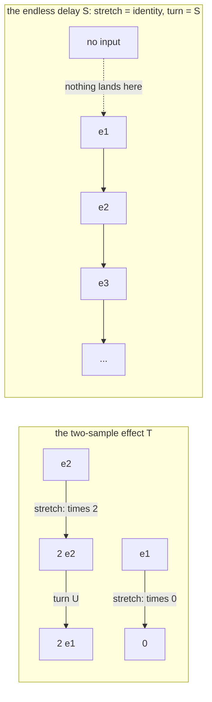

# Polar decomposition: every operator is a stretch followed by a partial turn

[Syllabus](../../../SYLLABUS.md) → [Functional analysis](../README.md) → [Bounded Operators](../README.md#s03) → Polar decomposition

---

## General Overview

Take a two-sample audio clip and one small effect. The effect reads the second sample, doubles it, and writes it into the first slot. It writes silence into the second slot. The input (3, 5) comes out as (10, 0). As a matrix the effect is T = `[[0, 2], [0, 0]]`.

Two things happen at once: a gain (the second sample is doubled) and a move (it changes slot). The polar decomposition pulls them apart:

- **First a stretch.** It never moves anything. It doubles sample 2 and silences sample 1: (3, 5) becomes (0, 10).
- **Then a partial turn.** It moves slot 2 to slot 1 and keeps lengths there: (0, 10) becomes (10, 0). It sends anything left in slot 1 to zero.

All the gain sits in the stretch. The turn only moves. A map that keeps lengths on one part of the space and sends the rest to zero is a **partial isometry**: an isometry (length-keeping map) on part of the space.

For matrices, the partial turn can always be completed to a full turn, a **unitary**: a map that keeps every length and reaches every output ([Normal matrices and the polar form](../../03-Algebra/07-Eigenvalues%20and%20Symmetric%20Matrices/11-normal-matrices-and-polar-decomposition.md)). On an endless signal it sometimes cannot. The delay S (the right shift of [Three model operators](02-integral-operators-and-the-shift.md)) moves every sample one place later. It amplifies nothing, so its stretch is the identity, and its turn is S itself. S keeps every length, yet nothing it outputs has anything in the first slot. No full turn can replace it.

**Every bounded operator on a Hilbert space is a stretch followed by a partial turn; in infinite dimensions the turn sometimes cannot be completed to a full one.**

**What kind of fact this is:** a theorem, proved on this card in Why it works for every bounded operator on a Hilbert space. The square root it uses is proved to exist on [Bounded and symmetric](10-spectral-theorem-for-bounded-self-adjoint-operators.md). The code checks finite truncations only.

### The picture: two partial turns



Schematic. Here $`e_n`$ is the unit sample in slot n: 1 in slot n, 0 elsewhere. On the left, U keeps slot 2 and kills slot 1. On the right, S keeps everything, but slot 1 of its output is always empty.

---

## The formula

Notation first, in words:

- H is a **Hilbert space**: a space with an inner product $`\langle x, y\rangle`$ and no missing limits. Scalars are real on this card. The **length** of x is $`\lVert x\rVert = \sqrt{\langle x, x\rangle}`$.
- T is a **bounded** operator on H ([Bounded operators](01-bounded-operators-and-the-operator-norm.md)). Its **adjoint** $`T^*`$ is the one operator with $`\langle Tx, y\rangle = \langle x, T^*y\rangle`$; for a real matrix it is the transpose ([Adjoints](03-adjoints-self-adjoint-and-unitary-operators.md)).
- $`T \ge 0`$, "T is positive", means T is self-adjoint and $`\langle x, Tx\rangle \ge 0`$ for every x.
- $`\ker T`$ is the **kernel**, the inputs T sends to 0. $`\mathrm{ran}\, T`$ is the **range**, the outputs T can produce. A bar on top, $`\overline{\mathrm{ran}\, T}`$, is the **closure**: the range plus all its limits.
- $`M^\perp`$ is everything perpendicular to M. $`P_M`$ is the **projection** onto a closed subspace M: it keeps the part in M and drops the part in $`M^\perp`$.

New notation on this card: $`\lvert T\rvert`$, read "the absolute value of T", is the positive square root of $`T^*T`$.

```math
T = U\,\lvert T\rvert, \qquad \lvert T\rvert = \sqrt{T^*T} \ge 0, \qquad U^*U = P_{\overline{\mathrm{ran}\,\lvert T\rvert}}, \qquad \ker U = \ker T
```

**Read it aloud:** T is the stretch "absolute value of T" followed by U; the stretch is the positive square root of T-star T; U keeps lengths exactly on the closure of the stretch's range; and U kills exactly what T kills.

A **partial isometry** is an operator U with $`\lVert Ux\rVert = \lVert x\rVert`$ for x in $`(\ker U)^\perp`$. That subspace is its **initial space**. The range of U, where those inputs land, is its **final space**. For the polar U:

```math
\text{initial space} = \overline{\mathrm{ran}\,\lvert T\rvert} = (\ker T)^\perp, \qquad \text{final space} = \overline{\mathrm{ran}\, T}
```

For the two-sample effect: $`T^*T`$ = `diag(0, 4)`, so $`\lvert T\rvert`$ = `diag(0, 2)`. U = `[[0, 1], [0, 0]]`, with initial space span($`e_2`$) and final space span($`e_1`$).

| Symbol | Plain meaning | In our example | Push it up and the answer… |
| --- | --- | --- | --- |
| $`H`$, $`\langle x, y\rangle`$, $`\lVert x\rVert`$ | Hilbert space; inner product; length | two samples; endless samples $`\ell^2`$; signals on [0, 1], $`L^2(0,1)`$ | — |
| $`T`$, $`T^*`$ | a bounded operator; its adjoint | `[[0, 2], [0, 0]]`; its transpose | larger gain, larger $`\lvert T\rvert`$ |
| $`T^*T`$ | T followed by its adjoint; never negative | `diag(0, 4)` | — |
| $`\lvert T\rvert`$, $`A`$, $`X`$, $`c`$ | the stretch $`\sqrt{T^*T}`$; A is short for $`T^*T`$; an iterate on the way to the stretch; a scale at least the top of A | `diag(0, 2)`; A = `diag(0, 4)`; $`\sqrt{c}\,X`$ on slot 2: 0, 1, 1.75, …; c = 4 | larger c, slower iteration |
| $`U`$, $`W`$ | the partial isometry; a unitary that might replace it | `[[0, 1], [0, 0]]`; the swap `[[0, 1], [1, 0]]` | — |
| $`\ker`$, $`\mathrm{ran}`$, overline | kernel; range; closure | $`\ker T`$ = span($`e_1`$), $`\mathrm{ran}\, T`$ = span($`e_1`$) | — |
| $`M^\perp`$, $`P_M`$ | perpendicular complement; projection onto M | $`U^*U = P`$ onto span($`e_2`$) | — |
| $`e_n`$, $`x`$ | unit sample in slot n; a test input | x = (3, 5); later x = (1, 1/2, 1/4, …) | — |
| $`S`$, $`S^*`$, $`C_N`$ | the delay; the advance (drop the first sample); the cyclic delay on N samples | $`\lvert S\rvert = I`$, U = S | — |
| $`V`$, $`K`$, $`k`$ | the running total, $`(Vf)(t) = \int_0^t f(s)\,ds`$ on [0, 1]; any compact operator; the frequency $`(n - \tfrac12)\pi`$ | $`\lVert V\rVert = 2/\pi`$ = 0.636620; K = V; k = π/2 for n = 1 | — |
| $`\sigma_n`$, $`v_n`$, $`u_n`$ | singular values; input shapes; output shapes | $`\sigma_n = 2/((2n-1)\pi)`$; cosines; sines | — |
| $`N`$, $`h`$ | samples in a truncation; grid step 1/N | N = 4 to 64 | the truncation error falls |

### When it holds

- **A Hilbert space.** The proof needs an adjoint and lengths from an inner product. On a space with only a norm there is no $`T^*T`$ to take a root of.
- **The positive root, on the right.** $`\lvert T\rvert`$ is built from $`T^*T`$ and goes first. Put the other stretch $`\lvert T^*\rvert = \sqrt{TT^*}`$ = `diag(2, 0)` after the turn, and U `diag(2, 0)` is the zero matrix: off by 2.000000.
- **U is unique only with $`\ker U = \ker T`$.** The swap W also gives $`W\lvert T\rvert = T`$. W does something on $`\ker T`$ where T does nothing.
- **U is unitary only when $`\ker T = \{0\}`$ and $`\mathrm{ran}\, T`$ is dense.** Some other unitary W works exactly when $`\ker T`$ and $`(\mathrm{ran}\, T)^\perp`$ have the same dimension. For the two-sample effect both are 1. For the endless delay they are 0 and 1, so no unitary works.

---

## Why it works

### Step 0: T and |T| give every input the same length

T and $`\lvert T\rvert`$ differ only in direction. For any input x:

```math
\lVert Tx\rVert^2 = \langle Tx, Tx\rangle = \langle x, T^*T x\rangle = \langle x, \lvert T\rvert^2 x\rangle = \langle \lvert T\rvert x, \lvert T\rvert x\rangle = \lVert\, \lvert T\rvert x \rVert^2
```

The fourth step uses that $`\lvert T\rvert`$ is self-adjoint. For x = (3, 5): Tx = (10, 0) and $`\lvert T\rvert x`$ = (0, 10), both of length 10.000000.

So "send $`\lvert T\rvert x`$ to $`Tx`$" is a fair rule. Two inputs with the same stretch $`\lvert T\rvert x = \lvert T\rvert y`$ have $`\lVert T(x - y)\rVert = 0`$, so the same T-output. The rule keeps lengths. That rule is U.

### Step 1: the stretch exists

$`T^*T`$ is positive: $`\langle x, T^*Tx\rangle = \lVert Tx\rVert^2 \ge 0`$. Every positive bounded operator has exactly one positive square root. [Bounded and symmetric](10-spectral-theorem-for-bounded-self-adjoint-operators.md) builds it as a function of the operator, and [Adjoints](03-adjoints-self-adjoint-and-unitary-operators.md) builds it on a ring of speakers.

One construction needs no eigenvectors at all. Write $`A = T^*T`$ and pick c with $`A \le cI`$, meaning $`cI - A \ge 0`$; $`c = \lVert A\rVert`$ works. Start at X = 0 and repeat:

```math
X \leftarrow X + \tfrac{1}{2}\left(A/c - X^2\right), \qquad \lvert T\rvert = \sqrt{c}\, \lim X
```

**Read it aloud:** nudge X by half the gap between the scaled A and X squared; the limit, scaled back, is the stretch.

Each X is a polynomial in A, the X's increase, and they stay below I. An increasing bounded sequence of self-adjoint operators converges on every vector (the strong topology of [Operator topologies](13-strong-and-weak-operator-topologies.md)). So the construction works in infinite dimensions too.

On the two-sample effect, c = 4, and the stretch on slot 2 runs 0.000000, 1.000000, 1.750000, 1.984375, 1.999939, 2.000000. The gap to 2 is squared and divided by 4 at each step, so the correct digits roughly double. Slot 1 stays at exactly 0.

### Step 2: build U, then extend it

U is defined in three moves:

1. **On the range of the stretch:** $`U(\lvert T\rvert x) = Tx`$. Step 0 says this is fair and keeps lengths.
2. **On its closure:** a limit of stretched inputs goes to the limit of their T-outputs. Lengths are kept, so a sequence that settles goes to a sequence that settles.
3. **On the rest:** U is 0 on $`(\mathrm{ran}\,\lvert T\rvert)^\perp`$.

Step 0 also gives $`\ker \lvert T\rvert = \ker T`$. A self-adjoint operator's range closure is the complement of its kernel. So the initial space is $`(\ker T)^\perp`$, and $`\ker U = \ker T`$.

For the two-sample effect, the stretch's range is span($`e_2`$). U sends $`2e_2`$ to $`Te_2 = 2e_1`$, so $`e_2 \mapsto e_1`$, and $`e_1 \mapsto 0`$. That is U = `[[0, 1], [0, 0]]`, and U `diag(0, 2)` rebuilds T exactly.

### Step 3: a partial isometry is read off U*U

U is a partial isometry exactly when $`U^*U`$ is a projection. Then $`U^*U`$ projects onto the initial space and $`UU^*`$ onto the final space.

For the example, $`U^*U`$ = `diag(0, 1)` keeps span($`e_2`$), and $`UU^*`$ = `diag(1, 0)` keeps span($`e_1`$). Applied to x = (3, 5), $`U^*U`$ gives (0, 5): the first sample is gone.

<details>
<summary>Detailed proof: U*U is the projection onto the initial space</summary>

Let M be the initial space. For x in M, $`\langle x, U^*Ux\rangle = \lVert Ux\rVert^2 = \lVert x\rVert^2 = \langle x, x\rangle`$. The self-adjoint operator $`B = I - U^*U`$ is positive on all of H, because $`\lVert Ux\rVert \le \lVert x\rVert`$ everywhere. For x in M, $`\langle x, Bx\rangle = 0`$.

A positive operator B with $`\langle x, Bx\rangle = 0`$ has $`Bx = 0`$, by the inequality $`\lvert\langle y, Bx\rangle\rvert^2 \le \langle y, By\rangle\langle x, Bx\rangle`$. So $`U^*Ux = x`$ on M.

For x in $`M^\perp = \ker U`$, $`U^*Ux = 0`$. Together: $`U^*U = P_M`$.

Conversely, if $`U^*U = P`$ is a projection, then $`\lVert Ux\rVert^2 = \langle x, Px\rangle = \lVert Px\rVert^2`$. So U keeps lengths on ran P and kills its complement.

Swap U and $`U^*`$: $`U^*`$ is a partial isometry from the final space back to the initial space, so $`UU^*`$ projects onto the final space.

</details>

### Step 4: when U is unitary, and when nothing unitary works

**U is unitary when T is invertible.** Then $`T^*T`$ is invertible, so $`\lvert T\rvert`$ is, and $`U = T\lvert T\rvert^{-1}`$ is an invertible isometry. Change the effect to T = `[[0, 2], [0.5, 0]]`, which also sends $`e_1`$ to $`0.5\,e_2`$. Then $`\lvert T\rvert`$ = `diag(0.5, 2)` and U is the swap `[[0, 1], [1, 0]]`, with $`U^*U = I`$.

**Invertible is more than needed.** U is unitary exactly when its initial space and final space are all of H: $`\ker T = \{0\}`$ and $`\mathrm{ran}\, T`$ dense. Step 6 shows a compact operator, never invertible, with a unitary U.

**Can a different unitary W replace U?** W must agree with U on the initial space $`(\ker T)^\perp`$. It must then send $`\ker T`$ onto the part U misses, $`(\mathrm{ran}\, T)^\perp`$, keeping lengths. That is possible exactly when the two have the same dimension.

- **In finite dimensions, always.** Both dimensions are N minus the rank (rank-nullity). For the two-sample effect both are 1, and the swap W works: $`W\lvert T\rvert = T`$, $`W^*W = I`$.
- **For the endless delay, never.** $`S^*S = I`$, so $`\lvert S\rvert = I`$ and U = S. Its kernel is {0}, but it misses $`e_1`$: dimensions 0 and 1. Any W with $`S = W\lvert S\rvert`$ is S itself, and $`SS^* \ne I`$: advance then delay turns (3, 1, 4, 1, 5) into (0, 1, 4, 1, 5), energy 52 down to 43.

When both dimensions are finite and the range is closed, their difference is the index of [Fredholm index](15-fredholm-operators-and-the-index.md). The delay's is −1.

### Step 5: what the truncation hides

Cut the delay to N samples, $`S_N`$. The code finds $`\lvert S_N\rvert`$ = `diag(1, ..., 1, 0)` and $`U_N = S_N`$ at N = 4, 8, 16 and 32. Every truncation has kernel dimension 1 (the last sample falls off) and misses dimension 1 (slot 1). They balance, as rank-nullity forces, and the cyclic delay $`C_N`$, which feeds the last sample back into slot 1, is a unitary.

Watch the decaying input x = (1, 1/2, 1/4, …), which has finite energy, as N grows:

| N | x along the kernel vector $`e_N`$ | x along the missed direction $`e_1`$ |
| ---: | ---: | ---: |
| 4 | 1.250e-01 | 1.000000 |
| 8 | 7.812e-03 | 1.000000 |
| 16 | 3.052e-05 | 1.000000 |
| 32 | 4.657e-10 | 1.000000 |

The kernel runs off to infinity and vanishes from view. The missed direction stays put. In the limit the balance is 0 against 1. No finite N shows this; only the trend does.

### Step 6: compact operators and singular values

If K is compact, so is $`\lvert K\rvert`$, and it is positive. [Compact and symmetric](08-spectral-theorem-for-compact-self-adjoint-operators.md) gives it perpendicular unit eigenvectors $`v_n`$ with eigenvalues $`\sigma_n > 0`$, the **singular values**; their span is dense in U's initial space. Set $`u_n = Uv_n`$. U keeps lengths and angles on its initial space, so the $`u_n`$ are perpendicular unit vectors too, and

```math
Kx = U\lvert K\rvert x = \sum_n \sigma_n \langle v_n, x\rangle\, u_n
```

**Read it aloud:** K measures x along each input shape, scales by the singular value, and writes it along the matching output shape. This is [The singular value decomposition](../../03-Algebra/07-Eigenvalues%20and%20Symmetric%20Matrices/06-singular-value-decomposition.md) with infinitely many terms.

The running total V shows it in closed form. With $`k = (n - \tfrac12)\pi`$, $`V\cos(kt) = \sin(kt)/k`$. So $`v_n = \sqrt2\cos(kt)`$, $`u_n = \sqrt2\sin(kt)`$ and $`\sigma_n = 1/k = 2/((2n-1)\pi)`$. U turns cosine shapes into sine shapes.

V is not invertible: its singular values fall to 0. Yet U is unitary. $`Vf = 0`$ forces f = 0 (differentiate), and the range of V holds every smooth function that starts at 0, which is dense in $`L^2(0,1)`$. Both conditions of Step 4 hold.

On an N-point grid the code finds:

| N | $`\sigma_1`$ | error | $`\sigma_2`$ | error |
| ---: | ---: | ---: | ---: | ---: |
| 8 | 0.634573 | −2.047e-03 | 0.206035 | −6.172e-03 |
| 16 | 0.636108 | −5.114e-04 | 0.210670 | −1.536e-03 |
| 32 | 0.636492 | −1.278e-04 | 0.211823 | −3.836e-04 |
| 64 | 0.636588 | −3.196e-05 | 0.212111 | −9.588e-05 |

The exact values are $`2/\pi`$ = 0.636620 and $`2/(3\pi)`$ = 0.212207. Each doubling of N cuts the error by 4.002, 4.000 and 4.000: it falls like $`1/N^2`$. At every N, the grid's $`u_1`$ equals $`\sqrt2\sin(\pi t/2)`$ at the grid points to within 1e-9.

---

## Worked numbers, by hand

The two-sample effect T = `[[0, 2], [0, 0]]` on the input x = (3, 5).

| Step | Arithmetic | Value |
| --- | --- | --- |
| $`T^*T`$ | transpose times T | `diag(0, 4)` |
| the stretch | square root of each diagonal entry | $`\lvert T\rvert`$ = `diag(0, 2)` |
| stretched input | $`\lvert T\rvert x`$ = (0 × 3, 2 × 5) | (0, 10) |
| output | Tx = (2 × 5, 0) | (10, 0) |
| lengths | $`\sqrt{0^2 + 10^2}`$ and $`\sqrt{10^2 + 0^2}`$ | 10.000000 and 10.000000 |
| the turn | (0, 10) ↦ (10, 0), and slot 1 ↦ 0 | U = `[[0, 1], [0, 0]]` |
| initial and final spaces | $`U^*U`$ and $`UU^*`$ | `diag(0, 1)` and `diag(1, 0)` |
| rebuild | U `diag(0, 2)` | **`[[0, 2], [0, 0]]` = T** |

The effect's whole gain, 2, is in the stretch; U only moves slot 2 to slot 1 and drops slot 1.

### What breaks if you drop a piece

| Mistake | Comes out at | What went wrong |
| --- | --- | --- |
| Stretch from $`TT^*`$, $`\lvert T^*\rvert`$ = `diag(2, 0)`, placed after U | U `diag(2, 0)` = the zero matrix, off by 2.000000 | $`\lvert T^*\rvert`$ belongs on the left: $`T = \lvert T^*\rvert U`$ |
| Treating U as unitary, undoing it with $`U^*`$ | $`U^*U`$(3, 5) = (0, 5), not (3, 5) | U is only partial: it forgot slot 1 |
| Completing the delay with the cyclic delay $`C_N`$ | unitary at every N, but the input it sends to $`e_1`$ overlaps x by 1.250e-01, 7.812e-03, 3.052e-05, 4.657e-10 | in the limit no finite-energy input reaches slot 1 |
| Treating the delay's U = S as undoable from both sides | $`SS^*`$(3, 1, 4, 1, 5) = (0, 1, 4, 1, 5), energy 52 → 43 | an isometry that misses $`e_1`$ is not unitary |

---

## Code, from first principles, and it actually runs

The code holds three finite rehearsals: the two-sample effect, the delay cut to N samples, and the running total on an N-point grid. It takes three independent roads to the stretch. The first is a Jacobi eigen solver (repeated small rotations that diagonalise a symmetric matrix). The second is the closed form $`\sqrt A = (A + \sqrt{\det A}\,I)/\sqrt{\mathrm{tr}\,A + 2\sqrt{\det A}}`$ for a 2 × 2 positive matrix. The third is the iteration of Step 1. U is built from the eigenvectors and checked against invariants: $`U\lvert T\rvert = T`$, $`U^*U`$ and $`UU^*`$ are projections, and lengths match. Kernel and missed dimensions come from two separate eigen solves. The running total's singular values are checked against $`2/((2n-1)\pi)`$, with the error ratio near 4.

**What the truncation hides.** Every matrix has kernel and missed directions of equal dimension, so every truncation's U can be completed to a unitary. The endless delay's imbalance, 0 against 1, shows only as the trend in Step 5. And the grid running total is invertible at every N, so its U is unitary for a reason the true V does not share.

### Python

```python
# Polar decomposition and partial isometries: the check behind the card.
# Standard library only. Real scalars. Square roots, eigenvectors and U are built by hand:
# a Jacobi eigen solver, a 2x2 closed form and the iteration X <- X + (A - X^2)/2.
import math

def mul(A, B): return [[sum(A[i][k] * B[k][j] for k in range(len(B))) for j in range(len(B[0]))] for i in range(len(A))]
def tp(A): return [list(r) for r in zip(*A)]
def gap(A, B): return max(abs(a - b) for r, s in zip(A, B) for a, b in zip(r, s))
def eye(n): return [[float(i == j) for j in range(n)] for i in range(n)]
def f6(x): return f"{0.0 if abs(x) < 5e-7 else x:.6f}"
def fm(A): return "[" + ", ".join("[" + ", ".join(f6(x) for x in r) + "]" for r in A) + "]"
def apply(A, x): return [sum(a * b for a, b in zip(r, x)) for r in A]

def jacobi(A):  # eigenvalues and eigenvector columns of a symmetric matrix
    n = len(A); A = [r[:] for r in A]; V = eye(n)
    for _ in range(60):
        if sum(A[i][j] ** 2 for i in range(n) for j in range(n) if i != j) < 1e-26: break
        for p in range(n - 1):
            for q in range(p + 1, n):
                if A[p][q] == 0.0: continue
                th = (A[q][q] - A[p][p]) / (2 * A[p][q])
                t = (1.0 if th >= 0 else -1.0) / (abs(th) + math.sqrt(th * th + 1))
                c = 1 / math.sqrt(t * t + 1); s = t * c
                for M in (A, V):
                    for k in range(n): M[k][p], M[k][q] = c * M[k][p] - s * M[k][q], s * M[k][p] + c * M[k][q]
                for k in range(n): A[p][k], A[q][k] = c * A[p][k] - s * A[q][k], s * A[p][k] + c * A[q][k]
    return [A[i][i] for i in range(n)], V

def polar(T):  # |T| = sqrt(T*T) and U: |T|v -> Tv on the eigenvectors with stretch > 0, zero on the rest
    n = len(T); w, V = jacobi(mul(tp(T), T)); sig = [math.sqrt(max(x, 0.0)) for x in w]
    P = [[sum(V[i][k] * sig[k] * V[j][k] for k in range(n)) for j in range(n)] for i in range(n)]
    U = [[0.0] * n for _ in range(n)]
    for k in [k for k in range(n) if sig[k] > 1e-9]:
        u = [sum(T[i][m] * V[m][k] for m in range(n)) / sig[k] for i in range(n)]
        for i in range(n):
            for j in range(n): U[i][j] += u[i] * V[j][k]
    return P, U, sig, V

def zeros(A): return sum(1 for x in jacobi(A)[0] if abs(x) < 1e-9)  # dimension of the kernel of a symmetric A

print("1. the two-sample effect T = [[0, 2], [0, 0]]: read sample 2, double it, write it in slot 1")
T = [[0.0, 2.0], [0.0, 0.0]]; A = mul(tp(T), T)
P, U, sig, _ = polar(T)
s = math.sqrt(A[0][0] * A[1][1] - A[0][1] * A[1][0]); r = math.sqrt(A[0][0] + A[1][1] + 2 * s)
P2 = [[(A[i][j] + s * (i == j)) / r for j in range(2)] for i in range(2)]  # road 2: closed form for 2x2
c = 4.0; X, its = [[0.0, 0.0], [0.0, 0.0]], []  # road 3: X <- X + (A/c - X^2)/2, c at least the top of A
for k in range(7):
    its.append(math.sqrt(c) * X[1][1]); X2 = mul(X, X)
    X = [[X[i][j] + (A[i][j] / c - X2[i][j]) / 2 for j in range(2)] for i in range(2)]
P3 = [[math.sqrt(c) * x for x in row] for row in X]
print("T*T =", fm(A)); print("|T| by Jacobi    =", fm(P)); print("|T| by 2x2 rule  =", fm(P2)); print("|T| by iteration =", fm(P3))
print("iteration on the stretch 2, steps 0 to 6:", ", ".join(f6(x) for x in its))
assert gap(P, [[0, 0], [0, 2]]) < 1e-12 and gap(P2, P) < 1e-12 and gap(P3, P) < 1e-9
print("U =", fm(U), "  U|T| - T, largest entry:", f6(gap(mul(U, P), T)))
assert gap(mul(U, P), T) < 1e-12 and gap(U, [[0, 1], [0, 0]]) < 1e-12
print("U*U =", fm(mul(tp(U), U)), "keeps span(e2);  UU* =", fm(mul(U, tp(U))), "keeps span(e1)")
assert gap(mul(tp(U), U), [[0, 0], [0, 1]]) < 1e-12 and gap(mul(U, tp(U)), [[1, 0], [0, 0]]) < 1e-12
x = [3.0, 5.0]; Tx, Px = apply(T, x), apply(P, x)
print("x = (3, 5): Tx =", fm([Tx]), " |T|x =", fm([Px]), " lengths", f6(math.hypot(*Tx)), "and", f6(math.hypot(*Px)))
assert abs(math.hypot(*Tx) - math.hypot(*Px)) < 1e-12 and abs(math.hypot(*Tx) - 10) < 1e-12
W = [[0.0, 1.0], [1.0, 0.0]]
print("the swap W =", fm(W), " W|T| - T:", f6(gap(mul(W, P), T)), " W*W - I:", f6(gap(mul(tp(W), W), eye(2))))
assert gap(mul(W, P), T) < 1e-12 and gap(mul(tp(W), W), eye(2)) < 1e-12
print("kernel of T: dimension", zeros(A), "  directions T misses: dimension", zeros(mul(T, tp(T))))
assert zeros(A) == 1 and zeros(mul(T, tp(T))) == 1
Te = [[0.0, 2.0], [0.5, 0.0]]; Pe, Ue, _, _ = polar(Te)  # an invertible neighbour: e1 now goes to 0.5 e2
print("T =", fm(Te), " |T| =", fm(Pe), " U =", fm(Ue), " U*U - I:", f6(gap(mul(tp(Ue), Ue), eye(2))))
assert gap(Ue, W) < 1e-12 and gap(mul(Ue, Pe), Te) < 1e-12

print("2. the delay S, cut to N samples; x = (1, 1/2, 1/4, ...)")
for N in (4, 8, 16, 32):
    S = [[float(i == j + 1) for j in range(N)] for i in range(N)]
    P, U, sig, V = polar(S)
    kv = [V[i][k] for k in range(N) if sig[k] < 1e-9 for i in range(N)]  # the kernel vector of |S_N|
    wv, Q = jacobi(mul(S, tp(S))); mv = [Q[i][k] for k in range(N) if abs(wv[k]) < 1e-9 for i in range(N)]
    xs = [0.5 ** i for i in range(N)]
    ok, om = abs(sum(a * b for a, b in zip(kv, xs))), abs(sum(a * b for a, b in zip(mv, xs)))
    D = [[float(i == j and i < N - 1) for j in range(N)] for i in range(N)]
    print(f"N = {N:2d}: |S_N| - diag(1, ..., 1, 0): {f6(gap(P, D))}, U_N - S_N: {f6(gap(U, S))}, kernel {zeros(mul(tp(S), S))}, "
          f"missed {zeros(mul(S, tp(S)))}; x along the kernel {ok:.3e}, along the missed direction {f6(om)}")
    assert gap(U, S) < 1e-12 and gap(P, D) < 1e-12 and abs(ok - 0.5 ** (N - 1)) < 1e-15 and abs(om - 1) < 1e-12
y = [3, 1, 4, 1, 5]; z = [0] + y[1:]  # advance (drop the first sample), then delay: S S* y
print("delay after advance on (3, 1, 4, 1, 5):", z, " energy", sum(v * v for v in y), "->", sum(v * v for v in z))
assert sum(v * v for v in z) == 43

print("3. the running total V on an N-point midpoint grid of [0, 1]")
ex = [2 / ((2 * n - 1) * math.pi) for n in (1, 2)]
print("   N  sigma_1   error       sigma_2   error")
errs = []
for N in (8, 16, 32, 64):
    h = 1 / N; Vn = [[h if j < i else h / 2 if j == i else 0.0 for j in range(N)] for i in range(N)]
    P, U, sig, V = polar(Vn)
    o = sorted(range(N), key=lambda k: -sig[k]); s1, s2 = sig[o[0]], sig[o[1]]
    v1 = [V[i][o[0]] for i in range(N)]; v1 = [-a for a in v1] if sum(v1) < 0 else v1
    u1 = [a / s1 / math.sqrt(h) for a in apply(Vn, v1)]
    du = max(abs(u1[i] - math.sqrt(2) * math.sin(math.pi * (i + 0.5) * h / 2)) for i in range(N))
    e1, e2, eu, er = s1 - ex[0], s2 - ex[1], gap(mul(tp(U), U), eye(N)), gap(mul(U, P), Vn)
    print(f"{N:4d}  {f6(s1)}  {e1:.3e}  {f6(s2)}  {e2:.3e}")
    errs.append(abs(e1)); assert eu < 1e-9 and er < 1e-9 and du < 1e-9
assert all(3.5 < errs[k] / errs[k + 1] < 4.5 for k in range(3))  # error falls like 1/N^2
print("exact: sigma_1 = 2/pi =", f6(ex[0]), " sigma_2 = 2/(3 pi) =", f6(ex[1]), " error ratios",
      ", ".join(f"{errs[k] / errs[k + 1]:.3f}" for k in range(3)))
print("at every N: U*U - I, U|V| - V and u_1 - sqrt2 sin(pi x/2) on the grid all below 1e-9")

print("what breaks")
P, U, _, _ = polar(T); Pl = polar(tp(T))[0]  # |T*| = sqrt(T T*), the stretch for the left form
print("U|T*| in place of U|T|:", fm(mul(U, Pl)), " largest error", f6(gap(mul(U, Pl), T)))
assert gap(mul(U, Pl), T) > 1.9 and gap(Pl, [[2, 0], [0, 0]]) < 1e-12
print("U*U x for x = (3, 5), as if U were unitary:", fm([apply(mul(tp(U), U), x)]))
assert gap([apply(mul(tp(U), U), x)], [[0, 5]]) < 1e-12
for N in (4, 8, 16, 32):  # the cyclic delay C_N is unitary; the input it sends to e1 is e_N
    C = [[float(i == (j + 1) % N) for j in range(N)] for i in range(N)]
    pre = apply(tp(C), [float(i == 0) for i in range(N)]); ov = sum(a * 0.5 ** i for i, a in enumerate(pre))
    print(f"cyclic delay C_N, N = {N:2d}: C_N*C_N - I {f6(gap(mul(tp(C), C), eye(N)))}; the input sent to e1 overlaps x by {ov:.3e}")
    assert gap(mul(tp(C), C), eye(N)) < 1e-12 and abs(ov - 2.0 ** (1 - N)) < 1e-15
print("ALL CHECKS PASS")
```

**Ran 2026-11-24 on macOS, Python 3.14.10, standard library only. All checks passed. Output, pasted from the run:**

```
1. the two-sample effect T = [[0, 2], [0, 0]]: read sample 2, double it, write it in slot 1
T*T = [[0.000000, 0.000000], [0.000000, 4.000000]]
|T| by Jacobi    = [[0.000000, 0.000000], [0.000000, 2.000000]]
|T| by 2x2 rule  = [[0.000000, 0.000000], [0.000000, 2.000000]]
|T| by iteration = [[0.000000, 0.000000], [0.000000, 2.000000]]
iteration on the stretch 2, steps 0 to 6: 0.000000, 1.000000, 1.750000, 1.984375, 1.999939, 2.000000, 2.000000
U = [[0.000000, 1.000000], [0.000000, 0.000000]]   U|T| - T, largest entry: 0.000000
U*U = [[0.000000, 0.000000], [0.000000, 1.000000]] keeps span(e2);  UU* = [[1.000000, 0.000000], [0.000000, 0.000000]] keeps span(e1)
x = (3, 5): Tx = [[10.000000, 0.000000]]  |T|x = [[0.000000, 10.000000]]  lengths 10.000000 and 10.000000
the swap W = [[0.000000, 1.000000], [1.000000, 0.000000]]  W|T| - T: 0.000000  W*W - I: 0.000000
kernel of T: dimension 1   directions T misses: dimension 1
T = [[0.000000, 2.000000], [0.500000, 0.000000]]  |T| = [[0.500000, 0.000000], [0.000000, 2.000000]]  U = [[0.000000, 1.000000], [1.000000, 0.000000]]  U*U - I: 0.000000
2. the delay S, cut to N samples; x = (1, 1/2, 1/4, ...)
N =  4: |S_N| - diag(1, ..., 1, 0): 0.000000, U_N - S_N: 0.000000, kernel 1, missed 1; x along the kernel 1.250e-01, along the missed direction 1.000000
N =  8: |S_N| - diag(1, ..., 1, 0): 0.000000, U_N - S_N: 0.000000, kernel 1, missed 1; x along the kernel 7.812e-03, along the missed direction 1.000000
N = 16: |S_N| - diag(1, ..., 1, 0): 0.000000, U_N - S_N: 0.000000, kernel 1, missed 1; x along the kernel 3.052e-05, along the missed direction 1.000000
N = 32: |S_N| - diag(1, ..., 1, 0): 0.000000, U_N - S_N: 0.000000, kernel 1, missed 1; x along the kernel 4.657e-10, along the missed direction 1.000000
delay after advance on (3, 1, 4, 1, 5): [0, 1, 4, 1, 5]  energy 52 -> 43
3. the running total V on an N-point midpoint grid of [0, 1]
   N  sigma_1   error       sigma_2   error
   8  0.634573  -2.047e-03  0.206035  -6.172e-03
  16  0.636108  -5.114e-04  0.210670  -1.536e-03
  32  0.636492  -1.278e-04  0.211823  -3.836e-04
  64  0.636588  -3.196e-05  0.212111  -9.588e-05
exact: sigma_1 = 2/pi = 0.636620  sigma_2 = 2/(3 pi) = 0.212207  error ratios 4.002, 4.000, 4.000
at every N: U*U - I, U|V| - V and u_1 - sqrt2 sin(pi x/2) on the grid all below 1e-9
what breaks
U|T*| in place of U|T|: [[0.000000, 0.000000], [0.000000, 0.000000]]  largest error 2.000000
U*U x for x = (3, 5), as if U were unitary: [[0.000000, 5.000000]]
cyclic delay C_N, N =  4: C_N*C_N - I 0.000000; the input sent to e1 overlaps x by 1.250e-01
cyclic delay C_N, N =  8: C_N*C_N - I 0.000000; the input sent to e1 overlaps x by 7.812e-03
cyclic delay C_N, N = 16: C_N*C_N - I 0.000000; the input sent to e1 overlaps x by 3.052e-05
cyclic delay C_N, N = 32: C_N*C_N - I 0.000000; the input sent to e1 overlaps x by 4.657e-10
ALL CHECKS PASS
```

### Rust

```rust
// Polar decomposition and partial isometries: the check behind the card.
// Standard library only. Real scalars. Square roots, eigenvectors and U are built by hand:
// a Jacobi eigen solver, a 2x2 closed form and the iteration X <- X + (A - X^2)/2.
use std::f64::consts::PI;
type M = Vec<Vec<f64>>;

fn mul(a: &M, b: &M) -> M {
    (0..a.len()).map(|i| (0..b[0].len()).map(|j| (0..b.len()).map(|k| a[i][k] * b[k][j]).sum()).collect()).collect()
}
fn tp(a: &M) -> M { (0..a[0].len()).map(|j| (0..a.len()).map(|i| a[i][j]).collect()).collect() }
fn gap(a: &M, b: &M) -> f64 { a.iter().zip(b).flat_map(|(r, s)| r.iter().zip(s).map(|(x, y)| (x - y).abs())).fold(0.0, f64::max) }
fn eye(n: usize) -> M { (0..n).map(|i| (0..n).map(|j| if i == j { 1.0 } else { 0.0 }).collect()).collect() }
fn f6(x: f64) -> String { format!("{:.6}", if x.abs() < 5e-7 { 0.0 } else { x }) }
fn fm(a: &M) -> String {
    let rows: Vec<String> = a.iter().map(|r| format!("[{}]", r.iter().map(|&x| f6(x)).collect::<Vec<_>>().join(", "))).collect();
    format!("[{}]", rows.join(", "))
}
fn apply(a: &M, x: &[f64]) -> Vec<f64> { a.iter().map(|r| r.iter().zip(x).map(|(p, q)| p * q).sum()).collect() }
fn sci(x: f64) -> String {
    let s = format!("{:.3e}", x);
    let (m, e) = s.split_once('e').unwrap();
    let e: i32 = e.parse().unwrap();
    format!("{}e{}{:02}", m, if e < 0 { '-' } else { '+' }, e.abs())
}

fn jacobi(a0: &M) -> (Vec<f64>, M) { // eigenvalues and eigenvector columns of a symmetric matrix
    let n = a0.len();
    let (mut a, mut v) = (a0.clone(), eye(n));
    for _ in 0..60 {
        let mut off = 0.0;
        for i in 0..n { for j in 0..n { if i != j { off += a[i][j] * a[i][j]; } } }
        if off < 1e-26 { break; }
        for p in 0..n - 1 {
            for q in p + 1..n {
                if a[p][q] == 0.0 { continue; }
                let th = (a[q][q] - a[p][p]) / (2.0 * a[p][q]);
                let t = (if th >= 0.0 { 1.0 } else { -1.0 }) / (th.abs() + (th * th + 1.0).sqrt());
                let c = 1.0 / (t * t + 1.0).sqrt(); let s = t * c;
                for m in [&mut a, &mut v] {
                    for k in 0..n { let (x, y) = (m[k][p], m[k][q]); m[k][p] = c * x - s * y; m[k][q] = s * x + c * y; }
                }
                for k in 0..n { let (x, y) = (a[p][k], a[q][k]); a[p][k] = c * x - s * y; a[q][k] = s * x + c * y; }
            }
        }
    }
    ((0..n).map(|i| a[i][i]).collect(), v)
}

// |T| = sqrt(T*T) and U: |T|v -> Tv on the eigenvectors with stretch > 0, zero on the rest
fn polar(t: &M) -> (M, M, Vec<f64>, M) {
    let n = t.len();
    let (w, v) = jacobi(&mul(&tp(t), t));
    let sig: Vec<f64> = w.iter().map(|&x| x.max(0.0).sqrt()).collect();
    let p: M = (0..n).map(|i| (0..n).map(|j| (0..n).map(|k| v[i][k] * sig[k] * v[j][k]).sum()).collect()).collect();
    let mut u = vec![vec![0.0; n]; n];
    for k in (0..n).filter(|&k| sig[k] > 1e-9) {
        let uk: Vec<f64> = (0..n).map(|i| (0..n).map(|m| t[i][m] * v[m][k]).sum::<f64>() / sig[k]).collect();
        for i in 0..n { for j in 0..n { u[i][j] += uk[i] * v[j][k]; } }
    }
    (p, u, sig, v)
}

fn zeros(a: &M) -> usize { jacobi(a).0.iter().filter(|x| x.abs() < 1e-9).count() } // kernel dimension of a symmetric A

fn main() {
    println!("1. the two-sample effect T = [[0, 2], [0, 0]]: read sample 2, double it, write it in slot 1");
    let t: M = vec![vec![0.0, 2.0], vec![0.0, 0.0]];
    let a = mul(&tp(&t), &t);
    let (p, u, _, _) = polar(&t);
    let s = (a[0][0] * a[1][1] - a[0][1] * a[1][0]).sqrt();
    let r = (a[0][0] + a[1][1] + 2.0 * s).sqrt();
    let p2: M = (0..2).map(|i| (0..2).map(|j| (a[i][j] + if i == j { s } else { 0.0 }) / r).collect()).collect(); // road 2
    let c = 4.0; // road 3: X <- X + (A/c - X^2)/2, c at least the top of A
    let (mut x, mut its) = (vec![vec![0.0; 2]; 2], vec![]);
    for _ in 0..7 {
        its.push(f64::sqrt(c) * x[1][1]);
        let x2 = mul(&x, &x);
        x = (0..2).map(|i| (0..2).map(|j| x[i][j] + (a[i][j] / c - x2[i][j]) / 2.0).collect()).collect();
    }
    let p3: M = x.iter().map(|row| row.iter().map(|v| f64::sqrt(c) * v).collect()).collect();
    println!("T*T = {}", fm(&a)); println!("|T| by Jacobi    = {}", fm(&p));
    println!("|T| by 2x2 rule  = {}", fm(&p2)); println!("|T| by iteration = {}", fm(&p3));
    println!("iteration on the stretch 2, steps 0 to 6: {}", its.iter().map(|&v| f6(v)).collect::<Vec<_>>().join(", "));
    assert!(gap(&p, &vec![vec![0.0, 0.0], vec![0.0, 2.0]]) < 1e-12 && gap(&p2, &p) < 1e-12 && gap(&p3, &p) < 1e-9);
    println!("U = {}   U|T| - T, largest entry: {}", fm(&u), f6(gap(&mul(&u, &p), &t)));
    assert!(gap(&mul(&u, &p), &t) < 1e-12 && gap(&u, &vec![vec![0.0, 1.0], vec![0.0, 0.0]]) < 1e-12);
    let (uu, uut) = (mul(&tp(&u), &u), mul(&u, &tp(&u)));
    println!("U*U = {} keeps span(e2);  UU* = {} keeps span(e1)", fm(&uu), fm(&uut));
    assert!(gap(&uu, &vec![vec![0.0, 0.0], vec![0.0, 1.0]]) < 1e-12 && gap(&uut, &vec![vec![1.0, 0.0], vec![0.0, 0.0]]) < 1e-12);
    let xv = vec![3.0, 5.0];
    let (tx, px) = (apply(&t, &xv), apply(&p, &xv));
    let (lt, lp) = (tx[0].hypot(tx[1]), px[0].hypot(px[1]));
    println!("x = (3, 5): Tx = {}  |T|x = {}  lengths {} and {}", fm(&vec![tx.clone()]), fm(&vec![px.clone()]), f6(lt), f6(lp));
    assert!((lt - lp).abs() < 1e-12 && (lt - 10.0).abs() < 1e-12);
    let w: M = vec![vec![0.0, 1.0], vec![1.0, 0.0]];
    println!("the swap W = {}  W|T| - T: {}  W*W - I: {}", fm(&w), f6(gap(&mul(&w, &p), &t)), f6(gap(&mul(&tp(&w), &w), &eye(2))));
    assert!(gap(&mul(&w, &p), &t) < 1e-12 && gap(&mul(&tp(&w), &w), &eye(2)) < 1e-12);
    let (zk, zm) = (zeros(&a), zeros(&mul(&t, &tp(&t))));
    println!("kernel of T: dimension {}   directions T misses: dimension {}", zk, zm);
    assert!(zk == 1 && zm == 1);
    let te: M = vec![vec![0.0, 2.0], vec![0.5, 0.0]]; // an invertible neighbour: e1 now goes to 0.5 e2
    let (pe, ue, _, _) = polar(&te);
    println!("T = {}  |T| = {}  U = {}  U*U - I: {}", fm(&te), fm(&pe), fm(&ue), f6(gap(&mul(&tp(&ue), &ue), &eye(2))));
    assert!(gap(&ue, &w) < 1e-12 && gap(&mul(&ue, &pe), &te) < 1e-12);

    println!("2. the delay S, cut to N samples; x = (1, 1/2, 1/4, ...)");
    for n in [4usize, 8, 16, 32] {
        let sm: M = (0..n).map(|i| (0..n).map(|j| if i == j + 1 { 1.0 } else { 0.0 }).collect()).collect();
        let (p, u, sig, v) = polar(&sm);
        let kv: Vec<f64> = (0..n).filter(|&k| sig[k] < 1e-9).flat_map(|k| (0..n).map(move |i| (k, i))).map(|(k, i)| v[i][k]).collect();
        let (wv, q) = jacobi(&mul(&sm, &tp(&sm)));
        let mv: Vec<f64> = (0..n).filter(|&k| wv[k].abs() < 1e-9).flat_map(|k| (0..n).map(move |i| (k, i))).map(|(k, i)| q[i][k]).collect();
        let xs: Vec<f64> = (0..n).map(|i| 0.5f64.powi(i as i32)).collect();
        let ok = kv.iter().zip(&xs).map(|(a, b)| a * b).sum::<f64>().abs();
        let om = mv.iter().zip(&xs).map(|(a, b)| a * b).sum::<f64>().abs();
        let d: M = (0..n).map(|i| (0..n).map(|j| if i == j && i < n - 1 { 1.0 } else { 0.0 }).collect()).collect();
        println!("N = {:2}: |S_N| - diag(1, ..., 1, 0): {}, U_N - S_N: {}, kernel {}, missed {}; x along the kernel {}, along the missed direction {}",
            n, f6(gap(&p, &d)), f6(gap(&u, &sm)), zeros(&mul(&tp(&sm), &sm)), zeros(&mul(&sm, &tp(&sm))), sci(ok), f6(om));
        assert!(gap(&u, &sm) < 1e-12 && gap(&p, &d) < 1e-12 && (ok - 0.5f64.powi(n as i32 - 1)).abs() < 1e-15 && (om - 1.0).abs() < 1e-12);
    }
    let y = vec![3, 1, 4, 1, 5];
    let mut z = y.clone(); z[0] = 0; // advance (drop the first sample), then delay: S S* y
    let (ey, ez): (i32, i32) = (y.iter().map(|v| v * v).sum(), z.iter().map(|v| v * v).sum());
    println!("delay after advance on (3, 1, 4, 1, 5): {:?}  energy {} -> {}", z, ey, ez);
    assert!(ez == 43);

    println!("3. the running total V on an N-point midpoint grid of [0, 1]");
    let ex = [2.0 / PI, 2.0 / (3.0 * PI)];
    println!("   N  sigma_1   error       sigma_2   error");
    let mut errs = vec![];
    for n in [8usize, 16, 32, 64] {
        let h = 1.0 / n as f64;
        let vn: M = (0..n).map(|i| (0..n).map(|j| if j < i { h } else if j == i { h / 2.0 } else { 0.0 }).collect()).collect();
        let (p, u, sig, v) = polar(&vn);
        let mut o: Vec<usize> = (0..n).collect();
        o.sort_by(|&i, &j| sig[j].partial_cmp(&sig[i]).unwrap());
        let (s1, s2) = (sig[o[0]], sig[o[1]]);
        let mut v1: Vec<f64> = (0..n).map(|i| v[i][o[0]]).collect();
        if v1.iter().sum::<f64>() < 0.0 { v1 = v1.iter().map(|a| -a).collect(); }
        let u1: Vec<f64> = apply(&vn, &v1).iter().map(|a| a / s1 / h.sqrt()).collect();
        let du = (0..n).map(|i| (u1[i] - 2f64.sqrt() * (PI * (i as f64 + 0.5) * h / 2.0).sin()).abs()).fold(0.0, f64::max);
        let (e1, e2, eu, er) = (s1 - ex[0], s2 - ex[1], gap(&mul(&tp(&u), &u), &eye(n)), gap(&mul(&u, &p), &vn));
        println!("{:4}  {}  {}  {}  {}", n, f6(s1), sci(e1), f6(s2), sci(e2));
        errs.push(e1.abs());
        assert!(eu < 1e-9 && er < 1e-9 && du < 1e-9);
    }
    assert!((0..3).all(|k| 3.5 < errs[k] / errs[k + 1] && errs[k] / errs[k + 1] < 4.5)); // error falls like 1/N^2
    println!("exact: sigma_1 = 2/pi = {}  sigma_2 = 2/(3 pi) = {}  error ratios {}", f6(ex[0]), f6(ex[1]),
        (0..3).map(|k| format!("{:.3}", errs[k] / errs[k + 1])).collect::<Vec<_>>().join(", "));
    println!("at every N: U*U - I, U|V| - V and u_1 - sqrt2 sin(pi x/2) on the grid all below 1e-9");

    println!("what breaks");
    let pl = polar(&tp(&t)).0; // |T*| = sqrt(T T*), the stretch for the left form
    println!("U|T*| in place of U|T|: {}  largest error {}", fm(&mul(&u, &pl)), f6(gap(&mul(&u, &pl), &t)));
    assert!(gap(&mul(&u, &pl), &t) > 1.9 && gap(&pl, &vec![vec![2.0, 0.0], vec![0.0, 0.0]]) < 1e-12);
    let ux = vec![apply(&uu, &xv)];
    println!("U*U x for x = (3, 5), as if U were unitary: {}", fm(&ux));
    assert!(gap(&ux, &vec![vec![0.0, 5.0]]) < 1e-12);
    for n in [4usize, 8, 16, 32] { // the cyclic delay C_N is unitary; the input it sends to e1 is e_N
        let c: M = (0..n).map(|i| (0..n).map(|j| if i == (j + 1) % n { 1.0 } else { 0.0 }).collect()).collect();
        let e1: Vec<f64> = (0..n).map(|i| if i == 0 { 1.0 } else { 0.0 }).collect();
        let pre = apply(&tp(&c), &e1);
        let ov: f64 = pre.iter().enumerate().map(|(i, a)| a * 0.5f64.powi(i as i32)).sum();
        let g = gap(&mul(&tp(&c), &c), &eye(n));
        println!("cyclic delay C_N, N = {:2}: C_N*C_N - I {}; the input sent to e1 overlaps x by {}", n, f6(g), sci(ov));
        assert!(g < 1e-12 && (ov - 2f64.powi(1 - n as i32)).abs() < 1e-15);
    }
    println!("ALL CHECKS PASS");
}
```

**Ran 2026-11-24 on macOS, rustc 1.98.1, no crates. All checks passed. Output, pasted from the run:**

```
1. the two-sample effect T = [[0, 2], [0, 0]]: read sample 2, double it, write it in slot 1
T*T = [[0.000000, 0.000000], [0.000000, 4.000000]]
|T| by Jacobi    = [[0.000000, 0.000000], [0.000000, 2.000000]]
|T| by 2x2 rule  = [[0.000000, 0.000000], [0.000000, 2.000000]]
|T| by iteration = [[0.000000, 0.000000], [0.000000, 2.000000]]
iteration on the stretch 2, steps 0 to 6: 0.000000, 1.000000, 1.750000, 1.984375, 1.999939, 2.000000, 2.000000
U = [[0.000000, 1.000000], [0.000000, 0.000000]]   U|T| - T, largest entry: 0.000000
U*U = [[0.000000, 0.000000], [0.000000, 1.000000]] keeps span(e2);  UU* = [[1.000000, 0.000000], [0.000000, 0.000000]] keeps span(e1)
x = (3, 5): Tx = [[10.000000, 0.000000]]  |T|x = [[0.000000, 10.000000]]  lengths 10.000000 and 10.000000
the swap W = [[0.000000, 1.000000], [1.000000, 0.000000]]  W|T| - T: 0.000000  W*W - I: 0.000000
kernel of T: dimension 1   directions T misses: dimension 1
T = [[0.000000, 2.000000], [0.500000, 0.000000]]  |T| = [[0.500000, 0.000000], [0.000000, 2.000000]]  U = [[0.000000, 1.000000], [1.000000, 0.000000]]  U*U - I: 0.000000
2. the delay S, cut to N samples; x = (1, 1/2, 1/4, ...)
N =  4: |S_N| - diag(1, ..., 1, 0): 0.000000, U_N - S_N: 0.000000, kernel 1, missed 1; x along the kernel 1.250e-01, along the missed direction 1.000000
N =  8: |S_N| - diag(1, ..., 1, 0): 0.000000, U_N - S_N: 0.000000, kernel 1, missed 1; x along the kernel 7.812e-03, along the missed direction 1.000000
N = 16: |S_N| - diag(1, ..., 1, 0): 0.000000, U_N - S_N: 0.000000, kernel 1, missed 1; x along the kernel 3.052e-05, along the missed direction 1.000000
N = 32: |S_N| - diag(1, ..., 1, 0): 0.000000, U_N - S_N: 0.000000, kernel 1, missed 1; x along the kernel 4.657e-10, along the missed direction 1.000000
delay after advance on (3, 1, 4, 1, 5): [0, 1, 4, 1, 5]  energy 52 -> 43
3. the running total V on an N-point midpoint grid of [0, 1]
   N  sigma_1   error       sigma_2   error
   8  0.634573  -2.047e-03  0.206035  -6.172e-03
  16  0.636108  -5.114e-04  0.210670  -1.536e-03
  32  0.636492  -1.278e-04  0.211823  -3.836e-04
  64  0.636588  -3.196e-05  0.212111  -9.588e-05
exact: sigma_1 = 2/pi = 0.636620  sigma_2 = 2/(3 pi) = 0.212207  error ratios 4.002, 4.000, 4.000
at every N: U*U - I, U|V| - V and u_1 - sqrt2 sin(pi x/2) on the grid all below 1e-9
what breaks
U|T*| in place of U|T|: [[0.000000, 0.000000], [0.000000, 0.000000]]  largest error 2.000000
U*U x for x = (3, 5), as if U were unitary: [[0.000000, 5.000000]]
cyclic delay C_N, N =  4: C_N*C_N - I 0.000000; the input sent to e1 overlaps x by 1.250e-01
cyclic delay C_N, N =  8: C_N*C_N - I 0.000000; the input sent to e1 overlaps x by 7.812e-03
cyclic delay C_N, N = 16: C_N*C_N - I 0.000000; the input sent to e1 overlaps x by 3.052e-05
cyclic delay C_N, N = 32: C_N*C_N - I 0.000000; the input sent to e1 overlaps x by 4.657e-10
ALL CHECKS PASS
```

### Lean

Lean proves the polar decomposition for every bounded operator on a Hilbert space with complex scalars, and checks the two-sample numbers exactly.

- Take a bounded operator $`T`$ on a Hilbert space. Then $`T = U\lvert T\rvert`$ for some U with $`\ker U = \ker T`$.
- Take that U. Then $`U^*U`$ projects onto $`\overline{\mathrm{ran}\,\lvert T\rvert}`$, and $`UU^*`$ projects onto $`\overline{\mathrm{ran}\, T}`$.
- Take any U with $`T = U\lvert T\rvert`$ and $`\ker U = \ker T`$. Then U is unitary exactly when $`\ker T = \{0\}`$ and $`\mathrm{ran}\, T`$ is dense.
- Take an isometry S that misses some output, like the delay on $`\ell^2`$. Then $`\lvert S\rvert = I`$, and no unitary W gives $`S = W\lvert S\rvert`$.
- Take T = `[[0, 2], [0, 0]]` and $`\lvert T\rvert`$ = `diag(0, 2)`. Then $`T^*T`$ and $`\lvert T\rvert^2`$ both equal `diag(0, 4)`.
- Take U = `[[0, 1], [0, 0]]`. Then U `diag(0, 2)` = T, $`U^*U`$ = `diag(0, 1)` and $`UU^*`$ = `diag(1, 0)`.
- Take x = (3, 5). Then Tx = (10, 0) and $`\lvert T\rvert x`$ = (0, 10).
- Take the swap W = `[[0, 1], [1, 0]]`. Then $`W\lvert T\rvert = T`$ and $`W^*W = I`$.
- Take the samples (3, 1, 4, 1, 5) and (0, 1, 4, 1, 5). Then their energies are 52 and 43.

The square-root iteration, the truncated delays, the running total's singular values and What breaks are left to the Python and Rust checks.

```lean
-- Polar decomposition: every bounded operator T on a complex Hilbert space equals U |T|, with |T| = sqrt(T* T) and U a partial isometry that kills exactly what T kills, and U is unitary exactly when T kills nothing and has a dense range.
import Mathlib.Analysis.SpecialFunctions.ContinuousFunctionalCalculus.Abs
import Mathlib.Analysis.CStarAlgebra.ContinuousLinearMap
import Mathlib.Analysis.CStarAlgebra.ContinuousFunctionalCalculus.Instances
import Mathlib.Analysis.InnerProductSpace.StarOrder
import Mathlib.Analysis.InnerProductSpace.Projection.Basic
import Mathlib.LinearAlgebra.Matrix.Notation
import Mathlib.Analysis.Normed.Operator.Extend

open ContinuousLinearMap

variable {H : Type*} [NormedAddCommGroup H] [InnerProductSpace ℂ H] [CompleteSpace H]

lemma polar_abs_adjoint (T : H →L[ℂ] H) : adjoint (CFC.abs T) = CFC.abs T :=
  (CFC.abs_nonneg T).isSelfAdjoint.adjoint_eq

lemma polar_norm_abs_apply (T : H →L[ℂ] H) (x : H) : ‖CFC.abs T x‖ = ‖T x‖ := by
  have h1 := apply_norm_sq_eq_inner_adjoint_left (CFC.abs T) x
  have h2 := apply_norm_sq_eq_inner_adjoint_left T x
  have h3 : adjoint (CFC.abs T) ∘L CFC.abs T = adjoint T ∘L T := by
    rw [polar_abs_adjoint]
    exact CFC.abs_mul_abs T
  rw [h3, ← h2] at h1
  exact (sq_eq_sq₀ (norm_nonneg _) (norm_nonneg _)).mp h1

lemma polar_ker_abs (T : H →L[ℂ] H) :
    LinearMap.ker ((CFC.abs T : H →L[ℂ] H) : H →ₗ[ℂ] H) = LinearMap.ker (T : H →ₗ[ℂ] H) := by
  ext x
  simp only [LinearMap.mem_ker, ContinuousLinearMap.coe_coe]
  rw [← norm_eq_zero, polar_norm_abs_apply, norm_eq_zero]

lemma polar_orthogonal_range_abs (T : H →L[ℂ] H) :
    (LinearMap.range ((CFC.abs T : H →L[ℂ] H) : H →ₗ[ℂ] H))ᗮ = LinearMap.ker (T : H →ₗ[ℂ] H) := by
  have := orthogonal_range (CFC.abs T)
  rw [polar_abs_adjoint] at this
  rw [← polar_ker_abs]
  exact this

lemma polar_denseRange_abs (T : H →L[ℂ] H) (h : LinearMap.ker (T : H →ₗ[ℂ] H) = ⊥) :
    DenseRange (CFC.abs T : H →L[ℂ] H) := by
  have : (LinearMap.range ((CFC.abs T : H →L[ℂ] H) : H →ₗ[ℂ] H)).topologicalClosure = ⊤ := by
    rw [Submodule.topologicalClosure_eq_top_iff, polar_orthogonal_range_abs, h]
  have h2 := Submodule.dense_iff_topologicalClosure_eq_top.mpr this
  rw [LinearMap.coe_range, ContinuousLinearMap.coe_coe] at h2
  exact h2

#print axioms polar_abs_adjoint
#print axioms polar_norm_abs_apply
#print axioms polar_ker_abs
#print axioms polar_orthogonal_range_abs
#print axioms polar_denseRange_abs

/-- Polar decomposition. Every bounded operator T on a Hilbert space is a stretch followed by a
partial turn: T = U |T|, where |T| = sqrt(T* T) is Mathlib's absolute value `CFC.abs T`.
U* U is the projection onto the closure of the range of |T| (U keeps lengths there and sends
the rest to 0), U U* is the projection onto the closure of the range of T, and ker U = ker T.
Mathlib builds |T| only for complex scalars (bounded operators form a C*-algebra there), so
the Hilbert space is complex; the card's real matrices are the special case of real entries. -/
theorem polar_decomposition (T : H →L[ℂ] H) :
    ∃ U : H →L[ℂ] H,
      T = U * CFC.abs T ∧
      star U * U = (LinearMap.range ((CFC.abs T : H →L[ℂ] H) : H →ₗ[ℂ] H)).topologicalClosure.starProjection ∧
      U * star U = (LinearMap.range (T : H →ₗ[ℂ] H)).topologicalClosure.starProjection ∧
      LinearMap.ker (U : H →ₗ[ℂ] H) = LinearMap.ker (T : H →ₗ[ℂ] H) := by
  set A : H →L[ℂ] H := CFC.abs T with hAdef
  set R := LinearMap.range (A : H →ₗ[ℂ] H) with hR
  set K := R.topologicalClosure with hK
  set L := (LinearMap.range (T : H →ₗ[ℂ] H)).topologicalClosure with hL
  have hAK : ∀ x, A x ∈ K := fun x =>
    R.le_topologicalClosure (LinearMap.mem_range_self (A : H →ₗ[ℂ] H) x)
  let e : H →ₗ[ℂ] K := (A : H →ₗ[ℂ] H).codRestrict K hAK
  have he : ∀ x, (e x : H) = A x := fun x => rfl
  have hdense : DenseRange e := by
    rw [DenseRange, Subtype.dense_iff]
    intro y hy
    have hy' : y ∈ (K : Set H) := hy
    rw [hK, Submodule.topologicalClosure_coe, hR, LinearMap.coe_range,
      ContinuousLinearMap.coe_coe] at hy'
    refine closure_mono (fun z hz => ?_) hy'
    obtain ⟨x, rfl⟩ := hz
    exact ⟨e x, ⟨x, rfl⟩, rfl⟩
  have hnorm : ∀ x, ‖(T : H →ₗ[ℂ] H) x‖ = ‖e x‖ := fun x => by
    show ‖T x‖ = ‖A x‖
    rw [polar_norm_abs_apply]
  let V : K →ₗᵢ[ℂ] H := (T : H →ₗ[ℂ] H).extendOfIsometry hdense hnorm
  have hV : ∀ x, V (e x) = T x := fun x => LinearMap.extendOfIsometry_eq _ hdense hnorm x
  let U : H →L[ℂ] H := V.toContinuousLinearMap ∘L K.orthogonalProjectionOnto
  have hUapply : ∀ y, U y = V (K.orthogonalProjectionOnto y) := fun _ => rfl
  have hUA : ∀ x, U (A x) = T x := by
    intro x
    rw [hUapply]
    have : K.orthogonalProjectionOnto (A x) = e x :=
      Submodule.orthogonalProjectionOnto_mem_subspace_eq_self (e x)
    rw [this, hV]
  have hT : T = U * A := by
    ext1 x
    rw [mul_apply_eq_comp, hUA]
  have h1 : star U * U = K.starProjection := by
    ext1 x
    refine ext_inner_left ℂ fun y => ?_
    rw [mul_apply_eq_comp, star_eq_adjoint, adjoint_inner_right, hUapply, hUapply,
      LinearIsometry.inner_map_map, Submodule.inner_orthogonalProjectionOnto_eq_of_mem_right,
      Submodule.starProjection_apply]
  have hUP : U * K.starProjection = U := by
    ext1 x
    rw [mul_apply_eq_comp, hUapply, hUapply, Submodule.starProjection_apply,
      Submodule.orthogonalProjectionOnto_mem_subspace_eq_self]
  have hUUU : U * star U * U = U := by rw [mul_assoc, h1, hUP]
  have hVL : ∀ k, V k ∈ L := by
    intro k
    refine hdense.induction_on (p := fun k => V k ∈ L) k ?_ ?_
    · exact (LinearMap.range (T : H →ₗ[ℂ] H)).isClosed_topologicalClosure.preimage V.continuous
    · intro x
      show V (e x) ∈ L
      rw [hV]
      exact (LinearMap.range (T : H →ₗ[ℂ] H)).le_topologicalClosure
        (LinearMap.mem_range_self (T : H →ₗ[ℂ] H) x)
  have h2 : U * star U = L.starProjection := by
    ext1 x
    symm
    apply Submodule.eq_starProjection_of_mem_of_inner_eq_zero
    · rw [mul_apply_eq_comp, hUapply]
      exact hVL _
    · intro w hw
      have key : ∀ z, inner ℂ (x - (U * star U) x) (T z) = 0 := by
        intro z
        have hsa : adjoint (U * star U) = U * star U := by
          rw [← star_eq_adjoint, star_mul, star_star]
        have hP : (U * star U) (T z) = T z := by
          conv_lhs => rw [hT]
          rw [← mul_apply_eq_comp, ← mul_assoc, hUUU]
          conv_rhs => rw [hT]
        rw [inner_sub_left, ← adjoint_inner_right, hsa, hP, sub_self]
      have hle : L ≤ (ℂ ∙ (x - (U * star U) x))ᗮ := by
        apply Submodule.topologicalClosure_minimal _ _ (Submodule.isClosed_orthogonal _)
        rintro _ ⟨z, rfl⟩
        rw [Submodule.mem_orthogonal_singleton_iff_inner_right]
        exact key z
      exact Submodule.mem_orthogonal_singleton_iff_inner_right.mp (hle hw)
  have hker : LinearMap.ker (U : H →ₗ[ℂ] H) = LinearMap.ker (T : H →ₗ[ℂ] H) := by
    ext x
    have hnU : ‖U x‖ = ‖K.orthogonalProjectionOnto x‖ := V.norm_map _
    simp only [LinearMap.mem_ker, ContinuousLinearMap.coe_coe]
    rw [← norm_eq_zero, hnU, norm_eq_zero, Submodule.orthogonalProjectionOnto_eq_zero_iff, hK,
      Submodule.orthogonal_closure, hR, polar_orthogonal_range_abs]
    rfl
  exact ⟨U, hT, h1, h2, hker⟩

/-- When U is unitary. Any U with T = U |T| and ker U = ker T (the polar turn) is unitary exactly
when T sends no nonzero input to 0 and the range of T is dense. An invertible T is one such case. -/
theorem polar_factor_unitary_iff (T U : H →L[ℂ] H) (hT : T = U * CFC.abs T)
    (hU : LinearMap.ker (U : H →ₗ[ℂ] H) = LinearMap.ker (T : H →ₗ[ℂ] H)) :
    U ∈ unitary (H →L[ℂ] H) ↔ LinearMap.ker (T : H →ₗ[ℂ] H) = ⊥ ∧ Dense (Set.range T) := by
  have hTfun : (T : H → H) = (U : H → H) ∘ (CFC.abs T : H →L[ℂ] H) := by
    conv_lhs => rw [hT]
    rfl
  constructor
  · intro hUu
    have h1 : star U * U = 1 := Unitary.star_mul_self_of_mem hUu
    have h2 : U * star U = 1 := Unitary.mul_star_self_of_mem hUu
    have hker : LinearMap.ker (T : H →ₗ[ℂ] H) = ⊥ := by
      rw [← hU, LinearMap.ker_eq_bot']
      intro x hx
      have : (star U * U) x = x := by rw [h1]; rfl
      have hx' : U x = 0 := hx
      rw [mul_apply_eq_comp, hx', map_zero] at this
      exact this.symm
    refine ⟨hker, ?_⟩
    have hUsurj : Function.Surjective U := fun y => ⟨star U y, by
      rw [← mul_apply_eq_comp, h2]; rfl⟩
    have := hUsurj.denseRange.comp (polar_denseRange_abs T hker) U.continuous
    rw [hTfun]
    exact this
  · rintro ⟨hker, hdense⟩
    have hAd := polar_denseRange_abs T hker
    have hiso : ∀ y, ‖U y‖ = ‖y‖ := by
      intro y
      refine hAd.induction_on (p := fun y => ‖U y‖ = ‖y‖) y
        (isClosed_eq (by fun_prop) (by fun_prop)) ?_
      intro x
      show ‖U (CFC.abs T x)‖ = ‖CFC.abs T x‖
      rw [polar_norm_abs_apply, ← Function.comp_apply (f := U), ← hTfun]
    have h1 : star U * U = 1 := by
      rw [star_eq_adjoint]
      exact (norm_map_iff_adjoint_comp_self U).mp hiso
    have hclosed : IsClosed (Set.range U) := by
      have : Isometry U := AddMonoidHomClass.isometry_iff_norm U |>.mpr hiso
      exact this.isClosedEmbedding.isClosed_range
    have hsurj : Set.range U = Set.univ := by
      have hsub : Set.range T ⊆ Set.range U := by
        rintro _ ⟨x, rfl⟩
        rw [hTfun]
        exact ⟨_, rfl⟩
      have := closure_mono hsub
      rw [hdense.closure_eq, hclosed.closure_eq] at this
      exact Set.eq_univ_of_univ_subset this
    have h2 : U * star U = 1 := by
      ext1 y
      obtain ⟨x, rfl⟩ : y ∈ Set.range U := hsurj ▸ Set.mem_univ y
      rw [mul_apply_eq_comp, ← mul_apply_eq_comp (star U), h1]
      rfl
    exact Unitary.mem_iff.mpr ⟨h1, h2⟩

/-- An isometry S (S* S = I) that misses some output, like the delay on l2, has |S| = I, and no
unitary W gives S = W |S|: its polar turn is S itself and cannot be completed to a full turn. -/
theorem isometry_not_onto_has_no_unitary_polar_factor (S : H →L[ℂ] H) (hS : star S * S = 1)
    (hmiss : ¬ Function.Surjective S) :
    CFC.abs S = 1 ∧ ¬ ∃ W ∈ unitary (H →L[ℂ] H), S = W * CFC.abs S := by
  have habs : CFC.abs S = 1 := by
    rw [CFC.abs, hS, CFC.sqrt_one]
  refine ⟨habs, ?_⟩
  rintro ⟨W, hW, hSW⟩
  rw [habs, mul_one] at hSW
  apply hmiss
  intro y
  refine ⟨star W y, ?_⟩
  rw [hSW, ← mul_apply_eq_comp, Unitary.mul_star_self_of_mem hW]
  rfl

/-! The card's two-sample effect T = [[0, 2], [0, 0]], with |T| = diag(0, 2) and U = [[0, 1], [0, 0]]. -/

-- T* T = diag(0, 4), and |T| = diag(0, 2) squares to it.
example : (!![0, 2; 0, 0] : Matrix (Fin 2) (Fin 2) ℤ).transpose * !![0, 2; 0, 0] = !![0, 0; 0, 4] := by
  decide
example : (!![0, 0; 0, 2] : Matrix (Fin 2) (Fin 2) ℤ) * !![0, 0; 0, 2] = !![0, 0; 0, 4] := by
  decide
-- U |T| rebuilds T.
example : (!![0, 1; 0, 0] : Matrix (Fin 2) (Fin 2) ℤ) * !![0, 0; 0, 2] = !![0, 2; 0, 0] := by
  decide
-- U* U keeps span(e2), U U* keeps span(e1).
example : (!![0, 1; 0, 0] : Matrix (Fin 2) (Fin 2) ℤ).transpose * !![0, 1; 0, 0] = !![0, 0; 0, 1] := by
  decide
example : (!![0, 1; 0, 0] : Matrix (Fin 2) (Fin 2) ℤ) * (!![0, 1; 0, 0]).transpose = !![1, 0; 0, 0] := by
  decide
-- x = (3, 5): T x = (10, 0) and |T| x = (0, 10), both of squared length 100.
example : (!![0, 2; 0, 0] : Matrix (Fin 2) (Fin 2) ℤ).mulVec ![3, 5] = ![10, 0] := by decide
example : (!![0, 0; 0, 2] : Matrix (Fin 2) (Fin 2) ℤ).mulVec ![3, 5] = ![0, 10] := by decide
-- The swap W also gives W |T| = T, and W* W = I.
example : (!![0, 1; 1, 0] : Matrix (Fin 2) (Fin 2) ℤ) * !![0, 0; 0, 2] = !![0, 2; 0, 0] := by
  decide
example : (!![0, 1; 1, 0] : Matrix (Fin 2) (Fin 2) ℤ).transpose * !![0, 1; 1, 0] = 1 := by decide
-- Advance then delay on (3, 1, 4, 1, 5) gives (0, 1, 4, 1, 5): energy 52 down to 43.
example : (3 ^ 2 + 1 ^ 2 + 4 ^ 2 + 1 ^ 2 + 5 ^ 2 : ℕ) = 52 ∧ (0 ^ 2 + 1 ^ 2 + 4 ^ 2 + 1 ^ 2 + 5 ^ 2 : ℕ) = 43 := by
  norm_num

#print axioms polar_decomposition
#print axioms polar_factor_unitary_iff
#print axioms isometry_not_onto_has_no_unitary_polar_factor
```

**Checked 2026-11-24 on macOS, Lean 4.36.0-rc2, Mathlib v4.36.0-rc2. Every proof is complete and uses only Lean's standard axioms. Output, pasted from the run:**

```
'polar_abs_adjoint' depends on axioms: [propext, Classical.choice, Quot.sound]
'polar_norm_abs_apply' depends on axioms: [propext, Classical.choice, Quot.sound]
'polar_ker_abs' depends on axioms: [propext, Classical.choice, Quot.sound]
'polar_orthogonal_range_abs' depends on axioms: [propext, Classical.choice, Quot.sound]
'polar_denseRange_abs' depends on axioms: [propext, Classical.choice, Quot.sound]
'polar_decomposition' depends on axioms: [propext, Classical.choice, Quot.sound]
'polar_factor_unitary_iff' depends on axioms: [propext, Classical.choice, Quot.sound]
'isometry_not_onto_has_no_unitary_polar_factor' depends on axioms: [propext, Classical.choice, Quot.sound]
```

> [!TIP]
> **Try changing**
> - Guess first: does U change if the leak from slot 1 into slot 2 is tiny? Change `0.5` in `Te` to `0.001`. $`\lvert T\rvert`$ = `diag(0.001, 2)` and U is still the swap, unitary. At exactly 0 it drops to `[[0, 1], [0, 0]]`: U jumps, while T and $`\lvert T\rvert`$ move smoothly.
> - Guess first: does a looser scale c slow the iteration? Change `c = 4.0` to `c = 16.0`. Step 6 now reads 1.891595, and the check stops with an assertion error. The scaled eigenvalue is 0.25, and the error only halves each step, instead of being squared.
> - Guess first: what does N = 128 give for the running total? Add `128` to the list `(8, 16, 32, 64)` and change both `range(3)` to `range(4)`. $`\sigma_1`$ = 0.636612, error −7.990e-06, ratio 4.000.

---

## The usual mistake

> [!warning]
> **Assuming the turn is unitary, as it is for matrices.** For the endless delay, $`\lvert S\rvert = I`$ and U = S. It keeps every length, but advance then delay turns (3, 1, 4, 1, 5) into (0, 1, 4, 1, 5): energy 52 down to 43. No unitary W gives $`S = W\lvert S\rvert`$, because S kills nothing but misses $`e_1`$.
>
> Smaller traps:
>
> - **Stretch on the wrong side.** $`\lvert T^*\rvert`$ = `diag(2, 0)` after U gives the zero matrix, off by 2.000000.
> - **Undoing U with its adjoint.** $`U^*U`$(3, 5) = (0, 5): slot 1 is lost.
> - **Trusting the truncation.** The cyclic delay is unitary at every N, but the input it sends to slot 1 overlaps x by only 4.657e-10 at N = 32, and by nothing in the limit.
> - **Thinking "not invertible" means "U not unitary".** The running total has singular values falling to 0, yet its U, cosines to sines, is unitary.

---

## Where you meet it in real life

- **Signal processing.** A filter's gain and its phase shift are its polar parts. The stretch says how much each input shape is amplified; the partial turn says where it goes.
- **Quantum mechanics.** Partial isometries move a state from one subspace to another while keeping probabilities. The delay is the model of a one-way channel: it never feeds back into the first slot.
- **Compression and imaging.** For a compact operator, the polar form gives the singular value decomposition. Keeping the largest $`\sigma_n`$ keeps the strongest input-output pairs, as with the running total's 0.636620 and 0.212207.
- **Operator algebras.** Two projections are counted as "the same size" when a partial isometry carries one onto the other. The delay shows an infinite subspace the same size as a smaller part of itself.

> **Say it back**
> Every bounded operator T on a Hilbert space is a stretch followed by a partial turn: $`T = U\lvert T\rvert`$.
> The stretch $`\lvert T\rvert`$ is the positive square root of $`T^*T`$, and T and $`\lvert T\rvert`$ give every input the same length.
> U keeps lengths on the closure of the stretch's range and kills $`\ker T`$; for `[[0, 2], [0, 0]]` it moves slot 2 to slot 1 and drops slot 1.
> U is unitary when T has no kernel and a dense range, and another unitary can replace it only when the kernel and the missed directions have the same dimension.
> For the endless delay they are 0 and 1, so its turn is an isometry that no unitary can replace.

---

## What this builds on

- [Adjoints](03-adjoints-self-adjoint-and-unitary-operators.md): $`T^*`$, positive operators, and the delay as an isometry that is not unitary.
- [Bounded and symmetric](10-spectral-theorem-for-bounded-self-adjoint-operators.md): the positive square root of any positive bounded operator, which gives $`\lvert T\rvert`$.
- [Three model operators](02-integral-operators-and-the-shift.md): the delay S and the running total V, with norm $`2/\pi`$.
- [Normal matrices and the polar form](../../03-Algebra/07-Eigenvalues%20and%20Symmetric%20Matrices/11-normal-matrices-and-polar-decomposition.md): the matrix version, where U can always be taken unitary.
- [The singular value decomposition](../../03-Algebra/07-Eigenvalues%20and%20Symmetric%20Matrices/06-singular-value-decomposition.md): the finite form of Step 6, two sets of perpendicular axes joined by singular values.

---

## Where this goes next

- [Trace class](12-trace-class-and-schatten-operators.md): the next card on this shelf. It sizes a compact operator by the singular values of $`\lvert T\rvert`$, summed or raised to a power.
- [Fredholm index](15-fredholm-operators-and-the-index.md): the dimension count of Step 4 turned into a number that small changes cannot move; the delay's is −1.
- [Operator topologies](13-strong-and-weak-operator-topologies.md): the convergence "on every vector" used for the square-root iteration and for the truncations.

The open question: U jumps when T acquires a kernel, as the 0.001 experiment shows, so which operators can be approached by invertible ones, whose turns are unitary?

---

## Sources

Verified 2026-11-24: every link below resolves to the publisher's page.

- Reed, M. and Simon, B. (1972). [Bounded operators](https://doi.org/10.1016/B978-0-12-585001-8.50012-X), chapter VI of *Methods of Modern Mathematical Physics I: Functional Analysis*, Academic Press. Section VI.4: the square root lemma, positive operators and the polar decomposition with a partial isometry.
- Conway, J. B. (2007). [A Course in Functional Analysis](https://doi.org/10.1007/978-1-4757-4383-8), 2nd edition, Springer. Partial isometries and the polar decomposition of a bounded operator on a Hilbert space.
- Halmos, P. R. and McLaughlin, J. E. (1963). [Partial isometries](https://doi.org/10.2140/pjm.1963.13.585). *Pacific Journal of Mathematics* 13(2), 585–596. Initial and final spaces, and the projection test on $`U^*U`$.
- Halmos, P. R. (1982). [A Hilbert Space Problem Book](https://doi.org/10.1007/978-1-4684-9330-6), 2nd edition, Springer. The shift as the model isometry that is not unitary, and the polar decomposition worked through problems.
