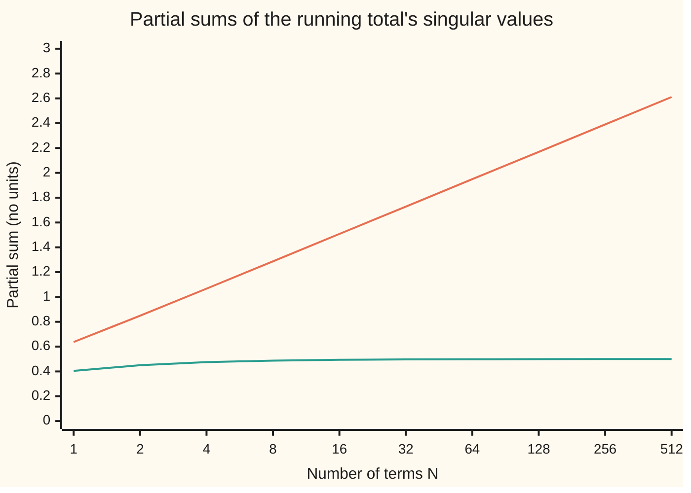

# Trace class: the operators small enough to have a trace, and Lidskii's theorem that the trace adds the eigenvalues

[Syllabus](../../../SYLLABUS.md) → [Functional analysis](../README.md) → [Bounded Operators](../README.md#s03) → Trace class

---

## General Overview

A flow meter on a pipe adds up the flow over one hour. Measure time as a fraction of the hour, x from 0 to 1. The reading at time x is the running total of the flow rate f since the start: $`(Vf)(x) = \int_0^x f(y)\,dy`$. This **running total** V (the Volterra operator) is a blur with a one-sided window: each reading mixes every earlier rate with equal weight.

Take N readings, a grid step h = 1/N apart. Then V is an N-by-N triangular matrix with h/2 on its diagonal. Its **trace**, the sum of the diagonal, is 0.500000 at every N. A triangular matrix has its eigenvalues on the diagonal, so the eigenvalues also add to 0.500000.

Now let N grow. The true V has no nonzero eigenvalue: if Vf = λf with λ ≠ 0, then f′ = f/λ and f(0) = 0, so f = 0. Its eigenvalues add to 0, while its diagonal still adds to 1/2. Something breaks on the way to infinity.

What breaks is size. Sort an operator's gains along its best input directions; these are its **singular values** $`\sigma_n`$. For V they are $`2/((2n-1)\pi)`$: 0.636620, 0.212207, 0.127324, and so on. Their squares add to 1/2, so V is **Hilbert-Schmidt**. The values themselves add to infinity, so V is not **trace class**.

Square the meter, V², and the singular values fall like $`1/n^2`$. They add to 0.379477, so V² is trace class. Its trace is 0 and it has no nonzero eigenvalue, so 0 = 0. Add the rank-one $`Kf(x) = x\int_0^1 f`$, the hour's total spread evenly over the hour (every output is a multiple of the one function x), and the sum T = K + V² has trace 1/2. T has infinitely many complex eigenvalues, and they add to 1/2 as well.

**An operator is trace class when its singular values add to a finite number; then the sum of its diagonal entries is the same in every orthonormal basis, it equals the integral of a continuous kernel along the diagonal, and by Lidskii's theorem it equals the sum of the eigenvalues.**

**What kind of fact this is:** theorems. Proved on this card in Why it works: the Schatten classes absorb bounded factors, the product of two Hilbert-Schmidt operators is trace class, the trace does not depend on the basis, and Lidskii's theorem in finite dimensions. Lidskii's theorem in infinite dimensions (Lidskii, 1959), closure under sums, and the kernel-diagonal formula for continuous kernels are stated with Simon's *Trace Ideals* as the source. The eigenvalues of T are derived on the card; the code checks every number on truncations.

### The picture: two sums of the meter's singular values



The upper line adds the singular values themselves, up to N terms. It climbs by about 0.2206 each time N doubles and never settles: V is not trace class. The lower line adds their squares and settles at 0.500: V is Hilbert-Schmidt.

---

## The formula

Notation first, in words.

- $`L^2(0, 1)`$ holds every signal f on the hour with a finite integral of $`f^2`$. The inner product is $`\langle f, g\rangle = \int_0^1 f g\,dx`$ (real here; with complex values it conjugates its first slot).
- $`T^*`$ is the adjoint of T ([Adjoints](03-adjoints-self-adjoint-and-unitary-operators.md)). $`\lvert T\rvert = (T^*T)^{1/2}`$ is its **absolute value**, the positive part of its [Polar decomposition](11-polar-decomposition-and-partial-isometries.md) $`T = U\lvert T\rvert`$.
- The **singular values** $`\sigma_1 \ge \sigma_2 \ge \dots`$ of a compact T are the eigenvalues of $`\lvert T\rvert`$ ([Compact and symmetric](08-spectral-theorem-for-compact-self-adjoint-operators.md)). Equivalently, $`\sigma_n^2`$ are the eigenvalues of $`T^*T`$.
- An **orthonormal basis** $`e_1, e_2, \dots`$ is a list of perpendicular signals of size 1 that leaves no direction out ([Orthonormal bases](../02-Hilbert%20Spaces/03-orthonormal-bases-and-parseval.md)).

The **Schatten p-norm**, for p from 1 up:

```math
\|T\|_p = \Big(\sum_{n} \sigma_n^p\Big)^{1/p}, \qquad S_p = \{T \text{ compact} : \|T\|_p < \infty\}
```

**Read it aloud:** add the p-th powers of the singular values and take the p-th root; the operators where this is finite form the Schatten class $`S_p`$.

Two classes have names. $`S_1`$ is the **trace class**, and $`\|T\|_1`$ is the **trace norm**. $`S_2`$ is the **Hilbert-Schmidt** class, and $`\|T\|_2 = \|T\|_{HS}`$ is the rms size of the kernel over the square ([Compact operators](05-compact-operators.md)). The operator norm is the largest singular value, $`\|T\| = \sigma_1`$.

For a trace-class T, the **trace** and Lidskii's theorem:

```math
\mathrm{tr}\, T = \sum_{n} \langle e_n, T e_n\rangle = \int_0^1 k(x, x)\,dx = \sum_{k} \lambda_k
```

**Read it aloud:** the trace is the sum of the diagonal entries in any orthonormal basis; for a continuous kernel it is the kernel integrated along the diagonal; and it is the sum of all the eigenvalues, each counted as often as its algebraic multiplicity (the power of its factor in the characteristic polynomial, for a matrix).

The example's operators, with kernels written for y < x and y > x:

```math
(Vf)(x) = \int_0^x f, \quad (Kf)(x) = x\int_0^1 f, \quad T = K + V^2, \quad k_T(x, y) = \begin{cases} x + (x - y), & y < x \\ x, & y > x \end{cases}
```

**Read it aloud:** V is the running total; K multiplies the hour's total by x; T adds K to the running total taken twice, whose kernel is x − y below the diagonal and 0 above it.

| Symbol | Plain meaning | In our example | Push it up and the answer… |
| --- | --- | --- | --- |
| $`x`$, $`y`$ | times, as fractions of the hour | 0 to 1 | — |
| $`f`$, $`L^2(0, 1)`$, $`\langle f, g\rangle`$ | a flow-rate signal; the space of signals; inner product | — | outputs scale with f |
| $`V`$ | the running total; kernel 1 below the diagonal, 0 above | $`\sigma_n = 2/((2n-1)\pi)`$ | — |
| $`K`$ | rank one: x times the hour's total; kernel x | trace 1/2, eigenvalue 1/2 | — |
| $`T = K + V^2`$, $`k_T`$, $`k(x, y)`$ | the trace-class test operator; its kernel; any operator's kernel | trace 1/2 | — |
| $`T^*`$, $`\lvert T\rvert`$, $`\sigma_n`$ | adjoint; absolute value; n-th singular value | $`\sigma_1(V)`$ = 0.636620 | — |
| $`\Vert T\Vert_p`$, $`S_p`$, $`\Vert T\Vert`$, $`p`$, $`q`$ | Schatten p-norm and class; operator norm; exponents, 1 or more | V²: 0.2844, 0.2887, 0.3795 for p = ∞, 2, 1 | smaller p, larger norm, smaller class |
| $`e_n`$, $`g_m`$, $`v_n`$, $`u_n`$ | orthonormal bases: sines $`\sqrt2\sin(n\pi x)`$, or 1 and cosines $`\sqrt2\cos(n\pi x)`$; a second basis; best input and output directions | both bases give trace 1/2 for T | — |
| $`\mathrm{tr}\, T`$, $`\lambda_k`$, $`L`$ | trace; k-th eigenvalue of T, for every integer k (an index, not a kernel); $`L = \ln(2 + \sqrt3)`$ = 1.316958 | $`\lambda_0`$ = 0.576576 | — |
| $`N`$, $`h`$, $`V_N`$, $`M`$ | grid points; grid step 1/N; the meter as an N-by-N grid matrix; basis terms kept | N = 20, 40, 80; M = 10 to 1000 | truncation error falls like 1/N or 1/M |
| $`\beta_n`$ | n-th root of $`\cos\beta\cosh\beta = -1`$, the cantilever equation | 1.875104 | $`\sigma_n(V^2) = 1/\beta_n^2`$ |
| $`A`$, $`B`$, $`U`$, $`R`$, $`F`$, $`G`$, $`z`$, $`\rho`$ | bounded operators; a unitary (length-keeping) operator; an upper-triangular matrix; two Hilbert-Schmidt factors; a complex number in the Fredholm determinant $`\det(I - zT)`$; a density operator. In the folds, w, s, a, c are named where used | $`\det(I - T)`$ = 0.456919 | — |

### When it holds

- **Trace class, for the trace to mean anything.** V is only Hilbert-Schmidt. Its diagonal sums are 1/2 in sines and cosines alike, yet its eigenvalues add to 0. Lidskii fails without $`\|T\|_1 < \infty`$.
- **A continuous kernel, for the diagonal integral.** V's kernel jumps from 1 to 0 across the diagonal. Read the diagonal as 0, 1/2 or 1 and the "trace" is 0, 1/2 or 1. T's kernel is continuous, so its diagonal integral is safe.
- **An orthonormal basis, for the diagonal sum.** A basis that is not perpendicular, or that leaves a direction out, changes the sum. Every orthonormal basis gives the same answer.
- **Algebraic multiplicity, for Lidskii.** A repeated eigenvalue counts as often as its factor repeats, not as often as it has independent eigenvectors. The 2-by-2 matrix with rows (1, 1) and (0, 1) has trace 2 and eigenvalue 1 twice, but one eigenvector: counting by eigenvectors gives 1, not 2.

---

## Why it works

### Step 0: the idea, a trace is a product of two square sums

In finite dimensions the trace is safe because the diagonal is finite. In infinite dimensions a diagonal sum can diverge, or converge in one basis and not another.

Trace class is the cure because every trace-class operator is a product $`T = FG`$ of two Hilbert-Schmidt operators F and G. A diagonal entry is then an inner product $`\langle F^* e_n, G e_n\rangle`$. Cauchy-Schwarz bounds the sum of their sizes by two square sums, and square sums do not depend on the basis. Absolute convergence lets the sum be rearranged freely, so the basis drops out.

### Step 1: singular values come from the absolute value

$`T^*T`$ is compact, self-adjoint and positive. [Compact and symmetric](08-spectral-theorem-for-compact-self-adjoint-operators.md) gives it orthonormal eigenvectors $`v_n`$ with eigenvalues $`\sigma_n^2`$. Set $`u_n = Tv_n/\sigma_n`$; these are orthonormal too. Then T acts as a weighted list of rank-one pieces, its **Schmidt form**:

```math
Tf = \sum_n \sigma_n \langle v_n, f\rangle\, u_n
```

**Read it aloud:** measure f along each best input direction, multiply by that direction's gain, and send it out along the matching output direction.

For the meter, $`V^*V`$ has kernel $`1 - \max(x, y)`$. Its eigenfunctions are $`\sqrt2\cos((2n-1)\pi x/2)`$ with eigenvalues $`4/((2n-1)^2\pi^2)`$, so $`\sigma_n(V) = 2/((2n-1)\pi)`$. The code finds them again on grids: 0.636599, 0.212145, 0.127222 at N = 80.

### Step 2: the Schatten classes are ideals

For bounded A and B, each singular value obeys $`\sigma_n(ATB) \le \|A\|\,\sigma_n(T)\,\|B\|`$. The reason: by the min-max rule, $`\sigma_n(T)`$ is the smallest worst-case gain of T on inputs perpendicular to some n − 1 directions, and A and B stretch every gain by at most their norms. So

```math
\|ATB\|_p \le \|A\|\,\|T\|_p\,\|B\|, \qquad \|T\| \le \|T\|_q \le \|T\|_p \ \ (p \le q)
```

**Read it aloud:** squeezing a Schatten operator between bounded ones keeps it in its class, and the norms fall as p rises, so the classes grow: trace class inside Hilbert-Schmidt inside every larger p, all inside the compact operators.

The second inequality holds because, once the singular values are scaled so the largest is 1, every other one is at most 1, and higher powers of such numbers are smaller. For V² the ladder reads 0.2844 ≤ 0.2887 ≤ 0.3795. The meter V sits in $`S_p`$ exactly when p > 1, because $`\sum n^{-p}`$ converges exactly then.

Sums stay in the class too: the p-norm of a sum is at most the sum of the p-norms (stated with Simon as the source). Closed under sums and under products with bounded operators, each $`S_p`$ is an **ideal**, so K + V² is trace class.

### Step 3: Hilbert-Schmidt times Hilbert-Schmidt is trace class

Take Hilbert-Schmidt F and G and any orthonormal basis. By Cauchy-Schwarz, first on each entry and then on the sum:

```math
\sum_n \lvert\langle e_n, FG e_n\rangle\rvert = \sum_n \lvert\langle F^* e_n, G e_n\rangle\rvert \le \|F\|_2\,\|G\|_2
```

**Read it aloud:** the diagonal of a product of two Hilbert-Schmidt operators adds up absolutely, to at most the product of their Hilbert-Schmidt norms.

For the trace norm itself, use the Schmidt directions of $`FG`$: $`\|FG\|_1 = \sum_n \langle u_n, FG v_n\rangle = \sum_n \langle F^* u_n, G v_n\rangle`$, and the same Cauchy-Schwarz gives $`\|FG\|_1 \le \|F\|_2\|G\|_2`$. Conversely, any trace-class $`T = U\lvert T\rvert`$ splits as $`(U\lvert T\rvert^{1/2})(\lvert T\rvert^{1/2})`$, two Hilbert-Schmidt factors.

For the meter, $`\|V^2\|_1 \le \|V\|_2^2 = 1/2`$. The true value is 0.379477.

The singular values of V² have a closed form: $`\sigma_n(V^2) = 1/\beta_n^2`$, where $`\beta_n`$ are the roots of $`\cos\beta\cosh\beta = -1`$, the clamped-free (cantilever) beam's equation. The first three are 0.284413, 0.045383 and 0.016208. Their squares add to 1/12 = 0.083333, the integral of $`(x - y)^2`$ over the triangle below the diagonal, as Hilbert-Schmidt requires.

<details>
<summary>Detailed derivation: why the cantilever equation gives the singular values of V²</summary>

Let $`(V^2)^*V^2 u = s^2 u`$, with s a singular value, and put $`w = V^2 u`$. Then $`w'' = u`$ and $`w(0) = w'(0) = 0`$. The adjoint $`V^*`$ totals from x to 1, so differentiating twice gives $`w = s^2 u''`$ with $`u(1) = u'(1) = 0`$:

$`\displaystyle s^2\, w'''' = w, \qquad w(0) = w'(0) = 0, \qquad w''(1) = w'''(1) = 0 .`$

That is a beam clamped at 0 and free at 1. With $`\beta^4 = 1/s^2`$, a nonzero solution exists only when $`\cos\beta\cosh\beta = -1`$. Since $`\beta_n`$ approaches $`(n - \tfrac12)\pi`$ very fast, the code adds 1/2 (the sum of $`1/((n - \tfrac12)\pi)^2`$) to a short, fast-converging list of corrections.

</details>

### Step 4: the trace does not depend on the basis

Write a trace-class T as $`FG`$ with both factors Hilbert-Schmidt, and take two orthonormal bases $`e_n`$ and $`g_m`$. Expand each diagonal entry of the first basis through the second (Parseval):

```math
\sum_n \langle F^* e_n, G e_n\rangle = \sum_n\sum_m \langle e_n, F g_m\rangle\langle G^* g_m, e_n\rangle = \sum_m \langle G^* g_m, F g_m\rangle
```

**Read it aloud:** expand along a second basis, swap the order of the two sums, and the sum becomes the diagonal of $`GF`$ in the second basis.

The double sum converges absolutely by Cauchy-Schwarz, so the swap is legal. With $`g_m = e_m`$ this says $`\mathrm{tr}(FG) = \mathrm{tr}(GF)`$. Chaining the two, the diagonal of $`FG`$ is the same in $`e_n`$ as in $`g_m`$.

The code checks T in two bases.

- **Sines,** $`e_n = \sqrt2\sin(n\pi x)`$: the diagonal entries are $`5/(n^2\pi^2)`$ for odd n and $`-3/(n^2\pi^2)`$ for even n: +0.506606, −0.075991, +0.056290, −0.018998. Quadrature on 4000 points agrees to six places.
- **One and cosines,** $`e_0 = 1`$, $`e_n = \sqrt2\cos(n\pi x)`$: the first entry is 1/2 + 1/6, and the rest are $`-1/(n^2\pi^2)`$.

Cut each basis at M terms. At M = 10, 100, 1000 the sine sums are 0.488532, 0.498972, 0.499899, and the cosine sums 0.509642, 0.501008, 0.500101. One approaches 1/2 from below, the other from above.

<details>
<summary>Detailed computation: the diagonal entries in both bases</summary>

For K, $`\langle e, Ke\rangle = \langle e, x\rangle\langle 1, e\rangle`$. With sines this is $`4/(n^2\pi^2)`$ for odd n and 0 for even n. With cosines only $`e_0 = 1`$ meets the constant, giving 1/2.

For V², $`\langle e, V^2 e\rangle = \langle V^* e, V e\rangle`$. With sines, $`Ve_n = \sqrt2(1 - \cos n\pi x)/(n\pi)`$ and $`V^*e_n = \sqrt2(\cos n\pi x - (-1)^n)/(n\pi)`$, so

$`\displaystyle \langle e_n, V^2 e_n\rangle = -\frac{2}{n^2\pi^2}\Big((-1)^n + \frac12\Big).`$

The odd terms add to 1/8 and the even to −1/8. With cosines the entries are 1/6, then $`-1/(n^2\pi^2)`$, adding to 0 again.

</details>

### Step 5: the trace from the kernel

For a trace-class operator with a continuous kernel, the trace is the diagonal integral $`\int_0^1 k(x, x)\,dx`$ (stated with Simon's *Trace Ideals* as the source). The idea: cut the square into small cells; the grid matrix's trace is a Riemann sum of the diagonal.

- K has kernel x, so $`\mathrm{tr}\,K = \int_0^1 x\,dx`$ = 0.500000. K sends x to $`x\int_0^1 x`$, 0.500000 times x, so its one nonzero eigenvalue is 1/2. Its one singular value is $`\|x\|\,\|1\| = 1/\sqrt3`$ = 0.577350. So $`\lvert\mathrm{tr}\,K\rvert \le \|K\|_1`$, with room to spare, because K is not a positive operator (for a positive one, trace and trace norm are equal).
- V² has kernel x − y below the diagonal and 0 above. Both sides are 0 at y = x, so $`\mathrm{tr}\,V^2 = 0`$, while $`\|V^2\|_1`$ = 0.379477.

### Step 6: Lidskii in finite dimensions, by the Schur form

Every square complex matrix A has a **Schur form** $`A = URU^*`$: U unitary (it keeps lengths) and R upper triangular. Build it one column at a time: take an eigenvector as the first basis vector, and repeat on the perpendicular part.

The diagonal of R holds the eigenvalues, each repeated by its algebraic multiplicity. The trace does not change under $`A \mapsto U^*AU`$ (Step 4, in finite form). So $`\mathrm{tr}\,A = \mathrm{tr}\,R`$ = the sum of the eigenvalues.

By hand, take the 2-by-2 matrix with rows (1, −2) and (1, 3). Its characteristic polynomial is $`(z - 1)(z - 3) + 2 = z^2 - 4z + 5`$, with roots 2 + i and 2 − i. They add to 4, the trace 1 + 3. The code finds the roots by Durand-Kerner root finding on $`\det(zI - A)`$ and checks each against the quadratic formula.

### Step 7: Lidskii in infinite dimensions, checked on T

For any trace-class T on a Hilbert space, $`\mathrm{tr}\,T = \sum_k \lambda_k`$ (Lidskii, 1959; stated with Simon as the source). The proof goes through the **Fredholm determinant** $`\det(I - zT)`$, an entire function (defined for every complex z) whose slope at z = 0 is $`-\mathrm{tr}\,T`$. The hard step is proving it equals $`\prod_k (1 - z\lambda_k)`$, with no extra exponential factor; then compare slopes at 0.

T = K + V² is not symmetric, so the spectral theorem of [Compact and symmetric](08-spectral-theorem-for-compact-self-adjoint-operators.md) does not apply. Its eigenvalues come from a short calculation:

```math
\lambda_k = \frac{1}{(L + 2\pi i k)^2}, \qquad \cosh L = 2, \qquad L = \ln(2 + \sqrt3), \qquad k = 0, \pm1, \pm2, \dots
```

**Read it aloud:** the eigenvalues are one over the squares of the complex numbers whose hyperbolic cosine is 2.

- k = 0: $`\lambda_0`$ = 0.576576. Power iteration on a 2000-point grid finds 0.576576.
- k = ±1: −0.022222 ± 0.009744i.
- k = ±2: −0.006128 ± 0.001299i.

They add to 1/2. Conjugate pairs cancel their imaginary parts. Summing over $`\lvert k\rvert \le`$ 1, 10, 100, 1000 gives 0.532131, 0.504819, 0.500504, 0.500051. In closed form, $`\sum_k (L + 2\pi i k)^{-2} = 1/(4\sinh^2(L/2))`$, and $`\sinh^2(L/2) = (\cosh L - 1)/2 = 1/2`$, so the sum is exactly 1/2.

The Fredholm determinant of T is $`\det(I - zT) = 2 - \cosh\sqrt z`$. Its zeros are $`z = 1/\lambda_k`$, its value at 0 is 1, and its slope at 0 is −1/2 = −tr T. Each zero is simple, since the slope $`-\sinh\sqrt z/(2\sqrt z)`$ is not 0 where $`\cosh\sqrt z = 2`$, so each $`\lambda_k`$ counts once. At z = 1 it is 2 − cosh 1 = 0.456919. Gaussian elimination on grids of 50, 100 and 200 points gives 0.454601, 0.455769, 0.456346, with the error halving as N doubles.

Only the trace adds: K has eigenvalue 1/2 and V² none, yet T's largest is 0.576576.

<details>
<summary>Detailed derivation: the eigenvalues of T = K + V²</summary>

Suppose $`Tf = \lambda f`$ with $`\lambda \ne 0`$, and let $`c = \int_0^1 f`$. Then $`\lambda f - V^2 f = c\,x`$. If c = 0, f would be an eigenfunction of V², which has none, so c ≠ 0; scale to c = 1.

Differentiate twice: $`\lambda f'' - f = 0`$, with $`f(0) = 0`$ and $`f'(0) = 1/\lambda`$ from the equation and its derivative at x = 0. With $`a = 1/\sqrt\lambda`$, the solution is

$`\displaystyle f(x) = \frac{\sinh(a x)}{\lambda a}, \qquad \int_0^1 f = \frac{\cosh a - 1}{\lambda a^2} = \cosh a - 1 .`$

The condition $`\int_0^1 f = c = 1`$ gives $`\cosh a = 2`$. Its solutions are $`a = \pm(L + 2\pi i k)`$, so $`\lambda = 1/a^2 = 1/(L + 2\pi i k)^2`$.

For the sum, differentiate $`\sum_k 1/(z + 2\pi i k) = \tfrac12\coth(z/2)`$ (the symmetric partial fraction series) with respect to z, and set z = L.

</details>

### What the truncation hides

On the grid, Lidskii holds by Step 6: the meter's grid matrix $`V_N`$ has N eigenvalues h/2, adding to 0.500000 at every N, while V has none. The finite sums do not pass to the limit because V's singular values are not summable: $`\|V_N\|_1`$ is 1.4349, 1.6555, 1.8761 at N = 20, 40, 80, growing by 0.2206 = ln 2/π per doubling. For V², the grid trace norms 0.367155, 0.373271, 0.376363 settle, and extrapolate to 0.379455 against 0.379477 from the cantilever roots. Trace class is the condition that lets the finite identity survive the limit.

---

## Worked numbers, by hand

| Step | Arithmetic | Value |
| --- | --- | --- |
| V's singular values | $`2/\pi`$, $`2/(3\pi)`$, $`2/(5\pi)`$ | 0.636620, 0.212207, 0.127324 |
| V's Hilbert-Schmidt norm squared | $`\frac{4}{\pi^2}\sum_{\text{odd } m} \frac{1}{m^2} = \frac{4}{\pi^2}\cdot\frac{\pi^2}{8}`$; also the triangle's area | 1/2 |
| V's trace norm | $`\sum 2/((2n-1)\pi)`$, 512 terms | 2.611, still growing |
| V²'s singular values | $`1/\beta_n^2`$, $`\beta`$ = 1.875104, 4.694091, 7.854757 | 0.284413, 0.045383, 0.016208 |
| V²'s trace norm | 1/2 plus the root corrections | 0.379477 ≤ 1/2 |
| trace of K | $`\int_0^1 x\,dx`$ | 0.500000 |
| trace of V² | $`\int_0^1 (x - x)\,dx`$ | 0 |
| top eigenvalue of T | $`1/L^2`$, L = 1.316958 | 0.576576 |
| eigenvalues of T, all k | $`1/(4\sinh^2(L/2)) = 1/(4 \times \tfrac12)`$ | **1/2 = tr T** |

The trace of T, read off its kernel's diagonal, is 1/2; its infinitely many complex eigenvalues, added up, are 1/2 too: Lidskii's theorem on an operator no spectral theorem can diagonalise.

### What breaks if you drop a piece

| Mistake | Comes out at | What went wrong |
| --- | --- | --- |
| Lidskii on V, which is only Hilbert-Schmidt | diagonal sums 0.479802, 0.497974, 0.499797 in sines at M = 10, 100, 1000; grid eigenvalues add to 0.500000; true eigenvalue sum 0 | not trace class: the trace norm grows 0.2206 per doubling |
| Trace norm read as the size of the trace | V²: trace 0, trace norm 0.379477 | $`\lvert\mathrm{tr}\,T\rvert \le \Vert T\Vert_1`$ is only a bound |
| Eigenvalues of a sum taken as sums of eigenvalues | K + V² read as 1/2 and 0; true top eigenvalue 0.576576 | only the trace is linear |
| Fredholm determinant on a coarse grid | 0.454601 at N = 50 against 0.456919 | the truncation error falls like 1/N |

The code prints every entry.

---

## Code, from first principles, and it actually runs

The code builds the meter on a midpoint grid and checks each claim by at least two roads.

- **Singular values:** the closed forms $`2/((2n-1)\pi)`$ and $`1/\beta_n^2`$ (cantilever roots by bisection), against Jacobi rotations on $`V_N^{\mathsf T}V_N`$ and $`(V_N^2)^{\mathsf T}V_N^2`$ at N = 20, 40, 80.
- **Hilbert-Schmidt norms:** the sum of squared singular values against the kernel's squares.
- **Traces:** closed-form diagonal entries in two bases, checked by quadrature, cut at M terms.
- **Lidskii:** the closed-form eigenvalues of T summed, against power iteration for the top one and Gaussian elimination for the Fredholm determinant.
- **Finite rehearsal:** the 2-by-2 eigenvalues by Durand-Kerner root finding, checked against the quadratic formula, then summed against the diagonal.

### Python

```python
# Trace class -- the check behind the card.  Standard library only.
# V is the running total (Vf)(x) = integral of f from 0 to x on L2(0, 1); K f(x) = x * (integral of f).
# Roads: closed forms (singular values, cantilever roots, eigenvalues of K + V^2) against
# truncations (an N-point midpoint grid, a basis cut to M terms); Jacobi rotations for
# eigenvalues, power iteration, Gaussian elimination for a determinant.
import math

def jacobi(A):                            # eigenvalues of a symmetric matrix, largest first
    n, A = len(A), [r[:] for r in A]
    while sum(A[i][j] ** 2 for i in range(n) for j in range(n) if i != j) > 1e-28:
        for p in range(n - 1):
            for q in range(p + 1, n):
                if A[p][q] == 0.0:
                    continue
                th = (A[q][q] - A[p][p]) / (2 * A[p][q])
                t = (1 if th >= 0 else -1) / (abs(th) + math.sqrt(th * th + 1))
                c = 1 / math.sqrt(t * t + 1); s = t * c
                for k in range(n):
                    A[k][p], A[k][q] = c * A[k][p] - s * A[k][q], s * A[k][p] + c * A[k][q]
                for k in range(n):
                    A[p][k], A[q][k] = c * A[p][k] - s * A[q][k], s * A[p][k] + c * A[q][k]
    return sorted((A[i][i] for i in range(n)), reverse=True)

def mul(A, B):                            # matrix product
    return [[sum(a * b for a, b in zip(r, c)) for c in zip(*B)] for r in A]
gram = lambda A: mul([list(c) for c in zip(*A)], A)   # A^T A: eigenvalues are squared singular values

def vgrid(N):                             # V on N midpoints: weight h below the diagonal, h/2 on it
    return [[1 / N if j < i else (0.5 / N if i == j else 0.0) for j in range(N)] for i in range(N)]

def vapply(f, h):                         # the same V_N, applied by a running sum
    out, run = [], 0.0
    for v in f:
        out.append(h * (run + v / 2)); run += v
    return out

sig = lambda n: 2 / ((2 * n - 1) * math.pi)
print("V: singular values 2/((2n-1)pi): " + ", ".join(f"{sig(n):.6f}" for n in (1, 2, 3)))
pts = [2 ** j for j in range(10)]
print("chart N 1..512, sum of sigma_n to N:   " + ", ".join(f"{sum(sig(n) for n in range(1, N + 1)):.3f}" for N in pts))
print("chart N 1..512, sum of sigma_n^2 to N: " + ", ".join(f"{sum(sig(n) ** 2 for n in range(1, N + 1)):.3f}" for N in pts))
grid = {}
for N in (20, 40, 80):
    V = vgrid(N)
    s = [math.sqrt(max(e, 0.0)) for e in jacobi(gram(V))]
    V2 = mul(V, V)
    s2 = [math.sqrt(max(e, 0.0)) for e in jacobi(gram(V2))]
    frob = sum(a * a for r in V for a in r)
    grid[N] = (s, s2, frob)
    print(f"grid N {N}: V top singular values {s[0]:.6f} {s[1]:.6f} {s[2]:.6f}; sum s^2 {sum(x * x for x in s):.6f},"
          f" kernel squared {frob:.6f}; trace norm sum s {sum(s):.4f}; V^2 trace norm {sum(s2):.6f}")
grow = [sum(grid[N][0]) for N in (20, 40, 80)]
print(f"V trace norm growth per doubling of N: {grow[1] - grow[0]:.4f}, {grow[2] - grow[1]:.4f}; ln2/pi = {math.log(2) / math.pi:.4f};"
      f" V_N's diagonal sum, N eigenvalues h/2: {sum(vgrid(80)[i][i] for i in range(80)):.6f}")

# V^2: singular values 1/beta^2, beta the cantilever roots of cos(b)cosh(b) = -1.
def beta(n):
    lo, hi = (n - 0.5) * math.pi - 1, (n - 0.5) * math.pi + 0.5
    for _ in range(200):
        mid = (lo + hi) / 2
        if (math.cos(mid) + 1 / math.cosh(mid) > 0) == (n % 2 == 1): lo = mid
        else: hi = mid
    return (lo + hi) / 2
b = [beta(n) for n in range(1, 31)]
asy = [((n - 0.5) * math.pi) for n in range(1, 31)]     # past n = 30, beta_n = (n - 1/2) pi to 1e-40
tn2 = 0.5 + sum(1 / x ** 2 - 1 / y ** 2 for x, y in zip(b, asy))
hs2 = 1 / 6 + sum(1 / x ** 4 - 1 / y ** 4 for x, y in zip(b, asy))
rich = 2 * sum(grid[80][1]) - sum(grid[40][1])
print(f"V^2: beta {b[0]:.6f} {b[1]:.6f} {b[2]:.6f}; singular values {1 / b[0] ** 2:.6f} {1 / b[1] ** 2:.6f} {1 / b[2] ** 2:.6f}")
print(f"V^2: HS^2 from roots {hs2:.6f}, kernel (x-y)^2 over the triangle 1/12 = {1 / 12:.6f}")
print(f"V^2: trace norm from roots {tn2:.6f}; grid 40 and 80 extrapolated {rich:.6f}; ||V||_HS^2 = 0.5 bounds it")
print(f"norm ladder V^2: operator {1 / b[0] ** 2:.4f} <= HS {math.sqrt(hs2):.4f} <= trace {tn2:.4f}")

# Traces.  T = K + V^2 has kernel x + (x - y) for y < x, and x above the diagonal.
Q = 4000; h = 1 / Q; xs = [(i + 0.5) * h for i in range(Q)]
Kx = [x * sum(v * h for v in xs) for x in xs]
print(f"trace from kernel diagonal: K {sum(x * h for x in xs):.6f}, V^2 0; K applied to x: {Kx[Q // 2] / xs[Q // 2]:.6f}"
      f" times x; ||K||_1 = 1/sqrt(3) = {1 / math.sqrt(3):.6f}")
sine = lambda n: (4 + 1 if n % 2 else -3) / (n * math.pi) ** 2          # <e_n, T e_n>, e_n = sqrt2 sin
for n in (1, 2, 3, 4):
    e = [math.sqrt(2) * math.sin(n * math.pi * x) for x in xs]
    Te = [k + w for k, w in zip([x * sum(v * h for v in e) for x in xs], vapply(vapply(e, h), h))]
    q = sum(a * c * h for a, c in zip(e, Te))
    print(f"sine basis n {n}: <e_n, T e_n> formula {sine(n):+.6f}, quadrature {q:+.6f}")
    assert abs(q - sine(n)) < 1e-5                                      # closed forms checked
for M in (10, 100, 1000):
    cs = 0.5 + 1 / 6 - sum(1 / (n * math.pi) ** 2 for n in range(1, M + 1))
    vs = sum(4 / (n * math.pi) ** 2 for n in range(1, M + 1, 2))
    print(f"basis cut M {M}: trace of T in sines {sum(sine(n) for n in range(1, M + 1)):.6f}, in cosines {cs:.6f};"
          f" V's diagonal in sines {vs:.6f}")

# Lidskii for T: eigenvalues 1/(L + 2 pi i k)^2 with cosh L = 2.
L = math.log(2 + math.sqrt(3))
lam = lambda k: 1 / complex(L, 2 * math.pi * k) ** 2
print(f"L = ln(2 + sqrt3) = {L:.6f}; eigenvalues: k = 0 {lam(0).real:.6f}; " + "; ".join(
      f"k = +-{k} {lam(k).real:.6f} +- {abs(lam(k).imag):.6f}i" for k in (1, 2)))
for Kc in (1, 10, 100, 1000):
    print(f"Lidskii: sum of eigenvalues |k| <= {Kc}: {sum(lam(k) for k in range(-Kc, Kc + 1)).real:.6f}")
N = 2000; hh = 1 / N; g = [(i + 0.5) * hh for i in range(N)]
f = [1.0] * N
for _ in range(60):
    w = [x * sum(v * hh for v in f) + a for x, a in zip(g, vapply(vapply(f, hh), hh))]
    top = math.sqrt(sum(a * a for a in w)); f = [a / top for a in w]
w = [x * sum(v * hh for v in f) + a for x, a in zip(g, vapply(vapply(f, hh), hh))]
lam0 = sum(a * c for a, c in zip(f, w))
print(f"power iteration on N {N}: top eigenvalue {lam0:.6f}, closed form 1/L^2 = {1 / L ** 2:.6f}")
for N in (50, 100, 200):
    V = vgrid(N); A = mul(V, V)
    M = [[(1.0 if i == j else 0.0) - ((i + 0.5) / N / N + A[i][j]) for j in range(N)] for i in range(N)]
    det = 1.0
    for c in range(N):                     # Gaussian elimination, no pivoting needed here
        det *= M[c][c]
        for r in range(c + 1, N):
            m = M[r][c] / M[c][c]
            M[r] = [a - m * p for a, p in zip(M[r], M[c])]
    print(f"Fredholm determinant det(I - T) on grid N {N}: {det:.6f}; limit 2 - cosh(1) = {2 - math.cosh(1):.6f}")

# Finite rehearsal: A = [[1, -2], [1, 3]], eigenvalues by Durand-Kerner on det(zI - A), built from A's entries.
A = [[1.0, -2.0], [1.0, 3.0]]; tr, dt = A[0][0] + A[1][1], A[0][0] * A[1][1] - A[0][1] * A[1][0]
z = [complex(0.4, 0.9), complex(0.4, 0.9) ** 2]
for _ in range(100): z = [zi - ((zi - A[0][0]) * (zi - A[1][1]) - A[0][1] * A[1][0]) / (zi - z[1 - i]) for i, zi in enumerate(z)]
print(f"2 x 2: eigenvalues {z[0].real:.6f}{z[0].imag:+.6f}i, {z[1].real:.6f}{z[1].imag:+.6f}i; sum {sum(z).real:.6f}, trace {tr:.0f}")

# Density matrix rho = 2 V*V: weights 8/((2n-1)^2 pi^2), sum 1, purity 2/3.
p = [2 * sig(n) ** 2 for n in range(1, 4)]
pg = [2 * x * x for x in grid[80][0]]
print(f"density 2V*V: weights {p[0]:.6f} {p[1]:.6f} {p[2]:.6f}; grid 80 {pg[0]:.6f} {pg[1]:.6f} {pg[2]:.6f};"
      f" grid trace {sum(pg):.6f}, purity {sum(x * x for x in pg):.6f}")

assert abs(grid[80][0][0] - sig(1)) < 1e-4 and abs(grid[80][0][1] - sig(2)) < 1e-3   # grid finds 2/pi, 2/(3pi)
assert all(abs(sum(x * x for x in grid[N][0]) - (0.5 - 1 / (4 * N))) < 1e-9 for N in grid)  # HS = kernel
assert abs(grow[2] - grow[1] - math.log(2) / math.pi) < 2e-3                         # trace norm diverges
assert abs(hs2 - 1 / 12) < 1e-12 and abs(rich - tn2) < 2e-4 and tn2 < 0.5            # V^2 trace class
assert abs(Kx[Q // 2] / xs[Q // 2] - 0.5) < 1e-9
assert abs(sum(sine(n) for n in range(1, 10 ** 5)) - 0.5) < 1e-5                    # basis-free trace
assert abs(sum(lam(k) for k in range(-10 ** 5, 10 ** 5 + 1)) - 0.5) < 1e-5          # Lidskii
assert abs(lam0 - 1 / L ** 2) < 1e-3 and abs(det - (2 - math.cosh(1))) < 2e-3
assert max(abs(zi - complex(tr / 2, s * math.sqrt(dt - tr * tr / 4))) for zi, s in zip(z, (1, -1))) < 1e-12  # quadratic formula
assert abs(sum(z) - tr) < 1e-12 and abs(sum(pg) - 1) < 0.01 and abs(sum(x * x for x in pg) - 2 / 3) < 1e-3
print("ALL CHECKS PASS")
```

**Ran 2026-11-24 on macOS, Python 3.14.10, standard library only. All checks passed. Output, pasted from the run:**

```
V: singular values 2/((2n-1)pi): 0.636620, 0.212207, 0.127324
chart N 1..512, sum of sigma_n to N:   0.637, 0.849, 1.067, 1.287, 1.508, 1.728, 1.949, 2.169, 2.390, 2.611
chart N 1..512, sum of sigma_n^2 to N: 0.405, 0.450, 0.475, 0.487, 0.494, 0.497, 0.498, 0.499, 0.500, 0.500
grid N 20: V top singular values 0.636292 0.211224 0.125683; sum s^2 0.487500, kernel squared 0.487500; trace norm sum s 1.4349; V^2 trace norm 0.367155
grid N 40: V top singular values 0.636538 0.211961 0.126915; sum s^2 0.493750, kernel squared 0.493750; trace norm sum s 1.6555; V^2 trace norm 0.373271
grid N 80: V top singular values 0.636599 0.212145 0.127222; sum s^2 0.496875, kernel squared 0.496875; trace norm sum s 1.8761; V^2 trace norm 0.376363
V trace norm growth per doubling of N: 0.2206, 0.2206; ln2/pi = 0.2206; V_N's diagonal sum, N eigenvalues h/2: 0.500000
V^2: beta 1.875104 4.694091 7.854757; singular values 0.284413 0.045383 0.016208
V^2: HS^2 from roots 0.083333, kernel (x-y)^2 over the triangle 1/12 = 0.083333
V^2: trace norm from roots 0.379477; grid 40 and 80 extrapolated 0.379455; ||V||_HS^2 = 0.5 bounds it
norm ladder V^2: operator 0.2844 <= HS 0.2887 <= trace 0.3795
trace from kernel diagonal: K 0.500000, V^2 0; K applied to x: 0.500000 times x; ||K||_1 = 1/sqrt(3) = 0.577350
sine basis n 1: <e_n, T e_n> formula +0.506606, quadrature +0.506606
sine basis n 2: <e_n, T e_n> formula -0.075991, quadrature -0.075991
sine basis n 3: <e_n, T e_n> formula +0.056290, quadrature +0.056290
sine basis n 4: <e_n, T e_n> formula -0.018998, quadrature -0.018998
basis cut M 10: trace of T in sines 0.488532, in cosines 0.509642; V's diagonal in sines 0.479802
basis cut M 100: trace of T in sines 0.498972, in cosines 0.501008; V's diagonal in sines 0.497974
basis cut M 1000: trace of T in sines 0.499899, in cosines 0.500101; V's diagonal in sines 0.499797
L = ln(2 + sqrt3) = 1.316958; eigenvalues: k = 0 0.576576; k = +-1 -0.022222 +- 0.009744i; k = +-2 -0.006128 +- 0.001299i
Lidskii: sum of eigenvalues |k| <= 1: 0.532131
Lidskii: sum of eigenvalues |k| <= 10: 0.504819
Lidskii: sum of eigenvalues |k| <= 100: 0.500504
Lidskii: sum of eigenvalues |k| <= 1000: 0.500051
power iteration on N 2000: top eigenvalue 0.576576, closed form 1/L^2 = 0.576576
Fredholm determinant det(I - T) on grid N 50: 0.454601; limit 2 - cosh(1) = 0.456919
Fredholm determinant det(I - T) on grid N 100: 0.455769; limit 2 - cosh(1) = 0.456919
Fredholm determinant det(I - T) on grid N 200: 0.456346; limit 2 - cosh(1) = 0.456919
2 x 2: eigenvalues 2.000000+1.000000i, 2.000000-1.000000i; sum 4.000000, trace 4
density 2V*V: weights 0.810569 0.090063 0.032423; grid 80 0.810517 0.090011 0.032371; grid trace 0.993750, purity 0.666563
ALL CHECKS PASS
```

### Rust

Same numbers, same labels, built with `rustc --edition 2021 -O`.

```rust
// Trace class -- the same check as the Python, in Rust.  No crates.
// V is the running total (Vf)(x) = integral of f from 0 to x on L2(0, 1); K f(x) = x * (integral of f).
// Roads: closed forms (singular values, cantilever roots, eigenvalues of K + V^2) against
// truncations (an N-point midpoint grid, a basis cut to M terms); Jacobi rotations for
// eigenvalues, power iteration, Gaussian elimination for a determinant.
use std::f64::consts::PI;

#[derive(Clone, Copy)]
struct C { re: f64, im: f64 } // a complex number
fn cadd(a: C, b: C) -> C { C { re: a.re + b.re, im: a.im + b.im } }
fn csub(a: C, b: C) -> C { C { re: a.re - b.re, im: a.im - b.im } }
fn cmul(a: C, b: C) -> C { C { re: a.re * b.re - a.im * b.im, im: a.re * b.im + a.im * b.re } }
fn cdiv(a: C, b: C) -> C { let d = b.re * b.re + b.im * b.im; C { re: (a.re * b.re + a.im * b.im) / d, im: (a.im * b.re - a.re * b.im) / d } }

type M = Vec<Vec<f64>>;
fn jacobi(a0: &M) -> Vec<f64> { // eigenvalues of a symmetric matrix, largest first
    let n = a0.len();
    let mut a = a0.clone();
    let off = |a: &M| { let mut s = 0.0; for i in 0..n { for j in 0..n { if i != j { s += a[i][j] * a[i][j]; } } } s };
    while off(&a) > 1e-28 {
        for p in 0..n - 1 { for q in p + 1..n {
            if a[p][q] == 0.0 { continue; }
            let th = (a[q][q] - a[p][p]) / (2.0 * a[p][q]);
            let t = (if th >= 0.0 { 1.0 } else { -1.0 }) / (th.abs() + (th * th + 1.0).sqrt());
            let c = 1.0 / (t * t + 1.0).sqrt(); let s = t * c;
            for k in 0..n { let (x, y) = (a[k][p], a[k][q]); a[k][p] = c * x - s * y; a[k][q] = s * x + c * y; }
            for k in 0..n { let (x, y) = (a[p][k], a[q][k]); a[p][k] = c * x - s * y; a[q][k] = s * x + c * y; }
        } }
    }
    let mut d: Vec<f64> = (0..n).map(|i| a[i][i]).collect();
    d.sort_by(|x, y| y.partial_cmp(x).unwrap()); d
}
fn mul(a: &M, b: &M) -> M { // matrix product
    (0..a.len()).map(|i| (0..a.len()).map(|j| (0..a.len()).map(|k| a[i][k] * b[k][j]).sum()).collect()).collect()
}
fn gram(a: &M) -> M { // A^T A: eigenvalues are squared singular values
    mul(&(0..a.len()).map(|i| (0..a.len()).map(|j| a[j][i]).collect()).collect(), a)
}
fn vgrid(n: usize) -> M { // V on N midpoints: weight h below the diagonal, h/2 on it
    (0..n).map(|i| (0..n).map(|j| if j < i { 1.0 / n as f64 } else if i == j { 0.5 / n as f64 } else { 0.0 }).collect()).collect()
}
fn vapply(f: &[f64], h: f64) -> Vec<f64> { // the same V_N, applied by a running sum
    let mut run = 0.0;
    f.iter().map(|&v| { let o = h * (run + v / 2.0); run += v; o }).collect()
}
fn sig(n: usize) -> f64 { 2.0 / ((2 * n - 1) as f64 * PI) }
fn sing(a: &M) -> Vec<f64> { jacobi(&gram(a)).iter().map(|e| e.max(0.0).sqrt()).collect() }
fn beta(n: usize) -> f64 { // cantilever root: cos(b)cosh(b) = -1
    let (mut lo, mut hi) = ((n as f64 - 0.5) * PI - 1.0, (n as f64 - 0.5) * PI + 0.5);
    for _ in 0..200 {
        let mid = (lo + hi) / 2.0;
        if (mid.cos() + 1.0 / mid.cosh() > 0.0) == (n % 2 == 1) { lo = mid } else { hi = mid }
    }
    (lo + hi) / 2.0
}
fn join(v: &[f64], d: usize) -> String { v.iter().map(|x| format!("{:.*}", d, x)).collect::<Vec<_>>().join(", ") }

fn main() {
    println!("V: singular values 2/((2n-1)pi): {}", join(&[sig(1), sig(2), sig(3)], 6));
    let pts: Vec<usize> = (0..10).map(|j| 1 << j).collect();
    let ps = |p: i32| -> Vec<f64> { pts.iter().map(|&n| (1..=n).map(|k| sig(k).powi(p)).sum()).collect() };
    println!("chart N 1..512, sum of sigma_n to N:   {}", join(&ps(1), 3));
    println!("chart N 1..512, sum of sigma_n^2 to N: {}", join(&ps(2), 3));
    let mut grid = vec![];
    for n in [20usize, 40, 80] {
        let v = vgrid(n);
        let (s, s2) = (sing(&v), sing(&mul(&v, &v)));
        let frob: f64 = v.iter().map(|r| r.iter().map(|a| a * a).sum::<f64>()).sum();
        println!("grid N {}: V top singular values {:.6} {:.6} {:.6}; sum s^2 {:.6}, kernel squared {:.6}; trace norm sum s {:.4}; V^2 trace norm {:.6}",
                 n, s[0], s[1], s[2], s.iter().map(|x| x * x).sum::<f64>(), frob, s.iter().sum::<f64>(), s2.iter().sum::<f64>());
        assert!((s.iter().map(|x| x * x).sum::<f64>() - (0.5 - 0.25 / n as f64)).abs() < 1e-9); // HS = kernel
        grid.push((n, s, s2));
    }
    let grow: Vec<f64> = grid.iter().map(|g| g.1.iter().sum()).collect();
    let v80 = vgrid(80);
    println!("V trace norm growth per doubling of N: {:.4}, {:.4}; ln2/pi = {:.4}; V_N's diagonal sum, N eigenvalues h/2: {:.6}",
             grow[1] - grow[0], grow[2] - grow[1], 2f64.ln() / PI, (0..80).map(|i| v80[i][i]).sum::<f64>());

    // V^2: singular values 1/beta^2, beta the cantilever roots of cos(b)cosh(b) = -1.
    let b: Vec<f64> = (1..31).map(beta).collect();
    let asy: Vec<f64> = (1..31).map(|n| (n as f64 - 0.5) * PI).collect(); // past n = 30, beta_n = (n - 1/2) pi to 1e-40
    let tn2 = 0.5 + b.iter().zip(&asy).map(|(x, y)| 1.0 / (x * x) - 1.0 / (y * y)).sum::<f64>();
    let hs2 = 1.0 / 6.0 + b.iter().zip(&asy).map(|(x, y)| 1.0 / x.powi(4) - 1.0 / y.powi(4)).sum::<f64>();
    let t2 = |i: usize| grid[i].2.iter().sum::<f64>();
    let rich = 2.0 * t2(2) - t2(1);
    println!("V^2: beta {:.6} {:.6} {:.6}; singular values {:.6} {:.6} {:.6}", b[0], b[1], b[2], 1.0 / (b[0] * b[0]), 1.0 / (b[1] * b[1]), 1.0 / (b[2] * b[2]));
    println!("V^2: HS^2 from roots {:.6}, kernel (x-y)^2 over the triangle 1/12 = {:.6}", hs2, 1.0 / 12.0);
    println!("V^2: trace norm from roots {:.6}; grid 40 and 80 extrapolated {:.6}; ||V||_HS^2 = 0.5 bounds it", tn2, rich);
    println!("norm ladder V^2: operator {:.4} <= HS {:.4} <= trace {:.4}", 1.0 / (b[0] * b[0]), hs2.sqrt(), tn2);

    // Traces.  T = K + V^2 has kernel x + (x - y) for y < x, and x above the diagonal.
    let (q, h) = (4000, 1.0 / 4000.0);
    let xs: Vec<f64> = (0..q).map(|i| (i as f64 + 0.5) * h).collect();
    let ix: f64 = xs.iter().map(|x| x * h).sum();
    let kx: Vec<f64> = xs.iter().map(|x| x * ix).collect();
    println!("trace from kernel diagonal: K {:.6}, V^2 0; K applied to x: {:.6} times x; ||K||_1 = 1/sqrt(3) = {:.6}",
             ix, kx[q / 2] / xs[q / 2], 1.0 / 3f64.sqrt());
    let sine = |n: usize| (if n % 2 == 1 { 5.0 } else { -3.0 }) / (n as f64 * PI).powi(2); // <e_n, T e_n>, e_n = sqrt2 sin
    for n in 1..5usize {
        let e: Vec<f64> = xs.iter().map(|x| 2f64.sqrt() * (n as f64 * PI * x).sin()).collect();
        let (ie, vve): (f64, _) = (e.iter().map(|v| v * h).sum(), vapply(&vapply(&e, h), h));
        let qd: f64 = e.iter().zip(xs.iter().zip(&vve)).map(|(a, (x, w))| a * (x * ie + w) * h).sum();
        println!("sine basis n {}: <e_n, T e_n> formula {:+.6}, quadrature {:+.6}", n, sine(n), qd);
        assert!((qd - sine(n)).abs() < 1e-5); // closed forms checked
    }
    for m in [10usize, 100, 1000] {
        let cs = 0.5 + 1.0 / 6.0 - (1..=m).map(|n| 1.0 / (n as f64 * PI).powi(2)).sum::<f64>();
        let vs: f64 = (1..=m).step_by(2).map(|n| 4.0 / (n as f64 * PI).powi(2)).sum();
        println!("basis cut M {}: trace of T in sines {:.6}, in cosines {:.6}; V's diagonal in sines {:.6}",
                 m, (1..=m).map(sine).sum::<f64>(), cs, vs);
    }

    // Lidskii for T: eigenvalues 1/(L + 2 pi i k)^2 with cosh L = 2.
    let l = (2.0 + 3f64.sqrt()).ln();
    let lam = |k: i64| { let a = C { re: l, im: 2.0 * PI * k as f64 }; cdiv(C { re: 1.0, im: 0.0 }, cmul(a, a)) };
    println!("L = ln(2 + sqrt3) = {:.6}; eigenvalues: k = 0 {:.6}; k = +-1 {:.6} +- {:.6}i; k = +-2 {:.6} +- {:.6}i",
             l, lam(0).re, lam(1).re, lam(1).im.abs(), lam(2).re, lam(2).im.abs());
    let lsum = |kc: i64| (-kc..=kc).fold(C { re: 0.0, im: 0.0 }, |s, k| cadd(s, lam(k)));
    for kc in [1i64, 10, 100, 1000] { println!("Lidskii: sum of eigenvalues |k| <= {}: {:.6}", kc, lsum(kc).re); }
    let (n, hh) = (2000, 1.0 / 2000.0);
    let g: Vec<f64> = (0..n).map(|i| (i as f64 + 0.5) * hh).collect();
    let tapply = |f: &Vec<f64>| -> Vec<f64> {
        let i_f: f64 = f.iter().map(|v| v * hh).sum();
        let w = vapply(&vapply(f, hh), hh);
        g.iter().zip(&w).map(|(x, a)| x * i_f + a).collect()
    };
    let mut f = vec![1.0; n];
    for _ in 0..60 { let w = tapply(&f); let top = w.iter().map(|a| a * a).sum::<f64>().sqrt(); f = w.iter().map(|a| a / top).collect(); }
    let lam0: f64 = f.iter().zip(tapply(&f)).map(|(a, c)| a * c).sum();
    println!("power iteration on N {}: top eigenvalue {:.6}, closed form 1/L^2 = {:.6}", n, lam0, 1.0 / (l * l));
    let mut det = 0.0;
    for nn in [50usize, 100, 200] {
        let v = vgrid(nn); let a = mul(&v, &v);
        let mut m: M = (0..nn).map(|i| (0..nn).map(|j| (if i == j { 1.0 } else { 0.0 })
            - ((i as f64 + 0.5) / nn as f64 / nn as f64 + a[i][j])).collect()).collect();
        det = 1.0;
        for c in 0..nn { // Gaussian elimination, no pivoting needed here
            det *= m[c][c];
            for r in c + 1..nn { let mm = m[r][c] / m[c][c]; for j in 0..nn { m[r][j] -= mm * m[c][j]; } }
        }
        println!("Fredholm determinant det(I - T) on grid N {}: {:.6}; limit 2 - cosh(1) = {:.6}", nn, det, 2.0 - 1f64.cosh());
    }

    // Finite rehearsal: A = [[1, -2], [1, 3]], eigenvalues by Durand-Kerner on det(zI - A), built from A's entries.
    let a = [[1.0, -2.0], [1.0, 3.0]]; let (tr, dt) = (a[0][0] + a[1][1], a[0][0] * a[1][1] - a[0][1] * a[1][0]);
    let (z0, cr) = (C { re: 0.4, im: 0.9 }, |x: f64| C { re: x, im: 0.0 }); let mut z = [z0, cmul(z0, z0)];
    let p = |w: C| csub(cmul(csub(w, cr(a[0][0])), csub(w, cr(a[1][1]))), cr(a[0][1] * a[1][0]));
    for _ in 0..100 { z = [0, 1].map(|i| csub(z[i], cdiv(p(z[i]), csub(z[i], z[1 - i])))); }
    let zs = cadd(z[0], z[1]);
    println!("2 x 2: eigenvalues {:.6}{:+.6}i, {:.6}{:+.6}i; sum {:.6}, trace {:.0}", z[0].re, z[0].im, z[1].re, z[1].im, zs.re, tr);

    // Density matrix rho = 2 V*V: weights 8/((2n-1)^2 pi^2), sum 1, purity 2/3.
    let pg: Vec<f64> = grid[2].1.iter().map(|x| 2.0 * x * x).collect();
    println!("density 2V*V: weights {:.6} {:.6} {:.6}; grid 80 {:.6} {:.6} {:.6}; grid trace {:.6}, purity {:.6}",
             2.0 * sig(1).powi(2), 2.0 * sig(2).powi(2), 2.0 * sig(3).powi(2), pg[0], pg[1], pg[2],
             pg.iter().sum::<f64>(), pg.iter().map(|x| x * x).sum::<f64>());

    assert!((grid[2].1[0] - sig(1)).abs() < 1e-4 && (grid[2].1[1] - sig(2)).abs() < 1e-3); // grid finds 2/pi, 2/(3pi)
    assert!((grow[2] - grow[1] - 2f64.ln() / PI).abs() < 2e-3); // trace norm diverges
    assert!((hs2 - 1.0 / 12.0).abs() < 1e-12 && (rich - tn2).abs() < 2e-4 && tn2 < 0.5); // V^2 trace class
    assert!((kx[q / 2] / xs[q / 2] - 0.5).abs() < 1e-9);
    assert!(((1..100000usize).map(sine).sum::<f64>() - 0.5).abs() < 1e-5); // basis-free trace
    let big = lsum(100000);
    assert!((big.re - 0.5).abs() < 1e-5 && big.im.abs() < 1e-9); // Lidskii
    assert!((lam0 - 1.0 / (l * l)).abs() < 1e-3 && (det - (2.0 - 1f64.cosh())).abs() < 2e-3);
    assert!([1.0, -1.0].iter().zip(&z).all(|(s, w)| (w.re - tr / 2.0).abs() < 1e-12 && (w.im - s * (dt - tr * tr / 4.0).sqrt()).abs() < 1e-12)); // quadratic formula
    assert!((zs.re - tr).abs() < 1e-12 && zs.im.abs() < 1e-12 && (pg.iter().sum::<f64>() - 1.0).abs() < 0.01
            && (pg.iter().map(|x| x * x).sum::<f64>() - 2.0 / 3.0).abs() < 1e-3);
    println!("ALL CHECKS PASS");
}
```

**Ran 2026-11-24 on macOS, rustc 1.98.1, no crates. All checks passed. Output, pasted from the run:**

```
V: singular values 2/((2n-1)pi): 0.636620, 0.212207, 0.127324
chart N 1..512, sum of sigma_n to N:   0.637, 0.849, 1.067, 1.287, 1.508, 1.728, 1.949, 2.169, 2.390, 2.611
chart N 1..512, sum of sigma_n^2 to N: 0.405, 0.450, 0.475, 0.487, 0.494, 0.497, 0.498, 0.499, 0.500, 0.500
grid N 20: V top singular values 0.636292 0.211224 0.125683; sum s^2 0.487500, kernel squared 0.487500; trace norm sum s 1.4349; V^2 trace norm 0.367155
grid N 40: V top singular values 0.636538 0.211961 0.126915; sum s^2 0.493750, kernel squared 0.493750; trace norm sum s 1.6555; V^2 trace norm 0.373271
grid N 80: V top singular values 0.636599 0.212145 0.127222; sum s^2 0.496875, kernel squared 0.496875; trace norm sum s 1.8761; V^2 trace norm 0.376363
V trace norm growth per doubling of N: 0.2206, 0.2206; ln2/pi = 0.2206; V_N's diagonal sum, N eigenvalues h/2: 0.500000
V^2: beta 1.875104 4.694091 7.854757; singular values 0.284413 0.045383 0.016208
V^2: HS^2 from roots 0.083333, kernel (x-y)^2 over the triangle 1/12 = 0.083333
V^2: trace norm from roots 0.379477; grid 40 and 80 extrapolated 0.379455; ||V||_HS^2 = 0.5 bounds it
norm ladder V^2: operator 0.2844 <= HS 0.2887 <= trace 0.3795
trace from kernel diagonal: K 0.500000, V^2 0; K applied to x: 0.500000 times x; ||K||_1 = 1/sqrt(3) = 0.577350
sine basis n 1: <e_n, T e_n> formula +0.506606, quadrature +0.506606
sine basis n 2: <e_n, T e_n> formula -0.075991, quadrature -0.075991
sine basis n 3: <e_n, T e_n> formula +0.056290, quadrature +0.056290
sine basis n 4: <e_n, T e_n> formula -0.018998, quadrature -0.018998
basis cut M 10: trace of T in sines 0.488532, in cosines 0.509642; V's diagonal in sines 0.479802
basis cut M 100: trace of T in sines 0.498972, in cosines 0.501008; V's diagonal in sines 0.497974
basis cut M 1000: trace of T in sines 0.499899, in cosines 0.500101; V's diagonal in sines 0.499797
L = ln(2 + sqrt3) = 1.316958; eigenvalues: k = 0 0.576576; k = +-1 -0.022222 +- 0.009744i; k = +-2 -0.006128 +- 0.001299i
Lidskii: sum of eigenvalues |k| <= 1: 0.532131
Lidskii: sum of eigenvalues |k| <= 10: 0.504819
Lidskii: sum of eigenvalues |k| <= 100: 0.500504
Lidskii: sum of eigenvalues |k| <= 1000: 0.500051
power iteration on N 2000: top eigenvalue 0.576576, closed form 1/L^2 = 0.576576
Fredholm determinant det(I - T) on grid N 50: 0.454601; limit 2 - cosh(1) = 0.456919
Fredholm determinant det(I - T) on grid N 100: 0.455769; limit 2 - cosh(1) = 0.456919
Fredholm determinant det(I - T) on grid N 200: 0.456346; limit 2 - cosh(1) = 0.456919
2 x 2: eigenvalues 2.000000+1.000000i, 2.000000-1.000000i; sum 4.000000, trace 4
density 2V*V: weights 0.810569 0.090063 0.032423; grid 80 0.810517 0.090011 0.032371; grid trace 0.993750, purity 0.666563
ALL CHECKS PASS
```

### Lean

Lean proves Lidskii's theorem in finite dimensions, and checks the card's two infinite sums and its by-hand numbers.

- Take an operator in finite dimensions, with complex scalars, and any orthonormal basis. Then its diagonal sum equals its eigenvalues' sum, counted by algebraic multiplicity.
- Take the numbers $`2/((2n-1)\pi)`$, the meter's singular values, for n = 1, 2, 3 and on. Then their squares add to exactly 1/2, while the numbers themselves add to infinity.
- Take $`L = \ln(2 + \sqrt3)`$. Then the numbers $`1/(L + 2\pi i k)^2`$, over every integer k, add to exactly 1/2.
- Take the matrix with rows (1, −2) and (1, 3). Then its trace is 4, and the roots 2 + i and 2 − i of $`z^2 - 4z + 5`$ add to 4.
- Take the matrix with rows (1, 1) and (0, 1). Then its trace is 2.
- Take the meter's grid matrix $`V_N`$ at N = 20, 40, 80. Then its N diagonal entries h/2 add to 1/2.
- The closing arithmetic holds: (2 − 1)/2 = 1/2, and 1/(4 · 1/2) = 1/2.

Linking these sums to V and T, and every grid and determinant computation, is left to the Python and Rust checks.

```lean
-- Trace class: in finite dimensions the diagonal sum in any orthonormal basis equals the sum of the eigenvalues counted by algebraic multiplicity, the running total is Hilbert-Schmidt but not trace class, and the eigenvalues of K + V² add to its trace 1/2.
import Mathlib.Analysis.InnerProductSpace.Trace
import Mathlib.LinearAlgebra.Eigenspace.Charpoly
import Mathlib.LinearAlgebra.Matrix.Charpoly.Eigs
import Mathlib.Analysis.SpecialFunctions.Trigonometric.Basic
import Mathlib.Analysis.SpecialFunctions.Sqrt
import Mathlib.Analysis.SpecialFunctions.Log.Basic
import Mathlib.Analysis.Complex.Polynomial.Basic
import Mathlib.Analysis.PSeries
import Mathlib.NumberTheory.ZetaValues
import Mathlib.NumberTheory.ModularForms.EisensteinSeries.QExpansion

open scoped InnerProductSpace
open Complex Real

/-- Lidskii's theorem in finite dimensions (Steps 4 and 6 of the card): for an operator `T`
on a finite-dimensional complex inner product space, the sum of the diagonal entries
`⟨eᵢ, T eᵢ⟩` is the same in every orthonormal basis `e`, and it equals the sum of the
eigenvalues of `T`, each counted as often as its factor repeats in the characteristic
polynomial (its algebraic multiplicity). -/
theorem diagonal_sum_eq_sum_eigenvalues
    {E ι : Type*} [NormedAddCommGroup E] [InnerProductSpace ℂ E] [FiniteDimensional ℂ E]
    [Fintype ι] (T : E →ₗ[ℂ] E) (e : OrthonormalBasis ι ℂ E) :
    ∑ i, ⟪e i, T (e i)⟫_ℂ = (LinearMap.charpoly T).roots.sum := by
  rw [← LinearMap.trace_eq_sum_inner T e]
  exact Module.End.trace_eq_sum_roots_charpoly_of_splits (IsAlgClosed.splits _)

/-- The running total `V` has singular values `2/((2n - 1)π)` for `n = 1, 2, …`
(indexed here from `n = 0` as `2/((2n + 1)π)`). Their squares add to `1/2`, so `V` is
Hilbert-Schmidt, but the singular values themselves do not add to a finite number,
so `V` is not trace class. -/
theorem running_total_hilbert_schmidt_not_trace_class :
    HasSum (fun n : ℕ => (2 / ((2 * (n : ℝ) + 1) * π)) ^ 2) (1 / 2) ∧
      ¬ Summable (fun n : ℕ => 2 / ((2 * (n : ℝ) + 1) * π)) := by
  constructor
  · set f : ℕ → ℝ := fun n => 1 / (n : ℝ) ^ 2 with hfdef
    have hf : HasSum f (π ^ 2 / 6) := hasSum_zeta_two
    have hs : Summable (fun n : ℕ => f (2 * n + 1)) :=
      hf.summable.comp_injective (f := f) (i := fun n : ℕ => 2 * n + 1)
        (fun a b h => by simpa using h)
    have he : HasSum (fun n : ℕ => f (2 * n)) (π ^ 2 / 6 / 4) := by
      have := hf.div_const 4
      refine this.congr_fun ?_
      intro n
      simp only [hfdef]
      push_cast
      ring
    have htot := HasSum.even_add_odd he hs.hasSum
    have hval : ∑' n : ℕ, f (2 * n + 1) = π ^ 2 / 8 := by
      have := htot.unique hf
      linarith
    have ho := hs.hasSum
    rw [hval] at ho
    have := ho.mul_left (4 / π ^ 2)
    convert this using 1
    · ext n
      have hp : π ≠ 0 := Real.pi_ne_zero
      have h1 : (2 * (n : ℝ) + 1) ≠ 0 := by positivity
      simp only [hfdef]
      push_cast
      field_simp
      ring
    · field_simp
      ring
  · intro h
    apply Real.not_summable_one_div_natCast
    rw [← summable_nat_add_iff 1]
    have h2 := h.mul_left π
    refine Summable.of_nonneg_of_le (fun n => by positivity) (fun n => ?_) h2
    have hp : 0 < π := Real.pi_pos
    push_cast
    rw [mul_div_assoc', div_le_div_iff₀ (by positivity) (by positivity)]
    nlinarith

/-- Lidskii's theorem checked on `T = K + V²`: its eigenvalues are `1/(L + 2πik)²` for every
integer `k`, with `L = ln(2 + √3)` (so `cosh L = 2`), and they add up to `1/2`, the trace of `T`
read off its kernel's diagonal. -/
theorem eigenvalues_of_k_plus_v_sq_sum_to_half :
    HasSum (fun k : ℤ =>
      1 / (((Real.log (2 + Real.sqrt 3) : ℝ) : ℂ) + 2 * (π : ℂ) * I * (k : ℂ)) ^ 2) (1 / 2) := by
  set L : ℝ := Real.log (2 + Real.sqrt 3) with hL
  have hs3 : Real.sqrt 3 ^ 2 = 3 := Real.sq_sqrt (by norm_num)
  have hs3pos : 0 < Real.sqrt 3 := by positivity
  have hs3gt : 1 < Real.sqrt 3 := by nlinarith
  have hLpos : 0 < L := Real.log_pos (by linarith)
  have hexp : Real.exp (-L) = 2 - Real.sqrt 3 := by
    rw [Real.exp_neg, hL, Real.exp_log (by positivity)]
    field_simp
    nlinarith
  have hpi : (0 : ℝ) < π := Real.pi_pos
  have hpiC : (π : ℂ) ≠ 0 := by exact_mod_cast hpi.ne'
  -- the point w = i L / (2π) in the upper half plane
  have hwim : 0 < (I * (L : ℂ) / (2 * π)).im := by
    have : (I * (L : ℂ) / (2 * π)) = ((L / (2 * π) : ℝ) : ℂ) * I := by
      push_cast; field_simp
    rw [this]
    simp only [mul_im, ofReal_re, I_im, ofReal_im, I_re, mul_zero, mul_one, add_zero]
    positivity
  let w : UpperHalfPlane := ⟨I * (L : ℂ) / (2 * π), hwim⟩
  have hw : (w : ℂ) = I * (L : ℂ) / (2 * π) := rfl
  have hq : cexp (2 * π * I * (w : ℂ)) = ((2 - Real.sqrt 3 : ℝ) : ℂ) := by
    rw [← hexp, ofReal_exp, hw]
    congr 1
    field_simp
    rw [I_sq]
    push_cast; ring
  have hqn : ‖((2 - Real.sqrt 3 : ℝ) : ℂ)‖ < 1 := by
    rw [Complex.norm_real, Real.norm_eq_abs, abs_lt]
    constructor <;> nlinarith
  have hid := EisensteinSeries.qExpansion_identity (k := 1) le_rfl w
  rw [hq] at hid
  simp only [pow_one, Nat.factorial_one, Nat.cast_one, div_one] at hid
  rw [tsum_coe_mul_geometric_of_norm_lt_one hqn] at hid
  -- summability of the Eisenstein-type series
  have hsum : Summable fun n : ℤ => 1 / ((w : ℂ) + n) ^ 2 := by
    have := EisensteinSeries.linear_right_summable (w : ℂ) 1 (k := 2) le_rfl
    refine this.congr fun n => ?_
    simp
  have hh := hsum.hasSum
  rw [hid] at hh
  have hneg := (Equiv.neg ℤ).hasSum_iff.mpr hh
  have hfin := hneg.mul_left (1 / (-4 * (π : ℂ) ^ 2))
  convert hfin using 1
  · ext k
    simp only [Function.comp_apply, Equiv.neg_apply, Int.cast_neg]
    rw [hw]
    have hk : ((L : ℂ) + 2 * π * I * k) = (-2 * π * I) * (I * L / (2 * π) + -(k : ℂ)) := by
      field_simp
      ring_nf
      rw [I_sq]
      ring
    rw [hk, mul_pow]
    have hI : (-2 * (π : ℂ) * I) ^ 2 = -4 * π ^ 2 := by
      ring_nf; rw [I_sq]; ring
    rw [hI]
    by_cases h0 : (I * L / (2 * π) + -(k : ℂ)) = 0
    · simp [h0]
    · field_simp
  · have h1 : (1 : ℂ) - ((2 - Real.sqrt 3 : ℝ) : ℂ) = ((Real.sqrt 3 - 1 : ℝ) : ℂ) := by
      push_cast; ring
    rw [h1]
    have hne : ((Real.sqrt 3 - 1 : ℝ) : ℂ) ≠ 0 := by
      exact_mod_cast (show Real.sqrt 3 - 1 ≠ 0 by linarith)
    have hI : (-2 * (π : ℂ) * I) ^ 2 = -4 * π ^ 2 := by
      ring_nf; rw [I_sq]; ring
    rw [hI]
    have hr : (2 - Real.sqrt 3) / (Real.sqrt 3 - 1) ^ 2 = (1 / 2 : ℝ) := by
      have : (Real.sqrt 3 - 1) ^ 2 ≠ 0 := by positivity
      field_simp
      nlinarith
    have hr' : ((2 - Real.sqrt 3 : ℝ) : ℂ) / ((Real.sqrt 3 - 1 : ℝ) : ℂ) ^ 2 = 1 / 2 := by
      rw [← ofReal_pow, ← ofReal_div, hr]; push_cast; ring
    rw [← hr']
    field_simp

-- The by-hand rehearsal: rows (1, -2) and (1, 3) have trace 4.
example : Matrix.trace !![(1 : ℚ), -2; 1, 3] = 4 := by
  norm_num [Matrix.trace_fin_two]

-- Its characteristic polynomial is z² - 4z + 5, whose roots 2 + i and 2 - i add to 4.
example : (2 + I) ^ 2 - 4 * (2 + I) + 5 = 0 ∧ (2 - I) ^ 2 - 4 * (2 - I) + 5 = 0 ∧
    (2 + I) + (2 - I) = 4 := by
  refine ⟨?_, ?_, ?_⟩ <;> ring_nf <;> norm_num [Complex.ext_iff, pow_two]

-- The Jordan block with rows (1, 1) and (0, 1) has trace 2 (eigenvalue 1, counted twice).
example : Matrix.trace !![(1 : ℚ), 1; 0, 1] = 2 := by
  norm_num [Matrix.trace_fin_two]

-- The meter's grid matrix V_N has N diagonal entries h/2 = 1/(2N), adding to 1/2.
example : (∑ _i : Fin 20, (1 : ℚ) / (2 * 20)) = 1 / 2 := by norm_num
example : (∑ _i : Fin 40, (1 : ℚ) / (2 * 40)) = 1 / 2 := by norm_num
example : (∑ _i : Fin 80, (1 : ℚ) / (2 * 80)) = 1 / 2 := by norm_num

-- The Fredholm-determinant closing step: sinh²(L/2) = (cosh L - 1)/2 = (2 - 1)/2 = 1/2,
-- so the eigenvalue sum 1/(4 sinh²(L/2)) is 1/2.
example : ((2 : ℚ) - 1) / 2 = 1 / 2 ∧ (1 : ℚ) / (4 * (1 / 2)) = 1 / 2 := by norm_num

#print axioms diagonal_sum_eq_sum_eigenvalues
#print axioms running_total_hilbert_schmidt_not_trace_class
#print axioms eigenvalues_of_k_plus_v_sq_sum_to_half
```

**Checked 2026-11-24 on macOS, Lean 4.36.0-rc2, Mathlib v4.36.0-rc2. Every proof is complete and uses only Lean's standard axioms. Output, pasted from the run:**

```
'diagonal_sum_eq_sum_eigenvalues' depends on axioms: [propext, Classical.choice, Quot.sound]
'running_total_hilbert_schmidt_not_trace_class' depends on axioms: [propext, Classical.choice, Quot.sound]
'eigenvalues_of_k_plus_v_sq_sum_to_half' depends on axioms: [propext, Classical.choice, Quot.sound]
```

> [!TIP]
> **Try changing**
> Guess first, then run it.
> - **A finer meter grid.** Change `(20, 40, 80)` in the singular-value loop to `(20, 40, 80, 160)`. Guess V's trace norm at N = 160. It is 2.0967, another 0.2206 up, while V²'s settles further, to 0.377917.
> - **More eigenvalues of T.** Add `10000` to the list in the Lidskii loop. Guess the partial sum. It is 0.500005: the error keeps falling ten times per tenfold cut.
> - **A finer determinant grid.** Add `400` to the Fredholm-determinant loop. Guess the value. It is 0.456633, the gap to 0.456919 halving again.

---

## The usual mistake

> [!warning]
> **Adding the diagonal of an operator that is not trace class.** The meter V has diagonal sums 0.479802, 0.497974, 0.499797 in sines at M = 10, 100, 1000, heading for 1/2; in cosines the first entry alone is 1/2. Every grid matrix agrees, with eigenvalues adding to 0.500000. Yet V has no nonzero eigenvalue. The diagonal number is real, but it is not a trace: V's singular values add to infinity.
>
> - **Hilbert-Schmidt taken for trace class.** V's squared singular values add to 1/2, but its trace norm grows by 0.2206 with every doubling of N.
> - **The trace norm taken for the trace.** V² has trace 0 and trace norm 0.379477; K has trace 0.500000 and trace norm 0.577350.
> - **Eigenvalues added across a sum.** K has eigenvalue 1/2 and V² none, but the top eigenvalue of K + V² is 0.576576. Only the traces add.
> - **A jumping kernel read on its diagonal.** V's kernel is 1 below the diagonal and 0 above, so its "diagonal integral" is 0, 1/2 or 1 depending on the reading.

---

## Where you meet it in real life

- **Quantum mechanics.** A mixed state is a **density operator** ρ (here not the resolvent set ρ(T)): positive, trace class, with trace 1. The expected value of a bounded observable A is tr(ρA). For example, $`\rho = 2V^*V`$ is a density operator with weights 0.810569, 0.090063, 0.032423, …; its purity $`\mathrm{tr}\,\rho^2`$ is 2/3, and the 80-point grid gives trace 0.993750 and purity 0.666563.
- **Random matrices.** The largest eigenvalue of a big random symmetric matrix follows, after centering and scaling, the Tracy-Widom law, which is a Fredholm determinant $`\det(I - K)`$ of a trace-class kernel operator.
- **Statistical physics.** A partition function is the trace of the exponential of minus the energy operator over Boltzmann's constant times temperature; it is finite exactly when that exponential is trace class.
- **Beams.** The singular values of V² are $`1/\beta_n^2`$ for a cantilever beam, whose natural frequencies grow like $`\beta_n^2`$: 1.875104² sets the lowest note of a diving board.

> **Say it back**
> Singular values are the eigenvalues of an operator's absolute value. Adding their p-th powers gives the Schatten classes: p = 1 is trace class, p = 2 Hilbert-Schmidt. For a trace-class operator the diagonal sum is the same in every orthonormal basis, and by Lidskii's theorem it equals the sum of the eigenvalues. The running total V is only Hilbert-Schmidt, and its diagonal says 1/2 while its eigenvalues say 0. K + V² is trace class: trace 1/2, and its complex eigenvalues add to 1/2.

---

## What this builds on

- [Polar decomposition](11-polar-decomposition-and-partial-isometries.md): the absolute value $`\lvert T\rvert = (T^*T)^{1/2}`$, whose eigenvalues are the singular values, and $`T = U\lvert T\rvert`$, which splits a trace-class operator into two Hilbert-Schmidt factors.
- [Compact operators](05-compact-operators.md): compactness, the Hilbert-Schmidt norm as the kernel's rms size, and the ideal rule that this card refines class by class.
- [Compact and symmetric](08-spectral-theorem-for-compact-self-adjoint-operators.md): the orthonormal eigenvectors of $`T^*T`$ behind the Schmidt form, and Mercer's diagonal trace for a positive kernel.
- [Orthonormal bases](../02-Hilbert%20Spaces/03-orthonormal-bases-and-parseval.md): Parseval's identity, the expansion that makes the trace the same in every basis.

---

## Where this goes next

- [Operator topologies](13-strong-and-weak-operator-topologies.md): the trace class is the predual of the bounded operators; every trace-class ρ gives the functional A ↦ tr(ρA), the reading of a quantum state.
- [Holomorphic functional calculus](14-holomorphic-functional-calculus-and-riesz-projections.md): Riesz projections, which pick out the eigenvectors and algebraic multiplicities that Lidskii counts.
- [Fredholm index](15-fredholm-operators-and-the-index.md): operators invertible up to a compact error (a parametrix), and the index, kernel dimension minus missed dimensions, which no compact change can move.

The question this card leaves open: the Fredholm determinant here has an exact formula, but how fast do grid determinants converge to it for a general kernel?

---

## Sources

Verified 2026-11-24: every link below resolves to the publisher's page.

- Simon, Barry. *Trace Ideals and Their Applications*, 2nd ed. American Mathematical Society, 2005. [doi:10.1090/surv/120](https://doi.org/10.1090/surv/120). Chapters 1–3: singular values, the Schatten ideals, Lidskii's theorem and the trace of an operator with a continuous kernel.
- Gohberg, Israel, Seymour Goldberg, and Nahum Krupnik. *Traces and Determinants of Linear Operators*. Birkhäuser, 2000. [doi:10.1007/978-3-0348-8401-3](https://doi.org/10.1007/978-3-0348-8401-3). Chapters I–II: the trace and the Fredholm determinant, with integral-operator examples.
- Gohberg, I. C., and M. G. Kreĭn. *Introduction to the Theory of Linear Nonselfadjoint Operators in Hilbert Space*. American Mathematical Society, 1969. [doi:10.1090/mmono/018](https://doi.org/10.1090/mmono/018). Singular values of non-symmetric operators, their inequalities, and the Volterra operator's spectrum.
- Reed, Michael, and Barry Simon. *Methods of Modern Mathematical Physics I: Functional Analysis*, revised and enlarged ed. Academic Press, 1980. [Publisher page](https://shop.elsevier.com/books/i-functional-analysis/reed/978-0-08-057048-8). Section VI.6: trace class and Hilbert-Schmidt operators, and the basis-free trace.
- von Neumann, John. *Mathematical Foundations of Quantum Mechanics*, new ed. Princeton University Press, 2018. [doi:10.1515/9781400889921](https://doi.org/10.1515/9781400889921). Density operators and expected values as traces.
