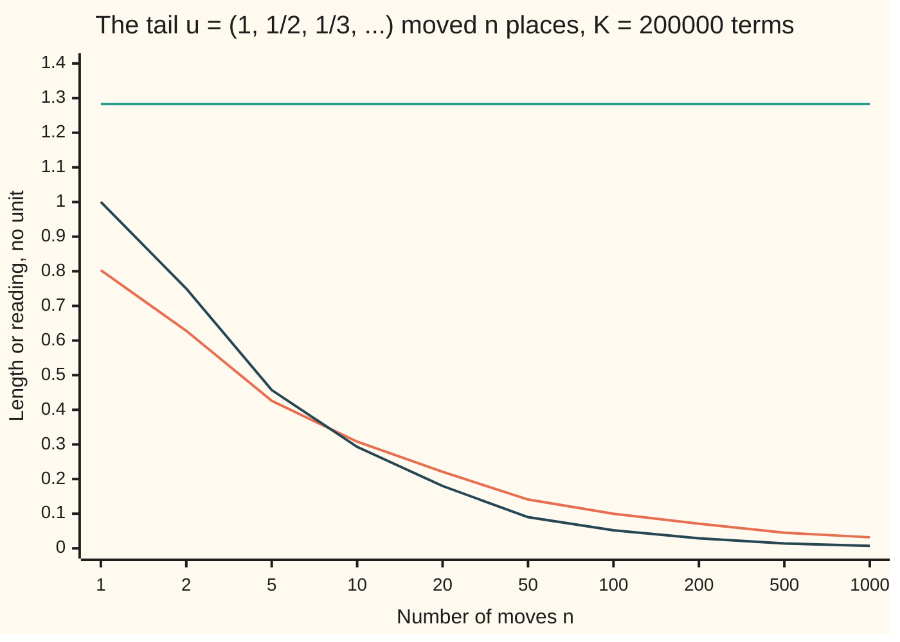

# Operator topologies: three meanings of 'these operators converge', and Goldstine's density theorem

[Syllabus](../../../SYLLABUS.md) → [Functional analysis](../README.md) → [Bounded Operators](../README.md#s03) → Operator topologies

---

## General Overview

A sound editor holds a five-sample clip, (3, 1, 4, 1, 5), in a buffer. Two buffer moves matter. The **delay** pushes every sample one place later and puts silence in front. The **advance** drops the first sample and moves the rest one place earlier. Do either move n times. What happens as n grows?

Advance the clip five times and nothing is left: its energy (sum of squared samples) goes 52, 43, 42, 26, 25, 0. Delay it and the energy stays 52 at every step, but the clip drifts away from any fixed place. A listener at a fixed point of the buffer hears it pass by and then hears silence.

So "the advance goes to zero" and "the delay goes to zero" are both true in some sense and false in another. Each sense is a **topology** on operators: a rule for which operators count as close.

- **Norm:** the worst input of length 1 must settle. Neither move does: some input always survives.
- **Strong:** each input must settle, one at a time. The advance does; the delay does not, since it keeps every length.
- **Weak:** each reading of each output must settle. Both moves do.

In finite dimensions the three senses agree. On endless lists they split apart, and sequences of operators stop being enough to describe closeness: some limits are reached only by **nets**, families indexed by something richer than 1, 2, 3, …. The same split explains Goldstine's theorem: the steady tone (1, 1, 1, …), which never fades, is a weak-star limit of switched-off copies (1, …, 1, 0, 0, …), each of which does fade. Weak-star means every summable weighting of the entries settles, even though the copies never come close entry by entry all at once.

**Operators can converge in norm (uniformly over the unit ball), strongly (at each input) or weakly (at each reading of each output), each strictly weaker than the one before on infinite lists, as the advance and the delay show; and Goldstine's theorem says every point of the unit ball of the second dual (the readings of the space's readings) is a weak-star limit, through a net, of points of the space's own unit ball.**

**What kind of fact this is:** three definitions and a set of theorems. The ordering, the shift examples, the facts about products and adjoints, the net with no sequence, the compactness of the unit ball, Goldstine's theorem and its reflexivity corollary are proved on this card in Why it works. Two inputs are stated with sources: weak-star continuous functionals on a dual are readings at a point, and bounded operators are the dual of the trace class. Goldstine's proof uses Hahn–Banach separation and so the axiom of choice; the c₀ case is computed explicitly.

### The picture: one decaying signal under the advance and the delay



First line (orange): the length of the advanced signal, $`\lVert S^{*n} u\rVert`$, falling like $`1/\sqrt n`$: strong convergence to 0. Second line (green): the length of the delayed signal, $`\lVert S^n u\rVert`$, fixed at 1.283: no strong convergence. Third line (dark blue): the reading $`\langle u, S^n u\rangle`$, falling to 0: weak convergence. The worst-case gain $`\lVert S^{*n}\rVert`$ is 1 at every n, so nothing converges in norm. The strong line is $`\sqrt{\pi^2/6 - \sum_{k \le n} 1/k^2}`$, checked against the tail held to K = 200000 terms plus an Euler–Maclaurin estimate (a standard correction formula) of the part past K. The length line is measured on the delayed K-term list. Both checks print every point.

---

## The formula

Notation first, in words. $`H = \ell^2`$ is the space of endless lists $`u = (u_1, u_2, \dots)`$ with finite energy $`\sum_k u_k^2`$ ([Sequence spaces](../01-Normed%20and%20Banach%20Spaces/02-sequence-spaces-lp-and-c0.md)). Its inner product is $`\langle w, u\rangle = \sum_k w_k u_k`$ and its length is $`\lVert u\rVert = \sqrt{\langle u, u\rangle}`$; scalars are real here, and with complex scalars the first slot is conjugated. $`e_n`$ is the click: 1 in place n, 0 elsewhere.

$`B(H)`$ is the set of bounded operators on $`H`$, and $`\lVert T\rVert`$ is the largest gain $`\lVert Tu\rVert/\lVert u\rVert`$ ([Bounded operators](01-bounded-operators-and-the-operator-norm.md)). The delay is the shift $`S`$, and the advance is its adjoint $`S^*`$ ([Three model operators](02-integral-operators-and-the-shift.md), [Adjoints](03-adjoints-self-adjoint-and-unitary-operators.md)):

```math
S(u_1, u_2, \dots) = (0, u_1, u_2, \dots), \qquad S^*(u_1, u_2, \dots) = (u_2, u_3, \dots)
```

A sequence of operators $`T_n`$ converges to $`T`$ in each of three senses:

```math
\underbrace{\lVert T_n - T\rVert \to 0}_{\text{norm}} \;\Longrightarrow\; \underbrace{\lVert T_n u - T u\rVert \to 0 \ \forall u}_{\text{strong}} \;\Longrightarrow\; \underbrace{\langle w, T_n u\rangle \to \langle w, T u\rangle \ \forall u, w}_{\text{weak}}
```

**Read it aloud:** norm convergence asks the worst input to settle; strong convergence asks every input to settle, one at a time; weak convergence asks only every reading of every output to settle; each implies the next, and on endless lists neither arrow reverses.

On the shift, every gap between them shows up:

```math
S^{*n} \to 0 \text{ strongly, not in norm}; \qquad S^n \to 0 \text{ weakly, not strongly}; \qquad S^{*n} S^n = I \text{ for every } n
```

**Read it aloud:** the advance repeated n times sends every signal to silence but always has gain 1; the delay repeated n times makes every reading fade but keeps every length; and advancing after delaying gives the signal back, although each factor goes to 0 weakly.

For a Banach space $`X`$ (a complete normed space) with dual $`X'`$ (its bounded linear readings) and second dual $`X''`$ (bounded linear readings of those), let $`J`$ be the reading map, $`(Jx)(\varphi) = \varphi(x)`$ ([Reflexive spaces](../01-Normed%20and%20Banach%20Spaces/10-reflexive-spaces-and-the-second-dual.md)), and $`B_X`$ the closed unit ball $`\{x : \lVert x\rVert \le 1\}`$. Goldstine's theorem:

```math
\overline{J(B_X)}^{\,w^*} = B_{X''}, \qquad\text{so}\qquad X \text{ is reflexive} \iff B_X \text{ is weakly compact}
```

**Read it aloud:** the weak-star closure of the space's own unit ball, seen inside the second dual, is the whole unit ball of the second dual; so the space is reflexive (equal to its second dual through J) exactly when its unit ball is compact in the weak topology, where closeness means every reading in $`X'`$ settles.

| Symbol | Plain meaning | In our example | Push it up and the answer… |
| --- | --- | --- | --- |
| $`u`$, $`v`$, $`u_k`$, $`e_n`$ | a signal; another input; its k-th sample; the click at place n | the clip (3, 1, 4, 1, 5); the tail $`u_k = 1/k`$ | louder signal, every length and reading scales |
| $`H = \ell^2`$, $`\langle w, u\rangle`$, $`\lVert u\rVert`$ | finite-energy lists; inner product; length | tail length $`\pi/\sqrt6`$ = 1.282550 | — |
| $`S`$, $`S^*`$, $`I`$ | delay; advance (its adjoint); the identity | $`S^{*5}`$ silences the clip | more moves, more drift |
| $`T`$, $`T_n`$, $`A_n`$, $`B_n`$, $`\lVert T\rVert`$, $`B(H)`$ | an operator; sequences of them; its largest gain; all bounded operators | $`\lVert S^{*n}\rVert = 1`$ | — |
| $`w`$ | a probe: the reading $`\langle w, Tu\rangle`$ of an output | $`w = u`$: the lag reading (autocorrelation) | — |
| $`n`$, $`N`$, $`P_N`$, $`K`$ | number of moves (the lag); size of a cut matrix; keep the first N samples; terms kept | N = 5; K = 200000 | larger n, smaller strong and weak gaps |
| $`h_n`$ | the harmonic number $`1 + 1/2 + \dots + 1/n`$ (not a step size) | $`\langle u, S^n u\rangle = h_n/n`$ | grows like $`\ln n`$ |
| $`T_{mn}`$, $`T_\alpha`$, $`\varepsilon`$ | the net's operators $`v \mapsto v_1(e_m + m\,e_n)`$; a net indexed by $`\alpha`$; a tolerance | $`\varepsilon = 1/1000`$: m = 2001, n = 4002001 | smaller ε, larger m and gain |
| $`X`$, $`X'`$, $`X''`$, $`J`$, $`B_X`$, $`\varphi`$, $`\Phi`$, $`L`$, $`c`$, $`C`$ | Banach space; dual; second dual; reading map; unit ball; points of $`X'`$ and $`X''`$; a separating functional and level; the weak-star closure of $`J(B_X)`$ | $`c_0`$, $`\ell^1`$, $`\ell^\infty`$ | — |
| $`c_0`$, $`x_n`$, $`\mathbf 1`$ | lists that fade to 0; n ones then zeros; the all-ones list | sup-distance from $`x_n`$ to $`\mathbf 1`$ is 1 | longer $`x_n`$, same distance |
| $`y`$ | a summable weighting in $`\ell^1`$, reading $`\sum_k y_k x_k`$ | $`y_k = 2^{-k}`$, $`y_k = 1/k^2`$ | — |
| $`A`$, $`s_j`$, $`\rho`$, $`\mathrm{tr}`$, $`M`$, $`R`$ | a trace-class operator; its summable weights; a density matrix; the trace; a gain bound; a cut-off | readings $`\mathrm{tr}(TA)`$ | — |

### When it holds

- **The lists are endless.** Cut to N = 5 samples, $`S^{*5}`$ is the zero matrix, so the cut advance converges in norm. The endless advance keeps gain 1 at every n. In finite dimensions all three senses agree.
- **Strong limits need every input, not a bound on all at once.** $`\lVert S^{*n} u\rVert`$ falls to 0 for each u, but at a rate that depends on u: like $`1/\sqrt n`$ for the tail $`1/k`$, like $`0.9^n`$ for a geometric signal. No rate covers every u, which is why the norm does not fall.
- **Weak limits can lose length.** $`S^n u \to 0`$ weakly while $`\lVert S^n u\rVert`$ stays 1.282550. A weak limit is never longer than the sequence's lengths, but it can be shorter.
- **Sequences suffice only on bounded sets.** On the whole of $`B(H)`$ the weak topology needs nets: Step 5 builds a set whose weak closure contains 0 that no sequence from the set reaches. On a bounded set of operators on a separable $`H`$ (one with a countable dense set), sequences are enough.
- **Goldstine needs the weak-star topology.** In the norm, $`c_0`$ is closed inside $`\ell^\infty`$: every $`x_n`$ stays at sup-distance 1 from $`\mathbf 1`$.


The chain of operator topologies, schematic. Each arrow means "convergence here implies convergence there".

---

## Why it works

### Step 0: each topology is fixed by what is allowed to be checked

A topology on operators is set by the tests it uses. Norm convergence tests all inputs of length 1 at once. Strong convergence tests one input at a time, and an operator is near $`T`$ if it is near on finitely many chosen inputs. Weak convergence tests one pair (probe w, input u) at a time. Fewer tests mean more operators pass, so more sequences converge. On a finite list, finitely many clicks $`e_1, \dots, e_N`$ test everything, and all three senses agree. On an endless list no finite set of tests covers everything, and they split.

### Step 1: the ordering

**Norm implies strong.** $`\lVert T_n u - Tu\rVert \le \lVert T_n - T\rVert\,\lVert u\rVert`$.

**Strong implies weak.** By Cauchy–Schwarz ([Inner products](../02-Hilbert%20Spaces/01-inner-products-and-hilbert-spaces.md)), $`\lvert\langle w, T_n u - Tu\rangle\rvert \le \lVert w\rVert\,\lVert T_n u - T u\rVert`$.

Step 2 shows neither arrow reverses.

### Step 2: the advance goes to 0 strongly, never in norm

Advancing n times drops the first n samples, so the energy left is the tail of the sum:

```math
\lVert S^{*n} u\rVert^2 = \sum_{k > n} u_k^2 \longrightarrow 0
```

The tail of a convergent sum goes to 0, so $`S^{*n} \to 0`$ strongly. For the clip the tail is exact: 52, 43, 42, 26, 25, 0. For the tail $`u_k = 1/k`$ it is $`\pi^2/6 - \sum_{k \le n} 1/k^2`$, so $`\lVert S^{*n} u\rVert`$ is 0.803078 at n = 1, 0.099751 at n = 100 and 0.031615 at n = 1000, about $`1/\sqrt n`$.

But the click one place past the cut survives: $`S^{*n} e_{n+1} = e_1`$, length 1. So $`\lVert S^{*n}\rVert = 1`$ for every n. Each input fades, the worst input never does.

### Step 3: the delay goes to 0 weakly, never strongly

The delay keeps every length, $`\lVert S^n u\rVert = \lVert u\rVert`$. If $`S^n u`$ converged strongly to some v, it would also converge weakly to v. The weak limit is 0 (below), so $`v = 0`$, which contradicts the fixed length. Concretely, delayed copies far apart do not overlap: $`\lVert S^5 u - S^{10} u\rVert = \sqrt{2 \times 52}`$ = 10.1980 for the clip, and the same at n = 50.

For the weak limit, move the delay to the other side of the reading with the adjoint:

```math
\lvert\langle w, S^n u\rangle\rvert = \lvert\langle S^{*n} w, u\rangle\rvert \le \lVert S^{*n} w\rVert\,\lVert u\rVert \longrightarrow 0
```

So the strong convergence of the advance gives the weak convergence of the delay. For an audio signal, $`\langle u, S^n u\rangle`$ is the **autocorrelation** at lag n: how much the signal resembles itself delayed n samples. For the clip it runs 52, 16, 33, 8, 15, 0. For the tail $`1/k`$ the fraction $`1/(k(k+n))`$ splits as $`(1/n)(1/k - 1/(k+n))`$, the sum telescopes, and

```math
\langle u, S^n u\rangle = \sum_{k \ge 1} \frac{1}{k(k+n)} = \frac{h_n}{n}
```

That is 1 at n = 1, 0.051874 at n = 100 and 0.007485 at n = 1000, below the Cauchy–Schwarz bound 0.040548.

### Step 4: products, adjoints, and where joint continuity fails

**Products.** In norm, $`\lVert A_n B_n - AB\rVert \le \lVert A_n\rVert\,\lVert B_n - B\rVert + \lVert A_n - A\rVert\,\lVert B\rVert`$, so products of convergent sequences converge. Strongly, the same split applied to one input gives

```math
\lVert A_n B_n u - ABu\rVert \le \lVert A_n\rVert\,\lVert (B_n - B)u\rVert + \lVert (A_n - A)(Bu)\rVert
```

which goes to 0 when the gains $`\lVert A_n\rVert`$ stay bounded. A strongly convergent sequence always has bounded gains, by the uniform boundedness principle ([Three Banach theorems](../01-Normed%20and%20Banach%20Spaces/08-open-mapping-closed-graph-and-uniform-boundedness.md)); for nets that bound must be assumed. Weakly, products fail even with gains bounded by 1: $`S^{*n} \to 0`$ and $`S^n \to 0`$ weakly, yet $`S^{*n} S^n = I`$. The clip comes back with energy 52 at every n.

**Adjoints.** Taking adjoints is weakly continuous, because $`\langle w, T^* u\rangle = \langle T w, u\rangle`$. It is not strongly continuous: $`S^{*n} \to 0`$ strongly, but its adjoints $`S^n`$ do not.

### Step 5: a net where no sequence works

A **net** is a family $`T_\alpha`$ indexed by a directed set: a set in which any two indices have a common later one ([Nets and filters](../../17-Topology/02-Topological%20Spaces/11-nets-and-filters.md)). Weak closeness to 0 is tested by finitely many probe pairs at a tolerance ε, and those (finite set, ε) pairs form a directed set.

Take the rank-one operators $`T_{mn} v = v_1\,(e_m + m\,e_n)`$ for $`1 \le m < n`$. A reading is $`\langle w, T_{mn} v\rangle = v_1(w_m + m\,w_n)`$.

**0 is in the weak closure.** Given finitely many probes and a tolerance ε, choose m so large that every $`\lvert v_1 w_m\rvert`$ is below $`\varepsilon/2`$, then n so large that every $`\lvert m\,v_1 w_n\rvert`$ is below $`\varepsilon/2`$. Both choices exist because probe entries fade. For the probe $`w = v = (1, 1/2, 1/3, \dots)`$ the reading is $`1/m + m/n`$:

- ε = 1/10: m = 21, n = 421, reading 0.97500 ε;
- ε = 1/100: m = 201, n = 40201, reading 0.99750 ε;
- ε = 1/1000: m = 2001, n = 4002001, reading 0.99975 ε.

This assignment, one operator for each (probe set, ε), is a net converging weakly to 0.

**No sequence from the set converges weakly to 0.** A weakly convergent sequence has bounded gains, again by uniform boundedness, applied twice. But $`\lVert T_{mn}\rVert = \sqrt{1 + m^2}`$: 21.024, 201.002, 2001.000 above. A sequence with bounded gains uses only finitely many m, so one m repeats forever along a subsequence, and there the reading with $`v = e_1`$, $`w = e_m`$ is $`w_m = 1`$, not 0. The net escapes only because its gains grow without bound, which no weakly convergent sequence can do.

### Step 6: bounded sets are compact, and the ultraweak topology

**The unit ball of B(H) is weakly compact.** Send each T with $`\lVert T\rVert \le 1`$ to its list of readings $`\langle w, T u\rangle`$, one coordinate for each pair (u, w), each in the interval $`[-\lVert u\rVert\lVert w\rVert, \lVert u\rVert\lVert w\rVert]`$. By Tychonoff's theorem the product of these intervals is compact ([Compactness with no distances, and Tychonoff](../../17-Topology/02-Topological%20Spaces/06-compactness-and-tychonoff.md)). The lists that come from operators are those linear in u and in w: closed conditions, and a bounded form that is linear in both slots comes from an operator by [Riesz representation](../02-Hilbert%20Spaces/06-riesz-representation-theorem.md). So the ball is a closed part of a compact set. This is Banach–Alaoglu again ([Weak convergence](../02-Hilbert%20Spaces/09-weak-convergence-and-banach-alaoglu.md)), and like it, it uses the axiom of choice.

The unit ball is not compact strongly. The map $`T \mapsto Tu`$ is strongly continuous and sends the ball onto the whole ball of radius $`\lVert u\rVert`$ in H, which is not compact in infinite dimensions ([Infinite dimensions](../01-Normed%20and%20Banach%20Spaces/05-why-infinite-dimensions-are-different.md)).

**The ultraweak topology.** A trace-class operator is $`A = \sum_j s_j \langle w_j, \cdot\rangle u_j`$ with unit vectors $`u_j`$, $`w_j`$ and $`\sum_j s_j`$ finite ([Trace class](12-trace-class-and-schatten-operators.md)). Its readings are $`\mathrm{tr}(TA) = \sum_j s_j \langle w_j, T u_j\rangle`$: countably many weak readings with summable weights. $`B(H)`$ is the dual of the trace class (stated, Reed–Simon), and convergence of every $`\mathrm{tr}(T_\alpha A)`$ is the weak-star topology of that duality, called **ultraweak**. On a set with gains at most M, cut the sum after R terms: the remainder is at most $`2M\sum_{j > R} s_j`$, so ultraweak and weak convergence agree there. Off bounded sets the ultraweak topology has more open sets.

### Step 7: Goldstine's theorem

**The c₀ case, explicitly.** Let $`X = c_0`$, the lists that fade to 0 with the sup norm. Its dual is $`\ell^1`$, summable weightings y, and its second dual is $`\ell^\infty`$, bounded lists ([Dual spaces](../01-Normed%20and%20Banach%20Spaces/09-dual-spaces-and-lp-duality.md)). The all-ones list $`\mathbf 1`$ is in the unit ball of $`\ell^\infty`$, not in $`c_0`$. The switched-off copies $`x_n = (1, \dots, 1, 0, 0, \dots)`$, n ones, are in the unit ball of $`c_0`$, and every weighting reads

```math
\langle y, x_n\rangle = \sum_{k \le n} y_k \longrightarrow \sum_k y_k = \langle y, \mathbf 1\rangle
```

So $`Jx_n \to \mathbf 1`$ weak-star, while $`\lVert x_n - \mathbf 1\rVert_\infty = 1`$ at every n.

**The general case.** Let C be the weak-star closure of $`J(B_X)`$. It is convex and lies inside $`B_{X''}`$, because J keeps lengths. Suppose some $`\Phi`$ in $`B_{X''}`$ is outside C. The weak-star topology is locally convex ([Locally convex and Frechet spaces](../01-Normed%20and%20Banach%20Spaces/11-locally-convex-and-frechet-spaces.md)), so [Separation](../01-Normed%20and%20Banach%20Spaces/07-hahn-banach-separation-and-supporting-walls.md) gives a weak-star continuous functional L and a number c with $`L(\Phi) > c \ge L(Jx)`$ for every x in $`B_X`$. Every weak-star continuous functional on $`X''`$ is a reading at some $`\varphi`$ in $`X'`$ (stated, Brezis). So

```math
\Phi(\varphi) > c \ge \sup_{\lVert x\rVert \le 1} \varphi(x) = \lVert\varphi\rVert \ge \lVert\Phi\rVert\,\lVert\varphi\rVert \ge \Phi(\varphi)
```

a contradiction. So $`C = B_{X''}`$. In general the approximants form a net; in the c₀ case a sequence happened to suffice.

**Corollary: reflexive exactly when the ball is weakly compact.** The map J carries the weak topology of X onto the weak-star topology on $`J(X)`$, because $`\varphi(x) = (Jx)(\varphi)`$. If X is reflexive, $`J(B_X) = B_{X''}`$, which is weak-star compact by Banach–Alaoglu, so $`B_X`$ is weakly compact. If $`B_X`$ is weakly compact, $`J(B_X)`$ is weak-star compact, hence weak-star closed; by Goldstine it is dense in $`B_{X''}`$, so it is all of it, and X is reflexive. For $`c_0`$ the ball is not weakly compact: the $`x_n`$ have no weak cluster point inside $`c_0`$, since reading entry k forces every entry of a cluster point to be 1, and $`\mathbf 1`$ is not in $`c_0`$.

---

## Worked numbers, by hand

The finite rehearsal is the clip u = (3, 1, 4, 1, 5) on the endless list.

| Step | Arithmetic | Value |
| --- | --- | --- |
| energy of the clip | 9 + 1 + 16 + 1 + 25 | 52 |
| advance once | drop the 3: 1 + 16 + 1 + 25 | 43 |
| advance 2, 3, 4, 5 times | drop 1, then 4, then 1, then 5 | 42, 26, 25, 0 |
| delay n times | nothing is dropped | 52 at every n |
| lag 1 reading $`\langle u, Su\rangle`$ | (0, 3, 1, 4, 1, 5) against u: 3·0 + 1·3 + 4·1 + 1·4 + 5·1 | 16 |
| lags 2, 3, 4 | 4·3 + 1·1 + 5·4; 1·3 + 5·1; 5·3 | 33, 8, 15 |
| lag 5 and beyond | the copies no longer overlap | 0 |
| distance between 5 and 10 delays | no overlap: $`\sqrt{52 + 52}`$ | 10.1980 |
| gain of the advance | the click $`e_{n+1}`$ comes out as $`e_1`$ | 1 at every n |
| advance after delay | the clip comes back | energy 52 |
| **the three senses for the clip** | advance; delay; delay read by u | **strong 0 from n = 5; length 52 forever; reading 0 from n = 5** |

On a five-sample clip the advance silences the signal in five steps, while the worst case, the click just past the cut, keeps gain 1; the delay keeps all 52 units of energy and only moves them out of every reading's reach.

### What breaks if you drop a piece

| Mistake | Comes out at | What went wrong |
| --- | --- | --- |
| Strong limit 0 taken as norm limit | $`\lVert S^{*1000}\rVert`$ = 1.0000, not 0 | each input fades, the click at place 1001 does not |
| Weak limit 0 taken as strong limit | $`\lVert S^{1000} u\rVert`$ = 1.2825, not 0 | readings fade; length does not |
| Limit of a product taken as product of limits | $`S^{*9} S^9 u`$ has energy 52, not 0 | weak convergence does not respect products |
| The cut matrix trusted | $`\lVert S^{*5}\rVert`$ = 0 at N = 5; endless list gives 1 | truncation makes the advance nilpotent (some power is zero) |

---

## Code, from first principles, and it actually runs

The code holds only the finite rehearsal: the clip as a short list, the tail $`1/k`$ as K = 200000 terms plus its remainder, and cut N by N matrices. It takes five roads. Tail sums are computed directly and as $`\pi^2/6`$ minus a partial sum, and the delayed tail's length is measured on the K-term list against $`\pi/\sqrt6`$. Lag readings are summed directly and matched to $`h_n/n`$. Cauchy–Schwarz bounds each reading. Power iteration (apply the matrix and its transpose again and again, rescaling each time) finds the cut gains, set against the endless list. Exact integer arithmetic checks the net's readings against ε. What the truncation hides: every cut matrix converges in all three senses at once, so the splits show only as trends over n that never close, and no finite list can hold the net of Step 5 or the all-ones list.

### Python

```python
# Operator topologies: the check behind the card.  Standard library only.
# The delay S (one sample later) and the advance S* (drop the first sample),
# its adjoint, on lists of samples.  The finite rehearsal is the clip
# (3, 1, 4, 1, 5); the infinite case is the fading tail u_k = 1/k, held to
# K terms plus its remainder.  Roads: tail sums against pi^2/6 minus partial
# sums; lag readings summed directly against H_n / n; Cauchy-Schwarz bounds;
# cut matrices against the endless list; exact integer probes for the net;
# switched-off copies against Goldstine's all-ones limit.
import math

def dot(a, b): return sum(x * y for x, y in zip(a, b))
def delay(u, n): return [0.0] * n + list(u)          # S^n on the endless list
def advance(u, n): return list(u[n:])                 # S*^n: drop n samples
def cut_adv(v, n): return (v[n:] + [0.0] * len(v))[:len(v)]   # S*^n cut to N
def cut_del(v, n): return ([0.0] * n + v)[:len(v)]            # S^n cut to N
def opnorm(f, ft, N):                                 # power iteration on f^T f
    x = [1.0 + 0.1 * i for i in range(N)]
    for _ in range(60):
        y = ft(f(x)); s = math.sqrt(dot(y, y))
        if s == 0.0: return 0.0
        x = [v / s for v in y]
    return math.sqrt(dot(f(x), f(x)))

print("1. the clip u = (3, 1, 4, 1, 5) on the endless list")
u = [3.0, 1.0, 4.0, 1.0, 5.0]
adv = [dot(advance(u, n), advance(u, n)) for n in range(6)]
dl = [dot(delay(u, n), delay(u, n)) for n in range(6)]
lag = [dot(u, delay(u, n)) for n in range(6)]
print("   n             " + " ".join(f"{n:4d}" for n in range(6)))
print("   energy S*^n u " + " ".join(f"{v:4.0f}" for v in adv))
print("   energy S^n u  " + " ".join(f"{v:4.0f}" for v in dl))
print("   <u, S^n u>    " + " ".join(f"{v:4.0f}" for v in lag))
assert adv == [52, 43, 42, 26, 25, 0] and dl == [52] * 6
assert lag == [dot(advance(u, n), u) for n in range(6)]          # <u, S^n u> = <S*^n u, u>
far = [math.sqrt(sum((a - b) ** 2 for a, b in zip(delay(u, n) + [0.0] * n, delay(u, 2 * n)))) for n in (5, 50)]
print(f"   |S^n u - S^2n u| at n = 5, 50: {far[0]:.4f} {far[1]:.4f}; sqrt(2 x 52) = {math.sqrt(104):.4f}")
assert all(abs(d - math.sqrt(104)) < 1e-12 for d in far)
wit = [advance([0.0] * n + [1.0], n) for n in (1, 10, 1000)]
print(f"   S*^n e_(n+1) = e_1 at n = 1, 10, 1000: {all(w == [1.0] for w in wit)}, so |S*^n| = 1")
assert all(w == [1.0] for w in wit)                               # the click past the cut survives
g = [opnorm(lambda v, n=n: cut_adv(v, n), lambda v, n=n: cut_del(v, n), 5) for n in range(1, 7)]
print("   cut to N = 5: |S*^n|, n = 1..6: " + " ".join(f"{v:.4f}" for v in g))
assert all(abs(v - 1) < 1e-9 for v in g[:4]) and g[4] == g[5] == 0.0
back = all(advance(delay(u, n), n) == u for n in (1, 10, 1000))
print(f"   S*^n S^n u = u at n = 1, 10, 1000: {back}, energy 52 at every n")
assert back                                                       # advance after delay gives u back

print("2. the fading tail u_k = 1/k, K = 200000 terms plus remainder")
K = 200000
Z = math.pi ** 2 / 6
def rem(K): return 1 / K - 1 / (2 * K * K) + 1 / (6 * K ** 3)    # Euler-Maclaurin estimate of sum of 1/k^2 past K
NS = (1, 2, 5, 10, 20, 50, 100, 200, 500, 1000)
print(f"   |u| = pi/sqrt(6) = {math.sqrt(Z):.6f}")
print("      n  |S*^n u|  |S^n u|  <u,S^n u>  bound |S*^n u||u|")
st, wk, ls = [], [], []
tail = [1 / k for k in range(1, K + 1)]                          # the tail u, K terms
for n in NS:
    direct = sum(1 / (k * k) for k in range(n + 1, K + 1)) + rem(K)
    viaz = Z - sum(1 / (k * k) for k in range(1, n + 1))
    assert abs(direct - viaz) < 1e-12                                # road 1: two tail sums
    lagd = sum(1 / (k * (k + n)) for k in range(1, K + 1))
    hn = sum(1 / k for k in range(1, n + 1)) / n
    assert 0 < hn - lagd < 1.0 / K                                   # road 2: H_n / n
    s = math.sqrt(viaz)
    assert hn <= s * math.sqrt(Z)                                    # road 3: Cauchy-Schwarz
    d = delay(tail, n); ln = math.sqrt(dot(d, d) + rem(K))           # |S^n u|, measured on the delayed list
    assert abs(ln - math.sqrt(Z)) < 1e-12                            # the delay keeps the length pi/sqrt(6)
    st.append(s); wk.append(hn); ls.append(ln)
    print(f"   {n:4d}  {s:.6f}  {ln:.6f}  {hn:.6f}   {s * math.sqrt(Z):.6f}")
assert all(abs(s * math.sqrt(n) - 1) < 0.6 for s, n in zip(st, NS))   # tail like 1/sqrt(n)
print("   chart n         " + " ".join(f"{n:5d}" for n in NS))
print("   chart strong    " + " ".join(f"{v:.3f}" for v in st))
print("   chart length    " + " ".join(f"{v:.3f}" for v in ls))
print("   chart weak      " + " ".join(f"{v:.3f}" for v in wk))

print("3. a net with no sequence: T_mn v = v_1 (e_m + m e_n), probed by w = u = (1/k)")
for q in (10, 100, 1000):                                            # eps = 1/q
    m = 2 * q + 1; n = 2 * m * q + 1                                 # 1/m < eps/2, m/n < eps/2
    num, den = n + m * m, m * n                                      # 1/m + m/n, exactly
    assert num * q < den                                             # reading below eps
    print(f"   eps 1/{q:<4d}: m {m:5d}, n {n:8d}, reading {num * q / den:.5f} x eps, |T_mn| = {math.sqrt(1 + m * m):.3f}")

print("4. Goldstine: x_n = (1, .., 1, 0, ..) in the ball of c0, read by y in l1")
print("      n  sum 2^-k  sum 1/k^2  sup-distance to all-ones")
for n in (1, 2, 5, 10, 100, 1000):
    r1 = sum(2.0 ** -k for k in range(1, n + 1)); r2 = sum(1 / (k * k) for k in range(1, n + 1))
    assert abs(r1 - (1 - 2.0 ** -n)) < 1e-15 and abs((Z - r2) - (1 / n - 1 / (2 * n * n))) < 0.2 / n ** 3
    print(f"   {n:4d}  {r1:.6f}  {r2:.6f}   1")
print(f"   limits: 1.000000 and pi^2/6 = {Z:.6f}; all-ones is in l-infinity, not in c0")

print("5. what breaks")
b9 = advance(delay(u, 9), 9); energy9 = dot(b9, b9)
print(f"   strong limit 0 taken as norm limit: |S*^1000| = {opnorm(lambda v: cut_adv(v, 1000), lambda v: cut_del(v, 1000), 1001):.4f}, not 0")
print(f"   weak limit 0 taken as strong limit: |S^1000 u| = {ls[-1]:.4f}, not 0")
print(f"   limit of the product as product of limits: S*^9 S^9 u has energy {energy9:.0f}, not 0")
assert b9 == u and energy9 == 52                                  # weak limits do not multiply
print(f"   cut matrix trusted: N = 5 gives |S*^5| = {g[4]:.0f}; the endless list gives 1")

print("ALL CHECKS PASS")
```

**Ran 2026-11-24 on macOS, Python 3.14.10, standard library only. All checks passed. Output, pasted from the run:**

```
1. the clip u = (3, 1, 4, 1, 5) on the endless list
   n                0    1    2    3    4    5
   energy S*^n u   52   43   42   26   25    0
   energy S^n u    52   52   52   52   52   52
   <u, S^n u>      52   16   33    8   15    0
   |S^n u - S^2n u| at n = 5, 50: 10.1980 10.1980; sqrt(2 x 52) = 10.1980
   S*^n e_(n+1) = e_1 at n = 1, 10, 1000: True, so |S*^n| = 1
   cut to N = 5: |S*^n|, n = 1..6: 1.0000 1.0000 1.0000 1.0000 0.0000 0.0000
   S*^n S^n u = u at n = 1, 10, 1000: True, energy 52 at every n
2. the fading tail u_k = 1/k, K = 200000 terms plus remainder
   |u| = pi/sqrt(6) = 1.282550
      n  |S*^n u|  |S^n u|  <u,S^n u>  bound |S*^n u||u|
      1  0.803078  1.282550  1.000000   1.029987
      2  0.628438  1.282550  0.750000   0.806003
      5  0.425820  1.282550  0.456667   0.546136
     10  0.308490  1.282550  0.292897   0.395654
     20  0.220841  1.282550  0.179887   0.283240
     50  0.140717  1.282550  0.089984   0.180477
    100  0.099751  1.282550  0.051874   0.127935
    200  0.070622  1.282550  0.029390   0.090577
    500  0.044699  1.282550  0.013586   0.057329
   1000  0.031615  1.282550  0.007485   0.040548
   chart n             1     2     5    10    20    50   100   200   500  1000
   chart strong    0.803 0.628 0.426 0.308 0.221 0.141 0.100 0.071 0.045 0.032
   chart length    1.283 1.283 1.283 1.283 1.283 1.283 1.283 1.283 1.283 1.283
   chart weak      1.000 0.750 0.457 0.293 0.180 0.090 0.052 0.029 0.014 0.007
3. a net with no sequence: T_mn v = v_1 (e_m + m e_n), probed by w = u = (1/k)
   eps 1/10  : m    21, n      421, reading 0.97500 x eps, |T_mn| = 21.024
   eps 1/100 : m   201, n    40201, reading 0.99750 x eps, |T_mn| = 201.002
   eps 1/1000: m  2001, n  4002001, reading 0.99975 x eps, |T_mn| = 2001.000
4. Goldstine: x_n = (1, .., 1, 0, ..) in the ball of c0, read by y in l1
      n  sum 2^-k  sum 1/k^2  sup-distance to all-ones
      1  0.500000  1.000000   1
      2  0.750000  1.250000   1
      5  0.968750  1.463611   1
     10  0.999023  1.549768   1
    100  1.000000  1.634984   1
   1000  1.000000  1.643935   1
   limits: 1.000000 and pi^2/6 = 1.644934; all-ones is in l-infinity, not in c0
5. what breaks
   strong limit 0 taken as norm limit: |S*^1000| = 1.0000, not 0
   weak limit 0 taken as strong limit: |S^1000 u| = 1.2825, not 0
   limit of the product as product of limits: S*^9 S^9 u has energy 52, not 0
   cut matrix trusted: N = 5 gives |S*^5| = 0; the endless list gives 1
ALL CHECKS PASS
```

### Rust

```rust
// Operator topologies: the check behind the card.  Rust std only, no crates.
// The delay S (one sample later) and the advance S* (drop the first sample),
// its adjoint, on lists of samples.  The finite rehearsal is the clip
// (3, 1, 4, 1, 5); the infinite case is the fading tail u_k = 1/k, held to
// K terms plus its remainder.  Roads: tail sums against pi^2/6 minus partial
// sums; lag readings summed directly against H_n / n; Cauchy-Schwarz bounds;
// cut matrices against the endless list; exact integer probes for the net;
// switched-off copies against Goldstine's all-ones limit.
use std::f64::consts::PI;

fn dot(a: &[f64], b: &[f64]) -> f64 { a.iter().zip(b).fold(0.0, |s, (x, y)| s + x * y) }
fn delay(u: &[f64], n: usize) -> Vec<f64> { let mut v = vec![0.0; n]; v.extend_from_slice(u); v } // S^n, endless
fn advance(u: &[f64], n: usize) -> Vec<f64> { u[n.min(u.len())..].to_vec() } // S*^n: drop n samples
fn cut_adv(v: &[f64], n: usize) -> Vec<f64> { let mut w = advance(v, n); w.resize(v.len(), 0.0); w } // cut to N
fn cut_del(v: &[f64], n: usize) -> Vec<f64> { let mut w = delay(v, n); w.truncate(v.len()); w }
fn opnorm(f: &dyn Fn(&[f64]) -> Vec<f64>, ft: &dyn Fn(&[f64]) -> Vec<f64>, n: usize) -> f64 {
    let mut x: Vec<f64> = (0..n).map(|i| 1.0 + 0.1 * i as f64).collect(); // power iteration on f^T f
    for _ in 0..60 {
        let y = ft(&f(&x)); let s = dot(&y, &y).sqrt();
        if s == 0.0 { return 0.0; }
        x = y.iter().map(|v| v / s).collect();
    }
    let fx = f(&x); dot(&fx, &fx).sqrt()
}
fn row(xs: &[f64], w: usize, d: usize) -> String { xs.iter().map(|v| format!("{:w$.d$}", v, w = w, d = d)).collect::<Vec<_>>().join(" ") }
fn rem(k: f64) -> f64 { 1.0 / k - 1.0 / (2.0 * k * k) + 1.0 / (6.0 * k * k * k) } // Euler-Maclaurin estimate of sum of 1/k^2 past K

fn main() {
    println!("1. the clip u = (3, 1, 4, 1, 5) on the endless list");
    let u = vec![3.0, 1.0, 4.0, 1.0, 5.0];
    let adv: Vec<f64> = (0..6).map(|n| { let a = advance(&u, n); dot(&a, &a) }).collect();
    let dl: Vec<f64> = (0..6).map(|n| { let a = delay(&u, n); dot(&a, &a) }).collect();
    let lag: Vec<f64> = (0..6).map(|n| dot(&u, &delay(&u, n))).collect();
    println!("   n             {}", (0..6).map(|n| format!("{:4}", n)).collect::<Vec<_>>().join(" "));
    println!("   energy S*^n u {}", row(&adv, 4, 0));
    println!("   energy S^n u  {}", row(&dl, 4, 0));
    println!("   <u, S^n u>    {}", row(&lag, 4, 0));
    assert!(adv == vec![52.0, 43.0, 42.0, 26.0, 25.0, 0.0] && dl == vec![52.0; 6]);
    assert!(lag == (0..6).map(|n| dot(&advance(&u, n), &u)).collect::<Vec<_>>()); // <u, S^n u> = <S*^n u, u>
    let far: Vec<f64> = [5usize, 50].iter().map(|&n| {
        let mut a = delay(&u, n); a.resize(5 + 2 * n, 0.0); let b = delay(&u, 2 * n);
        a.iter().zip(&b).map(|(x, y)| (x - y) * (x - y)).sum::<f64>().sqrt()
    }).collect();
    println!("   |S^n u - S^2n u| at n = 5, 50: {:.4} {:.4}; sqrt(2 x 52) = {:.4}", far[0], far[1], 104f64.sqrt());
    assert!(far.iter().all(|d| (d - 104f64.sqrt()).abs() < 1e-12));
    let wit = [1usize, 10, 1000].iter().all(|&n| { let mut e = vec![0.0; n]; e.push(1.0); advance(&e, n) == vec![1.0] });
    println!("   S*^n e_(n+1) = e_1 at n = 1, 10, 1000: {}, so |S*^n| = 1", if wit { "True" } else { "False" });
    assert!(wit); // the click past the cut survives
    let g: Vec<f64> = (1..7).map(|n| opnorm(&|v: &[f64]| cut_adv(v, n), &|v: &[f64]| cut_del(v, n), 5)).collect();
    println!("   cut to N = 5: |S*^n|, n = 1..6: {}", row(&g, 0, 4));
    assert!(g[..4].iter().all(|v| (v - 1.0).abs() < 1e-9) && g[4] == 0.0 && g[5] == 0.0);
    let back = [1usize, 10, 1000].iter().all(|&n| advance(&delay(&u, n), n) == u);
    println!("   S*^n S^n u = u at n = 1, 10, 1000: {}, energy 52 at every n", if back { "True" } else { "False" });
    assert!(back); // advance after delay gives u back

    println!("2. the fading tail u_k = 1/k, K = 200000 terms plus remainder");
    let kk: u64 = 200000;
    let z = PI * PI / 6.0;
    let ns: [u64; 10] = [1, 2, 5, 10, 20, 50, 100, 200, 500, 1000];
    println!("   |u| = pi/sqrt(6) = {:.6}", z.sqrt());
    println!("      n  |S*^n u|  |S^n u|  <u,S^n u>  bound |S*^n u||u|");
    let (mut st, mut wk, mut ls) = (Vec::new(), Vec::new(), Vec::new());
    let tail: Vec<f64> = (1..kk + 1).map(|k| 1.0 / k as f64).collect(); // the tail u, K terms
    for &n in &ns {
        let direct = (n + 1..kk + 1).map(|k| 1.0 / ((k * k) as f64)).sum::<f64>() + rem(kk as f64);
        let viaz = z - (1..n + 1).map(|k| 1.0 / ((k * k) as f64)).sum::<f64>();
        assert!((direct - viaz).abs() < 1e-12); // road 1: two tail sums
        let lagd: f64 = (1..kk + 1).map(|k| 1.0 / ((k * (k + n)) as f64)).sum();
        let hn = (1..n + 1).map(|k| 1.0 / k as f64).sum::<f64>() / n as f64;
        assert!(0.0 < hn - lagd && hn - lagd < 1.0 / kk as f64); // road 2: H_n / n
        let s = viaz.sqrt();
        assert!(hn <= s * z.sqrt()); // road 3: Cauchy-Schwarz
        let d = delay(&tail, n as usize); let ln = (dot(&d, &d) + rem(kk as f64)).sqrt(); // |S^n u|, on the delayed list
        assert!((ln - z.sqrt()).abs() < 1e-12); // the delay keeps the length pi/sqrt(6)
        st.push(s); wk.push(hn); ls.push(ln);
        println!("   {:4}  {:.6}  {:.6}  {:.6}   {:.6}", n, s, ln, hn, s * z.sqrt());
    }
    assert!(st.iter().zip(&ns).all(|(s, &n)| (s * (n as f64).sqrt() - 1.0).abs() < 0.6)); // tail like 1/sqrt(n)
    println!("   chart n         {}", ns.iter().map(|n| format!("{:5}", n)).collect::<Vec<_>>().join(" "));
    println!("   chart strong    {}", row(&st, 0, 3));
    println!("   chart length    {}", row(&ls, 0, 3));
    println!("   chart weak      {}", row(&wk, 0, 3));

    println!("3. a net with no sequence: T_mn v = v_1 (e_m + m e_n), probed by w = u = (1/k)");
    for q in [10u64, 100, 1000] { // eps = 1/q
        let m = 2 * q + 1; let n = 2 * m * q + 1; // 1/m < eps/2, m/n < eps/2
        let (num, den) = (n + m * m, m * n); // 1/m + m/n, exactly
        assert!(num * q < den); // reading below eps
        println!("   eps 1/{:<4}: m {:5}, n {:8}, reading {:.5} x eps, |T_mn| = {:.3}",
            q, m, n, (num * q) as f64 / den as f64, ((1 + m * m) as f64).sqrt());
    }

    println!("4. Goldstine: x_n = (1, .., 1, 0, ..) in the ball of c0, read by y in l1");
    println!("      n  sum 2^-k  sum 1/k^2  sup-distance to all-ones");
    for n in [1i32, 2, 5, 10, 100, 1000] {
        let r1: f64 = (1..n + 1).map(|k| 2f64.powi(-k)).sum();
        let r2: f64 = (1..n + 1).map(|k| 1.0 / ((k as i64 * k as i64) as f64)).sum();
        let nf = n as f64;
        assert!((r1 - (1.0 - 2f64.powi(-n))).abs() < 1e-15 && ((z - r2) - (1.0 / nf - 1.0 / (2.0 * nf * nf))).abs() < 0.2 / (nf * nf * nf));
        println!("   {:4}  {:.6}  {:.6}   1", n, r1, r2);
    }
    println!("   limits: 1.000000 and pi^2/6 = {:.6}; all-ones is in l-infinity, not in c0", z);

    println!("5. what breaks");
    let b9 = advance(&delay(&u, 9), 9); let energy9 = dot(&b9, &b9);
    println!("   strong limit 0 taken as norm limit: |S*^1000| = {:.4}, not 0", opnorm(&|v: &[f64]| cut_adv(v, 1000), &|v: &[f64]| cut_del(v, 1000), 1001));
    println!("   weak limit 0 taken as strong limit: |S^1000 u| = {:.4}, not 0", ls[ls.len() - 1]);
    println!("   limit of the product as product of limits: S*^9 S^9 u has energy {:.0}, not 0", energy9);
    assert!(b9 == u && energy9 == 52.0); // weak limits do not multiply
    println!("   cut matrix trusted: N = 5 gives |S*^5| = {:.0}; the endless list gives 1", g[4]);

    println!("ALL CHECKS PASS");
}
```

**Ran 2026-11-24 on macOS, rustc 1.98.1, no crates. All checks passed. Output, pasted from the run:**

```
1. the clip u = (3, 1, 4, 1, 5) on the endless list
   n                0    1    2    3    4    5
   energy S*^n u   52   43   42   26   25    0
   energy S^n u    52   52   52   52   52   52
   <u, S^n u>      52   16   33    8   15    0
   |S^n u - S^2n u| at n = 5, 50: 10.1980 10.1980; sqrt(2 x 52) = 10.1980
   S*^n e_(n+1) = e_1 at n = 1, 10, 1000: True, so |S*^n| = 1
   cut to N = 5: |S*^n|, n = 1..6: 1.0000 1.0000 1.0000 1.0000 0.0000 0.0000
   S*^n S^n u = u at n = 1, 10, 1000: True, energy 52 at every n
2. the fading tail u_k = 1/k, K = 200000 terms plus remainder
   |u| = pi/sqrt(6) = 1.282550
      n  |S*^n u|  |S^n u|  <u,S^n u>  bound |S*^n u||u|
      1  0.803078  1.282550  1.000000   1.029987
      2  0.628438  1.282550  0.750000   0.806003
      5  0.425820  1.282550  0.456667   0.546136
     10  0.308490  1.282550  0.292897   0.395654
     20  0.220841  1.282550  0.179887   0.283240
     50  0.140717  1.282550  0.089984   0.180477
    100  0.099751  1.282550  0.051874   0.127935
    200  0.070622  1.282550  0.029390   0.090577
    500  0.044699  1.282550  0.013586   0.057329
   1000  0.031615  1.282550  0.007485   0.040548
   chart n             1     2     5    10    20    50   100   200   500  1000
   chart strong    0.803 0.628 0.426 0.308 0.221 0.141 0.100 0.071 0.045 0.032
   chart length    1.283 1.283 1.283 1.283 1.283 1.283 1.283 1.283 1.283 1.283
   chart weak      1.000 0.750 0.457 0.293 0.180 0.090 0.052 0.029 0.014 0.007
3. a net with no sequence: T_mn v = v_1 (e_m + m e_n), probed by w = u = (1/k)
   eps 1/10  : m    21, n      421, reading 0.97500 x eps, |T_mn| = 21.024
   eps 1/100 : m   201, n    40201, reading 0.99750 x eps, |T_mn| = 201.002
   eps 1/1000: m  2001, n  4002001, reading 0.99975 x eps, |T_mn| = 2001.000
4. Goldstine: x_n = (1, .., 1, 0, ..) in the ball of c0, read by y in l1
      n  sum 2^-k  sum 1/k^2  sup-distance to all-ones
      1  0.500000  1.000000   1
      2  0.750000  1.250000   1
      5  0.968750  1.463611   1
     10  0.999023  1.549768   1
    100  1.000000  1.634984   1
   1000  1.000000  1.643935   1
   limits: 1.000000 and pi^2/6 = 1.644934; all-ones is in l-infinity, not in c0
5. what breaks
   strong limit 0 taken as norm limit: |S*^1000| = 1.0000, not 0
   weak limit 0 taken as strong limit: |S^1000 u| = 1.2825, not 0
   limit of the product as product of limits: S*^9 S^9 u has energy 52, not 0
   cut matrix trusted: N = 5 gives |S*^5| = 0; the endless list gives 1
ALL CHECKS PASS
```

### Lean

Lean proves the ordering, the shift's gaps and Goldstine's theorem, all with real scalars, and checks the clip and net arithmetic.

- Take bounded operators on $`\ell^2`$, or any complete real inner-product space, along a sequence or a net. Then norm convergence implies strong, and strong implies weak.
- Take the advance $`S^*`$ on $`\ell^2`$. Then $`S^{*n} \to 0`$ strongly, every $`\lVert S^{*n}\rVert = 1`$, and no norm limit exists.
- Take the delay $`S`$ on $`\ell^2`$. Then $`S^n \to 0`$ weakly, no strong limit exists, and $`S^{*n} S^n = I`$ for every n.
- Take a real Banach space $`X`$. Then the weak-star closure of $`J(B_X)`$ is the whole ball $`B_{X''}`$.
- Take the clip (3, 1, 4, 1, 5). Then its energies after advancing are 52, 43, 42, 26, 25, 0, and its lag readings 52, 16, 33, 8, 15, 0.
- Take ε = 1/10, 1/100 and 1/1000 in Step 5. Then the net's reading $`1/m + m/n`$ is below ε each time.

The tail $`1/k`$ numbers, the cut matrices and the $`c_0`$ readings are left to the Python and Rust checks.

```lean
-- Operator topologies: on bounded operators norm convergence implies strong implies weak, the shift on l2 shows neither arrow reverses, and Goldstine's theorem says a real Banach space's unit ball is weak-star dense in the unit ball of its second dual.
import Mathlib.Analysis.InnerProductSpace.WeakOperatorTopology
import Mathlib.Analysis.InnerProductSpace.l2Space
import Mathlib.Topology.Algebra.Module.Spaces.PointwiseConvergenceCLM
import Mathlib.Analysis.Normed.Module.DoubleDual
import Mathlib.Analysis.Normed.Module.WeakDual
import Mathlib.Analysis.LocallyConvex.Separation
import Mathlib.Analysis.LocallyConvex.WeakDual

open Filter
open scoped Topology InnerProductSpace lp

lemma two_toReal_pos : 0 < (2 : ENNReal).toReal := by norm_num

lemma exists_delay :
    ∃ S : ℓ²(ℕ, ℝ) →L[ℝ] ℓ²(ℕ, ℝ), ∀ u : ℓ²(ℕ, ℝ), S u 0 = 0 ∧ ∀ k, S u (k + 1) = u k := by
  have hp := two_toReal_pos
  have hmem : ∀ u : ℓ²(ℕ, ℝ),
      Memℓp (fun k : ℕ => if k = 0 then (0 : ℝ) else u (k - 1)) 2 := by
    intro u
    rw [memℓp_gen_iff hp, ← summable_nat_add_iff 1]
    simpa using (lp.memℓp u).summable hp
  let L : ℓ²(ℕ, ℝ) →ₗ[ℝ] ℓ²(ℕ, ℝ) :=
    { toFun := fun u => ⟨fun k => if k = 0 then (0 : ℝ) else u (k - 1), hmem u⟩
      map_add' := fun u v => by
        ext k
        show (if k = 0 then (0 : ℝ) else (u + v) (k - 1)) =
          (if k = 0 then (0 : ℝ) else u (k - 1)) + (if k = 0 then (0 : ℝ) else v (k - 1))
        split_ifs <;> simp
      map_smul' := fun c u => by
        ext k
        show (if k = 0 then (0 : ℝ) else (c • u) (k - 1)) =
          c • (if k = 0 then (0 : ℝ) else u (k - 1))
        split_ifs <;> simp }
  have hL0 : ∀ u, L u 0 = 0 := fun u => by simp [L]
  have hL1 : ∀ u k, L u (k + 1) = u k := fun u k => by simp [L]
  refine ⟨L.mkContinuous 1 fun u => ?_, fun u => ⟨hL0 u, hL1 u⟩⟩
  rw [one_mul]
  apply lp.norm_le_of_tsum_le hp (norm_nonneg _)
  rw [lp.norm_rpow_eq_tsum hp u, ((lp.memℓp (L u)).summable hp).tsum_eq_zero_add]
  simp only [hL0, hL1, norm_zero]
  rw [Real.zero_rpow hp.ne', zero_add]

lemma exists_advance :
    ∃ A : ℓ²(ℕ, ℝ) →L[ℝ] ℓ²(ℕ, ℝ), ∀ u : ℓ²(ℕ, ℝ), ∀ k, A u k = u (k + 1) := by
  have hp := two_toReal_pos
  have hmem : ∀ u : ℓ²(ℕ, ℝ), Memℓp (fun k : ℕ => u (k + 1)) 2 := by
    intro u
    rw [memℓp_gen_iff hp]
    exact (summable_nat_add_iff 1).mpr ((lp.memℓp u).summable hp)
  let L : ℓ²(ℕ, ℝ) →ₗ[ℝ] ℓ²(ℕ, ℝ) :=
    { toFun := fun u => ⟨fun k => u (k + 1), hmem u⟩
      map_add' := fun u v => by
        ext k
        show (u + v) (k + 1) = u (k + 1) + v (k + 1)
        simp
      map_smul' := fun c u => by
        ext k
        show (c • u) (k + 1) = c • u (k + 1)
        simp }
  have hL : ∀ u k, L u k = u (k + 1) := fun u k => rfl
  refine ⟨L.mkContinuous 1 fun u => ?_, fun u k => hL u k⟩
  rw [one_mul]
  apply lp.norm_le_of_tsum_le hp (norm_nonneg _)
  rw [lp.norm_rpow_eq_tsum hp u, ((lp.memℓp u).summable hp).tsum_eq_zero_add]
  simp only [hL]
  have : 0 ≤ ‖u 0‖ ^ (2 : ENNReal).toReal := by positivity
  linarith
lemma advance_mul_delay (S A : ℓ²(ℕ, ℝ) →L[ℝ] ℓ²(ℕ, ℝ))
    (hS : ∀ u : ℓ²(ℕ, ℝ), S u 0 = 0 ∧ ∀ k, S u (k + 1) = u k)
    (hA : ∀ (u : ℓ²(ℕ, ℝ)) (k : ℕ), A u k = u (k + 1)) : A * S = 1 := by
  ext u k
  simp [hA, (hS u).2]

lemma adjoint_delay (S A : ℓ²(ℕ, ℝ) →L[ℝ] ℓ²(ℕ, ℝ))
    (hS : ∀ u : ℓ²(ℕ, ℝ), S u 0 = 0 ∧ ∀ k, S u (k + 1) = u k)
    (hA : ∀ (u : ℓ²(ℕ, ℝ)) (k : ℕ), A u k = u (k + 1)) :
    ContinuousLinearMap.adjoint S = A := by
  symm
  rw [ContinuousLinearMap.eq_adjoint_iff]
  intro x y
  have h1 := lp.hasSum_inner (𝕜 := ℝ) (A x) y
  have h2 := lp.hasSum_inner (𝕜 := ℝ) x (S y)
  rw [← hasSum_nat_add_iff' 1] at h2
  simp only [Finset.range_one, Finset.sum_singleton, (hS y).1, (hS y).2, inner_zero_right,
    sub_zero] at h2
  simp only [hA] at h1
  exact h1.unique h2

lemma advance_pow_apply (A : ℓ²(ℕ, ℝ) →L[ℝ] ℓ²(ℕ, ℝ))
    (hA : ∀ (u : ℓ²(ℕ, ℝ)) (k : ℕ), A u k = u (k + 1)) (n : ℕ) (u : ℓ²(ℕ, ℝ)) (k : ℕ) :
    (A ^ n) u k = u (k + n) := by
  induction n generalizing u with
  | zero => simp
  | succ n ih => rw [pow_succ, mul_apply_eq_comp, ih, hA, add_assoc]

lemma norm_advance_pow_apply_le (A : ℓ²(ℕ, ℝ) →L[ℝ] ℓ²(ℕ, ℝ))
    (hA : ∀ (u : ℓ²(ℕ, ℝ)) (k : ℕ), A u k = u (k + 1)) (n : ℕ) (u : ℓ²(ℕ, ℝ)) :
    ‖(A ^ n) u‖ ≤ ‖u‖ := by
  have hp := two_toReal_pos
  induction n generalizing u with
  | zero => simp
  | succ n ih =>
    rw [pow_succ, mul_apply_eq_comp]
    refine (ih (A u)).trans ?_
    apply lp.norm_le_of_tsum_le hp (norm_nonneg _)
    rw [lp.norm_rpow_eq_tsum hp u, ((lp.memℓp u).summable hp).tsum_eq_zero_add]
    simp only [hA]
    have : 0 ≤ ‖u 0‖ ^ (2 : ENNReal).toReal := by positivity
    linarith

lemma advance_pow_tendsto (A : ℓ²(ℕ, ℝ) →L[ℝ] ℓ²(ℕ, ℝ))
    (hA : ∀ (u : ℓ²(ℕ, ℝ)) (k : ℕ), A u k = u (k + 1)) (u : ℓ²(ℕ, ℝ)) :
    Tendsto (fun n : ℕ => (A ^ n) u) atTop (𝓝 0) := by
  have hp := two_toReal_pos
  rw [tendsto_zero_iff_norm_tendsto_zero]
  have h : ∀ n : ℕ, ‖(A ^ n) u‖ = (∑' k, ‖u (k + n)‖ ^ (2 : ENNReal).toReal) ^ (1 / (2 : ENNReal).toReal) := by
    intro n
    rw [lp.norm_eq_tsum_rpow hp]
    simp only [advance_pow_apply A hA]
  simp only [h]
  have := (tendsto_sum_nat_add fun k => ‖u k‖ ^ (2 : ENNReal).toReal).rpow_const
    (p := 1 / (2 : ENNReal).toReal) (Or.inr (by positivity))
  rwa [Real.zero_rpow (by positivity)] at this

lemma norm_advance_pow (A : ℓ²(ℕ, ℝ) →L[ℝ] ℓ²(ℕ, ℝ))
    (hA : ∀ (u : ℓ²(ℕ, ℝ)) (k : ℕ), A u k = u (k + 1)) (n : ℕ) : ‖A ^ n‖ = 1 := by
  apply le_antisymm
  · exact ContinuousLinearMap.opNorm_le_bound _ zero_le_one fun u => by
      rw [one_mul]; exact norm_advance_pow_apply_le A hA n u
  · let e : ℕ → ℓ²(ℕ, ℝ) := fun m => lp.single 2 m 1
    have he : ∀ m, ‖e m‖ = 1 := fun m => by simp [e, lp.norm_single]
    have h1 : (A ^ n) (e n) = e 0 := by
      ext k
      rw [advance_pow_apply A hA]
      simp only [e, lp.single_apply]
      by_cases hk : k = 0 <;> simp [hk]
    have := (A ^ n).le_opNorm (e n)
    rw [h1, he, he, mul_one] at this
    exact this

theorem weakDual_locallyConvexSpace (X : Type*) [NormedAddCommGroup X] [NormedSpace ℝ X] :
    LocallyConvexSpace ℝ (WeakDual ℝ X) := by
  unfold WeakDual
  exact WeakBilin.locallyConvexSpace
theorem weakDual_dual_eq_eval (X : Type*) [NormedAddCommGroup X] [NormedSpace ℝ X]
    (f : StrongDual ℝ (WeakDual ℝ X)) :
    ∃ φ : X, ∀ Ψ : WeakDual ℝ X, f Ψ = WeakDual.toStrongDual Ψ φ := by
  obtain ⟨φ, hφ⟩ := LinearMap.dualEmbedding_surjective
    (topDualPairing ℝ X : (X →L[ℝ] ℝ) →ₗ[ℝ] X →ₗ[ℝ] ℝ) f
  exact ⟨φ, fun Ψ => by rw [← hφ]; rfl⟩

/-- **The shift separates the three senses.** On the endless lists `ℓ²` there is the delay
`S (u₀, u₁, …) = (0, u₀, u₁, …)`; its adjoint is the advance `S* (u₀, u₁, …) = (u₁, u₂, …)`.
The powers of the advance tend to `0` strongly (at each input) but each has gain `1`, so they
converge in norm to nothing; the powers of the delay tend to `0` weakly (every reading
`⟪w, Sⁿ u⟫` fades) but converge strongly to nothing; and advancing after delaying gives the
identity, `S*ⁿ Sⁿ = I`, at every `n`. -/
theorem shift_separates_norm_strong_weak :
    ∃ S : ℓ²(ℕ, ℝ) →L[ℝ] ℓ²(ℕ, ℝ),
      (∀ u : ℓ²(ℕ, ℝ), S u 0 = 0 ∧ ∀ k, S u (k + 1) = u k) ∧
      (∀ (u : ℓ²(ℕ, ℝ)) (k : ℕ), (ContinuousLinearMap.adjoint S) u k = u (k + 1)) ∧
      Tendsto (fun n : ℕ => ContinuousLinearMap.toPointwiseConvergenceCLM ℝ (RingHom.id ℝ)
        ℓ²(ℕ, ℝ) ℓ²(ℕ, ℝ) (ContinuousLinearMap.adjoint S ^ n)) atTop (𝓝 0) ∧
      (∀ n : ℕ, ‖ContinuousLinearMap.adjoint S ^ n‖ = 1) ∧
      (¬ ∃ A : ℓ²(ℕ, ℝ) →L[ℝ] ℓ²(ℕ, ℝ),
        Tendsto (fun n : ℕ => ContinuousLinearMap.adjoint S ^ n) atTop (𝓝 A)) ∧
      Tendsto (fun n : ℕ => ContinuousLinearMapWOT.ofCLM (σ := RingHom.id ℝ) (S ^ n))
        atTop (𝓝 0) ∧
      (¬ ∃ A : ℓ²(ℕ, ℝ) →L[ℝ] ℓ²(ℕ, ℝ),
        Tendsto (fun n : ℕ => ContinuousLinearMap.toPointwiseConvergenceCLM ℝ (RingHom.id ℝ)
          ℓ²(ℕ, ℝ) ℓ²(ℕ, ℝ) (S ^ n)) atTop
          (𝓝 (ContinuousLinearMap.toPointwiseConvergenceCLM ℝ (RingHom.id ℝ)
            ℓ²(ℕ, ℝ) ℓ²(ℕ, ℝ) A))) ∧
      (∀ n : ℕ, ContinuousLinearMap.adjoint S ^ n * S ^ n = 1) := by
  obtain ⟨S, hS⟩ := exists_delay
  obtain ⟨A, hA⟩ := exists_advance
  have hadj := adjoint_delay S A hS hA
  have hinner : ∀ (n : ℕ) (x y : ℓ²(ℕ, ℝ)), ⟪y, (S ^ n) x⟫_ℝ = ⟪(A ^ n) y, x⟫_ℝ := by
    intro n
    induction n with
    | zero => intro x y; simp
    | succ n ih =>
      intro x y
      rw [pow_succ', mul_apply_eq_comp, ← ContinuousLinearMap.adjoint_inner_left, hadj, ih,
        pow_succ, mul_apply_eq_comp]
  refine ⟨S, hS, ?_, ?_, ?_, ?_, ?_, ?_, ?_⟩
  · intro u k
    rw [hadj, hA]
  · rw [hadj, PointwiseConvergenceCLM.tendsto_iff_forall_tendsto]
    intro u
    exact advance_pow_tendsto A hA u
  · intro n
    rw [hadj]
    exact norm_advance_pow A hA n
  · rintro ⟨B, hB⟩
    rw [hadj] at hB
    have hB0 : B = 0 := by
      ext1 u
      have h1 : Tendsto (fun n : ℕ => (A ^ n) u) atTop (𝓝 (B u)) :=
        ((ContinuousLinearMap.apply ℝ _ u).continuous.tendsto B).comp hB
      exact tendsto_nhds_unique h1 (advance_pow_tendsto A hA u)
    subst hB0
    have h := hB.norm
    simp only [norm_zero, norm_advance_pow A hA] at h
    exact one_ne_zero (tendsto_nhds_unique tendsto_const_nhds h)
  · rw [ContinuousLinearMapWOT.tendsto_iff_forall_inner_apply_tendsto]
    intro x y
    simp only [ContinuousLinearMapWOT.ofCLM_apply, ContinuousLinearMapWOT.zero_apply,
      inner_zero_right, hinner]
    simpa using (advance_pow_tendsto A hA y).inner (tendsto_const_nhds (x := x))
  · rintro ⟨B, hB⟩
    rw [PointwiseConvergenceCLM.tendsto_iff_forall_tendsto] at hB
    let e : ℓ²(ℕ, ℝ) := lp.single 2 0 1
    have he : ‖e‖ = 1 := by simp [e, lp.norm_single]
    have h : Tendsto (fun n : ℕ => (S ^ n) e) atTop (𝓝 (B e)) := hB e
    have hBe : B e = 0 := by
      have h1 : Tendsto (fun n : ℕ => ⟪B e, (S ^ n) e⟫_ℝ) atTop (𝓝 ⟪B e, B e⟫_ℝ) :=
        tendsto_const_nhds.inner h
      have h2 : Tendsto (fun n : ℕ => ⟪B e, (S ^ n) e⟫_ℝ) atTop (𝓝 0) := by
        simp only [hinner]
        simpa using (advance_pow_tendsto A hA (B e)).inner (tendsto_const_nhds (x := e))
      exact inner_self_eq_zero.mp (tendsto_nhds_unique h1 h2)
    have h3 := h.norm
    rw [hBe, norm_zero] at h3
    have h4 : ∀ n : ℕ, 1 ≤ ‖(S ^ n) e‖ := by
      intro n
      have := norm_advance_pow_apply_le A hA n ((S ^ n) e)
      rwa [← mul_apply_eq_comp, pow_mul_pow_eq_one n (advance_mul_delay S A hS hA),
        one_apply_eq_self, he] at this
    have := ge_of_tendsto' h3 h4
    norm_num at this
  · intro n
    rw [hadj]
    exact pow_mul_pow_eq_one n (advance_mul_delay S A hS hA)

/-- **Norm implies strong implies weak.** For bounded operators on a real Hilbert space `H`,
along any sequence or net: if `Tₐ → T` in the operator norm then `Tₐ → T` strongly (in the
topology of convergence at each input), and if `Tₐ → T` strongly then `Tₐ → T` weakly (in the
weak operator topology, where every reading `⟪w, Tₐ u⟫` settles). -/
theorem norm_imp_strong_imp_weak {H : Type*} [NormedAddCommGroup H] [InnerProductSpace ℝ H]
    [CompleteSpace H] {α : Type*} {l : Filter α} (T : α → H →L[ℝ] H) (A : H →L[ℝ] H) :
    (Tendsto T l (𝓝 A) →
      Tendsto (fun a => ContinuousLinearMap.toPointwiseConvergenceCLM ℝ (RingHom.id ℝ) H H (T a))
        l (𝓝 (ContinuousLinearMap.toPointwiseConvergenceCLM ℝ (RingHom.id ℝ) H H A))) ∧
    (Tendsto (fun a => ContinuousLinearMap.toPointwiseConvergenceCLM ℝ (RingHom.id ℝ) H H (T a))
        l (𝓝 (ContinuousLinearMap.toPointwiseConvergenceCLM ℝ (RingHom.id ℝ) H H A)) →
      Tendsto (fun a => ContinuousLinearMapWOT.ofCLM (σ := RingHom.id ℝ) (T a)) l
        (𝓝 (ContinuousLinearMapWOT.ofCLM (σ := RingHom.id ℝ) A))) := by
  refine ⟨fun h => ((ContinuousLinearMap.toPointwiseConvergenceCLM ℝ (RingHom.id ℝ) H H).continuous.tendsto A).comp h, fun h => ?_⟩
  rw [PointwiseConvergenceCLM.tendsto_iff_forall_tendsto] at h
  rw [ContinuousLinearMapWOT.tendsto_iff_forall_inner_apply_tendsto]
  intro x y
  exact ((continuous_const.inner continuous_id).tendsto _).comp (h x)


/-- **Goldstine's theorem.** For a real Banach space `X`, the image of its closed unit ball
under the reading map `J : X → X''`, `(J x)(φ) = φ x`, is weak-star dense in the closed unit
ball of the second dual: its closure in the weak-star topology is that whole ball. -/
theorem goldstine (X : Type*) [NormedAddCommGroup X] [NormedSpace ℝ X] [CompleteSpace X] :
    closure ((fun x => StrongDual.toWeakDual (NormedSpace.inclusionInDoubleDual ℝ X x)) ''
        Metric.closedBall (0 : X) 1) =
      WeakDual.toStrongDual ⁻¹' Metric.closedBall (0 : StrongDual ℝ (StrongDual ℝ X)) 1 := by
  apply Set.Subset.antisymm
  · apply closure_minimal _ (WeakDual.isClosed_closedBall 0 1)
    rintro _ ⟨x, hx, rfl⟩
    simp only [Set.mem_preimage, Metric.mem_closedBall, dist_zero_right] at hx ⊢
    exact (NormedSpace.double_dual_bound ℝ X x).trans hx
  · intro Φ hΦ
    by_contra hnot
    have hconv : Convex ℝ (closure ((fun x => StrongDual.toWeakDual
        (NormedSpace.inclusionInDoubleDual ℝ X x)) '' Metric.closedBall (0 : X) 1)) := by
      apply Convex.closure
      exact (convex_closedBall (0:X) 1).linear_image
        ((StrongDual.toWeakDual : _ ≃ₗ[ℝ] _).toLinearMap ∘ₗ
          (NormedSpace.inclusionInDoubleDual ℝ X).toLinearMap)
    have := weakDual_locallyConvexSpace (StrongDual ℝ X)
    obtain ⟨f, u, hfu, hux⟩ := geometric_hahn_banach_closed_point hconv isClosed_closure hnot
    obtain ⟨φ, hf⟩ := weakDual_dual_eq_eval (StrongDual ℝ X) f
    have h1 : ∀ x ∈ Metric.closedBall (0:X) 1, φ x < u := fun x hx => by
      have := hfu _ (subset_closure ⟨x, hx, rfl⟩)
      rw [hf] at this
      simpa using this
    have hu : 0 ≤ u := by simpa using (h1 0 (by simp)).le
    have hφ : ‖φ‖ ≤ u := by
      refine ContinuousLinearMap.opNorm_le_of_unit_norm hu fun x hx => ?_
      have a := h1 x (by simp [hx])
      have b := h1 (-x) (by simp [hx])
      rw [map_neg] at b
      rw [Real.norm_eq_abs, abs_le]; constructor <;> linarith
    have hΦ' : ‖WeakDual.toStrongDual Φ‖ ≤ 1 := by
      have h := hΦ
      simp only [Set.mem_preimage, Metric.mem_closedBall] at h
      exact (dist_zero_right (WeakDual.toStrongDual Φ)).symm.le.trans h
    rw [hf] at hux
    have := (le_abs_self _).trans ((WeakDual.toStrongDual Φ).le_opNorm φ)
    nlinarith [norm_nonneg φ, norm_nonneg (WeakDual.toStrongDual Φ)]

/-! The clip `(3, 1, 4, 1, 5)`: energy after advancing `n` times, and the lag readings
`⟪u, Sⁿ u⟫`, exactly as on the card. -/
example : (List.map (fun n => ((([3, 1, 4, 1, 5] : List ℤ).drop n).map (· ^ 2)).sum)
    (List.range 6)) = [52, 43, 42, 26, 25, 0] := by decide
example : (List.map (fun n => (List.zipWith (· * ·) ([3, 1, 4, 1, 5] : List ℤ)
    ((List.replicate n (0 : ℤ) ++ [3, 1, 4, 1, 5]).take 5)).sum) (List.range 6)) =
    [52, 16, 33, 8, 15, 0] := by decide

/-! The net of Step 5, `T_mn v = v₁ (e_m + m e_n)` probed by `(1, 1/2, 1/3, …)`: with `ε = 1/q`,
`m = 2q + 1` and `n = 2mq + 1`, the reading `1/m + m/n` is below `ε`, that is
`(n + m²) q < m n`, for `q = 10, 100, 1000`. -/
example : (421 + 21 ^ 2) * 10 < 21 * 421 := by norm_num
example : (40201 + 201 ^ 2) * 100 < 201 * 40201 := by norm_num
example : (4002001 + 2001 ^ 2) * 1000 < 2001 * 4002001 := by norm_num

#print axioms two_toReal_pos
#print axioms exists_delay
#print axioms exists_advance
#print axioms advance_mul_delay
#print axioms adjoint_delay
#print axioms advance_pow_apply
#print axioms norm_advance_pow_apply_le
#print axioms advance_pow_tendsto
#print axioms norm_advance_pow
#print axioms weakDual_locallyConvexSpace
#print axioms weakDual_dual_eq_eval
#print axioms shift_separates_norm_strong_weak
#print axioms norm_imp_strong_imp_weak
#print axioms goldstine
```

**Checked 2026-11-24 on macOS, Lean 4.36.0-rc2, Mathlib v4.36.0-rc2. Every proof is complete and uses only Lean's standard axioms. Output, pasted from the run:**

```
'two_toReal_pos' depends on axioms: [propext, Classical.choice, Quot.sound]
'exists_delay' depends on axioms: [propext, Classical.choice, Quot.sound]
'exists_advance' depends on axioms: [propext, Classical.choice, Quot.sound]
'advance_mul_delay' depends on axioms: [propext, Classical.choice, Quot.sound]
'adjoint_delay' depends on axioms: [propext, Classical.choice, Quot.sound]
'advance_pow_apply' depends on axioms: [propext, Classical.choice, Quot.sound]
'norm_advance_pow_apply_le' depends on axioms: [propext, Classical.choice, Quot.sound]
'advance_pow_tendsto' depends on axioms: [propext, Classical.choice, Quot.sound]
'norm_advance_pow' depends on axioms: [propext, Classical.choice, Quot.sound]
'weakDual_locallyConvexSpace' depends on axioms: [propext, Classical.choice, Quot.sound]
'weakDual_dual_eq_eval' depends on axioms: [propext, Classical.choice, Quot.sound]
'shift_separates_norm_strong_weak' depends on axioms: [propext, Classical.choice, Quot.sound]
'norm_imp_strong_imp_weak' depends on axioms: [propext, Classical.choice, Quot.sound]
'goldstine' depends on axioms: [propext, Classical.choice, Quot.sound]
```

> [!TIP]
> **Try changing**
> - **More moves.** Guess first: does the advanced tail keep fading like $`1/\sqrt n`$ out to n = 10000? Add `10000` to `NS`. The advanced length is 0.010000, the delayed length is still 1.282550, and the reading is 0.000979.
> - **A finer tolerance.** Guess first: what gain does the net need at ε = 1/10000? In section 3, change `(10, 100, 1000)` to `(10, 100, 1000, 10000)`. Then m = 20001, n = 400020001, reading 0.99998 ε, gain 20001.000.
> - **Goldstine, further out.** Guess first: how close does $`x_{10000}`$ read to the all-ones list under $`y_k = 1/k^2`$? In section 4, add `10000` to `(1, 2, 5, 10, 100, 1000)`. It reads 1.644834, still 0.000100 short of π²/6 = 1.644934, while $`y_k = 2^{-k}`$ already reads 1.000000. No rate is shared by all weightings, which is why the sup-distance stays 1.

---

## The usual mistake

> [!warning]
> **Saying "the operators converge" without naming the topology.** $`S^{*n}`$ converges to 0 strongly and has gain 1 at every n. $`S^n`$ converges to 0 weakly and keeps every length, 1.282550 for the tail. Each claim is true in one sense and false in another.
>
> - **Trusting a truncation.** On N = 5 samples, $`S^{*5} = 0`$; the endless advance keeps gain 1.
> - **Multiplying weak limits.** $`S^{*n}`$ and $`S^n`$ both go to 0 weakly; $`S^{*n} S^n u = u`$, energy 52.
> - **Taking adjoints of strong limits.** $`S^{*n} \to 0`$ strongly; the adjoints $`S^n`$ do not converge strongly.
> - **Expecting sequences to find every limit.** The net of Step 5 reaches 0 with gains 21.024, 201.002, 2001.000; no sequence from that set can.

---

## Where you meet it in real life

- **Audio and radar correlation.** The reading $`\langle u, S^n u\rangle`$ is an autocorrelation at lag n. Weak convergence of the delay is the fact that any finite-energy echo decorrelates at long lags: 52, 16, 33, 8, 15, 0 for the clip.
- **Time evolution.** A semigroup is usually only strongly continuous: each state returns as the time step shrinks, the worst state need not ([Semigroups](../05-Unbounded%20Operators%20and%20Semigroups/04-strongly-continuous-semigroups.md)).
- **Quantum mechanics and operator algebras.** Von Neumann's double commutant theorem is a statement about weak closures ([States](../06-Banach%20Algebras%20and%20Fixed%20Points/04-states-representations-and-the-gns-construction.md)). Expectation values $`\mathrm{tr}(\rho T)`$, with a density matrix $`\rho`$ in the trace class, are the ultraweak readings.
- **Numerical approximation.** Finite-section and Galerkin methods replace an operator by cut matrices $`P_N T P_N`$, which converge to T strongly, and in norm only when T is compact ([Compact operators](05-compact-operators.md)).

> **Say it back**
> Operators can converge in norm, where the worst input settles, strongly, where each input settles, or weakly, where each reading settles. Each implies the next, and on endless lists the shift separates them: the advance goes to 0 strongly with gain 1, the delay goes to 0 weakly with fixed length. Weak limits do not respect products, and strong limits do not respect adjoints. Off bounded sets sequences can miss weak limits, so nets are needed, while the unit ball is weakly compact. Goldstine's theorem says the unit ball of a space is weak-star dense in the unit ball of its second dual, which makes reflexive the same as a weakly compact unit ball.

---

## What this builds on

- [Bounded operators](01-bounded-operators-and-the-operator-norm.md): the operator norm, the first of the three senses.
- [Three model operators](02-integral-operators-and-the-shift.md): the shift and the advance, and why the cut shift is nilpotent.
- [Weak convergence](../02-Hilbert%20Spaces/09-weak-convergence-and-banach-alaoglu.md): weak and weak-star convergence of vectors and Banach–Alaoglu, reused here for operators.
- [Reflexive spaces](../01-Normed%20and%20Banach%20Spaces/10-reflexive-spaces-and-the-second-dual.md): the second dual and the reading map J, which Goldstine completes.
- [Trace class](12-trace-class-and-schatten-operators.md): the predual of B(H), whose readings define the ultraweak topology.
- [Locally convex and Frechet spaces](../01-Normed%20and%20Banach%20Spaces/11-locally-convex-and-frechet-spaces.md): topologies set by families of seminorms, such as $`T \mapsto \lVert Tu\rVert`$ and $`T \mapsto \lvert\langle w, Tu\rangle\rvert`$.
- [Nets and filters](../../17-Topology/02-Topological%20Spaces/11-nets-and-filters.md): limits indexed by directed sets, needed in Step 5 and Step 7.
- [Bounded and symmetric](10-spectral-theorem-for-bounded-self-adjoint-operators.md): spectral projections $`P_A`$, a first instance of these topologies: they are strong limits of continuous functions of T, and in general not norm limits.

---

## Where this goes next

- [Holomorphic functional calculus](14-holomorphic-functional-calculus-and-riesz-projections.md): the next card, which builds f(T) from norm-convergent integrals of the resolvent.
- [Semigroups](../05-Unbounded%20Operators%20and%20Semigroups/04-strongly-continuous-semigroups.md): strong continuity in time, the setting where norm continuity is too much to ask.
- [States](../06-Banach%20Algebras%20and%20Fixed%20Points/04-states-representations-and-the-gns-construction.md): von Neumann's double commutant theorem, an equality between an algebraic set and a weak closure.

Weak closures of operator algebras turn out to be described purely algebraically, by commutants; what structure do such weakly closed algebras have, and how do they sort into types?

---

## Sources

Verified 2026-11-24: every link below resolves to the publisher's page.

- Reed, Michael, and Barry Simon. *Methods of Modern Mathematical Physics I: Functional Analysis*, revised and enlarged edition. Academic Press. [Publisher page](https://shop.elsevier.com/books/i-functional-analysis/reed/978-0-08-057048-8). Chapter VI: the norm, strong and weak operator topologies on bounded operators, with the shift as the example that separates them, and section VI.6: the bounded operators are the dual of the trace class.
- Brezis, Haïm. *Functional Analysis, Sobolev Spaces and Partial Differential Equations*. Springer, 2011. [doi:10.1007/978-0-387-70914-7](https://doi.org/10.1007/978-0-387-70914-7). Chapter 3: weak-star continuous functionals are readings at points, Goldstine's lemma and Kakutani's characterisation of reflexivity.
- Kadison, Richard V., and John R. Ringrose. *Fundamentals of the Theory of Operator Algebras, Volume I*. American Mathematical Society, Graduate Studies in Mathematics 15, 1997. [doi:10.1090/gsm/015](https://doi.org/10.1090/gsm/015). Chapter 5: the weak and strong operator topologies, continuity of products and adjoints, and weak compactness of the unit ball.
- Conway, John B. *A Course in Functional Analysis*, 2nd ed. Springer, Graduate Texts in Mathematics 96. [doi:10.1007/978-1-4757-4383-8](https://doi.org/10.1007/978-1-4757-4383-8). Chapter V: weak topologies, Alaoglu's theorem and Goldstine's theorem.
