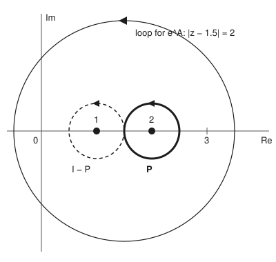
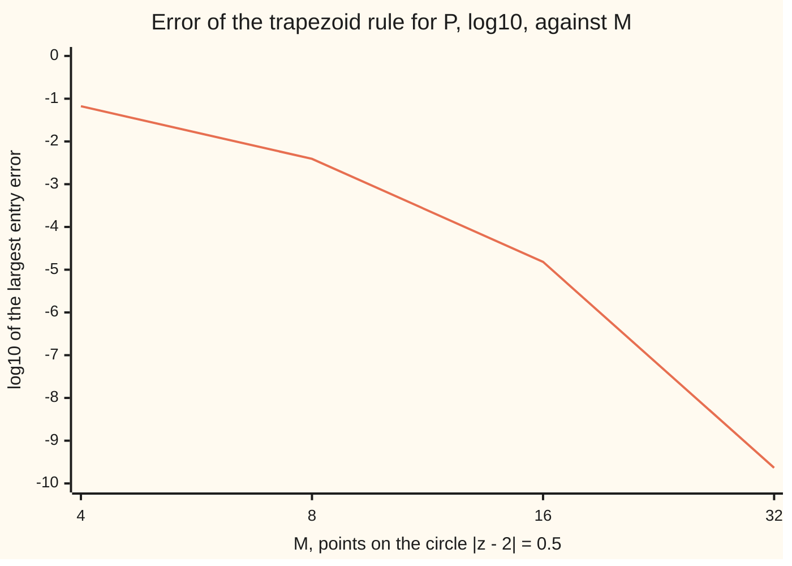

# Holomorphic functional calculus: put any operator into an analytic function, and cut out part of its spectrum

[Syllabus](../../../SYLLABUS.md) → [Functional analysis](../README.md) → [Bounded Operators](../README.md#s03) → Holomorphic functional calculus

---

## General Overview

Two quantities change together. The second, $`x_2`$, grows at rate 2 on its own. The first, $`x_1`$, grows at rate 1 and is also fed by the second: $`x_1' = x_1 + x_2`$ and $`x_2' = 2x_2`$. In one line, $`x' = Ax`$ with the 2 × 2 matrix A = `[[1, 1], [0, 2]]`. From a start $`x_0`$, the state at time t is $`e^{tA}x_0`$ ([The matrix exponential](../../08-Differential%20equations%20and%20dynamics/04-Systems%20and%20the%20Matrix%20Exponential/04-the-matrix-exponential.md)), so after one unit of time it is $`e^A x_0`$.

A has two eigenvalues, 1 and 2: the two growth rates. Its eigenvectors are (1, 0) for 1 and (1, 1) for 2. They are not at right angles, so A is not symmetric.

Two questions follow. First, what is $`e^A`$, or any other function of A? Second, which share of a start grows like $`e^{2t}`$ and soon takes over? For a symmetric matrix, both answers come from an orthonormal basis of eigenvectors ([Bounded and symmetric](10-spectral-theorem-for-bounded-self-adjoint-operators.md)). Here there is no such basis, and the fast share is not the nearest point on the line through (1, 1).

Complex analysis answers both questions with one loop integral. [Cauchy's integral formula](../../07-Complex%20analysis/03-Contour%20Integrals%20and%20Cauchy%27s%20Theorem/05-cauchys-integral-formula.md) rebuilds a function's value $`f(a)`$ from its values on a loop round a. Put the matrix in place of the number a. The same integral then builds $`f(A)`$. Take $`f = 1`$ near the eigenvalue 2 and $`f = 0`$ near 1, and the integral builds the matrix P = `[[0, 1], [0, 1]]`. P keeps the eigenvector (1, 1), deletes the eigenvector (1, 0), and satisfies $`P^2 = P`$. For a start $`x_0 = (x_1, x_2)`$, the fast share is $`Px_0 = (x_2, x_2)`$: only $`x_2`$ feeds the growth at rate 2.

The method needs no eigenvectors and no symmetry. It works for any bounded operator on an infinite-dimensional space, where eigenvectors may not exist at all.

**For a bounded operator T and a function f that is analytic near the spectrum of T, the loop integral of f(z) times the resolvent (zI − T)⁻¹ defines f(T); this rule respects sums and products, the spectrum of f(T) is f applied to the spectrum of T, and with f equal to 1 round one part of the spectrum and 0 round the rest it gives the Riesz projection onto that part.**

**What kind of fact this is:** theorems about any bounded operator on a complex Banach space (a complete normed space), proved on this card in Why it works. One piece is stated with its source: that the spectrum splits between the two ranges of a Riesz projection (Conway, chapter VII, section 4). The code checks the 2 × 2 example exactly and a blur on grids of N points; it proves nothing about the infinite case.

### The picture: the spectrum and the three loops

<p align="center"></p>

To scale, 80 px per unit, with 0 at (60, 190). The heavy circle $`\lvert z - 2\rvert = 0.5`$ gives the Riesz projection P. The dashed circle $`\lvert z - 1\rvert = 0.5`$ gives $`I - P`$. The large circle $`\lvert z - 1.5\rvert = 2`$ encloses the whole spectrum and gives $`e^A`$. Triangles show the anticlockwise direction.

---

## The formula

Notation first, in words.

- T is a **bounded operator**: a linear map with $`\lVert Tx\rVert \le C\lVert x\rVert`$ for one fixed C ([Bounded operators](01-bounded-operators-and-the-operator-norm.md)). A is our matrix, one example of T.
- $`\sigma(T)`$ is the **spectrum**: the complex numbers z where $`zI - T`$ has no bounded inverse. For a matrix, the eigenvalues ([Spectrum](07-spectrum-and-resolvent.md)).
- $`R(z, T) = (zI - T)^{-1}`$ is the **resolvent**, defined for every z outside the spectrum. This card writes z, not λ, because z runs round a loop.
- f is **holomorphic** (analytic) on an open set U: it has a complex derivative at every point of U. U must contain the spectrum.
- Γ (capital gamma) is a **loop** in U, or several loops, that winds once anticlockwise round every point of the spectrum and round no point outside U. Several loops are needed when U falls into separate pieces, as in Step 5.

The **holomorphic functional calculus**, also called the Riesz–Dunford calculus:

```math
f(T) = \frac{1}{2\pi i}\oint_\Gamma f(z)\,(zI - T)^{-1}\,dz
```

**Read it aloud:** f of T is one over two pi i times the loop integral of f of z times the resolvent of T at z.

Now split the spectrum into two pieces, $`\sigma_1`$ and $`\sigma_2`$, that are closed and do not touch. Let Γ wind round $`\sigma_1`$ only. The **Riesz projection** onto $`\sigma_1`$ is

```math
P = \frac{1}{2\pi i}\oint_\Gamma (zI - T)^{-1}\,dz, \qquad P^2 = P, \qquad PT = TP
```

**Read it aloud:** the Riesz projection is the loop integral of the resolvent alone; it is a projection, and it commutes with T.

The **spectral mapping theorem** says what f does to the spectrum, for any f holomorphic round it:

```math
\sigma(f(T)) = f(\sigma(T))
```

**Read it aloud:** the spectrum of f of T is f applied to every point of the spectrum of T.

For the example, the resolvent is

```math
(zI - A)^{-1} = \begin{bmatrix} \dfrac{1}{z-1} & \dfrac{1}{(z-1)(z-2)} \\ 0 & \dfrac{1}{z-2} \end{bmatrix}, \qquad P = \begin{bmatrix} 0 & 1 \\ 0 & 1 \end{bmatrix}, \qquad e^A = \begin{bmatrix} e & e^2 - e \\ 0 & e^2 \end{bmatrix}
```

**Read it aloud:** each entry of the resolvent is a fraction with poles at 1 and 2; the loop round 2 picks out P; the loop round both gives e to the A.

| Symbol | Plain meaning | In our example | Push it up and the answer… |
| --- | --- | --- | --- |
| $`T`$, $`A`$, $`I`$ | a bounded operator; the example matrix; the identity, which changes nothing | A = `[[1, 1], [0, 2]]` | — |
| $`x`$, $`x_1`$, $`x_2`$, $`x_0`$, $`t`$ | a vector, here the state in $`x' = Ax`$; its two entries; its start; time | $`x_1' = x_1 + x_2`$, $`x_2' = 2x_2`$ | larger t: the fast share $`Px_0`$, growing like $`e^{2t}`$, takes over |
| $`z`$, $`w`$; $`\lambda`$, $`\mu`$ | complex numbers on a loop; a point of the spectrum; a number tested against $`\sigma(f(T))`$ | λ = 1 or 2 | — |
| $`\varphi`$, $`\chi`$, $`B`$ | a bounded functional (continuous linear map to the complex numbers); the function equal to 1 round $`\sigma_1`$ and 0 round $`\sigma_2`$; a would-be inverse in Step 4 | χ = 1 near 2, 0 near 1 | — |
| $`\sigma(T)`$, $`\sigma_1`$, $`\sigma_2`$ | the spectrum; the part kept; the part discarded | {1, 2}; {2}; {1} | — |
| $`R(z, T)`$ | the resolvent $`(zI - T)^{-1}`$ | entries with poles at 1 and 2 | blows up as z nears the spectrum |
| $`f`$, $`g`$, $`U`$; $`a`$ | functions holomorphic on the open set U round the spectrum (in Step 6, f is a signal); a number inside a loop, in Cauchy's formula | $`f(z) = e^z`$, U the whole plane | — |
| $`\Gamma`$, $`\Gamma_1`$, $`\Gamma_2`$, $`r`$ | the loop, or loops; an inner and an outer loop in Step 3's proof; the radius when the loop is a circle | $`\lvert z - 2\rvert = 0.5`$, r = 0.5 | too large, it encloses 1 as well |
| $`P`$, $`I - P`$; $`O`$; $`J`$ | the Riesz projection onto $`\sigma_1`$; the one onto $`\sigma_2`$; the nearest-point projection onto (1, 1); a Jordan block | `[[0, 1], [0, 1]]`; `[[1, -1], [0, 0]]`; `[[0.5, 0.5], [0.5, 0.5]]`; `[[2, 1], [0, 2]]` | — |
| $`\lVert\cdot\rVert`$, $`C`$ | size of a vector; largest stretch of an operator; a bound with $`\lVert Tx\rVert \le C\lVert x\rVert`$ | $`\lVert P\rVert = \sqrt 2 = 1.414214`$ | above 1 means oblique |
| $`M`$; $`n`$, $`k`$ | points on the loop in the trapezoid rule; whole-number powers in Step 2 | 4, 8, 16, 32 | error falls like $`0.5^M`$ |
| $`K`$, $`k(x, y)`$, $`x`$, $`y`$, $`u`$; $`N`$, $`P_N`$ | the leaning blur, its kernel, positions on [0, 1] in Step 6, a temperature profile; the number of grid points, the loop integral on that grid | $`e^{x-y}\min(x,y)(1-\max(x,y))`$; N = 10 to 80 | closer to the infinite case |

### When it holds

- **f holomorphic on an open set round the whole spectrum.** A pole on the spectrum breaks it: $`f(z) = 1/(z - 2)`$ gives the zero matrix for A, which is no inverse of $`A - 2I`$.
- **The loop encloses all of the spectrum (for f(T)) or exactly the chosen part (for P).** Enclose 1 too, and the "projection onto 2" comes out as I.
- **The two parts of the spectrum do not touch.** A Riesz projection needs a loop between them. The delay line's spectrum, the closed unit disc ([Spectrum](07-spectrum-and-resolvent.md)), is one connected piece, so it has no Riesz projection except 0 and I.
- **Complex scalars and a complete space.** The loop runs through complex z, and the integral of operator values needs completeness to converge.
- **T bounded.** For an unbounded operator the spectrum can be unbounded, and the loop needs care at infinity (shelf 05).

---

## Why it works

### Step 0: Cauchy's formula already holds the idea

For a number a inside a loop, Cauchy's formula says $`f(a) = \frac{1}{2\pi i}\oint f(z)\,(z - a)^{-1}\,dz`$. The only thing that depends on a is $`(z - a)^{-1}`$. Replace the number a by the operator T and $`(z - a)^{-1}`$ by the resolvent $`(zI - T)^{-1}`$. The resolvent exists at every point of the loop, because the loop avoids the spectrum. So the integral makes sense.

The rest of the card checks that this definition behaves like "f applied to T". It does, because the resolvent behaves like $`1/(z - a)`$ in every way that matters.

### Step 1: the answer does not depend on the loop

The [Spectrum](07-spectrum-and-resolvent.md) card proves that the resolvent is holomorphic off the spectrum: it has a complex derivative, $`-R(z, T)^2`$. So $`f(z)R(z, T)`$ is holomorphic between any two loops that both enclose the spectrum. Cauchy's theorem lets one loop slide to the other without changing the integral ([Deforming a loop](../../07-Complex%20analysis/03-Contour%20Integrals%20and%20Cauchy%27s%20Theorem/04-deforming-contours-and-winding-numbers.md)). So f(T) depends only on f and T.

To make that precise for operator-valued integrals, apply a bounded functional φ (a continuous linear map to the complex numbers). Then $`\varphi(f(z)R(z, T))`$ is an ordinary holomorphic function, and ordinary complex analysis applies.

### Step 2: it agrees with polynomials and power series

Take a big circle, $`\lvert z\rvert = r`$ with radius $`r > \lVert T\rVert`$. There the [Neumann series](06-neumann-series-and-inverting-close-to-the-identity.md) gives the resolvent:

```math
(zI - T)^{-1} = \sum_{k=0}^{\infty} \frac{T^k}{z^{k+1}}, \qquad \frac{1}{2\pi i}\oint_{\lvert z\rvert = r} z^n \cdot \frac{1}{z^{k+1}}\,dz = \begin{cases} 1 & k = n \\ 0 & k \ne n \end{cases}
```

**Read it aloud:** on a big circle the resolvent is a geometric series in T over z, and integrating z to the n against each term keeps only the term with k equal to n.

So $`f(z) = z^n`$ gives exactly $`T^n`$, and $`f = 1`$ gives I. By adding, every polynomial p gives p(T). A power series that converges on a disc round the spectrum gives the sum of its terms, since the series converges uniformly on the loop. In particular the integral for $`e^z`$ equals the series $`\sum T^k/k!`$, the series of [The matrix exponential](../../08-Differential%20equations%20and%20dynamics/04-Systems%20and%20the%20Matrix%20Exponential/04-the-matrix-exponential.md) card.

### Step 3: products go to products

The **multiplication rule** says $`(fg)(T) = f(T)\,g(T)`$. Sums go to sums because the integral is linear. The product rule is the deep part: it follows from the resolvent identity $`R(z)R(w) = (R(z) - R(w))/(w - z)`$ ([Spectrum](07-spectrum-and-resolvent.md)).

<details>
<summary>Detailed proof: the multiplication rule, with two loops</summary>

Choose two loops round the spectrum, $`\Gamma_1`$ inside $`\Gamma_2`$. Write R(z) for R(z, T). Then

$`\displaystyle f(T)\,g(T) = \Big(\frac{1}{2\pi i}\Big)^2 \oint_{\Gamma_1}\oint_{\Gamma_2} f(z)\,g(w)\,R(z)R(w)\,dw\,dz.`$

Replace $`R(z)R(w)`$ by $`(R(z) - R(w))/(w - z)`$ and split into two integrals.

In the first, integrate over w first. The point z lies inside $`\Gamma_2`$, so Cauchy's formula gives $`\frac{1}{2\pi i}\oint_{\Gamma_2} g(w)/(w - z)\,dw = g(z)`$. What remains is $`\frac{1}{2\pi i}\oint_{\Gamma_1} f(z)g(z)R(z)\,dz`$.

In the second, integrate over z first. The point w lies outside $`\Gamma_1`$, so $`f(z)/(w - z)`$ is holomorphic inside $`\Gamma_1`$, and Cauchy's theorem gives 0.

So $`f(T)g(T) = (fg)(T)`$.

</details>

Two consequences follow. Any two functions of T commute with each other and with T. And if f has no zero on the spectrum, then 1/f is holomorphic there and $`(1/f)(T)`$ is the inverse of f(T).

### Step 4: the spectral mapping theorem

The claim is $`\sigma(f(T)) = f(\sigma(T))`$. Two halves.

1. **Every f(λ) is in the spectrum of f(T).** Take λ in $`\sigma(T)`$. The function $`g(z) = (f(z) - f(\lambda))/(z - \lambda)`$ is holomorphic: its only possible problem at λ cancels. By Step 3, $`f(T) - f(\lambda)I = (T - \lambda I)\,g(T) = g(T)\,(T - \lambda I)`$. If the left side had an inverse B, then $`g(T)B`$ would be a right inverse of $`T - \lambda I`$ and $`Bg(T)`$ a left inverse. Then $`T - \lambda I`$ would be invertible, which is false.
2. **Nothing else is in it.** Take μ not of the form f(λ). Then $`f(z) - \mu`$ has no zero on the spectrum, so by Step 3 its reciprocal gives an inverse of $`f(T) - \mu I`$.

For A, $`\sigma(e^A) = \{e, e^2\} = \{2.718282, 7.389056\}`$. The code finds the same two numbers as the roots of the characteristic polynomial of the computed $`e^A`$.

### Step 5: the Riesz projection

Let χ (chi) be 1 on an open set round $`\sigma_1`$ and 0 on a separate open set round $`\sigma_2`$. That function is holomorphic: it is constant near every point. Integrate it over two loops, one round each piece. The loop round $`\sigma_2`$ adds nothing, so the integral is the formula for P. Now the earlier steps do the work.

- $`\chi^2 = \chi`$, so $`P^2 = P`$ by Step 3: P is a **projection** (applying it twice changes nothing more).
- P commutes with T, so T maps the range of P into itself and the range of $`I - P`$ into itself. The space splits into two pieces that T keeps apart.
- On the range of P the spectrum of T is $`\sigma_1`$, and on the range of $`I - P`$ it is $`\sigma_2`$ (Conway, chapter VII, section 4).

For the matrix the integral is a **residue** count ([The residue theorem](../../07-Complex%20analysis/05-Laurent%20Series%2C%20Singularities%20and%20Residues/05-the-residue-theorem.md)): each entry of P is the residue at 2 of that entry of the resolvent. Those are 0, $`1/(2 - 1) = 1`$, 0 and 1, so P = `[[0, 1], [0, 1]]`.

P is not the nearest-point projection. Its range is the line through (1, 1), but it throws away along (1, 0), not at right angles. That shows in its size: $`\lVert P\rVert = \sqrt 2`$, while a projection at right angles has size 1. The Riesz projection is **oblique**: it cuts along the other eigenvector. The cut is a right angle when T commutes with its adjoint, as every symmetric T does; A does not.

**An isolated eigenvalue of finite multiplicity.** When $`\sigma_1`$ is one point λ and P has finite rank (its range has finite dimension), λ is an eigenvalue. The rank of P equals the trace of P, and it counts λ with its algebraic multiplicity: the size of its Jordan blocks added up. This is how later cards define the discrete part of a spectrum.

### Step 6: from the matrix to infinite dimensions

The construction never used the dimension. Take the shelf's blur, made to lean. The kernel $`\min(x, y)(1 - \max(x, y))`$ on [0, 1] is the tent-shaped string kernel: it averages a signal with weights that peak at the point itself. Multiply it by $`e^{x - y}`$ and it leans to the right. The leaning blur K acts on signals in $`L^2[0, 1]`$ (finite-energy functions) by

```math
(Kf)(x) = \int_0^1 e^{x - y}\min(x, y)\,(1 - \max(x, y))\,f(y)\,dy
```

**Read it aloud:** the leaning blur averages f against the tent kernel tilted by e to the x minus y.

The lean has a physical cause. Take a bar whose two ends are held at temperature 0, heated along its length by a source f. The string kernel turns f into the bar's steady temperature u: it undoes $`-u''`$. The leaning kernel undoes $`-u'' + 2u' - u`$ with the same ends. So Kf is the steady temperature of a bar whose heat is also carried to the right by a steady flow (the $`2u'`$) and topped up in proportion to its own temperature (the $`-u`$).

K multiplies a signal by $`e^{-y}`$, applies the plain string blur, then multiplies by $`e^x`$. So it has the plain blur's eigenvalues, $`1/(n^2\pi^2)`$. The top one is $`1/\pi^2 = 0.101321`$, with eigenfunction $`e^x\sin(\pi x)`$. K is not symmetric.

The circle of radius 0.04 round 0.1 encloses the top eigenvalue only, and its Riesz projection is $`(Pf)(x) = 2e^x\sin(\pi x)\int_0^1 e^{-y}\sin(\pi y)\,f(y)\,dy`$. Its size is $`\sinh(1)\,\pi^2/(1 + \pi^2) = 1.067083`$, above 1: oblique again.

In the bar, $`e^x\sin(\pi x)`$ is the temperature shape that fades slowest once the heating stops, and Pf is how much of a starting profile f ends up in it. P weighs the start by $`e^{-y}\sin(\pi y)`$, not by the shape itself. Heat that starts upstream, on the left, counts for more: the flow carries it along the bar, while heat near the right end is swept into the cold end. A projection at right angles would weigh the start by the shape itself and get that share wrong.

The code builds K on N grid points (the midpoint rule) and runs the same loop integral, with 48 points on the circle. It sizes $`P_N`$ by the square root of the sum of its squared entries, which equals the largest stretch because $`P_N`$ has rank one:

| N | trace of $`P_N`$ | eigenvalue estimate | (estimate − $`1/\pi^2`$) × N² | $`\lVert P_N\rVert`$ |
| ---: | ---: | ---: | ---: | ---: |
| 10 | 1.000000 | 0.102159 | 0.083746 | 1.067152 |
| 20 | 1.000000 | 0.101530 | 0.083436 | 1.067087 |
| 40 | 1.000000 | 0.101373 | 0.083359 | 1.067083 |
| 80 | 1.000000 | 0.101334 | 0.083340 | 1.067083 |

The trace stays 1: one eigenvalue, of multiplicity one, inside the loop. The eigenvalue error times N² settles near 0.0833, so the error falls like $`1/N^2`$. The size closes on the exact 1.067083.

What the grid hides: every grid matrix has only finitely many eigenvalues, while the true K has infinitely many, piling up at 0. Then 0 is in the spectrum but is not an isolated point, so no loop can cut it out. The calculus still works for any f holomorphic round the whole spectrum, 0 included.

---

## Worked numbers, by hand

| Step | Arithmetic | Value |
| --- | --- | --- |
| $`zI - A`$ | `[[z - 1, -1], [0, z - 2]]`, determinant $`(z-1)(z-2)`$ | poles at 1 and 2 |
| resolvent | inverse of a triangular 2 × 2 matrix | $`\frac{1}{z-1}`$, $`\frac{1}{(z-1)(z-2)}`$, 0, $`\frac{1}{z-2}`$ |
| residues at 2 | 0; $`1/(2 - 1)`$; 0; 1 | P = `[[0, 1], [0, 1]]` |
| $`P^2`$ | row 1 times column 2: $`0 \times 1 + 1 \times 1`$ | 1, so $`P^2 = P`$ |
| $`AP`$ and $`PA`$ | both `[[0, 2], [0, 2]]` | P commutes with A |
| P on the eigenvectors | $`P(1, 1) = (1, 1)`$, $`P(1, 0) = (0, 0)`$ | keeps 2, deletes 1 |
| size of P | $`P^{\mathsf T}P`$ = `[[0, 0], [0, 2]]`, square root of 2 | 1.414214 |
| loop round 1 | $`I - P`$ | `[[1, -1], [0, 0]]` |
| $`e^A`$ | $`e(I - P) + e^2 P`$, top right $`e^2 - e`$ | `[[2.718282, 4.670774], [0, 7.389056]]` |
| spectrum of $`e^A`$ | $`\{e^1, e^2\}`$ | **{2.718282, 7.389056}** |
| check | $`\det e^A = e^{\mathrm{trace}\,A} = e^3`$ | 20.085537 |

The loop round 2 hands back the part of any vector that grows like $`e^{2t}`$ under $`e^{tA}`$, with no eigen-solver and no basis change.

### What breaks if you drop a piece

| Mistake | Comes out at | What went wrong |
| --- | --- | --- |
| Apply f to the eigenvalue alone, for the Jordan block J = `[[2, 1], [0, 2]]` | $`e^2 I`$, top right 0 | the loop gives top right $`f'(2) = e^2 = 7.389056`$; a repeated eigenvalue without a full set of eigenvectors brings in the derivative |
| Use $`f(z) = 1/(z - 2)`$, a pole on the spectrum | loop gives the zero matrix; times $`A - 2I`$ still zero, not I | f must be holomorphic round the whole spectrum; $`A - 2I`$ has no inverse to find |
| Loop $`\lvert z - 2\rvert = 1.5`$, also enclosing 1 | I, trace 2.000000 | the loop must separate the kept part from the rest |
| Use the nearest-point projection O onto (1, 1) | $`AO - OA`$ = `[[0.5, -0.5], [0.5, -0.5]]` | O does not commute with A, so A mixes its range with the rest |

The code prints all four.

---

## Code, from first principles, and it actually runs

The code computes the loop integral directly. It puts M equally spaced points on a circle and applies the trapezoid rule (equal weights round the circle), inverting $`zI - T`$ at each point by Gauss–Jordan elimination. It takes three independent roads to P: the residues by hand, the trapezoid rule with its error checked against the exact $`r^M/(1 - r^M)`$, and the invariants $`P^2 = P`$, $`AP = PA`$ and $`\lVert P\rVert = \sqrt 2`$ by power iteration. It takes three roads to $`e^A`$: the loop, the power series and $`e(I - P) + e^2P`$, then checks the spectral mapping theorem against the roots of the characteristic polynomial. Finally it runs the leaning blur at N = 10, 20, 40 and 80.

### Python

```python
# Holomorphic functional calculus and Riesz projections -- the check behind the card.  Standard library only.
# f(T) = (1/(2 pi i)) x (loop integral of f(z) (zI - T)^-1 dz), computed by the trapezoid rule on a circle.
# Inverses, products, exponentials and norms are written out; nothing imported already knows the answer.
from math import cos, sin, pi, exp, sqrt, log10

def f6(t): return f"{(t if abs(t) >= 5e-7 else 0.0):.6f}"      # never print "-0.000000"
def cexp(z): return exp(z.real) * complex(cos(z.imag), sin(z.imag))
def mat(A): return "[[" + "], [".join(", ".join(f6(v) for v in row) for row in A) + "]]"
def dot(a, b):                       # plain running sum, so Python and Rust add in the same order
    s = 0.0
    for p, q in zip(a, b):
        s += p * q
    return s
def mul(A, B): return [[dot(A[i], [r[j] for r in B]) for j in range(len(B[0]))] for i in range(len(A))]
def gap(A, B): return max(abs(a - b) for ra, rb in zip(A, B) for a, b in zip(ra, rb))
def inverse(A):                      # Gauss-Jordan with partial pivoting, complex entries
    n = len(A)
    M = [list(A[i]) + [complex(1.0 if j == i else 0.0) for j in range(n)] for i in range(n)]
    for c in range(n):
        p = max(range(c, n), key=lambda r: abs(M[r][c]))
        M[c], M[p] = M[p], M[c]
        piv = M[c][c]
        M[c] = [v / piv for v in M[c]]
        for r in range(n):
            if r != c:
                f = M[r][c]
                M[r] = [a - f * b for a, b in zip(M[r], M[c])]
    return [row[n:] for row in M]
def calculus(f, A, centre, radius, nodes):   # (1/(2 pi i)) loop integral of f(z) (zI - A)^-1 dz, trapezoid rule
    n = len(A)
    S = [[0j] * n for _ in range(n)]
    for k in range(nodes):
        w = radius * complex(cos(2 * pi * k / nodes), sin(2 * pi * k / nodes))
        z = centre + w               # dz = i w dtheta; the i cancels the i in 1/(2 pi i)
        R = inverse([[(z if i == j else 0j) - A[i][j] for j in range(n)] for i in range(n)])
        for i in range(n):
            for j in range(n):
                S[i][j] += f(z) * R[i][j] * w / nodes
    return [[v.real for v in row] for row in S]
def opnorm(A, iters=200):            # largest stretch: power iteration on A^T A
    x = [1.0] * len(A[0])
    for _ in range(iters):
        y = [dot(row, x) for row in A]
        z = [dot([row[j] for row in A], y) for j in range(len(x))]
        s = sqrt(dot(z, z))
        x = [t / s for t in z]
    y = [dot(row, x) for row in A]
    return sqrt(dot(y, y))
one = lambda z: 1.0 + 0j

print("A = [[1, 1], [0, 2]], spectrum {1, 2}; (zI - A)^-1 = [[1/(z-1), 1/((z-1)(z-2))], [0, 1/(z-2)]]")
A = [[1.0, 1.0], [0.0, 2.0]]
P = [[0.0, 1 / (2 - 1)], [0.0, 1.0]]  # residues at z = 2, entry by entry: none, 1/(2-1), 1
print("road 1, residues at 2 by hand: P =", mat(P))
print("road 2, trapezoid rule on |z - 2| = 0.5 with M nodes:")
errs = []
for M in (4, 8, 16, 32):
    PM = calculus(one, A, 2.0, 0.5, M)
    err, pred = gap(PM, P), 0.5 ** M / (1 - 0.5 ** M)
    errs.append(log10(err))
    print(f"  M = {M:2d}: P_M = {mat(PM)}, error {err:.12f}, r^M/(1 - r^M) = {pred:.12f}, log10 error {log10(err):.3f}")
    assert abs(err - pred) < 1e-13
print("chart, log10 error against M = 4, 8, 16, 32:", ", ".join(f"{e:.3f}" for e in errs))
P2, AP, PA = mul(P, P), mul(A, P), mul(P, A)
print("road 3, invariants: P^2 =", mat(P2), "| AP =", mat(AP), "| PA =", mat(PA))
print("  P (1, 1) =", mat([[dot(P[0], [1.0, 1.0]), dot(P[1], [1.0, 1.0])]]), "| P (1, 0) =", mat([[P[0][0], P[1][0]]]), "| trace P =", f6(P[0][0] + P[1][1]))
nP = opnorm(P)
print("  ||P|| by power iteration =", f6(nP), "| sqrt 2 =", f6(sqrt(2)), "| above 1, so P is oblique, not orthogonal")
assert gap(P2, P) == 0 and gap(AP, PA) == 0 and abs(nP - sqrt(2)) < 1e-12
Q = [[1 - P[0][0], -P[0][1]], [-P[1][0], 1 - P[1][1]]]
Q1 = calculus(one, A, 1.0, 0.5, 64)
print("I - P =", mat(Q), "| loop |z - 1| = 0.5, 64 nodes:", mat(Q1))
assert gap(Q, Q1) < 1e-15
print("e^A, three roads:")
E1 = calculus(cexp, A, 1.5, 2.0, 64)
E2, term = [[1.0, 0.0], [0.0, 1.0]], [[1.0, 0.0], [0.0, 1.0]]
for k in range(1, 30):
    term = [[v / k for v in row] for row in mul(term, A)]
    E2 = [[a + b for a, b in zip(r, s)] for r, s in zip(E2, term)]
E3 = [[exp(1) * Q[i][j] + exp(2) * P[i][j] for j in range(2)] for i in range(2)]
print("  loop |z - 1.5| = 2, 64 nodes:", mat(E1))
print("  power series, 30 terms:     ", mat(E2))
print("  e (I - P) + e^2 P:          ", mat(E3))
assert gap(E1, E3) < 1e-12 and gap(E2, E3) < 1e-12
tr, det = E1[0][0] + E1[1][1], E1[0][0] * E1[1][1] - E1[0][1] * E1[1][0]
disc = sqrt(tr * tr - 4 * det)
lo, hi = (tr - disc) / 2, (tr + disc) / 2
print(f"spectral mapping: z^2 - {f6(tr)} z + {f6(det)} has roots {f6(lo)}, {f6(hi)} | e, e^2 = {f6(exp(1))}, {f6(exp(2))}")
print(f"  det e^A = {f6(det)} | e^(trace A) = e^3 = {f6(exp(3))}")
assert abs(lo - exp(1)) < 1e-9 and abs(hi - exp(2)) < 1e-9 and abs(det - exp(3)) < 1e-9
print("what breaks:")
J = [[2.0, 1.0], [0.0, 2.0]]
EJ = calculus(cexp, J, 2.0, 1.0, 64)
print("  Jordan block [[2, 1], [0, 2]]: loop gives e^J =", mat(EJ), "| e^2 on the eigenvalue alone:", mat([[exp(2), 0.0], [0.0, exp(2)]]))
assert abs(EJ[0][1] - exp(2)) < 1e-12
F = calculus(lambda z: 1 / (z - 2), A, 1.5, 2.0, 64)
FA = mul(F, [[-1.0, 1.0], [0.0, 0.0]])
print("  f = 1/(z - 2), a pole on the spectrum: loop gives", mat(F), "| times (A - 2I):", mat(FA), "not I")
assert gap(F, [[0.0, 0.0], [0.0, 0.0]]) < 1e-12
W = calculus(one, A, 2.0, 1.5, 64)
print("  loop |z - 2| = 1.5 also encloses 1:", mat(W), "| trace", f6(W[0][0] + W[1][1]))
assert gap(W, [[1.0, 0.0], [0.0, 1.0]]) < 1e-9
O = [[0.5, 0.5], [0.5, 0.5]]
C = [[a - b for a, b in zip(r, s)] for r, s in zip(mul(A, O), mul(O, A))]
print("  nearest-point projection O onto (1, 1): AO - OA =", mat(C), "| ||O|| =", f6(opnorm(O)))
assert gap(C, [[0.5, -0.5], [0.5, -0.5]]) == 0 and abs(opnorm(O) - 1) < 1e-12
print("infinite dimensions: leaning blur on L2[0, 1], k(x, y) = e^(x - y) min(x, y) (1 - max(x, y)), N grid points")
lam1, limit = 1 / pi ** 2, (exp(1) - exp(-1)) / 2 * pi ** 2 / (1 + pi ** 2)
print("  exact: top eigenvalue 1/pi^2 =", f6(lam1), "| ||P|| = sinh(1) pi^2 / (1 + pi^2) =", f6(limit))
for N in (10, 20, 40, 80):
    xs = [(i + 0.5) / N for i in range(N)]
    K = [[exp(x - y) * min(x, y) * (1 - max(x, y)) / N for y in xs] for x in xs]
    PN = calculus(one, K, 0.1, 0.04, 48)
    trP = dot([PN[i][i] for i in range(N)], [1.0] * N)
    lamN = dot([dot(K[i], [PN[j][i] for j in range(N)]) for i in range(N)], [1.0] * N) / trP
    nrm = sqrt(dot([v for row in PN for v in row], [v for row in PN for v in row]))
    idem = gap(mul(PN, PN), PN)
    print(f"  N = {N:2d}: trace P_N {f6(trP)} | eigenvalue {f6(lamN)}, (eigenvalue - 1/pi^2) x N^2 = {f6((lamN - lam1) * N * N)} | ||P_N|| {f6(nrm)} | P_N^2 = P_N: {'yes' if idem < 1e-10 else 'no'}")
    assert abs(trP - 1) < 1e-9 and idem < 1e-10 and abs(lamN - lam1) < 0.1 / N ** 2
assert abs(nrm - limit) < 1e-5
print("figure, 80 px per unit, 0 at (60, 190): z = 1 at (140, 190), z = 2 at (220, 190), loop |z - 2| = 0.5 radius 40, loop |z - 1.5| = 2 centre (180, 190) radius 160")
print("ALL CHECKS PASS")
```

**Ran 2026-11-24 on macOS, Python 3.14.10, standard library only. All checks passed. Output, pasted from the run:**

```
A = [[1, 1], [0, 2]], spectrum {1, 2}; (zI - A)^-1 = [[1/(z-1), 1/((z-1)(z-2))], [0, 1/(z-2)]]
road 1, residues at 2 by hand: P = [[0.000000, 1.000000], [0.000000, 1.000000]]
road 2, trapezoid rule on |z - 2| = 0.5 with M nodes:
  M =  4: P_M = [[-0.066667, 1.066667], [0.000000, 1.000000]], error 0.066666666667, r^M/(1 - r^M) = 0.066666666667, log10 error -1.176
  M =  8: P_M = [[-0.003922, 1.003922], [0.000000, 1.000000]], error 0.003921568627, r^M/(1 - r^M) = 0.003921568627, log10 error -2.407
  M = 16: P_M = [[-0.000015, 1.000015], [0.000000, 1.000000]], error 0.000015259022, r^M/(1 - r^M) = 0.000015259022, log10 error -4.816
  M = 32: P_M = [[0.000000, 1.000000], [0.000000, 1.000000]], error 0.000000000233, r^M/(1 - r^M) = 0.000000000233, log10 error -9.633
chart, log10 error against M = 4, 8, 16, 32: -1.176, -2.407, -4.816, -9.633
road 3, invariants: P^2 = [[0.000000, 1.000000], [0.000000, 1.000000]] | AP = [[0.000000, 2.000000], [0.000000, 2.000000]] | PA = [[0.000000, 2.000000], [0.000000, 2.000000]]
  P (1, 1) = [[1.000000, 1.000000]] | P (1, 0) = [[0.000000, 0.000000]] | trace P = 1.000000
  ||P|| by power iteration = 1.414214 | sqrt 2 = 1.414214 | above 1, so P is oblique, not orthogonal
I - P = [[1.000000, -1.000000], [0.000000, 0.000000]] | loop |z - 1| = 0.5, 64 nodes: [[1.000000, -1.000000], [0.000000, 0.000000]]
e^A, three roads:
  loop |z - 1.5| = 2, 64 nodes: [[2.718282, 4.670774], [0.000000, 7.389056]]
  power series, 30 terms:      [[2.718282, 4.670774], [0.000000, 7.389056]]
  e (I - P) + e^2 P:           [[2.718282, 4.670774], [0.000000, 7.389056]]
spectral mapping: z^2 - 10.107338 z + 20.085537 has roots 2.718282, 7.389056 | e, e^2 = 2.718282, 7.389056
  det e^A = 20.085537 | e^(trace A) = e^3 = 20.085537
what breaks:
  Jordan block [[2, 1], [0, 2]]: loop gives e^J = [[7.389056, 7.389056], [0.000000, 7.389056]] | e^2 on the eigenvalue alone: [[7.389056, 0.000000], [0.000000, 7.389056]]
  f = 1/(z - 2), a pole on the spectrum: loop gives [[0.000000, 0.000000], [0.000000, 0.000000]] | times (A - 2I): [[0.000000, 0.000000], [0.000000, 0.000000]] not I
  loop |z - 2| = 1.5 also encloses 1: [[1.000000, 0.000000], [0.000000, 1.000000]] | trace 2.000000
  nearest-point projection O onto (1, 1): AO - OA = [[0.500000, -0.500000], [0.500000, -0.500000]] | ||O|| = 1.000000
infinite dimensions: leaning blur on L2[0, 1], k(x, y) = e^(x - y) min(x, y) (1 - max(x, y)), N grid points
  exact: top eigenvalue 1/pi^2 = 0.101321 | ||P|| = sinh(1) pi^2 / (1 + pi^2) = 1.067083
  N = 10: trace P_N 1.000000 | eigenvalue 0.102159, (eigenvalue - 1/pi^2) x N^2 = 0.083746 | ||P_N|| 1.067152 | P_N^2 = P_N: yes
  N = 20: trace P_N 1.000000 | eigenvalue 0.101530, (eigenvalue - 1/pi^2) x N^2 = 0.083436 | ||P_N|| 1.067087 | P_N^2 = P_N: yes
  N = 40: trace P_N 1.000000 | eigenvalue 0.101373, (eigenvalue - 1/pi^2) x N^2 = 0.083359 | ||P_N|| 1.067083 | P_N^2 = P_N: yes
  N = 80: trace P_N 1.000000 | eigenvalue 0.101334, (eigenvalue - 1/pi^2) x N^2 = 0.083340 | ||P_N|| 1.067083 | P_N^2 = P_N: yes
figure, 80 px per unit, 0 at (60, 190): z = 1 at (140, 190), z = 2 at (220, 190), loop |z - 2| = 0.5 radius 40, loop |z - 1.5| = 2 centre (180, 190) radius 160
ALL CHECKS PASS
```

### Rust

```rust
// Holomorphic functional calculus and Riesz projections -- the check behind the card.  std only.
// f(T) = (1/(2 pi i)) x (loop integral of f(z) (zI - T)^-1 dz), computed by the trapezoid rule on a circle.
// Complex numbers are a small struct; inverses, products, exponentials and norms are written out.
use std::f64::consts::PI;

#[derive(Clone, Copy)]
struct C { re: f64, im: f64 }
fn c(re: f64, im: f64) -> C { C { re, im } }
fn add(a: C, b: C) -> C { c(a.re + b.re, a.im + b.im) }
fn sub(a: C, b: C) -> C { c(a.re - b.re, a.im - b.im) }
fn cmul(a: C, b: C) -> C { c(a.re * b.re - a.im * b.im, a.re * b.im + a.im * b.re) }
fn cdiv(a: C, b: C) -> C {           // Smith's method, as Python divides complex numbers
    if b.re.abs() >= b.im.abs() {
        let r = b.im / b.re; let d = b.re + b.im * r;
        c((a.re + a.im * r) / d, (a.im - a.re * r) / d)
    } else {
        let r = b.re / b.im; let d = b.re * r + b.im;
        c((a.re * r + a.im) / d, (a.im * r - a.re) / d)
    }
}
fn cabs(a: C) -> f64 { a.re.hypot(a.im) }
fn cexp(z: C) -> C { let e = z.re.exp(); c(e * z.im.cos(), e * z.im.sin()) }
fn one(_z: C) -> C { c(1.0, 0.0) }
fn pole(z: C) -> C { cdiv(c(1.0, 0.0), sub(z, c(2.0, 0.0))) }
type M = Vec<Vec<f64>>;
fn f6(t: f64) -> String { format!("{:.6}", if t.abs() >= 5e-7 { t } else { 0.0 }) }   // never "-0.000000"
fn mat(a: &M) -> String {
    let rows: Vec<String> = a.iter().map(|r| r.iter().map(|&v| f6(v)).collect::<Vec<_>>().join(", ")).collect();
    format!("[[{}]]", rows.join("], ["))
}
fn dot(a: &[f64], b: &[f64]) -> f64 { let mut s = 0.0; for (p, q) in a.iter().zip(b) { s += p * q; } s }
fn col(b: &M, j: usize) -> Vec<f64> { b.iter().map(|r| r[j]).collect() }
fn mul(a: &M, b: &M) -> M { (0..a.len()).map(|i| (0..b[0].len()).map(|j| dot(&a[i], &col(b, j))).collect()).collect() }
fn gap(a: &M, b: &M) -> f64 {
    let mut g: f64 = 0.0;
    for (ra, rb) in a.iter().zip(b) { for (x, y) in ra.iter().zip(rb) { g = g.max((x - y).abs()); } }
    g
}
fn inverse(a: Vec<Vec<C>>) -> Vec<Vec<C>> {   // Gauss-Jordan with partial pivoting
    let n = a.len();
    let mut m: Vec<Vec<C>> = (0..n).map(|i| { let mut r = a[i].clone(); r.extend((0..n).map(|j| c(if i == j { 1.0 } else { 0.0 }, 0.0))); r }).collect();
    for k in 0..n {
        let mut p = k;
        for r in k + 1..n { if cabs(m[r][k]) > cabs(m[p][k]) { p = r; } }
        m.swap(k, p);
        let piv = m[k][k];
        m[k] = m[k].iter().map(|&v| cdiv(v, piv)).collect();
        for r in 0..n {
            if r != k {
                let f = m[r][k];
                let row: Vec<C> = m[r].iter().zip(&m[k]).map(|(&x, &y)| sub(x, cmul(f, y))).collect();
                m[r] = row;
            }
        }
    }
    m.into_iter().map(|r| r[n..].to_vec()).collect()
}
fn calculus(f: fn(C) -> C, a: &M, centre: f64, radius: f64, nodes: usize) -> M {
    let n = a.len();
    let mut s = vec![vec![c(0.0, 0.0); n]; n];
    for k in 0..nodes {
        let t = 2.0 * PI * k as f64 / nodes as f64;
        let w = c(radius * t.cos(), radius * t.sin());
        let z = c(centre + w.re, w.im);  // dz = i w dtheta; the i cancels the i in 1/(2 pi i)
        let r = inverse((0..n).map(|i| (0..n).map(|j| sub(if i == j { z } else { c(0.0, 0.0) }, c(a[i][j], 0.0))).collect()).collect());
        for i in 0..n { for j in 0..n {
            let v = cmul(cmul(f(z), r[i][j]), w);
            s[i][j] = add(s[i][j], c(v.re / nodes as f64, v.im / nodes as f64));
        } }
    }
    s.iter().map(|r| r.iter().map(|v| v.re).collect()).collect()
}
fn opnorm(a: &M) -> f64 {            // largest stretch: power iteration on A^T A
    let mut x = vec![1.0; a[0].len()];
    for _ in 0..200 {
        let y: Vec<f64> = a.iter().map(|r| dot(r, &x)).collect();
        let z: Vec<f64> = (0..x.len()).map(|j| dot(&col(a, j), &y)).collect();
        let s = dot(&z, &z).sqrt();
        x = z.iter().map(|t| t / s).collect();
    }
    let y: Vec<f64> = a.iter().map(|r| dot(r, &x)).collect();
    dot(&y, &y).sqrt()
}
fn main() {
    println!("A = [[1, 1], [0, 2]], spectrum {{1, 2}}; (zI - A)^-1 = [[1/(z-1), 1/((z-1)(z-2))], [0, 1/(z-2)]]");
    let a: M = vec![vec![1.0, 1.0], vec![0.0, 2.0]];
    let p: M = vec![vec![0.0, 1.0 / (2.0 - 1.0)], vec![0.0, 1.0]];   // residues at z = 2, entry by entry
    println!("road 1, residues at 2 by hand: P = {}", mat(&p));
    println!("road 2, trapezoid rule on |z - 2| = 0.5 with M nodes:");
    let mut errs = vec![];
    for m in [4, 8, 16, 32] {
        let pm = calculus(one, &a, 2.0, 0.5, m);
        let (err, pred) = (gap(&pm, &p), 0.5f64.powi(m as i32) / (1.0 - 0.5f64.powi(m as i32)));
        errs.push(format!("{:.3}", err.log10()));
        println!("  M = {:2}: P_M = {}, error {:.12}, r^M/(1 - r^M) = {:.12}, log10 error {:.3}", m, mat(&pm), err, pred, err.log10());
        assert!((err - pred).abs() < 1e-13);
    }
    println!("chart, log10 error against M = 4, 8, 16, 32: {}", errs.join(", "));
    let (p2, ap, pa) = (mul(&p, &p), mul(&a, &p), mul(&p, &a));
    println!("road 3, invariants: P^2 = {} | AP = {} | PA = {}", mat(&p2), mat(&ap), mat(&pa));
    println!("  P (1, 1) = {} | P (1, 0) = {} | trace P = {}", mat(&vec![vec![dot(&p[0], &[1.0, 1.0]), dot(&p[1], &[1.0, 1.0])]]), mat(&vec![vec![p[0][0], p[1][0]]]), f6(p[0][0] + p[1][1]));
    let np = opnorm(&p);
    println!("  ||P|| by power iteration = {} | sqrt 2 = {} | above 1, so P is oblique, not orthogonal", f6(np), f6(2f64.sqrt()));
    assert!(gap(&p2, &p) == 0.0 && gap(&ap, &pa) == 0.0 && (np - 2f64.sqrt()).abs() < 1e-12);
    let q: M = vec![vec![1.0 - p[0][0], -p[0][1]], vec![-p[1][0], 1.0 - p[1][1]]];
    let q1 = calculus(one, &a, 1.0, 0.5, 64);
    println!("I - P = {} | loop |z - 1| = 0.5, 64 nodes: {}", mat(&q), mat(&q1));
    assert!(gap(&q, &q1) < 1e-15);
    println!("e^A, three roads:");
    let e1 = calculus(cexp, &a, 1.5, 2.0, 64);
    let (mut e2, mut term): (M, M) = (vec![vec![1.0, 0.0], vec![0.0, 1.0]], vec![vec![1.0, 0.0], vec![0.0, 1.0]]);
    for k in 1..30 {
        term = mul(&term, &a).iter().map(|r| r.iter().map(|v| v / k as f64).collect()).collect();
        e2 = e2.iter().zip(&term).map(|(r, s)| r.iter().zip(s).map(|(x, y)| x + y).collect()).collect();
    }
    let e3: M = (0..2).map(|i| (0..2).map(|j| 1f64.exp() * q[i][j] + 2f64.exp() * p[i][j]).collect()).collect();
    println!("  loop |z - 1.5| = 2, 64 nodes: {}", mat(&e1));
    println!("  power series, 30 terms:      {}", mat(&e2));
    println!("  e (I - P) + e^2 P:           {}", mat(&e3));
    assert!(gap(&e1, &e3) < 1e-12 && gap(&e2, &e3) < 1e-12);
    let (tr, det) = (e1[0][0] + e1[1][1], e1[0][0] * e1[1][1] - e1[0][1] * e1[1][0]);
    let disc = (tr * tr - 4.0 * det).sqrt();
    let (lo, hi) = ((tr - disc) / 2.0, (tr + disc) / 2.0);
    println!("spectral mapping: z^2 - {} z + {} has roots {}, {} | e, e^2 = {}, {}", f6(tr), f6(det), f6(lo), f6(hi), f6(1f64.exp()), f6(2f64.exp()));
    println!("  det e^A = {} | e^(trace A) = e^3 = {}", f6(det), f6(3f64.exp()));
    assert!((lo - 1f64.exp()).abs() < 1e-9 && (hi - 2f64.exp()).abs() < 1e-9 && (det - 3f64.exp()).abs() < 1e-9);
    println!("what breaks:");
    let jb: M = vec![vec![2.0, 1.0], vec![0.0, 2.0]];
    let ej = calculus(cexp, &jb, 2.0, 1.0, 64);
    println!("  Jordan block [[2, 1], [0, 2]]: loop gives e^J = {} | e^2 on the eigenvalue alone: {}", mat(&ej), mat(&vec![vec![2f64.exp(), 0.0], vec![0.0, 2f64.exp()]]));
    assert!((ej[0][1] - 2f64.exp()).abs() < 1e-12);
    let f = calculus(pole, &a, 1.5, 2.0, 64);
    let fa = mul(&f, &vec![vec![-1.0, 1.0], vec![0.0, 0.0]]);
    println!("  f = 1/(z - 2), a pole on the spectrum: loop gives {} | times (A - 2I): {} not I", mat(&f), mat(&fa));
    assert!(gap(&f, &vec![vec![0.0, 0.0], vec![0.0, 0.0]]) < 1e-12);
    let w = calculus(one, &a, 2.0, 1.5, 64);
    println!("  loop |z - 2| = 1.5 also encloses 1: {} | trace {}", mat(&w), f6(w[0][0] + w[1][1]));
    assert!(gap(&w, &vec![vec![1.0, 0.0], vec![0.0, 1.0]]) < 1e-9);
    let o: M = vec![vec![0.5, 0.5], vec![0.5, 0.5]];
    let cm: M = mul(&a, &o).iter().zip(&mul(&o, &a)).map(|(r, s)| r.iter().zip(s).map(|(x, y)| x - y).collect()).collect();
    println!("  nearest-point projection O onto (1, 1): AO - OA = {} | ||O|| = {}", mat(&cm), f6(opnorm(&o)));
    assert!(gap(&cm, &vec![vec![0.5, -0.5], vec![0.5, -0.5]]) == 0.0 && (opnorm(&o) - 1.0).abs() < 1e-12);
    println!("infinite dimensions: leaning blur on L2[0, 1], k(x, y) = e^(x - y) min(x, y) (1 - max(x, y)), N grid points");
    let (lam1, limit) = (1.0 / (PI * PI), (1f64.exp() - (-1f64).exp()) / 2.0 * (PI * PI) / (1.0 + PI * PI));
    println!("  exact: top eigenvalue 1/pi^2 = {} | ||P|| = sinh(1) pi^2 / (1 + pi^2) = {}", f6(lam1), f6(limit));
    let mut nrm = 0.0;
    for n in [10usize, 20, 40, 80] {
        let xs: Vec<f64> = (0..n).map(|i| (i as f64 + 0.5) / n as f64).collect();
        let k: M = xs.iter().map(|&x| xs.iter().map(|&y| (x - y).exp() * x.min(y) * (1.0 - x.max(y)) / n as f64).collect()).collect();
        let pn = calculus(one, &k, 0.1, 0.04, 48);
        let ones = vec![1.0; n];
        let trp = dot(&(0..n).map(|i| pn[i][i]).collect::<Vec<_>>(), &ones);
        let lamn = dot(&(0..n).map(|i| dot(&k[i], &col(&pn, i))).collect::<Vec<_>>(), &ones) / trp;
        let flat: Vec<f64> = pn.iter().flatten().cloned().collect();
        nrm = dot(&flat, &flat).sqrt();
        let idem = gap(&mul(&pn, &pn), &pn);
        println!("  N = {:2}: trace P_N {} | eigenvalue {}, (eigenvalue - 1/pi^2) x N^2 = {} | ||P_N|| {} | P_N^2 = P_N: {}",
            n, f6(trp), f6(lamn), f6((lamn - lam1) * n as f64 * n as f64), f6(nrm), if idem < 1e-10 { "yes" } else { "no" });
        assert!((trp - 1.0).abs() < 1e-9 && idem < 1e-10 && (lamn - lam1).abs() < 0.1 / (n * n) as f64);
    }
    assert!((nrm - limit).abs() < 1e-5);
    println!("figure, 80 px per unit, 0 at (60, 190): z = 1 at (140, 190), z = 2 at (220, 190), loop |z - 2| = 0.5 radius 40, loop |z - 1.5| = 2 centre (180, 190) radius 160");
    println!("ALL CHECKS PASS");
}
```

**Ran 2026-11-24 on macOS, rustc 1.98.1, no crates. All checks passed. Output, pasted from the run:**

```
A = [[1, 1], [0, 2]], spectrum {1, 2}; (zI - A)^-1 = [[1/(z-1), 1/((z-1)(z-2))], [0, 1/(z-2)]]
road 1, residues at 2 by hand: P = [[0.000000, 1.000000], [0.000000, 1.000000]]
road 2, trapezoid rule on |z - 2| = 0.5 with M nodes:
  M =  4: P_M = [[-0.066667, 1.066667], [0.000000, 1.000000]], error 0.066666666667, r^M/(1 - r^M) = 0.066666666667, log10 error -1.176
  M =  8: P_M = [[-0.003922, 1.003922], [0.000000, 1.000000]], error 0.003921568627, r^M/(1 - r^M) = 0.003921568627, log10 error -2.407
  M = 16: P_M = [[-0.000015, 1.000015], [0.000000, 1.000000]], error 0.000015259022, r^M/(1 - r^M) = 0.000015259022, log10 error -4.816
  M = 32: P_M = [[0.000000, 1.000000], [0.000000, 1.000000]], error 0.000000000233, r^M/(1 - r^M) = 0.000000000233, log10 error -9.633
chart, log10 error against M = 4, 8, 16, 32: -1.176, -2.407, -4.816, -9.633
road 3, invariants: P^2 = [[0.000000, 1.000000], [0.000000, 1.000000]] | AP = [[0.000000, 2.000000], [0.000000, 2.000000]] | PA = [[0.000000, 2.000000], [0.000000, 2.000000]]
  P (1, 1) = [[1.000000, 1.000000]] | P (1, 0) = [[0.000000, 0.000000]] | trace P = 1.000000
  ||P|| by power iteration = 1.414214 | sqrt 2 = 1.414214 | above 1, so P is oblique, not orthogonal
I - P = [[1.000000, -1.000000], [0.000000, 0.000000]] | loop |z - 1| = 0.5, 64 nodes: [[1.000000, -1.000000], [0.000000, 0.000000]]
e^A, three roads:
  loop |z - 1.5| = 2, 64 nodes: [[2.718282, 4.670774], [0.000000, 7.389056]]
  power series, 30 terms:      [[2.718282, 4.670774], [0.000000, 7.389056]]
  e (I - P) + e^2 P:           [[2.718282, 4.670774], [0.000000, 7.389056]]
spectral mapping: z^2 - 10.107338 z + 20.085537 has roots 2.718282, 7.389056 | e, e^2 = 2.718282, 7.389056
  det e^A = 20.085537 | e^(trace A) = e^3 = 20.085537
what breaks:
  Jordan block [[2, 1], [0, 2]]: loop gives e^J = [[7.389056, 7.389056], [0.000000, 7.389056]] | e^2 on the eigenvalue alone: [[7.389056, 0.000000], [0.000000, 7.389056]]
  f = 1/(z - 2), a pole on the spectrum: loop gives [[0.000000, 0.000000], [0.000000, 0.000000]] | times (A - 2I): [[0.000000, 0.000000], [0.000000, 0.000000]] not I
  loop |z - 2| = 1.5 also encloses 1: [[1.000000, 0.000000], [0.000000, 1.000000]] | trace 2.000000
  nearest-point projection O onto (1, 1): AO - OA = [[0.500000, -0.500000], [0.500000, -0.500000]] | ||O|| = 1.000000
infinite dimensions: leaning blur on L2[0, 1], k(x, y) = e^(x - y) min(x, y) (1 - max(x, y)), N grid points
  exact: top eigenvalue 1/pi^2 = 0.101321 | ||P|| = sinh(1) pi^2 / (1 + pi^2) = 1.067083
  N = 10: trace P_N 1.000000 | eigenvalue 0.102159, (eigenvalue - 1/pi^2) x N^2 = 0.083746 | ||P_N|| 1.067152 | P_N^2 = P_N: yes
  N = 20: trace P_N 1.000000 | eigenvalue 0.101530, (eigenvalue - 1/pi^2) x N^2 = 0.083436 | ||P_N|| 1.067087 | P_N^2 = P_N: yes
  N = 40: trace P_N 1.000000 | eigenvalue 0.101373, (eigenvalue - 1/pi^2) x N^2 = 0.083359 | ||P_N|| 1.067083 | P_N^2 = P_N: yes
  N = 80: trace P_N 1.000000 | eigenvalue 0.101334, (eigenvalue - 1/pi^2) x N^2 = 0.083340 | ||P_N|| 1.067083 | P_N^2 = P_N: yes
figure, 80 px per unit, 0 at (60, 190): z = 1 at (140, 190), z = 2 at (220, 190), loop |z - 2| = 0.5 radius 40, loop |z - 1.5| = 2 centre (180, 190) radius 160
ALL CHECKS PASS
```

The two outputs match line for line.

### How fast the loop integral settles

The trapezoid rule on a circle is exact for every power $`(z - 2)^k`$ with $`\lvert k + 1\rvert < M`$. The error comes only from the pole at 1, outside the loop, whose high powers fold back. With radius r = 0.5 and distance 1 to that pole, the error is exactly $`r^M/(1 - r^M)`$: each doubling of M squares it.



One line: the largest entry error of $`P_M`$ against the exact P, for the 2 × 2 example. It falls like $`0.5^M`$: each doubling of M doubles the number of correct digits.

### Lean

Lean proves the polynomial case for any bounded operator on a complex Banach space, and the 2 × 2 example exactly.

- Take a bounded operator T and a polynomial p. Then $`\sigma(p(T)) = p(\sigma(T))`$.
- Take a circle $`\lvert z\rvert = r`$ with $`r > \lVert T\rVert`$. Then $`\frac{1}{2\pi i}\oint p(z)\,(zI - T)^{-1}\,dz`$ round that circle equals p(T).
- Take A = `[[1, 1], [0, 2]]` and the circle $`\lvert z - 2\rvert = 0.5`$. Then the loop integral of the resolvent gives P = `[[0, 1], [0, 1]]`.
- $`P^2 = P`$, and $`AP = PA`$ = `[[0, 2], [0, 2]]`.
- P keeps (1, 1) and deletes (1, 0). Its trace is 1, and $`I - P`$ = `[[1, -1], [0, 0]]`.
- $`P^{\mathsf T}P`$ = `[[0, 0], [0, 2]]`, the matrix behind the size $`\sqrt 2`$.
- The nearest-point projection O does not commute with A: $`AO - OA`$ = `[[0.5, -0.5], [0.5, -0.5]]`.
- For the Try changing answers, $`A^2`$ = `[[1, 3], [0, 4]]` and $`J^2`$ = `[[4, 4], [0, 4]]`.

The exponential $`e^A`$, the Jordan block's loop, the leaning blur and the trapezoid errors are left to the Python and Rust checks.

```lean
-- Holomorphic functional calculus: for a bounded operator T the loop integral of p(z) times the resolvent of T is p(T) and the spectrum of p(T) is p applied to the spectrum of T for every polynomial p, and the loop round 2 turns the resolvent of A = [[1, 1], [0, 2]] into the Riesz projection P = [[0, 1], [0, 1]].
import Mathlib.FieldTheory.IsAlgClosed.Spectrum
import Mathlib.Analysis.Complex.Polynomial.Basic
import Mathlib.Analysis.Normed.Operator.Mul
import Mathlib.MeasureTheory.Integral.CircleIntegral
import Mathlib.LinearAlgebra.Matrix.NonsingularInverse
import Mathlib.LinearAlgebra.Matrix.Trace
import Mathlib.Analysis.Normed.Algebra.GelfandFormula
import Mathlib.Analysis.Complex.CauchyIntegral

open Polynomial Complex Real


section HFCHelpers

variable {F : Type*} [NormedAddCommGroup F] [NormedSpace ℂ F] [CompleteSpace F]

lemma hfc_mem_resolventSet [Nontrivial F] (T : F →L[ℂ] F) {r : ℝ} (hr : ‖T‖ < r) {z : ℂ}
    (hz : z ∈ Metric.sphere (0 : ℂ) r) : z ∈ resolventSet ℂ T :=
  spectrum.mem_resolventSet_of_norm_lt (by rw [mem_sphere_zero_iff_norm.mp hz]; exact hr)

omit [CompleteSpace F] in
lemma hfc_smul_resolvent (T : F →L[ℂ] F) {z : ℂ} (hz : z ∈ resolventSet ℂ T) :
    z • resolvent T z = 1 + T * resolvent T z := by
  have h : (algebraMap ℂ (F →L[ℂ] F) z - T) * resolvent T z = 1 :=
    Ring.mul_inverse_cancel _ hz
  rw [sub_mul, Algebra.algebraMap_eq_smul_one, smul_mul_assoc, one_mul,
    sub_eq_iff_eq_add] at h
  exact h

lemma hfc_continuousOn_resolvent [Nontrivial F] (T : F →L[ℂ] F) {r : ℝ} (hr : ‖T‖ < r) :
    ContinuousOn (resolvent T) (Metric.sphere (0 : ℂ) r) := fun _z hz =>
  (spectrum.hasDerivAt_resolvent_const_left
    (hfc_mem_resolventSet T hr hz)).continuousAt.continuousWithinAt

lemma hfc_ne_zero_of_mem_sphere {r : ℝ} (hr : 0 < r) {z : ℂ}
    (hz : z ∈ Metric.sphere (0 : ℂ) r) : z ≠ 0 := by
  rintro rfl
  rw [mem_sphere_zero_iff_norm, norm_zero] at hz
  linarith

lemma hfc_norm_resolvent_le [Nontrivial F] (T : F →L[ℂ] F) {r : ℝ} (hr : ‖T‖ < r) {z : ℂ}
    (hz : z ∈ Metric.sphere (0 : ℂ) r) : ‖resolvent T z‖ ≤ (r - ‖T‖)⁻¹ := by
  have h := hfc_smul_resolvent T (hfc_mem_resolventSet T hr hz)
  have h1 : r * ‖resolvent T z‖ ≤ 1 + ‖T‖ * ‖resolvent T z‖ := by
    have e := congrArg norm h
    rw [norm_smul, mem_sphere_zero_iff_norm.mp hz] at e
    rw [e]
    calc ‖1 + T * resolvent T z‖ ≤ ‖(1 : F →L[ℂ] F)‖ + ‖T * resolvent T z‖ := norm_add_le _ _
      _ ≤ 1 + ‖T‖ * ‖resolvent T z‖ := add_le_add (by simp) (norm_mul_le _ _)
  rw [inv_eq_one_div, le_div_iff₀ (by linarith)]
  nlinarith

lemma hfc_integral_mul_left (T : F →L[ℂ] F) {f : ℂ → F →L[ℂ] F} {r : ℝ}
    (hf : CircleIntegrable f 0 r) :
    (∮ z in C(0, r), T * f z) = T * ∮ z in C(0, r), f z := by
  unfold circleIntegral
  have := (ContinuousLinearMap.mul ℂ (F →L[ℂ] F) T).intervalIntegral_comp_comm hf.out
  simp only [ContinuousLinearMap.mul_apply'] at this
  rw [← this]
  congr 1
  ext1 θ
  rw [mul_smul_comm]

lemma hfc_integral_resolvent [Nontrivial F] (T : F →L[ℂ] F) {r : ℝ} (hr : ‖T‖ < r) :
    (∮ z in C(0, r), resolvent T z) = (2 * π * I) • (1 : F →L[ℂ] F) := by
  have hr0 : 0 < r := lt_of_le_of_lt (norm_nonneg _) hr
  set X : ℕ → (F →L[ℂ] F) := fun k => ∮ z in C(0, r), (z ^ k)⁻¹ • (T ^ k * resolvent T z)
    with hXdef
  have hcont : ∀ k, CircleIntegrable (fun z => (z ^ k)⁻¹ • (T ^ k * resolvent T z)) 0 r := by
    intro k
    refine ContinuousOn.circleIntegrable hr0.le ?_
    refine ContinuousOn.smul (f := fun z : ℂ => (z ^ k)⁻¹) ?_
      (continuousOn_const.mul (hfc_continuousOn_resolvent T hr))
    exact (continuousOn_pow k).inv₀ fun z hz => pow_ne_zero _ (hfc_ne_zero_of_mem_sphere hr0 hz)
  have hcont2 : ∀ k, CircleIntegrable (fun z : ℂ => (z ^ (k + 1))⁻¹ • T ^ k) 0 r := by
    intro k
    refine ContinuousOn.circleIntegrable hr0.le ?_
    refine ContinuousOn.smul (f := fun z : ℂ => (z ^ (k + 1))⁻¹) (g := fun _ => T ^ k) ?_
      continuousOn_const
    exact (continuousOn_pow _).inv₀ fun z hz => pow_ne_zero _ (hfc_ne_zero_of_mem_sphere hr0 hz)
  have hstep : ∀ k, X k = (∮ z in C(0, r), (z ^ (k + 1))⁻¹) • T ^ k + X (k + 1) := by
    intro k
    simp only [hXdef]
    rw [← circleIntegral.integral_smul_const (fun z => (z ^ (k + 1))⁻¹) (T ^ k) 0 r,
      ← circleIntegral.integral_add (hcont2 k) (hcont (k + 1))]
    apply circleIntegral.integral_congr hr0.le
    intro z hz
    have hz0 := hfc_ne_zero_of_mem_sphere hr0 hz
    have h := hfc_smul_resolvent T (hfc_mem_resolventSet T hr hz)
    have e1 : T ^ k + T ^ (k + 1) * resolvent T z = z • (T ^ k * resolvent T z) := by
      rw [← mul_smul_comm, h, mul_add, mul_one, pow_succ, mul_assoc]
    simp only
    rw [← smul_add, e1, smul_smul]
    congr 1
    field_simp
    ring
  have hint0 : (∮ z in C(0, r), (z ^ (0 + 1))⁻¹) = 2 * π * I := by
    simpa using circleIntegral.integral_sub_center_inv 0 hr0.ne'
  have hintk : ∀ k, 1 ≤ k → (∮ z in C(0, r), (z ^ (k + 1))⁻¹) = 0 := by
    intro k hk
    have e : ∀ z : ℂ, (z ^ (k + 1))⁻¹ = (z - 0) ^ (-(((k + 1 : ℕ)) : ℤ)) := fun z => by
      rw [sub_zero, zpow_neg, zpow_natCast]
    simp only [e]
    exact circleIntegral.integral_sub_zpow_of_ne (by omega) 0 0 r
  have hX : ∀ N, X 1 = X (N + 1) := by
    intro N
    induction N with
    | zero => rfl
    | succ n ih => rw [ih, hstep (n + 1), hintk (n + 1) (by omega), zero_smul, zero_add]
  have hbound : ∀ N, ‖X N‖ ≤ 2 * π * r * (r - ‖T‖)⁻¹ * (‖T‖ / r) ^ N := by
    intro N
    have := circleIntegral.norm_integral_le_of_norm_le_const hr0.le
      (f := fun z => (z ^ N)⁻¹ • (T ^ N * resolvent T z)) (c := 0)
      (C := (r ^ N)⁻¹ * (‖T‖ ^ N * (r - ‖T‖)⁻¹)) (by
        intro z hz
        rw [norm_smul, norm_inv, norm_pow, mem_sphere_zero_iff_norm.mp hz]
        refine mul_le_mul_of_nonneg_left ?_ (by positivity)
        refine (norm_mul_le _ _).trans ?_
        exact mul_le_mul (norm_pow_le _ _) (hfc_norm_resolvent_le T hr hz) (norm_nonneg _)
          (by positivity))
    refine this.trans (le_of_eq ?_)
    rw [div_pow]
    field_simp
  have hX1 : X 1 = 0 := by
    have ht : Filter.Tendsto (fun N : ℕ => 2 * π * r * (r - ‖T‖)⁻¹ * (‖T‖ / r) ^ (N + 1))
        Filter.atTop (nhds 0) := by
      have := tendsto_pow_atTop_nhds_zero_of_lt_one (div_nonneg (norm_nonneg T) hr0.le)
        ((div_lt_one hr0).mpr hr)
      simpa using (this.comp (Filter.tendsto_add_atTop_nat 1)).const_mul
        (2 * π * r * (r - ‖T‖)⁻¹)
    have : ‖X 1‖ ≤ 0 := ge_of_tendsto' ht (fun N => (hX N) ▸ hbound (N + 1))
    exact norm_le_zero_iff.mp this
  have h0 := hstep 0
  rw [hX1, add_zero, hint0] at h0
  simpa [hXdef] using h0

lemma hfc_integral_pow_smul_resolvent [Nontrivial F] (T : F →L[ℂ] F) {r : ℝ} (hr : ‖T‖ < r)
    (k : ℕ) : (∮ z in C(0, r), z ^ k • resolvent T z) = (2 * π * I) • T ^ k := by
  have hr0 : 0 < r := lt_of_le_of_lt (norm_nonneg _) hr
  have hcR : ∀ k : ℕ, CircleIntegrable (fun z : ℂ => z ^ k • resolvent T z) 0 r := fun k =>
    ContinuousOn.circleIntegrable hr0.le
      ((continuousOn_pow k).smul (hfc_continuousOn_resolvent T hr))
  induction k with
  | zero => simpa using hfc_integral_resolvent T hr
  | succ k ih =>
    have e : (∮ z in C(0, r), z ^ (k + 1) • resolvent T z) =
        ∮ z in C(0, r), (z ^ k • (1 : F →L[ℂ] F) + T * (z ^ k • resolvent T z)) := by
      apply circleIntegral.integral_congr hr0.le
      intro z hz
      have h := hfc_smul_resolvent T (hfc_mem_resolventSet T hr hz)
      simp only
      rw [pow_succ, mul_smul, h, smul_add, mul_smul_comm]
    have hc1 : CircleIntegrable (fun z : ℂ => z ^ k • (1 : F →L[ℂ] F)) 0 r :=
      ContinuousOn.circleIntegrable hr0.le ((continuousOn_pow k).smul continuousOn_const)
    have hc2 : CircleIntegrable (fun z : ℂ => T * (z ^ k • resolvent T z)) 0 r :=
      ContinuousOn.circleIntegrable hr0.le
        (continuousOn_const.mul ((continuousOn_pow k).smul (hfc_continuousOn_resolvent T hr)))
    have hzk : (∮ z in C(0, r), z ^ k) = 0 := by
      have e : ∀ z : ℂ, z ^ k = (z - 0) ^ ((k : ℕ) : ℤ) := fun z => by
        rw [sub_zero, zpow_natCast]
      simp only [e]
      exact circleIntegral.integral_sub_zpow_of_ne (by omega) 0 0 r
    rw [e, circleIntegral.integral_add hc1 hc2, circleIntegral.integral_smul_const, hzk,
      zero_smul, zero_add, hfc_integral_mul_left T (hcR k), ih, mul_smul_comm, pow_succ']

end HFCHelpers

#print axioms hfc_mem_resolventSet
#print axioms hfc_smul_resolvent
#print axioms hfc_continuousOn_resolvent
#print axioms hfc_ne_zero_of_mem_sphere
#print axioms hfc_norm_resolvent_le
#print axioms hfc_integral_mul_left
#print axioms hfc_integral_resolvent
#print axioms hfc_integral_pow_smul_resolvent

variable {E : Type*} [NormedAddCommGroup E] [NormedSpace ℂ E] [CompleteSpace E]

/-- Spectral mapping theorem, polynomial case: for any bounded operator T on a complex
Banach space and any polynomial p, the spectrum of p(T) is p applied to every point of the
spectrum of T, that is σ(p(T)) = p(σ(T)). -/
theorem spectral_mapping_polynomial (T : E →L[ℂ] E) (p : ℂ[X]) :
    spectrum ℂ (aeval T p) = (fun z => p.eval z) '' spectrum ℂ T := by
  rcases subsingleton_or_nontrivial E with hE | hE
  · have : Subsingleton (E →L[ℂ] E) := ⟨fun a b => by ext x; exact Subsingleton.elim _ _⟩
    have h1 : ∀ S : E →L[ℂ] E, spectrum ℂ S = ∅ := by
      intro S
      ext k
      simp only [Set.mem_empty_iff_false, iff_false]
      intro hk
      exact (spectrum.mem_iff.mp hk) (isUnit_of_subsingleton _)
    rw [h1, h1, Set.image_empty]
  · exact spectrum.map_polynomial_aeval T p

/-- The loop integral agrees with polynomials: on a circle |z| = r with r larger than the
operator norm of T, one over 2πi times the loop integral of p(z) times the resolvent
(zI - T)⁻¹ is exactly p(T). -/
theorem loop_integral_resolvent_eq_polynomial (T : E →L[ℂ] E) (p : ℂ[X]) {r : ℝ}
    (hr : ‖T‖ < r) :
    (2 * π * I)⁻¹ • (∮ z in C(0, r), p.eval z • resolvent T z) = aeval T p := by
  rcases subsingleton_or_nontrivial E with hE | hE
  · ext x
    exact Subsingleton.elim _ _
  have hr0 : 0 < r := lt_of_le_of_lt (norm_nonneg _) hr
  have key : (∮ z in C(0, r), p.eval z • resolvent T z) = (2 * π * I) • aeval T p := by
    induction p using Polynomial.induction_on' with
    | add p q hp hq =>
      have hc : ∀ s : ℂ[X], CircleIntegrable (fun z => s.eval z • resolvent T z) 0 r :=
        fun s => ContinuousOn.circleIntegrable hr0.le
          (s.continuous.continuousOn.smul (hfc_continuousOn_resolvent T hr))
      simp only [eval_add, add_smul, map_add, smul_add]
      rw [circleIntegral.integral_add (hc p) (hc q), hp, hq]
    | monomial n a =>
      simp only [eval_monomial, aeval_monomial]
      rw [show (fun z => (a * z ^ n) • resolvent T z) = fun z => a • (z ^ n • resolvent T z) from
        funext fun z => mul_smul _ _ _]
      rw [circleIntegral.integral_smul, hfc_integral_pow_smul_resolvent T hr n,
        Algebra.algebraMap_eq_smul_one, smul_mul_assoc, one_mul, smul_comm]
  rw [key, smul_smul, inv_mul_cancel₀ two_pi_I_ne_zero, one_smul]

/-- The worked example: for A = [[1, 1], [0, 2]], one over 2πi times the loop integral of the
resolvent (zI - A)⁻¹ round the circle |z - 2| = 1/2, entry by entry, is the Riesz projection
P = [[0, 1], [0, 1]] onto the eigenvalue 2. -/
theorem riesz_projection_two_by_two :
    Matrix.of (fun i j => (2 * π * I)⁻¹ *
        ∮ z in C(2, 1 / 2),
          ((z • (1 : Matrix (Fin 2) (Fin 2) ℂ) - !![1, 1; 0, 2])⁻¹ : Matrix (Fin 2) (Fin 2) ℂ) i j) =
      !![0, 1; 0, 1] := by
  have hne : ∀ z ∈ Metric.sphere (2 : ℂ) (1 / 2), z - 1 ≠ 0 ∧ z - 2 ≠ 0 := by
    intro z hz
    rw [mem_sphere_iff_norm] at hz
    constructor
    · intro h
      have : z - 2 = -1 := by linear_combination h
      rw [this] at hz
      norm_num at hz
    · intro h
      rw [h] at hz
      norm_num at hz
  have hinv : ∀ z ∈ Metric.sphere (2 : ℂ) (1 / 2),
      ((z • (1 : Matrix (Fin 2) (Fin 2) ℂ) - !![1, 1; 0, 2])⁻¹ : Matrix (Fin 2) (Fin 2) ℂ) =
        !![(z - 1)⁻¹, ((z - 1) * (z - 2))⁻¹; 0, (z - 2)⁻¹] := by
    intro z hz
    obtain ⟨h1, h2⟩ := hne z hz
    apply Matrix.inv_eq_right_inv
    ext i j
    fin_cases i <;> fin_cases j <;>
      simp [Matrix.mul_apply, Fin.sum_univ_two, Matrix.one_apply] <;> field_simp <;> ring
  have hR : (0 : ℝ) ≤ 1 / 2 := by norm_num
  have hcont1 : ContinuousOn (fun z : ℂ => (z - 1)⁻¹) (Metric.sphere (2 : ℂ) (1 / 2)) :=
    (continuousOn_id.sub continuousOn_const).inv₀ fun z hz => (hne z hz).1
  have hcont2 : ContinuousOn (fun z : ℂ => (z - 2)⁻¹) (Metric.sphere (2 : ℂ) (1 / 2)) :=
    (continuousOn_id.sub continuousOn_const).inv₀ fun z hz => (hne z hz).2
  have hI2 : (∮ z in C(2, 1 / 2), (z - 2)⁻¹) = 2 * π * I :=
    circleIntegral.integral_sub_center_inv 2 (by norm_num)
  have hI1 : (∮ z in C(2, 1 / 2), (z - 1)⁻¹) = 0 := by
    apply DiffContOnCl.circleIntegral_eq_zero hR
    apply DifferentiableOn.diffContOnCl
    rw [closure_ball _ (by norm_num)]
    intro z hz
    have hz1 : z - 1 ≠ 0 := by
      intro h
      rw [Metric.mem_closedBall, dist_eq_norm, show z - 2 = -1 by linear_combination h] at hz
      norm_num at hz
    have hd : DifferentiableAt ℂ (fun y : ℂ => y - 1) z := differentiableAt_id.sub_const 1
    exact (hd.inv hz1).differentiableWithinAt
  have h00 : (∮ z in C(2, 1 / 2),
      ((z • (1 : Matrix (Fin 2) (Fin 2) ℂ) - !![1, 1; 0, 2])⁻¹ : Matrix (Fin 2) (Fin 2) ℂ) 0 0) =
      0 := by
    rw [circleIntegral.integral_congr hR (g := fun z => (z - 1)⁻¹), hI1]
    intro z hz
    simp [hinv z hz]
  have h01 : (∮ z in C(2, 1 / 2),
      ((z • (1 : Matrix (Fin 2) (Fin 2) ℂ) - !![1, 1; 0, 2])⁻¹ : Matrix (Fin 2) (Fin 2) ℂ) 0 1) =
      2 * π * I := by
    rw [circleIntegral.integral_congr hR (g := fun z => (z - 2)⁻¹ - (z - 1)⁻¹),
      circleIntegral.integral_sub (hcont2.circleIntegrable hR) (hcont1.circleIntegrable hR),
      hI1, hI2, sub_zero]
    intro z hz
    obtain ⟨h1, h2⟩ := hne z hz
    simp only [hinv z hz]
    simp
    field_simp
    ring
  have h10 : (∮ z in C(2, 1 / 2),
      ((z • (1 : Matrix (Fin 2) (Fin 2) ℂ) - !![1, 1; 0, 2])⁻¹ : Matrix (Fin 2) (Fin 2) ℂ) 1 0) =
      0 := by
    rw [circleIntegral.integral_congr hR (g := fun _ => (0 : ℂ))]
    · simp [circleIntegral]
    intro z hz
    simp [hinv z hz]
  have h11 : (∮ z in C(2, 1 / 2),
      ((z • (1 : Matrix (Fin 2) (Fin 2) ℂ) - !![1, 1; 0, 2])⁻¹ : Matrix (Fin 2) (Fin 2) ℂ) 1 1) =
      2 * π * I := by
    rw [circleIntegral.integral_congr hR (g := fun z => (z - 2)⁻¹), hI2]
    intro z hz
    simp [hinv z hz]
  have hpi : (2 * π * I)⁻¹ * (2 * π * I) = 1 := inv_mul_cancel₀ two_pi_I_ne_zero
  ext i j
  fin_cases i <;> fin_cases j
  · simp only [Matrix.of_apply, Fin.zero_eta, Fin.mk_one, Fin.isValue]
    rw [h00]
    simp
  · simp only [Matrix.of_apply, Fin.zero_eta, Fin.mk_one, Fin.isValue]
    rw [h01, hpi]
    simp
  · simp only [Matrix.of_apply, Fin.zero_eta, Fin.mk_one, Fin.isValue]
    rw [h10]
    simp
  · simp only [Matrix.of_apply, Fin.zero_eta, Fin.mk_one, Fin.isValue]
    rw [h11, hpi]
    simp

-- The card's whole-number worked examples, with A = [[1, 1], [0, 2]] and P = [[0, 1], [0, 1]].
-- P is a projection: P² = P.
example : (!![0, 1; 0, 1] : Matrix (Fin 2) (Fin 2) ℤ) * !![0, 1; 0, 1] = !![0, 1; 0, 1] := by
  decide
-- AP = PA = [[0, 2], [0, 2]]: P commutes with A.
example : (!![1, 1; 0, 2] : Matrix (Fin 2) (Fin 2) ℤ) * !![0, 1; 0, 1] = !![0, 2; 0, 2] ∧
    (!![0, 1; 0, 1] : Matrix (Fin 2) (Fin 2) ℤ) * !![1, 1; 0, 2] = !![0, 2; 0, 2] := by
  decide
-- P keeps the eigenvector (1, 1) and deletes the eigenvector (1, 0).
example : (!![0, 1; 0, 1] : Matrix (Fin 2) (Fin 2) ℤ).mulVec ![1, 1] = ![1, 1] ∧
    (!![0, 1; 0, 1] : Matrix (Fin 2) (Fin 2) ℤ).mulVec ![1, 0] = ![0, 0] := by
  decide
-- trace P = 1, and I - P = [[1, -1], [0, 0]].
example : Matrix.trace (!![0, 1; 0, 1] : Matrix (Fin 2) (Fin 2) ℤ) = 1 := by
  decide
example : (1 : Matrix (Fin 2) (Fin 2) ℤ) - !![0, 1; 0, 1] = !![1, -1; 0, 0] := by
  decide
-- PᵀP = [[0, 0], [0, 2]], so the size of P is √2.
example : (!![0, 1; 0, 1] : Matrix (Fin 2) (Fin 2) ℤ).transpose * !![0, 1; 0, 1] = !![0, 0; 0, 2] := by
  decide
-- The nearest-point projection O = [[1/2, 1/2], [1/2, 1/2]] does not commute with A:
-- AO - OA = [[1/2, -1/2], [1/2, -1/2]].
example : (!![1, 1; 0, 2] : Matrix (Fin 2) (Fin 2) ℚ) * !![1/2, 1/2; 1/2, 1/2] -
    !![1/2, 1/2; 1/2, 1/2] * !![1, 1; 0, 2] = !![1/2, -1/2; 1/2, -1/2] := by
  ext i j
  fin_cases i <;> fin_cases j <;> norm_num [Matrix.mul_apply, Fin.sum_univ_two]
-- Try changing: A² = [[1, 3], [0, 4]] and, for the Jordan block J = [[2, 1], [0, 2]], J² = [[4, 4], [0, 4]].
example : (!![1, 1; 0, 2] : Matrix (Fin 2) (Fin 2) ℤ) ^ 2 = !![1, 3; 0, 4] := by
  decide
example : (!![2, 1; 0, 2] : Matrix (Fin 2) (Fin 2) ℤ) ^ 2 = !![4, 4; 0, 4] := by
  decide

#print axioms spectral_mapping_polynomial
#print axioms loop_integral_resolvent_eq_polynomial
#print axioms riesz_projection_two_by_two
```

**Checked 2026-11-24 on macOS, Lean 4.36.0-rc2, Mathlib v4.36.0-rc2. Every proof is complete and uses only Lean's standard axioms. Output, pasted from the run:**

```
'hfc_mem_resolventSet' depends on axioms: [propext, Classical.choice, Quot.sound]
'hfc_smul_resolvent' depends on axioms: [propext, Classical.choice, Quot.sound]
'hfc_continuousOn_resolvent' depends on axioms: [propext, Classical.choice, Quot.sound]
'hfc_ne_zero_of_mem_sphere' depends on axioms: [propext, Classical.choice, Quot.sound]
'hfc_norm_resolvent_le' depends on axioms: [propext, Classical.choice, Quot.sound]
'hfc_integral_mul_left' depends on axioms: [propext, Classical.choice, Quot.sound]
'hfc_integral_resolvent' depends on axioms: [propext, Classical.choice, Quot.sound]
'hfc_integral_pow_smul_resolvent' depends on axioms: [propext, Classical.choice, Quot.sound]
'spectral_mapping_polynomial' depends on axioms: [propext, Classical.choice, Quot.sound]
'loop_integral_resolvent_eq_polynomial' depends on axioms: [propext, Classical.choice, Quot.sound]
'riesz_projection_two_by_two' depends on axioms: [propext, Classical.choice, Quot.sound]
```

> [!TIP]
> **Try changing**
> - **Guess first:** what does the loop give for $`f(z) = z^2`$? Change `calculus(cexp, A, 1.5, 2.0, 64)` to `calculus(lambda z: z * z, A, 1.5, 2.0, 64)`. Answer: `[[1, 3], [0, 4]]`, which is $`A^2`$; the next assert then stops the run, since it still expects $`e^A`$.
> - **Guess first:** what is $`J^2`$ by the loop? In the Jordan line, change `cexp` to `lambda z: z * z`. Answer: `[[4, 4], [0, 4]]`: the top right is the derivative of $`z^2`$ at 2, which is 4. The assert then stops the run.
> - **Guess first:** what does the exponential loop give if it encloses only 2? Change `calculus(cexp, A, 1.5, 2.0, 64)` to `calculus(cexp, A, 2.0, 0.5, 64)`. Answer: `[[0, 7.389056], [0, 7.389056]]`, which is $`e^2P`$: only the part of $`e^A`$ that belongs to 2. The assert then stops the run.

---

## The usual mistake

> [!warning]
> **Applying f to the eigenvalues and keeping the eigenvectors.** That works only when the eigenvectors form a basis. For the Jordan block J = `[[2, 1], [0, 2]]`, it gives $`e^2 I`$, but $`e^J`$ = `[[7.389056, 7.389056], [0, 7.389056]]`. The loop integral handles the missing eigenvector by itself: the double pole of the resolvent brings in $`f'(2)`$.
>
> - **Taking the projection at right angles.** The nearest-point projection onto (1, 1) is `[[0.5, 0.5], [0.5, 0.5]]`, of size 1. It does not commute with A: $`AO - OA`$ = `[[0.5, -0.5], [0.5, -0.5]]`. The Riesz projection has size 1.414214 and commutes.
> - **A loop that is too big.** Radius 1.5 round 2 also encloses 1. The "projection" comes out as I, trace 2.000000.
> - **A function with a pole on the spectrum.** $`f(z) = 1/(z - 2)`$ gives the zero matrix, which is no inverse of $`A - 2I`$.
> - **Trusting a coarse loop.** With 4 points on the circle the top-right entry of P comes out as 1.066667, not 1.

---

## Where you meet it in real life

- **Quantum mechanics.** A Riesz projection round one energy level follows that level while the system is disturbed. Kato's perturbation theory is built on it: the projection changes smoothly while the loop still separates the level from the rest.
- **Eigenvalue software.** Contour-integral eigensolvers apply the trapezoid rule round a chosen circle to a few vectors, exactly as the code does to the whole matrix. They find every eigenvalue inside the circle and nothing outside.
- **Matrix functions.** Square roots, logarithms and powers of large matrices are computed by the same loop integral with a clever choice of points (Hale, Higham and Trefethen).
- **Control and stability.** The solution of $`x' = Ax`$ is $`e^{tA}x_0`$. The Riesz projection onto the eigenvalues with the largest real part gives the slowest-decaying or fastest-growing part of the motion, here the share that grows like $`e^{2t}`$.

> **Say it back**
> Cauchy's formula rebuilds f(a) from a loop integral of f(z)/(z − a). Replacing 1/(z − a) by the resolvent defines f(T) for any bounded operator and any f holomorphic round its spectrum. The rule agrees with polynomials and power series, sends products to products, and maps the spectrum: σ(f(T)) = f(σ(T)). With f equal to 1 round one part of the spectrum and 0 round the rest, it gives the Riesz projection, which commutes with T and is oblique unless T commutes with its adjoint. For A = `[[1, 1], [0, 2]]`, the loop round 2 gives P = `[[0, 1], [0, 1]]`, and $`e^A`$ has spectrum {e, e²}.

---

## What this builds on

- [Spectrum](07-spectrum-and-resolvent.md): the resolvent, its holomorphy off the spectrum, and the resolvent identity that drives the multiplication rule.
- [Neumann series](06-neumann-series-and-inverting-close-to-the-identity.md): the geometric series for the resolvent on a big circle, which shows the calculus agrees with polynomials.
- [Bounded operators](01-bounded-operators-and-the-operator-norm.md): the operator norm, which sizes P at $`\sqrt 2`$.
- [Cauchy's integral formula](../../07-Complex%20analysis/03-Contour%20Integrals%20and%20Cauchy%27s%20Theorem/05-cauchys-integral-formula.md): the scalar formula this card turns into an operator formula.
- [The residue theorem](../../07-Complex%20analysis/05-Laurent%20Series%2C%20Singularities%20and%20Residues/05-the-residue-theorem.md): the loop integral as a sum of residues, which gives P by hand.
- [Bounded and symmetric](10-spectral-theorem-for-bounded-self-adjoint-operators.md): the symmetric case, where f(T) needs only continuous f and every spectral projection is at right angles.

## Where this goes next

- [Fredholm index](15-fredholm-operators-and-the-index.md): the essential spectrum, where $`\lambda I - T`$ stops being Fredholm. For a self-adjoint operator it is what remains once Riesz projections cut out the isolated eigenvalues of finite multiplicity (Weyl).
- [Kato-Rellich](../05-Unbounded%20Operators%20and%20Semigroups/11-kato-rellich-and-perturbed-eigenvalues.md): a Riesz projection follows an isolated eigenvalue while the operator is disturbed.
- [Banach algebras](../06-Banach%20Algebras%20and%20Fixed%20Points/01-banach-algebras-and-the-gelfand-transform.md): the same loop integral works for any element of an algebra with a norm, and the Gelfand transform reads the spectral mapping theorem as a statement about characters.

The calculus needs f holomorphic round the whole spectrum; the open question is how far a merely continuous f can go, answered for operators that commute with their adjoint by the continuous calculus of [C-star algebras](../06-Banach%20Algebras%20and%20Fixed%20Points/03-c-star-algebras-in-outline.md).

---

## Sources

Verified 2026-11-24: every link below resolves to the publisher's page.

- Conway, John B. *A Course in Functional Analysis*, 2nd ed. Springer, 1990. [doi:10.1007/978-1-4757-4383-8](https://doi.org/10.1007/978-1-4757-4383-8). Chapter VII, section 4: the Riesz functional calculus, the multiplication rule, the spectral mapping theorem and Riesz projections.
- Kato, Tosio. *Perturbation Theory for Linear Operators*, 2nd ed. Springer, 1976 (Classics reprint 1995). [doi:10.1007/978-3-642-66282-9](https://doi.org/10.1007/978-3-642-66282-9). Chapter I, section 5: the resolvent of a matrix, its Laurent expansion, and eigenprojections by loop integrals.
- Higham, Nicholas J. *Functions of Matrices: Theory and Computation*. SIAM, 2008. [doi:10.1137/1.9780898717778](https://doi.org/10.1137/1.9780898717778). The Cauchy integral definition of f(A), and why a Jordan block brings in derivatives.
- Hale, Nicholas, Nicholas J. Higham and Lloyd N. Trefethen. "Computing $`A^\alpha`$, $`\log(A)`$, and related matrix functions by contour integrals." *SIAM Journal on Numerical Analysis* 46 (2008). [doi:10.1137/070700607](https://doi.org/10.1137/070700607). The trapezoid rule on a loop as a practical method for matrix functions.
