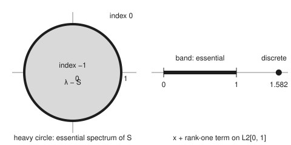
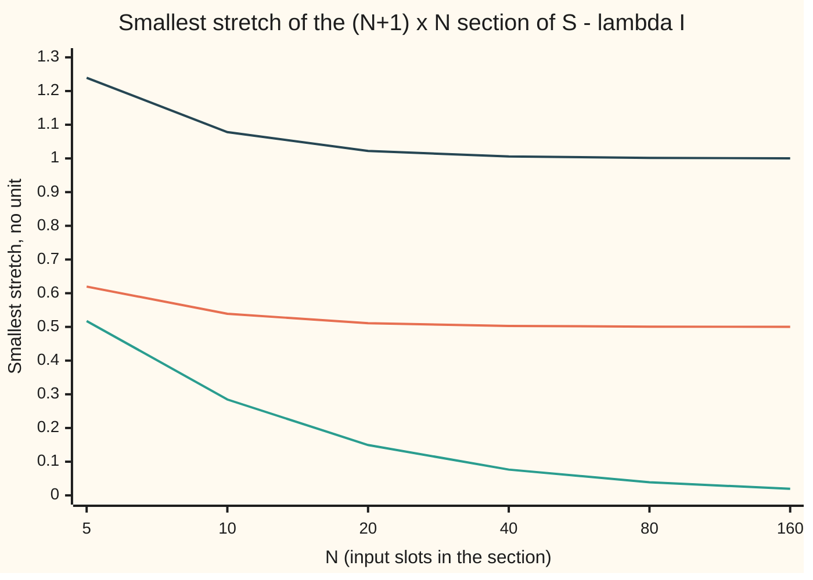

# Fredholm index: dimension of the kernel minus the dimension of what the range misses, and compact changes cannot move it

[Syllabus](../../../SYLLABUS.md) → [Functional analysis](../README.md) → [Bounded Operators](../README.md#s03) → Fredholm index

---

## General Overview

A delay line pushes every sample of an endless recording one place later and puts silence in the first slot. The clip (3, 1, 4, 1, 5) comes out as (0, 3, 1, 4, 1, 5). Call the delay $`S`$. It loses nothing: different inputs give different outputs. But no input gives an output that starts with a sound. So $`S`$ misses exactly one output direction: the click $`e_1 = (1, 0, 0, \dots)`$ in the first slot.

Now try to repair it. Add a correction $`K`$ that writes the first input sample into the silent slot. The output of (3, 1, 4, 1, 5) becomes (3, 3, 1, 4, 1, 5). The first slot is now filled, but every output has its first two entries equal. The miss has moved, from $`e_1`$ to $`e_1 - e_2`$; it has not gone away. That is not bad luck. No correction of this kind can ever make the delay invertible.

The number that refuses to move is the **index**: the number of independent inputs the operator kills, minus the number of independent output directions it misses. For the delay it is $`0 - 1 = -1`$. For a matrix with $`n`$ columns and $`m`$ rows it is always $`n - m`$, whatever the entries. In infinite dimensions the same count survives for **Fredholm** operators: those invertible apart from finitely many directions. Adding any compact operator (a norm limit of finite-rank operators) leaves it fixed.

**The Fredholm index, kernel dimension minus missed dimensions, is an integer that small and compact changes cannot move: the delay line, index −1, stays non-invertible after any compact correction, and its essential spectrum, where it stops being Fredholm, stays put.**

**What kind of fact this is:** theorems, proved on this card in Why it works, with Atkinson's theorem, the product rule and the stability proof in folds. Weyl's description of the essential spectrum of a self-adjoint operator is stated with its sources. The code checks finite sections only.

### The picture: where the index lives

<p align="center"></p>

To scale. Left: the complex plane at 80 px per unit. For every $`\lambda`$ inside the disc, $`\lambda I - S`$ has index −1; outside it has index 0 and is invertible. The heavy circle is where $`\lambda I - S`$ is not Fredholm at all: the essential spectrum. Right: the real line at 120 px per unit. Multiplication by $`x`$ on $`[0, 1]`$, plus a rank-one term, keeps the heavy band $`[0, 1]`$ as essential spectrum and gains one isolated eigenvalue at 1.582.

---

## The formula

Notation first, in words.

- $`T : X \to Y`$ is a bounded operator between Banach spaces. Here $`X`$ and $`Y`$ are Hilbert spaces: $`\ell^2`$, the endless lists with finite energy $`\sum \lvert x_n\rvert^2`$ ([Sequence spaces](../01-Normed%20and%20Banach%20Spaces/02-sequence-spaces-lp-and-c0.md)), or $`L^2[0, 1]`$.
- $`\ker T`$ is the **kernel**: all $`x`$ with $`Tx = 0`$. $`\mathrm{ran}\, T`$ is the **range**: all outputs $`Tx`$.
- The **cokernel** $`Y / \mathrm{ran}\, T`$ is what the range misses. Its dimension is the number of independent output directions that no input reaches. When the range is closed, as it is for every Fredholm operator (Step 2), it equals $`\dim \ker T^*`$, where $`T^*`$ is the adjoint ([Adjoints](03-adjoints-self-adjoint-and-unitary-operators.md)).
- $`T`$ is **Fredholm** when its kernel and cokernel are both finite-dimensional. Its range is then automatically closed (Step 2).

```math
\mathrm{ind}\, T = \dim \ker T - \dim (Y / \mathrm{ran}\, T) = \dim \ker T - \dim \ker T^*
```

**Read it aloud:** the index of T is the number of independent inputs T sends to zero, minus the number of independent output directions T never reaches.

The three facts the card proves, for $`T`$ Fredholm and $`K`$ compact:

```math
\mathrm{ind}(T + K) = \mathrm{ind}\, T, \qquad \mathrm{ind}(FG) = \mathrm{ind}\, F + \mathrm{ind}\, G, \qquad T \text{ Fredholm} \iff BT - I \text{ and } TB - I \text{ are compact for some bounded } B
```

**Read it aloud:** adding a compact operator leaves the index alone; the index of a product is the sum of the indices; and an operator is Fredholm exactly when some bounded operator inverts it up to compact errors.

The last fact is **Atkinson's theorem**, and the $`B`$ is called a **parametrix** (an inverse up to compact errors). The **essential spectrum** collects the $`\lambda`$ where this fails:

```math
\sigma_{\mathrm{ess}}(T) = \{\lambda \in \mathbb{C} : \lambda I - T \text{ is not Fredholm}\}, \qquad \sigma_{\mathrm{ess}}(T + K) = \sigma_{\mathrm{ess}}(T)
```

**Read it aloud:** the essential spectrum is the set of lambda where lambda times the identity minus T is not Fredholm, and a compact change never moves it.

| Symbol | Plain meaning | In our example | Push it up and the answer… |
| --- | --- | --- | --- |
| $`T`$, $`X`$, $`Y`$; $`X_1`$, $`Y_0`$, $`T_1`$ | a bounded operator and its input and output spaces; in the folds, complements of $`\ker T`$ and of the range, and $`T`$ on $`X_1`$ | the delay $`S`$ on $`\ell^2`$ | — |
| $`\ker T`$, $`\mathrm{ran}\, T`$ | kernel: inputs sent to zero; range: outputs reached | $`\ker S = \{0\}`$; $`\mathrm{ran}\, S`$ = lists starting with 0 | — |
| $`Y / \mathrm{ran}\, T`$; $`d`$, $`y_i`$, $`a`$ | cokernel: the output directions the range misses; in Step 2's fold, their number, a spanning list, its coefficients | spanned by $`e_1`$ for $`S`$ | — |
| $`\mathrm{ind}\, T`$; $`F`$, $`G`$, $`R_t`$, $`W_t`$; $`A`$, $`n`$, $`m`$, $`r`$ | the index: kernel dimension minus cokernel dimension; Fredholm operators in the product rule, its fold's rotation and path; $`A`$ a matrix in Step 1 (in Step 4's fold, a block); in Steps 1 and 4, $`n`$ columns or kernel dimension, $`m`$ rows or missed directions, $`r`$ the rank | −1 for $`S`$, +1 for $`S^*`$, −3 for $`S^3`$ | more kernel raises it; more missed directions lower it |
| $`S`$, $`S^*`$, $`S^k`$, $`e_n`$ | delay by one sample; advance (drop the first sample), the adjoint of $`S`$, written $`S_{\leftarrow}`$ in [Three model operators](02-integral-operators-and-the-shift.md); delay by $`k`$ samples; the click at slot $`n`$ | $`S(3, 1, 4) = (0, 3, 1, 4)`$ | — |
| $`K`$, $`E`$, $`E_{ij}`$, $`t`$, $`P_1`$ | a compact operator: a norm limit of finite-rank operators ([Compact operators](05-compact-operators.md)); a general perturbation and its blocks; a dial from 0 to 1 that scales $`K`$ (in the product fold, an angle); the projection onto $`e_1`$ | $`Kx = x_1 e_1`$, rank one | the index does not move |
| $`B`$; $`K_1`$, $`K_2`$ | a parametrix: inverts $`T`$ up to compact errors; those errors | $`S^*`$: $`S^*S = I`$, $`SS^* = I - (\text{projection on } e_1)`$ | — |
| $`\lambda`$, $`\sigma(T)`$ | a complex number; the spectrum, where $`\lambda I - T`$ has no bounded inverse ([Spectrum](07-spectrum-and-resolvent.md)) | $`\sigma(S)`$ is the closed unit disc | — |
| $`\sigma_{\mathrm{ess}}`$, $`\sigma_{\mathrm{d}}`$ | essential spectrum: where $`\lambda I - T`$ is not Fredholm; discrete spectrum: isolated points of the spectrum whose Riesz projection has finite rank | unit circle for $`S`$; $`\{1.581977\}`$ for $`M_x + K`$ | — |
| $`M_x`$, $`c`$, $`\mathbf{1}`$ | multiplication by $`x`$ on $`L^2[0, 1]`$; the strength of a rank-one term $`Ku = c\langle \mathbf{1}, u\rangle \mathbf{1}`$; the constant function 1 | $`c = 1`$ | the new eigenvalue $`1/(1 - e^{-1/c})`$ moves away from the band |
| $`N`$, $`x_i`$ | size of a finite section: a matrix cut from the operator; the grid points $`(i + 0.5)/N`$ | 6 for ranks; 5 to 160 for the trend | the section approaches the operator |
| $`\gamma`$ | smallest stretch: the least ratio $`\lVert Tx\rVert / \lVert x\rVert`$ over nonzero $`x`$ | 1 for $`S`$; $`\lvert 1 - \lvert\lambda\rvert\rvert`$ for $`S - \lambda I`$ | a bigger $`\gamma`$ allows bigger safe perturbations |

### When it holds

- **Both dimensions are finite.** If the kernel or the cokernel is infinite-dimensional, "infinity minus something" means nothing, and the index is not defined. The projection onto the even slots kills every odd click, infinitely many directions, and is not Fredholm.
- **The range is closed.** $`S - I`$ is one-to-one and $`\ker(S^* - I) = \{0\}`$, so counting missed directions as $`\dim \ker T^*`$ finds none. But its range is dense and not closed, so $`Y / \mathrm{ran}(S - I)`$ is infinite-dimensional. It is not Fredholm: its smallest stretch is 0, and nearby operators jump between index −1 and 0 (What breaks, row 2).
- **The perturbation is compact or small.** A non-compact, non-small change can move the index anywhere. Adding $`E = S^* - S`$ turns $`S`$ into $`S^*`$: index −1 becomes +1 (What breaks, row 4).
- **Weyl's description needs self-adjointness.** For a self-adjoint $`T`$, everything in $`\sigma(T)`$ outside $`\sigma_{\mathrm{ess}}(T)`$ is an isolated eigenvalue of finite multiplicity. For $`S`$, which is not self-adjoint, the open disc lies in $`\sigma(S)`$ but outside $`\sigma_{\mathrm{ess}}(S)`$, and holds no eigenvalues at all.

---

## Why it works

### Step 0: an infinite operator that is a finite matrix in disguise

A Fredholm operator is invertible except on two finite-dimensional pieces: the kernel on the input side and the missed directions on the output side. Between those pieces it is a bounded bijection. A small or compact change can only stir the finite pieces. On finite pieces the index is a pure dimension count, $`n - m`$, which no change of entries can affect.

### Step 1: for a matrix the index is just the shape

Take an $`m \times n`$ matrix $`A`$ (n columns, m rows) of rank $`r`$. [Rank and nullity](../../03-Algebra/05-Solving%20Systems/05-rank-nullity.md) gives $`\dim \ker A = n - r`$. The range has dimension $`r`$, so it misses $`m - r`$ directions. The index is

```math
(n - r) - (m - r) = n - m.
```

The rank cancels. Every 7-by-6 matrix has index −1; every square matrix has index 0. That is why a square cut of the delay hides its index (What breaks, row 1), and why the honest rehearsal of $`S`$ is the 7-by-6 section: six input slots, seven output slots, the last input landing in slot 7.

### Step 2: the delay line, its powers and its adjoint

- **$`S`$.** If $`Sx = 0`$ then every $`x_n = 0`$, so $`\ker S = \{0\}`$. The outputs are exactly the lists that start with 0, so the missed directions are spanned by $`e_1`$. Index $`0 - 1 = -1`$.
- **$`S^*`$, the advance.** It kills $`e_1`$ and reaches every list. Index $`1 - 0 = +1`$.
- **$`S^k`$.** It fills the first $`k`$ slots with silence: index $`-k`$. $`(S^*)^k`$ has index $`+k`$.

Fredholm operators have closed range, which is what makes "the directions the range misses" a clean idea.

<details>
<summary>Proof: a finite-codimensional range is closed</summary>

Suppose $`\mathrm{ran}\, T`$ misses $`d`$ directions, spanned by $`y_1, \dots, y_d`$. Define a map from $`(X / \ker T) \times \mathbb{C}^d`$ to $`Y`$ by

$`\displaystyle (x, a) \mapsto Tx + a_1 y_1 + \dots + a_d y_d.`$

It is bounded, one-to-one and onto, between Banach spaces. By the bounded inverse theorem of [Three Banach theorems](../01-Normed%20and%20Banach%20Spaces/08-open-mapping-closed-graph-and-uniform-boundedness.md) its inverse is bounded. So it carries the closed set $`(X / \ker T) \times \{0\}`$ onto a closed set, and that set is $`\mathrm{ran}\, T`$. ∎

</details>

### Step 3: Atkinson, invertible up to compact errors

The advance is a parametrix for the delay. $`S^*S = I`$ exactly, and $`SS^* = I - P_1`$, where $`P_1`$ is the projection onto $`e_1`$, a rank-one and so compact operator. The checks confirm both on the 7-by-6 section.

In general, invert a Fredholm $`T`$ between the complement of its kernel and its range, and send the missed directions to 0. Then $`I - BT`$ and $`I - TB`$ project onto the kernel and the missed directions: finite rank. Conversely, a parametrix forces finite kernel and finite cokernel through the [Fredholm alternative](09-fredholm-alternative-and-integral-equations.md).

<details>
<summary>Proof of Atkinson's theorem</summary>

**Fredholm gives a parametrix.** Split $`X = \ker T \oplus X_1`$ and $`Y = \mathrm{ran}\, T \oplus Y_0`$, where $`Y_0`$ is finite-dimensional and $`\mathrm{ran}\, T`$ is closed (Step 2). $`T`$ maps $`X_1`$ one-to-one onto $`\mathrm{ran}\, T`$, so by the bounded inverse theorem it has a bounded inverse $`T_1^{-1}`$ there. Let $`B = T_1^{-1}`$ on $`\mathrm{ran}\, T`$ and $`B = 0`$ on $`Y_0`$. Then $`I - BT`$ projects onto $`\ker T`$ and $`I - TB`$ projects onto $`Y_0`$. Both have finite rank, so both are compact.

**A parametrix gives Fredholm.** Say $`BT = I + K_1`$ and $`TB = I + K_2`$ with $`K_1`$, $`K_2`$ compact. Then $`\ker T \subset \ker(I + K_1)`$, which is finite-dimensional by the Fredholm alternative. And $`\mathrm{ran}\, T \supset \mathrm{ran}(I + K_2)`$, which misses only finitely many directions by the same theorem. ∎

</details>

The parametrix view has a name. Divide all bounded operators by the compact ones; the result is the **Calkin algebra**, and Atkinson says Fredholm means invertible there. Algebras of operators get their own shelf in [Banach algebras](../06-Banach%20Algebras%20and%20Fixed%20Points/01-banach-algebras-and-the-gelfand-transform.md).

### Step 4: small changes cannot move the index

Use the split of the Atkinson proof. In block form $`T`$ is a bounded bijection $`T_1`$ from $`X_1`$ onto $`\mathrm{ran}\, T`$, and zero on the rest. A small change $`E`$ keeps the big block invertible. Elimination then pushes all of $`T + E`$ onto one finite matrix, from the $`n`$-dimensional kernel to the $`m`$ missed directions. By Step 1 that matrix has index $`n - m`$, whatever its entries.

<details>
<summary>Detailed proof: the index is the index of one finite matrix</summary>

Write $`n = \dim \ker T`$ and $`m = \dim Y_0`$. With $`X = X_1 \oplus \ker T`$ and $`Y = \mathrm{ran}\, T \oplus Y_0`$,

$`\displaystyle T + E = \begin{pmatrix} T_1 + E_{11} & E_{12} \\ E_{21} & E_{22} \end{pmatrix}.`$

If $`\lVert E\rVert < 1/\lVert T_1^{-1}\rVert`$, the block $`A = T_1 + E_{11}`$ is invertible by the [Neumann series](06-neumann-series-and-inverting-close-to-the-identity.md). Multiply on the left and right by invertible triangular blocks:

$`\displaystyle \begin{pmatrix} I & 0 \\ -E_{21}A^{-1} & I \end{pmatrix} (T + E) \begin{pmatrix} I & -A^{-1}E_{12} \\ 0 & I \end{pmatrix} = \begin{pmatrix} A & 0 \\ 0 & E_{22} - E_{21}A^{-1}E_{12} \end{pmatrix}.`$

Invertible factors do not change kernel or cokernel dimensions. The block $`A`$ is invertible. So $`T + E`$ has the kernel and cokernel dimensions of the $`m \times n`$ matrix $`E_{22} - E_{21}A^{-1}E_{12}`$, whose index is $`n - m = \mathrm{ind}\, T`$ by Step 1. ∎

</details>

For the delay, the smallest stretch is 1, since $`\lVert Sx\rVert = \lVert x\rVert`$. So every perturbation of norm below 1 keeps index −1. In particular $`S - \lambda I`$ has index −1 for every $`\lvert\lambda\rvert < 1`$: it is never invertible, which is why the whole open disc lies in $`\sigma(S)`$.

### Step 5: compact changes cannot move the index either

Take $`T`$ Fredholm and $`K`$ compact. For each $`t`$ from 0 to 1, $`T + tK`$ has the same parametrix $`B`$ as $`T`$, up to the compact error $`tBK`$. By Atkinson each $`T + tK`$ is Fredholm. By Step 4 the index is locally constant along $`t`$. An integer that is locally constant on an interval is constant. So $`\mathrm{ind}(T + K) = \mathrm{ind}\, T`$.

For the delay this settles the opening question. $`S + K`$ has index −1 for every compact $`K`$, so it always misses at least one direction and is never invertible. The rank-one correction only moved the miss, to $`e_1 - e_2`$.

The product rule follows from the same stability. On sections it is a count: the advance twice (index +2) after $`S^3`$ (index −3) is exactly $`S`$ (index −1).

<details>
<summary>Proof of the product rule</summary>

For $`F`$ and $`G`$ Fredholm from one space $`X`$ to itself, consider operators on pairs of vectors of $`X`$, built with the rotation $`R_t = \begin{pmatrix} \cos t & -\sin t \\ \sin t & \cos t \end{pmatrix}`$ (each entry times the identity). It mixes the two slots, so they must hold the same space:

$`\displaystyle W_t = \begin{pmatrix} F & 0 \\ 0 & I \end{pmatrix} R_t \begin{pmatrix} G & 0 \\ 0 & I \end{pmatrix} R_t^{-1}.`$

Each $`W_t`$ is a product of Fredholm operators, so it is Fredholm (multiply the parametrices). At $`t = 0`$ it is $`\begin{pmatrix} FG & 0 \\ 0 & I \end{pmatrix}`$, with index $`\mathrm{ind}(FG)`$. At $`t = \pi/2`$ it is $`\begin{pmatrix} F & 0 \\ 0 & G \end{pmatrix}`$, with index $`\mathrm{ind}\, F + \mathrm{ind}\, G`$, since kernels and cokernels of a block-diagonal operator add. By Step 4 the index is constant along $`t`$. ∎

</details>

### Step 6: essential spectrum, and why compact changes cannot move it

By Atkinson, $`\lambda I - T - K`$ is Fredholm exactly when $`\lambda I - T`$ is. So $`\sigma_{\mathrm{ess}}(T + K) = \sigma_{\mathrm{ess}}(T)`$.

**The delay.** For $`\lvert\lambda\rvert \ne 1`$, $`\lVert(S - \lambda I)x\rVert \ge \lvert 1 - \lvert\lambda\rvert\rvert\, \lVert x\rVert`$, so the kernel is 0 and the range is closed. Inside the disc, $`S - \lambda I`$ misses one direction, $`(1, \bar\lambda, \bar\lambda^2, \dots)`$, which has finite energy only when $`\lvert\lambda\rvert < 1`$. Index −1. Outside, it is invertible: index 0. On the circle the smallest stretch is 0 ([Spectrum](07-spectrum-and-resolvent.md) builds the near-eigenvectors), so the range is not closed. So $`\sigma_{\mathrm{ess}}(S)`$ is the unit circle, and for every compact $`K`$ the spectrum of $`S + K`$ still contains the closed disc.

**Weyl's theorem.** The **discrete spectrum** is the isolated points $`\lambda_0`$ of the spectrum whose Riesz projection, the contour integral of the resolvent round $`\lambda_0`$ from [Holomorphic functional calculus](14-holomorphic-functional-calculus-and-riesz-projections.md), has finite rank: the isolated eigenvalues of finite multiplicity. For a self-adjoint $`T`$, the essential spectrum is everything else. Weyl proved in 1909 that a compact self-adjoint change can add, remove or move discrete eigenvalues but never touches the essential part.

### Step 7: a rank-one change adds one eigenvalue outside the band

$`M_x`$ multiplies a function on $`[0, 1]`$ by $`x`$. Its spectrum is $`[0, 1]`$, all essential: near each point of $`[0, 1]`$ sit infinitely many independent narrow bumps that $`M_x`$ barely changes in shape. Add $`Ku = c\langle \mathbf{1}, u\rangle \mathbf{1}`$, with $`\langle \mathbf{1}, u\rangle = \int_0^1 u\, dx`$. $`M_x + K`$ is self-adjoint, so its eigenvalues are real. An eigenvector solves $`xu + c\langle \mathbf{1}, u\rangle = \lambda u`$, so $`u = c\langle \mathbf{1}, u\rangle / (\lambda - x)`$. Integrate both sides:

```math
1 = c \int_0^1 \frac{dx}{\lambda - x} = c \ln\frac{\lambda}{\lambda - 1} \quad\Longrightarrow\quad \lambda = \frac{1}{1 - e^{-1/c}}.
```

For $`c = 1`$ that is $`\lambda = 1.581977`$. The right side of the first equation falls steadily for $`\lambda > 1`$ and is negative for $`\lambda < 0`$, so this is the only eigenvalue outside the band. The band stays: $`[0, 1]`$ is essential for $`M_x`$, and $`K`$ is compact.

### Step 8: what the sections show, and what they hide

Every section is a matrix, so every section is Fredholm and has the index of its shape (Step 1). The infinite answer shows only in trends over $`N`$ (numbers in What breaks).

- **Closed range.** The smallest stretch of the $`(N + 1) \times N`$ section of $`S - \lambda I`$ is $`\sqrt{1 + \lambda^2 - 2\lvert\lambda\rvert\cos(\pi/(N + 1))}`$. It settles at $`\lvert 1 - \lvert\lambda\rvert\rvert`$ off the circle. At $`\lambda = 1`$ it falls like $`\pi/(N + 1)`$: the range is not closed.
- **The real missed direction.** Every section of $`S - 2I`$ has index −1, yet the true index is 0: the section's missed direction $`(1, 2, 4, \dots, 2^N)`$ keeps just over 0.75 of its energy at the cut. At $`\lambda = 0.5`$ the missed direction $`(1, 0.5, 0.25, \dots)`$ keeps at least 0.999023 of its energy in the first 5 entries at every $`N`$: it is real.
- **Discrete against essential.** On an $`N`$-point grid, $`M_x + K`$ has exactly one eigenvalue above 1, converging to 1.581977 with error about $`0.098/N^2`$. Eigenvalues that crowd as $`N`$ grows are essential; one that stays put is discrete.



Orange: $`\lambda = 0.5`$, settling at 0.5. Green: $`\lambda = 1`$, falling to 0. Dark: $`\lambda = 2`$, settling at 1. Both checks print every point.

---

## Worked numbers, by hand

| Step | Arithmetic | Value |
| --- | --- | --- |
| 1. $`\ker S`$ | $`Sx = (0, x_1, x_2, \dots) = 0`$ forces every $`x_n = 0`$ | dimension 0 |
| 2. Missed by $`S`$ | outputs are the lists starting with 0 | $`e_1`$: dimension 1 |
| 3. $`\mathrm{ind}\, S`$ | $`0 - 1`$ | −1 |
| 4. $`\mathrm{ind}\, S^*`$ | kills $`e_1`$, reaches everything: $`1 - 0`$ | +1 |
| 5. $`\mathrm{ind}\, S^3`$ | 0 killed, $`e_1, e_2, e_3`$ missed | −3 |
| 6. Product $`(S^*)^2 S^3 = S`$ | $`+2 + (-3)`$ | −1 |
| 7. $`S + K`$, $`Kx = x_1 e_1`$ | output $`(x_1, x_1, x_2, \dots)`$; kernel 0; misses $`e_1 - e_2`$ | −1 |
| 8. $`S - 0.5I`$ | missed direction $`(1, 0.5, 0.25, \dots)`$, energy $`1/(1 - 0.25) = 1.333333`$, finite | −1 |
| 9. $`S - 2I`$ | stretch at least $`2 - 1 = 1`$; missed list $`(1, 2, 4, \dots)`$ has infinite energy | 0, invertible |
| 10. $`M_x + K`$, $`c = 1`$ | $`\lambda = 1/(1 - e^{-1}) = 1/(1 - 0.367879) = 1/0.632121`$ | 1.581977 |

**The delay has index −1, so neither it nor any compact correction of it can be inverted; the band of $`M_x`$ keeps its essential spectrum $`[0, 1]`$, and the rank-one term adds the single eigenvalue 1.581977.**

Index −1 means one output direction is always out of reach. The value 1.581977 is a state pulled out of the band, which itself does not move.

### What breaks if you drop a piece

| Mistake | Comes out at | What went wrong |
| --- | --- | --- |
| Cut $`S`$ to a square N × N matrix | index 0 (kernel 1, cokernel 1), true −1 | every square matrix has index 0; the cut drops the last sample and invents a kernel |
| Drop closed range: $`S - I`$ | smallest stretch 0.2846, 0.1495, 0.0766 at N = 10, 20, 40, about $`\pi/(N + 1)`$ | not Fredholm; across the circle the index jumps from −1 to 0 |
| Trust a section's index: $`S - 2I`$ | −1 at every N, true 0 | the missed direction (1, 2, 4, …) has about 0.75 of its energy at the cut (0.750183 at N = 5) |
| Add a non-compact $`E = S^* - S`$ | index +1, not −1 | $`S + E = S^*`$; $`E`$ is neither compact nor small, so the index is free to move |
| Read the grid eigenvalues in [0.4, 0.6] as discrete | 20, 200, 2000 at N = 100, 1000, 10000 | they crowd as N grows: essential; only 1.581977 stays put |

---

## Code, from first principles, and it actually runs

The code builds finite sections of the delay and of the band, and checks each claim by independent roads. Three roads in all:

- **Exact ranks.** Integer elimination on the 7-by-6 sections gives kernel, cokernel and index, and confirms the product $`(S^*)^2 S^3 = S`$ and the parametrix identities entry by entry.
- **Closed form against bisection.** The smallest stretch of each section is found by a Sturm count (counting negative pivots of a tridiagonal matrix) and bisection, and compared with the closed form of Step 8.
- **Three routes to the new eigenvalue.** The grid's top eigenvalue comes from the secular equation (Step 7's eigenvalue equation on the grid) $`1 = (c/N)\sum 1/(\lambda - x_i)`$ and, separately, from counting negative pivots of the grid matrix. Both are compared with the limit $`1/(1 - e^{-1/c})`$, within $`1/N^2`$.

### Python

```python
# Fredholm index: the check behind the card.  Standard library only.
# Every computation is a finite section of an infinite operator; the trend over N
# carries the infinite-dimensional answer.  Ranks are exact (integer elimination).
from math import cos, sin, pi, exp, gcd

def rank(A):                        # exact rank of an integer matrix, row by row
    M = [r[:] for r in A]; rk = 0
    for c in range(len(M[0])):
        p = next((i for i in range(rk, len(M)) if M[i][c] != 0), None)
        if p is None: continue
        M[rk], M[p] = M[p], M[rk]
        for i in range(rk + 1, len(M)):
            row = [M[rk][c] * M[i][j] - M[i][c] * M[rk][j] for j in range(len(M[0]))]
            g = 0
            for v in row: g = gcd(g, abs(v))
            M[i] = [v // g for v in row] if g else row
        rk += 1
    return rk

def zeros(r, c): return [[0] * c for _ in range(r)]
def shift(r, c, k):                 # delay by k: column j has a 1 in row j + k
    A = zeros(r, c)
    for j in range(c):
        if j + k < r: A[j + k][j] = 1
    return A
def transpose(A): return [list(x) for x in zip(*A)]
def mul(A, B): return [[sum(A[i][t] * B[t][j] for t in range(len(B))) for j in range(len(B[0]))] for i in range(len(A))]
def index_row(name, A):
    r = rank(A); ker = len(A[0]) - r; cok = len(A) - r
    print(f"{name:<34}{len(A)}x{len(A[0])}  ker {ker}  coker {cok}  index {ker - cok:+d}")
    return ker - cok

N = 6
print("Finite sections of the delay line S on an endless clip (exact ranks)")
S = shift(N + 1, N, 1); adv = transpose(shift(N + 1, N, 1))      # advance = S* = S transposed
iS = index_row("S, delay by one", S)
iA = index_row("advance S*", adv)
iS3 = index_row("S^3, delay by three", shift(N + 3, N, 3))
iA2 = index_row("advance twice", transpose(shift(N + 3, N + 1, 2)))
P = mul(transpose(shift(N + 3, N + 1, 2)), shift(N + 3, N, 3))
iP = index_row("advance twice after S^3", P)
assert P == S and iP == iA2 + iS3 == -1 and iA == 1 and iS == -1
SK = [row[:] for row in S]; SK[0][0] = 1                        # K x = x1 e1, rank one
iSK = index_row("S + K, K x = x1 e1", SK)
y = [1, -1] + [0] * (N - 1)                                      # the direction S + K misses
assert iSK == -1 and all(sum(y[i] * SK[i][j] for i in range(N + 1)) == 0 for j in range(N))
iH = index_row("2(S - 0.5), inside the circle", [[2 * S[i][j] - (i == j) for j in range(N)] for i in range(N + 1)])
iT = index_row("S - 2, outside the circle", [[S[i][j] - 2 * (i == j) for j in range(N)] for i in range(N + 1)])
iQ = index_row("S cut square", shift(N, N, 1))
assert iH == iT == -1 and iQ == 0
eye = lambda n: [[int(i == j) for j in range(n)] for i in range(n)]
r2 = rank([[x - z for x, z in zip(a, b)] for a, b in zip(mul(S, adv), eye(N + 1))])
print(f"parametrix: advance S = I is {mul(adv, S) == eye(N)}; S advance - I has rank {r2} (minus the projection on e1)")
assert mul(adv, S) == eye(N) and r2 == 1

def count_below(a, b, t):          # Sturm count: eigenvalues < t of a symmetric tridiagonal matrix
    q, n = a[0] - t, int(a[0] - t < 0)
    for i in range(1, len(a)):
        q = a[i] - t - b[i - 1] ** 2 / (q if q != 0 else 1e-300)
        n += q < 0
    return n
def smallest_stretch(lam, n):      # smallest singular value of the (n+1) x n section of S - lam
    cols = [[(-lam if i == j else 1.0 if i == j + 1 else 0.0) for i in range(n + 1)] for j in range(n)]
    a = [sum(v * v for v in c) for c in cols]
    b = [sum(u * v for u, v in zip(cols[j], cols[j + 1])) for j in range(n - 1)]
    lo, hi = 0.0, (1 + abs(lam)) ** 2
    for _ in range(80):
        mid = (lo + hi) / 2
        lo, hi = (lo, mid) if count_below(a, b, mid) >= 1 else (mid, hi)
    return ((lo + hi) / 2) ** 0.5
print("Smallest stretch of the section of S - lam (closed range test); closed form agrees")
chart = {0.5: [], 1.0: [], 2.0: []}
for n in [5, 10, 20, 40, 80, 160]:
    vals = []
    for lam in [0.5, 1.0, 2.0]:
        s = smallest_stretch(lam, n)
        exact = (1 + lam * lam - 2 * lam * cos(pi / (n + 1))) ** 0.5
        assert abs(s - exact) < 1e-9
        chart[lam].append(s); vals.append(s)
    print(f"N={n:<4} lam 0.5: {vals[0]:.4f}  lam 1: {vals[1]:.4f} (x (N+1)/pi = {vals[1] * (n + 1) / pi:.4f})  lam 2: {vals[2]:.4f}")
assert abs(chart[1.0][-1] * 161 / pi - 1) < 1e-4 and chart[0.5][-1] > 0.49 and chart[2.0][-1] > 0.99
print(f"Missed direction (1, lam, lam^2, ...): energy share in the first 5 entries / at the cut; endless energy at lam 0.5: {sum(0.25 ** j for j in range(200)):.6f}")
for n in [5, 10, 20]:
    out = []
    for lam in [0.5, 2.0]:
        w = [lam ** (2 * j) for j in range(n + 1)]
        A = [[(-lam if i == j else 1.0 if i == j + 1 else 0.0) for j in range(n)] for i in range(n + 1)]
        yv = [lam ** j for j in range(n + 1)]
        assert all(sum(yv[i] * A[i][j] for i in range(n + 1)) == 0 for j in range(n))
        out += [sum(w[:5]) / sum(w), w[-1] / sum(w)]
    print(f"N={n:<3} lam 0.5: first 5 {out[0]:.6f}, at cut {out[1]:.6f}   lam 2: first 5 {out[2]:.6f}, at cut {out[3]:.6f}")
assert out[0] > 0.999 and out[3] > 0.74

print("Multiplication by x on L2[0, 1] plus K u = c <1, u> 1, midpoint grid of N points")
def grid_count(n, c, t):           # eigenvalues < t of diag(x) + (c/n) 1 1^T, by pivots
    s, neg = 1.0, 0
    for i in range(n):
        d = (i + 0.5) / n - t
        p = d + s * c / n
        neg += p < 0
        s = s * d / p
    return neg
def top_secular(n, c):
    lo, hi = (n - 0.5) / n + 1e-15, 1 + abs(c) + 1
    for _ in range(200):
        mid = (lo + hi) / 2
        f = 1 - c / n * sum(1 / (mid - (i + 0.5) / n) for i in range(n))
        lo, hi = (lo, mid) if f > 0 else (mid, hi)
    return (lo + hi) / 2
def top_count(n, c):
    lo, hi = 1.0, 3.0
    for _ in range(100):
        mid = (lo + hi) / 2
        lo, hi = (lo, mid) if grid_count(n, c, mid) == n else (mid, hi)
    return (lo + hi) / 2
c = 1.0
lam_star = 1 / (1 - exp(-1 / c))
print(f"closed form, 1 = c ln(lam/(lam - 1)): lam = 1/(1 - {exp(-1 / c):.6f}) = 1/{1 - exp(-1 / c):.6f} = {lam_star:.6f}")
for n in [10, 100, 1000]:
    a, b = top_secular(n, c), top_count(n, c)
    assert abs(a - b) < 1e-9 and abs(a - lam_star) < 1 / n ** 2
    print(f"N={n:<5} top eigenvalue {a:.6f} (secular) {b:.6f} (pivots)  error x N^2 {(a - lam_star) * n * n:+.4f}")
for n in [100, 1000, 10000]:
    below, above = grid_count(n, c, 0.0), n - grid_count(n, c, 1.0)
    mid = grid_count(n, c, 0.6) - grid_count(n, c, 0.4)
    print(f"N={n:<6} below 0: {below}   above 1: {above}   in [0.4, 0.6]: {mid}   without K, above 1: {n - grid_count(n, 0.0, 1.0)}")
    assert below == 0 and above == 1 and abs(mid - 0.2 * n) <= 1
lo, hi = -3.0, 0.0                 # c = -1: the bound state moves below the band
for _ in range(100):
    mid = (lo + hi) / 2
    lo, hi = (lo, mid) if grid_count(1000, -1.0, mid) >= 1 else (mid, hi)
print(f"c = -1, N=1000: one eigenvalue below 0, at {lo:.6f}; closed form -1/(e - 1) = {-1 / (exp(1.0) - 1):.6f}")
assert grid_count(1000, -1.0, 0.0) == 1 and abs(lo + 1 / (exp(1.0) - 1)) < 1e-5
print(f"figure, circle centre 120 120 radius 80; band 270.0 to 390.0; eigenvalue at {270 + 120 * lam_star:.3f}")
print("ALL CHECKS PASS")
```

**Ran 2026-11-24 on macOS, Python 3.14.10, standard library only. All checks passed. Output, pasted from the run:**

```
Finite sections of the delay line S on an endless clip (exact ranks)
S, delay by one                   7x6  ker 0  coker 1  index -1
advance S*                        6x7  ker 1  coker 0  index +1
S^3, delay by three               9x6  ker 0  coker 3  index -3
advance twice                     7x9  ker 2  coker 0  index +2
advance twice after S^3           7x6  ker 0  coker 1  index -1
S + K, K x = x1 e1                7x6  ker 0  coker 1  index -1
2(S - 0.5), inside the circle     7x6  ker 0  coker 1  index -1
S - 2, outside the circle         7x6  ker 0  coker 1  index -1
S cut square                      6x6  ker 1  coker 1  index +0
parametrix: advance S = I is True; S advance - I has rank 1 (minus the projection on e1)
Smallest stretch of the section of S - lam (closed range test); closed form agrees
N=5    lam 0.5: 0.6197  lam 1: 0.5176 (x (N+1)/pi = 0.9886)  lam 2: 1.2393
N=10   lam 0.5: 0.5390  lam 1: 0.2846 (x (N+1)/pi = 0.9966)  lam 2: 1.0780
N=20   lam 0.5: 0.5110  lam 1: 0.1495 (x (N+1)/pi = 0.9991)  lam 2: 1.0221
N=40   lam 0.5: 0.5029  lam 1: 0.0766 (x (N+1)/pi = 0.9998)  lam 2: 1.0059
N=80   lam 0.5: 0.5008  lam 1: 0.0388 (x (N+1)/pi = 0.9999)  lam 2: 1.0015
N=160  lam 0.5: 0.5002  lam 1: 0.0195 (x (N+1)/pi = 1.0000)  lam 2: 1.0004
Missed direction (1, lam, lam^2, ...): energy share in the first 5 entries / at the cut; endless energy at lam 0.5: 1.333333
N=5   lam 0.5: first 5 0.999267, at cut 0.000733   lam 2: first 5 0.249817, at cut 0.750183
N=10  lam 0.5: first 5 0.999024, at cut 0.000001   lam 2: first 5 0.000244, at cut 0.750000
N=20  lam 0.5: first 5 0.999023, at cut 0.000000   lam 2: first 5 0.000000, at cut 0.750000
Multiplication by x on L2[0, 1] plus K u = c <1, u> 1, midpoint grid of N points
closed form, 1 = c ln(lam/(lam - 1)): lam = 1/(1 - 0.367879) = 1/0.632121 = 1.581977
N=10    top eigenvalue 1.581001 (secular) 1.581001 (pivots)  error x N^2 -0.0976
N=100   top eigenvalue 1.581967 (secular) 1.581967 (pivots)  error x N^2 -0.0979
N=1000  top eigenvalue 1.581977 (secular) 1.581977 (pivots)  error x N^2 -0.0979
N=100    below 0: 0   above 1: 1   in [0.4, 0.6]: 20   without K, above 1: 0
N=1000   below 0: 0   above 1: 1   in [0.4, 0.6]: 200   without K, above 1: 0
N=10000  below 0: 0   above 1: 1   in [0.4, 0.6]: 2000   without K, above 1: 0
c = -1, N=1000: one eigenvalue below 0, at -0.581977; closed form -1/(e - 1) = -0.581977
figure, circle centre 120 120 radius 80; band 270.0 to 390.0; eigenvalue at 459.837
ALL CHECKS PASS
```

### Rust

```rust
// Fredholm index: the check behind the card.  Rust std only, no crates.
// Every computation is a finite section of an infinite operator; the trend over N
// carries the infinite-dimensional answer.  Ranks are exact (integer elimination).
use std::f64::consts::PI;
type M = Vec<Vec<i128>>;

fn gcd(a: i128, b: i128) -> i128 { if b == 0 { a.abs() } else { gcd(b, a % b) } }
fn rank(a: &M) -> usize {          // exact rank of an integer matrix, row by row
    let mut m = a.clone();
    let (rows, cols) = (m.len(), m[0].len());
    let mut rk = 0;
    for c in 0..cols {
        let p = match (rk..rows).find(|&i| m[i][c] != 0) { Some(p) => p, None => continue };
        m.swap(rk, p);
        for i in rk + 1..rows {
            let row: Vec<i128> = (0..cols).map(|j| m[rk][c] * m[i][j] - m[i][c] * m[rk][j]).collect();
            let g = row.iter().fold(0, |g, &v| gcd(g, v));
            m[i] = if g != 0 { row.iter().map(|v| v / g).collect() } else { row };
        }
        rk += 1;
    }
    rk
}
fn shift(r: usize, c: usize, k: usize) -> M {   // delay by k: column j has a 1 in row j + k
    (0..r).map(|i| (0..c).map(|j| (i == j + k) as i128).collect()).collect()
}
fn transpose(a: &M) -> M { (0..a[0].len()).map(|j| a.iter().map(|r| r[j]).collect()).collect() }
fn mul(a: &M, b: &M) -> M {
    (0..a.len()).map(|i| (0..b[0].len()).map(|j| (0..b.len()).map(|t| a[i][t] * b[t][j]).sum()).collect()).collect()
}
fn eye(n: usize) -> M { (0..n).map(|i| (0..n).map(|j| (i == j) as i128).collect()).collect() }
fn index_row(name: &str, a: &M) -> i64 {
    let r = rank(a);
    let (ker, cok) = (a[0].len() - r, a.len() - r);
    println!("{:<34}{}x{}  ker {}  coker {}  index {:+}", name, a.len(), a[0].len(), ker, cok, ker as i64 - cok as i64);
    ker as i64 - cok as i64
}
fn count_below(a: &[f64], b: &[f64], t: f64) -> usize {  // Sturm count for a symmetric tridiagonal matrix
    let (mut q, mut n) = (a[0] - t, (a[0] - t < 0.0) as usize);
    for i in 1..a.len() {
        q = a[i] - t - b[i - 1] * b[i - 1] / (if q != 0.0 { q } else { 1e-300 });
        n += (q < 0.0) as usize;
    }
    n
}
fn section(lam: f64, n: usize) -> Vec<Vec<f64>> {  // (n+1) x n section of S - lam
    (0..n + 1).map(|i| (0..n).map(|j| if i == j { -lam } else if i == j + 1 { 1.0 } else { 0.0 }).collect()).collect()
}
fn smallest_stretch(lam: f64, n: usize) -> f64 {
    let s = section(lam, n);
    let col = |j: usize| -> Vec<f64> { s.iter().map(|r| r[j]).collect() };
    let a: Vec<f64> = (0..n).map(|j| col(j).iter().map(|v| v * v).sum()).collect();
    let b: Vec<f64> = (0..n - 1).map(|j| col(j).iter().zip(col(j + 1).iter()).map(|(u, v)| u * v).sum()).collect();
    let (mut lo, mut hi) = (0.0, (1.0 + lam.abs()).powi(2));
    for _ in 0..80 {
        let mid = (lo + hi) / 2.0;
        if count_below(&a, &b, mid) >= 1 { hi = mid } else { lo = mid }
    }
    ((lo + hi) / 2.0).sqrt()
}
fn grid_count(n: usize, c: f64, t: f64) -> usize {  // eigenvalues < t of diag(x) + (c/n) 1 1^T, by pivots
    let (mut s, mut neg) = (1.0, 0);
    for i in 0..n {
        let d = (i as f64 + 0.5) / n as f64 - t;
        let p = d + s * c / n as f64;
        neg += (p < 0.0) as usize;
        s = s * d / p;
    }
    neg
}
fn top_secular(n: usize, c: f64) -> f64 {
    let (mut lo, mut hi) = ((n as f64 - 0.5) / n as f64 + 1e-15, 1.0 + c.abs() + 1.0);
    for _ in 0..200 {
        let mid = (lo + hi) / 2.0;
        let f = 1.0 - c / n as f64 * (0..n).map(|i| 1.0 / (mid - (i as f64 + 0.5) / n as f64)).sum::<f64>();
        if f > 0.0 { hi = mid } else { lo = mid }
    }
    (lo + hi) / 2.0
}
fn top_count(n: usize, c: f64) -> f64 {
    let (mut lo, mut hi) = (1.0, 3.0);
    for _ in 0..100 {
        let mid = (lo + hi) / 2.0;
        if grid_count(n, c, mid) == n { hi = mid } else { lo = mid }
    }
    (lo + hi) / 2.0
}

fn main() {
    let n = 6;
    println!("Finite sections of the delay line S on an endless clip (exact ranks)");
    let (s, adv) = (shift(n + 1, n, 1), transpose(&shift(n + 1, n, 1)));  // advance = S* = S transposed
    let i_s = index_row("S, delay by one", &s);
    let i_a = index_row("advance S*", &adv);
    let i_s3 = index_row("S^3, delay by three", &shift(n + 3, n, 3));
    let a2 = transpose(&shift(n + 3, n + 1, 2));
    let i_a2 = index_row("advance twice", &a2);
    let p = mul(&a2, &shift(n + 3, n, 3));
    let i_p = index_row("advance twice after S^3", &p);
    assert!(p == s && i_p == i_a2 + i_s3 && i_p == -1 && i_a == 1 && i_s == -1);
    let mut sk = s.clone(); sk[0][0] = 1;          // K x = x1 e1, rank one
    let i_sk = index_row("S + K, K x = x1 e1", &sk);
    let y: Vec<i128> = (0..n + 1).map(|i| [1, -1, 0][i.min(2)]).collect();  // the direction S + K misses
    assert!(i_sk == -1 && (0..n).all(|j| (0..n + 1).map(|i| y[i] * sk[i][j]).sum::<i128>() == 0));
    let h: M = (0..n + 1).map(|i| (0..n).map(|j| 2 * s[i][j] - (i == j) as i128).collect()).collect();
    let i_h = index_row("2(S - 0.5), inside the circle", &h);
    let t: M = (0..n + 1).map(|i| (0..n).map(|j| s[i][j] - 2 * (i == j) as i128).collect()).collect();
    let i_t = index_row("S - 2, outside the circle", &t);
    let i_q = index_row("S cut square", &shift(n, n, 1));
    assert!(i_h == -1 && i_t == -1 && i_q == 0);
    let (sa, e7) = (mul(&s, &adv), eye(n + 1));
    let r2 = rank(&(0..n + 1).map(|i| (0..n + 1).map(|j| sa[i][j] - e7[i][j]).collect()).collect());
    let left_ok = mul(&adv, &s) == eye(n);
    println!("parametrix: advance S = I is {}; S advance - I has rank {} (minus the projection on e1)",
             if left_ok { "True" } else { "False" }, r2);
    assert!(left_ok && r2 == 1);

    println!("Smallest stretch of the section of S - lam (closed range test); closed form agrees");
    let mut last = [0.0f64; 3];
    for &m in &[5usize, 10, 20, 40, 80, 160] {
        for (k, &lam) in [0.5f64, 1.0, 2.0].iter().enumerate() {
            let v = smallest_stretch(lam, m);
            let exact = (1.0 + lam * lam - 2.0 * lam * (PI / (m as f64 + 1.0)).cos()).sqrt();
            assert!((v - exact).abs() < 1e-9);
            last[k] = v;
        }
        println!("N={:<4} lam 0.5: {:.4}  lam 1: {:.4} (x (N+1)/pi = {:.4})  lam 2: {:.4}",
                 m, last[0], last[1], last[1] * (m as f64 + 1.0) / PI, last[2]);
    }
    assert!((last[1] * 161.0 / PI - 1.0).abs() < 1e-4 && last[0] > 0.49 && last[2] > 0.99);
    println!("Missed direction (1, lam, lam^2, ...): energy share in the first 5 entries / at the cut; endless energy at lam 0.5: {:.6}", (0..200).map(|j| 0.25f64.powi(j)).sum::<f64>());
    let mut out = [0.0f64; 4];
    for &m in &[5usize, 10, 20] {
        for (k, &lam) in [0.5f64, 2.0].iter().enumerate() {
            let w: Vec<f64> = (0..m + 1).map(|j| lam.powi(2 * j as i32)).collect();
            let a = section(lam, m);
            let yv: Vec<f64> = (0..m + 1).map(|j| lam.powi(j as i32)).collect();
            assert!((0..m).all(|j| (0..m + 1).map(|i| yv[i] * a[i][j]).sum::<f64>() == 0.0));
            let tot: f64 = w.iter().sum();
            (out[2 * k], out[2 * k + 1]) = (w[..5].iter().sum::<f64>() / tot, w[m] / tot);
        }
        println!("N={:<3} lam 0.5: first 5 {:.6}, at cut {:.6}   lam 2: first 5 {:.6}, at cut {:.6}", m, out[0], out[1], out[2], out[3]);
    }
    assert!(out[0] > 0.999 && out[3] > 0.74);

    println!("Multiplication by x on L2[0, 1] plus K u = c <1, u> 1, midpoint grid of N points");
    let c = 1.0f64; let lam_star = 1.0 / (1.0 - (-1.0 / c).exp());
    println!("closed form, 1 = c ln(lam/(lam - 1)): lam = 1/(1 - {:.6}) = 1/{:.6} = {:.6}", (-1.0 / c).exp(), 1.0 - (-1.0 / c).exp(), lam_star);
    for &m in &[10usize, 100, 1000] {
        let (a, b) = (top_secular(m, c), top_count(m, c));
        assert!((a - b).abs() < 1e-9 && (a - lam_star).abs() < 1.0 / (m * m) as f64);
        println!("N={:<5} top eigenvalue {:.6} (secular) {:.6} (pivots)  error x N^2 {:+.4}", m, a, b, (a - lam_star) * (m * m) as f64);
    }
    for &m in &[100usize, 1000, 10000] {
        let (below, above) = (grid_count(m, c, 0.0), m - grid_count(m, c, 1.0));
        let mid = grid_count(m, c, 0.6) - grid_count(m, c, 0.4);
        println!("N={:<6} below 0: {}   above 1: {}   in [0.4, 0.6]: {}   without K, above 1: {}", m, below, above, mid, m - grid_count(m, 0.0, 1.0));
        assert!(below == 0 && above == 1 && (mid as f64 - 0.2 * m as f64).abs() <= 1.0);
    }
    let (mut lo, mut hi) = (-3.0f64, 0.0f64);     // c = -1: the bound state moves below the band
    for _ in 0..100 {
        let mid = (lo + hi) / 2.0;
        if grid_count(1000, -1.0, mid) >= 1 { hi = mid } else { lo = mid }
    }
    println!("c = -1, N=1000: one eigenvalue below 0, at {:.6}; closed form -1/(e - 1) = {:.6}", lo, -1.0 / (1f64.exp() - 1.0));
    assert!(grid_count(1000, -1.0, 0.0) == 1 && (lo + 1.0 / (1f64.exp() - 1.0)).abs() < 1e-5);
    println!("figure, circle centre 120 120 radius 80; band 270.0 to 390.0; eigenvalue at {:.3}", 270.0 + 120.0 * lam_star);
    println!("ALL CHECKS PASS");
}
```

**Ran 2026-11-24 on macOS, rustc 1.98.1, no crates. All checks passed. Output, pasted from the run:**

```
Finite sections of the delay line S on an endless clip (exact ranks)
S, delay by one                   7x6  ker 0  coker 1  index -1
advance S*                        6x7  ker 1  coker 0  index +1
S^3, delay by three               9x6  ker 0  coker 3  index -3
advance twice                     7x9  ker 2  coker 0  index +2
advance twice after S^3           7x6  ker 0  coker 1  index -1
S + K, K x = x1 e1                7x6  ker 0  coker 1  index -1
2(S - 0.5), inside the circle     7x6  ker 0  coker 1  index -1
S - 2, outside the circle         7x6  ker 0  coker 1  index -1
S cut square                      6x6  ker 1  coker 1  index +0
parametrix: advance S = I is True; S advance - I has rank 1 (minus the projection on e1)
Smallest stretch of the section of S - lam (closed range test); closed form agrees
N=5    lam 0.5: 0.6197  lam 1: 0.5176 (x (N+1)/pi = 0.9886)  lam 2: 1.2393
N=10   lam 0.5: 0.5390  lam 1: 0.2846 (x (N+1)/pi = 0.9966)  lam 2: 1.0780
N=20   lam 0.5: 0.5110  lam 1: 0.1495 (x (N+1)/pi = 0.9991)  lam 2: 1.0221
N=40   lam 0.5: 0.5029  lam 1: 0.0766 (x (N+1)/pi = 0.9998)  lam 2: 1.0059
N=80   lam 0.5: 0.5008  lam 1: 0.0388 (x (N+1)/pi = 0.9999)  lam 2: 1.0015
N=160  lam 0.5: 0.5002  lam 1: 0.0195 (x (N+1)/pi = 1.0000)  lam 2: 1.0004
Missed direction (1, lam, lam^2, ...): energy share in the first 5 entries / at the cut; endless energy at lam 0.5: 1.333333
N=5   lam 0.5: first 5 0.999267, at cut 0.000733   lam 2: first 5 0.249817, at cut 0.750183
N=10  lam 0.5: first 5 0.999024, at cut 0.000001   lam 2: first 5 0.000244, at cut 0.750000
N=20  lam 0.5: first 5 0.999023, at cut 0.000000   lam 2: first 5 0.000000, at cut 0.750000
Multiplication by x on L2[0, 1] plus K u = c <1, u> 1, midpoint grid of N points
closed form, 1 = c ln(lam/(lam - 1)): lam = 1/(1 - 0.367879) = 1/0.632121 = 1.581977
N=10    top eigenvalue 1.581001 (secular) 1.581001 (pivots)  error x N^2 -0.0976
N=100   top eigenvalue 1.581967 (secular) 1.581967 (pivots)  error x N^2 -0.0979
N=1000  top eigenvalue 1.581977 (secular) 1.581977 (pivots)  error x N^2 -0.0979
N=100    below 0: 0   above 1: 1   in [0.4, 0.6]: 20   without K, above 1: 0
N=1000   below 0: 0   above 1: 1   in [0.4, 0.6]: 200   without K, above 1: 0
N=10000  below 0: 0   above 1: 1   in [0.4, 0.6]: 2000   without K, above 1: 0
c = -1, N=1000: one eigenvalue below 0, at -0.581977; closed form -1/(e - 1) = -0.581977
figure, circle centre 120 120 radius 80; band 270.0 to 390.0; eigenvalue at 459.837
ALL CHECKS PASS
```

### Lean

Lean proves the card's three facts for every Fredholm operator between real or complex Banach spaces, and checks the delay's whole-number examples.

- Take $`T`$ Fredholm and $`K`$ compact. Then $`T + K`$ is Fredholm and $`\mathrm{ind}(T + K) = \mathrm{ind}\, T`$.
- Atkinson's theorem. Take any bounded $`T`$. Then $`T`$ is Fredholm exactly when some bounded $`B`$ makes $`BT - I`$ and $`TB - I`$ compact.
- The product rule. Take $`F`$ and $`G`$ Fredholm, with the outputs of $`G`$ the inputs of $`F`$. Then $`FG`$ is Fredholm and $`\mathrm{ind}(FG) = \mathrm{ind}\, F + \mathrm{ind}\, G`$.
- The index counts hold: $`0 - 1 = -1`$ for $`S`$, $`1 - 0 = 1`$ for $`S^*`$, and $`0 - 3 = -3`$ for $`S^3`$.
- Indices of a product add: $`2 + (-3) = -1`$, while multiplying them would give $`2 \times (-3) = -6`$.
- Take a 7-by-6 matrix of any rank $`r`$. Then its index is $`(6 - r) - (7 - r) = -1`$.
- On the sections, the advance twice after $`S^3`$ is exactly $`S`$.
- On the 7-by-6 section, the advance after the delay is exactly the identity.

Section ranks, the smallest stretch and the eigenvalue 1.581977 are left to the Python and Rust checks; Weyl's theorem rests on its sources.

```lean
-- Fredholm index: a compact change keeps a Fredholm operator Fredholm with the same index, Fredholm means invertible up to compact errors, and the index of a product is the sum of the indices.
import Mathlib.Analysis.Normed.Operator.Fredholm.Open
import Mathlib.Analysis.Normed.Operator.Compact.Basic
import Mathlib.Analysis.RCLike.Basic
import Mathlib.Data.Matrix.Mul
import Mathlib.Analysis.Normed.Operator.Compact.FredholmAlternative
import Mathlib.Analysis.Normed.Operator.Compact.FiniteDimension
import Mathlib.Analysis.Normed.Module.HahnBanach
import Mathlib.Analysis.LocallyConvex.HahnBanach
import Mathlib.Analysis.Normed.Module.FiniteDimension
import Mathlib.Analysis.Normed.Operator.Banach
import Mathlib.Analysis.RCLike.Lemmas
import Mathlib.Topology.Connected.TotallyDisconnected

open ContinuousLinearMap

variable {𝕜 : Type*} [RCLike 𝕜]
  {X Y Z : Type*}
  [NormedAddCommGroup X] [NormedSpace 𝕜 X] [CompleteSpace X]
  [NormedAddCommGroup Y] [NormedSpace 𝕜 Y] [CompleteSpace Y]
  [NormedAddCommGroup Z] [NormedSpace 𝕜 Z] [CompleteSpace Z]

open scoped LinearMap.FiniteRangeSetoid

/-- A bounded operator with finite-dimensional range is compact. -/
theorem fredholmAux_isCompactOperator_of_hasFiniteRange {E F : Type*}
    [NormedAddCommGroup E] [NormedSpace 𝕜 E] [NormedAddCommGroup F] [NormedSpace 𝕜 F]
    (f : E →L[𝕜] F) (hf : (f : E →ₗ[𝕜] F).HasFiniteRange) : IsCompactOperator f := by
  have : FiniteDimensional 𝕜 (LinearMap.range (f : E →ₗ[𝕜] F)) := Module.Finite.iff_fg.mpr hf
  let g : E →L[𝕜] LinearMap.range (f : E →ₗ[𝕜] F) :=
    f.codRestrict _ (fun x => LinearMap.mem_range_self _ x)
  have hg : IsCompactOperator g := isCompactOperator_of_locallyCompactSpace_dom g
  exact hg.clm_comp (LinearMap.range (f : E →ₗ[𝕜] F)).subtypeL

omit [CompleteSpace X] in
/-- For a compact `K`, the kernel of `I + K` is finite dimensional. -/
theorem fredholmAux_finiteDimensional_ker {K : X →L[𝕜] X} (hK : IsCompactOperator K) :
    FiniteDimensional 𝕜 (ContinuousLinearMap.id 𝕜 X + K).ker := by
  set N := (ContinuousLinearMap.id 𝕜 X + K).ker with hN
  have hV : ∀ v ∈ N, (K : X →ₗ[𝕜] X) v ∈ N := by
    intro v hv
    have hv' : v + K v = 0 := by simpa [hN] using hv
    have : K v = -v := by rw [eq_neg_iff_add_eq_zero, add_comm]; exact hv'
    simpa [this] using N.neg_mem hv
  have hcl : IsClosed (N : Set X) := ContinuousLinearMap.isClosed_ker _
  have hR := (hK.restrict hV hcl).neg
  apply FiniteDimensional.of_isCompactOperator_id
  convert hR using 1
  funext x
  apply Subtype.ext
  have hx : (x : X) + K x = 0 := by simpa [hN] using x.2
  simp only [id, Pi.neg_apply, Submodule.coe_neg, LinearMap.coe_restrict_apply,
    ContinuousLinearMap.coe_coe]
  rw [eq_neg_iff_add_eq_zero]; exact hx


/-- Riesz: for a compact `K` on a Banach space, `I + K` is Fredholm. -/
theorem fredholmAux_isFredholm_id_add {K : X →L[𝕜] X} (hK : IsCompactOperator K) :
    (ContinuousLinearMap.id 𝕜 X + K).IsFredholm := by
  suffices H : ∀ n : ℕ, ∀ K : X →L[𝕜] X, IsCompactOperator K →
      Module.finrank 𝕜 (ContinuousLinearMap.id 𝕜 X + K).ker = n →
      (ContinuousLinearMap.id 𝕜 X + K).IsFredholm from H _ K hK rfl
  intro n
  induction n using Nat.strong_induction_on with
  | _ n ih =>
  intro K hK hn
  set S := ContinuousLinearMap.id 𝕜 X + K with hS
  have hfin : FiniteDimensional 𝕜 S.ker := fredholmAux_finiteDimensional_ker hK
  by_cases hsurj : Function.Surjective S
  · exact (S.isQuotientMap hsurj).isFredholm
      (Submodule.ClosedComplemented.of_finiteDimensional _) hfin
  obtain ⟨w, hw⟩ : ∃ w, ∀ x, S x ≠ w := by
    simpa [Function.Surjective] using hsurj
  rcases Nat.eq_zero_or_pos n with hn0 | hnpos
  · exfalso
    have hker : S.ker = ⊥ := Submodule.finrank_eq_zero.mp (hn.trans hn0)
    have hinj : ∀ x, S x = 0 → x = 0 := by
      intro x hx
      have hxk : x ∈ S.ker := hx
      simpa [hker] using hxk
    rcases IsCompactOperator.hasEigenvalue_or_mem_resolventSet (T := -K) hK.neg
      (μ := (1:𝕜)) one_ne_zero with h | h
    · obtain ⟨x, hx⟩ := h.exists_hasEigenvector
      have h1 := Module.End.mem_eigenspace_iff.mp hx.1
      apply hx.2
      apply hinj
      have h2 : -(K x) = x := by simpa using h1
      simp only [hS, add_apply, ContinuousLinearMap.coe_id', id]
      rw [← sub_neg_eq_add, h2, sub_self]
    · rw [spectrum.mem_resolventSet_iff, ContinuousLinearMap.isUnit_iff_bijective] at h
      apply hsurj
      have hSeq : (algebraMap 𝕜 (X →L[𝕜] X)) 1 - -K = S := by
        rw [hS, map_one, sub_neg_eq_add]; rfl
      rw [hSeq] at h
      exact h.2
  · have hne : S.ker ≠ ⊥ := by
      intro h; rw [h, finrank_bot] at hn; omega
    obtain ⟨v, hvN, hv0⟩ := Submodule.exists_mem_ne_zero_of_ne_bot hne
    obtain ⟨φ, -, hφv⟩ := exists_dual_vector 𝕜 v (norm_ne_zero_iff.mpr hv0)
    have hφv0 : φ v ≠ 0 := by
      rw [hφv]; exact_mod_cast norm_ne_zero_iff.mpr hv0
    set F : X →L[𝕜] X := (ContinuousLinearMap.toSpanSingleton 𝕜 w).comp φ with hF
    have hFc : IsCompactOperator F :=
      (isCompactOperator_of_locallyCompactSpace_dom φ).clm_comp
        (ContinuousLinearMap.toSpanSingleton 𝕜 w)
    have hFr : ((-F : X →L[𝕜] X) : X →ₗ[𝕜] X).HasFiniteRange := by
      have h0 : ((φ : X →ₗ[𝕜] 𝕜)).HasFiniteRange := LinearMap.HasFiniteRange.of_isNoetherian_rng
      have h1 := h0.comp_left (-(ContinuousLinearMap.toSpanSingleton 𝕜 w : 𝕜 →ₗ[𝕜] X))
      convert h1 using 1
      ext x
      simp [hF]
    have hK' : IsCompactOperator (K + F) := hK.add hFc
    have key : ∀ x, (ContinuousLinearMap.id 𝕜 X + (K + F)) x = 0 → S x = 0 ∧ φ x = 0 := by
      intro x hx
      have hx' : S x + φ x • w = 0 := by
        rw [hS]
        simpa [hF, add_assoc] using hx
      by_cases hφ : φ x = 0
      · refine ⟨?_, hφ⟩
        simpa [hφ] using hx'
      · exfalso
        apply hw ((-(φ x)⁻¹) • x)
        have hSx : S x = -(φ x • w) := eq_neg_of_add_eq_zero_left hx'
        rw [map_smul, hSx, smul_neg, neg_smul, neg_neg, smul_smul, inv_mul_cancel₀ hφ, one_smul]
    have hlt : (ContinuousLinearMap.id 𝕜 X + (K + F)).ker < S.ker := by
      rw [IsConcreteLE.lt_iff_le_and_exists]
      exact ⟨fun x hx => (key x hx).1, v, hvN, fun hv => hφv0 (key v hv).2⟩
    have hlt' := Submodule.finrank_lt_finrank_of_lt hlt
    have IH := ih _ (lt_of_lt_of_eq hlt' hn) (K + F) hK' rfl
    have := IH.add_hasFiniteRange hFr
    convert this using 1
    rw [hS]
    abel

omit [CompleteSpace X] [CompleteSpace Y] in
/-- A Fredholm operator has a bounded inverse up to finite-rank, hence compact, errors. -/
theorem fredholmAux_exists_parametrix {T : X →L[𝕜] Y} (hT : T.IsFredholm) :
    ∃ B : Y →L[𝕜] X,
      IsCompactOperator (B ∘L T - ContinuousLinearMap.id 𝕜 X) ∧
      IsCompactOperator (T ∘L B - ContinuousLinearMap.id 𝕜 Y) := by
  obtain ⟨v, hv⟩ := hT.exists_isQuasiInverse
  refine ⟨v, fredholmAux_isCompactOperator_of_hasFiniteRange _ ?_,
    fredholmAux_isCompactOperator_of_hasFiniteRange _ ?_⟩
  · have := LinearMap.FiniteRangeSetoid.equiv_iff_hasFiniteRange.mp hv.1
    simpa using this
  · have := LinearMap.FiniteRangeSetoid.equiv_iff_hasFiniteRange.mp hv.2
    simpa using this

/-- An operator with a bounded inverse up to compact errors is Fredholm. -/
theorem fredholmAux_isFredholm_of_parametrix {T : X →L[𝕜] Y} (B : Y →L[𝕜] X)
    (h1 : IsCompactOperator (B ∘L T - ContinuousLinearMap.id 𝕜 X))
    (h2 : IsCompactOperator (T ∘L B - ContinuousLinearMap.id 𝕜 Y)) : T.IsFredholm := by
  have hP : (B ∘L T).IsFredholm := by
    simpa using fredholmAux_isFredholm_id_add h1
  have hQ : (T ∘L B).IsFredholm := by
    simpa using fredholmAux_isFredholm_id_add h2
  obtain ⟨w, hw⟩ := hP.exists_isQuasiInverse
  obtain ⟨w', hw'⟩ := hQ.exists_isQuasiInverse
  have hL : ((w ∘L B : Y →L[𝕜] X) : Y →ₗ[𝕜] X) ∘ₗ (T : X →ₗ[𝕜] Y) ≈ LinearMap.id := hw.1
  have hR : (T : X →ₗ[𝕜] Y) ∘ₗ ((B : Y →ₗ[𝕜] X) ∘ₗ (w' : Y →ₗ[𝕜] Y)) ≈ LinearMap.id := hw'.2
  have hLR : ((w ∘L B : Y →L[𝕜] X) : Y →ₗ[𝕜] X) ≈ (B : Y →ₗ[𝕜] X) ∘ₗ (w' : Y →ₗ[𝕜] Y) := by
    calc ((w ∘L B : Y →L[𝕜] X) : Y →ₗ[𝕜] X)
        = ((w ∘L B : Y →L[𝕜] X) : Y →ₗ[𝕜] X) ∘ₗ LinearMap.id := rfl
      _ ≈ ((w ∘L B : Y →L[𝕜] X) : Y →ₗ[𝕜] X) ∘ₗ
          ((T : X →ₗ[𝕜] Y) ∘ₗ ((B : Y →ₗ[𝕜] X) ∘ₗ (w' : Y →ₗ[𝕜] Y))) :=
          LinearMap.FiniteRangeSetoid.equiv_comp_left (Setoid.symm hR)
      _ = (((w ∘L B : Y →L[𝕜] X) : Y →ₗ[𝕜] X) ∘ₗ (T : X →ₗ[𝕜] Y)) ∘ₗ
          ((B : Y →ₗ[𝕜] X) ∘ₗ (w' : Y →ₗ[𝕜] Y)) := rfl
      _ ≈ LinearMap.id ∘ₗ ((B : Y →ₗ[𝕜] X) ∘ₗ (w' : Y →ₗ[𝕜] Y)) :=
          LinearMap.FiniteRangeSetoid.equiv_comp_right hL
      _ = (B : Y →ₗ[𝕜] X) ∘ₗ (w' : Y →ₗ[𝕜] Y) := rfl
  refine IsFredholm.of_isQuasiInverse (v := w ∘L B) ⟨hL, ?_⟩
  show (T : X →ₗ[𝕜] Y) ∘ₗ ((w ∘L B : Y →L[𝕜] X) : Y →ₗ[𝕜] X) ≈ LinearMap.id
  exact Setoid.trans (LinearMap.FiniteRangeSetoid.equiv_comp_left hLR) hR

/-- A compact change keeps an operator Fredholm. -/
theorem fredholmAux_isFredholm_add_compact {T K : X →L[𝕜] Y} (hT : T.IsFredholm)
    (hK : IsCompactOperator K) : (T + K).IsFredholm := by
  obtain ⟨B, h1, h2⟩ := fredholmAux_exists_parametrix hT
  refine fredholmAux_isFredholm_of_parametrix B ?_ ?_
  · convert h1.add (hK.clm_comp B) using 1
    funext x
    simp only [FunLike.coe_sub, coe_comp, coe_id', Pi.sub_apply, Pi.add_apply, Function.comp_apply,
      id_eq, add_apply, map_add]
    abel
  · convert h2.add (hK.comp_clm B) using 1
    funext x
    simp only [FunLike.coe_sub, coe_comp, coe_id', Pi.sub_apply, Pi.add_apply, Function.comp_apply,
      id_eq, add_apply]
    abel

/-- Compact changes cannot move the index: if `T : X → Y` is a Fredholm operator between
Banach spaces and `K : X → Y` is compact, then `T + K` is again Fredholm and
`ind (T + K) = ind T`, where the index is the kernel dimension minus the dimension of
what the range misses. -/
theorem index_add_compact_eq {T K : X →L[𝕜] Y} (hT : T.IsFredholm)
    (hK : IsCompactOperator K) :
    (T + K).IsFredholm ∧ (T + K).index = T.index := by
  refine ⟨fredholmAux_isFredholm_add_compact hT hK, ?_⟩
  let p : ℝ → (X →L[𝕜] Y) := fun t => T + ((t : 𝕜) • K)
  have hp : ∀ t, (p t).IsFredholm := fun t =>
    fredholmAux_isFredholm_add_compact hT (by simpa using hK.smul (t : 𝕜))
  have hpc : Continuous p := by fun_prop
  have hg : Continuous (fun t => (p t).index) :=
    continuous_iff_continuousAt.mpr fun t => (hp t).index_continuousAt.comp hpc.continuousAt
  have := PreconnectedSpace.constant inferInstance hg (x := 1) (y := 0)
  simpa [p] using this

/-- Atkinson's theorem: a bounded operator `T : X → Y` between Banach spaces is Fredholm
exactly when some bounded `B : Y → X` inverts it up to compact errors, that is,
`B T - I` and `T B - I` are both compact. -/
theorem isFredholm_iff_exists_parametrix (T : X →L[𝕜] Y) :
    T.IsFredholm ↔ ∃ B : Y →L[𝕜] X,
      IsCompactOperator (B ∘L T - ContinuousLinearMap.id 𝕜 X) ∧
      IsCompactOperator (T ∘L B - ContinuousLinearMap.id 𝕜 Y) := by
  refine ⟨fredholmAux_exists_parametrix, ?_⟩
  rintro ⟨B, h1, h2⟩
  exact fredholmAux_isFredholm_of_parametrix B h1 h2

/-- The product rule: if `G : X → Y` and `F : Y → Z` are Fredholm, then so is the product
`F G`, and its index is the sum of the indices, `ind (F G) = ind F + ind G`. -/
theorem index_comp_eq_add {F : Y →L[𝕜] Z} {G : X →L[𝕜] Y} (hF : F.IsFredholm)
    (hG : G.IsFredholm) :
    (F ∘L G).IsFredholm ∧ (F ∘L G).index = F.index + G.index := by
  exact ⟨hF.comp hG, hF.index_comp hG⟩

/-! The card's whole-number worked examples. -/

/-- The `r × c` section of the delay by `k` samples: column `j` has a 1 in row `j + k`. -/
def delaySection (r c k : ℕ) : Matrix (Fin r) (Fin c) ℤ :=
  Matrix.of fun i j => if (i : ℕ) = (j : ℕ) + k then 1 else 0

-- Index of the delay S: 0 killed, 1 missed.
example : (0 : ℤ) - 1 = -1 := by norm_num
-- Index of the advance S*: 1 killed, 0 missed.
example : (1 : ℤ) - 0 = 1 := by norm_num
-- Index of S^3: 0 killed, 3 missed.
example : (0 : ℤ) - 3 = -3 := by norm_num
-- Product rule: the advance twice after S^3 has index +2 + (-3) = -1, not +2 × (-3) = -6.
example : (2 : ℤ) + (-3) = -1 ∧ (2 : ℤ) * (-3) = -6 := by norm_num
-- Step 1: a 7-by-6 matrix of any rank r ≤ 6 has index (6 - r) - (7 - r) = 6 - 7 = -1.
example : ∀ r : ℤ, (6 - r) - (7 - r) = -1 := by intro r; ring
-- The advance twice after the delay by three is exactly the delay by one (7 × 9 times 9 × 6).
example : (delaySection 9 7 2).transpose * delaySection 9 6 3 = delaySection 7 6 1 := by
  decide
-- Parametrix: the advance after the delay is the identity on the 7 × 6 section.
example : (delaySection 7 6 1).transpose * delaySection 7 6 1 = 1 := by decide

#print axioms fredholmAux_isCompactOperator_of_hasFiniteRange
#print axioms fredholmAux_finiteDimensional_ker
#print axioms fredholmAux_isFredholm_id_add
#print axioms fredholmAux_exists_parametrix
#print axioms fredholmAux_isFredholm_of_parametrix
#print axioms fredholmAux_isFredholm_add_compact
#print axioms index_add_compact_eq
#print axioms isFredholm_iff_exists_parametrix
#print axioms index_comp_eq_add
```

**Checked 2026-11-24 on macOS, Lean 4.36.0-rc2, Mathlib v4.36.0-rc2. Every proof is complete and uses only Lean's standard axioms. Output, pasted from the run:**

```
'fredholmAux_isCompactOperator_of_hasFiniteRange' depends on axioms: [propext, Classical.choice, Quot.sound]
'fredholmAux_finiteDimensional_ker' depends on axioms: [propext, Classical.choice, Quot.sound]
'fredholmAux_isFredholm_id_add' depends on axioms: [propext, Classical.choice, Quot.sound]
'fredholmAux_exists_parametrix' depends on axioms: [propext, Classical.choice, Quot.sound]
'fredholmAux_isFredholm_of_parametrix' depends on axioms: [propext, Classical.choice, Quot.sound]
'fredholmAux_isFredholm_add_compact' depends on axioms: [propext, Classical.choice, Quot.sound]
'index_add_compact_eq' depends on axioms: [propext, Classical.choice, Quot.sound]
'isFredholm_iff_exists_parametrix' depends on axioms: [propext, Classical.choice, Quot.sound]
'index_comp_eq_add' depends on axioms: [propext, Classical.choice, Quot.sound]
```

> [!TIP]
> **Try changing**
> - Guess first: where does the eigenvalue go if the impurity is flipped to $`c = -1`$? Below the band, at −0.581977, matching $`-1/(e - 1)`$. The last check prints it, and the pivot count finds exactly one eigenvalue below 0. The band $`[0, 1]`$ stays essential.
> - Guess first: weaken the impurity to `c = 0.5`. The eigenvalue moves toward the band, to $`1/(1 - e^{-2})`$ = 1.156518. Any $`c > 0`$, however small, still pulls one eigenvalue out above 1.
> - Guess first: move the correction, `SK[0][3] = 5` in place of `SK[0][0] = 1`. The output becomes $`(5x_4, x_1, x_2, \dots)`$. The index is still −1: kernel 0, one missed direction. The assert on $`e_1 - e_2`$ stops the run on purpose: the missed direction is now $`e_1 - 5e_5`$.
> - Guess first: print `smallest_stretch(0.9, n)` for the same N. The stretch falls 0.5012, 0.2879, 0.1735, 0.1236, 0.1066, 0.1017 and settles at 0.1. Still Fredholm, but a perturbation of size 0.1 is now enough to break it.

---

## The usual mistake

> [!warning]
> **Computing the index on a square truncation.** Every square matrix has index 0. So the N × N cut of the delay reports kernel 1, cokernel 1, index 0 at every N. The true delay has kernel 0 and index −1. The cut invents a kernel by dropping the last sample. Use rectangular sections, and read the index from the trend of the missed direction, not from one matrix.
>
> Smaller traps:
> - **"One-to-one, so nearly invertible."** $`S + K`$ is one-to-one for $`Kx = x_1 e_1`$, and still misses $`e_1 - e_2`$. Index −1 means at least one missed direction, always.
> - **A new eigenvalue read as a new essential spectrum.** The rank-one term adds 1.581977, an isolated eigenvalue. The essential spectrum stays exactly $`[0, 1]`$.
> - **Index of a product taken as a product.** The index adds: $`+2 + (-3) = -1`$ for $`(S^*)^2 S^3`$, not $`+2 \times (-3) = -6`$.

---

## Where you meet it in real life

- **Impurities in crystals.** An electron band is a band of essential spectrum. A single impurity atom is a compact change: it cannot move the band, but it can pull a bound state out of it, like the eigenvalue 1.581977 above the band $`[0, 1]`$. This is the Koster–Slater model of impurity levels.
- **Atoms.** The hydrogen atom's energy operator has essential spectrum $`[0, \infty)`$, the free electron. Weyl's theorem, in its form for unbounded operators, is how physicists show that the bound states below 0 are discrete.
- **Signal processing on a half-line.** A filter acting on signals that start at time 0 is a Toeplitz operator (a filter cut to one side). Its index is minus the winding number of its frequency response: how many times that response circles 0. The index decides whether the filter can be inverted on causal signals.
- **The quantum Hall effect.** The quantized Hall conductance can be written as the index of a Fredholm operator. Being an integer that small changes cannot move explains why the plateaus are so flat in dirty samples.
- **Geometry and physics.** The Atiyah–Singer index theorem computes the index of an elliptic differential operator (one like the Laplacian, whose highest-order part is invertible) from the shape of the space it lives on. It counts solutions of field equations without solving them.

> **Say it back**
> The index of an operator is the number of independent inputs it kills minus the number of independent output directions it misses. For a matrix it is columns minus rows, whatever the entries. A Fredholm operator has both numbers finite, a closed range, and an inverse up to compact errors (Atkinson). Small changes and compact changes cannot move the index, so the delay line, with index −1, stays non-invertible after any compact correction. The essential spectrum, where an operator stops being Fredholm, also survives compact changes: for the delay it is the unit circle, and for multiplication by x it is [0, 1], while a rank-one term only adds the isolated eigenvalue 1.581977.

---

## What this builds on

- [Fredholm alternative](09-fredholm-alternative-and-integral-equations.md): identity minus compact, the index-0 case, and the finite kernels used in Atkinson's theorem.
- [Compact operators](05-compact-operators.md): the operators that cannot move the index, and the closed-ideal rule behind "parametrix times compact is compact".
- [Holomorphic functional calculus](14-holomorphic-functional-calculus-and-riesz-projections.md): the Riesz projection that decides when an isolated eigenvalue is discrete.
- [Three model operators](02-integral-operators-and-the-shift.md): the delay, the advance and multiplication by $`x`$, the examples worked here.
- [Three Banach theorems](../01-Normed%20and%20Banach%20Spaces/08-open-mapping-closed-graph-and-uniform-boundedness.md): the bounded inverse theorem, which gives closed range and the parametrix.

## Where this goes next

- [Numerical range](16-numerical-range-and-spectral-gap.md): the next card, which encloses the spectrum in a convex set and measures the gap round an isolated eigenvalue.
- [Banach algebras](../06-Banach%20Algebras%20and%20Fixed%20Points/01-banach-algebras-and-the-gelfand-transform.md): invertibility in an algebra; the Calkin algebra, where Fredholm means invertible, is one.
- [Wiener's lemma](../06-Banach%20Algebras%20and%20Fixed%20Points/02-wieners-lemma-and-invertible-filters.md): a filter whose gain never vanishes has a stable inverse.
- The Toeplitz index (planned): a filter cut to one side is a Toeplitz operator, and its index is minus the winding number of its frequency response.
- [C-star algebras](../06-Banach%20Algebras%20and%20Fixed%20Points/03-c-star-algebras-in-outline.md): the setting where the Calkin algebra and index theory live.
- [Layer potentials](../../19-Partial%20differential%20equations/07-Nonlinear%20PDE%20and%20Fluids/14-layer-potentials-and-boundary-integral-equations.md): turn a boundary-value problem into an integral equation on the boundary.
- [Pseudodifferential operators](../../20-Harmonic%20analysis/07-Multipliers%20and%20Estimates%20for%20PDE/05-pseudodifferential-operators.md): a Fourier multiplier whose gain also depends on position.

The question this card leaves open: the index is a topological invariant of one operator, so can it be computed from the shape of the space an operator acts on, without finding a single solution?

---

## Sources

Verified 2026-11-24: every link below resolves to the publisher's page.

- Conway, John B. *A Course in Functional Analysis*, 2nd ed. Springer, 1990. [doi:10.1007/978-1-4757-4383-8](https://doi.org/10.1007/978-1-4757-4383-8). Chapter XI: Fredholm operators, the index, its stability, and the essential spectrum.
- Douglas, Ronald G. *Banach Algebra Techniques in Operator Theory*, 2nd ed. Springer, 1998. [doi:10.1007/978-1-4612-1656-8](https://doi.org/10.1007/978-1-4612-1656-8). Chapters 5 and 7: Atkinson's theorem, the Calkin algebra, and the Toeplitz index as minus a winding number.
- Weyl, Hermann. "Über beschränkte quadratische Formen, deren Differenz vollstetig ist." *Rendiconti del Circolo Matematico di Palermo* 27 (1909): 373–392. [doi:10.1007/BF03019655](https://doi.org/10.1007/BF03019655). Compact changes leave the essential spectrum of a self-adjoint operator unchanged.
- Koster, G. F., and J. C. Slater. "Wave Functions for Impurity Levels." *Physical Review* 95 (1954): 1167. [doi:10.1103/PhysRev.95.1167](https://doi.org/10.1103/PhysRev.95.1167). A localized impurity pulling a bound state out of a band.
- Atiyah, M. F., and I. M. Singer. "The index of elliptic operators on compact manifolds." *Bulletin of the American Mathematical Society* 69 (1963): 422–433. [doi:10.1090/S0002-9904-1963-10957-X](https://doi.org/10.1090/S0002-9904-1963-10957-X). The index of an elliptic operator computed from topology.
