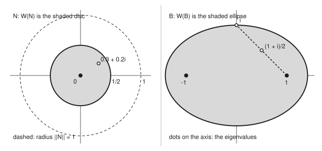
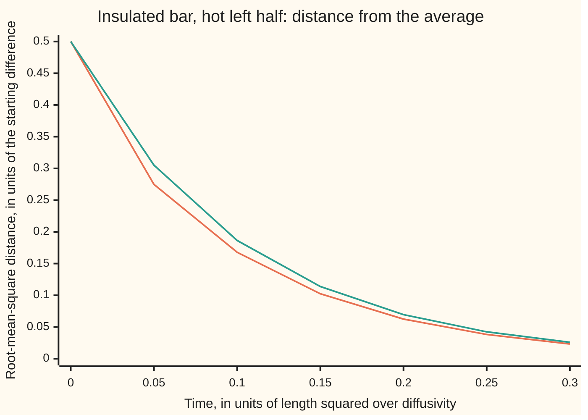

# Numerical range: the set of averages <x, Tx> is convex, holds the spectrum, and bounds how fast an evolution settles

[Syllabus](../../../SYLLABUS.md) → [Functional analysis](../README.md) → [Bounded Operators](../README.md#s03) → Numerical range

---

## General Overview

A metal bar 1 m long lies in a box of insulation, so no heat leaves it. At the start its left half is hot and its right half is cold: temperature 1 on the left, 0 on the right, in units of the starting difference. Heat flows from hot to cold, and the bar heads for its average, 0.5 everywhere.

How fast? Measure the bar's distance from the average as a root-mean-square: the square root of the mean squared gap between the temperature and 0.5. It starts at 0.5. By time 0.1 it is 0.1678, by time 0.3 it is 0.0233. One rate controls the whole fall: the distance shrinks at least like $`e^{-9.87\,t}`$. The number 9.87 is $`\pi^2`$, the bar's **spectral gap**. The heat operator is the rule that turns a temperature profile into its rate of change. Its spectrum (the numbers λ where λ minus the operator cannot be inverted) is 0, for a flat bar, and then a set of negative numbers. The gap is the distance from 0 to the nearest of those. For a copper-like bar, that means one factor of e every 921.1 s.

That rate comes from averages $`\langle x, Tx\rangle`$: how far an operator T pushes a unit vector x along x itself. The set of all such averages is the **numerical range**. The matrix N = `[[0, 1], [0, 0]]` shows why it matters. Its only eigenvalue is 0, yet its averages fill a disc of radius 1/2, and it stretches some vectors by 1. The averages see what the eigenvalues miss.

Two words carry the card. A set is **convex** when the straight segment between any two of its points stays inside it. The **closure** of a set is the set plus its limit points.

**The numerical range of an operator is the set of averages ⟨x, Tx⟩ over unit vectors x; it is convex, it holds the spectrum in its closure, its largest size is within a factor 2 of the operator's norm, and for a symmetric generator (the operator that drives an evolution) the gap between 0 and its averages on profiles away from the steady state is a rate at which the evolution settles.**

**What kind of fact this is:** theorems. Convexity (the Toeplitz–Hausdorff theorem), the spectrum inside the closure, the norm bounds and the decay bound are proved on this card in Why it works. The exact ellipse shape of a 2 × 2 range is stated with Horn and Johnson as the source, and checked at eight angles. The code checks instances: 2 × 2 matrices and the bar cut into M cells.

### The picture: two numerical ranges, to scale

<p align="center"></p>

To scale: 120 px per unit on the left, 100 on the right. Left: N's averages fill the disc; its eigenvalue 0 is the centre; the dashed circle has radius ‖N‖ = 1. Right: B = `[[1, 2], [0, -1]]` has eigenvalues 1 and −1, and its averages fill an ellipse with those foci. The chord's midpoint, (1 + i)/2, is an average too: that is convexity.

---

## The formula

Notation from earlier cards, in words.

- H is a Hilbert space: a complete space with lengths and angles ([Inner products](../02-Hilbert%20Spaces/01-inner-products-and-hilbert-spaces.md)). Its inner product $`\langle x, y\rangle`$ conjugates its first slot, like wing 07's $`v^*w`$; texts differ.
- T is a bounded operator on H, with norm $`\lVert T\rVert`$, its largest stretch of a unit vector ([Bounded operators](01-bounded-operators-and-the-operator-norm.md)). $`T^*`$ is its adjoint, the mirror with $`\langle x, Ty\rangle = \langle T^*x, y\rangle`$ ([Adjoints](03-adjoints-self-adjoint-and-unitary-operators.md)).
- $`\sigma(T)`$ is the spectrum: the complex λ where $`\lambda I - T`$ has no bounded inverse. $`R(\lambda, T) = (\lambda I - T)^{-1}`$ is the resolvent, and $`r(T)`$ is the spectral radius, the spectrum's farthest reach from 0 ([Spectrum](07-spectrum-and-resolvent.md)).

This card introduces the **numerical range** $`W(T)`$, the **numerical radius** $`w(T)`$ and the **spectral gap** γ:

```math
W(T) = \{\langle x, Tx\rangle : \lVert x\rVert = 1\}, \qquad w(T) = \sup\{\lvert z\rvert : z \in W(T)\}
```

**Read it aloud:** the numerical range is every average of T over unit vectors; the numerical radius is the largest size of such an average.

Three facts hold for every bounded operator on a complex Hilbert space. The bar over $`W(T)`$ means its closure: the set plus its limit points.

```math
W(T) \text{ is convex}, \qquad \sigma(T) \subseteq \overline{W(T)}, \qquad w(T) \le \lVert T\rVert \le 2\,w(T)
```

**Read it aloud:** the averages form a convex set; every point of the spectrum is an average or a limit of averages; the numerical radius is at most the norm, and the norm is at most twice the numerical radius.

For the bar, write $`u(t, s)`$ for the temperature at time t and position s along the bar, and $`\bar u`$ for its average, which never changes. The heat operator $`Lu = u''`$ (second derivative in s) drives the flow $`\partial_t u = Lu`$. Its averages on profiles of average zero stop at $`-\gamma`$:

```math
\langle v, Lv\rangle \le -\gamma\,\lVert v\rVert^2 \ \text{ whenever } \textstyle\int_0^1 v\,ds = 0 \quad \Longrightarrow \quad \lVert u(t) - \bar u\rVert \le e^{-\gamma t}\,\lVert u(0) - \bar u\rVert, \qquad \gamma = \pi^2
```

**Read it aloud:** if every average of L on mean-zero profiles is at most minus gamma times the profile's squared length, then the distance from the average shrinks at least like e to the minus gamma t; for the insulated bar gamma is pi squared.

| Symbol | Plain meaning | In our example | Push it up and the answer… |
| --- | --- | --- | --- |
| H; $`x`$, $`y`$, $`x_2`$; $`z_\tau`$, τ; $`e_1`$, $`e_2`$ | the Hilbert space; vectors in it (unit where averaged), and the second entry of x; the walk between x and y and its step; the standard unit vectors | $`x = e_1`$, $`y = (1, i)/\sqrt2`$ | — |
| $`T`$, $`T^*`$, $`T'`$; N, B, A, Q | any bounded operator, its adjoint, a rescaled copy; the 2 × 2 test matrices: a two-sample shift, an ellipse maker, a generator with a shear, a quarter turn | N = `[[0, 1], [0, 0]]` | — |
| a, b; $`\lambda_k`$, $`c_k`$; n, $`c_n`$; k | two averages; eigenvalues and coefficients in an eigenvector basis; the bar's mode number and coefficients; a counter | a = 1, b = i for B | — |
| $`W(T)`$ | numerical range: all averages $`\langle x, Tx\rangle`$ | disc of radius 1/2 for N | a bigger shear widens it |
| $`w(T)`$ | numerical radius: the largest average's size | 0.500000 for N, 1.414214 for B | — |
| $`\lVert T\rVert`$ | norm: largest stretch | 1 for N, 2.414214 for B | lies between w and 2w |
| $`\sigma(T)`$, $`r(T)`$, $`R(\lambda, T)`$, λ, d | spectrum, spectral radius, resolvent, a test point and its distance to W | {0}, 0, $`\lVert R(1, N)\rVert`$ = 1.618034, λ = 1 | — |
| $`\mathrm{Re}\,T`$, $`\mathrm{Im}\,T`$, J; θ, α, φ | the parts $`(T + T^*)/2`$ and $`(T - T^*)/2i`$, J being $`\mathrm{Im}\,T'`$; angles | $`\mathrm{Re}(e^{i\theta}N)`$ has top eigenvalue 0.5 at every θ | — |
| $`u(t, s)`$, $`\bar u`$, $`v`$ | temperature at time t and position s; its average; a profile of average zero | $`\bar u = 0.5`$ | — |
| $`L`$, $`L_M`$ | heat operator $`u''`$ with insulated ends; its version on M cells | eigenvalues 0, $`-\pi^2`$, $`-4\pi^2`$, … | — |
| γ, ω | spectral gap; top of $`\mathrm{Re}\,W`$, the largest real part of an average | γ = 9.869604; ω = 1.541381 for A | bigger γ settles faster; ω > 0 allows growth |
| t, κ, M | time in units of length² / κ; diffusivity (heat-spreading rate); grid cells | t = 0.1; κ = 1.1 × 10⁻⁴ m²/s; M = 50 | more cells, gap closer to π² |

### When it holds

- **Complex scalars.** With real vectors only, the quarter turn Q = `[[0, -1], [1, 0]]` has every average equal to 0.000000, yet its eigenvalues are i and −i. The spectrum escapes the real averages. Complex vectors give W(Q) the segment from −i to i, with w(Q) = 1.
- **The closure, in infinite dimensions.** On $`\ell^2`$, the operator that multiplies the n-th coordinate by 1/n has averages filling the interval from 0 to 1, but never 0 itself. Yet 0 is in its spectrum.
- **A symmetric generator, for the gap to set the rate.** A = `[[-1, 6], [0, -2]]` has eigenvalues −1 and −2, yet $`\lVert e^{0.3A}\rVert`$ = 1.448595, not below 1. Without symmetry the honest rate is ω, the top of Re W: here 1.541381.
- **A gap above zero.** On an infinite bar, the spectrum of $`u''`$ runs all the way up to 0, with no gap. Heat still spreads out, but at no exponential rate.
- **The domain.** L is unbounded, so its domain decides it: profiles with two square-integrable derivatives and zero slope at both ends (no heat crosses an end). On that domain L is self-adjoint and W(L) is $`(-\infty, 0]`$. Drop the end condition and the integration by parts in Step 5 picks up boundary terms of either sign.

---

## Why it works

### Step 0: an average is a weighted mix

Take a symmetric matrix (self-adjoint: $`T^* = T`$, which for complex entries means Hermitian) with eigenvalues $`\lambda_k`$ and perpendicular unit eigenvectors. Write a unit vector x in that basis with coefficients $`c_k`$. Then

```math
\langle x, Tx\rangle = \sum_k \lambda_k \lvert c_k\rvert^2, \qquad \sum_k \lvert c_k\rvert^2 = 1
```

**Read it aloud:** the average is the eigenvalues mixed with weights that are the squared sizes of the coefficients, and the weights add to one.

So the averages are exactly the weighted mixes of the eigenvalues: the smallest convex set holding them, their **convex hull**. The same holds for every **normal** matrix (one that commutes with its adjoint), since it too has perpendicular eigenvectors. For a symmetric matrix the hull is the interval from the smallest to the largest eigenvalue: the bottom and top of the Rayleigh ratio of [Compact and symmetric](08-spectral-theorem-for-compact-self-adjoint-operators.md).

For a non-normal matrix the eigenvectors are not perpendicular, the cross terms survive, and the averages spill past the eigenvalues. N is the extreme case.

### Step 1: N's averages fill a disc

Every unit vector in $`\mathbb{C}^2`$ is, up to an overall phase that does not change the average, $`x = (\cos\alpha, e^{i\varphi}\sin\alpha)`$. Then $`Nx = (e^{i\varphi}\sin\alpha, 0)`$, so

```math
\langle x, Nx\rangle = \cos\alpha \cdot e^{i\varphi}\sin\alpha = \tfrac12 \sin 2\alpha\; e^{i\varphi}
```

**Read it aloud:** the average is one half sine of two alpha, turned by the angle phi.

As α runs from 0 to π/4, the size runs from 0 to 1/2; φ turns it to every direction. So W(N) is the closed disc of radius 1/2 and w(N) = 1/2. The code reaches the point 0.3 + 0.2i this way and samples 129960 unit vectors: the largest average has size 0.500000.

The norm is 1: N sends $`e_2`$ to $`e_1`$, and $`\lVert Nx\rVert = \lvert x_2\rvert \le \lVert x\rVert`$ for every x. The spectral radius is 0. So the three sizes of N are 0, 1/2 and 1, and only the middle one comes from averages.

### Step 2: the spectrum sits in the closure

Take λ at distance d > 0 from W(T). For a unit vector x, the number $`\langle x, (T - \lambda I)x\rangle = \langle x, Tx\rangle - \lambda`$ has size at least d. By the Cauchy–Schwarz inequality, $`\lvert\langle x, (T - \lambda I)x\rangle\rvert \le \lVert(T - \lambda I)x\rVert`$. So

```math
\lVert(\lambda I - T)x\rVert \ge d\,\lVert x\rVert \quad \text{for every } x
```

**Read it aloud:** lambda I minus T never shrinks a vector below d times its length.

A map **bounded below** like this is one-to-one, and its range is closed. The range is also everything. A vector y at right angles to the whole range would have $`\langle y, (\lambda I - T)y\rangle = 0`$, but that number has size at least $`d\lVert y\rVert^2`$, so y = 0. One-to-one and onto with a bound below: λ I − T has an inverse of size at most 1/d. So

```math
\sigma(T) \subseteq \overline{W(T)}, \qquad \lVert R(\lambda, T)\rVert \le \frac{1}{\mathrm{dist}(\lambda, W(T))}
```

**Read it aloud:** the spectrum lies in the closure of the numerical range, and the resolvent's size is at most one over the distance to it.

For N at λ = 1: the distance to the disc is 1/2, so the bound is 2. The inverse is $`(I - N)^{-1}`$ = `[[1, 1], [0, 1]]`, of size 1.618034, the golden ratio. In particular $`r(T) \le w(T)`$.

### Step 3: the averages form a convex set

**Toeplitz–Hausdorff theorem.** Pick two averages, a = ⟨x, Tx⟩ and b = ⟨y, Ty⟩. The segment between them lies in W(T).

The whole argument happens in the plane spanned by x and y. Rescale first: $`T' = (T - aI)/(b - a)`$ has averages 0 at x and 1 at y, and a segment of T′ maps back to a segment of T. Now split T′ into its two symmetric parts, $`T' = \mathrm{Re}\,T' + i\,\mathrm{Im}\,T'`$, with $`\mathrm{Re}\,T' = (T' + T'^*)/2`$ and $`\mathrm{Im}\,T' = (T' - T'^*)/2i`$. Every average of a symmetric operator is real, so the real part of an average comes from $`\mathrm{Re}\,T'`$ and the imaginary part from $`\mathrm{Im}\,T'`$.

1. Turn x by a phase $`e^{i\theta}`$, chosen so the cross term of $`\mathrm{Im}\,T'`$ between x and y vanishes. The average at x stays 0.
2. Walk along $`z_\tau = (1 - \tau)x + \tau y`$ as τ runs from 0 to 1. The imaginary part of the average stays 0 the whole way.
3. The real part moves continuously from 0 to 1, so by the intermediate value theorem it passes every value between.

So every point of [0, 1] is an average of T′, and every point of the segment from a to b is an average of T. The code runs this walk for B from a = 1 (at $`e_1`$) to b = i (at $`(1, i)/\sqrt2`$) and stops at the midpoint: 0.500000 + 0.500000i.

<details>
<summary>Detailed proof: why the imaginary part stays zero along the walk</summary>

Write $`J = \mathrm{Im}\,T'`$, a symmetric operator. At the ends, $`\langle x, Jx\rangle = 0`$ and $`\langle y, Jy\rangle = 0`$, since the averages there are the real numbers 0 and 1.

Along the walk,

$`\displaystyle \langle z_\tau, J z_\tau\rangle = (1 - \tau)^2\langle x, Jx\rangle + \tau^2\langle y, Jy\rangle + \tau(1 - \tau)\,2\,\mathrm{Re}\,\langle x, Jy\rangle.`$

Replacing x by $`e^{i\theta}x`$ multiplies $`\langle x, Jy\rangle`$ by $`e^{-i\theta}`$ and changes nothing else. Choose θ so that the product is purely imaginary. Then all three terms are 0.

The walk never passes through the zero vector, since x and y point in different directions. So $`\langle z_\tau, T' z_\tau\rangle / \lVert z_\tau\rVert^2`$ is a real, continuous function of τ, equal to 0 at τ = 0 and 1 at τ = 1.

</details>

In two dimensions there is an exact picture, the **elliptical range theorem**: the numerical range of a 2 × 2 matrix is a filled ellipse whose foci are its eigenvalues. For B the foci are 1 and −1 and the semi-axes are 1.414214 and 1. The code checks it two ways: all 129960 sampled averages lie inside, and the ellipse's reach in each direction matches the top eigenvalue of $`\mathrm{Re}(e^{i\theta}B)`$ at eight angles. Every two-dimensional piece of W(T) is such an ellipse, which gives convexity a second time.

### Step 4: the norm is between w and 2w

The left half is Cauchy–Schwarz: $`\lvert\langle x, Tx\rangle\rvert \le \lVert x\rVert\,\lVert Tx\rVert \le \lVert T\rVert`$ for a unit x.

The right half rebuilds every number $`\langle y, Tx\rangle`$ from four averages. This is **polarization**:

```math
4\,\langle y, Tx\rangle = \sum_{k=0}^{3} i^k \,\langle x + i^k y,\; T(x + i^k y)\rangle
```

**Read it aloud:** four times y against T x equals the sum, over the four powers of i, of that power times the average of T at x plus that power times y.

Each average on the right has size at most $`w(T)\lVert x + i^k y\rVert^2`$. Those four squared lengths add to $`4(\lVert x\rVert^2 + \lVert y\rVert^2)`$, which is 8 for unit x and y. So $`\lvert\langle y, Tx\rangle\rvert \le 2w(T)`$. Choosing y in the direction of Tx gives $`\lVert Tx\rVert \le 2w(T)`$.

N attains the right-hand bound exactly: ‖N‖ = 1 = 2w(N), with w(N) = 0.5. B sits strictly inside: 1.414214 ≤ 2.414214 ≤ 2.828427. For a symmetric operator, w(T) = ‖T‖: the norm is the largest size of a point of the spectrum ([Bounded and symmetric](10-spectral-theorem-for-bounded-self-adjoint-operators.md)), and Step 2 puts that point in the closure of W.

Unlike the spectral radius, w is a norm on operators: w(T) = 0 forces T = 0. N has r(N) = 0 but w(N) = 1/2.

### Step 5: the bar's gap is a bound on averages

For a profile v with zero slope at both ends, integrate by parts once:

```math
\langle v, Lv\rangle = \int_0^1 v\,v''\,ds = -\int_0^1 (v')^2\,ds \le 0
```

**Read it aloud:** the average of the heat operator at v is minus the total squared slope of v, never positive.

So W(L) lies in $`(-\infty, 0]`$. Constants give 0: a flat bar does not change. On profiles of average zero, expand in the bar's modes $`\sqrt2\cos(n\pi s)`$, n = 1, 2, 3, …, which form a perpendicular basis: the cosine version of the string's sine modes on [Compact and symmetric](08-spectral-theorem-for-compact-self-adjoint-operators.md). With coefficients $`c_n`$, the squared slope is $`\sum n^2\pi^2 c_n^2 \ge \pi^2 \sum c_n^2`$. So $`\langle v, Lv\rangle \le -\pi^2\lVert v\rVert^2`$: the gap is γ = π².

Now let $`v(t) = u(t) - \bar u`$. Heat is conserved, so v keeps average zero. Its squared length changes at the rate

```math
\frac{d}{dt}\lVert v\rVert^2 = 2\,\langle v, Lv\rangle \le -2\gamma\,\lVert v\rVert^2
```

**Read it aloud:** the squared distance from the average falls at least two gamma times as fast as its own size.

A quantity whose rate of change is at most $`-2\gamma`$ times itself falls at least like $`e^{-2\gamma t}`$ (Grönwall's inequality, by comparing with the exact exponential). Taking square roots gives $`\lVert v(t)\rVert \le e^{-\gamma t}\lVert v(0)\rVert`$.

A second road gives the same bound. Each mode decays on its own: $`c_n(t) = e^{-n^2\pi^2 t}c_n(0)`$. The slowest is n = 1, at rate π². For the hot-left, cold-right start, $`c_n(0)`$ is 0 for even n and $`\pm\sqrt2/(n\pi)`$ for odd n, so the distance is an explicit cosine series. The code sums it and compares it with a time-stepped grid.

The energy road used only the top of W(L); the mode road used only the spectrum. For a symmetric generator they agree, since the closure of W is the convex hull of the spectrum. A finite Markov chain forgets its start the same way, at a rate set by its own gap ([Convergence to equilibrium](../../11-Stochastic%20processes%20and%20calculus/03-Markov%20Chains/05-convergence-to-equilibrium.md)).

### Step 6: what changes for a non-symmetric generator, and what the grid hides

For a general generator A on $`\mathbb{C}^n`$, the energy argument still runs: $`\frac{d}{dt}\lVert v\rVert^2 = 2\,\mathrm{Re}\langle v, Av\rangle \le 2\omega\lVert v\rVert^2`$. So $`\lVert e^{tA}\rVert \le e^{\omega t}`$, with ω the top of Re W(A). That bound is honest. The eigenvalues are not: they set the rate only in the long run, and they hide growth at the start.

For A = `[[-1, 6], [0, -2]]`, ω = (−3 + √37)/2 = 1.541381. On a time grid of step 0.01, the norm $`\lVert e^{tA}\rVert`$ is largest at t = 0.61, where it is 1.608959; then it decays. An operator whose numerical range lies in the left half-plane, ω ≤ 0, never grows: this is the root of the Lumer–Phillips test on [Hille-Yosida](../05-Unbounded%20Operators%20and%20Semigroups/05-hille-yosida-and-generators.md).

The code cannot hold L. It holds $`L_M`$, the bar cut into M cells with the same insulated ends. $`L_M`$ is a symmetric matrix, so its W is the bounded interval from its lowest eigenvalue to 0. The true W(L) runs down to $`-\infty`$. The gap is the edge near 0, and it converges: $`\gamma_M = 4M^2\sin^2(\pi/2M)`$ climbs to π² from below, with error close to $`\pi^4/(12M^2)`$. The bottom edge, near $`-4M^2`$, has no limit. That missing bottom is why L has a domain and the matrix does not.

---

## Worked numbers, by hand

| Step | Arithmetic | Value |
| --- | --- | --- |
| largest average of N | $`\tfrac12\sin 2\alpha`$ at α = π/4 | w(N) = 0.5 |
| norm of N | $`Ne_2 = e_1`$ | 1 |
| the two bounds | 0.5 ≤ 1 ≤ 2 × 0.5 | tight on the right |
| resolvent at λ = 1 | $`(I - N)^{-1}`$ = `[[1, 1], [0, 1]]` | 1.618034 ≤ 1/0.5 = 2 |
| B's ellipse | foci 1 and −1, semi-axes $`\sqrt2`$ and 1 | w(B) = 1.414214 |
| B's bounds | 1.414214 ≤ 1 + √2 ≤ 2√2 | 2.414214 ≤ 2.828427 |
| the bar's gap | slowest mode cos(πs) | γ = π² = 9.869604 |
| bound at t = 0.1 | $`0.5\,e^{-0.9869604}`$ | 0.186354 |
| true distance at t = 0.1 | cosine series | **0.167777** |
| time unit, 1 m copper-like bar | $`1\text{ m}^2 / (1.1\times10^{-4}\text{ m}^2/\text{s})`$ | 9090.9 s |
| one factor of e | $`9090.9 / \pi^2`$ | 921.1 s |
| down to 1% | $`9090.9 \times \ln 100 / \pi^2`$ | **4241.8 s** |

The bar's distance from its average is 0.167777 at t = 0.1, under the gap's bound 0.186354. A bar 1 m long with diffusivity 1.1 × 10⁻⁴ m²/s, close to copper's (illustrative), has its distance from the average down to 1% of the starting distance after 4241.8 s, whatever its starting profile.

The decay, traced by the grid with M = 50 cells, against the bound:



Orange: the bar on a grid of M = 50 cells. Green: the bound 0.5 e^(−π² t). Both start at 0.5000, and the bar stays below the bound at every time.

### What breaks if you drop a piece

| Mistake | Comes out at | What went wrong |
| --- | --- | --- |
| Size N by its eigenvalues | r(N) = 0, yet ‖N‖ = 1 and w(N) = 0.5 | N is not normal; its averages spread past the spectrum |
| Rate of A from its eigenvalues | predicts 0.740818 at t = 0.3; true 1.448595 | A is not symmetric; the honest bound is $`e^{0.3\omega}`$ = 1.587903 |
| Real vectors for the quarter turn Q | every average 0.000000; eigenvalues ±i | the spectrum lies in the closure of the complex W only |
| Gap read off a coarse grid, M = 4 | 9.372583 instead of 9.869604 | the truncation's gap is below π² by about π⁴/(12M²) |

The code prints all four.

---

## Code, from first principles, and it actually runs

The code holds only 2 × 2 matrices and the bar cut into M cells, and reaches each answer by two or three independent roads:

- **Numerical range:** sampling 129960 unit vectors, against the top eigenvalue of $`\mathrm{Re}(e^{i\theta}T)`$, which traces the range's edge.
- **Norms:** power iteration (repeatedly applying $`T^{\mathsf T}T`$, which settles on the largest stretch), against closed forms.
- **Convexity:** Step 3's walk, run by bisection to the midpoint.
- **The gap:** power iteration on $`L_M`$ with constants removed, against $`4M^2\sin^2(\pi/2M)`$.
- **The decay:** time-stepping the grid, against the cosine series, both under the bound; A's exponential in closed form, against its Taylor series.

### Python

```python
# Numerical range and spectral gap -- the check behind the card.  Standard library only.
# Complex numbers are (re, im) pairs.  Eigenvalues, norms, exponentials and the heat
# flow are written out here; nothing imported already knows an answer.
from math import sqrt, sin, cos, exp, log, pi, asin, atan2

def f6(t): return f"{t:.6f}"
def cm(a, b): return (a[0] * b[0] - a[1] * b[1], a[0] * b[1] + a[1] * b[0])
def ca(a, b): return (a[0] + b[0], a[1] + b[1])
def cx(A): return [[(a, 0.0) for a in row] for row in A]
def size(z): return sqrt(z[0] * z[0] + z[1] * z[1])
def ip(x, y):                          # <x, y>, conjugating the first slot
    s = (0.0, 0.0)
    for a, b in zip(x, y):
        s = ca(s, cm((a[0], -a[1]), b))
    return s
def mul(T, x):                         # T x for a complex 2 x 2 matrix
    return [ca(cm(row[0], x[0]), cm(row[1], x[1])) for row in T]
def avg(T, x):                         # the average <x, Tx> / <x, x>
    q, n = ip(x, mul(T, x)), ip(x, x)[0]
    return (q[0] / n, q[1] / n)
def unit(al, ph): return [(cos(al), 0.0), (sin(al) * cos(ph), sin(al) * sin(ph))]
def sample(T):                         # averages over a grid of 361 x 360 unit vectors
    return [avg(T, unit(k * pi / 720, m * pi / 180)) for k in range(361) for m in range(360)]
def top(T, th):                        # top eigenvalue of the Hermitian part of e^(i th) T
    M = [[cm((cos(th), sin(th)), t) for t in row] for row in T]
    a, d = M[0][0][0], M[1][1][0]
    br, bi = (M[0][1][0] + M[1][0][0]) / 2, (M[0][1][1] - M[1][0][1]) / 2
    return (a + d) / 2 + sqrt(((a - d) / 2) ** 2 + br * br + bi * bi)
def norm(A):                           # largest stretch of a real 2 x 2: power iteration on A^T A
    v = [1.0, 0.3]
    for _ in range(400):
        w = [A[0][0] * v[0] + A[0][1] * v[1], A[1][0] * v[0] + A[1][1] * v[1]]
        v = [A[0][0] * w[0] + A[1][0] * w[1], A[0][1] * w[0] + A[1][1] * w[1]]
        s = sqrt(v[0] * v[0] + v[1] * v[1]); v = [v[0] / s, v[1] / s]
    w = [A[0][0] * v[0] + A[0][1] * v[1], A[1][0] * v[0] + A[1][1] * v[1]]
    return sqrt(w[0] * w[0] + w[1] * w[1])

N, B, Q = [[0.0, 1.0], [0.0, 0.0]], [[1.0, 2.0], [0.0, -1.0]], [[0.0, -1.0], [1.0, 0.0]]
wN, nN = max(size(z) for z in sample(cx(N))), norm(N)
sup = [top(cx(N), k * pi / 180) for k in range(360)]
hit = avg(cx(N), unit(asin(2 * size((0.3, 0.2))) / 2, atan2(0.2, 0.3)))
res = norm([[1.0, 1.0], [0.0, 1.0]])
print("N: trace 0 and determinant 0, so l^2 = 0: spectrum {0}, spectral radius 0")
print(f"N: largest |<x, Nx>| over 129960 unit vectors: w(N) = {f6(wN)}")
print(f"N: top of Re(e^(i th) N) over 360 angles: min {f6(min(sup))}, max {f6(max(sup))}")
print(f"N: ||N|| = {f6(nN)}; w <= ||N|| <= 2w: {f6(wN)} <= {f6(nN)} <= {f6(2 * wN)}")
print(f"N: the point 0.3 + 0.2i as an average: {f6(hit[0])} + {f6(hit[1])}i")
print(f"N: ||(I - N)^-1|| = {f6(res)} (golden ratio {f6((1 + sqrt(5)) / 2)}) <= 1/dist(1, W) = {f6(1 / (1 - wN))}")
ell = max(abs(top(cx(B), k * pi / 4) - sqrt(2 * cos(k * pi / 4) ** 2 + sin(k * pi / 4) ** 2)) for k in range(8))
pts = sample(cx(B))
inside = all(p[0] * p[0] / 2 + p[1] * p[1] <= 1 + 1e-12 for p in pts)
wB, nB = max(size(p) for p in pts), norm(B)
print(f"B: foci 1 and -1, semi-axes {f6(sqrt(2))} and {f6(1.0)}; largest gap, support against ellipse: {f6(ell)}")
print(f"B: all 129960 averages inside the ellipse: {'yes' if inside else 'no'}; w(B) = {f6(wB)}")
print(f"B: ||B|| = {f6(nB)} (1 + sqrt 2 = {f6(1 + sqrt(2))}); w <= ||B|| <= 2w: {f6(wB)} <= {f6(nB)} <= {f6(2 * wB)}")
x, y = [(1.0, 0.0), (0.0, 0.0)], [(sqrt(0.5), 0.0), (0.0, sqrt(0.5))]
a, b = avg(cx(B), x), avg(cx(B), y)    # Step 3's path: T' = (B - aI)/(b - a) runs from 0 to 1
e = (b[0] - a[0], b[1] - a[1])
d = (e[0] / (e[0] * e[0] + e[1] * e[1]), -e[1] / (e[0] * e[0] + e[1] * e[1]))    # 1 / (b - a)
Tp = [[cm(ca(t, (-a[0], -a[1])) if i == j else t, d) for j, t in enumerate(row)] for i, row in enumerate(cx(B))]
g = ca(ip(x, mul(Tp, y)), (-ip(y, mul(Tp, x))[0], ip(y, mul(Tp, x))[1]))    # 2i <x, (Im T') y>
xr = [cm((cos(atan2(g[1], g[0])), sin(atan2(g[1], g[0]))), c) for c in x]
path = lambda t: [ca(cm((1 - t, 0.0), xr[i]), cm((t, 0.0), y[i])) for i in range(2)]
lo, hi = 0.0, 1.0
for _ in range(60):
    lo, hi = ((lo + hi) / 2, hi) if avg(Tp, path((lo + hi) / 2))[0] < 0.5 else (lo, (lo + hi) / 2)
mp = avg(cx(B), path(lo))
print(f"B: <e1, Be1> = {f6(a[0])}, <y, By> = {f6(b[1])}i; the path reaches {f6(mp[0])} + {f6(mp[1])}i")

def lap(u, M):                         # grid heat operator on M cells, insulated ends
    return [M * M * ((u[j - 1] if j > 0 else u[0]) - 2 * u[j] + (u[j + 1] if j < M - 1 else u[M - 1]))
            for j in range(M)]
def spread(u):                         # distance from the average, sqrt(h * sum of squares)
    m = sum(u) / len(u)
    return sqrt(sum((c - m) ** 2 for c in u) / len(u))
print("heat, grid of M cells: gap by power iteration, closed form 4M^2 sin^2(pi/2M), pi^2 - gap, times M^2")
gaps = []
for M in (4, 8, 16, 32, 64):
    v, c = [(j + 1.0) ** 3 for j in range(M)], 4.0 * M * M
    for _ in range(20000):             # power iteration on A + cI, constants projected out
        m = sum(v) / M; v = [t - m for t in v]
        Av = lap(v, M); v = [p + c * q for p, q in zip(Av, v)]
        s = sqrt(sum(t * t for t in v)); v = [t / s for t in v]
    m = sum(v) / M; v = [t - m for t in v]
    g = -sum(p * q for p, q in zip(v, lap(v, M))) / sum(t * t for t in v)
    cf = 4 * M * M * sin(pi / (2 * M)) ** 2
    gaps.append((g, cf, (pi * pi - cf) * M * M))
    print(f"  M = {M:2d}: {f6(g)}  {f6(cf)}  {f6(pi * pi - cf)}  {f6((pi * pi - cf) * M * M)}")
print(f"  limit pi^2 = {f6(pi * pi)}; the error times M^2 tends to pi^4/12 = {f6(pi ** 4 / 12)}")
M, dt, ts = 50, 1e-4, (1, 5, 10, 20, 30)
u, rows, chart = [1.0 if j < M // 2 else 0.0 for j in range(M)], [], []
for n in range(3001):
    if n % 500 == 0: chart.append((spread(u), 0.5 * exp(-pi * pi * n * dt)))
    if n % 100 == 0 and n // 100 in ts: rows.append((n * dt, spread(u)))
    Au = lap(u, M); u = [p + dt * q for p, q in zip(u, Au)]
g50 = 4 * M * M * sin(pi / (2 * M)) ** 2
print("hot left half, cold right half: t, grid M = 50, cosine series, bound 0.5 e^(-pi^2 t)")
for t, gr in rows:
    se = sqrt(sum(2 / (n * n * pi * pi) * exp(-2 * n * n * pi * pi * t) for n in range(1, 400, 2)))
    print(f"  {t:.2f}  {f6(gr)}  {f6(se)}  {f6(0.5 * exp(-pi * pi * t))}")
    assert abs(gr - se) < 2e-3 and se <= 0.5 * exp(-pi * pi * t) and gr <= 0.5 * exp(-g50 * t) + 1e-12
print("chart, t = 0, 0.05, ..., 0.3, grid:", ", ".join(f"{p:.4f}" for p, q in chart))
print("chart, bound:", ", ".join(f"{q:.4f}" for p, q in chart))
unit_s = 1 / 1.1e-4
print(f"1 m bar, kappa 1.1e-4 m^2/s: time unit {unit_s:.1f} s; settles by e in {unit_s / pi ** 2:.1f} s, "
      f"to 1% in {unit_s * log(100) / pi ** 2:.1f} s")
A = [[-1.0, 6.0], [0.0, -2.0]]
om = (-3 + sqrt(37)) / 2
omS = max(p[0] for p in sample(cx(A)))
def expA(t): return [[exp(-t), 6 * (exp(-t) - exp(-2 * t))], [0.0, exp(-2 * t)]]
def taylor(t):                         # sum of (tA)^k / k!, 60 terms
    S, P = [[1.0, 0.0], [0.0, 1.0]], [[1.0, 0.0], [0.0, 1.0]]
    for k in range(1, 60):
        P = [[sum(P[i][l] * A[l][j] for l in range(2)) * t / k for j in range(2)] for i in range(2)]
        S = [[S[i][j] + P[i][j] for j in range(2)] for i in range(2)]
    return S
tay = max(abs(expA(0.3)[i][j] - taylor(0.3)[i][j]) for i in range(2) for j in range(2))
scan = [(norm(expA(k / 100)), k / 100) for k in range(301)]
pk = max(scan)
print(f"A = [[-1, 6], [0, -2]]: eigenvalues -1, -2; top of Re W: {f6(om)} closed form, {f6(omS)} sampled")
print(f"A: ||e^(0.3A)|| = {f6(norm(expA(0.3)))}; spectrum predicts {f6(exp(-0.3))}; bound e^(0.3 w) = {f6(exp(0.3 * om))}")
print(f"A: largest ||e^(tA)|| = {f6(pk[0])} at t = {pk[1]:.2f}; Taylor against closed form {f6(tay)}")
real = max(abs(avg(cx(Q), unit(k * pi / 720, 0.0))[0]) for k in range(1441))
wQ = max(size(p) for p in sample(cx(Q)))
print(f"quarter turn Q: trace 0, determinant 1, eigenvalues i and -i; real vectors give at most {f6(real)}; complex w(Q) = {f6(wQ)}")
print(f"figure, left: centre (160, 150), 120 px per unit, W(N) radius {120 * wN:.1f}, norm circle {120 * nN:.1f}; "
      f"right: centre (470, 150), 100 px per unit, rx {100 * sqrt(2):.1f}, ry {100 * 1.0:.1f}, "
      f"foci x {470 - 100 * 1.0:.1f} and {470 + 100 * 1.0:.1f}, midpoint ({470 + 100 * mp[0]:.1f}, {150 - 100 * mp[1]:.1f})")
assert abs(wN - max(sup)) < 1e-9 and abs(min(sup) - 0.5) < 1e-9       # sampling against support
assert abs(nN - 1) < 1e-9 and abs(nB - (1 + sqrt(2))) < 1e-9           # power iteration, closed form
assert abs(res - (1 + sqrt(5)) / 2) < 1e-9 and res <= 1 / (1 - wN)     # resolvent bound
assert inside and ell < 1e-12 and abs(wB - sqrt(2)) < 1e-9 and wB <= nB <= 2 * wB
assert abs(mp[0] - 0.5) < 1e-9 and abs(mp[1] - 0.5) < 1e-9           # convexity path
assert all(abs(g - cf) < 1e-6 for g, cf, e in gaps) and abs(gaps[-1][2] - pi ** 4 / 12) < 1e-2
assert abs(om - omS) < 1e-4 and tay < 1e-12 and pk[0] > 1 and all(n <= exp(t * om) + 1e-12 for n, t in scan)
assert real < 1e-15 and abs(wQ - 1) < 1e-9
print("ALL CHECKS PASS")
```

**Ran 2026-11-24 on macOS, Python 3.14.10, standard library only. All checks passed. Output, pasted from the run:**

```
N: trace 0 and determinant 0, so l^2 = 0: spectrum {0}, spectral radius 0
N: largest |<x, Nx>| over 129960 unit vectors: w(N) = 0.500000
N: top of Re(e^(i th) N) over 360 angles: min 0.500000, max 0.500000
N: ||N|| = 1.000000; w <= ||N|| <= 2w: 0.500000 <= 1.000000 <= 1.000000
N: the point 0.3 + 0.2i as an average: 0.300000 + 0.200000i
N: ||(I - N)^-1|| = 1.618034 (golden ratio 1.618034) <= 1/dist(1, W) = 2.000000
B: foci 1 and -1, semi-axes 1.414214 and 1.000000; largest gap, support against ellipse: 0.000000
B: all 129960 averages inside the ellipse: yes; w(B) = 1.414214
B: ||B|| = 2.414214 (1 + sqrt 2 = 2.414214); w <= ||B|| <= 2w: 1.414214 <= 2.414214 <= 2.828427
B: <e1, Be1> = 1.000000, <y, By> = 1.000000i; the path reaches 0.500000 + 0.500000i
heat, grid of M cells: gap by power iteration, closed form 4M^2 sin^2(pi/2M), pi^2 - gap, times M^2
  M =  4: 9.372583  9.372583  0.497021  7.952342
  M =  8: 9.743420  9.743420  0.126185  8.075812
  M = 16: 9.837936  9.837936  0.031668  8.107000
  M = 32: 9.861680  9.861680  0.007925  8.114817
  M = 64: 9.867623  9.867623  0.001982  8.116772
  limit pi^2 = 9.869604; the error times M^2 tends to pi^4/12 = 8.117424
hot left half, cold right half: t, grid M = 50, cosine series, bound 0.5 e^(-pi^2 t)
  0.01  0.412627  0.412567  0.453009
  0.05  0.274849  0.274826  0.305249
  0.10  0.167778  0.167777  0.186354
  0.20  0.062522  0.062532  0.069456
  0.30  0.023299  0.023306  0.025887
chart, t = 0, 0.05, ..., 0.3, grid: 0.5000, 0.2748, 0.1678, 0.1024, 0.0625, 0.0382, 0.0233
chart, bound: 0.5000, 0.3052, 0.1864, 0.1138, 0.0695, 0.0424, 0.0259
1 m bar, kappa 1.1e-4 m^2/s: time unit 9090.9 s; settles by e in 921.1 s, to 1% in 4241.8 s
A = [[-1, 6], [0, -2]]: eigenvalues -1, -2; top of Re W: 1.541381 closed form, 1.541381 sampled
A: ||e^(0.3A)|| = 1.448595; spectrum predicts 0.740818; bound e^(0.3 w) = 1.587903
A: largest ||e^(tA)|| = 1.608959 at t = 0.61; Taylor against closed form 0.000000
quarter turn Q: trace 0, determinant 1, eigenvalues i and -i; real vectors give at most 0.000000; complex w(Q) = 1.000000
figure, left: centre (160, 150), 120 px per unit, W(N) radius 60.0, norm circle 120.0; right: centre (470, 150), 100 px per unit, rx 141.4, ry 100.0, foci x 370.0 and 570.0, midpoint (520.0, 100.0)
ALL CHECKS PASS
```

### Rust

Same numbers, same labels, built with `rustc --edition 2021 -O`.

```rust
// Numerical range and spectral gap -- the same check as the Python, in Rust.  No crates.
// Complex numbers are a small struct.  Eigenvalues, norms, exponentials and the heat
// flow are written out here; nothing in std already knows an answer.
use std::f64::consts::PI;

#[derive(Clone, Copy)] struct C { re: f64, im: f64 }
fn c(re: f64, im: f64) -> C { C { re, im } }
fn cm(a: C, b: C) -> C { c(a.re * b.re - a.im * b.im, a.re * b.im + a.im * b.re) }
fn ca(a: C, b: C) -> C { c(a.re + b.re, a.im + b.im) }
fn size(z: C) -> f64 { (z.re * z.re + z.im * z.im).sqrt() }
type M2 = [[C; 2]; 2];
fn cx(a: [[f64; 2]; 2]) -> M2 { [[c(a[0][0], 0.0), c(a[0][1], 0.0)], [c(a[1][0], 0.0), c(a[1][1], 0.0)]] }
fn f6(t: f64) -> String { format!("{:.6}", t) }
fn ip(x: [C; 2], y: [C; 2]) -> C {                    // <x, y>, conjugating the first slot
    (0..2).fold(c(0.0, 0.0), |s, k| ca(s, cm(c(x[k].re, -x[k].im), y[k])))
}
fn mul(t: &M2, x: [C; 2]) -> [C; 2] {                 // T x for a complex 2 x 2 matrix
    [ca(cm(t[0][0], x[0]), cm(t[0][1], x[1])), ca(cm(t[1][0], x[0]), cm(t[1][1], x[1]))]
}
fn avg(t: &M2, x: [C; 2]) -> C {                      // the average <x, Tx> / <x, x>
    let (q, n) = (ip(x, mul(t, x)), ip(x, x).re);
    c(q.re / n, q.im / n)
}
fn unit(al: f64, ph: f64) -> [C; 2] { [c(al.cos(), 0.0), c(al.sin() * ph.cos(), al.sin() * ph.sin())] }
fn sample(t: &M2) -> Vec<C> {                         // averages over a grid of 361 x 360 unit vectors
    (0..361).flat_map(|k| (0..360).map(move |m| avg(t, unit(k as f64 * PI / 720.0, m as f64 * PI / 180.0)))).collect()
}
fn top(t: &M2, th: f64) -> f64 {                      // top eigenvalue of the Hermitian part of e^(i th) T
    let e = c(th.cos(), th.sin());
    let m = [[cm(e, t[0][0]), cm(e, t[0][1])], [cm(e, t[1][0]), cm(e, t[1][1])]];
    let (a, d) = (m[0][0].re, m[1][1].re);
    let (br, bi) = ((m[0][1].re + m[1][0].re) / 2.0, (m[0][1].im - m[1][0].im) / 2.0);
    (a + d) / 2.0 + (((a - d) / 2.0).powi(2) + br * br + bi * bi).sqrt()
}
fn norm(a: [[f64; 2]; 2]) -> f64 {                    // largest stretch of a real 2 x 2: power iteration on A^T A
    let mut v = [1.0, 0.3];
    for _ in 0..400 {
        let w = [a[0][0] * v[0] + a[0][1] * v[1], a[1][0] * v[0] + a[1][1] * v[1]];
        v = [a[0][0] * w[0] + a[1][0] * w[1], a[0][1] * w[0] + a[1][1] * w[1]];
        let s = (v[0] * v[0] + v[1] * v[1]).sqrt(); v = [v[0] / s, v[1] / s];
    }
    let w = [a[0][0] * v[0] + a[0][1] * v[1], a[1][0] * v[0] + a[1][1] * v[1]];
    (w[0] * w[0] + w[1] * w[1]).sqrt()
}
fn lap(u: &[f64]) -> Vec<f64> {                       // grid heat operator on M cells, insulated ends
    let m = u.len();
    (0..m).map(|j| (m * m) as f64 * ((if j > 0 { u[j - 1] } else { u[0] }) - 2.0 * u[j]
        + (if j < m - 1 { u[j + 1] } else { u[m - 1] }))).collect()
}
fn sum(v: &[f64]) -> f64 { v.iter().fold(0.0, |s, t| s + t) }
fn spread(u: &[f64]) -> f64 {                         // distance from the average, sqrt(h * sum of squares)
    let m = sum(u) / u.len() as f64;
    (u.iter().fold(0.0, |s, t| s + (t - m).powi(2)) / u.len() as f64).sqrt()
}
const A: [[f64; 2]; 2] = [[-1.0, 6.0], [0.0, -2.0]];
fn exp_a(t: f64) -> [[f64; 2]; 2] { [[(-t).exp(), 6.0 * ((-t).exp() - (-2.0 * t).exp())], [0.0, (-2.0 * t).exp()]] }
fn taylor(t: f64) -> [[f64; 2]; 2] {                  // sum of (tA)^k / k!, 60 terms
    let (mut s, mut p) = ([[1.0, 0.0], [0.0, 1.0]], [[1.0, 0.0], [0.0, 1.0]]);
    for k in 1..60 {
        let mut q = [[0.0; 2]; 2];
        for i in 0..2 { for j in 0..2 { q[i][j] = (0.0 + p[i][0] * A[0][j] + p[i][1] * A[1][j]) * t / k as f64 } }
        p = q;
        for i in 0..2 { for j in 0..2 { s[i][j] += p[i][j] } }
    }
    s
}

fn main() {
    let (n, b, q) = ([[0.0, 1.0], [0.0, 0.0]], [[1.0, 2.0], [0.0, -1.0]], [[0.0, -1.0], [1.0, 0.0]]);
    let (nc, bc) = (cx(n), cx(b));
    let w_n = sample(&nc).iter().map(|&z| size(z)).fold(f64::MIN, f64::max);
    let n_n = norm(n);
    let sup: Vec<f64> = (0..360).map(|k| top(&nc, k as f64 * PI / 180.0)).collect();
    let (smin, smax) = (sup.iter().cloned().fold(f64::MAX, f64::min), sup.iter().cloned().fold(f64::MIN, f64::max));
    let hit = avg(&nc, unit((2.0 * size(c(0.3, 0.2))).asin() / 2.0, 0.2f64.atan2(0.3)));
    let res = norm([[1.0, 1.0], [0.0, 1.0]]);
    let gold = (1.0 + 5f64.sqrt()) / 2.0;
    println!("N: trace 0 and determinant 0, so l^2 = 0: spectrum {{0}}, spectral radius 0");
    println!("N: largest |<x, Nx>| over 129960 unit vectors: w(N) = {}", f6(w_n));
    println!("N: top of Re(e^(i th) N) over 360 angles: min {}, max {}", f6(smin), f6(smax));
    println!("N: ||N|| = {}; w <= ||N|| <= 2w: {} <= {} <= {}", f6(n_n), f6(w_n), f6(n_n), f6(2.0 * w_n));
    println!("N: the point 0.3 + 0.2i as an average: {} + {}i", f6(hit.re), f6(hit.im));
    println!("N: ||(I - N)^-1|| = {} (golden ratio {}) <= 1/dist(1, W) = {}", f6(res), f6(gold), f6(1.0 / (1.0 - w_n)));
    let ell = (0..8).map(|k| { let th = k as f64 * PI / 4.0;
        (top(&bc, th) - (2.0 * th.cos().powi(2) + th.sin().powi(2)).sqrt()).abs() }).fold(f64::MIN, f64::max);
    let pts = sample(&bc);
    let inside = pts.iter().all(|p| p.re * p.re / 2.0 + p.im * p.im <= 1.0 + 1e-12);
    let (w_b, n_b) = (pts.iter().map(|&z| size(z)).fold(f64::MIN, f64::max), norm(b));
    println!("B: foci 1 and -1, semi-axes {} and {}; largest gap, support against ellipse: {}", f6(2f64.sqrt()), f6(1.0), f6(ell));
    println!("B: all 129960 averages inside the ellipse: {}; w(B) = {}", if inside { "yes" } else { "no" }, f6(w_b));
    println!("B: ||B|| = {} (1 + sqrt 2 = {}); w <= ||B|| <= 2w: {} <= {} <= {}",
             f6(n_b), f6(1.0 + 2f64.sqrt()), f6(w_b), f6(n_b), f6(2.0 * w_b));
    let (x, y) = ([c(1.0, 0.0), c(0.0, 0.0)], [c(0.5f64.sqrt(), 0.0), c(0.0, 0.5f64.sqrt())]);
    let (a, bb) = (avg(&bc, x), avg(&bc, y));        // Step 3's path: T' = (B - aI)/(b - a) runs from 0 to 1
    let e = c(bb.re - a.re, bb.im - a.im);
    let d = c(e.re / (e.re * e.re + e.im * e.im), -e.im / (e.re * e.re + e.im * e.im));
    let mut tp = bc;
    for i in 0..2 { for j in 0..2 { tp[i][j] = cm(if i == j { ca(bc[i][j], c(-a.re, -a.im)) } else { bc[i][j] }, d) } }
    let h = ip(y, mul(&tp, x));
    let g = ca(ip(x, mul(&tp, y)), c(-h.re, h.im));       // 2i <x, (Im T') y>
    let ph = g.im.atan2(g.re);
    let xr = [cm(c(ph.cos(), ph.sin()), x[0]), cm(c(ph.cos(), ph.sin()), x[1])];
    let path = |t: f64| [ca(cm(c(1.0 - t, 0.0), xr[0]), cm(c(t, 0.0), y[0])), ca(cm(c(1.0 - t, 0.0), xr[1]), cm(c(t, 0.0), y[1]))];
    let (mut lo, mut hi) = (0.0, 1.0);
    for _ in 0..60 { let mid = (lo + hi) / 2.0; if avg(&tp, path(mid)).re < 0.5 { lo = mid } else { hi = mid } }
    let mp = avg(&bc, path(lo));
    println!("B: <e1, Be1> = {}, <y, By> = {}i; the path reaches {} + {}i", f6(a.re), f6(bb.im), f6(mp.re), f6(mp.im));
    println!("heat, grid of M cells: gap by power iteration, closed form 4M^2 sin^2(pi/2M), pi^2 - gap, times M^2");
    let mut gaps = Vec::new();
    for m in [4usize, 8, 16, 32, 64] {
        let cc = 4.0 * m as f64 * m as f64;
        let mut v: Vec<f64> = (0..m).map(|j| (j as f64 + 1.0).powi(3)).collect();
        for _ in 0..20000 {                           // power iteration on A + cI, constants projected out
            let mu = sum(&v) / m as f64; v = v.iter().map(|t| t - mu).collect();
            let av = lap(&v); v = av.iter().zip(&v).map(|(p, q)| p + cc * q).collect();
            let s = v.iter().fold(0.0, |s, t| s + t * t).sqrt(); v = v.iter().map(|t| t / s).collect();
        }
        let mu = sum(&v) / m as f64; v = v.iter().map(|t| t - mu).collect();
        let g = -lap(&v).iter().zip(&v).fold(0.0, |s, (p, q)| s + p * q) / v.iter().fold(0.0, |s, t| s + t * t);
        let cf = (4 * m * m) as f64 * (PI / (2.0 * m as f64)).sin().powi(2);
        gaps.push((g, cf, (PI.powi(2) - cf) * m as f64 * m as f64));
        println!("  M = {:2}: {}  {}  {}  {}", m, f6(g), f6(cf), f6(PI.powi(2) - cf), f6((PI.powi(2) - cf) * m as f64 * m as f64));
    }
    println!("  limit pi^2 = {}; the error times M^2 tends to pi^4/12 = {}", f6(PI * PI), f6(PI.powi(4) / 12.0));
    let (mm, dt) = (50usize, 1e-4);
    let mut u: Vec<f64> = (0..mm).map(|j| if j < mm / 2 { 1.0 } else { 0.0 }).collect();
    let (mut rows, mut chart) = (Vec::new(), Vec::new());
    for k in 0..3001usize {
        if k % 500 == 0 { chart.push((spread(&u), 0.5 * ((-PI) * PI * k as f64 * dt).exp())) }
        if k % 100 == 0 && [1, 5, 10, 20, 30].contains(&(k / 100)) { rows.push((k as f64 * dt, spread(&u))) }
        let au = lap(&u); u = u.iter().zip(&au).map(|(p, q)| p + dt * q).collect();
    }
    let g50 = (4 * mm * mm) as f64 * (PI / (2.0 * mm as f64)).sin().powi(2);
    println!("hot left half, cold right half: t, grid M = 50, cosine series, bound 0.5 e^(-pi^2 t)");
    for &(t, gr) in &rows {
        let se = (1..400).step_by(2).fold(0.0, |s, k: i64| s + 2.0 / ((k * k) as f64 * PI * PI) * ((-2 * k * k) as f64 * PI * PI * t).exp()).sqrt();
        println!("  {:.2}  {}  {}  {}", t, f6(gr), f6(se), f6(0.5 * ((-PI) * PI * t).exp()));
        assert!((gr - se).abs() < 2e-3 && se <= 0.5 * ((-PI) * PI * t).exp() && gr <= 0.5 * (-g50 * t).exp() + 1e-12);
    }
    let fmt = |v: Vec<f64>| v.iter().map(|p| format!("{:.4}", p)).collect::<Vec<_>>().join(", ");
    println!("chart, t = 0, 0.05, ..., 0.3, grid: {}", fmt(chart.iter().map(|p| p.0).collect()));
    println!("chart, bound: {}", fmt(chart.iter().map(|p| p.1).collect()));
    let unit_s = 1.0 / 1.1e-4;
    println!("1 m bar, kappa 1.1e-4 m^2/s: time unit {:.1} s; settles by e in {:.1} s, to 1% in {:.1} s",
             unit_s, unit_s / PI.powi(2), unit_s * 100f64.ln() / PI.powi(2));
    let om = (-3.0 + 37f64.sqrt()) / 2.0;
    let om_s = sample(&cx(A)).iter().map(|p| p.re).fold(f64::MIN, f64::max);
    let tay = (0..4).map(|q| (exp_a(0.3)[q / 2][q % 2] - taylor(0.3)[q / 2][q % 2]).abs()).fold(f64::MIN, f64::max);
    let scan: Vec<(f64, f64)> = (0..301).map(|k| (norm(exp_a(k as f64 / 100.0)), k as f64 / 100.0)).collect();
    let pk = scan.iter().cloned().fold((f64::MIN, 0.0), |s, p| if p.0 > s.0 { p } else { s });
    println!("A = [[-1, 6], [0, -2]]: eigenvalues -1, -2; top of Re W: {} closed form, {} sampled", f6(om), f6(om_s));
    println!("A: ||e^(0.3A)|| = {}; spectrum predicts {}; bound e^(0.3 w) = {}", f6(norm(exp_a(0.3))), f6((-0.3f64).exp()), f6((0.3 * om).exp()));
    println!("A: largest ||e^(tA)|| = {} at t = {:.2}; Taylor against closed form {}", f6(pk.0), pk.1, f6(tay));
    let real = (0..1441).map(|k| avg(&cx(q), unit(k as f64 * PI / 720.0, 0.0)).re.abs()).fold(f64::MIN, f64::max);
    let w_q = sample(&cx(q)).iter().map(|&z| size(z)).fold(f64::MIN, f64::max);
    println!("quarter turn Q: trace 0, determinant 1, eigenvalues i and -i; real vectors give at most {}; complex w(Q) = {}", f6(real), f6(w_q));
    println!("figure, left: centre (160, 150), 120 px per unit, W(N) radius {:.1}, norm circle {:.1}; right: centre (470, 150), 100 px per unit, rx {:.1}, ry {:.1}, foci x {:.1} and {:.1}, midpoint ({:.1}, {:.1})",
             120.0 * w_n, 120.0 * n_n, 100.0 * 2f64.sqrt(), 100.0 * 1.0, 470.0 - 100.0 * 1.0, 470.0 + 100.0 * 1.0, 470.0 + 100.0 * mp.re, 150.0 - 100.0 * mp.im);
    assert!((w_n - smax).abs() < 1e-9 && (smin - 0.5).abs() < 1e-9);       // sampling against support
    assert!((n_n - 1.0).abs() < 1e-9 && (n_b - (1.0 + 2f64.sqrt())).abs() < 1e-9); // power iteration, closed form
    assert!((res - gold).abs() < 1e-9 && res <= 1.0 / (1.0 - w_n));          // resolvent bound
    assert!(inside && ell < 1e-12 && (w_b - 2f64.sqrt()).abs() < 1e-9 && w_b <= n_b && n_b <= 2.0 * w_b);
    assert!((mp.re - 0.5).abs() < 1e-9 && (mp.im - 0.5).abs() < 1e-9);      // convexity path
    assert!(gaps.iter().all(|g| (g.0 - g.1).abs() < 1e-6) && (gaps[4].2 - PI.powi(4) / 12.0).abs() < 1e-2);
    assert!((om - om_s).abs() < 1e-4 && tay < 1e-12 && pk.0 > 1.0 && scan.iter().all(|p| p.0 <= (p.1 * om).exp() + 1e-12));
    assert!(real < 1e-15 && (w_q - 1.0).abs() < 1e-9);
    println!("ALL CHECKS PASS");
}
```

**Ran 2026-11-24 on macOS, rustc 1.98.1, no crates. All checks passed. Output, pasted from the run:**

```
N: trace 0 and determinant 0, so l^2 = 0: spectrum {0}, spectral radius 0
N: largest |<x, Nx>| over 129960 unit vectors: w(N) = 0.500000
N: top of Re(e^(i th) N) over 360 angles: min 0.500000, max 0.500000
N: ||N|| = 1.000000; w <= ||N|| <= 2w: 0.500000 <= 1.000000 <= 1.000000
N: the point 0.3 + 0.2i as an average: 0.300000 + 0.200000i
N: ||(I - N)^-1|| = 1.618034 (golden ratio 1.618034) <= 1/dist(1, W) = 2.000000
B: foci 1 and -1, semi-axes 1.414214 and 1.000000; largest gap, support against ellipse: 0.000000
B: all 129960 averages inside the ellipse: yes; w(B) = 1.414214
B: ||B|| = 2.414214 (1 + sqrt 2 = 2.414214); w <= ||B|| <= 2w: 1.414214 <= 2.414214 <= 2.828427
B: <e1, Be1> = 1.000000, <y, By> = 1.000000i; the path reaches 0.500000 + 0.500000i
heat, grid of M cells: gap by power iteration, closed form 4M^2 sin^2(pi/2M), pi^2 - gap, times M^2
  M =  4: 9.372583  9.372583  0.497021  7.952342
  M =  8: 9.743420  9.743420  0.126185  8.075812
  M = 16: 9.837936  9.837936  0.031668  8.107000
  M = 32: 9.861680  9.861680  0.007925  8.114817
  M = 64: 9.867623  9.867623  0.001982  8.116772
  limit pi^2 = 9.869604; the error times M^2 tends to pi^4/12 = 8.117424
hot left half, cold right half: t, grid M = 50, cosine series, bound 0.5 e^(-pi^2 t)
  0.01  0.412627  0.412567  0.453009
  0.05  0.274849  0.274826  0.305249
  0.10  0.167778  0.167777  0.186354
  0.20  0.062522  0.062532  0.069456
  0.30  0.023299  0.023306  0.025887
chart, t = 0, 0.05, ..., 0.3, grid: 0.5000, 0.2748, 0.1678, 0.1024, 0.0625, 0.0382, 0.0233
chart, bound: 0.5000, 0.3052, 0.1864, 0.1138, 0.0695, 0.0424, 0.0259
1 m bar, kappa 1.1e-4 m^2/s: time unit 9090.9 s; settles by e in 921.1 s, to 1% in 4241.8 s
A = [[-1, 6], [0, -2]]: eigenvalues -1, -2; top of Re W: 1.541381 closed form, 1.541381 sampled
A: ||e^(0.3A)|| = 1.448595; spectrum predicts 0.740818; bound e^(0.3 w) = 1.587903
A: largest ||e^(tA)|| = 1.608959 at t = 0.61; Taylor against closed form 0.000000
quarter turn Q: trace 0, determinant 1, eigenvalues i and -i; real vectors give at most 0.000000; complex w(Q) = 1.000000
figure, left: centre (160, 150), 120 px per unit, W(N) radius 60.0, norm circle 120.0; right: centre (470, 150), 100 px per unit, rx 141.4, ry 100.0, foci x 370.0 and 570.0, midpoint (520.0, 100.0)
ALL CHECKS PASS
```

The two outputs match line for line.

### Lean

Lean proves Steps 2 to 4 for every bounded operator on a complex Hilbert space, and Step 5's energy road for any flow.

- Take any bounded operator T on a complex Hilbert space H. Then W(T) is convex: the segment between two averages stays inside it.
- Take the same T. Then every point of $`\sigma(T)`$ lies in the closure of W(T).
- Take the same T. Then $`w(T) \le \lVert T\rVert \le 2\,w(T)`$.
- Suppose λ is at distance d > 0 from W(T). Then λI − T has a bounded inverse, and $`\lVert R(\lambda, T)\rVert \le 1/d`$.
- Suppose $`dv/dt = Lv`$, with $`\mathrm{Re}\,\langle v, Lv\rangle \le -\gamma\lVert v\rVert^2`$ for all t ≥ 0. Then $`\lVert v(t)\rVert \le e^{-\gamma t}\lVert v(0)\rVert`$ for all t ≥ 0.
- Take N, B and Q from the table. Then N² = 0, B² = I and Q² = −I.
- Take λ = 1. Then I − N times `[[1, 1], [0, 1]]` is I, in both orders.
- Take A = `[[-1, 6], [0, -2]]`. Then (A + I)(A + 2I) = 0, so its eigenvalues are −1 and −2.

The disc W(N), B's ellipse, the gap π², the bar's decay numbers and A's growth are left to the Python and Rust checks.

```lean
-- Numerical range: for a bounded operator on a complex Hilbert space the set of averages <x, Tx> over unit vectors is convex, holds the spectrum in its closure, has largest size w with w <= ||T|| <= 2w, and an upper bound on the averages over a flow's states makes the flow settle at that exponential rate.
import Mathlib.Analysis.InnerProductSpace.Basic
import Mathlib.Analysis.Normed.Algebra.Spectrum
import Mathlib.Analysis.Normed.Operator.Basic
import Mathlib.Analysis.Convex.Basic
import Mathlib.Analysis.Calculus.Deriv.Basic
import Mathlib.Analysis.SpecialFunctions.Exp
import Mathlib.Topology.MetricSpace.HausdorffDistance
import Mathlib.LinearAlgebra.Matrix.Determinant.Basic
import Mathlib.LinearAlgebra.Matrix.Notation
import Mathlib.Analysis.InnerProductSpace.Positive
import Mathlib.Analysis.InnerProductSpace.LinearMap
import Mathlib.Analysis.InnerProductSpace.Calculus
import Mathlib.Analysis.Calculus.Deriv.MeanValue
import Mathlib.Analysis.SpecialFunctions.ExpDeriv
import Mathlib.Topology.Order.IntermediateValue

open scoped InnerProductSpace

/-! Mathlib has no numerical range, so the card's two definitions are written out here:
`numericalRange T` is the card's `W(T)` and `numericalRadius T` its `w(T)`. The inner product
`⟪x, y⟫_ℂ` conjugates its first slot, as on the card. -/

section Operators

variable {H : Type*} [NormedAddCommGroup H] [InnerProductSpace ℂ H]

/-- The numerical range `W(T)`: every average `⟪x, T x⟫` over unit vectors `x`. -/
def numericalRange (T : H →L[ℂ] H) : Set ℂ :=
  {z | ∃ x : H, ‖x‖ = 1 ∧ ⟪x, T x⟫_ℂ = z}

/-- The numerical radius `w(T)`: the largest size of an average, `sup {|z| : z ∈ W(T)}`. -/
noncomputable def numericalRadius (T : H →L[ℂ] H) : ℝ :=
  sSup ((fun z : ℂ => ‖z‖) '' numericalRange T)

/-! Helper lemmas for the proofs below. -/

lemma numericalRange_inner_div_mem (T : H →L[ℂ] H) {x : H} (hx : x ≠ 0) :
    ⟪x, T x⟫_ℂ / ((‖x‖ ^ 2 : ℝ) : ℂ) ∈ numericalRange T := by
  have hn : ‖x‖ ≠ 0 := norm_ne_zero_iff.2 hx
  refine ⟨((‖x‖⁻¹ : ℝ) : ℂ) • x, ?_, ?_⟩
  · rw [norm_smul, Complex.norm_real, Real.norm_eq_abs, abs_inv, abs_norm,
      inv_mul_cancel₀ hn]
  · rw [map_smul, inner_smul_left, inner_smul_right, Complex.conj_ofReal]
    push_cast
    field_simp

lemma numericalRadius_bddAbove (T : H →L[ℂ] H) :
    BddAbove ((fun z : ℂ => ‖z‖) '' numericalRange T) := by
  refine ⟨‖T‖, ?_⟩
  rintro _ ⟨_, ⟨x, hx, rfl⟩, rfl⟩
  calc ‖⟪x, T x⟫_ℂ‖ ≤ ‖x‖ * ‖T x‖ := norm_inner_le_norm _ _
    _ ≤ ‖x‖ * (‖T‖ * ‖x‖) := by gcongr; exact T.le_opNorm x
    _ = ‖T‖ := by rw [hx]; ring

lemma numericalRadius_nonneg (T : H →L[ℂ] H) : 0 ≤ numericalRadius T :=
  Real.sSup_nonneg (by rintro _ ⟨z, _, rfl⟩; exact norm_nonneg z)

lemma numericalRadius_le_opNorm (T : H →L[ℂ] H) : numericalRadius T ≤ ‖T‖ := by
  refine Real.sSup_le ?_ (norm_nonneg T)
  rintro _ ⟨_, ⟨x, hx, rfl⟩, rfl⟩
  calc ‖⟪x, T x⟫_ℂ‖ ≤ ‖x‖ * ‖T x‖ := norm_inner_le_norm _ _
    _ ≤ ‖x‖ * (‖T‖ * ‖x‖) := by gcongr; exact T.le_opNorm x
    _ = ‖T‖ := by rw [hx]; ring

lemma norm_inner_le_numericalRadius_mul (T : H →L[ℂ] H) (x : H) :
    ‖⟪x, T x⟫_ℂ‖ ≤ numericalRadius T * ‖x‖ ^ 2 := by
  by_cases hx : x = 0
  · simp [hx]
  have hpos : 0 < ‖x‖ ^ 2 := by positivity
  have hmem := numericalRange_inner_div_mem T hx
  have hle : ‖⟪x, T x⟫_ℂ / ((‖x‖ ^ 2 : ℝ) : ℂ)‖ ≤ numericalRadius T :=
    le_csSup (numericalRadius_bddAbove T) ⟨_, hmem, rfl⟩
  rw [norm_div, Complex.norm_real, Real.norm_eq_abs, abs_of_pos hpos,
    div_le_iff₀ hpos] at hle
  exact hle

lemma norm_inner_map_le (T : H →L[ℂ] H) (x y : H) :
    ‖⟪T y, x⟫_ℂ‖ ≤ numericalRadius T * (‖x‖ ^ 2 + ‖y‖ ^ 2) := by
  have hw : ∀ z : H, ‖⟪T z, z⟫_ℂ‖ ≤ numericalRadius T * ‖z‖ ^ 2 := by
    intro z
    rw [← inner_conj_symm, RCLike.norm_conj]
    exact norm_inner_le_numericalRadius_mul T z
  have hp := inner_map_polarization (T : H →ₗ[ℂ] H) x y
  simp only [ContinuousLinearMap.coe_coe] at hp
  rw [hp]
  have h1 := hw (x + y)
  have h2 := hw (x - y)
  have h3 := hw (x + Complex.I • y)
  have h4 := hw (x - Complex.I • y)
  have pl1 := parallelogram_law_with_norm ℂ x y
  have pl2 := parallelogram_law_with_norm ℂ x (Complex.I • y)
  rw [norm_smul, Complex.norm_I, one_mul] at pl2
  set a := ⟪T (x + y), x + y⟫_ℂ
  set b := ⟪T (x - y), x - y⟫_ℂ
  set c := ⟪T (x + Complex.I • y), x + Complex.I • y⟫_ℂ
  set d := ⟪T (x - Complex.I • y), x - Complex.I • y⟫_ℂ
  have hsum : ‖(a - b + Complex.I * c - Complex.I * d) / 4‖ ≤ (‖a‖ + ‖b‖ + ‖c‖ + ‖d‖) / 4 := by
    rw [norm_div]
    have : ‖(4 : ℂ)‖ = 4 := by norm_num
    rw [this]
    gcongr
    calc ‖a - b + Complex.I * c - Complex.I * d‖
        ≤ ‖a - b + Complex.I * c‖ + ‖Complex.I * d‖ := norm_sub_le _ _
      _ ≤ ‖a - b‖ + ‖Complex.I * c‖ + ‖Complex.I * d‖ := by gcongr; exact norm_add_le _ _
      _ ≤ ‖a‖ + ‖b‖ + ‖Complex.I * c‖ + ‖Complex.I * d‖ := by gcongr; exact norm_sub_le _ _
      _ = ‖a‖ + ‖b‖ + ‖c‖ + ‖d‖ := by simp [Complex.norm_I]
  refine hsum.trans ?_
  have q1 := congrArg (fun r => numericalRadius T * r) pl1
  have q2 := congrArg (fun r => numericalRadius T * r) pl2
  linarith

lemma opNorm_le_two_mul_numericalRadius (T : H →L[ℂ] H) : ‖T‖ ≤ 2 * numericalRadius T := by
  have hw0 := numericalRadius_nonneg T
  refine T.opNorm_le_bound (by positivity) fun y => ?_
  by_cases hTy : T y = 0
  · rw [hTy, norm_zero]; positivity
  have hy : y ≠ 0 := by rintro rfl; exact hTy (map_zero T)
  have hTyp : 0 < ‖T y‖ := norm_pos_iff.2 hTy
  have hyp : 0 < ‖y‖ := norm_pos_iff.2 hy
  set r : ℝ := ‖y‖ / ‖T y‖ with hr
  have h := norm_inner_map_le T ((r : ℂ) • T y) y
  rw [inner_smul_right, inner_self_eq_norm_sq_to_K, norm_smul, norm_mul, Complex.norm_real,
    Real.norm_eq_abs, abs_of_pos (by positivity)] at h
  have e1 : r * ‖T y‖ = ‖y‖ := by rw [hr]; field_simp
  simp only [norm_pow, RCLike.norm_ofReal, abs_norm] at h
  rw [e1] at h
  have : r * ‖T y‖ ^ 2 = ‖y‖ * ‖T y‖ := by rw [← e1]; ring
  rw [this] at h
  nlinarith

lemma resolvent_aux [CompleteSpace H] (T : H →L[ℂ] H) (μ : ℂ)
    (hd : 0 < Metric.infDist μ (numericalRange T)) :
    μ ∈ resolventSet ℂ T ∧
      ‖resolvent T μ‖ ≤ 1 / Metric.infDist μ (numericalRange T) := by
  set d := Metric.infDist μ (numericalRange T) with hdd
  set A : H →L[ℂ] H := algebraMap ℂ (H →L[ℂ] H) μ - T with hA
  have hAx : ∀ x, ⟪x, A x⟫_ℂ = μ * ((‖x‖ ^ 2 : ℝ) : ℂ) - ⟪x, T x⟫_ℂ := by
    intro x
    simp [A, inner_sub_right, inner_smul_right, inner_self_eq_norm_sq_to_K]
  have hlow : ∀ x, d * ‖x‖ ^ 2 ≤ ‖⟪x, A x⟫_ℂ‖ := by
    intro x
    by_cases hx : x = 0
    · simp [hx]
    have hpos : 0 < ‖x‖ ^ 2 := by positivity
    have hmem := numericalRange_inner_div_mem T hx
    have hle := Metric.infDist_le_dist_of_mem (x := μ) hmem
    rw [← hdd, Complex.dist_eq] at hle
    have hne : ((‖x‖ ^ 2 : ℝ) : ℂ) ≠ 0 := by exact_mod_cast hpos.ne'
    have : ⟪x, A x⟫_ℂ = ((‖x‖ ^ 2 : ℝ) : ℂ) *
        (μ - ⟪x, T x⟫_ℂ / ((‖x‖ ^ 2 : ℝ) : ℂ)) := by
      rw [hAx, mul_sub, mul_div_cancel₀ _ hne, mul_comm]
    rw [this, norm_mul, Complex.norm_real, Real.norm_eq_abs, abs_of_pos hpos]
    nlinarith
  have hunit : IsUnit A := by
    refine ContinuousLinearMap.isUnit_of_forall_le_norm_inner_map A (c := ⟨d, hd.le⟩)
      (by exact_mod_cast hd) fun x => ?_
    rw [← inner_conj_symm, RCLike.norm_conj, mul_comm]
    exact hlow x
  have hbound : ∀ x, d * ‖x‖ ≤ ‖A x‖ := by
    intro x
    by_cases hx : x = 0
    · simp [hx]
    have hxp : 0 < ‖x‖ := norm_pos_iff.2 hx
    have h1 := (hlow x).trans (norm_inner_le_norm x (A x))
    nlinarith
  refine ⟨hunit, ?_⟩
  obtain ⟨u, hu⟩ := hunit
  have hres : resolvent T μ = ((u⁻¹ : (H →L[ℂ] H)ˣ) : H →L[ℂ] H) := by
    rw [resolvent, ← hA, ← hu, Ring.inverse_unit]
  rw [hres]
  set B : H →L[ℂ] H := ((u⁻¹ : (H →L[ℂ] H)ˣ) : H →L[ℂ] H) with hB
  refine ContinuousLinearMap.opNorm_le_bound _ (by positivity) fun y => ?_
  have h := hbound (B y)
  have hy : A (B y) = y := by
    have hAB : A * B = 1 := by rw [hB, ← hu, Units.mul_inv]
    have := congrArg (fun F : H →L[ℂ] H => F y) hAB
    simpa using this
  rw [hy] at h
  rw [div_mul_eq_mul_div, one_mul, le_div_iff₀ hd, mul_comm]
  exact h

lemma numericalRange_core (S : H →L[ℂ] H) {x y : H} (hx : ‖x‖ = 1) (hy : ‖y‖ = 1)
    (h0 : ⟪x, S x⟫_ℂ = 0) (h1 : ⟪y, S y⟫_ℂ = 1) {t : ℝ} (ht0 : 0 ≤ t) (ht1 : t ≤ 1) :
    (t : ℂ) ∈ numericalRange S := by
  set α := ⟪x, S y⟫_ℂ
  set β := ⟪y, S x⟫_ℂ
  obtain ⟨c, hc, hcim⟩ : ∃ c : ℂ, ‖c‖ = 1 ∧ (c * (α - (starRingEnd ℂ) β)).im = 0 := by
    by_cases hg : α - (starRingEnd ℂ) β = 0
    · exact ⟨1, by simp, by simp [hg]⟩
    set g := α - (starRingEnd ℂ) β
    have hgn : (‖g‖ : ℂ) ≠ 0 := by exact_mod_cast norm_ne_zero_iff.2 hg
    refine ⟨(starRingEnd ℂ) g / (‖g‖ : ℂ), ?_, ?_⟩
    · rw [norm_div, RCLike.norm_conj, Complex.norm_real, Real.norm_eq_abs, abs_norm,
        div_self (norm_ne_zero_iff.2 hg)]
    · have : (starRingEnd ℂ) g / (‖g‖ : ℂ) * g = ((‖g‖ : ℝ) : ℂ) := by
        rw [div_mul_eq_mul_div, Complex.conj_mul', div_eq_iff hgn]
        ring
      rw [this, Complex.ofReal_im]
  have hcc : (starRingEnd ℂ) c * c = 1 := by
    rw [Complex.conj_mul', hc]; simp
  set y' := c • y with hy'
  have hy'n : ‖y'‖ = 1 := by rw [hy', norm_smul, hc, hy, one_mul]
  have h1' : ⟪y', S y'⟫_ℂ = 1 := by
    rw [hy', map_smul, inner_smul_left, inner_smul_right, h1, mul_one]
    exact hcc
  have hmix : (⟪x, S y'⟫_ℂ + ⟪y', S x⟫_ℂ).im = 0 := by
    rw [hy', map_smul, inner_smul_left, inner_smul_right]
    have e : c * α + (starRingEnd ℂ) c * β = c * (α - (starRingEnd ℂ) β) +
        (c * (starRingEnd ℂ) β + (starRingEnd ℂ) (c * (starRingEnd ℂ) β)) := by
      simp only [map_mul, Complex.conj_conj]; ring
    rw [e, Complex.add_im, hcim, Complex.add_conj, Complex.ofReal_im]
    simp
  set z : ℝ → H := fun u => ((1 - u : ℝ) : ℂ) • x + ((u : ℝ) : ℂ) • y' with hz
  have hq : ∀ u : ℝ, ⟪z u, S (z u)⟫_ℂ = (((1 - u) * u : ℝ) : ℂ) * (⟪x, S y'⟫_ℂ + ⟪y', S x⟫_ℂ)
      + ((u ^ 2 : ℝ) : ℂ) := by
    intro u
    simp only [hz, map_add, map_smul, inner_add_left, inner_add_right, inner_smul_left,
      inner_smul_right, Complex.conj_ofReal, h0, h1']
    push_cast; ring
  have hqim : ∀ u : ℝ, (⟪z u, S (z u)⟫_ℂ).im = 0 := by
    intro u
    rw [hq u, Complex.add_im, Complex.mul_im, hmix, Complex.ofReal_im, Complex.ofReal_im]
    simp
  have hzne : ∀ u : ℝ, z u ≠ 0 := by
    intro u hu
    have e : ((u : ℝ) : ℂ) • y' = -(((1 - u : ℝ) : ℂ) • x) :=
      eq_neg_of_add_eq_zero_right hu
    have e2 := congrArg (fun w => ⟪w, S w⟫_ℂ) e
    simp only [map_smul, map_neg, inner_smul_left, inner_smul_right, inner_neg_left,
      inner_neg_right, Complex.conj_ofReal, h0, h1'] at e2
    have hu0 : u = 0 := by
      have : ((u : ℂ) * u) = 0 := by simpa using e2
      exact_mod_cast mul_self_eq_zero.1 this
    rw [hu0] at hu
    simp [hz] at hu
    rw [hu, norm_zero] at hx
    exact zero_ne_one hx
  set g : ℝ → ℝ := fun u => (⟪z u, S (z u)⟫_ℂ).re - t * ‖z u‖ ^ 2 with hg
  have hzc : Continuous z := by rw [hz]; fun_prop
  have hgc : Continuous g := by
    rw [hg]
    have : Continuous fun u => ⟪z u, S (z u)⟫_ℂ := hzc.inner (S.continuous.comp hzc)
    fun_prop
  have hg0 : g 0 = -t := by simp [hg, hz, h0, hx]
  have hg1 : g 1 = 1 - t := by simp [hg, hz, h1', hy'n]
  obtain ⟨u, -, hu⟩ : (0 : ℝ) ∈ g '' Set.Icc 0 1 := by
    apply intermediate_value_Icc zero_le_one hgc.continuousOn
    rw [hg0, hg1]; constructor <;> linarith
  have hmem := numericalRange_inner_div_mem S (hzne u)
  have hzv : ⟪z u, S (z u)⟫_ℂ = ((t * ‖z u‖ ^ 2 : ℝ) : ℂ) := by
    apply Complex.ext
    · simp only [Complex.ofReal_re]; simp only [hg] at hu; linarith
    · rw [hqim u, Complex.ofReal_im]
  have hpos : (0 : ℝ) < ‖z u‖ ^ 2 := by have := norm_pos_iff.2 (hzne u); positivity
  rw [hzv, ← Complex.ofReal_div, mul_div_cancel_right₀ _ hpos.ne'] at hmem
  exact hmem

lemma convex_numericalRange (T : H →L[ℂ] H) : Convex ℝ (numericalRange T) := by
  rintro _ ⟨x, hx, rfl⟩ _ ⟨y, hy, rfl⟩ p q hp hq hpq
  set a := ⟪x, T x⟫_ℂ with ha
  set b := ⟪y, T y⟫_ℂ with hb
  by_cases hab : a = b
  · rw [hab, ← add_smul, hpq, one_smul]; exact ⟨y, hy, hb.symm⟩
  have hba : b - a ≠ 0 := sub_ne_zero.2 (Ne.symm hab)
  set S : H →L[ℂ] H := (b - a)⁻¹ • (T - a • ContinuousLinearMap.id ℂ H) with hS
  have hSz : ∀ z : H, ‖z‖ = 1 → ⟪z, S z⟫_ℂ = (b - a)⁻¹ * (⟪z, T z⟫_ℂ - a) := by
    intro z hz
    simp [S, inner_smul_right, inner_sub_right, inner_self_eq_norm_sq_to_K, hz]
  have hS0 : ⟪x, S x⟫_ℂ = 0 := by rw [hSz x hx, ← ha, sub_self, mul_zero]
  have hS1 : ⟪y, S y⟫_ℂ = 1 := by rw [hSz y hy, ← hb, inv_mul_cancel₀ hba]
  obtain ⟨z, hz, hzS⟩ := numericalRange_core S hx hy hS0 hS1 hq (by linarith)
  refine ⟨z, hz, ?_⟩
  rw [hSz z hz] at hzS
  have hp' : p = 1 - q := by linarith
  rw [Complex.real_smul, Complex.real_smul, hp']
  field_simp at hzS
  push_cast
  linear_combination hzS

lemma spectrum_subset_closure_aux [CompleteSpace H] (T : H →L[ℂ] H) :
    spectrum ℂ T ⊆ closure (numericalRange T) := by
  intro μ hμ
  by_contra hc
  rcases (numericalRange T).eq_empty_or_nonempty with he | hne
  · have hsub : Subsingleton H := by
      refine ⟨fun a b => ?_⟩
      have h0 : ∀ x : H, x = 0 := by
        intro x
        by_contra hx
        have := numericalRange_inner_div_mem T hx
        rw [he] at this
        exact this
      rw [h0 a, h0 b]
    have : Subsingleton (H →L[ℂ] H) :=
      ⟨fun A B => ContinuousLinearMap.ext fun x => Subsingleton.elim _ _⟩
    exact hμ (isUnit_of_subsingleton _)
  · have hd := (Metric.infDist_pos_iff_notMem_closure hne).1 hc
    exact hμ (resolvent_aux T μ hd).1

variable [CompleteSpace H]

/-- The card's three facts for every bounded operator `T` on a complex Hilbert space `H`:
the averages `⟪x, T x⟫` over unit vectors form a convex set (the Toeplitz–Hausdorff theorem);
every point of the spectrum `σ(T)` is an average or a limit of averages; and the numerical
radius lies between half the norm and the norm, `w(T) ≤ ‖T‖ ≤ 2 w(T)`. -/
theorem numerical_range_convex_holds_spectrum_and_bounds_norm (T : H →L[ℂ] H) :
    Convex ℝ (numericalRange T) ∧
      spectrum ℂ T ⊆ closure (numericalRange T) ∧
      numericalRadius T ≤ ‖T‖ ∧ ‖T‖ ≤ 2 * numericalRadius T := by
  exact ⟨convex_numericalRange T, spectrum_subset_closure_aux T, numericalRadius_le_opNorm T,
      opNorm_le_two_mul_numericalRadius T⟩

/-- Step 2's resolvent bound: if a complex number `μ` is at distance `d > 0` from the numerical
range, then `μ I − T` has a bounded inverse (so `μ` is in the resolvent set) and the resolvent
`R(μ, T) = (μ I − T)⁻¹` has norm at most `1 / d`. -/
theorem resolvent_norm_le_inv_dist_numerical_range (T : H →L[ℂ] H) (μ : ℂ)
    (hd : 0 < Metric.infDist μ (numericalRange T)) :
    μ ∈ resolventSet ℂ T ∧
      ‖resolvent T μ‖ ≤ 1 / Metric.infDist μ (numericalRange T) := by
  exact resolvent_aux T μ hd

end Operators

/-- Step 5, the gap gives the settling rate. Let `L` drive an evolution `v' = L v` on an inner
product space `E` (real or complex), and let `D` be the set of states the evolution moves
through: for the bar, `v(t) = u(t) − ū`, the profiles of average zero in `L`'s domain. If every
average of `L` on `D` is at most `−γ` times the squared length, `Re ⟪v, L v⟫ ≤ −γ ‖v‖²`, then the
distance shrinks at least like `e^(−γ t)`: `‖v(t)‖ ≤ e^(−γ t) ‖v(0)‖` for every `t ≥ 0`.
With `γ` the gap `π²` this is the bar's bound; with `−γ = ω`, the top of `Re W(A)`, it is
Step 6's bound `‖e^(tA)‖ ≤ e^(ω t)`. -/
theorem distance_from_steady_state_decays_at_gap_rate
    {𝕜 E : Type*} [RCLike 𝕜] [NormedAddCommGroup E] [InnerProductSpace 𝕜 E]
    [NormedSpace ℝ E] [IsScalarTower ℝ 𝕜 E]
    (L : E → E) (D : Set E) (γ : ℝ)
    (hgap : ∀ w ∈ D, RCLike.re ⟪w, L w⟫_𝕜 ≤ -γ * ‖w‖ ^ 2)
    (v : ℝ → E) (hD : ∀ t, 0 ≤ t → v t ∈ D)
    (hflow : ∀ t, 0 ≤ t → HasDerivWithinAt v (L (v t)) (Set.Ici 0) t) :
    ∀ t, 0 ≤ t → ‖v t‖ ≤ Real.exp (-γ * t) * ‖v 0‖ := by
  intro t ht
  set f : ℝ → ℝ := fun s => Real.exp (2 * γ * s) * ‖v s‖ ^ 2 with hf
  have hderiv : ∀ s, 0 ≤ s → HasDerivWithinAt f
      (Real.exp (2 * γ * s) * (2 * γ) * ‖v s‖ ^ 2 +
        Real.exp (2 * γ * s) * (2 * RCLike.re ⟪v s, L (v s)⟫_𝕜)) (Set.Ici 0) s := by
    intro s hs
    have h1 := (hflow s hs).inner 𝕜 (hflow s hs)
    have h2 : HasDerivWithinAt (fun r => ‖v r‖ ^ 2)
        (2 * RCLike.re ⟪v s, L (v s)⟫_𝕜) (Set.Ici 0) s := by
      have := (RCLike.reCLM (K := 𝕜)).hasFDerivAt.comp_hasDerivWithinAt s h1
      convert this using 1
      · funext r
        simp
      · simp only [RCLike.reCLM_apply, map_add]
        rw [← inner_conj_symm (v s) (L (v s)), RCLike.conj_re]
        ring
    have h3 : HasDerivWithinAt (fun r => Real.exp (2 * γ * r))
        (Real.exp (2 * γ * s) * (2 * γ)) (Set.Ici 0) s := by
      have := ((hasDerivAt_id s).const_mul (2 * γ)).exp
      simpa using this.hasDerivWithinAt
    exact h3.mul h2
  have hanti : AntitoneOn f (Set.Ici 0) := by
    refine antitoneOn_of_hasDerivWithinAt_nonpos (convex_Ici 0)
      (f' := fun s => Real.exp (2 * γ * s) * (2 * γ) * ‖v s‖ ^ 2 +
        Real.exp (2 * γ * s) * (2 * RCLike.re ⟪v s, L (v s)⟫_𝕜)) ?_ ?_ ?_
    · intro s hs
      exact (hderiv s hs).continuousWithinAt
    · intro s hs
      rw [interior_Ici] at hs ⊢
      exact (hderiv s (le_of_lt hs)).mono Set.Ioi_subset_Ici_self
    · intro s hs
      rw [interior_Ici] at hs
      have hg := hgap _ (hD s (le_of_lt hs))
      have he := Real.exp_pos (2 * γ * s)
      nlinarith
  have hft : f t ≤ f 0 := hanti (Set.mem_Ici.2 le_rfl) (Set.mem_Ici.2 ht) ht
  simp only [hf, mul_zero, Real.exp_zero, one_mul] at hft
  have hsq : ‖v t‖ ^ 2 ≤ (Real.exp (-γ * t) * ‖v 0‖) ^ 2 := by
    have e1 : Real.exp (-γ * t) ^ 2 * Real.exp (2 * γ * t) = 1 := by
      rw [← Real.exp_nat_mul, ← Real.exp_add]; norm_num; ring_nf
    have he := Real.exp_pos (-γ * t)
    rw [mul_pow]
    nlinarith [sq_nonneg (Real.exp (-γ * t)), norm_nonneg (v t)]
  exact (pow_le_pow_iff_left₀ (norm_nonneg _) (by positivity) two_ne_zero).1 hsq

/-! The card's whole-number worked examples, on its 2 × 2 test matrices. -/

-- N = [[0, 1], [0, 0]] has trace 0 and determinant 0 and N² = 0, so its spectrum is {0}.
example : (!![0, 1; 0, 0] : Matrix (Fin 2) (Fin 2) ℤ) * !![0, 1; 0, 0] = 0 := by decide

-- The resolvent of N at λ = 1: (I − N)⁻¹ = [[1, 1], [0, 1]].
example : ((1 : Matrix (Fin 2) (Fin 2) ℤ) - !![0, 1; 0, 0]) * !![1, 1; 0, 1] = 1 ∧
    !![1, 1; 0, 1] * ((1 : Matrix (Fin 2) (Fin 2) ℤ) - !![0, 1; 0, 0]) = 1 := by decide

-- Its size squared is the top eigenvalue of [[1, 1], [0, 1]]ᵀ [[1, 1], [0, 1]] = [[1, 1], [1, 2]],
-- trace 3 and determinant 1, whose roots are φ² and 1/φ² for the golden ratio φ.
example : (!![1, 0; 1, 1] : Matrix (Fin 2) (Fin 2) ℤ) * !![1, 1; 0, 1] = !![1, 1; 1, 2] ∧
    Matrix.det (!![1, 1; 1, 2] : Matrix (Fin 2) (Fin 2) ℤ) = 1 := by
  refine ⟨by decide, ?_⟩
  simp [Matrix.det_fin_two]

-- The hand bounds for N: w = 1/2, ‖N‖ = 1, and 1/2 ≤ 1 ≤ 2 · 1/2, tight on the right.
example : (1 / 2 : ℚ) ≤ 1 ∧ (1 : ℚ) ≤ 2 * (1 / 2) := by norm_num

-- B = [[1, 2], [0, −1]] has B² = I, so its eigenvalues, the ellipse's foci, are 1 and −1.
example : (!![1, 2; 0, -1] : Matrix (Fin 2) (Fin 2) ℤ) * !![1, 2; 0, -1] = 1 := by decide

-- The quarter turn Q = [[0, −1], [1, 0]] has Q² = −I, so its eigenvalues are i and −i.
example : (!![0, -1; 1, 0] : Matrix (Fin 2) (Fin 2) ℤ) * !![0, -1; 1, 0] = -1 := by decide

-- A = [[−1, 6], [0, −2]]: (A + I)(A + 2I) = 0, so its eigenvalues are −1 and −2; its
-- symmetric part (A + Aᵀ)/2 = [[−1, 3], [3, −2]] has trace −3 and determinant −7, so its top
-- eigenvalue is ω = (−3 + √37)/2, the root of λ² + 3λ − 7.
example : ((!![-1, 6; 0, -2] : Matrix (Fin 2) (Fin 2) ℤ) + 1) * (!![-1, 6; 0, -2] + 2) = 0 ∧
    (!![-1, 6; 0, -2] : Matrix (Fin 2) (Fin 2) ℤ) + (!![-1, 6; 0, -2]).transpose
      = 2 • !![-1, 3; 3, -2] := by
  decide

example : Matrix.det (!![-1, 3; 3, -2] : Matrix (Fin 2) (Fin 2) ℤ) = -7 ∧
    Matrix.trace (!![-1, 3; 3, -2] : Matrix (Fin 2) (Fin 2) ℤ) = -3 := by
  simp [Matrix.det_fin_two, Matrix.trace_fin_two]

#print axioms numerical_range_convex_holds_spectrum_and_bounds_norm
#print axioms resolvent_norm_le_inv_dist_numerical_range
#print axioms distance_from_steady_state_decays_at_gap_rate
#print axioms numericalRange_inner_div_mem
#print axioms numericalRadius_bddAbove
#print axioms numericalRadius_nonneg
#print axioms numericalRadius_le_opNorm
#print axioms norm_inner_le_numericalRadius_mul
#print axioms norm_inner_map_le
#print axioms opNorm_le_two_mul_numericalRadius
#print axioms resolvent_aux
#print axioms numericalRange_core
#print axioms convex_numericalRange
#print axioms spectrum_subset_closure_aux
```

**Checked 2026-11-24 on macOS, Lean 4.36.0-rc2, Mathlib v4.36.0-rc2. Every proof is complete and uses only Lean's standard axioms. Output, pasted from the run:**

```
'numerical_range_convex_holds_spectrum_and_bounds_norm' depends on axioms: [propext, Classical.choice, Quot.sound]
'resolvent_norm_le_inv_dist_numerical_range' depends on axioms: [propext, Classical.choice, Quot.sound]
'distance_from_steady_state_decays_at_gap_rate' depends on axioms: [propext, Classical.choice, Quot.sound]
'numericalRange_inner_div_mem' depends on axioms: [propext, Classical.choice, Quot.sound]
'numericalRadius_bddAbove' depends on axioms: [propext, Classical.choice, Quot.sound]
'numericalRadius_nonneg' depends on axioms: [propext, Classical.choice, Quot.sound]
'numericalRadius_le_opNorm' depends on axioms: [propext, Classical.choice, Quot.sound]
'norm_inner_le_numericalRadius_mul' depends on axioms: [propext, Classical.choice, Quot.sound]
'norm_inner_map_le' depends on axioms: [propext, Classical.choice, Quot.sound]
'opNorm_le_two_mul_numericalRadius' depends on axioms: [propext, Classical.choice, Quot.sound]
'resolvent_aux' depends on axioms: [propext, Classical.choice, Quot.sound]
'numericalRange_core' depends on axioms: [propext, Classical.choice, Quot.sound]
'convex_numericalRange' depends on axioms: [propext, Classical.choice, Quot.sound]
'spectrum_subset_closure_aux' depends on axioms: [propext, Classical.choice, Quot.sound]
```

> [!TIP]
> **Try changing**
> Guess first, then run it. The asserts are pinned to the card's matrices, so the first two experiments stop the program, as each says; the third runs to the end.
> - **A stronger shift.** Set N's top-right entry to 2.0. Guess w(N) and ‖N‖ first. They become 1.000000 and 2.000000: the right-hand bound is still tight. The Python run then stops at the resolvent bound with a division by zero: λ = 1 now sits on the edge of W(N), at distance 0. Rust prints `inf` there, and its asserts, pinned to 0.5 and 1, stop the run.
> - **Remove the shear.** Change the 6.0 in `A` and the 6 in `expA` to 0. Guess the growth first. A is now symmetric: the sampled top of Re W becomes −1.000000, the largest $`\lVert e^{tA}\rVert`$ is 1.000000 at t = 0.00, and $`\lVert e^{0.3A}\rVert`$ equals the eigenvalue prediction, 0.740818. The assert pinned to the shear stops the run.
> - **A finer grid.** Add 128 to the list of M. Guess the error times M² first: it is 8.117261, closer to π⁴/12 = 8.117424 than at 64.

---

## The usual mistake

> [!warning]
> **Reading the settling rate off the eigenvalues of a generator that is not symmetric.** A = `[[-1, 6], [0, -2]]` has eigenvalues −1 and −2, which promise 0.740818 at t = 0.3. The true size is 1.448595, and it reaches 1.608959 at t = 0.61. Eigenvalues give only the long-run rate; the numerical range bounds every moment, $`\lVert e^{tA}\rVert \le e^{\omega t}`$.
>
> - **The spectral radius as a size.** r(N) = 0, but N stretches $`e_2`$ to length 1.
> - **The numerical radius as the norm.** They agree for symmetric operators only; for N the norm is twice w, 1 against 0.5.
> - **Real vectors.** The quarter turn's real averages are all 0.000000, far from its eigenvalues ±i.
> - **Trusting a coarse grid's gap.** With M = 4 cells the gap is 9.372583, against the true 9.869604.

---

## Where you meet it in real life

- **Quantum mechanics.** For a state x of length 1, $`\langle x, Tx\rangle`$ is the expected value of the observable T. The bottom edge of an energy operator's numerical range is the ground-state energy, which the variational method finds by minimising averages.
- **Heat, diffusion and sampling.** The spectral gap sets how long a system takes to forget its start: a bar reaching its average, a dye mixing in a tank, a random sampler reaching its target distribution.
- **Transient growth in fluids and control.** Flows and feedback loops with stable eigenvalues can still amplify a disturbance for a while, as A does. Engineers bound that growth by the numerical range and its relatives, the pseudospectra (the regions where the resolvent is large) of Trefethen and Embree.
- **The blur.** The shelf's blur, integrating a signal against a symmetric smoothing kernel, is a symmetric operator. The closure of its numerical range is the interval from the bottom to the top of its spectrum, and its numerical radius equals its norm.

> **Say it back**
> The numerical range of T is the set of averages ⟨x, Tx⟩ over unit vectors x. It is convex, because between any two averages a phase-adjusted walk passes through every value. It holds the spectrum in its closure, because away from it λI − T is bounded below, and the numerical radius sits between half the norm and the norm. For N = `[[0, 1], [0, 0]]` the averages fill a disc of radius 1/2 while the spectrum is just 0. For the insulated bar, every average of the heat operator on mean-zero profiles is at most −π², so the distance from the average shrinks at least like e^(−9.87 t).

---

## What this builds on

- [Spectrum](07-spectrum-and-resolvent.md): the spectrum, the resolvent and the spectral radius that the numerical range encloses and bounds.
- [Compact and symmetric](08-spectral-theorem-for-compact-self-adjoint-operators.md): the perpendicular modes of the bar and the Rayleigh ratio behind the gap.
- [Adjoints](03-adjoints-self-adjoint-and-unitary-operators.md): the adjoint and symmetric operators.
- [Inner products](../02-Hilbert%20Spaces/01-inner-products-and-hilbert-spaces.md): the inner product, Cauchy–Schwarz and the polarization identity.
- [Convergence to equilibrium](../../11-Stochastic%20processes%20and%20calculus/03-Markov%20Chains/05-convergence-to-equilibrium.md): settling at a geometric rate for a finite chain, the discrete twin of the bar's gap.

## Where this goes next

- [Hille-Yosida](../05-Unbounded%20Operators%20and%20Semigroups/05-hille-yosida-and-generators.md): a generator whose averages have real part at most 0 drives an evolution that never grows, the Lumer–Phillips test.
- [Two evolutions](../05-Unbounded%20Operators%20and%20Semigroups/09-the-heat-and-schrodinger-semigroups.md): the heat flow on the bar as a semigroup, with its smoothing.
- [States](../06-Banach%20Algebras%20and%20Fixed%20Points/04-states-representations-and-the-gns-construction.md): an average $`\langle x, Tx\rangle`$ is the simplest state, an expectation on an algebra of operators.

The gap gave a rate for symmetric generators, and ω gave a bound for any matrix; the open question is how large the start-up growth of a non-normal evolution can be, which the numerical range bounds only from above.

---

## Sources

Verified 2026-11-24: every link below resolves to the publisher's page.

- Toeplitz, Otto. "Das algebraische Analogon zu einem Satze von Fejér." *Mathematische Zeitschrift* 2 (1918). [doi:10.1007/BF01212904](https://doi.org/10.1007/BF01212904). Introduces the numerical range and proves its outer edge is convex.
- Hausdorff, Felix. "Der Wertvorrat einer Bilinearform." *Mathematische Zeitschrift* 3 (1919). [doi:10.1007/BF01292610](https://doi.org/10.1007/BF01292610). Completes the proof that the whole numerical range is convex.
- Gustafson, Karl E., and Duggirala K. M. Rao. *Numerical Range: The Field of Values of Linear Operators and Matrices*. Springer, 1997. [doi:10.1007/978-1-4613-8498-4](https://doi.org/10.1007/978-1-4613-8498-4). Chapter 1: convexity, the spectrum in the closure and the bounds w ≤ ‖T‖ ≤ 2w.
- Horn, Roger A., and Charles R. Johnson. *Topics in Matrix Analysis*. Cambridge University Press, 1991. [doi:10.1017/CBO9780511840371](https://doi.org/10.1017/CBO9780511840371). Chapter 1, the field of values: the elliptical range theorem for 2 × 2 matrices and the normal case.
- Trefethen, Lloyd N., and Mark Embree. *Spectra and Pseudospectra*. Princeton University Press, 2005. [doi:10.1515/9780691213101](https://doi.org/10.1515/9780691213101). Transient growth of non-normal evolutions, and the numerical abscissa ω as the initial growth rate.
