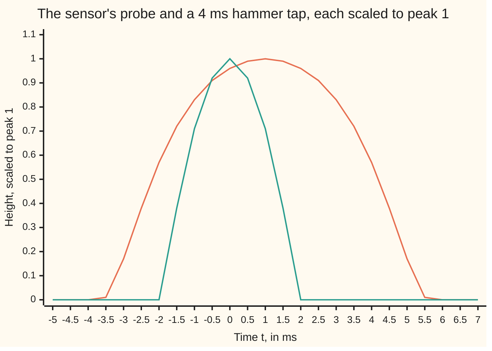
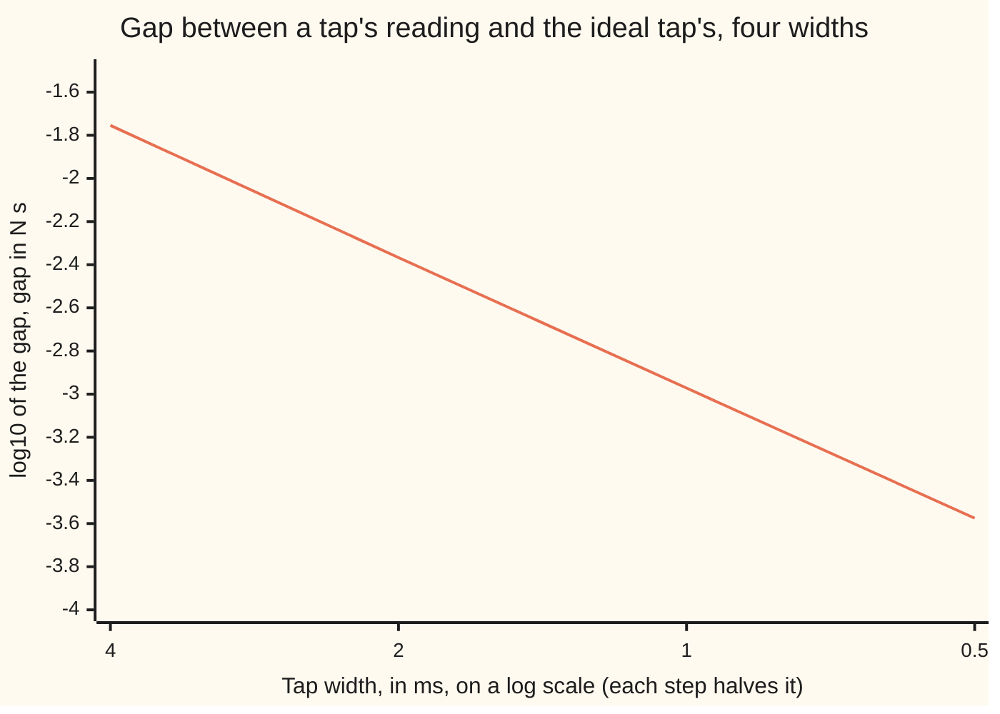

# Distributions: objects defined only by what they read on smooth probes

[Syllabus](../../../SYLLABUS.md) → [Functional analysis](../README.md) → [Distributions and Sobolev Spaces](../README.md#s04) → Distributions

---

## General Overview

A hammer taps a steel plate at time 0. The tap passes an impulse of 0.5 N·s into the plate (an illustrative number): force times contact time. The force itself depends on the hammer tip. A 1 ms tap peaks at 785.40 N. A 0.5 ms tap with the same impulse peaks at 1570.80 N. An ideal tap, over in no time at all, has no force value at time 0 that any number could give.

A force sensor never reports the force at an instant. Its electronics average the force over a short window, with a smooth weight that rises from zero and falls back to zero. Here the window runs from −4 ms to 6 ms and the weight is largest at 1 ms. That weight is a **probe**.

The sensor's output is one number: the force times the probe, added up over time. That number is the **reading**. For taps 4 ms down to 0.5 ms wide, the readings run from 0.461967 to 0.479328 N·s, and as the tap narrows they settle on 0.479595 N·s.

So keep the readings and drop the point values. An object that is known only by its readings on every smooth probe is a **distribution**, the term used from here on. Every ordinary force curve gives one. The ideal tap gives one too, although it is no function. A derivative also passes to the probe: the slope of a distribution is read by reading the probe's slope, with a minus sign. That rule differentiates the momentum of the plate, which jumps at the tap, and returns the tap.

**A distribution is a rule that turns each smooth probe, zero outside a bounded interval, into a number, linearly and continuously; any function you can integrate on bounded intervals gives one by integrating against the probe, and every distribution has a derivative, defined by moving the derivative onto the probe with a minus sign.**

**What kind of fact this is:** a definition (test function, distribution, derivative of a distribution), with three theorems about it proved on this card in Why it works: a function gives a distribution, the new derivative agrees with the old one, and the ideal tap is a distribution that no function gives. One further theorem, that readings fix a function, is stated here and proved on Convolution and mollifiers.

### The picture: the probe and a 4 ms tap



Orange: the probe, zero outside −4 ms to 6 ms, largest at 1 ms. Teal: a 4 ms tap's force divided by its peak of 196.35 N. The reading is the area under force times probe. As the tap narrows, the probe is nearly flat across it, at its value 0.959189 at time 0.

---

## The formula

Notation first, in words.

- A **test function**, or probe, is a function $`\varphi`$ ("phi") with a derivative of every order, each one continuous, that is zero outside some bounded interval. All test functions together form the space $`C_c^\infty`$, written $`\mathcal D`$ in the sources: "c" for compact support (zero outside a bounded interval), "∞" for every derivative.
- A function $`f`$ is **locally integrable** when $`\int_K \lvert f\rvert\,dt`$ is finite on every bounded interval $`K`$ ([Integrable functions](../../10-Measure%20and%20integration/04-The%20Lebesgue%20Integral/04-integrable-functions-and-l1.md)).
- A **distribution** $`T`$ is a rule $`\varphi \mapsto T(\varphi)`$, read "T of phi", that is linear and continuous in the sense below. All distributions form $`\mathcal D'`$. The prime marks a dual space: the readings of $`\mathcal D`$. On the same card a prime on $`T`$ or $`\varphi`$ marks a derivative.

A locally integrable function gives a distribution, and every distribution has a derivative:

```math
T_f(\varphi) = \int_{-\infty}^{\infty} f(t)\,\varphi(t)\,dt, \qquad T'(\varphi) = -\,T(\varphi').
```

**Read it aloud:** the distribution made from f reads a probe by integrating f times the probe; the derivative of any distribution reads a probe by reading the probe's slope, with a minus sign.

**Continuity**, the condition that makes a linear rule a distribution: for every bounded interval $`K`$ there are a constant $`C`$ and a whole number $`m`$ with

```math
\lvert T(\varphi)\rvert \le C \sum_{j=0}^{m} \max_t \lvert \varphi^{(j)}(t)\rvert \quad \text{for every test function } \varphi \text{ that is zero outside } K .
```

**Read it aloud:** on each bounded window, a reading is at most a fixed multiple of the probe's size and the sizes of its first m derivatives.

The sensor's probe has centre $`c`$ and half-width $`a`$. With $`u = (t-c)/a`$, the scaled time:

```math
\varphi(t) = \exp\!\Big(1 - \frac{1}{1-u^2}\Big) \text{ for } \lvert u\rvert < 1, \qquad \varphi(t) = 0 \text{ otherwise}.
```

At $`t = 0`$, $`u = -0.2`$, so $`\varphi(0) = e^{1 - 25/24} = e^{-1/24} = 0.959189`$.

The tap of width $`w`$ is one arch of a cosine, with area $`J`$:

```math
f(t) = \frac{\pi J}{2w}\cos\frac{\pi t}{w} \text{ for } \lvert t\rvert < \frac{w}{2}, \qquad f(t) = 0 \text{ otherwise}.
```

Its peak is $`\pi J/(2w)`$: 785.40 N for $`w`$ = 1 ms. The momentum delivered so far is $`p(t) = \tfrac{J}{2}\big(1 + \sin(\pi t/w)\big)`$ during the tap, 0 before it and $`J`$ after it.

| Symbol | Plain meaning | In our example | Push it up and the answer… |
| --- | --- | --- | --- |
| $`t`$ | time | −4 ms to 6 ms inside the probe | — |
| $`f`$, $`g`$ | the tap's force, a locally integrable function; any candidate function in Step 5 | half-cosine, peak 785.40 N for 1 ms | — |
| $`w`$, $`J`$ | the tap's width; its impulse, the area under $`f`$ | 1 ms; 0.5 N·s | wider: the reading drops below 0.479595; larger J: the reading scales up |
| $`p`$ | momentum passed to the plate so far; its slope is $`f`$ | 0 before the tap, 0.5 N·s after | — |
| $`\varphi`$, $`\varphi'`$ | the probe; its slope | $`\varphi(0) = 0.959189`$ | — |
| $`c`$, $`a`$, $`u`$, $`s`$ | the probe's centre; its half-width; scaled time; $`1/(1-u^2)`$ in the fold | 1 ms; 5 ms; −0.2 at the tap | a centre further from 0 lowers the reading |
| $`\mathcal D = C_c^\infty`$ | all test functions | the probe, and every other smooth window | — |
| $`T`$, $`T_f`$ | a distribution; the one made from f | readings 0.478528 N·s (1 ms tap), 0.479595 N·s (ideal tap) | — |
| $`\mathcal D'`$ | all distributions | the tap's, the ideal tap's, the step's | — |
| $`T'`$ | the derivative of $`T`$ | step's derivative reads 0.479595 N·s | — |
| $`K`$, $`C`$, $`m`$, $`j`$ | a bounded window; a constant; how many probe derivatives a reading may use; which derivative | −4 ms to 6 ms; 0.5 N·s; 0 | a bigger m allows rougher distributions |
| $`h`$, $`n`$, $`k`$, $`\varepsilon`$ | grid step; grid points per half-width; a sample's number; a shrinking probe's half-width | 500, 50, 5 µs; 10, 100, 1000; 1, 0.1, 0.01 ms | — |

### When it holds

- **The function is locally integrable.** Then $`T_f`$ is finite on every probe. The function $`1/\lvert t\rvert`$ fails: its area near 0 is infinite, so any probe with $`\varphi(0) \neq 0`$ gets no reading.
- **Probes are zero outside a bounded interval.** Moving the derivative throws away the end terms of an integration by parts. A smooth ramp from 0 at −4 ms to 1 at 6 ms keeps an end term: read directly, the 1 ms tap gives 0.200000 N·s; moved, −0.300000 N·s.
- **Probes are smooth.** A distribution's derivative reads the probe's slope, its second derivative reads the probe's second slope, and so on. A box-shaped probe has no slope at its edges. It also reads a tap at its edge as half: 0.250000 N·s, against 0.500000 and 0.000000 just either side.
- **Only linear operations.** Adding distributions, multiplying one by a smooth function and differentiating all work. Multiplying two distributions does not in general: the square of the ideal tap has no reading ([The delta](02-the-dirac-delta-and-derivatives-of-jumps.md)).

---

## Why it works

### Step 0: a sensor sees averages, and averages are enough

No instrument reads a value at an instant; each reports an average against its own smooth weight. If two force curves give the same reading on every probe, no instrument can tell them apart. So define an object by its list of readings. That list is linear, and it also makes sense for objects with no values at points, such as the ideal tap.

### Step 1: the finite rehearsal, twelve samples

Record the momentum at 12 instants. The record is a list of 12 numbers. Any linear reading of such a list is a sum of each sample times a weight: a dot product with a list of 12 weights. Twelve readings, on the 12 lists that each hold a single 1, recover every sample.

In finite dimensions, nothing new appears. Every linear reading comes from a list of weights, so "known by its readings" and "known by its values" mean the same thing. The space of readings is again a space of 12-number lists (Dual spaces, planned, makes this exact).

The derivative also moves in the finite case. Take samples $`p_0, \dots, p_{11}`$ and weights $`\varphi_0, \dots, \varphi_{11}`$ that are 0 at both ends. Summation by parts, the discrete integration by parts, gives

```math
\sum_{k=0}^{10} (p_{k+1} - p_k)\,\varphi_k \;=\; -\sum_{k=1}^{11} p_k\,(\varphi_k - \varphi_{k-1}).
```

**Read it aloud:** read the differences of the samples, or read the samples against the differences of the weights with a minus sign; the two agree. The rule holds for any 12 samples, not only a momentum record. With samples 3, 1, 4, 1, 5, 9, 2, 6, 5, 3, 5, 8 and weights 0, 1, 3, 6, 8, 9, 8, 6, 3, 1, 0, 0, both sides are exactly 9.

### Step 2: a locally integrable function gives a distribution

The reading $`T_f(\varphi) = \int f\varphi\,dt`$ is linear, because integrals are. It is continuous with $`m = 0`$. For a probe that is zero outside $`K`$,

```math
\lvert T_f(\varphi)\rvert \le \int_K \lvert f\rvert\,\lvert\varphi\rvert\,dt \le \Big(\int_K \lvert f\rvert\,dt\Big)\max_t \lvert\varphi(t)\rvert .
```

So $`C = \int_K \lvert f\rvert\,dt`$ works. For the 1 ms tap that constant is the impulse, 0.5 N·s, and the probe's largest value is 1. The reading, 0.478528 N·s, sits below the bound 0.500000 N·s.

Different functions give different readings, unless they agree except on a set of length zero. That is the theorem that lets a function and its distribution share one name. The proof smooths $`f`$ by averaging it against narrow probes, the subject of [Convolution and mollifiers](03-convolution-and-mollifiers.md), which gives it in its Step 4; Hörmander's book is the source.

A distribution is zero on a probe that misses the place where it lives. Moved to centre 10 ms, the probe is zero wherever the 1 ms tap pushes, so the reading is exactly 0.000000 N·s. The smallest closed set outside which every such reading is zero is the distribution's **support**: from −0.5 ms to 0.5 ms for the 1 ms tap, and the single instant 0 for the ideal tap.

### Step 3: the derivative moves to the probe

Let $`f`$ have a continuous derivative. Integration by parts on the bounded interval outside which $`\varphi`$ is zero gives

```math
\int f'(t)\,\varphi(t)\,dt = \Big[f\varphi\Big]_{\text{ends}} - \int f(t)\,\varphi'(t)\,dt = -\int f(t)\,\varphi'(t)\,dt ,
```

because $`\varphi`$ is zero at both ends. So $`T_{f'}(\varphi) = -T_f(\varphi')`$ for every probe.

The right side never uses $`f'`$. It makes sense for any distribution, so it becomes the definition: $`T'(\varphi) = -T(\varphi')`$. It is linear. It is continuous, with $`m`$ one larger, since the reading now uses one more derivative of the probe. And by the line above, it agrees with the ordinary derivative whenever there is one.

The plate's momentum $`p`$ has the 1 ms tap's force as its slope. Read the force directly: 0.478527884 N·s. Read the momentum against the probe's slope, with a minus sign: 0.478527884 N·s. The two roads agree to nine decimals.

### Step 4: differentiate the jump

An ideal tap makes the momentum jump: 0 before time 0, $`J`$ after. That step has no ordinary derivative at 0. Its distributional derivative still has a reading:

```math
T_p'(\varphi) = -\int_0^{\infty} J\,\varphi'(t)\,dt = -J\big(\varphi(6\text{ ms}) - \varphi(0)\big) = J\,\varphi(0) = 0.479595 \text{ N·s}.
```

That is exactly the number the narrowing taps settle on. The derivative of the jump is the ideal tap. [The delta](02-the-dirac-delta-and-derivatives-of-jumps.md) names it and works out jumps in general; [Impulses](../../08-Differential%20equations%20and%20dynamics/08-Laplace%20Transforms%20for%20Initial-Value%20Problems/06-impulses-and-the-delta-function.md) met it as a limit of pulses.

The taps converge in the sense of distributions: for each fixed probe, their readings converge. This convergence is checked one probe at a time, and the sources call it weak-star convergence in $`\mathcal D'`$. Derivatives pass through such limits for free. If $`T_k(\varphi) \to T(\varphi)`$ for every probe, then $`T_k'(\varphi) = -T_k(\varphi') \to -T(\varphi') = T'(\varphi)`$, since $`\varphi'`$ is a probe too. For functions, [Swapping limits](../../06-Calculus%20and%20analysis/06-Series/08-swapping-limits-with-integrals-and-derivatives.md) needs the slopes to converge uniformly first.

### Step 5: what changes in infinite dimensions

On a grid with step $`h`$, the momentum is a list and its forward difference is an ordinary list too: a single spike of height $`J/h`$. Summation by parts shows the spike reads $`J\varphi(-h)`$, the probe one grid step before the tap. As $`n`$ grows, the gap to $`J\varphi(0)`$ falls about tenfold per tenfold step: 0.0266786, 0.0021380, 0.0002087 N·s.

The limit has no list behind it. No locally integrable $`g`$ gives $`\int g\varphi\,dt = \varphi(0)`$ for every probe. Take probes of half-width $`\varepsilon`$, centred at 0, each with value 1 there. Then

```math
\Big\lvert \int g\,\varphi_\varepsilon\,dt \Big\rvert \le \int_{-\varepsilon}^{\varepsilon} \lvert g\rvert\,dt \longrightarrow 0 ,
```

by absolute continuity of the integral ([Integrable functions](../../10-Measure%20and%20integration/04-The%20Lebesgue%20Integral/04-integrable-functions-and-l1.md)). The value at 0 stays 1. With the 1 ms tap's force as $`g`$, half-widths 1, 0.1 and 0.01 ms read 0.475039, 0.094052 and 0.009478 N·s, while each probe's value at 0 is 1.000.

So in infinite dimensions the readings outnumber the functions. Every grid in the code holds only the finite rehearsal, where they do not.

<details>
<summary>Detailed proof: the probe is a test function</summary>

Inside $`\lvert u\rvert < 1`$ the probe is $`e`$ raised to a smooth expression, so it has derivatives of every order there. Its $`j`$-th derivative is a polynomial in $`u`$ and $`1/(1-u^2)`$, times $`e^{-1/(1-u^2)}`$.

As $`u`$ approaches 1 or −1, $`s = 1/(1-u^2)`$ grows without bound. A power of $`s`$ times $`e^{-s}`$ tends to 0 for every power, since the exponential grows faster than any polynomial. So every derivative tends to 0 at the edges and matches the zero function outside. The probe has every derivative, each continuous, and is zero outside $`c-a`$ to $`c+a`$.

The slope used in the code comes from the chain rule:

$`\displaystyle \varphi'(t) = \varphi(t)\cdot\frac{-2u}{a\,(1-u^2)^2}.`$

</details>

---

## Worked numbers, by hand

The ideal tap at time 0, read through the sensor's probe with centre 1 ms and half-width 5 ms.

| Step | Arithmetic | Value |
| --- | --- | --- |
| scaled time at the tap | $`u = (0 - 1)/5`$ | −0.2 |
| probe at the tap | $`e^{1 - 1/(1 - 0.04)} = e^{-1/24}`$ | 0.959189 |
| the tap's reading | $`J\varphi(0) = 0.5 \times 0.959189`$ | 0.479595 N·s |
| 1 ms tap, read directly | the integral of force times probe | 0.478528 N·s |
| its momentum, derivative moved onto the probe | minus the integral of momentum times probe slope | 0.478528 N·s |
| the step's derivative | $`-J(\varphi(6\text{ ms}) - \varphi(0)) = 0.5 \times 0.959189`$ | **0.479595 N·s** |

The sensor reports 0.479595 N·s for the ideal tap, and the derivative of the momentum jump reads the same number: the tap is the jump's derivative.

### How the readings settle

| Tap width | Peak force | Reading | Gap to 0.479595 |
| --- | --- | --- | --- |
| 4 ms | 196.35 N | 0.461967 N·s | 0.0176281 N·s |
| 2 ms | 392.70 N | 0.475299 N·s | 0.0042954 N·s |
| 1 ms | 785.40 N | 0.478528 N·s | 0.0010668 N·s |
| 0.5 ms | 1570.80 N | 0.479328 N·s | 0.0002663 N·s |

The peak force doubles at each halving and has no limit. The gap is divided by 4.104, 4.026 and 4.007: it falls as the width squared, since the probe is smooth and the tap is symmetric about 0.



One line: the gap at four tap widths, 4 ms down to 0.5 ms. Each halving of the width lowers it by about the same amount, so on these log scales it is a straight line.

### What breaks if you drop a piece

| Mistake | Comes out at | What went wrong |
| --- | --- | --- |
| Moving the derivative without the minus sign | −0.479595 N·s | Integration by parts carries the minus |
| A ramp probe, 1 at the window's end | moved −0.300000 against direct 0.200000; gap 0.500000 N·s | The end term $`J \times 1`$ was thrown away, but it is not zero |
| A box probe, 1 up to 6 ms | 0.500000, 0.250000, 0.000000 N·s for a 0.1 ms tap at 5.9, 6.0, 6.1 ms | A rough probe jumps, so readings jump; it has no slope to read |
| Reading the tap at the instant 0 | 1570.80 N at 0.5 ms, doubling at each halving | Point values have no limit; readings do |

The code prints all four.

---

## Code, from first principles, and it actually runs

The scripts build the probe, its slope, the tap and the momentum from their formulas, and integrate with Simpson's rule written out. In the code, `C` and `A` are the probe's centre $`c`$ and half-width $`a`$, not the continuity constant. The scripts reach the ideal tap's reading by three roads. First, the closed form $`J\varphi(0)`$ against four ever-narrower taps, whose gaps must fall by about 4 per halving. Second, the derivative moved onto the probe, against the direct reading of the force, for the 1 ms tap and for the ideal jump. Third, a grid: exact integer summation by parts on 12 samples, and grid readings that must equal $`J\varphi(-h)`$ at n = 10, 100 and 1000.

What the truncation hides: every grid object is an ordinary list, and the grid derivative of the jump is a finite spike. The point-reading with no function behind it exists only in the limit, which is why Step 5 needs a proof and not a run.

### Python

```python
# Distributions -- the check behind the card.  Standard library: math only.
# A hammer tap of impulse J = 0.5 N s (illustrative) is read through a smooth
# probe: a bump centred at c = 1 ms, half-width a = 5 ms, height 1 at its centre.
# Roads: the reading by quadrature against the limit J*phi(0); the derivative
# moved onto the probe against the direct reading; exact integer sums on a grid.
import math
J, C, A = 0.5, 0.001, 0.005                    # N s, s, s

def phi(t, c=C, a=A):                          # the probe: smooth, zero off (c-a, c+a)
    u = (t - c) / a
    return math.exp(1 - 1 / (1 - u * u)) if abs(u) < 1 else 0.0

def dphi(t, c=C, a=A):                         # its slope, by the chain rule
    u = (t - c) / a
    return phi(t, c, a) * (-2 * u / (a * (1 - u * u) ** 2)) if abs(u) < 1 else 0.0

def tap(t, w):                                 # half-cosine force, width w, area J
    return J * math.pi / (2 * w) * math.cos(math.pi * t / w) if abs(t) < w / 2 else 0.0

def mom(t, w):                                 # momentum delivered so far: its slope is tap
    if t <= -w / 2: return 0.0
    if t >= w / 2: return J
    return J * (1 + math.sin(math.pi * t / w)) / 2

def simpson(g, lo, hi, n=2000):                # Simpson's rule, n even, written out
    h, s = (hi - lo) / n, g(lo) + g(hi)
    for k in range(1, n):
        s += (4 if k % 2 else 2) * g(lo + k * h)
    return s * h / 3

limit = J * phi(0.0)
print(f"probe: centre 1 ms, half-width 5 ms, u at the tap = {(0.0 - C) / A:.1f}, phi(0) = {phi(0.0):.6f}")
print(f"ideal tap reads J*phi(0) = {limit:.6f} N s")
gaps = []
for name, w in (("4 ms", 0.004), ("2 ms", 0.002), ("1 ms", 0.001), ("0.5 ms", 0.0005)):
    r = simpson(lambda t: tap(t, w) * phi(t), -w / 2, w / 2)
    gaps.append(limit - r)
    print(f"width {name:>6}: peak force {tap(0.0, w):7.2f} N, reading {r:.6f} N s, "
          f"gap {limit - r:.7f}, log10 gap {math.log10(limit - r):.3f}")
ratios = [gaps[i] / gaps[i + 1] for i in range(3)]
print("gap ratio per halving of the width: " + ", ".join(f"{q:.3f}" for q in ratios))

w = 0.001                                      # the 1 ms tap, read two ways
direct = simpson(lambda t: tap(t, w) * phi(t), -w / 2, w / 2)
moved = -(simpson(lambda t: mom(t, w) * dphi(t), -w / 2, w / 2)
          + simpson(lambda t: J * dphi(t), w / 2, C + A))
step = -simpson(lambda t: J * dphi(t), 0.0, C + A)
print(f"1 ms tap read directly, integral of f*phi: {direct:.9f} N s")
print(f"its momentum p, derivative moved onto the probe, -integral of p*phi': {moved:.9f} N s")
print(f"ideal step of height J, -integral of J*phi' from 0: {step:.9f} N s")
print(f"bound: reading {direct:.6f} <= (integral of |f|) x (largest phi) = {J:.6f}")
far = simpson(lambda t: tap(t, w) * phi(t, 0.010), -w / 2, w / 2)
print(f"probe moved to centre 10 ms, clear of the tap: reading {far:.6f} N s")

grid = []
for n in (10, 100, 1000):                      # grid rehearsal: step h = a/n
    h, fwd, back = A / n, 0.0, 0.0
    for k in range(-n - 2, 2 * n + 2):         # covers the probe's support
        p0, p1 = (J if k >= 0 else 0.0), (J if k + 1 >= 0 else 0.0)
        fwd += (p1 - p0) * phi(k * h)
        back -= p0 * (phi(k * h) - phi((k - 1) * h))
    grid.append((h, fwd, back))
    print(f"grid n = {n:4d}, h = {5000 // n:3d} us: difference reading {fwd:.9f}, "
          f"moved onto probe {back:.9f}, gap {limit - fwd:.7f}")
pv = [3, 1, 4, 1, 5, 9, 2, 6, 5, 3, 5, 8]      # any 12 samples
qv = [0, 1, 3, 6, 8, 9, 8, 6, 3, 1, 0, 0]      # an integer probe, zero at both ends
left = sum((pv[k + 1] - pv[k]) * qv[k] for k in range(11))
right = -sum(pv[k] * (qv[k] - qv[k - 1]) for k in range(1, 12))
print(f"12 integer samples: sum of differences x probe = {left}; "
      f"minus sum of samples x probe differences = {right}")

for name, eps in (("1 ms", 0.001), ("0.1 ms", 0.0001), ("0.01 ms", 0.00001)):
    lo, hi = max(-eps, -w / 2), min(eps, w / 2)     # shrink the probe, keep phi(0) = 1
    r = simpson(lambda t: tap(t, w) * phi(t, 0.0, eps), lo, hi)
    print(f"probe half-width {name:>7}: value at 0 is {phi(0.0, 0.0, eps):.3f}, 1 ms tap reads {r:.6f} N s")

print(f"mistake 1, minus sign dropped: {-step:.6f} N s, not {limit:.6f}")
ramp = lambda t: (t - C + A) / (2 * A)         # smooth, but 1 at the window's end
rd = simpson(lambda t: tap(t, w) * ramp(t), -w / 2, w / 2)
rm = -(simpson(lambda t: mom(t, w) / (2 * A), -w / 2, w / 2) + J * (C + A - w / 2) / (2 * A))
print(f"mistake 2, ramp probe, 1 at the window's end: direct {rd:.6f}, moved {rm:.6f}, gap {rd - rm:.6f} N s")
edge = C + A                                   # a box probe: 1 up to 6 ms, then 0
box = [mom(edge - t0, 0.0001) for t0 in (edge - 0.0001, edge, edge + 0.0001)]
print("mistake 3, box probe, 0.1 ms tap at 5.9, 6.0, 6.1 ms: " + ", ".join(f"{b:.6f}" for b in box))
print(f"mistake 4, force at t = 0 of the 0.5 ms tap: {tap(0.0, 0.0005):.2f} N, doubling as the width halves")
ts = [k * 0.5 for k in range(-10, 15)]
print("figure, t ms: " + " ".join(f"{t:g}" for t in ts))
print("figure, probe: " + " ".join(f"{phi(t / 1000):.2f}" for t in ts))
print("figure, 4 ms tap / peak: " + " ".join(f"{tap(t / 1000, 0.004) / tap(0.0, 0.004):.2f}" for t in ts))

assert all(3.9 < q < 4.2 for q in ratios)                  # gap falls as width squared
assert abs(direct - moved) < 1e-9 and abs(step - limit) < 1e-9   # moved derivative = reading
assert all(abs(f - J * phi(-h)) < 1e-12 and abs(f - b) < 1e-12 for h, f, b in grid)
assert left == right                                       # summation by parts, exact
assert abs(rd - rm - J * ramp(C + A)) < 1e-9               # the boundary term J*psi(end)
assert far == 0.0 and box == [0.5, 0.25, 0.0]
print("ALL CHECKS PASS")
```

**Ran 2026-11-15 on macOS, Python 3.14.10, standard library only. All checks passed. Output, pasted from the run:**

```
probe: centre 1 ms, half-width 5 ms, u at the tap = -0.2, phi(0) = 0.959189
ideal tap reads J*phi(0) = 0.479595 N s
width   4 ms: peak force  196.35 N, reading 0.461967 N s, gap 0.0176281, log10 gap -1.754
width   2 ms: peak force  392.70 N, reading 0.475299 N s, gap 0.0042954, log10 gap -2.367
width   1 ms: peak force  785.40 N, reading 0.478528 N s, gap 0.0010668, log10 gap -2.972
width 0.5 ms: peak force 1570.80 N, reading 0.479328 N s, gap 0.0002663, log10 gap -3.575
gap ratio per halving of the width: 4.104, 4.026, 4.007
1 ms tap read directly, integral of f*phi: 0.478527884 N s
its momentum p, derivative moved onto the probe, -integral of p*phi': 0.478527884 N s
ideal step of height J, -integral of J*phi' from 0: 0.479594729 N s
bound: reading 0.478528 <= (integral of |f|) x (largest phi) = 0.500000
probe moved to centre 10 ms, clear of the tap: reading 0.000000 N s
grid n =   10, h = 500 us: difference reading 0.452916146, moved onto probe 0.452916146, gap 0.0266786
grid n =  100, h =  50 us: difference reading 0.477456743, moved onto probe 0.477456743, gap 0.0021380
grid n = 1000, h =   5 us: difference reading 0.479386009, moved onto probe 0.479386009, gap 0.0002087
12 integer samples: sum of differences x probe = 9; minus sum of samples x probe differences = 9
probe half-width    1 ms: value at 0 is 1.000, 1 ms tap reads 0.475039 N s
probe half-width  0.1 ms: value at 0 is 1.000, 1 ms tap reads 0.094052 N s
probe half-width 0.01 ms: value at 0 is 1.000, 1 ms tap reads 0.009478 N s
mistake 1, minus sign dropped: -0.479595 N s, not 0.479595
mistake 2, ramp probe, 1 at the window's end: direct 0.200000, moved -0.300000, gap 0.500000 N s
mistake 3, box probe, 0.1 ms tap at 5.9, 6.0, 6.1 ms: 0.500000, 0.250000, 0.000000
mistake 4, force at t = 0 of the 0.5 ms tap: 1570.80 N, doubling as the width halves
figure, t ms: -5 -4.5 -4 -3.5 -3 -2.5 -2 -1.5 -1 -0.5 0 0.5 1 1.5 2 2.5 3 3.5 4 4.5 5 5.5 6 6.5 7
figure, probe: 0.00 0.00 0.00 0.01 0.17 0.38 0.57 0.72 0.83 0.91 0.96 0.99 1.00 0.99 0.96 0.91 0.83 0.72 0.57 0.38 0.17 0.01 0.00 0.00 0.00
figure, 4 ms tap / peak: 0.00 0.00 0.00 0.00 0.00 0.00 0.00 0.38 0.71 0.92 1.00 0.92 0.71 0.38 0.00 0.00 0.00 0.00 0.00 0.00 0.00 0.00 0.00 0.00 0.00
ALL CHECKS PASS
```

### Rust

Same numbers, same labels, built with `rustc --edition 2021 -O`.

```rust
// Distributions -- the same check as the Python, in Rust.  No crates.
// A hammer tap of impulse J = 0.5 N s (illustrative) is read through a smooth
// probe: a bump centred at c = 1 ms, half-width a = 5 ms, height 1 at its centre.
// Roads: the reading by quadrature against the limit J*phi(0); the derivative
// moved onto the probe against the direct reading; exact integer sums on a grid.
use std::f64::consts::PI;
const J: f64 = 0.5;
const C: f64 = 0.001;
const A: f64 = 0.005;

fn bump(t: f64, c: f64, a: f64) -> f64 {        // the probe: smooth, zero off (c-a, c+a)
    let u = (t - c) / a;
    if u.abs() < 1.0 { (1.0 - 1.0 / (1.0 - u * u)).exp() } else { 0.0 }
}
fn phi(t: f64) -> f64 { bump(t, C, A) }
fn dphi(t: f64) -> f64 {                        // its slope, by the chain rule
    let u = (t - C) / A;
    if u.abs() < 1.0 { phi(t) * (-2.0 * u / (A * (1.0 - u * u).powi(2))) } else { 0.0 }
}
fn tap(t: f64, w: f64) -> f64 {                 // half-cosine force, width w, area J
    if t.abs() < w / 2.0 { J * PI / (2.0 * w) * (PI * t / w).cos() } else { 0.0 }
}
fn mom(t: f64, w: f64) -> f64 {                 // momentum delivered so far: its slope is tap
    if t <= -w / 2.0 { return 0.0 }
    if t >= w / 2.0 { return J }
    J * (1.0 + (PI * t / w).sin()) / 2.0
}
fn simpson(g: &dyn Fn(f64) -> f64, lo: f64, hi: f64) -> f64 {   // Simpson's rule, n = 2000
    let n = 2000;
    let h = (hi - lo) / n as f64;
    let mut s = g(lo) + g(hi);
    for k in 1..n { s += (if k % 2 == 1 { 4.0 } else { 2.0 }) * g(lo + k as f64 * h) }
    s * h / 3.0
}
fn join(v: &[String], sep: &str) -> String { v.join(sep) }

fn main() {
    let limit = J * phi(0.0);
    println!("probe: centre 1 ms, half-width 5 ms, u at the tap = {:.1}, phi(0) = {:.6}", (0.0 - C) / A, phi(0.0));
    println!("ideal tap reads J*phi(0) = {:.6} N s", limit);
    let mut gaps = vec![];
    for (name, w) in [("4 ms", 0.004f64), ("2 ms", 0.002), ("1 ms", 0.001), ("0.5 ms", 0.0005)] {
        let r = simpson(&|t| tap(t, w) * phi(t), -w / 2.0, w / 2.0);
        gaps.push(limit - r);
        println!("width {:>6}: peak force {:7.2} N, reading {:.6} N s, gap {:.7}, log10 gap {:.3}",
                 name, tap(0.0, w), r, limit - r, (limit - r).log10());
    }
    let ratios: Vec<f64> = (0..3).map(|i| gaps[i] / gaps[i + 1]).collect();
    println!("gap ratio per halving of the width: {}",
             join(&ratios.iter().map(|q| format!("{:.3}", q)).collect::<Vec<_>>(), ", "));

    let w = 0.001;                               // the 1 ms tap, read two ways
    let direct = simpson(&|t| tap(t, w) * phi(t), -w / 2.0, w / 2.0);
    let moved = -(simpson(&|t| mom(t, w) * dphi(t), -w / 2.0, w / 2.0)
                  + simpson(&|t| J * dphi(t), w / 2.0, C + A));
    let step = -simpson(&|t| J * dphi(t), 0.0, C + A);
    println!("1 ms tap read directly, integral of f*phi: {:.9} N s", direct);
    println!("its momentum p, derivative moved onto the probe, -integral of p*phi': {:.9} N s", moved);
    println!("ideal step of height J, -integral of J*phi' from 0: {:.9} N s", step);
    println!("bound: reading {:.6} <= (integral of |f|) x (largest phi) = {:.6}", direct, J);
    let far = simpson(&|t| tap(t, w) * bump(t, 0.010, A), -w / 2.0, w / 2.0);
    println!("probe moved to centre 10 ms, clear of the tap: reading {:.6} N s", far);

    let mut grid = vec![];
    for n in [10i64, 100, 1000] {                // grid rehearsal: step h = a/n
        let h = A / n as f64;
        let (mut fwd, mut back) = (0.0, 0.0);
        for k in (-n - 2)..(2 * n + 2) {         // covers the probe's support
            let p0 = if k >= 0 { J } else { 0.0 };
            let p1 = if k + 1 >= 0 { J } else { 0.0 };
            fwd += (p1 - p0) * phi(k as f64 * h);
            back -= p0 * (phi(k as f64 * h) - phi((k - 1) as f64 * h));
        }
        grid.push((h, fwd, back));
        println!("grid n = {:4}, h = {:3} us: difference reading {:.9}, moved onto probe {:.9}, gap {:.7}",
                 n, 5000 / n, fwd, back, limit - fwd);
    }
    let pv = [3i64, 1, 4, 1, 5, 9, 2, 6, 5, 3, 5, 8];   // any 12 samples
    let qv = [0i64, 1, 3, 6, 8, 9, 8, 6, 3, 1, 0, 0];   // an integer probe, zero at both ends
    let left: i64 = (0..11).map(|k| (pv[k + 1] - pv[k]) * qv[k]).sum();
    let right: i64 = -(1..12).map(|k| pv[k] * (qv[k] - qv[k - 1])).sum::<i64>();
    println!("12 integer samples: sum of differences x probe = {}; minus sum of samples x probe differences = {}",
             left, right);

    for (name, eps) in [("1 ms", 0.001f64), ("0.1 ms", 0.0001), ("0.01 ms", 0.00001)] {
        let (lo, hi) = ((-eps).max(-w / 2.0), eps.min(w / 2.0));   // shrink the probe, keep phi(0) = 1
        let r = simpson(&|t| tap(t, w) * bump(t, 0.0, eps), lo, hi);
        println!("probe half-width {:>7}: value at 0 is {:.3}, 1 ms tap reads {:.6} N s", name, bump(0.0, 0.0, eps), r);
    }

    println!("mistake 1, minus sign dropped: {:.6} N s, not {:.6}", -step, limit);
    let ramp = |t: f64| (t - C + A) / (2.0 * A);  // smooth, but 1 at the window's end
    let rd = simpson(&|t| tap(t, w) * ramp(t), -w / 2.0, w / 2.0);
    let rm = -(simpson(&|t| mom(t, w) / (2.0 * A), -w / 2.0, w / 2.0) + J * (C + A - w / 2.0) / (2.0 * A));
    println!("mistake 2, ramp probe, 1 at the window's end: direct {:.6}, moved {:.6}, gap {:.6} N s", rd, rm, rd - rm);
    let edge = C + A;                            // a box probe: 1 up to 6 ms, then 0
    let bx: Vec<f64> = [edge - 0.0001, edge, edge + 0.0001].iter().map(|&t0| mom(edge - t0, 0.0001)).collect();
    println!("mistake 3, box probe, 0.1 ms tap at 5.9, 6.0, 6.1 ms: {}",
             join(&bx.iter().map(|b| format!("{:.6}", b)).collect::<Vec<_>>(), ", "));
    println!("mistake 4, force at t = 0 of the 0.5 ms tap: {:.2} N, doubling as the width halves", tap(0.0, 0.0005));
    let ts: Vec<f64> = (-10..15).map(|k| k as f64 * 0.5).collect();
    println!("figure, t ms: {}", join(&ts.iter().map(|t| format!("{}", t)).collect::<Vec<_>>(), " "));
    println!("figure, probe: {}", join(&ts.iter().map(|t| format!("{:.2}", phi(t / 1000.0))).collect::<Vec<_>>(), " "));
    println!("figure, 4 ms tap / peak: {}", join(&ts.iter()
             .map(|t| format!("{:.2}", tap(t / 1000.0, 0.004) / tap(0.0, 0.004))).collect::<Vec<_>>(), " "));

    assert!(ratios.iter().all(|&q| 3.9 < q && q < 4.2));             // gap falls as width squared
    assert!((direct - moved).abs() < 1e-9 && (step - limit).abs() < 1e-9);   // moved derivative = reading
    assert!(grid.iter().all(|&(h, f, b)| (f - J * phi(-h)).abs() < 1e-12 && (f - b).abs() < 1e-12));
    assert!(left == right);                                          // summation by parts, exact
    assert!((rd - rm - J * ramp(C + A)).abs() < 1e-9);               // the boundary term J*psi(end)
    assert!(far == 0.0 && bx == vec![0.5, 0.25, 0.0]);
    println!("ALL CHECKS PASS");
}
```

**Ran 2026-11-15 on macOS, rustc 1.98.1, no crates. All checks passed. Output, pasted from the run:**

```
probe: centre 1 ms, half-width 5 ms, u at the tap = -0.2, phi(0) = 0.959189
ideal tap reads J*phi(0) = 0.479595 N s
width   4 ms: peak force  196.35 N, reading 0.461967 N s, gap 0.0176281, log10 gap -1.754
width   2 ms: peak force  392.70 N, reading 0.475299 N s, gap 0.0042954, log10 gap -2.367
width   1 ms: peak force  785.40 N, reading 0.478528 N s, gap 0.0010668, log10 gap -2.972
width 0.5 ms: peak force 1570.80 N, reading 0.479328 N s, gap 0.0002663, log10 gap -3.575
gap ratio per halving of the width: 4.104, 4.026, 4.007
1 ms tap read directly, integral of f*phi: 0.478527884 N s
its momentum p, derivative moved onto the probe, -integral of p*phi': 0.478527884 N s
ideal step of height J, -integral of J*phi' from 0: 0.479594729 N s
bound: reading 0.478528 <= (integral of |f|) x (largest phi) = 0.500000
probe moved to centre 10 ms, clear of the tap: reading 0.000000 N s
grid n =   10, h = 500 us: difference reading 0.452916146, moved onto probe 0.452916146, gap 0.0266786
grid n =  100, h =  50 us: difference reading 0.477456743, moved onto probe 0.477456743, gap 0.0021380
grid n = 1000, h =   5 us: difference reading 0.479386009, moved onto probe 0.479386009, gap 0.0002087
12 integer samples: sum of differences x probe = 9; minus sum of samples x probe differences = 9
probe half-width    1 ms: value at 0 is 1.000, 1 ms tap reads 0.475039 N s
probe half-width  0.1 ms: value at 0 is 1.000, 1 ms tap reads 0.094052 N s
probe half-width 0.01 ms: value at 0 is 1.000, 1 ms tap reads 0.009478 N s
mistake 1, minus sign dropped: -0.479595 N s, not 0.479595
mistake 2, ramp probe, 1 at the window's end: direct 0.200000, moved -0.300000, gap 0.500000 N s
mistake 3, box probe, 0.1 ms tap at 5.9, 6.0, 6.1 ms: 0.500000, 0.250000, 0.000000
mistake 4, force at t = 0 of the 0.5 ms tap: 1570.80 N, doubling as the width halves
figure, t ms: -5 -4.5 -4 -3.5 -3 -2.5 -2 -1.5 -1 -0.5 0 0.5 1 1.5 2 2.5 3 3.5 4 4.5 5 5.5 6 6.5 7
figure, probe: 0.00 0.00 0.00 0.01 0.17 0.38 0.57 0.72 0.83 0.91 0.96 0.99 1.00 0.99 0.96 0.91 0.83 0.72 0.57 0.38 0.17 0.01 0.00 0.00 0.00
figure, 4 ms tap / peak: 0.00 0.00 0.00 0.00 0.00 0.00 0.00 0.38 0.71 0.92 1.00 0.92 0.71 0.38 0.00 0.00 0.00 0.00 0.00 0.00 0.00 0.00 0.00 0.00 0.00
ALL CHECKS PASS
```

The two outputs match line for line.

### Lean

Lean proves the card's three theorems for functions on the whole line, and checks the twelve-sample sums of Step 1.

- Take a locally integrable $`f`$. Then $`T_f`$ is a distribution: linear and continuous on test functions.
- Take also a probe that is zero outside a bounded interval $`K`$. Then $`\lvert T_f(\varphi)\rvert \le \big(\int_K \lvert f\rvert\,dt\big)\max_t \lvert\varphi(t)\rvert`$.
- Suppose $`f`$ has a continuous derivative $`f'`$. Then $`T_f' = T_{f'}`$: the new derivative agrees with the old one.
- Take any locally integrable $`g`$. Then some probe has $`\int g\varphi\,dt \neq \varphi(0)`$, so no function gives the ideal tap.
- Take the twelve samples and twelve weights of Step 1. Then both sides of summation by parts are exactly 9.

The tap readings, their gaps, the grid spikes and the four mistakes are left to the Python and Rust checks.

```lean
-- Distributions: a locally integrable function on the line gives a distribution by integrating against test functions, its distributional derivative agrees with the ordinary one, and the delta at 0 comes from no locally integrable function.
import Mathlib.Analysis.Distribution.Distribution
import Mathlib.MeasureTheory.Integral.IntegralEqImproper

open MeasureTheory TopologicalSpace Set LineDeriv
open scoped Distributions

/-- A function you can integrate on bounded intervals gives a distribution on the whole line:
the rule that reads a smooth probe `φ`, zero outside a bounded interval, as `∫ f(t) φ(t) dt`
is a continuous linear map on test functions. Its continuity is the card's bound with `m = 0`:
for a probe that is zero outside `[a, b]` and at most `M` in size, the reading is at most
`(∫ over [a, b] of |f|) · M`. -/
theorem locally_integrable_function_gives_distribution (f : ℝ → ℝ) (hf : LocallyIntegrable f) :
    ∃ T : 𝓓'((⊤ : Opens ℝ), ℝ),
      (∀ φ : 𝓓((⊤ : Opens ℝ), ℝ), T φ = ∫ t, f t * φ t) ∧
      ∀ (a b M : ℝ) (φ : 𝓓((⊤ : Opens ℝ), ℝ)),
        (∀ t ∉ Icc a b, φ t = 0) → (∀ t, |φ t| ≤ M) →
          |T φ| ≤ (∫ t in Icc a b, |f t|) * M := by
  have hf' : LocallyIntegrableOn f ((⊤ : Opens ℝ) : Set ℝ) volume := hf.locallyIntegrableOn _
  refine ⟨Distribution.ofFun (⊤ : Opens ℝ) f volume ⊤, ?_, ?_⟩
  · intro φ
    rw [Distribution.ofFun_apply hf']
    congr 1
    ext t
    rw [smul_eq_mul, mul_comm]
  · intro a b M φ hφ hM
    rw [Distribution.ofFun_apply hf']
    have hint : Integrable (fun t => φ t • f t) := φ.integrable_smul hf'
    have hfI : IntegrableOn f (Icc a b) := hf.integrableOn_isCompact isCompact_Icc
    calc |∫ t, φ t • f t| ≤ ∫ t, |φ t • f t| := abs_integral_le_integral_abs
      _ = ∫ t in Icc a b, |φ t • f t| := by
          rw [setIntegral_eq_integral_of_forall_compl_eq_zero]
          intro t ht
          simp [hφ t ht]
      _ ≤ ∫ t in Icc a b, |f t| * M := by
          apply setIntegral_mono_on hint.abs.integrableOn
            ((Integrable.abs hfI).mul_const M) measurableSet_Icc
          intro t _
          rw [smul_eq_mul, abs_mul, mul_comm]
          exact mul_le_mul_of_nonneg_left (hM t) (abs_nonneg _)
      _ = (∫ t in Icc a b, |f t|) * M := integral_mul_const _ _

/-- The new derivative agrees with the old one: if `f` has a continuous derivative `f'`, then the
derivative of the distribution made from `f` (which reads a probe `φ` as `-T_f(φ')`) is the
distribution made from `f'`. -/
theorem distributional_derivative_agrees_with_classical (f : ℝ → ℝ) (hf : ContDiff ℝ 1 f) :
    ∂_{(1 : ℝ)} (Distribution.ofFun (⊤ : Opens ℝ) f volume ⊤) =
      Distribution.ofFun (⊤ : Opens ℝ) (deriv f) volume ⊤ := by
  have hc : Continuous (deriv f) := hf.continuous_deriv le_rfl
  have hfl : LocallyIntegrableOn f ((⊤ : Opens ℝ) : Set ℝ) volume :=
    hf.continuous.locallyIntegrable.locallyIntegrableOn _
  have hfl' : LocallyIntegrableOn (deriv f) ((⊤ : Opens ℝ) : Set ℝ) volume :=
    hc.locallyIntegrable.locallyIntegrableOn _
  ext φ
  rw [Distribution.lineDerivOp_apply_apply, Distribution.ofFun_apply hfl,
    Distribution.ofFun_apply hfl']
  set ψ : 𝓓((⊤ : Opens ℝ), ℝ) := ∂_{(1 : ℝ)} φ with hψdef
  have hψ : ∀ x, HasDerivAt φ (ψ x) x := by
    intro x
    have hdiff : DifferentiableAt ℝ φ x :=
      (φ.contDiff.differentiable (by simp)).differentiableAt
    have : ψ x = lineDeriv ℝ φ x 1 := TestFunction.lineDerivCLM_apply_of_le (by simp)
    rw [this, hdiff.lineDeriv_eq_fderiv, fderiv_apply_one_eq_deriv]
    exact hdiff.hasDerivAt
  have hfd : ∀ x, HasDerivAt f (deriv f x) x := fun x =>
    ((hf.differentiable one_ne_zero) x).hasDerivAt
  have I1 : Integrable (f * ⇑ψ) := by
    convert ψ.integrable_smul hfl using 1
    ext x
    simp [mul_comm]
  have I2 : Integrable (deriv f * ⇑φ) := by
    convert φ.integrable_smul hfl' using 1
    ext x
    simp [mul_comm]
  have I3 : Integrable (f * ⇑φ) := by
    convert φ.integrable_smul hfl using 1
    ext x
    simp [mul_comm]
  have key := integral_mul_deriv_eq_deriv_mul_of_integrable (fun x _ => hfd x)
    (fun x _ => hψ x) I1 I2 I3
  have e1 : ∫ x, (-ψ) x • f x = -∫ x, f x * ψ x := by
    rw [← integral_neg]
    congr 1
    ext x
    simp [mul_comm]
  have e2 : ∫ x, φ x • deriv f x = ∫ x, deriv f x * φ x := by
    congr 1
    ext x
    simp [mul_comm]
  rw [e1, e2, key, neg_neg]

/-- The ideal tap is a distribution that no function gives: no locally integrable `g` reads
every probe `φ` as its value `φ(0)`, so the delta at 0 is not the distribution of any
locally integrable function. -/
theorem delta_not_given_by_any_function (g : ℝ → ℝ) (hg : LocallyIntegrable g) :
    Distribution.ofFun (⊤ : Opens ℝ) g volume ⊤ ≠ (Distribution.delta 0 : 𝓓'((⊤ : Opens ℝ), ℝ)) := by
  intro h
  have hgl : LocallyIntegrableOn g ((⊤ : Opens ℝ) : Set ℝ) volume := hg.locallyIntegrableOn _
  have key : ∀ φ : 𝓓((⊤ : Opens ℝ), ℝ), ∫ x, φ x • g x = φ 0 := by
    intro φ
    rw [← Distribution.ofFun_apply hgl, h, Distribution.delta_apply]
  have hae : ∀ᵐ x ∂(volume : Measure ℝ), x ∈ ({0}ᶜ : Set ℝ) → g x = 0 := by
    apply isOpen_compl_singleton.ae_eq_zero_of_integral_contDiff_smul_eq_zero
      (hg.locallyIntegrableOn _)
    intro ψ hψ hψc hψs
    let Φ : 𝓓((⊤ : Opens ℝ), ℝ) := ⟨ψ, hψ, hψc, by simp⟩
    have hΦ := key Φ
    change ∫ x, ψ x • g x = ψ 0 at hΦ
    rw [hΦ]
    exact image_eq_zero_of_notMem_tsupport (fun h0 => hψs h0 rfl)
  have h0 : ∀ᵐ x ∂(volume : Measure ℝ), x ≠ 0 := by
    rw [ae_iff]
    simp
  have hae' : g =ᵐ[(volume : Measure ℝ).restrict ((⊤ : Opens ℝ) : Set ℝ)] 0 := by
    rw [Opens.coe_top, Measure.restrict_univ]
    filter_upwards [hae, h0] with x hx hx0
    exact hx hx0
  have hz : Distribution.ofFun (⊤ : Opens ℝ) g volume ⊤ = 0 := by
    rw [Distribution.ofFun_congr_ae hae', Distribution.ofFun_zero]
  let b : ContDiffBump (0 : ℝ) := ⟨1, 2, one_pos, one_lt_two⟩
  let Φ : 𝓓((⊤ : Opens ℝ), ℝ) := ⟨b, b.contDiff, b.hasCompactSupport, by simp⟩
  have hb : b 0 = 1 := b.one_of_mem_closedBall (by simp [b])
  have hval := congrArg (fun T : 𝓓'((⊤ : Opens ℝ), ℝ) => T Φ) (hz.symm.trans h)
  simp only [zero_apply, Distribution.delta_apply] at hval
  change (0 : ℝ) = b 0 at hval
  rw [hb] at hval
  exact zero_ne_one hval

/-- The card's twelve samples and twelve weights (the finite rehearsal of Step 1). -/
def samples : List ℤ := [3, 1, 4, 1, 5, 9, 2, 6, 5, 3, 5, 8]
def weights : List ℤ := [0, 1, 3, 6, 8, 9, 8, 6, 3, 1, 0, 0]

/-- Summation by parts on the card's samples: read the differences of the samples against the
weights, and get exactly 9. -/
example : (∑ k ∈ Finset.range 11,
    (samples.getD (k + 1) 0 - samples.getD k 0) * weights.getD k 0) = 9 := by
  decide

/-- The other side: minus the samples read against the differences of the weights, also 9. -/
example : -(∑ k ∈ Finset.Icc 1 11,
    samples.getD k 0 * (weights.getD k 0 - weights.getD (k - 1) 0)) = 9 := by
  decide

#print axioms locally_integrable_function_gives_distribution
#print axioms distributional_derivative_agrees_with_classical
#print axioms delta_not_given_by_any_function
```

**Checked 2026-11-15 on macOS, Lean 4.36.0-rc2, Mathlib v4.36.0-rc2. Every proof is complete and uses only Lean's standard axioms. Output, pasted from the run:**

```
'locally_integrable_function_gives_distribution' depends on axioms: [propext, Classical.choice, Quot.sound]
'distributional_derivative_agrees_with_classical' depends on axioms: [propext, Classical.choice, Quot.sound]
'delta_not_given_by_any_function' depends on axioms: [propext, Classical.choice, Quot.sound]
```

> [!TIP]
> **Try changing**
> Guess first, then run it.
> - **Centre the probe on the tap.** Set `C = 0.0`. Guess: the probe now reads its own peak, 1, at the tap, so the readings climb towards J = 0.5 N·s. Every assert still holds.
> - **Drop the minus sign.** In the line that computes `moved`, delete the leading minus. The moved reading flips sign and the second assert stops the run.
> - **Let the integer probe end on 1.** Change the last weight in `qv` from 0 to 1. The end term of summation by parts no longer vanishes, the two sums disagree, and the fourth assert stops the run.
> - **Shift the grid's jump.** Change `k >= 0` to `k >= 1` in both places in the grid loop. The spike now reads the probe at time 0, not one step before, and the third assert stops the run.

---

## The usual mistake

> [!warning]
> **Asking a distribution for its value at a point.** A distribution has readings, not values. The ideal tap has no force at time 0; the tap of width 0.5 ms already shows 1570.80 N there, and the value doubles at every halving. Its reading on the probe, 0.479595 N·s, is the only number that survives.
>
> - **Dropping the minus sign.** The step's derivative then reads −0.479595 N·s: an impulse in the wrong direction.
> - **A probe that does not vanish at the ends.** The ramp leaves an end term: −0.300000 N·s moved, against 0.200000 N·s read directly.
> - **A rough probe.** A box probe reads a tap on its edge as 0.250000 N·s and a hair away as 0.500000 or 0.000000. Readings must vary smoothly as the tap moves.
> - **Calling a grid's spike the ideal tap.** On a 5 µs grid the jump's difference is an ordinary list, still 0.0002087 N·s short; the gap closes only in the limit.

---

## Where you meet it in real life

- **Impact-hammer testing.** Engineers find a structure's resonances by tapping it with an instrumented hammer. The tap is treated as an impulse, and every sensor in the chain reports a smoothed average: a reading on a probe.
- **Switching circuits.** A light switch makes the voltage jump. The current into a capacitor is its capacitance times the voltage's slope, so at the jump it is a spike of current that delivers a fixed charge: the derivative of a step, read by distributions.
- **Point charges and point masses.** The density of a point charge is a distribution, like the ideal tap. Solving for its field once, then adding up, is the method of [Fundamental solution](04-fundamental-solutions-and-the-response-to-a-spike.md).
- **Finite element software.** Structural and fluid solvers test each equation against many smooth probes instead of demanding it at every point. That is the weak form of [Weak solutions](08-weak-solutions-of-differential-equations.md).

> **Say it back**
> A test function is a smooth probe that is zero outside a bounded interval. A distribution is a rule that reads each probe as a number, linearly and continuously. A function you can integrate on bounded windows gives one by integrating against the probe. Every distribution has a derivative: read the probe's slope, with a minus sign, which agrees with the ordinary derivative when there is one. The hammer tap's readings settle on 0.479595 N·s, which is also the reading of the derivative of the momentum jump, and no function gives it.

---

## What this builds on

- [Function spaces C and Lp](../01-Normed%20and%20Banach%20Spaces/03-function-spaces-c-and-lp.md): the spaces of continuous and of integrable functions that test functions and locally integrable functions sit inside.
- [Dual spaces](../01-Normed%20and%20Banach%20Spaces/09-dual-spaces-and-lp-duality.md): a space of linear, continuous readings; $`\mathcal D'`$ is the dual of $`\mathcal D`$.
- [Swapping limits](../../06-Calculus%20and%20analysis/06-Series/08-swapping-limits-with-integrals-and-derivatives.md): when limits pass through integrals and derivatives, the condition distributions make automatic.
- [Integrable functions](../../10-Measure%20and%20integration/04-The%20Lebesgue%20Integral/04-integrable-functions-and-l1.md): the Lebesgue integral of a signed function, and the absolute continuity that Step 5 uses.
- [Impulses](../../08-Differential%20equations%20and%20dynamics/08-Laplace%20Transforms%20for%20Initial-Value%20Problems/06-impulses-and-the-delta-function.md): a hammer blow as the limit of narrow pulses of area 1.

## Where this goes next

- [The delta](02-the-dirac-delta-and-derivatives-of-jumps.md): the ideal tap as its own distribution, and the derivative of any jump.
- [Convolution and mollifiers](03-convolution-and-mollifiers.md): smoothing by averaging against a narrow probe, which proves that readings fix a function.
- [Tempered distributions](05-tempered-distributions-and-the-fourier-transform.md): probes that decay fast at infinity, so the Fourier transform can act.
- [Weak derivatives](07-weak-derivatives-and-sobolev-spaces.md): functions whose distributional derivative is again a function, and the spaces that keep score.
- [Weak solutions](08-weak-solutions-of-differential-equations.md): equations asked to hold only against probes.
- [Schwartz space and tempered distributions](../../20-Harmonic%20analysis/02-The%20Fourier%20Transform/06-schwartz-space-and-tempered-distributions.md): the space of fast-decaying probes treated in full.
- Also on this shelf: [Fundamental solution](04-fundamental-solutions-and-the-response-to-a-spike.md), [Sampling](06-sampling-the-dirac-comb-and-nyquist.md), [Sobolev and Poincare](09-sobolev-embedding-and-poincare-inequality.md), [Boundary values and compactness](10-trace-and-rellich-kondrachov-in-outline.md).

Every distribution has a derivative, but which distributions live at a single instant, and what is the derivative of a jump in general?

---

## Sources

Verified 2026-11-15: every link below resolves to the publisher's page.

- Schwartz, Laurent. "Généralisation de la notion de fonction, de dérivation, de transformation de Fourier et applications mathématiques et physiques." *Annales de l'université de Grenoble* 21 (1945), 57–74. [Numdam](http://www.numdam.org/item/AUG_1945__21__57_0/). The first paper on distributions: a derivative defined by moving it onto the test function.
- Hörmander, Lars. *The Analysis of Linear Partial Differential Operators I*. Springer, Classics in Mathematics, 2003. [doi:10.1007/978-3-642-61497-2](https://doi.org/10.1007/978-3-642-61497-2). Chapters 1 to 3: test functions, the continuity bound, support, and the theorem that readings fix a locally integrable function.
- Strichartz, Robert S. *A Guide to Distribution Theory and Fourier Transforms*. World Scientific, 2003. [doi:10.1142/5314](https://doi.org/10.1142/5314). An applied first course: distributions as readings, derivatives moved onto test functions, convergence one probe at a time.
