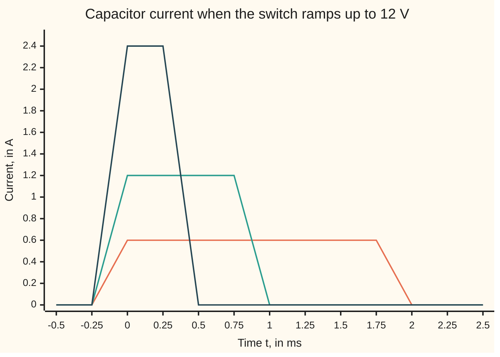

# The delta: a spike of unit mass, and the derivative of a switch

[Syllabus](../../../SYLLABUS.md) → [Functional analysis](../README.md) → [Distributions and Sobolev Spaces](../README.md#s04) → The delta

---

## General Overview

A switch connects a 12 V battery to a lamp at time t = 0. Across the lamp sits a 100 µF capacitor, a part that stores charge. Before the switch closes, the voltage is 0 V. After, it is 12 V. The numbers are illustrative.

The current into a capacitor is its capacitance times the rate of change of its voltage. So the question is plain: what is the rate of change of a voltage that jumps? Ordinary calculus says it is 0 at every time except t = 0, where it does not exist. That answer is useless. The capacitor really does take a charge of 100 µF × 12 V = 1.2 mC (millicoulombs) at the switch.

A real switch takes some time to rise. Over 1 ms the current is 1.2 A. Over 1 µs it is 1200 A. The current pulse gets taller and thinner, but its area, the charge, stays 1.2 mC. In the limit there is no function left, only a spike with a fixed area: the **delta**, the hammer tap that flips the switch.

This card makes that spike exact. It does not ask what the derivative is at each time. It asks what the derivative reads when a smooth probe (a smooth weighting window) averages it. That reading always exists, because the derivative can be moved off the jump and onto the probe.

**The derivative of a switch, taken against smooth probes, is a spike of mass equal to the jump: the step's derivative is the delta, which reads a probe's value at the switch.**

**What kind of fact this is:** the delta is a definition; that the step's derivative is the delta, the jump rule and the principal-value formula are theorems, proved on this card in Why it works.

### The picture: the same charge, squeezed into a shorter time



Orange: rise time 2 ms, 0.6 A. Teal: 1 ms, 1.2 A. Dark: 0.5 ms, 2.4 A. Each pulse carries 1.2 mC. The sloped edges come from sampling every 0.25 ms; the true pulses are rectangles.

---

## The formula

A reminder from [Distributions](01-test-functions-and-distributions.md). A **test function** φ ("phi") is infinitely smooth and zero outside some bounded interval; the set of them is $`C_c^\infty`$. A **distribution** T is a rule that turns each test function into a number $`T(\varphi)`$, linearly and continuously (in the sense set on that card). An ordinary function f gives the distribution $`\varphi \mapsto \int f\varphi\,dt`$.

Notation introduced here, in words. The **step** $`H(t)`$ is 0 for t < 0 and 1 for t ≥ 0; wing 08 calls it u(t), but on this card u is only the probe's scaled time. The **delta at a**, $`\delta_a`$, is the distribution that reads a test function's value at the point a. We write δ for $`\delta_0`$.

```math
\delta_a(\varphi) = \varphi(a)
```

**Read it aloud:** the delta at a hands back the probe's value at a.

The same card defines the derivative of any distribution T by moving the derivative onto the probe, with a minus sign:

```math
T'(\varphi) = -\,T(\varphi')
```

**Read it aloud:** the derivative of T reads a probe as minus what T reads on the probe's slope.

Applied to the step, the definition gives the delta:

```math
H'(\varphi) = -\int_0^\infty \varphi'(t)\,dt = \varphi(0), \qquad \text{so } H' = \delta
```

**Read it aloud:** minus the total rise of the probe after zero is the probe's value at zero, so the step's derivative is the delta.

More generally, let f be smooth on each side of a, with f and f′ both having one-sided limits at a, and a jump $`J = f(a^+) - f(a^-)`$ there. Then

```math
f' = \{f'\} + J\,\delta_a
```

**Read it aloud:** the derivative of a function with a jump is its ordinary slope plus the jump's size times the delta at the jump.

Here $`\{f'\}`$ is the ordinary derivative away from a, treated as a function. The switch has $`\{V'\} = 0`$ and J = 12 V, so V′ = 12δ.

The same move handles a function that blows up instead of jumping. The derivative of $`\ln\lvert t\rvert`$ is the **principal value** of 1/t, the integral with an equal gap cut on both sides of 0 ([Poles on the path](../../07-Complex%20analysis/06-Real%20Integrals%20and%20Counting%20Zeros/04-indented-contours-and-principal-values.md)):

```math
(\ln\lvert t\rvert)' = \mathrm{PV}\,\frac{1}{t}, \qquad \mathrm{PV}\,\frac{1}{t}(\varphi) = \lim_{\varepsilon\to 0}\int_{\lvert t\rvert > \varepsilon} \frac{\varphi(t)}{t}\,dt
```

**Read it aloud:** the derivative of the log of the distance from zero is one over t, read with equal gaps round zero that then close.

The probe on this card is one smooth bump, alive from −2 ms to 6 ms and centred at 2 ms:

```math
\varphi(t) = \exp\!\left(-\frac{1}{1-u^2}\right) \text{ for } \lvert u\rvert < 1,\quad u = \frac{t-2}{4},\qquad \varphi(t) = 0 \text{ otherwise}
```

Its value at the switch is $`\varphi(0) = e^{-4/3} = 0.263597`$, and its slope there is 0.117154 per ms. So the switch's derivative reads 12 V × 0.263597 = **3.163166 V** on it.

| Symbol | Plain meaning | In our example | Push it up and the answer… |
| --- | --- | --- | --- |
| $`t`$ | time, in ms | switch at t = 0 | — |
| $`H`$ | the step: 0 before t = 0, 1 from then on | the switch's shape | — |
| $`V`$ | the voltage, $`V = 12H`$, in volts | 0 V, then 12 V | every reading grows in proportion |
| $`C`$, $`i`$ | capacitance; current $`i = C\,dV/dt`$ | 100 µF; 1.2 A at 1 ms rise | more charge, 1.2 mC per 100 µF |
| $`\varphi`$, $`u`$ | the probe; its scaled time | bump on (−2, 6) ms | — |
| $`T`$, $`T(\varphi)`$ | a distribution; what it reads on a probe | V′ reads 3.163166 V | — |
| $`\delta_a`$, $`\delta`$ | the delta at a: reads $`\varphi(a)`$; δ is the delta at 0 | $`\delta(\varphi) = 0.263597`$ | — |
| $`f`$, $`J`$, $`a^\pm`$ | a function with a jump; the jump's size; just after and just before the jump point a | f = V, J = 12 V at a = 0 | the spike's mass grows |
| $`\{f'\}`$ | the ordinary slope away from the jump | 0 for the switch | — |
| $`\varepsilon`$ | a small width: rise time, or half a gap | 1 ms down to 1 µs | the reading drifts from 3.163166 V |
| $`\mathrm{PV}`$ | principal value: equal gaps, then the limit | PV 1/t reads 0.746581 | — |
| $`N`$, $`h`$ | samples in the finite list; their spacing, ms | N = 12 to 12000; h = 1 to 0.001 | the spike gets taller |

### When it holds

- **The probe is smooth and vanishes far out.** The minus-sign rule is integration by parts with no end terms. A probe that is nonzero at the edge of the window leaves an end term, and the finite list below then misses by it.
- **The jump is a finite jump between two smooth pieces.** A function that blows up, like $`\ln\lvert t\rvert`$, needs the principal value instead; a gap cut unevenly gives a different number.
- **Only linear operations act on the delta.** Adding, scaling, shifting and differentiating are fine. Squaring is not: the squared ramp slope integrates to 144/ε (V²/ms), which has no limit.
- **The answer is a reading, not a value.** The delta has no value at 0. Code handles it only through what it reads on probes, or through a ramp of stated width.

---

## Why it works

### Step 0: move the derivative off the jump

The jump makes V′ meaningless point by point, but $`\varphi'`$ is perfectly smooth. Integration by parts swaps which factor carries the derivative. The probe vanishes far out, so the swap costs only a minus sign. The derivative then lands on something that has one.

### Step 1: rehearse on a finite list

Sample the switch at N points spaced h ms apart, from −4 ms to 8 ms. The list reads 0, …, 0, 12, …, 12. Its difference quotient (next value minus this one, over h) is zero everywhere except one spike of height 12/h. That spike's area, height times width, is always 12.

Summation by parts is exact on a list: the spike summed against the probe equals minus the step summed against the probe's differences. The code checks both sums to 12 digits at every N.

| N | spike height, V/ms | reading | error against 3.163166 V |
| --- | --- | --- | --- |
| 12 | 12.0 | 3.748180 | 0.585014 |
| 120 | 120.0 | 3.232198 | 0.069032 |
| 1200 | 1200.0 | 3.170182 | 0.007017 |
| 12000 | 12000.0 | 3.163868 | 0.000703 |

The error falls tenfold as N grows tenfold: the spike sits at h/2, so it reads $`\varphi(h/2)`$.

**What changes in infinite dimensions.** The spike's height grows without bound, so in the sup norm (largest absolute value) the lists diverge. Their total area stays 12, but no integrable function is zero away from one point and has area 12. The lists converge only as readings on probes. That is the topology in which the delta is the limit.

### Step 2: the step's derivative is the delta

Apply the definition to H. The step is 0 before 0 and 1 after, so

```math
H'(\varphi) = -\int_{-\infty}^{\infty} H(t)\,\varphi'(t)\,dt = -\int_0^\infty \varphi'(t)\,dt = -\big(0 - \varphi(0)\big) = \varphi(0)
```

The last step is the fundamental theorem of calculus: the probe goes from $`\varphi(0)`$ at the switch to 0 at the far end. For the switch: 12 V × 0.263597 = 3.163166 V, and Simpson's rule on the integral of $`-12\varphi'`$ gives 3.163166 V too.

This is the point mass of [Distribution functions and Lebesgue-Stieltjes measures](../../10-Measure%20and%20integration/02-Length%20Done%20Properly/06-lebesgue-stieltjes-measures.md). There H is the distribution function of mass 1 at 0, and its measure gives $`\int\varphi\,dH = \varphi(0)`$. The distribution derivative is that measure, read on probes.

### Step 3: the jump rule

Split the integral at the jump a. On each side f is smooth, so integrate by parts there. Each side leaves an end term at a. The two end terms are $`f(a^-)\varphi(a)`$ and $`-f(a^+)\varphi(a)`$, with a minus sign in front of the whole. What survives is the ordinary slope plus $`J\varphi(a)`$.

<details>
<summary>Detailed proof: the jump rule</summary>

Let f be smooth on $`(-\infty, a)`$ and on $`(a, \infty)`$, with one-sided limits $`f(a^-)`$ and $`f(a^+)`$, and let f′ have one-sided limits at a too, so that $`\{f'\}`$ is bounded near a and can be integrated there. Let φ vanish outside a bounded interval. Then

$`\displaystyle -\int_{-\infty}^{\infty} f\varphi'\,dt = -\Big[f\varphi\Big]_{-\infty}^{a^-} + \int_{-\infty}^{a} f'\varphi\,dt - \Big[f\varphi\Big]_{a^+}^{\infty} + \int_{a}^{\infty} f'\varphi\,dt`$

The far ends give 0, since φ vanishes there. The bracket at $`a^-`$ gives $`-f(a^-)\varphi(a)`$ and the bracket at $`a^+`$ gives $`+f(a^+)\varphi(a)`$. So

$`\displaystyle f'(\varphi) = \int \{f'\}\,\varphi\,dt + \big(f(a^+) - f(a^-)\big)\varphi(a)`$

which is $`\{f'\} + J\delta_a`$ read on φ. Several jumps add one delta each.

</details>

Check it on a switch turned on at 0 and off again at 5 ms. The rule gives $`12\varphi(0) - 12\varphi(5) = 1.942749`$ V. Moving the derivative onto the probe and integrating over (0, 5) gives 1.942749 V too.

### Step 4: a real switch converges to the delta

A switch that ramps up over ε ms has slope 12/ε V/ms during the ramp and 0 elsewhere. Its derivative reads 12 times the probe's average over (0, ε). As ε shrinks, the average closes on $`\varphi(0)`$. The gap is about $`12\varphi'(0)\,\varepsilon/2`$, since the average sits at the ramp's middle. So error/ε should approach 12 × 0.117154 / 2 = 0.702926, and the checks print 0.702756 at ε = 1 µs.

[Impulses](../../08-Differential%20equations%20and%20dynamics/08-Laplace%20Transforms%20for%20Initial-Value%20Problems/06-impulses-and-the-delta-function.md) already defines the delta as the limit of such unit-area pulses. What is new here is that the limit is a distribution in its own right: the derivative of H, read on probes.

### Step 5: the principal value is a derivative too

$`\ln\lvert t\rvert`$ has no jump, but it dives to minus infinity at 0. It is still locally integrable (integrable on every bounded interval), so it is a distribution. Its ordinary derivative 1/t is not integrable near 0. Moving the derivative onto the probe gives a reading anyway: $`-\int \ln\lvert t\rvert\,\varphi'(t)\,dt = 0.746581`$ on our probe.

Integrate by parts on $`\lvert t\rvert > \varepsilon`$. The end terms are $`\ln\varepsilon\,(\varphi(\varepsilon) - \varphi(-\varepsilon))`$. That is about $`2\varepsilon\ln\varepsilon\,\varphi'(0)`$, which tends to 0. What is left is the integral of $`\varphi/t`$ with an equal gap. The checks print 0.723146, 0.744238 and 0.746347 at ε = 0.1, 0.01 and 0.001 ms (gaps of twice that), closing on 0.746581.

<details>
<summary>Detailed proof: the derivative of ln|t| is PV 1/t</summary>

For ε > 0, integrate by parts on $`(\varepsilon, \infty)`$ and on $`(-\infty, -\varepsilon)`$:

$`\displaystyle -\int_{\lvert t\rvert > \varepsilon} \ln\lvert t\rvert\,\varphi'(t)\,dt = \ln\varepsilon\,\big(\varphi(\varepsilon) - \varphi(-\varepsilon)\big) + \int_{\lvert t\rvert > \varepsilon}\frac{\varphi(t)}{t}\,dt`$

By the mean value theorem, $`\lvert\varphi(\varepsilon) - \varphi(-\varepsilon)\rvert \le 2\varepsilon \max\lvert\varphi'\rvert`$, so the end term is at most $`2\varepsilon\lvert\ln\varepsilon\rvert\max\lvert\varphi'\rvert`$, which tends to 0. The left side tends to the full integral, since $`\ln\lvert t\rvert`$ is integrable near 0. So the gap integrals have a limit, and it equals $`(\ln\lvert t\rvert)'(\varphi)`$.

The gap must be even. A gap from −ε to 2ε misses the piece $`\int_\varepsilon^{2\varepsilon}\varphi/t\,dt`$ that the equal gap keeps. That piece tends to $`\varphi(0)\ln 2`$, not 0.

</details>

---

## Worked numbers, by hand

| Step | Arithmetic | Value |
| --- | --- | --- |
| the jump | 12 V − 0 V | J = 12 V |
| charge taken at the switch | 100 µF × 12 V | 1.2 mC |
| peak current, rise 1 ms | 100 µF × 12 V / 0.001 s | 1.2 A |
| peak current, rise 1 µs | 100 µF × 12 V / 0.000001 s | 1200 A |
| probe at the switch | u = (0 − 2)/4 = −0.5; exp(−1/0.75) | 0.263597 |
| the delta's rule | 12 V × 0.263597 | **3.163166 V** |
| moved onto the probe | −∫ 12φ′ over t > 0, by Simpson | 3.163166 V |
| ramp of 1 ms | 12 V × the probe's average over (0, 1) ms | 3.714376 V |

The switch's derivative is a spike that reads 3.163166 V on this probe, which is 12 V times the probe's value at the switch; on the capacitor, that spike is a charge of 1.2 mC delivered at once.

### What breaks if you drop a piece

| Mistake | Comes out at | What went wrong |
| --- | --- | --- |
| Classical derivative: 0 off the switch, ignore t = 0 | reading 0, charge 0 mC, not 3.163166 V | the whole jump sits at one point that the classical derivative throws away |
| Minus sign dropped when moving the derivative | −3.163166 V | integration by parts carries a minus sign |
| Lopsided gap (−0.001, 0.002) for PV 1/t | 0.563518, off by about φ(0) ln 2 = 0.182712 | only an equal gap cancels the two sides of 1/t |
| Squaring the ramp's slope, at rise 1, 0.1, 0.01, 0.001 ms | 144, 1440, 14400, 144000 | δ² is not a distribution: the squares do not converge |

The code prints all four.

---

## Code, from first principles, and it actually runs

The code holds only the rehearsal: one smooth probe, Simpson's rule written out, and finite lists. It takes three roads to the switch's reading of 3.163166 V. The first is the delta's rule, 12φ(0). The second integrates −12φ′ by Simpson's rule. The third is a ramping switch at four rise times, plus a sampled list at four sizes, both closing on the same number at rate ε or h. The principal value is reached twice, by shrinking equal gaps and by integrating ln|t| against φ′.

### Python

```python
# The delta and the derivative of a switch -- the check behind the card.
# Standard library only: math supplies exp and log, nothing more.  Time is in
# milliseconds.  A switch puts 12 V on a lamp at t = 0, with a 100 uF capacitor
# across it.  The step's derivative is read on one smooth probe by three roads:
# the delta's rule 12*phi(0); the derivative moved onto the probe, integrated by
# Simpson's rule; and real switches that ramp up over eps ms, eps shrinking.
import math

V, C = 12.0, 100e-6                  # volts; farads
CEN, W = 2.0, 4.0                    # probe centre and half-width, ms: alive on (-2, 6)

def phi(t):                          # the probe: a smooth bump, zero outside (-2, 6)
    u = (t - CEN) / W
    return math.exp(-1.0 / (1.0 - u * u)) if abs(u) < 1.0 else 0.0

def dphi(t):                         # its slope, per ms, by the chain rule
    u = (t - CEN) / W
    return phi(t) * (-2.0 * u / (1.0 - u * u) ** 2) / W if abs(u) < 1.0 else 0.0

def simpson(f, a, b, n=4000):        # Simpson's rule, written out; n is even
    h = (b - a) / n
    s = f(a) + f(b)
    for k in range(1, n):
        s += (4.0 if k % 2 == 1 else 2.0) * f(a + k * h)
    return s * h / 3.0

def gap_integral(lo, hi):            # integral of phi(t)/t over (-2, -lo) and (hi, 6)
    right = simpson(lambda x: phi(math.exp(x)), math.log(hi), math.log(6.0))
    left = simpson(lambda x: phi(-math.exp(x)), math.log(lo), math.log(2.0))
    return right - left              # t = e^x on the right, t = -e^x on the left

def log_weight(s):                   # ln|t| phi'(t) after t = s*s, on each side
    if s == 0.0:
        return 0.0
    return 4.0 * s * math.log(s) * (dphi(s * s) + dphi(-s * s))

# ---- road 1 and road 2: the delta's rule, and the derivative moved onto the probe
road1 = V * phi(0.0)
road2 = -simpson(lambda t: V * dphi(t), 0.0, 6.0)
print("switch 12 V at t = 0 ms; capacitor 100 uF; probe centre 2 ms, half-width 4 ms")
print(f"probe phi(0) = {phi(0.0):.6f}, slope phi'(0) = {dphi(0.0):.6f} per ms")
print(f"road 1, the delta's rule 12*phi(0): {road1:.6f}")
print(f"road 2, minus the integral of 12*phi' over t > 0: {road2:.6f}")

# ---- road 3: a real switch ramps from 0 to 12 V over eps ms
print("road 3, ramp switch of rise time eps: peak current, charge, reading, error/eps")
ratios = []
for eps in [1.0, 0.1, 0.01, 0.001]:
    slope = V / eps                                  # V per ms while the ramp rises
    current = C * slope * 1000.0                     # amps: C dV/dt with dt in seconds
    charge = simpson(lambda t: current, 0.0, eps)     # amps times ms is millicoulombs
    reading = simpson(lambda t: slope * phi(t), 0.0, eps)
    ratios.append((reading - road1) / eps)
    print(f"  eps {eps:g} ms: {current:.1f} A, {charge:.3f} mC, "
          f"{reading:.6f}, {ratios[-1]:.6f}")
half_slope = V * dphi(0.0) / 2.0
print(f"  error/eps tends to 12*phi'(0)/2 = {half_slope:.6f}")

# ---- the finite rehearsal: the step as a list of N samples on (-4, 8) ms
print("finite rehearsal, N samples: spike height V/ms, reading, by parts, error")
for n in [12, 120, 1200, 12000]:
    h = 12.0 / n
    ts = [-4.0 + (k + 0.5) * h for k in range(n)]
    step = [V if t >= 0.0 else 0.0 for t in ts]
    diff = [0.0] + [(step[k] - step[k - 1]) / h for k in range(1, n)]
    reading = sum(diff[k] * phi(ts[k]) * h for k in range(n))
    by_parts = -sum(step[k] * (phi(ts[k + 1]) - phi(ts[k])) for k in range(n - 1))
    assert abs(reading - by_parts) < 1e-12               # summation by parts, exact
    print(f"  N {n}: {max(diff):.1f}, {reading:.6f}, {by_parts:.6f}, "
          f"{reading - road1:.6f}")

# ---- the jump rule: on at 0 ms, off at 5 ms
jump_rule = V * phi(0.0) - V * phi(5.0)
moved = -simpson(lambda t: V * dphi(t), 0.0, 5.0)
print(f"jump rule, on at 0 and off at 5 ms: 12*phi(0) - 12*phi(5) = {jump_rule:.6f}; "
      f"moved onto the probe = {moved:.6f}")

# ---- the principal value of 1/t: the derivative of ln|t|
print("principal value of 1/t on the probe, gap (-eps, eps) cut out:")
gaps = []
for eps in [0.1, 0.01, 0.001]:
    gaps.append(gap_integral(eps, eps))
    print(f"  eps {eps:g}: {gaps[-1]:.6f}")
log_road = -simpson(log_weight, 0.0, math.sqrt(6.0))
print(f"  minus the integral of ln|t| phi'(t): {log_road:.6f}")
lopsided = gap_integral(0.001, 0.002)
ln2_shift = phi(0.0) * math.log(2.0)

# ---- what breaks
print(f"mistake 1, classical derivative, zero off the switch: reading 0, charge 0 mC, not {road1:.6f}")
print(f"mistake 2, minus sign dropped: {-road2:.6f}")
print(f"mistake 3, lopsided gap (-0.001, 0.002): {lopsided:.6f}, off by phi(0) ln 2 = {ln2_shift:.6f}")
squares = [simpson(lambda t: (V / e) ** 2, 0.0, e) for e in [1.0, 0.1, 0.01, 0.001]]
print("mistake 4, squaring the ramp's slope, integral of (12/eps)^2: "
      + ", ".join(f"{q:.0f}" for q in squares))

# ---- chart: capacitor current for rise times 2, 1 and 0.5 ms
xs = [-0.5 + 0.25 * k for k in range(13)]
for eps in [2.0, 1.0, 0.5]:
    row = [C * V / eps * 1000.0 if 0.0 <= x < eps else 0.0 for x in xs]
    print(f"chart eps {eps:g}: " + ", ".join(f"{y:.2f}" for y in row))

assert abs(road1 - road2) < 1e-9                         # rule against moved derivative
assert abs(ratios[-1] - half_slope) < 1e-3               # ramp error falls like eps
assert abs(jump_rule - moved) < 1e-9                     # two jumps, two deltas
assert abs(gaps[-1] - log_road) < 3 * 0.001 * dphi(0.0)  # PV: gap against log road
assert abs((gaps[-1] - lopsided) - ln2_shift) < 1e-3     # lopsided gap is off by ln 2
print("ALL CHECKS PASS")
```

**Ran 2026-11-15 on macOS, Python 3.14.10, standard library only. All checks passed. Output, pasted from the run:**

```
switch 12 V at t = 0 ms; capacitor 100 uF; probe centre 2 ms, half-width 4 ms
probe phi(0) = 0.263597, slope phi'(0) = 0.117154 per ms
road 1, the delta's rule 12*phi(0): 3.163166
road 2, minus the integral of 12*phi' over t > 0: 3.163166
road 3, ramp switch of rise time eps: peak current, charge, reading, error/eps
  eps 1 ms: 1.2 A, 1.200 mC, 3.714376, 0.551210
  eps 0.1 ms: 12.0 A, 1.200 mC, 3.231784, 0.686185
  eps 0.01 ms: 120.0 A, 1.200 mC, 3.170178, 0.701235
  eps 0.001 ms: 1200.0 A, 1.200 mC, 3.163868, 0.702756
  error/eps tends to 12*phi'(0)/2 = 0.702926
finite rehearsal, N samples: spike height V/ms, reading, by parts, error
  N 12: 12.0, 3.748180, 3.748180, 0.585014
  N 120: 120.0, 3.232198, 3.232198, 0.069032
  N 1200: 1200.0, 3.170182, 3.170182, 0.007017
  N 12000: 12000.0, 3.163868, 3.163868, 0.000703
jump rule, on at 0 and off at 5 ms: 12*phi(0) - 12*phi(5) = 1.942749; moved onto the probe = 1.942749
principal value of 1/t on the probe, gap (-eps, eps) cut out:
  eps 0.1: 0.723146
  eps 0.01: 0.744238
  eps 0.001: 0.746347
  minus the integral of ln|t| phi'(t): 0.746581
mistake 1, classical derivative, zero off the switch: reading 0, charge 0 mC, not 3.163166
mistake 2, minus sign dropped: -3.163166
mistake 3, lopsided gap (-0.001, 0.002): 0.563518, off by phi(0) ln 2 = 0.182712
mistake 4, squaring the ramp's slope, integral of (12/eps)^2: 144, 1440, 14400, 144000
chart eps 2: 0.00, 0.00, 0.60, 0.60, 0.60, 0.60, 0.60, 0.60, 0.60, 0.60, 0.00, 0.00, 0.00
chart eps 1: 0.00, 0.00, 1.20, 1.20, 1.20, 1.20, 0.00, 0.00, 0.00, 0.00, 0.00, 0.00, 0.00
chart eps 0.5: 0.00, 0.00, 2.40, 2.40, 0.00, 0.00, 0.00, 0.00, 0.00, 0.00, 0.00, 0.00, 0.00
ALL CHECKS PASS
```

### Rust

Same numbers, same labels, built with `rustc --edition 2021 -O`.

```rust
// The delta and the derivative of a switch -- the same check as the Python, in
// Rust.  No crates: std supplies exp and ln, nothing more.  Time is in
// milliseconds.  A switch puts 12 V on a lamp at t = 0, with a 100 uF capacitor
// across it.  The step's derivative is read on one smooth probe by three roads:
// the delta's rule 12*phi(0); the derivative moved onto the probe, integrated by
// Simpson's rule; and real switches that ramp up over eps ms, eps shrinking.
const V: f64 = 12.0; // volts
const C: f64 = 100e-6; // farads
const CEN: f64 = 2.0; // probe centre, ms
const W: f64 = 4.0; // probe half-width, ms: alive on (-2, 6)

fn phi(t: f64) -> f64 {
    // the probe: a smooth bump, zero outside (-2, 6)
    let u = (t - CEN) / W;
    if u.abs() < 1.0 { (-1.0 / (1.0 - u * u)).exp() } else { 0.0 }
}

fn dphi(t: f64) -> f64 {
    // its slope, per ms, by the chain rule
    let u = (t - CEN) / W;
    if u.abs() < 1.0 { phi(t) * (-2.0 * u / (1.0 - u * u).powi(2)) / W } else { 0.0 }
}

fn simpson<F: Fn(f64) -> f64>(f: F, a: f64, b: f64) -> f64 {
    // Simpson's rule, written out; n is even
    let n = 4000;
    let h = (b - a) / n as f64;
    let mut s = f(a) + f(b);
    for k in 1..n {
        s += if k % 2 == 1 { 4.0 } else { 2.0 } * f(a + k as f64 * h);
    }
    s * h / 3.0
}

fn gap_integral(lo: f64, hi: f64) -> f64 {
    // integral of phi(t)/t over (-2, -lo) and (hi, 6); t = e^x right, t = -e^x left
    let right = simpson(|x| phi(x.exp()), hi.ln(), 6.0f64.ln());
    let left = simpson(|x| phi(-x.exp()), lo.ln(), 2.0f64.ln());
    right - left
}

fn log_weight(s: f64) -> f64 {
    // ln|t| phi'(t) after t = s*s, on each side
    if s == 0.0 { return 0.0; }
    4.0 * s * s.ln() * (dphi(s * s) + dphi(-s * s))
}

fn main() {
    // ---- road 1 and road 2: the delta's rule, and the derivative moved onto the probe
    let road1 = V * phi(0.0);
    let road2 = -simpson(|t| V * dphi(t), 0.0, 6.0);
    println!("switch 12 V at t = 0 ms; capacitor 100 uF; probe centre 2 ms, half-width 4 ms");
    println!("probe phi(0) = {:.6}, slope phi'(0) = {:.6} per ms", phi(0.0), dphi(0.0));
    println!("road 1, the delta's rule 12*phi(0): {:.6}", road1);
    println!("road 2, minus the integral of 12*phi' over t > 0: {:.6}", road2);

    // ---- road 3: a real switch ramps from 0 to 12 V over eps ms
    println!("road 3, ramp switch of rise time eps: peak current, charge, reading, error/eps");
    let mut ratios = Vec::new();
    for eps in [1.0, 0.1, 0.01, 0.001] {
        let slope = V / eps; // V per ms while the ramp rises
        let current = C * slope * 1000.0; // amps: C dV/dt with dt in seconds
        let charge = simpson(|_| current, 0.0, eps); // amps times ms is millicoulombs
        let reading = simpson(|t| slope * phi(t), 0.0, eps);
        ratios.push((reading - road1) / eps);
        println!("  eps {} ms: {:.1} A, {:.3} mC, {:.6}, {:.6}", eps, current, charge, reading,
                 ratios[ratios.len() - 1]);
    }
    let half_slope = V * dphi(0.0) / 2.0;
    println!("  error/eps tends to 12*phi'(0)/2 = {:.6}", half_slope);

    // ---- the finite rehearsal: the step as a list of N samples on (-4, 8) ms
    println!("finite rehearsal, N samples: spike height V/ms, reading, by parts, error");
    for n in [12usize, 120, 1200, 12000] {
        let h = 12.0 / n as f64;
        let ts: Vec<f64> = (0..n).map(|k| -4.0 + (k as f64 + 0.5) * h).collect();
        let step: Vec<f64> = ts.iter().map(|&t| if t >= 0.0 { V } else { 0.0 }).collect();
        let mut diff = vec![0.0; n];
        for k in 1..n { diff[k] = (step[k] - step[k - 1]) / h; }
        let reading: f64 = (0..n).map(|k| diff[k] * phi(ts[k]) * h).sum();
        let by_parts: f64 = -(0..n - 1).map(|k| step[k] * (phi(ts[k + 1]) - phi(ts[k]))).sum::<f64>();
        assert!((reading - by_parts).abs() < 1e-12); // summation by parts, exact
        let top = diff.iter().cloned().fold(f64::MIN, f64::max);
        println!("  N {}: {:.1}, {:.6}, {:.6}, {:.6}", n, top, reading, by_parts, reading - road1);
    }

    // ---- the jump rule: on at 0 ms, off at 5 ms
    let jump_rule = V * phi(0.0) - V * phi(5.0);
    let moved = -simpson(|t| V * dphi(t), 0.0, 5.0);
    println!("jump rule, on at 0 and off at 5 ms: 12*phi(0) - 12*phi(5) = {:.6}; moved onto the probe = {:.6}",
             jump_rule, moved);

    // ---- the principal value of 1/t: the derivative of ln|t|
    println!("principal value of 1/t on the probe, gap (-eps, eps) cut out:");
    let mut gaps = Vec::new();
    for eps in [0.1, 0.01, 0.001] {
        gaps.push(gap_integral(eps, eps));
        println!("  eps {}: {:.6}", eps, gaps[gaps.len() - 1]);
    }
    let log_road = -simpson(log_weight, 0.0, 6.0f64.sqrt());
    println!("  minus the integral of ln|t| phi'(t): {:.6}", log_road);
    let lopsided = gap_integral(0.001, 0.002);
    let ln2_shift = phi(0.0) * 2.0f64.ln();

    // ---- what breaks
    println!("mistake 1, classical derivative, zero off the switch: reading 0, charge 0 mC, not {:.6}", road1);
    println!("mistake 2, minus sign dropped: {:.6}", -road2);
    println!("mistake 3, lopsided gap (-0.001, 0.002): {:.6}, off by phi(0) ln 2 = {:.6}", lopsided, ln2_shift);
    let squares: Vec<String> = [1.0, 0.1, 0.01, 0.001].iter()
        .map(|&e: &f64| format!("{:.0}", simpson(|_| (V / e).powi(2), 0.0, e))).collect();
    println!("mistake 4, squaring the ramp's slope, integral of (12/eps)^2: {}", squares.join(", "));

    // ---- chart: capacitor current for rise times 2, 1 and 0.5 ms
    let xs: Vec<f64> = (0..13).map(|k| -0.5 + 0.25 * k as f64).collect();
    for eps in [2.0, 1.0, 0.5] {
        let row: Vec<String> = xs.iter()
            .map(|&x| format!("{:.2}", if x >= 0.0 && x < eps { C * V / eps * 1000.0 } else { 0.0 }))
            .collect();
        println!("chart eps {}: {}", eps, row.join(", "));
    }

    assert!((road1 - road2).abs() < 1e-9); // rule against moved derivative
    assert!((ratios[3] - half_slope).abs() < 1e-3); // ramp error falls like eps
    assert!((jump_rule - moved).abs() < 1e-9); // two jumps, two deltas
    assert!((gaps[2] - log_road).abs() < 3.0 * 0.001 * dphi(0.0)); // PV: gap against log road
    assert!(((gaps[2] - lopsided) - ln2_shift).abs() < 1e-3); // lopsided gap is off by ln 2
    println!("ALL CHECKS PASS");
}
```

**Ran 2026-11-15 on macOS, rustc 1.98.1, no crates. All checks passed. Output, pasted from the run:**

```
switch 12 V at t = 0 ms; capacitor 100 uF; probe centre 2 ms, half-width 4 ms
probe phi(0) = 0.263597, slope phi'(0) = 0.117154 per ms
road 1, the delta's rule 12*phi(0): 3.163166
road 2, minus the integral of 12*phi' over t > 0: 3.163166
road 3, ramp switch of rise time eps: peak current, charge, reading, error/eps
  eps 1 ms: 1.2 A, 1.200 mC, 3.714376, 0.551210
  eps 0.1 ms: 12.0 A, 1.200 mC, 3.231784, 0.686185
  eps 0.01 ms: 120.0 A, 1.200 mC, 3.170178, 0.701235
  eps 0.001 ms: 1200.0 A, 1.200 mC, 3.163868, 0.702756
  error/eps tends to 12*phi'(0)/2 = 0.702926
finite rehearsal, N samples: spike height V/ms, reading, by parts, error
  N 12: 12.0, 3.748180, 3.748180, 0.585014
  N 120: 120.0, 3.232198, 3.232198, 0.069032
  N 1200: 1200.0, 3.170182, 3.170182, 0.007017
  N 12000: 12000.0, 3.163868, 3.163868, 0.000703
jump rule, on at 0 and off at 5 ms: 12*phi(0) - 12*phi(5) = 1.942749; moved onto the probe = 1.942749
principal value of 1/t on the probe, gap (-eps, eps) cut out:
  eps 0.1: 0.723146
  eps 0.01: 0.744238
  eps 0.001: 0.746347
  minus the integral of ln|t| phi'(t): 0.746581
mistake 1, classical derivative, zero off the switch: reading 0, charge 0 mC, not 3.163166
mistake 2, minus sign dropped: -3.163166
mistake 3, lopsided gap (-0.001, 0.002): 0.563518, off by phi(0) ln 2 = 0.182712
mistake 4, squaring the ramp's slope, integral of (12/eps)^2: 144, 1440, 14400, 144000
chart eps 2: 0.00, 0.00, 0.60, 0.60, 0.60, 0.60, 0.60, 0.60, 0.60, 0.60, 0.00, 0.00, 0.00
chart eps 1: 0.00, 0.00, 1.20, 1.20, 1.20, 1.20, 0.00, 0.00, 0.00, 0.00, 0.00, 0.00, 0.00
chart eps 0.5: 0.00, 0.00, 2.40, 2.40, 0.00, 0.00, 0.00, 0.00, 0.00, 0.00, 0.00, 0.00, 0.00
ALL CHECKS PASS
```

The two outputs match line for line.

### Lean

Lean proves the card's three theorems for every probe, and checks the worked numbers exactly.

- The step's derivative is the delta. Take any probe φ. Then $`H'(\varphi) = \varphi(0)`$.
- The jump rule. Suppose f is smooth on each side of a, and f and f′ have one-sided limits at a. Then $`f' = \{f'\} + J\,\delta_a`$, with $`J = f(a^+) - f(a^-)`$.
- The principal value. Take any probe φ. Then the integral of φ(t)/t with the gap (−ε, ε) cut out tends to $`(\ln\lvert t\rvert)'(\varphi)`$ as ε shrinks.
- The hand arithmetic: the 12 V jump, the 1.2 mC charge, u = −1/2 at the switch, and the squared slopes 144 to 144000.

The probe's decimal readings, Simpson's rule, the ramps and the finite lists are left to the Python and Rust checks.

```lean
-- The delta: read on smooth probes, the step's derivative is the delta at the switch, a jump of size J adds J times a delta at the jump to the ordinary slope, and the derivative of ln|t| is the principal value of 1/t.
import Mathlib.Analysis.Distribution.Distribution
import Mathlib.Analysis.SpecialFunctions.Log.Basic
import Mathlib.Analysis.SpecialFunctions.Pow.Asymptotics
import Mathlib.Analysis.SpecialFunctions.Integrability.Basic
import Mathlib.MeasureTheory.Integral.IntegralEqImproper
import Mathlib.Tactic.NormNum

/-! Setting, in the card's notation, using Mathlib's own distributions.
* A test function (the card's probe `φ`) is an element of `𝓓(⊤, ℝ)`: a real function on the
  whole line `⊤ : Opens ℝ` that is infinitely smooth and zero outside a bounded interval.
* A distribution `T` is an element of `𝓓'(⊤, ℝ)`: a continuous linear rule `φ ↦ T φ`.
* An ordinary locally integrable function `f` gives the distribution
  `Distribution.ofFun ⊤ f volume ⊤`, which reads `φ` as `∫ t, φ t * f t`.
* The derivative of a distribution is Mathlib's `∂_{1} T`, defined by moving the derivative onto
  the probe with a minus sign: `(∂_{1} T) φ = T (-φ')` (`Distribution.lineDerivOp_apply_apply`).
* `Distribution.delta a` is the card's `δ_a`: it reads a probe's value `φ a`.
* The step `H` is `Set.indicator (Set.Ici 0) 1`: 0 for `t < 0`, 1 for `t ≥ 0`.
* "From the left of `a`" and "from the right of `a`" are the filters `𝓝[<] a` and `𝓝[>] a`;
  `ε → 0` from above is `𝓝[>] 0`.
* `{f'}`, the ordinary slope away from the jump, is `deriv f` (its value at the single point
  `a` does not change any integral). -/

open MeasureTheory Filter Topology Set TopologicalSpace
open scoped Distributions LineDeriv ContDiff

namespace DiracDeltaJumps

/-- The card's step `H(t)`: 0 for `t < 0` and 1 for `t ≥ 0`. -/
noncomputable def step : ℝ → ℝ := (Ici (0 : ℝ)).indicator 1

lemma probe_deriv_apply (φ : 𝓓((⊤ : Opens ℝ), ℝ)) (x : ℝ) :
    (∂_{(1 : ℝ)} φ : 𝓓((⊤ : Opens ℝ), ℝ)) x = deriv φ x := by
  rw [TestFunction.lineDerivOp_eq_lineDerivCLM ℝ, TestFunction.lineDerivCLM_apply_of_le (by simp)]
  rw [(φ.contDiff.differentiable (by simp)).differentiableAt.lineDeriv_eq_fderiv]
  simp

lemma probe_hasDerivAt (φ : 𝓓((⊤ : Opens ℝ), ℝ)) (x : ℝ) :
    HasDerivAt φ ((∂_{(1 : ℝ)} φ : 𝓓((⊤ : Opens ℝ), ℝ)) x) x := by
  rw [probe_deriv_apply]
  exact ((φ.contDiff.differentiable (by simp)) x).hasDerivAt

lemma probe_eventually_zero_atTop (φ : 𝓓((⊤ : Opens ℝ), ℝ)) :
    ∀ᶠ x in atTop, φ x = 0 := by
  obtain ⟨R, hR⟩ := φ.hasCompactSupport.isCompact.bddAbove
  filter_upwards [eventually_gt_atTop R] with x hx
  exact image_eq_zero_of_notMem_tsupport fun h => absurd (hR h) (not_le.mpr hx)

lemma probe_eventually_zero_atBot (φ : 𝓓((⊤ : Opens ℝ), ℝ)) :
    ∀ᶠ x in atBot, φ x = 0 := by
  obtain ⟨R, hR⟩ := φ.hasCompactSupport.isCompact.bddBelow
  filter_upwards [eventually_lt_atBot R] with x hx
  exact image_eq_zero_of_notMem_tsupport fun h => absurd (hR h) (not_le.mpr hx)

lemma locInt_of_pieces (g : ℝ → ℝ) (a l r : ℝ) (hc : ContinuousOn g {a}ᶜ)
    (hl : Tendsto g (𝓝[<] a) (𝓝 l)) (hr : Tendsto g (𝓝[>] a) (𝓝 r)) :
    LocallyIntegrable g volume := by
  have hmeas : AEStronglyMeasurable g volume := by
    have := hc.aestronglyMeasurable (μ := volume) (measurableSet_singleton a).compl
    rwa [restrict_compl_singleton] at this
  have hbd : ∀ x, ∃ M, ∀ᶠ y in 𝓝 x, y ≠ a → ‖g y‖ ≤ M := by
    intro x
    by_cases hx : x = a
    · subst hx
      refine ⟨max (‖l‖ + 1) (‖r‖ + 1), ?_⟩
      have h1 : ∀ᶠ y in 𝓝[<] x, ‖g y‖ ≤ max (‖l‖ + 1) (‖r‖ + 1) :=
        (hl.norm.eventually (gt_mem_nhds (lt_add_one _))).mono
          fun y hy => hy.le.trans (le_max_left _ _)
      have h2 : ∀ᶠ y in 𝓝[>] x, ‖g y‖ ≤ max (‖l‖ + 1) (‖r‖ + 1) :=
        (hr.norm.eventually (gt_mem_nhds (lt_add_one _))).mono
          fun y hy => hy.le.trans (le_max_right _ _)
      have h3 := eventually_sup.mpr ⟨h1, h2⟩
      rw [nhdsLT_sup_nhdsGT] at h3
      exact eventually_nhdsWithin_iff.mp h3
    · refine ⟨‖g x‖ + 1, ?_⟩
      have hca : ContinuousAt g x := hc.continuousAt (isOpen_compl_singleton.mem_nhds hx)
      exact (hca.norm.eventually (gt_mem_nhds (lt_add_one _))).mono fun y hy _ => hy.le
  intro x
  obtain ⟨M, hM⟩ := hbd x
  obtain ⟨U, hU, hUo, hxU⟩ := eventually_nhds_iff.mp hM
  refine ⟨U ∩ Ioo (x - 1) (x + 1), inter_mem (hUo.mem_nhds hxU) (Ioo_mem_nhds (by linarith) (by linarith)), ?_⟩
  refine Measure.integrableOn_of_bounded (M := M) ?_ hmeas ?_
  · exact ((measure_mono inter_subset_right).trans_lt measure_Ioo_lt_top).ne
  · have hs : MeasurableSet (U ∩ Ioo (x - 1) (x + 1)) := hUo.measurableSet.inter measurableSet_Ioo
    rw [ae_restrict_iff' hs]
    filter_upwards [(countable_singleton a).ae_notMem volume] with y hy hyU
    exact hU y hyU.1 hy


lemma jump_aux (f : ℝ → ℝ) (a fl fr dl dr : ℝ)
    (hleft : ContDiffOn ℝ ∞ f (Iio a)) (hright : ContDiffOn ℝ ∞ f (Ioi a))
    (hfl : Tendsto f (𝓝[<] a) (𝓝 fl)) (hfr : Tendsto f (𝓝[>] a) (𝓝 fr))
    (hdl : Tendsto (deriv f) (𝓝[<] a) (𝓝 dl)) (hdr : Tendsto (deriv f) (𝓝[>] a) (𝓝 dr)) :
    (∂_{(1 : ℝ)} (Distribution.ofFun (⊤ : Opens ℝ) f volume ⊤) : 𝓓'((⊤ : Opens ℝ), ℝ)) =
      Distribution.ofFun (⊤ : Opens ℝ) (deriv f) volume ⊤ + (fr - fl) • Distribution.delta a := by
  have pieces : ∀ g : ℝ → ℝ, ContinuousOn g (Iio a) → ContinuousOn g (Ioi a) →
      ContinuousOn g {a}ᶜ := by
    intro g h1 h2 y hy
    rcases lt_or_gt_of_ne hy with h | h
    · exact (h1.continuousAt (Iio_mem_nhds h)).continuousWithinAt
    · exact (h2.continuousAt (Ioi_mem_nhds h)).continuousWithinAt
  have hcf : ContinuousOn f {a}ᶜ := pieces f hleft.continuousOn hright.continuousOn
  have hcd : ContinuousOn (deriv f) {a}ᶜ :=
    pieces _ (hleft.continuousOn_deriv_of_isOpen isOpen_Iio (by simp))
      (hright.continuousOn_deriv_of_isOpen isOpen_Ioi (by simp))
  have hfΩ : LocallyIntegrableOn f ((⊤ : Opens ℝ) : Set ℝ) volume := by
    simpa using (locInt_of_pieces f a fl fr hcf hfl hfr).locallyIntegrableOn univ
  have hdΩ : LocallyIntegrableOn (deriv f) ((⊤ : Opens ℝ) : Set ℝ) volume := by
    simpa using (locInt_of_pieces _ a dl dr hcd hdl hdr).locallyIntegrableOn univ
  ext φ
  rw [Distribution.lineDerivOp_apply_apply, Distribution.ofFun_apply hfΩ,
    add_apply, Distribution.ofFun_apply hdΩ,
    smul_apply, Distribution.delta_apply]
  set ψ : 𝓓((⊤ : Opens ℝ), ℝ) := ∂_{(1 : ℝ)} φ with hψ
  have hv : ∀ x, HasDerivAt φ (ψ x) x := probe_hasDerivAt φ
  have hI1 : Integrable (f * ⇑ψ) volume :=
    (ψ.integrable_smul hfΩ).congr (ae_of_all _ fun x => by simp [mul_comm])
  have hI2 : Integrable (deriv f * ⇑φ) volume :=
    (φ.integrable_smul hdΩ).congr (ae_of_all _ fun x => by simp [mul_comm])
  have hφc : ∀ x, Tendsto φ (𝓝 x) (𝓝 (φ x)) := fun x => φ.continuous.tendsto x
  have hR := integral_Ioi_mul_deriv_eq_deriv_mul (a := a) (u := f) (v := φ) (u' := deriv f)
    (v' := ψ) (a' := fr * φ a) (b' := 0)
    (fun x hx => (((hright.differentiableOn (by simp)) x hx).differentiableAt
      (isOpen_Ioi.mem_nhds hx)).hasDerivAt) (fun x _ => hv x) hI1.integrableOn hI2.integrableOn
    (hfr.mul ((hφc a).mono_left nhdsWithin_le_nhds))
    (tendsto_const_nhds.congr' (by
      filter_upwards [probe_eventually_zero_atTop φ] with x hx
      simp [hx]))
  have hL := integral_Iic_mul_deriv_eq_deriv_mul (a := a) (u := f) (v := φ) (u' := deriv f)
    (v' := ψ) (a' := fl * φ a) (b' := 0)
    (fun x hx => (((hleft.differentiableOn (by simp)) x hx).differentiableAt
      (isOpen_Iio.mem_nhds hx)).hasDerivAt) (fun x _ => hv x) hI1.integrableOn hI2.integrableOn
    (hfl.mul ((hφc a).mono_left nhdsWithin_le_nhds))
    (tendsto_const_nhds.congr' (by
      filter_upwards [probe_eventually_zero_atBot φ] with x hx
      simp [hx]))
  have e1 : ∫ x, (-ψ) x • f x = -∫ x, f x * ψ x := by
    rw [← integral_neg]; congr 1; ext x; simp [mul_comm]
  have e2 : ∫ x, φ x • deriv f x = ∫ x, deriv f x * φ x := by
    congr 1; ext x; simp [mul_comm]
  rw [e1, e2, ← intervalIntegral.integral_Iic_add_Ioi (f := fun x => f x * ψ x) (b := a)
      hI1.integrableOn hI1.integrableOn,
    ← intervalIntegral.integral_Iic_add_Ioi (f := fun x => deriv f x * φ x) (b := a)
      hI2.integrableOn hI2.integrableOn, hL, hR, smul_eq_mul]
  ring

/-- The step's derivative is the delta. Read on smooth probes, the derivative of the step
`H` (taken by moving the derivative onto the probe with a minus sign) is the delta at 0: it reads
every probe `φ` as `φ(0)`, the probe's value at the switch. -/
theorem step_derivative_eq_delta :
    (∂_{(1 : ℝ)} (Distribution.ofFun (⊤ : Opens ℝ) step volume ⊤) : 𝓓'((⊤ : Opens ℝ), ℝ)) =
      Distribution.delta 0 := by
  have hneg : ∀ x ∈ Iio (0 : ℝ), step x = 0 := fun x hx =>
    indicator_of_notMem (fun h : x ∈ Ici 0 => absurd (mem_Ici.mp h) (not_le.mpr hx)) _
  have hpos : ∀ x ∈ Ioi (0 : ℝ), step x = 1 := fun x (hx : 0 < x) => by
    simp [step, le_of_lt hx]
  have hd : ∀ x ≠ (0 : ℝ), deriv step x = 0 := by
    intro x hx
    rcases lt_or_gt_of_ne hx with h | h
    · have : step =ᶠ[𝓝 x] fun _ => 0 := eventually_of_mem (Iio_mem_nhds h) hneg
      rw [this.deriv_eq, deriv_const]
    · have : step =ᶠ[𝓝 x] fun _ => 1 := eventually_of_mem (Ioi_mem_nhds h) hpos
      rw [this.deriv_eq, deriv_const]
  have hdl : Tendsto (deriv step) (𝓝[<] 0) (𝓝 0) :=
    tendsto_const_nhds.congr' (eventually_of_mem self_mem_nhdsWithin
      fun x (hx : x < 0) => (hd x hx.ne).symm)
  have hdr : Tendsto (deriv step) (𝓝[>] 0) (𝓝 0) :=
    tendsto_const_nhds.congr' (eventually_of_mem self_mem_nhdsWithin
      fun x (hx : 0 < x) => (hd x hx.ne').symm)
  rw [jump_aux step 0 0 1 0 0 (contDiffOn_const.congr hneg) (contDiffOn_const.congr hpos)
    (tendsto_const_nhds.congr' (eventually_of_mem self_mem_nhdsWithin fun x hx => (hneg x hx).symm))
    (tendsto_const_nhds.congr' (eventually_of_mem self_mem_nhdsWithin fun x hx => (hpos x hx).symm))
    hdl hdr]
  have hae : deriv step =ᵐ[volume.restrict ((⊤ : Opens ℝ) : Set ℝ)] (0 : ℝ → ℝ) := by
    refine ae_restrict_of_ae ?_
    filter_upwards [(countable_singleton (0 : ℝ)).ae_notMem volume] with x hx
    exact hd x hx
  rw [Distribution.ofFun_congr_ae hae, Distribution.ofFun_zero]
  simp

/-- The jump rule. Let `f` be smooth on each side of a point `a`, with `f` and its slope `f'`
both having one-sided limits at `a`; write `f(a⁻)` and `f(a⁺)` for the limits of `f` from the
left and from the right. Then, read on smooth probes, the derivative of `f` is its ordinary slope
plus the jump's size `J = f(a⁺) - f(a⁻)` times the delta at the jump:
`f' = {f'} + J δ_a`. -/
theorem jump_rule (f : ℝ → ℝ) (a fl fr dl dr : ℝ)
    (hleft : ContDiffOn ℝ ∞ f (Iio a)) (hright : ContDiffOn ℝ ∞ f (Ioi a))
    (hfl : Tendsto f (𝓝[<] a) (𝓝 fl)) (hfr : Tendsto f (𝓝[>] a) (𝓝 fr))
    (hdl : Tendsto (deriv f) (𝓝[<] a) (𝓝 dl)) (hdr : Tendsto (deriv f) (𝓝[>] a) (𝓝 dr)) :
    (∂_{(1 : ℝ)} (Distribution.ofFun (⊤ : Opens ℝ) f volume ⊤) : 𝓓'((⊤ : Opens ℝ), ℝ)) =
      Distribution.ofFun (⊤ : Opens ℝ) (deriv f) volume ⊤ + (fr - fl) • Distribution.delta a := by
  exact jump_aux f a fl fr dl dr hleft hright hfl hfr hdl hdr

/-- The principal value is a derivative too. Read on any smooth probe `φ`, the derivative of
`ln|t|` equals the principal value of `1/t`: the integral of `φ(t)/t` with an equal gap
`(-ε, ε)` cut out around 0 tends to that reading as the gap closes. -/
theorem log_abs_derivative_eq_principal_value (φ : 𝓓((⊤ : Opens ℝ), ℝ)) :
    Tendsto (fun ε : ℝ => ∫ t in {t : ℝ | ε < |t|}, φ t / t) (𝓝[>] 0)
      (𝓝 ((∂_{(1 : ℝ)} (Distribution.ofFun (⊤ : Opens ℝ) (fun t : ℝ => Real.log |t|) volume ⊤)
        : 𝓓'((⊤ : Opens ℝ), ℝ)) φ)) := by
  have hlog : (fun t : ℝ => Real.log |t|) = Real.log := funext fun t => Real.log_abs t
  have hlocΩ : LocallyIntegrableOn Real.log ((⊤ : Opens ℝ) : Set ℝ) volume := by
    have : LocallyIntegrable Real.log volume := fun x =>
      ⟨Icc (x - 1) (x + 1), Icc_mem_nhds (by linarith) (by linarith),
        (intervalIntegrable_iff_integrableOn_Icc_of_le (by linarith)).mp intervalIntegral.intervalIntegrable_log'⟩
    simpa using this.locallyIntegrableOn univ
  rw [hlog, Distribution.lineDerivOp_apply_apply, Distribution.ofFun_apply hlocΩ]
  set ψ : 𝓓((⊤ : Opens ℝ), ℝ) := ∂_{(1 : ℝ)} φ with hψ
  have hv : ∀ x, HasDerivAt φ (ψ x) x := probe_hasDerivAt φ
  have hφc : ∀ x, Tendsto φ (𝓝 x) (𝓝 (φ x)) := fun x => φ.continuous.tendsto x
  have hIψ : Integrable (Real.log * ⇑ψ) volume :=
    (ψ.integrable_smul hlocΩ).congr (ae_of_all _ fun x => by simp [mul_comm])
  have hφint : Integrable φ volume := φ.continuous.integrable_of_hasCompactSupport φ.hasCompactSupport
  have hSm : ∀ ε : ℝ, MeasurableSet {t : ℝ | ε < |t|} := fun ε =>
    measurableSet_lt measurable_const continuous_abs.measurable
  have key : ∀ ε : ℝ, 0 < ε → ∫ t in {t : ℝ | ε < |t|}, φ t / t =
      Real.log ε * (φ (-ε) - φ ε) - ∫ t in {t : ℝ | ε < |t|}, Real.log t * ψ t := by
    intro ε hε
    have hIS : IntegrableOn ((fun t : ℝ => t⁻¹) * ⇑φ) {t : ℝ | ε < |t|} volume := by
      refine Integrable.bdd_mul (c := ε⁻¹) hφint.integrableOn
        measurable_inv.aestronglyMeasurable ?_
      rw [ae_restrict_iff' (hSm ε)]
      refine ae_of_all _ fun t (ht : ε < |t|) => ?_
      rw [norm_inv, Real.norm_eq_abs]
      exact inv_anti₀ hε ht.le
    have hS : {t : ℝ | ε < |t|} = Iio (-ε) ∪ Ioi ε := by
      ext t; simp only [mem_ofPred_eq, mem_union, mem_Iio, mem_Ioi, lt_abs]; constructor <;>
        rintro (h | h) <;> [right; left; right; left] <;> linarith
    have hIo : Ioi ε ⊆ {t : ℝ | ε < |t|} := fun t (ht : ε < t) =>
      show ε < |t| from ht.trans_le (le_abs_self t)
    have hIi : Iic (-ε) ⊆ {t : ℝ | ε < |t|} ∪ {-ε} := by
      intro t (ht : t ≤ -ε)
      rcases ht.lt_or_eq with h | h
      · left; show ε < |t|; rw [abs_of_neg (by linarith)]; linarith
      · right; exact h
    have hIic : IntegrableOn ((fun t : ℝ => t⁻¹) * ⇑φ) (Iic (-ε)) volume := by
      refine (integrableOn_Iic_iff_integrableOn_Iio enorm_ne_top).mpr (hIS.mono_set fun t (ht : t < -ε) => ?_)
      show ε < |t|; rw [abs_of_neg (by linarith)]; linarith
    have hR := integral_Ioi_mul_deriv_eq_deriv_mul (a := ε) (u := Real.log) (v := φ)
      (u' := fun t => t⁻¹) (v' := ψ) (a' := Real.log ε * φ ε) (b' := 0)
      (fun x (hx : ε < x) => Real.hasDerivAt_log (by linarith)) (fun x _ => hv x)
      hIψ.integrableOn (hIS.mono_set hIo)
      (((Real.continuousAt_log hε.ne').tendsto.mul (hφc ε)).mono_left nhdsWithin_le_nhds)
      (tendsto_const_nhds.congr' (by
        filter_upwards [probe_eventually_zero_atTop φ] with x hx
        simp [hx]))
    have hL := integral_Iic_mul_deriv_eq_deriv_mul (a := -ε) (u := Real.log) (v := φ)
      (u' := fun t => t⁻¹) (v' := ψ) (a' := Real.log (-ε) * φ (-ε)) (b' := 0)
      (fun x (hx : x < -ε) => Real.hasDerivAt_log (by linarith)) (fun x _ => hv x)
      hIψ.integrableOn hIic
      (((Real.continuousAt_log (by linarith)).tendsto.mul (hφc (-ε))).mono_left
        nhdsWithin_le_nhds)
      (tendsto_const_nhds.congr' (by
        filter_upwards [probe_eventually_zero_atBot φ] with x hx
        simp [hx]))
    rw [integral_Iic_eq_integral_Iio, integral_Iic_eq_integral_Iio] at hL
    have hdisj : Disjoint (Iio (-ε)) (Ioi ε) :=
      Set.disjoint_left.mpr fun t (h1 : t < -ε) (h2 : ε < t) => by linarith
    have e1 : ∫ t in {t : ℝ | ε < |t|}, φ t / t =
        (∫ t in Iio (-ε), t⁻¹ * φ t) + ∫ t in Ioi ε, t⁻¹ * φ t := by
      rw [hS] at hIS ⊢
      simp_rw [div_eq_inv_mul]
      exact setIntegral_union (f := fun t => t⁻¹ * φ t) hdisj measurableSet_Ioi
        (hIS.mono_set subset_union_left) (hIS.mono_set subset_union_right)
    have e2 : ∫ t in {t : ℝ | ε < |t|}, Real.log t * ψ t =
        (∫ t in Iio (-ε), Real.log t * ψ t) + ∫ t in Ioi ε, Real.log t * ψ t := by
      rw [hS]
      exact setIntegral_union (f := fun t => Real.log t * ψ t) hdisj measurableSet_Ioi
        hIψ.integrableOn hIψ.integrableOn
    rw [e1, e2, hL, hR, Real.log_neg_eq_log]
    ring
  -- the boundary term tends to 0
  have hslope := hasDerivAt_iff_tendsto_slope_zero.mp (hv 0)
  simp only [zero_add, smul_eq_mul] at hslope
  have hs1 : Tendsto (fun ε : ℝ => ε⁻¹ * (φ ε - φ 0)) (𝓝[>] 0) (𝓝 (ψ 0)) :=
    hslope.mono_left (nhdsWithin_mono _ fun x (hx : 0 < x) => ne_of_gt hx)
  have hs2 : Tendsto (fun ε : ℝ => (-ε)⁻¹ * (φ (-ε) - φ 0)) (𝓝[>] 0) (𝓝 (ψ 0)) := by
    refine hslope.comp (tendsto_nhdsWithin_of_tendsto_nhds_of_eventually_within _ ?_ ?_)
    · have : Tendsto (fun ε : ℝ => -ε) (𝓝 0) (𝓝 (-0)) := tendsto_id.neg
      simpa using this.mono_left nhdsWithin_le_nhds
    · exact eventually_of_mem self_mem_nhdsWithin fun x (hx : 0 < x) => by
        simp only [mem_compl_iff, mem_singleton_iff, neg_eq_zero]; exact hx.ne'
  have hlm : Tendsto (fun ε : ℝ => Real.log ε * ε) (𝓝[>] 0) (𝓝 0) := by
    simpa using tendsto_log_mul_rpow_nhdsGT_zero zero_lt_one
  have hB : Tendsto (fun ε : ℝ => Real.log ε * (φ (-ε) - φ ε)) (𝓝[>] 0) (𝓝 0) := by
    have := hlm.mul ((hs1.add hs2).neg)
    rw [zero_mul] at this
    refine this.congr' (eventually_of_mem self_mem_nhdsWithin fun ε (hε : 0 < ε) => ?_)
    field_simp
    ring
  -- the remaining integral converges by dominated convergence
  have hA : Tendsto (fun ε : ℝ => ∫ t in {t : ℝ | ε < |t|}, Real.log t * ψ t) (𝓝[>] 0)
      (𝓝 (∫ t, Real.log t * ψ t)) := by
    simp_rw [← integral_indicator (hSm _)]
    refine tendsto_integral_filter_of_dominated_convergence (fun t => ‖Real.log t * ψ t‖)
      (Eventually.of_forall fun ε => hIψ.aestronglyMeasurable.indicator (hSm ε))
      (Eventually.of_forall fun ε => ae_of_all _ fun t => norm_indicator_le_norm_self _ _)
      hIψ.norm ?_
    filter_upwards [(countable_singleton (0 : ℝ)).ae_notMem volume] with t ht
    refine tendsto_const_nhds.congr' ?_
    have hpos : 0 < |t| := abs_pos.mpr ht
    filter_upwards [nhdsWithin_le_nhds (gt_mem_nhds hpos)] with ε hε
    exact (indicator_of_mem (show t ∈ {t : ℝ | ε < |t|} from hε) (fun t => Real.log t * ψ t)).symm
  have hval : ∫ x, (-ψ) x • Real.log x = 0 - ∫ t, Real.log t * ψ t := by
    rw [zero_sub, ← integral_neg]; congr 1; ext x; simp [mul_comm]
  rw [hval]
  exact (hB.sub hA).congr' (eventually_of_mem self_mem_nhdsWithin fun ε hε => (key ε hε).symm)

-- The switch's jump: 12 V after, 0 V before, so J = 12 V.
example : (12 : ℤ) - 0 = 12 := by norm_num
-- Charge taken at the switch: 100 µF × 12 V = 1200 µC, which is 1.2 mC.
example : (100 : ℕ) * 12 = 1200 := by norm_num
-- Peak current at a 1 µs rise: 1200 µC over 1 µs is 1200 A; at a 1 ms rise, 1200 µC / 1000 µs.
example : (1200 : ℚ) / 1000 = 6 / 5 := by norm_num
-- The probe at the switch: u = (0 - 2)/4 = -1/2, and 1/(1 - u²) = 4/3, so φ(0) = e^(-4/3).
example : ((0 : ℚ) - 2) / 4 = -1 / 2 := by norm_num
example : (1 : ℚ) / (1 - (-1 / 2) ^ 2) = 4 / 3 := by norm_num
-- Squaring the ramp's slope: (12/ε)² times the width ε is 144/ε, which has no limit.
example : (12 / (1 : ℚ)) ^ 2 * 1 = 144 := by norm_num
example : (12 / (1 / 10 : ℚ)) ^ 2 * (1 / 10) = 1440 := by norm_num
example : (12 / (1 / 100 : ℚ)) ^ 2 * (1 / 100) = 14400 := by norm_num
example : (12 / (1 / 1000 : ℚ)) ^ 2 * (1 / 1000) = 144000 := by norm_num

#print axioms probe_deriv_apply
#print axioms probe_hasDerivAt
#print axioms probe_eventually_zero_atTop
#print axioms probe_eventually_zero_atBot
#print axioms locInt_of_pieces
#print axioms jump_aux
#print axioms step_derivative_eq_delta
#print axioms jump_rule
#print axioms log_abs_derivative_eq_principal_value

end DiracDeltaJumps
```

**Checked 2026-11-15 on macOS, Lean 4.36.0-rc2, Mathlib v4.36.0-rc2. Every proof is complete and uses only Lean's standard axioms. Output, pasted from the run:**

```
'DiracDeltaJumps.probe_deriv_apply' depends on axioms: [propext, Classical.choice, Quot.sound]
'DiracDeltaJumps.probe_hasDerivAt' depends on axioms: [propext, Classical.choice, Quot.sound]
'DiracDeltaJumps.probe_eventually_zero_atTop' depends on axioms: [propext, Classical.choice, Quot.sound]
'DiracDeltaJumps.probe_eventually_zero_atBot' depends on axioms: [propext, Classical.choice, Quot.sound]
'DiracDeltaJumps.locInt_of_pieces' depends on axioms: [propext, Classical.choice, Quot.sound]
'DiracDeltaJumps.jump_aux' depends on axioms: [propext, Classical.choice, Quot.sound]
'DiracDeltaJumps.step_derivative_eq_delta' depends on axioms: [propext, Classical.choice, Quot.sound]
'DiracDeltaJumps.jump_rule' depends on axioms: [propext, Classical.choice, Quot.sound]
'DiracDeltaJumps.log_abs_derivative_eq_principal_value' depends on axioms: [propext, Classical.choice, Quot.sound]
```

> [!TIP]
> **Try changing**
> - **Double the battery.** Guess first: what happens to the charge and the squared slopes? Set `V` to `24.0`. The reading becomes 6.326331 V and the charge 2.400 mC, both doubled. The squared slopes go up fourfold, to 576 at 1 ms.
> - **A bigger capacitor.** Guess first: does the reading change? Set `C` to `470e-6`. The charge becomes 5.640 mC and the peak current at 1 µs becomes 5640.0 A. The readings do not change, since they are taken on the voltage, not the current.
> - **A wider lopsided gap.** Guess first: what is the new shift? Change `gap_integral(0.001, 0.002)` to `gap_integral(0.001, 0.003)`. The result is 0.456521, off by about φ(0) ln 3 = 0.289591. The last assert stops the run, since it expects ln 2.

---

## The usual mistake

> [!warning]
> **Treating the delta as a function with a value at 0.** "Infinite at 0, zero elsewhere, area 1" describes no function: any function zero off one point integrates to 0. The delta is known only by its readings, $`\delta(\varphi) = \varphi(0)`$. Asking for δ(0) is asking for a number that does not exist.
>
> - **Taking the classical derivative.** It is 0 everywhere the step is defined smoothly, so it reads 0 V, not 3.163166 V, and the capacitor's 1.2 mC disappears.
> - **Losing the minus sign.** Moving the derivative onto the probe without it reads −3.163166 V: the switch would seem to drain the capacitor.
> - **An uneven gap for 1/t.** A gap from −0.001 to 0.002 reads 0.563518 instead of 0.746581, off by about φ(0) ln 2 = 0.182712.
> - **Multiplying deltas.** The squared ramp slope integrates to 144, 1440, 14400 and 144000 as the rise time shrinks tenfold each time. There is no limit, so δ² is not a distribution.

---

## Where you meet it in real life

- **Inrush current.** A power supply's input capacitors draw a charge spike at switch-on. Its size is capacitance times the voltage jump, which is why supplies add soft-start circuits to stretch the ramp.
- **Signal processing.** A system's impulse response is its answer to δ. A step test, which is easier to run, gives the step response; differentiating it gives the impulse response by H′ = δ.
- **Probability.** A distribution function with a jump has a point mass there. Its density is the ordinary density plus a delta, by the jump rule.
- **Beams and shocks.** A point load on a beam is a delta in the load. Shear force then jumps by the load, and the bending moment has a kink.
- **The Hilbert transform.** Convolving a signal with PV 1/(πt) shifts the phase of every frequency component by a quarter cycle. Phase detectors and single-sideband radio rely on it.

> **Say it back**
> A jump has no ordinary derivative at the point where it jumps. Read against smooth probes, it does: move the derivative onto the probe with a minus sign. For the step this gives the probe's value at the switch, so the step's derivative is the delta. A jump of size J adds J times a delta at the jump to the ordinary slope. The same move turns the derivative of ln|t| into the principal value of 1/t.

---

## What this builds on

- [Distributions](01-test-functions-and-distributions.md): test functions, distributions, and the derivative moved onto the probe with a minus sign; this card names the delta, proves the jump rule and reads the principal value as a derivative.
- [Impulses](../../08-Differential%20equations%20and%20dynamics/08-Laplace%20Transforms%20for%20Initial-Value%20Problems/06-impulses-and-the-delta-function.md): the delta as a limit of unit-area pulses, striking a car's suspension.
- [Distribution functions and Lebesgue-Stieltjes measures](../../10-Measure%20and%20integration/02-Length%20Done%20Properly/06-lebesgue-stieltjes-measures.md): a jump in a distribution function is a point mass, which this card reads as a derivative.
- [Poles on the path](../../07-Complex%20analysis/06-Real%20Integrals%20and%20Counting%20Zeros/04-indented-contours-and-principal-values.md): the principal value, here seen as the derivative of ln|t|.

## Where this goes next

- [Convolution and mollifiers](03-convolution-and-mollifiers.md): smoothing a distribution by averaging, where the ramp switch becomes a general method.

The question this card leaves open: the ramp converged to the delta only as readings on probes, so how can a rough object be smoothed into true smooth functions that converge to it?

---

## Sources

Verified 2026-11-15: every link below resolves to the publisher's page.

- Dirac, P. A. M. "The Physical Interpretation of the Quantum Dynamics." *Proceedings of the Royal Society A* 113, no. 765 (1927): 621–641. [doi:10.1098/rspa.1927.0012](https://doi.org/10.1098/rspa.1927.0012). Introduces the delta function and the rule that it reads off a function's value.
- Lighthill, M. J. *An Introduction to Fourier Analysis and Generalised Functions*. Cambridge University Press, 1958. [doi:10.1017/CBO9781139171427](https://doi.org/10.1017/CBO9781139171427). The delta as a limit of good functions, read on smooth probes.
- Strichartz, Robert S. *A Guide to Distribution Theory and Fourier Transforms*. World Scientific, 2003. [doi:10.1142/5314](https://doi.org/10.1142/5314). Derivatives of distributions, the step and the principal value, at this card's level.
- Hörmander, Lars. *The Analysis of Linear Partial Differential Operators I*. Springer, 2003 reprint. [doi:10.1007/978-3-642-61497-2](https://doi.org/10.1007/978-3-642-61497-2). The rigorous account, including the derivative of a jump and of ln|t|.
