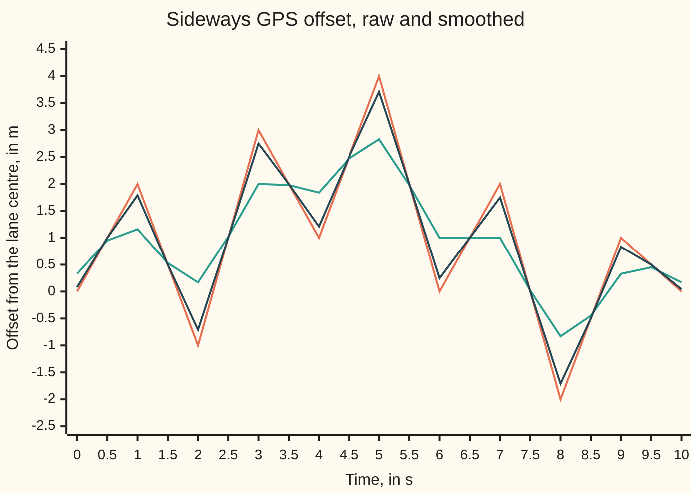

# Convolution and mollifiers: smoothing a rough object without moving it

[Syllabus](../../../SYLLABUS.md) → [Functional analysis](../README.md) → [Distributions and Sobolev Spaces](../README.md#s04) → Convolution and mollifiers

---

## General Overview

A runner's watch logs one GPS fix per second along a straight road. Each fix gives the runner's sideways offset from the lane centre, in metres. Over 10 seconds the fixes read 0, 2, −1, 3, 1, 4, 0, 2, −2, 1, 0. These numbers are illustrative: a consumer GPS wanders by a few metres.

Joined by straight lines, the track zigzags. The runner did not. A smoother replaces the offset at each moment by a weighted average of the offsets near that moment. The weights come from a **bump**: a smooth hill, highest in the middle, zero beyond a half-width ε (epsilon) seconds. The weights add up to 1, and they are the same forwards and backwards in time.

Three things follow, and this card proves all three.

1. **The smoothed track has no corners.** It has a slope at every moment, and slopes of slopes, without end.
2. **It is not moved.** Its area and its centre in time stay exactly where they were. A trailing average, which looks only into the past, would shift it late.
3. **It returns to the original as the bump narrows.** At the sharpest corner the gap is 0.293 m when ε = 0.25 s, and it halves each time ε halves.

A narrowing family of bumps used this way is called a family of **mollifiers** (from the Latin *mollis*, soft). Mollifiers let a proof do its work on smooth functions and then pass to a rough one in the limit. The name comes from a 1944 paper that used them to show that two ways of extending a differential operator agree.

On the list of 11 fixes, smoothing is a table of weights, and a narrow enough bump gives back the list exactly. On the continuous time line the bump never reaches the identity. The limit holds track by track, never for all tracks at once. That contrast is the infinite-dimensional part of this card.

**Averaging a rough function against a narrow, symmetric, smooth bump of total weight 1 makes it infinitely smooth without shifting it, never makes it larger, and returns it in the limit: in every Lp size with p finite, and in the worst-case gap when the function is uniformly continuous, for instance continuous and zero outside a bounded interval, like the track.**

**What kind of fact this is:** a theorem, proved on this card in Why it works, using Minkowski's inequality for integrals (proved here in a fold) and the density of continuous functions from a linked card. The exact gaps at a corner and at a jump are computations proved here. The bump and the convolution are definitions.

### The picture: the track, smoothed at two widths



Orange: the fixes joined by straight lines. Teal: smoothed with a bump of half-width ε = 1 s. Dark blue: ε = 0.25 s, which hugs the track and rounds only the corners. Points every half second; the code prints each one.

---

## The formula

Notation first, in words. $`f(t)`$ is the track: the offset in metres at time $`t`$ in seconds. The **joined track** runs straight between fixes. The **held track** keeps each fix for one second, as some loggers do, so it jumps at every whole second. Both are zero before 0 s and after 10 s.

The standard bump, with $`u`$ its own variable, and its narrowed copy:

```math
\eta(u) = \frac{1}{Z}\, e^{-1/(1-u^2)} \ \text{ for } \lvert u\rvert < 1, \quad \eta(u) = 0 \text{ otherwise}; \qquad \eta_\varepsilon(s) = \frac{1}{\varepsilon}\,\eta\!\left(\frac{s}{\varepsilon}\right)
```

**Read it aloud:** the bump is e to the minus one over one minus u squared inside the unit interval, zero outside, divided by its area Z; the narrowed bump squeezes it to half-width epsilon and stands it up by one over epsilon, so its area stays 1.

Here $`\eta`$ (eta) is the bump and $`Z = 0.443994`$ is the raw hill's area. The family $`\eta_\varepsilon`$ is the **mollifier**, notation this card introduces. Each $`\eta_\varepsilon`$ is smooth and zero outside a bounded interval, so it lies in $`C_c^\infty`$, the probes of [Distributions](01-test-functions-and-distributions.md).

The smoothed track is the convolution of $`f`$ with the bump ([Convolution](../../10-Measure%20and%20integration/06-Product%20Measures%20and%20Fubini/05-convolution-and-sums.md)):

```math
(\eta_\varepsilon * f)(x) = \int_{-\varepsilon}^{\varepsilon} \eta_\varepsilon(s)\, f(x - s)\, ds
```

**Read it aloud:** the smoothed track at time x is the average of the track over the times x minus s, with s running from minus epsilon to epsilon, weighted by the bump at s.

**Theorem.** Let $`f`$ be in $`L^p`$, the functions whose size to the p-th power, $`\lvert f\rvert^p`$, has a finite integral, and $`\lVert f\rVert_p`$ its size: the p-th root of that integral ([Lp spaces](../../10-Measure%20and%20integration/07-Sizes%20of%20Functions/01-lp-spaces.md)). Then:

1. $`\eta_\varepsilon * f`$ has derivatives of every order, and each one falls on the bump: $`(\eta_\varepsilon * f)' = \eta_\varepsilon' * f`$.
2. $`\lVert \eta_\varepsilon * f\rVert_p \le \lVert f\rVert_p`$ for every $`p`$ from 1 to $`\infty`$.
3. If $`1 \le p < \infty`$, then $`\lVert \eta_\varepsilon * f - f\rVert_p \to 0`$ as $`\varepsilon \to 0`$. If $`f`$ is bounded and uniformly continuous, the worst-case gap $`\lVert \eta_\varepsilon * f - f\rVert_\infty`$ tends to 0 as well.

Two exact gaps make the rate visible. At a corner where the slope changes by $`\Delta s`$, and at a jump of size $`J`$ (for ε at most half the distance to the next break):

```math
(\eta_\varepsilon * f - f)(\text{corner}) = \tfrac12\, \Delta s\; m_1\, \varepsilon, \qquad \int \lvert \eta_\varepsilon * f - f\rvert\, dx \text{ near a jump} = \lvert J\rvert\, m_1\, \varepsilon, \qquad m_1 = \int_{-1}^{1} \lvert u\rvert\, \eta(u)\, du
```

**Read it aloud:** at a corner the smoothed track cuts inside by half the change in slope, times m1, times epsilon; around a jump the total gap is the jump times m1 times epsilon; m1 is the bump's mean distance from its centre.

| Symbol | Plain meaning | In our example | Push it up and the answer… |
| --- | --- | --- | --- |
| $`f`$, $`y_k`$, $`k`$ | the track; the fix at second k | fix at 5 s: 4 m | — |
| $`t`$, $`x`$, $`s`$, $`y`$, $`u`$ | time in s; the time read; the look-back inside the window; a time in the track; the bump's own variable | x = 5 s | — |
| $`\eta`$, $`Z`$ | the unit-area bump; the raw hill's area | Z = 0.443994, peak 0.828569 | — |
| $`\varepsilon`$ | the bump's half-width, in s | 0.25 s | smoother, further from the track |
| $`\eta_\varepsilon`$, $`C_c^\infty`$ | the narrowed bump, area 1, the mollifier; the smooth functions zero outside a bounded interval | peak 0.828569/ε | — |
| $`\eta_\varepsilon * f`$ | the smoothed track | 3.71 m at 5 s, ε = 0.25 s | — |
| $`m_1`$ | the bump's mean distance from its centre | 0.334454 | larger gaps |
| $`\Delta s`$, $`J`$, $`(\cdot)_+`$ | change of slope at a corner, in m/s; size of a jump in the held track, in m; the positive part, negatives set to 0 | −7 at 5 s; −4 at 6 s (size 4) | larger gap |
| $`\lVert\cdot\rVert_p`$, $`\lVert\cdot\rVert_\infty`$, $`p`$, $`p'`$ | the Lp size; the worst-case value (sup norm); the exponent and its conjugate | L2 size of the track 5.033223 | — |
| $`\mathrm{osc}_f`$, $`g`$, $`\tau`$, $`w`$, $`n`$ | proof helpers: largest change within ε; a continuous stand-in for f; a tolerance; in the fold, a large number and a power | osc ≤ 4ε for the joined track | — |
| $`H`$, $`\delta`$, $`\varphi`$ | the switch's step; the tap at its instant; a probe | H smoothed: 0.5 at t = 0 | — |
| $`\xi`$, $`\hat\eta`$, $`a`$ | a wiggle's frequency, in rad/s; the bump's Fourier transform at a | ξ = 20/ε, η-hat(20) = −0.001266 | wiggle more erased |

### When it holds

- **The bump has area 1.** The raw hill, area 0.444, shrinks the track by that factor at every width. At ε = 0.0625 s it reads 1.743492 m at 5 s, where the track is 4 m.
- **The bump is symmetric.** A trailing bump, all in the past, moves the track's centre from 4.0 s to 4.5 s at ε = 0.5 s. The average still converges, but every width lags by ε.
- **The worst-case gap needs a uniformly continuous track.** The held track jumps by 4 m at 3, 6 and 8 s. Its worst-case gap stays at 2.000000 m, half the jump, at every width. Its L1 gap still falls in step with ε.
- **The size p is finite.** Convergence in Lp, p finite, holds for every f in Lp. In the sup norm a jump never closes, as the bullet above shows.
- **One track at a time.** For each width there is a wiggle the bump all but erases. A wiggle at 20/ε rad/s keeps −0.001266 of its height at every ε, so no single width serves every track.

---

## Why it works

### Step 0: the gap is an average of differences

The bump's weights add up to 1, so $`f(x)`$ equals its own weighted average. Subtract:

```math
(\eta_\varepsilon * f)(x) - f(x) = \int_{-\varepsilon}^{\varepsilon} \eta_\varepsilon(s)\, \big(f(x - s) - f(x)\big)\, ds
```

The gap is a weighted average of how much the track changes within ε of x. Everything below follows from that line. A track that changes little over short times has a small gap.

### Step 1: a uniformly continuous track converges in the worst case

Let $`\mathrm{osc}_f(\varepsilon)`$, the **oscillation**, be the largest change of $`f`$ between any two times at most ε apart. A function is **uniformly continuous** when $`\mathrm{osc}_f(\varepsilon) \to 0`$ ([Uniform continuity](../../06-Calculus%20and%20analysis/01-Limits%20and%20Continuity/08-uniform-continuity-and-lipschitz.md)). Weights are non-negative and add to 1, so Step 0 gives

```math
\lvert (\eta_\varepsilon * f)(x) - f(x)\rvert \le \mathrm{osc}_f(\varepsilon) \quad \text{for every } x
```

The joined track's steepest piece climbs 4 m/s, so $`\mathrm{osc}_f(\varepsilon) \le 4\varepsilon`$. The true worst gap is smaller: 1.170589ε, found in Step 5.

### Step 2: the derivative falls on the bump

Substitute $`y = x - s`$: $`(\eta_\varepsilon * f)(x) = \int \eta_\varepsilon(x - y)\, f(y)\, dy`$. Now x sits only inside the bump. The bump has bounded derivatives of every order, so the derivative may pass under the integral sign ([Differentiating under the integral sign](../../10-Measure%20and%20integration/05-Swapping%20Limits%20and%20Integrals/03-differentiating-under-the-integral.md)):

```math
(\eta_\varepsilon * f)'(x) = \int \eta_\varepsilon'(x - y)\, f(y)\, dy
```

Repeat for every order. The track only needs to be integrable over bounded intervals; all the smoothness comes from the bump.

At the 5 s corner the track arrives at 3 m/s and leaves at −4 m/s. The bump is symmetric, so the smoothed slope there is the average: −0.5 m/s.

<details>
<summary>Why the bump itself is smooth at its edges</summary>

Inside, the bump is a composition of smooth functions. The only question is at u = ±1, where it meets zero. Near the edge, $`1 - u^2`$ is small and positive.

Each derivative of the bump there is a polynomial in $`1/(1 - u^2)`$ times the bump. Put $`w = 1/(1 - u^2)`$, which grows without bound at the edge. For any power n,

$`\displaystyle w^n e^{-w} \to 0 \quad \text{as } w \to \infty,`$

because the exponential beats every power. So every derivative tends to 0 at the edge, matching the zero function outside. The bump has derivatives of every order everywhere, and it is not given by a power series at the edge: it is smooth but not analytic.

</details>

### Step 3: smoothing never makes the track larger

The smoothed track is a blend of shifted copies of the track:

```math
\eta_\varepsilon * f = \int_{-\varepsilon}^{\varepsilon} \eta_\varepsilon(s)\, f(\cdot - s)\, ds
```

A shift does not change size: each copy $`f(\cdot - s)`$ has size $`\lVert f\rVert_p`$. By Minkowski's inequality for integrals, the continuous version of [Minkowski's inequality](../../10-Measure%20and%20integration/07-Sizes%20of%20Functions/03-minkowskis-inequality.md) proved in the fold below, the size of a blend is at most the blend of the sizes. The weights add to 1, so

```math
\lVert \eta_\varepsilon * f\rVert_p \le \lVert \eta_\varepsilon\rVert_1\, \lVert f\rVert_p = \lVert f\rVert_p
```

The joined track has L2 size 5.033223. Smoothed at ε = 0.5 s it is 4.771017; at ε = 1 s, 4.315599.

The same proof with any integrable g in place of the bump gives $`\lVert g * f\rVert_p \le \lVert g\rVert_1 \lVert f\rVert_p`$. This is one case of Young's inequality for convolutions; the general inequality (planned, in the harmonic-analysis wing) trades sizes in other exponents.

<details>
<summary>Detailed proof: the size bound, by Hölder and Tonelli</summary>

This is Minkowski's inequality for integrals, written out for this case. Take $`1 < p < \infty`$ and its conjugate $`p'`$, with $`1/p + 1/p' = 1`$. Split the weight as $`\eta_\varepsilon = \eta_\varepsilon^{1/p'}\, \eta_\varepsilon^{1/p}`$ and apply [Holder's inequality](../../10-Measure%20and%20integration/07-Sizes%20of%20Functions/02-holders-inequality.md) in s:

$`\displaystyle \lvert (\eta_\varepsilon * f)(x)\rvert \le \Big(\int \eta_\varepsilon(s)\, ds\Big)^{1/p'} \Big(\int \eta_\varepsilon(s)\, \lvert f(x - s)\rvert^p\, ds\Big)^{1/p}.`$

The first factor is 1. Raise to the power p and integrate in x. The integrand is non-negative, so [Tonelli and Fubini](../../10-Measure%20and%20integration/06-Product%20Measures%20and%20Fubini/03-tonelli-and-fubini.md) lets the order swap:

$`\displaystyle \lVert \eta_\varepsilon * f\rVert_p^p \le \int \eta_\varepsilon(s) \Big(\int \lvert f(x - s)\rvert^p\, dx\Big) ds = \int \eta_\varepsilon(s)\, \lVert f\rVert_p^p\, ds = \lVert f\rVert_p^p.`$

For p = 1 skip Hölder and apply Tonelli directly. For p = ∞ the average of values at most $`\lVert f\rVert_\infty`$ is at most $`\lVert f\rVert_\infty`$. For a general integrable g, run the same lines with $`\lvert g\rvert`$ and pick up the factor $`\lVert g\rVert_1`$.

</details>

### Step 4: every Lp track converges, by approximating it with a continuous one

A track in $`L^p`$ may be nowhere continuous, so Step 1 does not apply directly. Continuous functions that are zero outside a bounded interval are **dense** in $`L^p`$ for p finite: one comes within any tolerance of f ([Riesz-Fischer](../../10-Measure%20and%20integration/07-Sizes%20of%20Functions/05-completeness-of-lp.md)).

Pick such a g with $`\lVert f - g\rVert_p < \tau`$, for a small tolerance τ. Split the gap in three and use Step 3 on the first piece:

```math
\lVert \eta_\varepsilon * f - f\rVert_p \le \lVert \eta_\varepsilon * (f - g)\rVert_p + \lVert \eta_\varepsilon * g - g\rVert_p + \lVert g - f\rVert_p \le 2\tau + \lVert \eta_\varepsilon * g - g\rVert_p
```

The middle term lives on g's interval, widened by ε. On it the gap is at most $`\mathrm{osc}_g(\varepsilon)`$ by Step 1, so the term is at most $`\mathrm{osc}_g(\varepsilon)`$ times the p-th root of the interval's length, which tends to 0. The gap ends below 3τ for small ε, and τ was any tolerance.

The argument fails at p = ∞, because continuous functions are not dense there. The held track shows it: its sup gap stays at 2 m.

**Readings fix a function.** Let $`f`$ be integrable over every bounded interval, with $`\int f\varphi\,dt = 0`$ for every probe $`\varphi`$. Each smoothed value $`(\eta_\varepsilon * f)(x) = \int \eta_\varepsilon(x - y)\, f(y)\, dy`$ is such a reading, on the probe $`y \mapsto \eta_\varepsilon(x - y)`$, so $`\eta_\varepsilon * f = 0`$ everywhere. On any bounded interval, with ε below 1, the smoothed values use $`f`$ only on that interval widened by 1, where $`f`$ is in $`L^1`$; so by the argument above with p = 1, $`\eta_\varepsilon * f \to f`$ in $`L^1`$ there. The integral of $`\lvert f\rvert`$ over every bounded interval is therefore 0, so $`f = 0`$ almost everywhere (except on a set of length zero). Two functions with the same readings on every probe agree almost everywhere: the fact that [Distributions](01-test-functions-and-distributions.md) and [Weak derivatives](07-weak-derivatives-and-sobolev-spaces.md) rely on.

### Step 5: the exact gaps at a corner and at a jump

Near a corner at time k, the joined track is a straight line plus $`\Delta s\, (x - k)_+`$, where $`(\cdot)_+`$ keeps positive values and replaces negative ones by 0. A symmetric unit-area bump returns a straight line unchanged: the average of $`a + b(x - s)`$ is $`a + bx`$, since the bump's mean s is 0. Only the bend contributes:

```math
(\eta_\varepsilon * f - f)(k) = \Delta s \int_{-\varepsilon}^{0} \eta_\varepsilon(s)\, (-s)\, ds = \tfrac12\, \Delta s\; m_1\, \varepsilon
```

Near a jump of size J the smoothed track rises along the bump's running total, so a little past the jump the gap is J times the bump's weight still beyond that point. Integrating that weight over the distance gives the bump's mean distance. Both sides together give $`\lvert J\rvert\, m_1\, \varepsilon`$.

These formulas need each window to hold one break, so ε at most 0.5 s here. The joined track's largest bend is 7 m/s, at 2, 5 and 8 s; the held track's jumps add to 28 m. So the worst gap is 3.5 m1 ε and the L1 gap is 28 m1 ε. [The Lebesgue differentiation theorem](../../10-Measure%20and%20integration/11-Derivatives%20Meet%20the%20Lebesgue%20Integral/02-lebesgue-differentiation-theorem.md) draws the same picture with a flat box in place of the bump. It proves convergence at almost every point rather than in size.

A track with a bounded second derivative does better. The symmetric bump cancels the first-order term, and the gap shrinks like ε².

### Step 6: no shift, and the centre stays put

Integrate the smoothed track over all time and swap the order (Fubini, since the track is integrable): the area is the track's area times the bump's area, 1. The joined track's area is the sum of the fixes, 10 m·s, before and after.

The same swap on $`t\,(\eta_\varepsilon * f)(t)`$ adds the bump's mean times the area. The mean of a symmetric bump is 0, so the centre stays at 4.000000 s. A trailing bump has mean ε, and the centre moves to 4.5 s at ε = 0.5 s and 5.0 s at ε = 1 s.

### Step 7: what the finite list hides

On the 11 fixes, smoothing with bump weights on whole seconds is an 11-by-11 matrix. At ε = 2 s each row reads 0.294498, 0.411005, 0.294498 around the diagonal. Once ε is 1 s or less, the bump is zero at ±1 s and the matrix is exactly the identity.

The continuous line has no such floor. A wiggle $`\sin(\xi t)`$ passes through any convolution unchanged in shape, scaled by the transform ([Convolution](../../07-Complex%20analysis/08-Transforms%20in%20Outline/04-convolution-theorem.md)):

```math
\eta_\varepsilon * \sin(\xi\, \cdot) = \hat\eta(\varepsilon \xi)\, \sin(\xi\, \cdot), \qquad \hat\eta(a) = \int_{-1}^{1} \eta(u)\, \cos(a u)\, du
```

At ξ = 20/ε the factor is η-hat(20) = −0.001266 for every ε. The bump keeps about a thousandth of the wiggle and flips it, so the gap is 1.001266 times the wiggle's height. The gap closes for each track. But among bounded tracks whose worst-case value is 1, the largest worst-case gap is at least 1.001266 at every ε.

In operator terms: on uniformly continuous tracks, measured by the worst-case gap, $`\eta_\varepsilon * f \to f`$ for each f (**strong convergence**). But the distance from the smoother to the identity in the operator norm, the worst gap over all tracks of worst-case value 1, stays above 1 at every ε. A finite matrix cannot show this.

### Step 8: the switch and the tap

The shelf's house example is a light switch. Its voltage is the step $`H(t)`$: 0 before the flip at t = 0, 1 after. Its derivative is the tap $`\delta`$, a spike of unit mass with no value at its point ([The delta](02-the-dirac-delta-and-derivatives-of-jumps.md)).

Smooth the step: $`\eta_\varepsilon * H`$ is a ramp that rises over 2ε. It reads 0.500000 at the flip and 0.877033 at ε/2. Its derivative, by Step 2, is $`\eta_\varepsilon * \delta = \eta_\varepsilon`$, the bump itself. So the mollifier is a stand-in for the tap of stated width ε. Read on any probe φ, $`\int \eta_\varepsilon \varphi \to \varphi(0)`$, which is the delta's reading.

---

## Worked numbers, by hand

The finite list first, then the continuous track at the 5 s corner.

| Step | Arithmetic | Value |
| --- | --- | --- |
| 1 | Bump weights on whole seconds at ε = 2 s: $`e^{-4/3}`$ at ±1 s, $`e^{-1}`$ at 0 | 0.263597, 0.367879 |
| 2 | Rescale to add to 1: divide by 0.367879 + 2 × 0.263597 = 0.895074 | 0.294498, 0.411005 |
| 3 | Smoothed fix at 5 s: 0.294498 × 1 + 0.411005 × 4 + 0.294498 × 0 | 1.938516 m, from the unrounded weights |
| 4 | Total of the 11 fixes, before and after | 10, then 10.000000 |
| 5 | Continuous track: slope into 5 s is 4 − 1 = 3, out is 0 − 4 = −4 | Δs = −7 m/s |
| 6 | Bump's mean distance from its centre, from the code | m1 = 0.334454 |
| 7 | Corner gap at ε = 0.25 s: ½ × 7 × 0.334454 × 0.25 | 0.292647 m |
| 8 | Smoothed value at 5 s: 4 − 0.292647 | **3.71 m** |
| 9 | Halve ε to 0.125 s: ½ × 7 × 0.334454 × 0.125 | 0.146324 m |
| 10 | Smoothed slope at 5 s: (3 + (−4)) / 2 | −0.5 m/s |

**At ε = 0.25 s the smoothed track passes 0.293 m inside the sharpest corner, at 3.71 m, and the gap halves with ε.** On a track sampled once a second with metre-sized wander, the smoother cuts each corner by a known amount, at most 0.293 m at ε = 0.25 s, and never shifts the track in time; an app picks ε to trade wander removed against corners cut.

### What breaks if you drop a piece

| Mistake | Comes out at | What went wrong |
| --- | --- | --- |
| Raw bump, area 0.443994 instead of 1, at ε = 0.0625 s | 1.743492 m at 5 s, against 4 m: gap 2.256508 | the track is scaled by the area and never comes back |
| Trailing bump, past values only | centre 4.500000 s at ε = 0.5 s, 5.000000 s at ε = 1 s, against 4.000000 | a lopsided bump shifts the track late by its mean, ε |
| Judge the held track in the sup norm | 2.000000 m at every ε | at a jump the average sits at the midpoint |
| Expect one width to serve every track | wiggle at 20/ε keeps −0.001266; gap 1.001266 | convergence is track by track, not uniform over tracks |

---

## Code, from first principles, and it actually runs

The code smooths the track by numerical integration, with its own Gauss-Legendre rule split at every break of the track. It takes independent roads to each number. The exact gap formulas, which use only the constant m1, are checked against a brute-force scan of 1,201 times and an integral of the gap. The smoothed slope from the bump's derivative is checked against a finite difference. The wiggle's kept fraction from direct smoothing is checked against the transform η-hat(20). The list rehearsal, the area and centre, the L2 sizes and the switch ramp come last. Python and Rust print the same lines. Every result is a truncation: a quadrature on a fixed number of panels, at four widths. Only the proof covers every ε and every track.

### Python

```python
# Convolution and mollifiers: smooth a jagged GPS track with a shrinking bump.
from math import exp, cos, sin

Y = [0.0, 2.0, -1.0, 3.0, 1.0, 4.0, 0.0, 2.0, -2.0, 1.0, 0.0]  # offsets (m), one fix per second

def bump(u):                       # exp(-1/(1-u^2)) inside (-1, 1), zero outside
    return exp(-1.0 / (1.0 - u * u)) if abs(u) < 1.0 else 0.0

R = 0.6 ** 0.5
def gauss(g, a, b, n):             # n panels of 3-point Gauss-Legendre; never touches a or b
    h, s = (b - a) / n, 0.0
    for i in range(n):
        c = a + (i + 0.5) * h
        s += 5.0 * g(c - 0.5 * h * R) + 8.0 * g(c) + 5.0 * g(c + 0.5 * h * R)
    return s * h / 18.0

Z = gauss(bump, -1.0, 1.0, 2000)                    # the bump's area
def eta(u): return bump(u) / Z                         # unit-area bump
def deta(u): return eta(u) * (-2.0 * u / (1.0 - u * u) ** 2) if abs(u) < 1.0 else 0.0
m1 = gauss(lambda u: abs(u) * eta(u), -1.0, 1.0, 2000)  # mean distance |u| under the bump

def joined(t):                     # fixes joined by straight lines, zero outside 0..10 s
    if t <= 0.0 or t >= 10.0: return 0.0
    k = int(t); return Y[k] + (Y[k + 1] - Y[k]) * (t - k)
def held(t):                       # each fix held for one second, zero outside 0..10 s
    return Y[int(t)] if 0.0 <= t < 10.0 else 0.0

def smooth(f, x, eps, kern=eta, n=100, lo=-1.0, hi=1.0):  # (kern_eps * f)(x), split where f breaks
    cuts = [lo * eps] + sorted(x - k for k in range(-1, 13) if lo * eps < x - k < hi * eps) + [hi * eps]
    g = lambda s: kern(s / eps) / eps * f(x - s)
    return sum(gauss(g, a, b, n) for a, b in zip(cuts, cuts[1:]) if b > a)

def integrate(h, lo, hi, eps, n=100):     # integral of h over [lo, hi], split at k and k +- eps
    pts = sorted(set([lo, hi] + [p for k in range(-1, 12) for p in (k - eps, k, k + eps) if lo < p < hi]))
    return sum(gauss(h, a, b, n) for a, b in zip(pts, pts[1:]))

print(f"bump area Z                     {Z:.12f}")
print(f"m1, mean |u| under the bump     {m1:.12f}")
print(f"eta(0), the bump's peak         {eta(0.0):.12f}")

# Rehearsal on the list of 11 fixes: weights eta(k/eps) on whole seconds, rescaled to add to 1.
print(f"list, raw hill at 0 and 1 s, eps 2: {bump(0.0):.6f} {bump(0.5):.6f}; sum {bump(0.0) + 2 * bump(0.5):.6f}")
for eps in (2.0, 0.5):
    w = [eta(k / eps) for k in (-1, 0, 1)]; tot = sum(w); w = [v / tot for v in w]
    pad = [0.0] + Y + [0.0]
    sm = [w[0] * pad[i] + w[1] * pad[i + 1] + w[2] * pad[i + 2] for i in range(11)]
    print(f"list, eps {eps:.1f} s: weights {w[0]:.6f} {w[1]:.6f}; fix at 5 s {sm[5]:.6f}; total {sum(sm):.6f}")

# Road 1 against road 2: worst gap on the joined track, scanned against eps*m1*7/2.
print("eps (s)   sup gap joined  formula   L1 gap held  formula   sup gap held")
for eps in (0.5, 0.25, 0.125, 0.0625):
    grid = [(j - 100) / 100.0 for j in range(1201)]
    sup_j = max(abs(smooth(joined, x, eps) - joined(x)) for x in grid)
    l1_h = integrate(lambda x: abs(smooth(held, x, eps) - held(x)), -1.0, 11.0, eps)
    sup_h = max(abs(smooth(held, x, eps) - held(x)) for x in grid)
    f_sup, f_l1 = 3.5 * eps * m1, 28.0 * eps * m1
    print(f"{eps:<9.4f} {sup_j:.6f}        {f_sup:.6f}  {l1_h:.6f}     {f_l1:.6f}  {sup_h:.6f}")
    assert abs(sup_j - f_sup) < 1e-6          # scanned worst gap = eps * m1 * 7/2
    assert abs(l1_h - f_l1) < 1e-6            # integrated gap = eps * m1 * 28
    assert abs(sup_h - 2.0) < 1e-9          # half the 4 m jump survives in the sup norm

# Smoothness: slope of the smoothed track at the 5 s corner (3 m/s in, -4 m/s out).
eps = 0.25
slope_q = smooth(joined, 5.0, eps, kern=lambda u: deta(u) / eps)
slope_fd = (smooth(joined, 5.0 + 1e-4, eps) - smooth(joined, 5.0 - 1e-4, eps)) / 2e-4
print(f"slope at 5 s, eps 0.25: eta' * f {slope_q:.6f}; finite difference {slope_fd:.6f}")
assert abs(slope_q - (-0.5)) < 1e-6 and abs(slope_fd - (-0.5)) < 1e-6

# No shift: area and centre of the track are kept; a trailing bump moves the centre by eps.
for eps in (0.5, 1.0):
    a0 = integrate(joined, -2.0, 12.0, eps)
    c0 = integrate(lambda t: t * joined(t), -2.0, 12.0, eps) / a0
    a1 = integrate(lambda t: smooth(joined, t, eps), -2.0, 12.0, eps)
    c1 = integrate(lambda t: t * smooth(joined, t, eps), -2.0, 12.0, eps) / a1
    c2 = integrate(lambda t: t * smooth(joined, t, eps, kern=lambda u: eta(u - 1.0), lo=0.0, hi=2.0), -2.0, 12.0, eps) / a1
    print(f"eps {eps:.1f}: area {a0:.6f} -> {a1:.6f}; centre {c0:.6f} s -> {c1:.6f} s; trailing bump {c2:.6f} s")
    assert abs(a0 - sum(Y)) < 1e-9          # area of the joined track = sum of the fixes
    assert abs(a1 - a0) < 1e-7 and abs(c1 - c0) < 1e-7
    assert abs(c2 - c0 - eps) < 1e-6

# Never larger: the L2 size of the smoothed track against the track's own (Young, p = 2).
n2 = sum((Y[k] ** 2 + Y[k] * Y[k + 1] + Y[k + 1] ** 2) / 3.0 for k in range(10)) ** 0.5
for eps in (0.5, 1.0):
    s2 = integrate(lambda t: smooth(joined, t, eps) ** 2, -2.0, 12.0, eps) ** 0.5
    print(f"L2 size: track {n2:.6f}, smoothed eps {eps:.1f}: {s2:.6f}")
    assert s2 <= n2

# Wrong mass: the raw bump (area Z) shrinks the track and never recovers it.
raw = smooth(joined, 5.0, 0.0625, kern=bump)
print(f"raw bump at 5 s, eps 0.0625: {raw:.6f} (track 4.000000); gap {4.0 - raw:.6f}")
assert abs(raw - Z * (4.0 - 3.5 * 0.0625 * m1)) < 1e-6

# The infinite-dimensional catch: a wiggle sin(xi t), xi = 20/eps, is all but erased at every eps.
hat20 = gauss(lambda u: eta(u) * cos(20.0 * u), -1.0, 1.0, 4000)
for eps in (0.5, 0.0625):
    xi, x = 20.0 / eps, 0.3
    ratio = smooth(lambda t: sin(xi * t), x, eps, n=4000) / sin(xi * x)
    print(f"wiggle, eps {eps:.4f}: kept fraction {ratio:.6f}; eta-hat(20) {hat20:.6f}; gap {1.0 - hat20:.6f}")
    assert abs(ratio - hat20) < 1e-7

# The switch and the tap: H * eta_eps rises over 2 eps; its slope at 0 is eta_eps(0).
ramp_half = gauss(eta, -1.0, 0.5, 2000)
print(f"switch smoothed, at t = eps/2: {ramp_half:.6f}; at t = 0: {gauss(eta, -1.0, 0.0, 2000):.6f}")

# Chart points: the joined track and two smoothings, every half second.
ts = [0.5 * j for j in range(21)]
def tidy(v): return v if abs(v) >= 0.005 else 0.0   # print 0.00, never -0.00
print("chart, track    " + " ".join(f"{tidy(joined(t)):.2f}" for t in ts))
for eps in (1.0, 0.25):
    print(f"chart, eps {eps:.2f} " + " ".join(f"{tidy(smooth(joined, t, eps)):.2f}" for t in ts))
print("ALL CHECKS PASS")
```

**Ran 2026-11-15 on macOS, Python 3.14.10, standard library only. All checks passed. Output, pasted from the run:**

```
bump area Z                     0.443993816168
m1, mean |u| under the bump     0.334453997710
eta(0), the bump's peak         0.828568839869
list, raw hill at 0 and 1 s, eps 2: 0.367879 0.263597; sum 0.895074
list, eps 2.0 s: weights 0.294498 0.411005; fix at 5 s 1.938516; total 10.000000
list, eps 0.5 s: weights 0.000000 1.000000; fix at 5 s 4.000000; total 10.000000
eps (s)   sup gap joined  formula   L1 gap held  formula   sup gap held
0.5000    0.585294        0.585294  4.682356     4.682356  2.000000
0.2500    0.292647        0.292647  2.341178     2.341178  2.000000
0.1250    0.146324        0.146324  1.170589     1.170589  2.000000
0.0625    0.073162        0.073162  0.585294     0.585294  2.000000
slope at 5 s, eps 0.25: eta' * f -0.500000; finite difference -0.500000
eps 0.5: area 10.000000 -> 10.000000; centre 4.000000 s -> 4.000000 s; trailing bump 4.500000 s
eps 1.0: area 10.000000 -> 10.000000; centre 4.000000 s -> 4.000000 s; trailing bump 5.000000 s
L2 size: track 5.033223, smoothed eps 0.5: 4.771017
L2 size: track 5.033223, smoothed eps 1.0: 4.315599
raw bump at 5 s, eps 0.0625: 1.743492 (track 4.000000); gap 2.256508
wiggle, eps 0.5000: kept fraction -0.001266; eta-hat(20) -0.001266; gap 1.001266
wiggle, eps 0.0625: kept fraction -0.001266; eta-hat(20) -0.001266; gap 1.001266
switch smoothed, at t = eps/2: 0.877033; at t = 0: 0.500000
chart, track    0.00 1.00 2.00 0.50 -1.00 1.00 3.00 2.00 1.00 2.50 4.00 2.00 0.00 1.00 2.00 0.00 -2.00 -0.50 1.00 0.50 0.00
chart, eps 1.00 0.33 0.95 1.16 0.53 0.17 1.02 2.00 1.98 1.84 2.47 2.83 1.98 1.00 1.00 1.00 0.02 -0.83 -0.45 0.33 0.45 0.17
chart, eps 0.25 0.08 1.00 1.79 0.50 -0.71 1.00 2.75 2.00 1.21 2.50 3.71 2.00 0.25 1.00 1.75 0.00 -1.71 -0.50 0.83 0.50 0.04
ALL CHECKS PASS
```

### Rust

```rust
// Convolution and mollifiers: smooth a jagged GPS track with a shrinking bump.
const Y: [f64; 11] = [0.0, 2.0, -1.0, 3.0, 1.0, 4.0, 0.0, 2.0, -2.0, 1.0, 0.0]; // offsets (m), one fix per second

fn bump(u: f64) -> f64 {
    // exp(-1/(1-u^2)) inside (-1, 1), zero outside
    if u.abs() < 1.0 { (-1.0 / (1.0 - u * u)).exp() } else { 0.0 }
}

fn gauss(g: &dyn Fn(f64) -> f64, a: f64, b: f64, n: usize) -> f64 {
    // n panels of 3-point Gauss-Legendre; never touches a or b
    let r = 0.6f64.sqrt();
    let h = (b - a) / n as f64;
    let mut s = 0.0;
    for i in 0..n {
        let c = a + (i as f64 + 0.5) * h;
        s += 5.0 * g(c - 0.5 * h * r) + 8.0 * g(c) + 5.0 * g(c + 0.5 * h * r);
    }
    s * h / 18.0
}

fn joined(t: f64) -> f64 {
    // fixes joined by straight lines, zero outside 0..10 s
    if t <= 0.0 || t >= 10.0 { return 0.0; }
    let k = t as usize;
    Y[k] + (Y[k + 1] - Y[k]) * (t - k as f64)
}

fn held(t: f64) -> f64 {
    // each fix held for one second, zero outside 0..10 s
    if (0.0..10.0).contains(&t) { Y[t as usize] } else { 0.0 }
}

fn smooth(f: &dyn Fn(f64) -> f64, x: f64, eps: f64, kern: &dyn Fn(f64) -> f64, n: usize, lo: f64, hi: f64) -> f64 {
    // (kern_eps * f)(x), split where f breaks
    let mut cuts = vec![lo * eps];
    let mut inner: Vec<f64> = (-1..13).map(|k| x - k as f64).filter(|&s| lo * eps < s && s < hi * eps).collect();
    inner.sort_by(|a, b| a.partial_cmp(b).unwrap());
    cuts.extend(inner);
    cuts.push(hi * eps);
    let g = |s: f64| kern(s / eps) / eps * f(x - s);
    cuts.windows(2).filter(|w| w[1] > w[0]).map(|w| gauss(&g, w[0], w[1], n)).sum()
}

fn integrate(h: &dyn Fn(f64) -> f64, lo: f64, hi: f64, eps: f64) -> f64 {
    // integral of h over [lo, hi], split at k and k +- eps
    let mut pts = vec![lo, hi];
    for k in -1..12 {
        for p in [k as f64 - eps, k as f64, k as f64 + eps] {
            if lo < p && p < hi { pts.push(p); }
        }
    }
    pts.sort_by(|a, b| a.partial_cmp(b).unwrap());
    pts.dedup();
    pts.windows(2).map(|w| gauss(h, w[0], w[1], 100)).sum()
}

fn tidy(v: f64) -> f64 { if v.abs() >= 0.005 { v } else { 0.0 } } // print 0.00, never -0.00

fn main() {
    let z = gauss(&bump, -1.0, 1.0, 2000); // the bump's area
    let eta = move |u: f64| bump(u) / z; // unit-area bump
    let deta = move |u: f64| if u.abs() < 1.0 { eta(u) * (-2.0 * u / (1.0 - u * u).powi(2)) } else { 0.0 };
    let m1 = gauss(&|u: f64| u.abs() * eta(u), -1.0, 1.0, 2000); // mean distance |u| under the bump
    let sm = |f: &dyn Fn(f64) -> f64, x: f64, eps: f64| smooth(f, x, eps, &eta, 100, -1.0, 1.0);

    println!("bump area Z                     {:.12}", z);
    println!("m1, mean |u| under the bump     {:.12}", m1);
    println!("eta(0), the bump's peak         {:.12}", eta(0.0));

    // Rehearsal on the list of 11 fixes: weights eta(k/eps) on whole seconds, rescaled to add to 1.
    println!("list, raw hill at 0 and 1 s, eps 2: {:.6} {:.6}; sum {:.6}", bump(0.0), bump(0.5), bump(0.0) + 2.0 * bump(0.5));
    for eps in [2.0, 0.5] {
        let w0: Vec<f64> = [-1.0, 0.0, 1.0].iter().map(|k: &f64| eta(k / eps)).collect();
        let tot: f64 = w0.iter().sum();
        let w: Vec<f64> = w0.iter().map(|v| v / tot).collect();
        let mut pad = vec![0.0];
        pad.extend_from_slice(&Y);
        pad.push(0.0);
        let s: Vec<f64> = (0..11).map(|i| w[0] * pad[i] + w[1] * pad[i + 1] + w[2] * pad[i + 2]).collect();
        let total: f64 = s.iter().sum();
        println!("list, eps {:.1} s: weights {:.6} {:.6}; fix at 5 s {:.6}; total {:.6}", eps, w[0], w[1], s[5], total);
    }

    // Road 1 against road 2: worst gap on the joined track, scanned against eps*m1*7/2.
    println!("eps (s)   sup gap joined  formula   L1 gap held  formula   sup gap held");
    for eps in [0.5, 0.25, 0.125, 0.0625] {
        let grid: Vec<f64> = (0..1201).map(|j| (j as f64 - 100.0) / 100.0).collect();
        let sup_j = grid.iter().map(|&x| (sm(&joined, x, eps) - joined(x)).abs()).fold(0.0, f64::max);
        let l1_h = integrate(&|x: f64| (sm(&held, x, eps) - held(x)).abs(), -1.0, 11.0, eps);
        let sup_h = grid.iter().map(|&x| (sm(&held, x, eps) - held(x)).abs()).fold(0.0, f64::max);
        let (f_sup, f_l1) = (3.5 * eps * m1, 28.0 * eps * m1);
        println!("{:<9.4} {:.6}        {:.6}  {:.6}     {:.6}  {:.6}", eps, sup_j, f_sup, l1_h, f_l1, sup_h);
        assert!((sup_j - f_sup).abs() < 1e-6, "scanned worst gap = eps * m1 * 7/2");
        assert!((l1_h - f_l1).abs() < 1e-6, "integrated gap = eps * m1 * 28");
        assert!((sup_h - 2.0).abs() < 1e-9, "half the 4 m jump survives in the sup norm");
    }

    // Smoothness: slope of the smoothed track at the 5 s corner (3 m/s in, -4 m/s out).
    let eps = 0.25;
    let slope_q = smooth(&joined, 5.0, eps, &|u: f64| deta(u) / eps, 100, -1.0, 1.0);
    let slope_fd = (sm(&joined, 5.0 + 1e-4, eps) - sm(&joined, 5.0 - 1e-4, eps)) / 2e-4;
    println!("slope at 5 s, eps 0.25: eta' * f {:.6}; finite difference {:.6}", slope_q, slope_fd);
    assert!((slope_q + 0.5).abs() < 1e-6 && (slope_fd + 0.5).abs() < 1e-6);

    // No shift: area and centre of the track are kept; a trailing bump moves the centre by eps.
    for eps in [0.5, 1.0] {
        let a0 = integrate(&joined, -2.0, 12.0, eps);
        let c0 = integrate(&|t: f64| t * joined(t), -2.0, 12.0, eps) / a0;
        let a1 = integrate(&|t: f64| sm(&joined, t, eps), -2.0, 12.0, eps);
        let c1 = integrate(&|t: f64| t * sm(&joined, t, eps), -2.0, 12.0, eps) / a1;
        let trail = |u: f64| eta(u - 1.0);
        let c2 = integrate(&|t: f64| t * smooth(&joined, t, eps, &trail, 100, 0.0, 2.0), -2.0, 12.0, eps) / a1;
        println!("eps {:.1}: area {:.6} -> {:.6}; centre {:.6} s -> {:.6} s; trailing bump {:.6} s", eps, a0, a1, c0, c1, c2);
        assert!((a0 - Y.iter().sum::<f64>()).abs() < 1e-9, "area of the joined track = sum of the fixes");
        assert!((a1 - a0).abs() < 1e-7 && (c1 - c0).abs() < 1e-7);
        assert!((c2 - c0 - eps).abs() < 1e-6);
    }

    // Never larger: the L2 size of the smoothed track against the track's own (Young, p = 2).
    let n2 = (0..10).map(|k| (Y[k] * Y[k] + Y[k] * Y[k + 1] + Y[k + 1] * Y[k + 1]) / 3.0).sum::<f64>().sqrt();
    for eps in [0.5, 1.0] {
        let s2 = integrate(&|t: f64| sm(&joined, t, eps).powi(2), -2.0, 12.0, eps).sqrt();
        println!("L2 size: track {:.6}, smoothed eps {:.1}: {:.6}", n2, eps, s2);
        assert!(s2 <= n2);
    }

    // Wrong mass: the raw bump (area Z) shrinks the track and never recovers it.
    let raw = smooth(&joined, 5.0, 0.0625, &bump, 100, -1.0, 1.0);
    println!("raw bump at 5 s, eps 0.0625: {:.6} (track 4.000000); gap {:.6}", raw, 4.0 - raw);
    assert!((raw - z * (4.0 - 3.5 * 0.0625 * m1)).abs() < 1e-6);

    // The infinite-dimensional catch: a wiggle sin(xi t), xi = 20/eps, is all but erased at every eps.
    let hat20 = gauss(&|u: f64| eta(u) * (20.0 * u).cos(), -1.0, 1.0, 4000);
    for eps in [0.5, 0.0625] {
        let (xi, x) = (20.0 / eps, 0.3);
        let ratio = smooth(&|t: f64| (xi * t).sin(), x, eps, &eta, 4000, -1.0, 1.0) / (xi * x).sin();
        println!("wiggle, eps {:.4}: kept fraction {:.6}; eta-hat(20) {:.6}; gap {:.6}", eps, ratio, hat20, 1.0 - hat20);
        assert!((ratio - hat20).abs() < 1e-7);
    }

    // The switch and the tap: H * eta_eps rises over 2 eps; its slope at 0 is eta_eps(0).
    let ramp_half = gauss(&eta, -1.0, 0.5, 2000);
    println!("switch smoothed, at t = eps/2: {:.6}; at t = 0: {:.6}", ramp_half, gauss(&eta, -1.0, 0.0, 2000));

    // Chart points: the joined track and two smoothings, every half second.
    let ts: Vec<f64> = (0..21).map(|j| 0.5 * j as f64).collect();
    let line = |v: Vec<f64>| v.iter().map(|x| format!("{:.2}", tidy(*x))).collect::<Vec<_>>().join(" ");
    println!("chart, track    {}", line(ts.iter().map(|&t| joined(t)).collect()));
    for eps in [1.0, 0.25] {
        println!("chart, eps {:.2} {}", eps, line(ts.iter().map(|&t| sm(&joined, t, eps)).collect()));
    }
    println!("ALL CHECKS PASS");
}
```

**Ran 2026-11-15 on macOS, rustc 1.98.1, no crates. All checks passed. Output, pasted from the run:**

```
bump area Z                     0.443993816168
m1, mean |u| under the bump     0.334453997710
eta(0), the bump's peak         0.828568839869
list, raw hill at 0 and 1 s, eps 2: 0.367879 0.263597; sum 0.895074
list, eps 2.0 s: weights 0.294498 0.411005; fix at 5 s 1.938516; total 10.000000
list, eps 0.5 s: weights 0.000000 1.000000; fix at 5 s 4.000000; total 10.000000
eps (s)   sup gap joined  formula   L1 gap held  formula   sup gap held
0.5000    0.585294        0.585294  4.682356     4.682356  2.000000
0.2500    0.292647        0.292647  2.341178     2.341178  2.000000
0.1250    0.146324        0.146324  1.170589     1.170589  2.000000
0.0625    0.073162        0.073162  0.585294     0.585294  2.000000
slope at 5 s, eps 0.25: eta' * f -0.500000; finite difference -0.500000
eps 0.5: area 10.000000 -> 10.000000; centre 4.000000 s -> 4.000000 s; trailing bump 4.500000 s
eps 1.0: area 10.000000 -> 10.000000; centre 4.000000 s -> 4.000000 s; trailing bump 5.000000 s
L2 size: track 5.033223, smoothed eps 0.5: 4.771017
L2 size: track 5.033223, smoothed eps 1.0: 4.315599
raw bump at 5 s, eps 0.0625: 1.743492 (track 4.000000); gap 2.256508
wiggle, eps 0.5000: kept fraction -0.001266; eta-hat(20) -0.001266; gap 1.001266
wiggle, eps 0.0625: kept fraction -0.001266; eta-hat(20) -0.001266; gap 1.001266
switch smoothed, at t = eps/2: 0.877033; at t = 0: 0.500000
chart, track    0.00 1.00 2.00 0.50 -1.00 1.00 3.00 2.00 1.00 2.50 4.00 2.00 0.00 1.00 2.00 0.00 -2.00 -0.50 1.00 0.50 0.00
chart, eps 1.00 0.33 0.95 1.16 0.53 0.17 1.02 2.00 1.98 1.84 2.47 2.83 1.98 1.00 1.00 1.00 0.02 -0.83 -0.45 0.33 0.45 0.17
chart, eps 0.25 0.08 1.00 1.79 0.50 -0.71 1.00 2.75 2.00 1.21 2.50 3.71 2.00 0.25 1.00 1.75 0.00 -1.71 -0.50 0.83 0.50 0.04
ALL CHECKS PASS
```

### Lean

Lean proves the theorem's three parts for every such bump and every track in $`L^p`$, and checks five worked numbers.

- Take any smooth, symmetric bump $`\eta`$ of area 1, never negative and zero outside $`[-1, 1]`$. Then the bullets below hold for its narrowed copies $`\eta_\varepsilon`$.
- Take $`\varepsilon > 0`$ and a track $`f`$ in $`L^p`$, with $`p`$ from 1 to $`\infty`$. Then $`\eta_\varepsilon * f`$ has derivatives of every order, and $`(\eta_\varepsilon * f)' = \eta_\varepsilon' * f`$.
- Take the same $`\varepsilon`$, $`p`$ and $`f`$. Then $`\lVert \eta_\varepsilon * f\rVert_p \le \lVert f\rVert_p`$.
- Take $`1 \le p < \infty`$ and $`f`$ in $`L^p`$. Then $`\lVert \eta_\varepsilon * f - f\rVert_p \to 0`$ as $`\varepsilon \to 0`$.
- Suppose $`f`$ is bounded and uniformly continuous. Then the worst-case gap $`\lVert \eta_\varepsilon * f - f\rVert_\infty`$ tends to 0 as $`\varepsilon \to 0`$.
- The 11 fixes add up to 10, the joined track's area in m·s.
- At the 5 s corner the slope goes from 3 m/s to −4 m/s, so Δs = −7 m/s.
- The held track's jumps add up to 28 m.
- The average of the slopes in and out at 5 s is −0.5 m/s.
- The joined track's largest bend, in size, is 7 m/s.

The bump's numbers, the exact gaps, the kept area and centre, and the wiggle are left to the Python and Rust checks.

```lean
-- Convolution and mollifiers: averaging a function against a narrowing smooth symmetric bump of area 1 makes it smooth, never larger, and returns it in every Lp size with p finite and uniformly when it is uniformly continuous.
import Mathlib.Analysis.Calculus.ContDiff.Convolution
import Mathlib.MeasureTheory.Function.LpSeminorm.Basic
import Mathlib.MeasureTheory.Function.ContinuousMapDense
import Mathlib.MeasureTheory.Function.LpSeminorm.CompareExp
import Mathlib.MeasureTheory.Measure.Haar.NormedSpace
import Mathlib.MeasureTheory.Measure.Haar.Unique
import Mathlib.Analysis.Calculus.ContDiff.Operations

open MeasureTheory Filter Topology
open scoped Convolution ContDiff ENNReal

open scoped Pointwise

lemma moll_aux_contDiff {η : ℝ → ℝ} (hη : ContDiff ℝ ∞ η) (ε : ℝ) :
    ContDiff ℝ ∞ (fun s => ε⁻¹ * η (s / ε)) :=
  ContDiff.mul contDiff_const (hη.comp (contDiff_id.div_const ε))

lemma moll_aux_support {η : ℝ → ℝ} (hsupp : Function.support η ⊆ Set.Icc (-1) 1)
    {ε : ℝ} (hε : 0 < ε) :
    Function.support (fun s => ε⁻¹ * η (s / ε)) ⊆ Set.Icc (-ε) ε := by
  intro s hs
  have h : s / ε ∈ Set.Icc (-1 : ℝ) 1 := hsupp (fun h => hs (by simp [h]))
  rw [Set.mem_Icc, le_div_iff₀ hε, div_le_iff₀ hε] at h
  constructor <;> linarith [h.1, h.2]

lemma moll_aux_hasCompactSupport {η : ℝ → ℝ} (hsupp : Function.support η ⊆ Set.Icc (-1) 1)
    {ε : ℝ} (hε : 0 < ε) :
    HasCompactSupport (fun s => ε⁻¹ * η (s / ε)) :=
  HasCompactSupport.of_support_subset_isCompact isCompact_Icc (moll_aux_support hsupp hε)

lemma moll_aux_nonneg {η : ℝ → ℝ} (hnn : ∀ u, 0 ≤ η u) {ε : ℝ} (hε : 0 < ε) (s : ℝ) :
    0 ≤ ε⁻¹ * η (s / ε) :=
  mul_nonneg (inv_nonneg.2 hε.le) (hnn _)

lemma moll_aux_integral {η : ℝ → ℝ} (harea : ∫ u, η u = 1) {ε : ℝ} (hε : 0 < ε) :
    ∫ s, ε⁻¹ * η (s / ε) = 1 := by
  rw [integral_const_mul, Measure.integral_comp_div, harea, abs_of_pos hε, smul_eq_mul,
    mul_one, inv_mul_cancel₀ hε.ne']

lemma jensen_aux_lintegral {Φ G : ℝ → ℝ≥0∞} (hΦ : Measurable Φ) (hΦ1 : ∫⁻ t, Φ t = 1)
    (hG : Measurable G) {r : ℝ} (hr : 1 ≤ r) :
    (∫⁻ t, Φ t * G t) ^ r ≤ ∫⁻ t, Φ t * G t ^ r := by
  set ν := volume.withDensity Φ
  have : IsProbabilityMeasure ν := ⟨by simp [ν, withDensity_apply _ MeasurableSet.univ, hΦ1]⟩
  have h1 : ∫⁻ t, Φ t * G t = ∫⁻ t, G t ∂ν :=
    (lintegral_withDensity_eq_lintegral_mul _ hΦ hG).symm
  have h2 : ∫⁻ t, Φ t * G t ^ r = ∫⁻ t, G t ^ r ∂ν :=
    (lintegral_withDensity_eq_lintegral_mul _ hΦ (hG.pow_const r)).symm
  rw [h1, h2]
  have hle : (1 : ℝ≥0∞) ≤ ENNReal.ofReal r := by simpa using ENNReal.ofReal_le_ofReal hr
  have := eLpNorm_le_eLpNorm_of_exponent_le (μ := ν) (f := G) hle
  rw [eLpNorm_one_eq_lintegral_enorm hG.aestronglyMeasurable,
    eLpNorm_eq_lintegral_rpow_enorm_toReal (by positivity) ENNReal.ofReal_ne_top
      hG.aestronglyMeasurable, ENNReal.toReal_ofReal (by linarith)] at this
  simp only [enorm_eq_self] at this
  calc (∫⁻ t, G t ∂ν) ^ r ≤ ((∫⁻ t, G t ^ r ∂ν) ^ (1 / r)) ^ r :=
        ENNReal.rpow_le_rpow this (by linarith)
    _ = ∫⁻ t, G t ^ r ∂ν := by
        rw [← ENNReal.rpow_mul, one_div_mul_cancel (by linarith), ENNReal.rpow_one]

lemma young_aux_eLpNorm_one {φ : ℝ → ℝ} (hφn : ∀ u, 0 ≤ φ u) (hφi : ∫ u, φ u = 1) :
    eLpNorm φ 1 volume = 1 := by
  have hint : Integrable φ := integrable_of_integral_eq_one hφi
  rw [eLpNorm_one_eq_lintegral_enorm hint.aestronglyMeasurable]
  simp_rw [Real.enorm_eq_ofReal (hφn _)]
  rw [← ofReal_integral_eq_lintegral_ofReal hint (Eventually.of_forall hφn), hφi,
    ENNReal.ofReal_one]

lemma young_aux_lintegral {φ : ℝ → ℝ} (hφn : ∀ u, 0 ≤ φ u) (hφi : ∫ u, φ u = 1) :
    ∫⁻ u, ENNReal.ofReal (φ u) = 1 := by
  have hint : Integrable φ := integrable_of_integral_eq_one hφi
  rw [← ofReal_integral_eq_lintegral_ofReal hint (Eventually.of_forall hφn), hφi,
    ENNReal.ofReal_one]

lemma young_aux {φ : ℝ → ℝ} (hφc : Continuous φ) (hφn : ∀ u, 0 ≤ φ u)
    (hφi : ∫ u, φ u = 1) {p : ℝ≥0∞} (hp1 : 1 ≤ p) {f : ℝ → ℝ} (hf : MemLp f p) :
    eLpNorm (φ ⋆ f) p volume ≤ eLpNorm f p volume := by
  set g := hf.aestronglyMeasurable.mk f with hg_def
  have hfg : f =ᵐ[volume] g := hf.aestronglyMeasurable.ae_eq_mk
  have hg : StronglyMeasurable g := hf.aestronglyMeasurable.stronglyMeasurable_mk
  rw [convolution_congr _ (EventuallyEq.refl _ _) hfg, eLpNorm_congr_ae hfg]
  by_cases hp : p = ⊤
  · subst hp
    have hcm : AEStronglyMeasurable (φ ⋆ g) volume :=
      hφc.aestronglyMeasurable.convolution _ hg.aestronglyMeasurable
    rw [eLpNorm_exponent_top hcm]
    apply eLpNormEssSup_le_of_ae_enorm_bound
    filter_upwards with x
    have hL : ‖(ContinuousLinearMap.lsmul ℝ ℝ : ℝ →L[ℝ] ℝ →L[ℝ] ℝ)‖ₑ ≤ 1 := by
      rw [← ofReal_norm]
      exact ENNReal.ofReal_le_one.2 ContinuousLinearMap.opNorm_lsmul_le
    calc ‖(φ ⋆ g) x‖ₑ ≤ ‖(ContinuousLinearMap.lsmul ℝ ℝ : ℝ →L[ℝ] ℝ →L[ℝ] ℝ)‖ₑ *
          eLpNorm φ 1 volume * eLpNorm g ⊤ volume :=
          enorm_convolution_le (p := 1) (q := ⊤) _ hφc.aestronglyMeasurable
            hg.aestronglyMeasurable x
      _ ≤ 1 * 1 * eLpNorm g ⊤ volume := by
          rw [young_aux_eLpNorm_one hφn hφi]; gcongr
      _ = eLpNorm g ⊤ volume := by simp
  · have hp0 : p ≠ 0 := (lt_of_lt_of_le zero_lt_one hp1).ne'
    set r := p.toReal with hr_def
    have hr : 1 ≤ r := by
      rw [hr_def]
      have := ENNReal.toReal_mono hp hp1
      simpa using this
    have hcm : AEStronglyMeasurable (φ ⋆ g) volume :=
      hφc.aestronglyMeasurable.convolution _ hg.aestronglyMeasurable
    rw [eLpNorm_eq_lintegral_rpow_enorm_toReal hp0 hp hcm,
      eLpNorm_eq_lintegral_rpow_enorm_toReal hp0 hp hg.aestronglyMeasurable]
    refine ENNReal.rpow_le_rpow ?_ (by positivity)
    set Φ : ℝ → ℝ≥0∞ := fun t => ENNReal.ofReal (φ t)
    have hΦ : Measurable Φ := hφc.measurable.ennreal_ofReal
    have hΦ1 : ∫⁻ t, Φ t = 1 := young_aux_lintegral hφn hφi
    have hgm : Measurable g := hg.measurable
    have hpt : ∀ x, ‖(φ ⋆ g) x‖ₑ ^ r ≤ ∫⁻ t, Φ t * ‖g (x - t)‖ₑ ^ r := by
      intro x
      have h1 : ‖(φ ⋆ g) x‖ₑ ≤ ∫⁻ t, Φ t * ‖g (x - t)‖ₑ := by
        rw [convolution_def]
        refine (enorm_integral_le_lintegral_enorm _).trans (lintegral_mono fun t => ?_)
        simp only [ContinuousLinearMap.lsmul_apply, smul_eq_mul, enorm_mul, Φ,
          Real.enorm_eq_ofReal (hφn t), le_refl]
      calc ‖(φ ⋆ g) x‖ₑ ^ r ≤ (∫⁻ t, Φ t * ‖g (x - t)‖ₑ) ^ r :=
            ENNReal.rpow_le_rpow h1 (by linarith)
        _ ≤ _ := jensen_aux_lintegral hΦ hΦ1 ((hgm.comp (measurable_const.sub measurable_id)).enorm) hr
    calc ∫⁻ x, ‖(φ ⋆ g) x‖ₑ ^ r ≤ ∫⁻ x, ∫⁻ t, Φ t * ‖g (x - t)‖ₑ ^ r := lintegral_mono hpt
      _ = ∫⁻ t, ∫⁻ x, Φ t * ‖g (x - t)‖ₑ ^ r := by
          apply lintegral_lintegral_swap
          exact ((hΦ.comp measurable_snd).mul
            ((hgm.comp (measurable_fst.sub measurable_snd)).enorm.pow_const r)).aemeasurable
      _ = ∫⁻ t, Φ t * ∫⁻ x, ‖g x‖ₑ ^ r := by
          congr 1; ext t
          rw [lintegral_const_mul (Φ t) (f := fun x => ‖g (x - t)‖ₑ ^ r) ((hgm.comp (measurable_id.sub measurable_const)).enorm.pow_const r)]
          congr 1
          exact lintegral_sub_right_eq_self (fun x => ‖g x‖ₑ ^ r) t
      _ = ∫⁻ x, ‖g x‖ₑ ^ r := by
          rw [lintegral_mul_const _ hΦ, hΦ1, one_mul]

lemma moll_aux_close {η : ℝ → ℝ} (hη_nonneg : ∀ u, 0 ≤ η u)
    (hη_supp : Function.support η ⊆ Set.Icc (-1) 1) (hη_area : ∫ u, η u = 1)
    {g : ℝ → ℝ} (hgc : Continuous g) {ρ δ : ℝ} (hδ : 0 ≤ δ)
    (hρ : ∀ x y, dist x y < ρ → dist (g x) (g y) ≤ δ) {ε : ℝ} (hε : 0 < ε) (hερ : ε < ρ)
    (x : ℝ) : dist (((fun s => ε⁻¹ * η (s / ε)) ⋆ g) x) (g x) ≤ δ := by
  have hsupp : Function.support (fun s => ε⁻¹ * η (s / ε)) ⊆ Metric.ball (0 : ℝ) ρ := by
    intro s hs
    have h := moll_aux_support hη_supp hε hs
    rw [Metric.mem_ball, dist_zero_right, Real.norm_eq_abs, abs_lt]
    constructor <;> linarith [h.1, h.2]
  exact dist_convolution_le hδ hsupp (moll_aux_nonneg hη_nonneg hε)
    (moll_aux_integral hη_area hε) hgc.aestronglyMeasurable (fun y hy => hρ y x hy)

lemma moll_aux_Lp_compact {η : ℝ → ℝ} (hη_smooth : ContDiff ℝ ∞ η)
    (hη_nonneg : ∀ u, 0 ≤ η u)
    (hη_supp : Function.support η ⊆ Set.Icc (-1) 1) (hη_area : ∫ u, η u = 1)
    {p : ℝ≥0∞} {g : ℝ → ℝ} (hgc : Continuous g) (hgs : HasCompactSupport g)
    {δ : ℝ≥0∞} (hδ : 0 < δ) :
    ∀ᶠ ε in 𝓝[>] (0 : ℝ),
      eLpNorm ((fun s => ε⁻¹ * η (s / ε)) ⋆ g - g) p volume ≤ δ := by
  set K : Set ℝ := Set.Icc (-1 : ℝ) 1 + tsupport g with hK_def
  have hK : IsCompact K := isCompact_Icc.add hgs.isCompact
  set C : ℝ≥0∞ := (volume K) ^ p.toReal⁻¹ with hC_def
  have hC : C ≠ ⊤ := ENNReal.rpow_ne_top_of_nonneg (by positivity) hK.measure_lt_top.ne
  have hlim : Tendsto (fun t : ℝ => C * ENNReal.ofReal t) (𝓝 0) (𝓝 0) := by
    have := ENNReal.Tendsto.const_mul (ENNReal.tendsto_ofReal (tendsto_id (x := 𝓝 (0 : ℝ))))
      (a := C) (Or.inr hC)
    simpa using this
  obtain ⟨δ', hδ'pos, hδ'⟩ : ∃ δ' : ℝ, 0 < δ' ∧ C * ENNReal.ofReal δ' < δ := by
    have h1 := (hlim.mono_left (nhdsWithin_le_nhds (s := Set.Ioi 0))).eventually (gt_mem_nhds hδ)
    have h2 : ∀ᶠ t in 𝓝[>] (0 : ℝ), 0 < t := self_mem_nhdsWithin
    obtain ⟨t, ht1, ht2⟩ := (h1.and h2).exists
    exact ⟨t, ht2, ht1⟩
  obtain ⟨ρ, hρpos, hρ⟩ :=
    Metric.uniformContinuous_iff.1 (hgs.uniformContinuous_of_continuous hgc) δ' hδ'pos
  have hmem : Set.Ioo (0 : ℝ) (min ρ 1) ∈ 𝓝[>] (0 : ℝ) := Ioo_mem_nhdsGT (lt_min hρpos one_pos)
  filter_upwards [hmem] with ε hε
  have hε0 : 0 < ε := hε.1
  have hερ : ε < ρ := lt_of_lt_of_le hε.2 (min_le_left _ _)
  have hε1 : ε ≤ 1 := (lt_of_lt_of_le hε.2 (min_le_right _ _)).le
  set φ : ℝ → ℝ := fun s => ε⁻¹ * η (s / ε) with hφ_def
  have hφc : Continuous φ := (moll_aux_contDiff hη_smooth ε).continuous
  have hφs : HasCompactSupport φ := moll_aux_hasCompactSupport hη_supp hε0
  have hcont : Continuous (φ ⋆ g - g) :=
    (hφs.continuous_convolution_left _ hφc hgc.locallyIntegrable).sub hgc
  have hsub : Function.support (φ ⋆ g - g) ⊆ K := by
    refine (Function.support_sub _ _).trans (Set.union_subset ?_ ?_)
    · refine (support_convolution_subset _).trans (Set.add_subset_add ?_ (subset_tsupport g))
      intro s hs
      have h := moll_aux_support hη_supp hε0 hs
      exact ⟨by linarith [h.1], by linarith [h.2]⟩
    · intro s hs
      exact ⟨0, ⟨by norm_num, by norm_num⟩, s, subset_tsupport g hs, zero_add s⟩
  rw [← eLpNorm_restrict_eq_of_support_subset hcont.aestronglyMeasurable hsub]
  have hbound : ∀ᵐ x ∂(volume.restrict K), ‖(φ ⋆ g - g) x‖ ≤ δ' := by
    refine Eventually.of_forall fun x => ?_
    rw [Pi.sub_apply, ← dist_eq_norm]
    exact moll_aux_close hη_nonneg hη_supp hη_area hgc hδ'pos.le
      (fun a b hab => (hρ hab).le) hε0 hερ x
  refine (eLpNorm_le_of_ae_bound hcont.aestronglyMeasurable.restrict hbound).trans ?_
  rw [Measure.restrict_apply_univ]
  exact hδ'.le

#print axioms moll_aux_contDiff
#print axioms moll_aux_support
#print axioms moll_aux_hasCompactSupport
#print axioms moll_aux_nonneg
#print axioms moll_aux_integral
#print axioms jensen_aux_lintegral
#print axioms young_aux_eLpNorm_one
#print axioms young_aux_lintegral
#print axioms young_aux
#print axioms moll_aux_close
#print axioms moll_aux_Lp_compact

/-- The mollifier recovers every Lp track. Let `η` be a smooth bump: non-negative, zero outside
`[-1, 1]`, of area 1 and symmetric. Narrow it to half-width `ε` as `η_ε(s) = η(s / ε) / ε`.
For `1 ≤ p < ∞` and every `f` in `Lp`, the Lp size of the gap `η_ε * f - f` tends to 0 as the
width `ε` shrinks to 0. -/
theorem mollifier_convolution_tendsto_in_Lp {η : ℝ → ℝ} (hη_smooth : ContDiff ℝ ∞ η)
    (hη_nonneg : ∀ u, 0 ≤ η u) (hη_supp : Function.support η ⊆ Set.Icc (-1) 1)
    (hη_area : ∫ u, η u = 1) (hη_symm : ∀ u, η (-u) = η u)
    {p : ℝ≥0∞} (hp1 : 1 ≤ p) (hp : p ≠ ⊤) {f : ℝ → ℝ} (hf : MemLp f p) :
    Tendsto (fun ε : ℝ => eLpNorm ((fun s => ε⁻¹ * η (s / ε)) ⋆ f - f) p volume)
      (𝓝[>] 0) (𝓝 0) := by
  rw [ENNReal.tendsto_nhds_zero]
  intro δ hδ
  have hδ3 : δ / 3 ≠ 0 := (ENNReal.div_pos hδ.ne' (by norm_num)).ne'
  obtain ⟨g, hgs, hfg, hgc, hgm⟩ := hf.exists_hasCompactSupport_eLpNorm_sub_le hp hδ3
  have hfl : LocallyIntegrable f volume := hf.locallyIntegrable hp1
  have hgl : LocallyIntegrable g volume := hgc.locallyIntegrable
  filter_upwards [moll_aux_Lp_compact hη_smooth hη_nonneg hη_supp hη_area (p := p) hgc hgs
      (pos_iff_ne_zero.2 hδ3), self_mem_nhdsWithin] with ε hε hε0
  have hε0 : (0 : ℝ) < ε := hε0
  set φ : ℝ → ℝ := fun s => ε⁻¹ * η (s / ε) with hφ_def
  have hφc : Continuous φ := (moll_aux_contDiff hη_smooth ε).continuous
  have hφs : HasCompactSupport φ := moll_aux_hasCompactSupport hη_supp hε0
  have e1 : φ ⋆ f = φ ⋆ (f - g) + φ ⋆ g := by
    rw [← ConvolutionExists.distrib_add (hφs.convolutionExists_left _ hφc (hfl.sub hgl))
      (hφs.convolutionExists_left _ hφc hgl), sub_add_cancel]
  have e2 : φ ⋆ f - f = (φ ⋆ (f - g) + (φ ⋆ g - g)) + (g - f) := by rw [e1]; abel
  rw [e2]
  have m1 : AEStronglyMeasurable (φ ⋆ (f - g)) volume :=
    (hφs.continuous_convolution_left _ hφc (hfl.sub hgl)).aestronglyMeasurable
  have m2 : AEStronglyMeasurable (φ ⋆ g - g) volume :=
    ((hφs.continuous_convolution_left _ hφc hgl).sub hgc).aestronglyMeasurable
  have m3 : AEStronglyMeasurable (g - f) volume :=
    hgm.aestronglyMeasurable.sub hf.aestronglyMeasurable
  have hy : eLpNorm (φ ⋆ (f - g)) p volume ≤ eLpNorm (f - g) p volume :=
    young_aux hφc (moll_aux_nonneg hη_nonneg hε0) (moll_aux_integral hη_area hε0) hp1
      (hf.sub hgm)
  calc eLpNorm (φ ⋆ (f - g) + (φ ⋆ g - g) + (g - f)) p volume
      ≤ eLpNorm (φ ⋆ (f - g) + (φ ⋆ g - g)) p volume + eLpNorm (g - f) p volume :=
        eLpNorm_add_le hp1
    _ ≤ eLpNorm (φ ⋆ (f - g)) p volume + eLpNorm (φ ⋆ g - g) p volume +
          eLpNorm (g - f) p volume := by
        gcongr
        exact eLpNorm_add_le hp1
    _ ≤ δ / 3 + δ / 3 + δ / 3 := by
        gcongr
        · exact hy.trans hfg
        · rw [eLpNorm_sub_comm]; exact hfg
    _ = δ := ENNReal.add_thirds δ

/-- The worst-case gap closes for a uniformly continuous track. With the same bump, if `f` is
bounded and uniformly continuous, then `η_ε * f` tends to `f` uniformly (in the sup norm) as
`ε` shrinks to 0. -/
theorem mollifier_convolution_tendsto_uniformly {η : ℝ → ℝ} (hη_smooth : ContDiff ℝ ∞ η)
    (hη_nonneg : ∀ u, 0 ≤ η u) (hη_supp : Function.support η ⊆ Set.Icc (-1) 1)
    (hη_area : ∫ u, η u = 1) (hη_symm : ∀ u, η (-u) = η u)
    {f : ℝ → ℝ} (hf_bdd : ∃ C, ∀ x, |f x| ≤ C) (hf_uc : UniformContinuous f) :
    TendstoUniformly (fun ε : ℝ => (fun s => ε⁻¹ * η (s / ε)) ⋆ f) f (𝓝[>] 0) := by
  rw [Metric.tendstoUniformly_iff]
  intro δ hδ
  obtain ⟨ρ, hρpos, hρ⟩ := Metric.uniformContinuous_iff.1 hf_uc (δ / 2) (by positivity)
  filter_upwards [Ioo_mem_nhdsGT hρpos] with ε hε x
  rw [dist_comm]
  have := moll_aux_close hη_nonneg hη_supp hη_area hf_uc.continuous
    (by positivity : (0 : ℝ) ≤ δ / 2) (fun a b hab => (hρ hab).le) hε.1 hε.2 x
  linarith

/-- Smoothing makes the track infinitely smooth and never larger. With the same bump, for every
width `ε > 0`, every `1 ≤ p ≤ ∞` and every `f` in `Lp`: `η_ε * f` has derivatives of every order,
its derivative falls on the bump, `(η_ε * f)' = η_ε' * f`, and `‖η_ε * f‖_p ≤ ‖f‖_p`. -/
theorem mollifier_convolution_smooth_and_no_larger {η : ℝ → ℝ} (hη_smooth : ContDiff ℝ ∞ η)
    (hη_nonneg : ∀ u, 0 ≤ η u) (hη_supp : Function.support η ⊆ Set.Icc (-1) 1)
    (hη_area : ∫ u, η u = 1) (hη_symm : ∀ u, η (-u) = η u)
    {ε : ℝ} (hε : 0 < ε) {p : ℝ≥0∞} (hp1 : 1 ≤ p) {f : ℝ → ℝ} (hf : MemLp f p) :
    ContDiff ℝ ∞ ((fun s => ε⁻¹ * η (s / ε)) ⋆ f) ∧
      deriv ((fun s => ε⁻¹ * η (s / ε)) ⋆ f) = deriv (fun s => ε⁻¹ * η (s / ε)) ⋆ f ∧
      eLpNorm ((fun s => ε⁻¹ * η (s / ε)) ⋆ f) p volume ≤ eLpNorm f p volume := by
  have hφs := moll_aux_hasCompactSupport hη_supp hε
  have hφd := moll_aux_contDiff hη_smooth ε
  have hfl : LocallyIntegrable f volume := hf.locallyIntegrable hp1
  refine ⟨hφs.contDiff_convolution_left _ hφd hfl, ?_, ?_⟩
  · funext x
    exact (hφs.hasDerivAt_convolution_left _ (hφd.of_le (by simp)) hfl x).deriv
  · exact young_aux hφd.continuous (moll_aux_nonneg hη_nonneg hε)
      (moll_aux_integral hη_area hε) hp1 hf

-- The 11 fixes, in metres: their total, which is also the joined track's area in m·s, is 10.
example : ([0, 2, -1, 3, 1, 4, 0, 2, -2, 1, 0] : List ℤ).sum = 10 := by decide

-- The change of slope at the 5 s corner: in at 4 - 1 = 3 m/s, out at 0 - 4 = -4 m/s.
example : ((0 : ℤ) - 4) - (4 - 1) = -7 := by decide

-- The held track's jumps, at 1, 2, ..., 10 s, add to 28 m.
example : (List.zipWith (fun a b => |b - a|) [0, 2, -1, 3, 1, 4, 0, 2, -2, 1]
    [2, -1, 3, 1, 4, 0, 2, -2, 1, 0] : List ℤ).sum = 28 := by decide

-- The smoothed slope at the 5 s corner is the average of the slopes in and out: -1/2 m/s.
example : ((3 : ℚ) + (-4)) / 2 = -1 / 2 := by norm_num

-- The joined track's slopes, zero outside 0..10 s; its largest bend, in size, is 7 m/s.
example : ((List.zipWith (fun a b => |b - a|) [0, 2, -3, 4, -2, 3, -4, 2, -4, 3, -1]
    [2, -3, 4, -2, 3, -4, 2, -4, 3, -1, 0] : List ℤ).foldl max 0) = 7 := by decide

#print axioms mollifier_convolution_tendsto_in_Lp
#print axioms mollifier_convolution_tendsto_uniformly
#print axioms mollifier_convolution_smooth_and_no_larger
```

**Checked 2026-11-15 on macOS, Lean 4.36.0-rc2, Mathlib v4.36.0-rc2. Every proof is complete and uses only Lean's standard axioms. Output, pasted from the run:**

```
'moll_aux_contDiff' depends on axioms: [propext, Classical.choice, Quot.sound]
'moll_aux_support' depends on axioms: [propext, Classical.choice, Quot.sound]
'moll_aux_hasCompactSupport' depends on axioms: [propext, Classical.choice, Quot.sound]
'moll_aux_nonneg' depends on axioms: [propext, Classical.choice, Quot.sound]
'moll_aux_integral' depends on axioms: [propext, Classical.choice, Quot.sound]
'jensen_aux_lintegral' depends on axioms: [propext, Classical.choice, Quot.sound]
'young_aux_eLpNorm_one' depends on axioms: [propext, Classical.choice, Quot.sound]
'young_aux_lintegral' depends on axioms: [propext, Classical.choice, Quot.sound]
'young_aux' depends on axioms: [propext, Classical.choice, Quot.sound]
'moll_aux_close' depends on axioms: [propext, Classical.choice, Quot.sound]
'moll_aux_Lp_compact' depends on axioms: [propext, Classical.choice, Quot.sound]
'mollifier_convolution_tendsto_in_Lp' depends on axioms: [propext, Classical.choice, Quot.sound]
'mollifier_convolution_tendsto_uniformly' depends on axioms: [propext, Classical.choice, Quot.sound]
'mollifier_convolution_smooth_and_no_larger' depends on axioms: [propext, Classical.choice, Quot.sound]
```

> [!TIP]
> **Try changing**
> - **Guess first:** what does the corner check say if the scan grid misses the corners? Change `(j - 100) / 100.0` to `(j - 100) / 100.0 + 0.003`. Answer: the scanned worst gap now sits below the formula, and the first assert stops the run. The worst gap is reached exactly at the corner.
> - **Guess first:** what happens to the centre with a leading bump, future values only? Change `eta(u - 1.0)` to `eta(u + 1.0)` and `lo=0.0, hi=2.0` to `lo=-2.0, hi=0.0`. Answer: the centre moves early by ε instead of late, and the trailing-bump assert fails.
> - **Guess first:** does a fixed wiggle survive as the bump narrows? In the line `xi, x = 20.0 / eps, 0.3`, change `20.0 / eps` to `40.0`. Answer: the kept fraction is no longer η-hat(20) and the assert fails. It equals η-hat(20) at ε = 0.5 s, is larger at ε = 0.0625 s, and tends to 1 as ε shrinks: a fixed track is recovered, as the theorem says.

---

## The usual mistake

> [!warning]
> **Thinking that "converges" means "converges in every sense".** The smoothed track tends to the track in every Lp size with p finite. It tends in the worst-case gap only if the track is uniformly continuous: the held track keeps a 2.000000 m gap at every width. And it never tends uniformly over all tracks: a wiggle at 20/ε keeps only −0.001266 of itself at every width. Name the size every time.
>
> - **Forgetting the area.** The raw hill has area 0.443994. Used unscaled at ε = 0.0625 s it reads 1.743492 m where the track reads 4 m.
> - **Using a trailing average and calling it smoothing.** It converges, but at every width it lags by its mean: 4.500000 s instead of 4.000000 s at ε = 0.5 s.
> - **Trusting the grid.** On the list of fixes, ε = 0.5 s gives back the fix at 5 s exactly, 4.000000 m. The continuous track still has a 0.585294 m gap at that width. A grid whose spacing is ε or more cannot see the smoothing.

---

## Where you meet it in real life

- **Running and cycling apps.** A recorded route is smoothed with a symmetric window after the run, so corners round off without a lag. A live display can use only past fixes, so it lags.
- **Photo editors.** A blur convolves the picture with a bump in two dimensions. A bell curve stands in for the bump; it is not zero outside a window, but it has area 1 and is symmetric, and the same theorem holds with one extra step for its tails.
- **Differential equations.** Mollifying a rough solution gives smooth functions that converge to it. That is how [Weak derivatives](07-weak-derivatives-and-sobolev-spaces.md) shows weak and ordinary derivatives agree in the limit.
- **Statistics.** A kernel density estimate places a small bump at each data point and adds them up. It is the convolution of the data's spikes with a bump, and its width, the bandwidth, trades smoothness for faithfulness exactly as ε does here.
- **Pricing.** A digital option's payoff jumps at the strike. Smoothing the jump with a narrow bump gives finite sensitivities to differentiate, at the cost of a gap of known size.

> **Say it back**
> A mollifier is a smooth bump of area 1, symmetric, squeezed to half-width ε. Convolving a track with it replaces each value by a weighted average of nearby values. The result has derivatives of every order, keeps its area and centre, and is never larger in any Lp size. As ε shrinks it returns to the track in Lp for p finite, and in the worst case when the track is uniformly continuous. The GPS track's sharpest corner is missed by 0.293 m at ε = 0.25 s, half that at half the width, while a jump keeps a gap of half its size in the worst case.

---

## What this builds on

- [The delta](02-the-dirac-delta-and-derivatives-of-jumps.md): the switch's step and the tap that is its derivative; the mollifier is the tap's smooth stand-in.
- [Convolution](../../10-Measure%20and%20integration/06-Product%20Measures%20and%20Fubini/05-convolution-and-sums.md): the measure wing's definition of convolution, and the order swap that keeps area.
- [Uniform convergence](../../06-Calculus%20and%20analysis/06-Series/07-uniform-convergence.md): convergence in the worst-case gap, the sense Step 1 earns for uniformly continuous tracks.
- [Convolution](../../07-Complex%20analysis/08-Transforms%20in%20Outline/04-convolution-theorem.md): the complex-analysis wing's convolution theorem, which turns smoothing into multiplication by the bump's transform in Step 7.
- [The Lebesgue differentiation theorem](../../10-Measure%20and%20integration/11-Derivatives%20Meet%20the%20Lebesgue%20Integral/02-lebesgue-differentiation-theorem.md): the flat-box case, with averages over shrinking windows recovering a function almost everywhere.
- [The heat kernel](../../08-Differential%20equations%20and%20dynamics/10-The%20Classical%20PDEs/10-the-heat-kernel.md): smoothing by a bell curve that widens with time; as the time shrinks to 0, the bells form a family like the mollifier, though never zero outside a window.

## Where this goes next

- [Fundamental solution](04-fundamental-solutions-and-the-response-to-a-spike.md): solve once for the tap, then convolve with any load; mollifying the tap makes that solution smooth.
- [Weak derivatives](07-weak-derivatives-and-sobolev-spaces.md): mollifiers show that smooth functions are dense in the Sobolev spaces, so weak derivatives are limits of ordinary ones.
- [Approximate identities](../../20-Harmonic%20analysis/03-Convolution%20and%20Approximate%20Identities/03-approximate-identities.md): any family of unit-area kernels that concentrates at a point, including bell curves and the averaging kernels of Fourier series.

The card leaves open how fast the gap closes for a track rougher than a corner but smoother than a jump, and how to measure that roughness.

---

## Sources

Verified 2026-11-15: every link below resolves to the publisher's page.

- Friedrichs, K. O. "The identity of weak and strong extensions of differential operators." *Transactions of the American Mathematical Society* 55 (1944), 132–151. [DOI](https://doi.org/10.1090/S0002-9947-1944-0009701-0). Introduces mollifiers and uses them to show that weak and strong derivatives agree.
- Brezis, Haim. *Functional Analysis, Sobolev Spaces and Partial Differential Equations*. Springer, 2011. [DOI](https://doi.org/10.1007/978-0-387-70914-7). Section 4.4, convolution and regularization: the size bound, smoothness and convergence in Lp, proved in the order this card follows.
- Folland, Gerald B. *Real Analysis: Modern Techniques and Their Applications*, 2nd ed. Wiley, 1999. [Publisher page](https://www.wiley.com/en-us/Real+Analysis%3A+Modern+Techniques+and+Their+Applications%2C+2nd+Edition-p-9780471317166). Section 8.2 proves Young's inequality and the convergence of approximate identities in Lp and uniformly.
