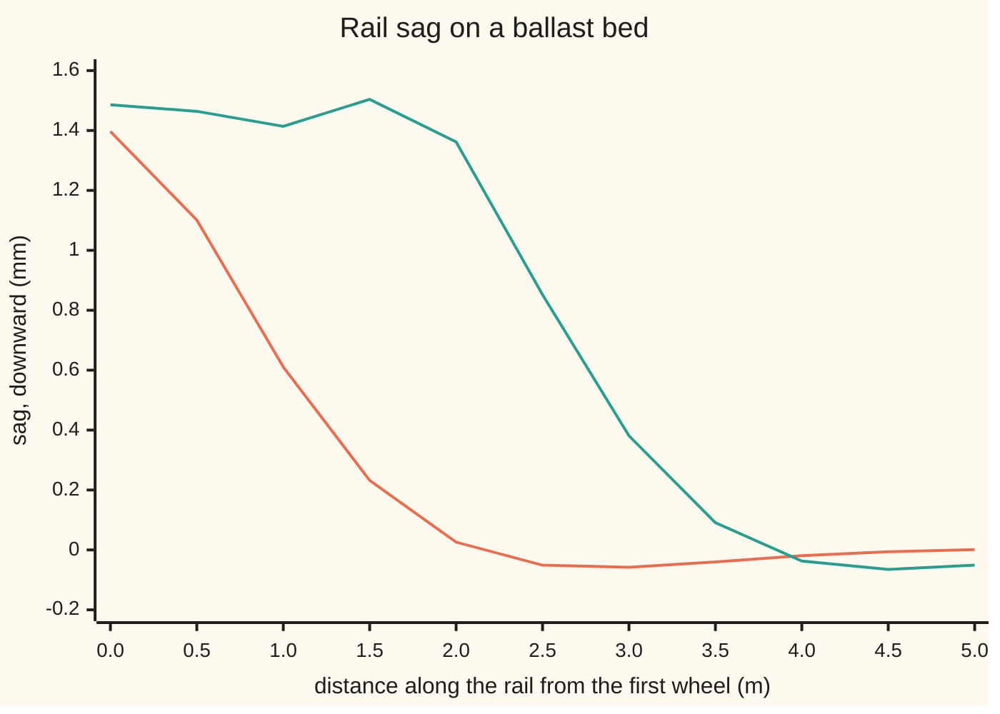

# Fundamental solution: solve once for a spike, then convolve for any load

[Syllabus](../../../SYLLABUS.md) → [Functional analysis](../README.md) → [Distributions and Sobolev Spaces](../README.md#s04) → Fundamental solution

---

## General Overview

A steel rail lies on a bed of ballast (crushed stone). A train wheel presses down on it with 100 kN, about the weight of 10 tonnes. The rail sinks 1.3967 mm under the wheel. Beside the wheel, the dip fades within about 2 m. Further out, the rail even rises a little, by 0.0604 mm at 2.8116 m.

Engineers want the dip under every load: one wheel, a bogie (the two-wheel set under one end of a carriage), a whole train. So they solve once, for one sharp push at one point. The rail is linear (two loads together give the sum of their separate sags) and the same all along. So any load's sag is the single-push dip, copied to each place and weighted by the load there.

That single-push dip is the **fundamental solution**, the term used from here on. The sharp push is the delta, $`\delta`$, from [The delta](02-the-dirac-delta-and-derivatives-of-jumps.md). It has no value at its point. So "the rail's equation with a delta as the load" makes sense only between distributions (objects defined by what they do to smooth probe shapes), from [Distributions](01-test-functions-and-distributions.md).

A computer can only rehearse this with finitely many numbers. Cut 20 m of rail into 399 grid nodes, make the push one tall block on one node, and solve a matrix equation: the sag comes out at 1.397786 mm, and the gap to the true dip shrinks as the grid gets finer (Step 5).

All numbers for the rail and bed are illustrative, chosen to be typical of a heavy rail on ballast.

**Solve the equation once with a delta as the load, on the whole line, using the distribution meaning of "solve"; then the response to any load is that one solution convolved with the load.**

**What kind of fact this is:** a theorem. That the rail's $`G`$ solves $`LG = \delta`$, and that $`G * q`$ then solves $`Lw = q`$ for every integrable or bounded load $`q`$, are proved on this card in Why it works. That every linear equation with constant coefficients has a fundamental solution is the Malgrange–Ehrenpreis theorem, stated here with its sources. The rail on a springy bed is a model: an assumption that fits well enough, not a law.

### The picture: one wheel, then a bogie



Orange: one 100 kN wheel at 0 m, the fundamental solution times 100 kN. Green: a bogie, wheels at 0 m and 1.8 m, made by adding two shifted copies of the orange curve. The dip is mirror-symmetric, so only the right half of the single wheel is drawn. Just inboard of each wheel the bogie sags a little more than under it: 1.504 mm at 1.5 m against 1.486 mm under each wheel, so the bogie's deepest point is not under a wheel. Both curves come from the closed form; the grid of 399 nodes ($`h`$ = 0.05 m) agrees with them to about 0.001 mm (1.398 against 1.397 under the wheel).

---

## The formula

Write $`x`$ for the distance along the rail in metres and $`w(x)`$ for the sag there, downward. A load $`q(x)`$ in newtons per metre presses on the rail. The rail resists bending with stiffness $`EI`$ (steel's modulus times the cross-section's second moment of area). The bed pushes back with $`k\,w`$, like a row of springs; this is the Winkler model. Balance of forces on a short piece of rail gives

```math
L w \;=\; EI\, w'''' + k\, w \;=\; q
```

Here $`L`$ is the operator (a rule that turns one function into another) that takes a sag and returns the load that would cause it. The fundamental solution $`G`$ is the solution for a unit spike at 0, and it builds every other solution:

```math
L G = \delta, \qquad w(x) = (G * q)(x) = \int_{-\infty}^{\infty} G(x - s)\, q(s)\, ds
```

For the rail, with $`\beta`$ (per metre) the inverse of the dip's decay length,

```math
G(x) = \frac{\beta}{2k}\, e^{-\beta |x|} \left( \cos \beta|x| + \sin \beta|x| \right), \qquad \beta = \left( \frac{k}{4EI} \right)^{1/4}
```

**Read it aloud:** the sag at $`x`$ is the load at each place $`s`$, times the dip that a unit push at $`s`$ makes at $`x`$, added over the whole rail.

$`LG = \delta`$ is an equation between distributions. It means: for every test function $`\varphi`$ (a smooth probe shape that is zero far away),

```math
(LG)(\varphi) \;=\; \int_{-\infty}^{\infty} G(x) \left( EI\, \varphi''''(x) + k\, \varphi(x) \right) dx \;=\; \varphi(0)
```

The derivatives land on the probe, not on $`G`$. That is the meaning of a derivative of a distribution from [Distributions](01-test-functions-and-distributions.md), applied four times.

| Symbol | Plain meaning | In our example | Push it up and the answer… |
| --- | --- | --- | --- |
| $`x`$, $`s`$, $`d`$ | where the sag is read; where a load sits; wheel spacing, all in m | wheel at $`s = 0`$; $`d = 1.8`$ | larger $`d`$: the neighbour's share falls fast |
| $`w(x)`$, $`w_i`$ | sag of the rail, in m, downward; the sag at grid node $`i`$ | 1.3967 mm under one wheel | — |
| $`q(x)`$, $`P`$ | load per metre of rail, N/m; one wheel's load, N | $`P`$ = 100 kN; a bogie is two spikes of $`P`$ | sag grows in proportion |
| $`EI`$ | the rail's bending stiffness, N m² | 6.4155 MN m² | shallower, wider dip |
| $`k`$ | the bed's stiffness: push-back per metre of rail per metre of sag, N/m² | 40 MN/m² | shallower, narrower dip |
| $`\beta`$ | $`(k/4EI)^{1/4}`$, per m; $`1/\beta`$ is the decay length | 1.117358 per m; 0.8950 m | narrower dip |
| $`L`$, $`\delta`$, $`\delta_s`$ | the operator $`EI\,w'''' + k\,w`$ (sag in, load out); the unit spike at 0, which reads a probe's value at 0; the spike moved to $`s`$ | — | — |
| $`G`$, $`\hat G(\xi)`$ | fundamental solution: sag from a 1 N spike at 0, m per N; its Fourier transform at spatial frequency $`\xi`$ | $`P\,G(0)`$ = 1.3967 mm | — |
| $`[F]`$ | the jump of a function $`F`$ across 0: $`F(0^+) - F(0^-)`$ | $`[G'''] = 1/EI`$ | — |
| $`r`$, $`A`$, $`B`$ | a growth rate tried in Step 1 ($`i`$ is $`\sqrt{-1}`$); the dip's two constants for $`x > 0`$ | $`A = B = \beta/(2k)`$ | — |
| $`\varphi`$, $`a`$ | a probe shape; its width | $`e^{-(x/a)^2}`$, $`a = 0.5`$ m | any width gives the same test result |
| $`h`$, $`N`$ | grid spacing in m; number of grid nodes | 0.05 m; 399 nodes on 20 m | smaller $`h`$: closer to $`G`$, error falls like $`h^2`$ |

### When it holds

- **Linear, small sags.** The rail stays elastic and the bed pushes back in proportion to the sag. Past that, loads stop adding, and no single $`G`$ exists.
- **The same rail and bed everywhere.** Then the response to a push at $`s`$ is $`G(x - s)`$, a shifted copy, and the sum is a convolution. On a bridge approach, where $`k`$ changes, the response is a two-place kernel $`G(x, s)`$ instead, as on the [Green's function](../../08-Differential%20equations%20and%20dynamics/07-Series%20Solutions%20and%20Boundary%20Problems/10-greens-function-for-a-boundary-problem.md) card.
- **Both stiffnesses positive.** With no bed ($`k = 0`$) no fundamental solution decays, and the sag depends on where the rail ends (mistake 1). With no bending stiffness ($`EI = 0`$) the "solution" is the spike $`\delta/k`$ itself, not a function (mistake 2).
- **Decay at both ends picks the answer.** $`LG = \delta`$ alone does not fix $`G`$: adding any solution of $`Lu = 0`$ keeps it true. Asking that $`G`$ stay bounded removes them all, because every one of them grows at one end.
- **The bed pushes both ways.** Where $`G`$ is negative, as on the stretch that starts at 2.1087 m, the model has the bed pulling the rail down. Real ballast cannot pull, so the small lift there is the model's, not a measurement.

---

## Why it works

### Step 0: a load is a crowd of spikes, and the rail treats them all alike

Cut a load into thin slices. The slice at $`s`$ is a spike of size $`q(s)\,ds`$, that is $`q(s)\,ds\;\delta_s`$, where $`\delta_s`$ is the spike moved to $`s`$. The rail is linear, so the slices' sags add. The rail is the same everywhere, so a spike at $`s`$ gives the dip $`G`$ moved to $`s`$: $`G(x - s)`$. Adding over all slices gives $`w = G * q`$. This is the same idea as the [Convolution](../../08-Differential%20equations%20and%20dynamics/08-Laplace%20Transforms%20for%20Initial-Value%20Problems/07-convolution-and-the-impulse-response.md) card's impulse response, where time plays the part of distance. So everything hangs on one question: what is $`G`$?

### Step 1: away from the spike, the rail obeys the unloaded equation

At every $`x \ne 0`$ there is no load, so $`EI\,G'''' + k\,G = 0`$. Try $`G = e^{rx}`$: then $`EI\,r^4 + k = 0`$, so $`r^4 = -4\beta^4`$. The four roots are $`r = \beta(\pm 1 \pm i)`$, since $`(1 + i)^4 = (2i)^2 = -4`$. In real form, the unloaded shapes are $`e^{\pm\beta x}`$ times $`\cos\beta x`$ or $`\sin\beta x`$.

For $`x > 0`$ the sag must stay bounded, so only $`e^{-\beta x}`$ survives:

```math
G(x) = e^{-\beta x}\left( A\cos\beta x + B\sin\beta x \right), \qquad x > 0
```

The rail and bed look the same from either side, so $`G`$ is even: $`G(-x) = G(x)`$. Two unknowns remain, $`A`$ and $`B`$.

### Step 2: what the spike demands at 0

The spike is felt only through $`(LG)(\varphi) = \varphi(0)`$. Split the integral at 0 and integrate by parts four times on each side (folded proof below). The parts away from 0 vanish, because $`LG = 0`$ there and $`\varphi`$ is zero far away. What is left is a sum of the jumps of $`G`$ and its first three derivatives at 0, each times a derivative of $`\varphi`$ at 0:

```math
(LG)(\varphi) = EI\left( [G''']\,\varphi(0) - [G'']\,\varphi'(0) + [G']\,\varphi''(0) - [G]\,\varphi'''(0) \right)
```

Here $`[F]`$ means $`F(0^+) - F(0^-)`$, the jump across 0. For this to equal $`\varphi(0)`$ for every probe:

- $`G`$, $`G'`$ and $`G''`$ must not jump: the rail does not tear, kink or snap its bending moment (the turning effect that bends the rail).
- $`G'''`$ must jump by exactly $`1/EI`$: the shear force (the force across a cut in the rail) changes by the spike's 1 N.

Compare the [Green's function](../../08-Differential%20equations%20and%20dynamics/07-Series%20Solutions%20and%20Boundary%20Problems/10-greens-function-for-a-boundary-problem.md) card's canvas shelf. Its equation has two derivatives, so its tent has a corner: the slope jumps. The rail's equation has four, so the break moves up to the third derivative and the dip looks smooth.

### Step 3: two conditions fix the dip

An even function has $`G'(0) = 0`$ if $`G'`$ does not jump. From Step 1, $`G'(0^+) = \beta(B - A)`$, so $`B = A`$. Differentiating $`e^{-\beta x}(\cos\beta x + \sin\beta x)`$ three times gives $`4\beta^3 e^{-\beta x}\cos\beta x`$, which is $`4\beta^3`$ at 0. So $`G'''(0^+) = 4A\beta^3`$.

$`G'''`$ is odd, so its jump is $`2\,G'''(0^+) = 8A\beta^3`$. Setting that to $`1/EI`$ gives $`A = 1/(8EI\beta^3)`$. Since $`4EI\beta^4 = k`$, this is $`A = \beta/(2k)`$, which is the formula. $`G''`$ is even, so it does not jump either. All conditions hold.

<details>
<summary>Detailed proof: the probe test gives exactly the jumps</summary>

Let $`\varphi`$ be smooth and zero outside a bounded interval. On $`x > 0`$, integrate $`G\varphi''''`$ by parts four times. Each step moves one derivative from $`\varphi`$ to $`G`$ and leaves a boundary term at 0; the term at infinity is zero because $`\varphi`$ is.

$`\displaystyle \int_0^\infty G\varphi''''\,dx = -G(0^+)\varphi'''(0) + G'(0^+)\varphi''(0) - G''(0^+)\varphi'(0) + G'''(0^+)\varphi(0) + \int_0^\infty G''''\varphi\,dx`$

On $`x < 0`$ the same steps give the same boundary terms with $`0^-`$ and every sign reversed, since 0 is now the upper end.

$`\displaystyle \int_{-\infty}^0 G\varphi''''\,dx = G(0^-)\varphi'''(0) - G'(0^-)\varphi''(0) + G''(0^-)\varphi'(0) - G'''(0^-)\varphi(0) + \int_{-\infty}^0 G''''\varphi\,dx`$

Add the two lines, multiply by $`EI`$, and add $`\int k\,G\varphi\,dx`$. The leftover integrals combine to $`\int (EI\,G'''' + kG)\varphi\,dx`$ over $`x \ne 0`$, which is zero by Step 1. The boundary terms give the jump formula of Step 2. With the jumps of Step 3 only $`EI \times (1/EI)\,\varphi(0) = \varphi(0)`$ survives.

So $`(LG)(\varphi) = \varphi(0) = \delta(\varphi)`$ for every test function: $`LG = \delta`$ as distributions.

Uniqueness among bounded solutions: if two bounded solutions both work, their difference is a distribution sent to 0 by $`L`$. A distribution solving this equation with constant coefficients is a smooth function (Strichartz, in the Sources, proves this), so the difference is a sum of the four unloaded shapes of Step 1. Each nonzero sum grows like $`e^{\beta|x|}`$ at one end at least. A bounded difference is therefore zero.

</details>

### Step 4: the convolution solves every load

Read $`G * q`$ on a probe. $`L`$ has only even derivatives, so moving all four onto the probe costs no sign, as in the formula above. Then swap the order of integration:

```math
\big(L(G * q)\big)(\varphi) = \int \Big( \int G(x - s)\, q(s)\, ds \Big) (L\varphi)(x)\, dx = \int q(s) \Big( \int G(x - s)\, (L\varphi)(x)\, dx \Big) ds = \int q(s)\, \varphi(s)\, ds
```

The swap is allowed by [Tonelli and Fubini](../../10-Measure%20and%20integration/06-Product%20Measures%20and%20Fubini/03-tonelli-and-fubini.md): $`G`$ is bounded and integrable and $`L\varphi`$ is zero far away, so the double integral of absolute values is finite whenever the load $`q`$ is integrable or bounded. The inner integral reads the dip moved to $`s`$ against $`L\varphi`$. Because $`L`$ has the same coefficients everywhere, that moved dip solves $`L\,G(\cdot - s) = \delta_s`$, so the inner integral is $`\delta_s(\varphi) = \varphi(s)`$. The last integral is $`q`$ read on the probe, so $`L(G * q) = q`$ as distributions. Two checks on the rail:

- **Two wheels.** The bogie's load is $`P\delta_0 + P\delta_d`$. Its sag is $`P\,G(x) + P\,G(x - d)`$, the green curve in the picture.
- **A load spread evenly everywhere.** The sag of $`q`$ newtons per metre is $`q/k`$: the bed takes it all and the rail does not bend. The convolution must agree, so $`k\int G\,dx = 1`$. The code integrates it and gets 1.00000000.

A second door is the Fourier transform. It turns $`LG = \delta`$ into $`(EI\,\xi^4 + k)\,\hat G(\xi) = 1`$, so $`\hat G = 1/(EI\,\xi^4 + k)`$. That route needs transforms of distributions, from [Tempered distributions](05-tempered-distributions-and-the-fourier-transform.md).

[The heat kernel](../../08-Differential%20equations%20and%20dynamics/10-The%20Classical%20PDEs/10-the-heat-kernel.md) is another worked fundamental solution: the heat equation's response to a point of heat.

### Step 5: the finite rehearsal, and what it hides

On a computer, cut the rail to 20 m with pinned ends (zero sag and zero bending moment). Put grid nodes $`h`$ apart. Replace $`w''''`$ by the five-point difference $`(w_{i-2} - 4w_{i-1} + 6w_i - 4w_{i+1} + w_{i+2})/h^4`$. The rail becomes an $`N \times N`$ matrix with five bands. The spike becomes a vector that is $`P/h`$ on one node and zero elsewhere: a block of height $`P/h`$ and width $`h`$, so its area is $`P`$. That block is a box stand-in for the delta, of width $`h`$: the flat-box case of the smooth stand-ins on the [Convolution and mollifiers](03-convolution-and-mollifiers.md) card.

Solving this system is ordinary linear algebra, and its answer converges to $`P\,G`$:

| Grid spacing h (m) | Nodes N | Sag at the wheel (mm) | Error (mm) | Error ratio |
| --- | ---: | ---: | ---: | ---: |
| 0.4 | 49 | 1.460829 | +0.064132 | — |
| 0.2 | 99 | 1.413802 | +0.017104 | 3.7494 |
| 0.1 | 199 | 1.401036 | +0.004339 | 3.9421 |
| 0.05 | 399 | 1.397786 | +0.001089 | 3.9858 |

Each halving of $`h`$ divides the error by nearly 4, so the error falls like $`h^2`$. Doubling the rail to 40 m changes nothing in six decimals (1.397786 mm both times): the dip has died out long before the ends.

What the truncation hides:

- On the grid the spike is an honest vector. Its height $`P/h`$ grows without limit as $`h \to 0`$, so in the limit there is no function to solve for, only the probe test.
- On the grid the pinned ends pick the one answer. On the whole line there are no ends, and the decay condition has to do that job. Mistake 1 shows what happens when no decaying answer exists.

---

## Worked numbers, by hand

Steel rail: $`EI = 210 \times 10^9 \times 3055 \times 10^{-8}`$ N m². Bed $`k = 40`$ MN/m². Wheel $`P = 100`$ kN.

| Step | Arithmetic | Value |
| --- | --- | --- |
| bending stiffness $`EI`$ | $`210 \times 10^9 \times 3.055 \times 10^{-5}`$ | 6.4155 MN m² |
| $`k/(4EI)`$ | $`40 / (4 \times 6.4155)`$ | 1.558725 per m⁴ |
| $`\beta`$ | $`1.558725^{1/4}`$ | 1.117358 per m |
| decay length $`1/\beta`$ | $`1 / 1.117358`$ | 0.8950 m |
| **sag under one wheel**, $`P\beta/(2k)`$ | $`100{,}000 \times 1.117358 / (8 \times 10^7)`$ | **1.3967 mm** |
| bending moment under the wheel, $`P/(4\beta)`$ | $`100 / (4 \times 1.117358)`$ | 22.3742 kN m |
| first point of lift, $`3\pi/(4\beta)`$ | $`3\pi / (4 \times 1.117358)`$ | 2.1087 m |
| greatest lift, at $`\pi/\beta`$ = 2.8116 m | $`1.3967 \times e^{-\pi}`$ | 0.0604 mm |
| bogie: $`\beta d`$ | $`1.117358 \times 1.8`$ | 2.0112 |
| $`e^{-\beta d}`$ and $`\cos\beta d + \sin\beta d`$ | from the two values above | 0.1338 and 0.4782 |
| neighbour's share, $`P\,G(1.8)`$ | $`1.3967 \times 0.1338 \times 0.4782`$ | 0.0894 mm |
| **sag under each bogie wheel** | $`1.3967 + 0.0894`$ | **1.4861 mm** |
| bending moment under each bogie wheel, $`\frac{P}{4\beta}\left(1 + e^{-\beta d}(\cos\beta d - \sin\beta d)\right)`$ | $`22.3742 \times (1 + 0.1338 \times (-1.3309))`$ | 18.3893 kN m |

One wheel sinks the rail 1.3967 mm; its neighbour 1.8 m away adds only 0.0894 mm, and it lowers the bending moment from 22.3742 to 18.3893 kN m, because at 1.8 m the dip is already curving the other way.

### What breaks if you drop a piece

| Mistake | Comes out at | What went wrong |
| --- | --- | --- |
| No ballast, $`k = 0`$ | middle sag 0.3248 m on a 10 m rail, 2.5980 m on 20 m, 20.7833 m on 40 m | No decaying $`G`$ exists. The only fundamental solutions, $`\lvert x\rvert^3/(12EI)`$ plus unloaded shapes, grow, so the ends set the answer. The sag grows 8-fold per doubling: a trend over the rail's length that never settles. |
| No bending stiffness, $`EI = 0`$ | 25.0, 50.0, 100.0 mm at $`h`$ = 0.1, 0.05, 0.025 m | $`G = \delta/k`$, a spike. The grid's answer $`P/(kh)`$ doubles each time $`h`$ halves. |
| Drop the 2 in $`P\beta/(2k)`$ | 2.7934 mm; probe test 2.000000 | Each side of the rail carries half the wheel. Without the 2, the jump in $`G'''`$ is $`2/EI`$, a spike of 2 wheels. |
| Bogie: add the two peaks | 2.7934 mm, not 1.4861 | The second wheel's dip must be read where the first wheel stands, 1.8 m from its own peak, not at its peak. |

The first row's sags are the linear model's numbers, far past where it applies; the point is the growth. The code also prints the textbook beam-on-two-supports value, 0.3247 m on 10 m, as a cross-check.

---

## Code, from first principles, and it actually runs

Nothing is imported except `math`. The code takes four roads to the rail's dip. Road one is the closed form $`G`$. Road two is the probe test: it integrates $`G`$ against $`L\varphi`$ for Gaussian probes by Simpson's rule (an integration rule written out in the code), and must get $`\varphi(0)`$. A Gaussian is not zero far away, so strictly it is not a test function; but it and $`G`$ fall off so fast that every end term in the fold still vanishes, and [Tempered distributions](05-tempered-distributions-and-the-fourier-transform.md) admits such fast-fading probes in full. Road three checks $`k\int G = 1`$. Road four never mentions $`G`$: it builds the five-band matrix of Step 5 and solves it by elimination inside the band, for one wheel and for the bogie. The asserts compare the roads, and the "what breaks" cases against their own formulas.

### Python

```python
# Fundamental solution of a rail on a ballast bed: EI w'''' + k w = load.
# Standard library only.  Roads: the closed form G; the probe test
# (LG)(phi) = phi(0); the identity k * (integral of G) = 1; and a rail of
# N grid nodes solved by banded elimination, which never mentions G.
import math

EI = 210e9 * 3055e-8   # N m^2: steel rail, I = 3055 cm^4 (illustrative)
k = 40e6               # N/m per m of rail: the ballast bed (illustrative)
P = 100e3              # N: one wheel (illustrative)
d = 1.8                # m: spacing of the two wheels of a bogie
beta = (k / (4 * EI)) ** 0.25

def G(x):              # sag at x, in m, from a 1 N spike at 0
    y = beta * abs(x)
    return beta / (2 * k) * math.exp(-y) * (math.cos(y) + math.sin(y))

def simpson(f, a, b, n):
    hh = (b - a) / n
    s = f(a) + f(b) + sum((4 if i % 2 else 2) * f(a + i * hh) for i in range(1, n))
    return s * hh / 3

def rail(EIg, kg, length, h, loads):
    """Rail from -length/2 to length/2, ends pinned (w = w'' = 0).
    A load (x, F) is a spike F/h on one node.  Returns the sag at node x."""
    n = round(length / h) - 1
    A = [[0.0] * n for _ in range(n)]
    b = [0.0] * n
    c = EIg / h ** 4
    for i in range(n):
        for j, v in zip(range(i - 2, i + 3), (1, -4, 6, -4, 1)):
            if 0 <= j < n:
                A[i][j] += c * v
        A[i][i] += kg
    A[0][0] -= c                       # ghost node beyond a pinned end: w = -w(mirror)
    A[n - 1][n - 1] -= c
    for x, F in loads:
        b[round((x + length / 2) / h) - 1] += F / h
    for i in range(n):                 # elimination inside the band, no pivoting
        for r in range(i + 1, min(i + 3, n)):
            m = A[r][i] / A[i][i]
            for j in range(i, min(i + 3, n)):
                A[r][j] -= m * A[i][j]
            b[r] -= m * b[i]
    w = [0.0] * n
    for i in range(n - 1, -1, -1):
        w[i] = (b[i] - sum(A[i][j] * w[j] for j in range(i + 1, min(i + 3, n)))) / A[i][i]
    return lambda x: w[round((x + length / 2) / h) - 1]

mm = 1000
print(f"rail: EI = {EI / 1e6:.4f} MN m^2, bed k = {k / 1e6:.1f} MN/m^2, wheel P = {P / 1e3:.0f} kN")
print(f"beta = (k/(4 EI))^(1/4) = ({k / (4 * EI):.6f})^(1/4) = {beta:.6f} per m; decay length 1/beta = {1 / beta:.4f} m")
print(f"sag under the wheel P beta/(2k) = {P * G(0) * mm:.4f} mm")
print(f"first lift-off at x = 3 pi/(4 beta) = {3 * math.pi / (4 * beta):.4f} m; "
      f"greatest lift {-P * G(math.pi / beta) * mm:.4f} mm at x = pi/beta = {math.pi / beta:.4f} m")
print(f"bending moment under the wheel P/(4 beta) = {P / (4 * beta) / 1e3:.4f} kN m")

# road 2: the probe test, (LG)(phi) = integral of G (EI phi'''' + k phi) = phi(0)
def probe(c, a, scale=1.0):
    def Lphi(x):
        u = (x - c) / a
        e = math.exp(-u * u)
        return EI * (16 * u ** 4 - 48 * u ** 2 + 12) / a ** 4 * e + k * e
    return simpson(lambda x: scale * G(x) * Lphi(x), -12, 12, 4800)
for c in (0.0, 0.5):
    got, want = probe(c, 0.5), math.exp(-(c / 0.5) ** 2)
    print(f"probe width 0.5 m centred at {c:.1f} m: (LG)(phi) = {got:.8f}, phi(0) = {want:.8f}")
    assert abs(got - want) < 1e-7
# road 3: a load spread evenly sags the rail by load/k, so k * (integral of G) = 1
area = k * simpson(G, -20, 20, 8000)
print(f"k * integral of G = {area:.8f}")
assert abs(area - 1) < 1e-8

# road 4: a rail of grid nodes; the discrete spike is P/h on one node
print("h (m)   nodes  sag at wheel (mm)  error vs P G(0) (mm)  error ratio")
prev = None
for h in (0.4, 0.2, 0.1, 0.05):
    s = rail(EI, k, 20, h, [(0, P)])(0) * mm
    err = s - P * G(0) * mm
    ratio = f"{prev / err:.4f}" if prev else "-"
    print(f"{h:<7} {round(20 / h) - 1:<6} {s:.6f}           {err:+.6f}             {ratio}")
    prev = err
assert abs(s - P * G(0) * mm) < 2e-3
w20, w40 = rail(EI, k, 20, 0.05, [(0, P)]), rail(EI, k, 40, 0.05, [(0, P)])
print(f"rail 20 m against 40 m, h = 0.05: sag at wheel {w20(0) * mm:.6f} vs {w40(0) * mm:.6f} mm")
xs = [0.5 * i for i in range(11)]
print("x (m)        " + " ".join(f"{x:6.1f}" for x in xs))
print("P G(x) (mm)  " + " ".join(f"{P * G(x) * mm:6.3f}" for x in xs))
print("grid (mm)    " + " ".join(f"{w20(x) * mm:6.3f}" for x in xs))
print("bogie (mm)   " + " ".join(f"{P * (G(x) + G(x - d)) * mm:6.3f}" for x in xs))
for x in xs:
    assert abs(w20(x) - P * G(x)) < 5e-6

# any load: a bogie, two wheels d apart, is G convolved with two spikes
two = P * (G(0) + G(d))
g2 = rail(EI, k, 20, 0.05, [(0, P), (d, P)])
print(f"bogie, wheels {d} m apart: sag under each wheel {two * mm:.4f} mm, grid {g2(0) * mm:.4f} mm")
bd = beta * d
print(f"  beta d = {bd:.4f}, e^(-beta d) = {math.exp(-bd):.4f}, cos + sin = {math.cos(bd) + math.sin(bd):.4f}, "
      f"cos - sin = {math.cos(bd) - math.sin(bd):.4f}")
print(f"  the neighbour adds P G({d}) = {P * G(d) * mm:.4f} mm")
mom = P / (4 * beta) * (1 + math.exp(-beta * d) * (math.cos(beta * d) - math.sin(beta * d)))
print(f"  bending moment under each wheel {mom / 1e3:.4f} kN m")
assert abs(g2(0) - two) < 5e-6

# what breaks
print("mistake 1, no ballast (k = 0): sag at the middle, h = 0.1")
for length in (10, 20, 40):
    s = rail(EI, 0.0, length, 0.1, [(0, P)])(0)
    print(f"  rail {length} m: {s:.4f} m (beam on two supports, no bed: {P * length ** 3 / (48 * EI):.4f} m)")
    assert abs(s / (P * length ** 3 / (48 * EI)) - 1) < 1e-3
print("mistake 2, no bending stiffness (EI = 0): sag at the wheel = P/(k h)")
for h in (0.1, 0.05, 0.025):
    s = rail(0.0, k, 4, h, [(0, P)])(0)
    print(f"  h = {h}: {s * mm:.1f} mm")
    assert abs(s - P / (k * h)) < 1e-12
print(f"mistake 3, no halving, P beta/k: {2 * P * G(0) * mm:.4f} mm; probe gives {probe(0.0, 0.5, 2.0):.6f}")
print(f"mistake 4, two wheels' peaks added: {2 * P * G(0) * mm:.4f} mm, not {two * mm:.4f}")
# try changing: one setting at a time
for name, EIt, kt in (("bed k = 80 MN/m^2", EI, 80e6), ("bed k = 20 MN/m^2", EI, 20e6), ("rail EI doubled", 2 * EI, k)):
    bt = (kt / (4 * EIt)) ** 0.25
    print(f"try {name}: sag {P * bt / (2 * kt) * mm:.4f} mm, decay length {1 / bt:.4f} m")
print(f"try wheels 1.5 m apart: sag under each wheel {P * (G(0) + G(1.5)) * mm:.4f} mm")
print(f"try a probe of width 0.1 m: (LG)(phi) = {probe(0.0, 0.1):.6f}")
print("ALL CHECKS PASS")
```

**Ran 2026-11-15 on macOS, Python 3.14.10, standard library only. All checks passed. Output, pasted from the run:**

```
rail: EI = 6.4155 MN m^2, bed k = 40.0 MN/m^2, wheel P = 100 kN
beta = (k/(4 EI))^(1/4) = (1.558725)^(1/4) = 1.117358 per m; decay length 1/beta = 0.8950 m
sag under the wheel P beta/(2k) = 1.3967 mm
first lift-off at x = 3 pi/(4 beta) = 2.1087 m; greatest lift 0.0604 mm at x = pi/beta = 2.8116 m
bending moment under the wheel P/(4 beta) = 22.3742 kN m
probe width 0.5 m centred at 0.0 m: (LG)(phi) = 1.00000000, phi(0) = 1.00000000
probe width 0.5 m centred at 0.5 m: (LG)(phi) = 0.36787944, phi(0) = 0.36787944
k * integral of G = 1.00000000
h (m)   nodes  sag at wheel (mm)  error vs P G(0) (mm)  error ratio
0.4     49     1.460829           +0.064132             -
0.2     99     1.413802           +0.017104             3.7494
0.1     199    1.401036           +0.004339             3.9421
0.05    399    1.397786           +0.001089             3.9858
rail 20 m against 40 m, h = 0.05: sag at wheel 1.397786 vs 1.397786 mm
x (m)           0.0    0.5    1.0    1.5    2.0    2.5    3.0    3.5    4.0    4.5    5.0
P G(x) (mm)   1.397  1.101  0.611  0.232  0.026 -0.051 -0.058 -0.040 -0.019 -0.006  0.001
grid (mm)     1.398  1.101  0.611  0.232  0.026 -0.051 -0.058 -0.040 -0.019 -0.006  0.001
bogie (mm)    1.486  1.464  1.414  1.504  1.362  0.852  0.381  0.091 -0.037 -0.065 -0.051
bogie, wheels 1.8 m apart: sag under each wheel 1.4861 mm, grid 1.4871 mm
  beta d = 2.0112, e^(-beta d) = 0.1338, cos + sin = 0.4782, cos - sin = -1.3309
  the neighbour adds P G(1.8) = 0.0894 mm
  bending moment under each wheel 18.3893 kN m
mistake 1, no ballast (k = 0): sag at the middle, h = 0.1
  rail 10 m: 0.3248 m (beam on two supports, no bed: 0.3247 m)
  rail 20 m: 2.5980 m (beam on two supports, no bed: 2.5979 m)
  rail 40 m: 20.7833 m (beam on two supports, no bed: 20.7830 m)
mistake 2, no bending stiffness (EI = 0): sag at the wheel = P/(k h)
  h = 0.1: 25.0 mm
  h = 0.05: 50.0 mm
  h = 0.025: 100.0 mm
mistake 3, no halving, P beta/k: 2.7934 mm; probe gives 2.000000
mistake 4, two wheels' peaks added: 2.7934 mm, not 1.4861
try bed k = 80 MN/m^2: sag 0.8305 mm, decay length 0.7526 m
try bed k = 20 MN/m^2: sag 2.3490 mm, decay length 1.0643 m
try rail EI doubled: sag 1.1745 mm, decay length 1.0643 m
try wheels 1.5 m apart: sag under each wheel 1.6291 mm
try a probe of width 0.1 m: (LG)(phi) = 1.000000
ALL CHECKS PASS
```

### Rust

```rust
// Fundamental solution of a rail on a ballast bed: EI w'''' + k w = load.
// std only.  Roads: the closed form G; the probe test (LG)(phi) = phi(0);
// the identity k * (integral of G) = 1; and a rail of N grid nodes solved
// by banded elimination, which never mentions G.
use std::f64::consts::PI;

const EI: f64 = 210e9 * 3055e-8; // N m^2: steel rail, I = 3055 cm^4 (illustrative)
const K: f64 = 40e6; // N/m per m of rail: the ballast bed (illustrative)
const P: f64 = 100e3; // N: one wheel (illustrative)
const D: f64 = 1.8; // m: spacing of the two wheels of a bogie
const MM: f64 = 1000.0;

fn beta() -> f64 { (K / (4.0 * EI)).powf(0.25) }

// sag at x, in m, from a 1 N spike at 0
fn g(x: f64) -> f64 {
    let b = beta();
    let y = b * x.abs();
    b / (2.0 * K) * (-y).exp() * (y.cos() + y.sin())
}

fn simpson(f: &dyn Fn(f64) -> f64, a: f64, b: f64, n: usize) -> f64 {
    let hh = (b - a) / n as f64;
    let mut s = f(a) + f(b);
    for i in 1..n {
        s += if i % 2 == 1 { 4.0 } else { 2.0 } * f(a + i as f64 * hh);
    }
    s * hh / 3.0
}

struct Rail { w: Vec<f64>, length: f64, h: f64 }

impl Rail {
    fn at(&self, x: f64) -> f64 { self.w[((x + self.length / 2.0) / self.h).round() as usize - 1] }
}

// Rail from -length/2 to length/2, ends pinned (w = w'' = 0).
// A load (x, F) is a spike F/h on one node.
fn rail(eig: f64, kg: f64, length: f64, h: f64, loads: &[(f64, f64)]) -> Rail {
    let n = (length / h).round() as usize - 1;
    let mut a = vec![vec![0.0f64; n]; n];
    let mut b = vec![0.0f64; n];
    let c = eig / h.powi(4);
    for i in 0..n {
        for (off, v) in [1.0, -4.0, 6.0, -4.0, 1.0].iter().enumerate() {
            let j = i as i64 - 2 + off as i64;
            if j >= 0 && (j as usize) < n {
                a[i][j as usize] += c * v;
            }
        }
        a[i][i] += kg;
    }
    a[0][0] -= c; // ghost node beyond a pinned end: w = -w(mirror)
    a[n - 1][n - 1] -= c;
    for &(x, f) in loads {
        b[((x + length / 2.0) / h).round() as usize - 1] += f / h;
    }
    for i in 0..n {
        // elimination inside the band, no pivoting
        for r in i + 1..(i + 3).min(n) {
            let m = a[r][i] / a[i][i];
            for j in i..(i + 3).min(n) {
                a[r][j] -= m * a[i][j];
            }
            b[r] -= m * b[i];
        }
    }
    let mut w = vec![0.0f64; n];
    for i in (0..n).rev() {
        let mut s = b[i];
        for j in i + 1..(i + 3).min(n) {
            s -= a[i][j] * w[j];
        }
        w[i] = s / a[i][i];
    }
    Rail { w, length, h }
}

// (LG)(phi) for the probe phi = exp(-((x - c)/a)^2), times scale
fn probe(c: f64, a: f64, scale: f64) -> f64 {
    let lphi = move |x: f64| {
        let u = (x - c) / a;
        let e = (-u * u).exp();
        EI * (16.0 * u.powi(4) - 48.0 * u * u + 12.0) / a.powi(4) * e + K * e
    };
    simpson(&|x| scale * g(x) * lphi(x), -12.0, 12.0, 4800)
}

fn main() {
    let beta = beta();
    println!("rail: EI = {:.4} MN m^2, bed k = {:.1} MN/m^2, wheel P = {:.0} kN", EI / 1e6, K / 1e6, P / 1e3);
    println!("beta = (k/(4 EI))^(1/4) = ({:.6})^(1/4) = {:.6} per m; decay length 1/beta = {:.4} m", K / (4.0 * EI), beta, 1.0 / beta);
    println!("sag under the wheel P beta/(2k) = {:.4} mm", P * g(0.0) * MM);
    println!("first lift-off at x = 3 pi/(4 beta) = {:.4} m; greatest lift {:.4} mm at x = pi/beta = {:.4} m",
        3.0 * PI / (4.0 * beta), -P * g(PI / beta) * MM, PI / beta);
    println!("bending moment under the wheel P/(4 beta) = {:.4} kN m", P / (4.0 * beta) / 1e3);

    // road 2: the probe test
    for c in [0.0, 0.5] {
        let (got, want) = (probe(c, 0.5, 1.0), (-(c / 0.5f64).powi(2)).exp());
        println!("probe width 0.5 m centred at {:.1} m: (LG)(phi) = {:.8}, phi(0) = {:.8}", c, got, want);
        assert!((got - want).abs() < 1e-7);
    }
    // road 3: k * (integral of G) = 1
    let area = K * simpson(&g, -20.0, 20.0, 8000);
    println!("k * integral of G = {:.8}", area);
    assert!((area - 1.0).abs() < 1e-8);

    // road 4: a rail of grid nodes
    println!("h (m)   nodes  sag at wheel (mm)  error vs P G(0) (mm)  error ratio");
    let mut prev: Option<f64> = None;
    let mut s = 0.0;
    for h in [0.4, 0.2, 0.1, 0.05] {
        s = rail(EI, K, 20.0, h, &[(0.0, P)]).at(0.0) * MM;
        let err = s - P * g(0.0) * MM;
        let ratio = prev.map_or("-".to_string(), |p| format!("{:.4}", p / err));
        let nodes = (20.0 / h).round() as usize - 1;
        println!("{:<7} {:<6} {:.6}           {:+.6}             {}", h, nodes, s, err, ratio);
        prev = Some(err);
    }
    assert!((s - P * g(0.0) * MM).abs() < 2e-3);
    let w20 = rail(EI, K, 20.0, 0.05, &[(0.0, P)]);
    let w40 = rail(EI, K, 40.0, 0.05, &[(0.0, P)]);
    println!("rail 20 m against 40 m, h = 0.05: sag at wheel {:.6} vs {:.6} mm", w20.at(0.0) * MM, w40.at(0.0) * MM);
    let xs: Vec<f64> = (0..11).map(|i| 0.5 * i as f64).collect();
    let row = |f: &dyn Fn(f64) -> f64, p: usize| xs.iter().map(|&x| format!("{:6.*}", p, f(x))).collect::<Vec<_>>().join(" ");
    println!("x (m)        {}", row(&|x| x, 1));
    println!("P G(x) (mm)  {}", row(&|x| P * g(x) * MM, 3));
    println!("grid (mm)    {}", row(&|x| w20.at(x) * MM, 3));
    println!("bogie (mm)   {}", row(&|x| P * (g(x) + g(x - D)) * MM, 3));
    for &x in &xs { assert!((w20.at(x) - P * g(x)).abs() < 5e-6); }

    // any load: a bogie
    let two = P * (g(0.0) + g(D));
    let g2 = rail(EI, K, 20.0, 0.05, &[(0.0, P), (D, P)]);
    println!("bogie, wheels {} m apart: sag under each wheel {:.4} mm, grid {:.4} mm", D, two * MM, g2.at(0.0) * MM);
    let bd = beta * D;
    println!("  beta d = {:.4}, e^(-beta d) = {:.4}, cos + sin = {:.4}, cos - sin = {:.4}",
        bd, (-bd).exp(), bd.cos() + bd.sin(), bd.cos() - bd.sin());
    println!("  the neighbour adds P G({}) = {:.4} mm", D, P * g(D) * MM);
    let mom = P / (4.0 * beta) * (1.0 + (-beta * D).exp() * ((beta * D).cos() - (beta * D).sin()));
    println!("  bending moment under each wheel {:.4} kN m", mom / 1e3);
    assert!((g2.at(0.0) - two).abs() < 5e-6);

    // what breaks
    println!("mistake 1, no ballast (k = 0): sag at the middle, h = 0.1");
    for length in [10, 20, 40] {
        let l = length as f64;
        let s = rail(EI, 0.0, l, 0.1, &[(0.0, P)]).at(0.0);
        let want = P * l.powi(3) / (48.0 * EI);
        println!("  rail {} m: {:.4} m (beam on two supports, no bed: {:.4} m)", length, s, want);
        assert!((s / want - 1.0).abs() < 1e-3);
    }
    println!("mistake 2, no bending stiffness (EI = 0): sag at the wheel = P/(k h)");
    for h in [0.1, 0.05, 0.025] {
        let s = rail(0.0, K, 4.0, h, &[(0.0, P)]).at(0.0);
        println!("  h = {}: {:.1} mm", h, s * MM);
        assert!((s - P / (K * h)).abs() < 1e-12);
    }
    println!("mistake 3, no halving, P beta/k: {:.4} mm; probe gives {:.6}", 2.0 * P * g(0.0) * MM, probe(0.0, 0.5, 2.0));
    println!("mistake 4, two wheels' peaks added: {:.4} mm, not {:.4}", 2.0 * P * g(0.0) * MM, two * MM);
    // try changing: one setting at a time
    for (name, eit, kt) in [("bed k = 80 MN/m^2", EI, 80e6), ("bed k = 20 MN/m^2", EI, 20e6), ("rail EI doubled", 2.0 * EI, K)] {
        let bt = (kt / (4.0 * eit)).powf(0.25);
        println!("try {}: sag {:.4} mm, decay length {:.4} m", name, P * bt / (2.0 * kt) * MM, 1.0 / bt);
    }
    println!("try wheels 1.5 m apart: sag under each wheel {:.4} mm", P * (g(0.0) + g(1.5)) * MM);
    println!("try a probe of width 0.1 m: (LG)(phi) = {:.6}", probe(0.0, 0.1, 1.0));
    println!("ALL CHECKS PASS");
}
```

**Ran 2026-11-15 on macOS, rustc 1.98.1, no crates. All checks passed. Output, pasted from the run:**

```
rail: EI = 6.4155 MN m^2, bed k = 40.0 MN/m^2, wheel P = 100 kN
beta = (k/(4 EI))^(1/4) = (1.558725)^(1/4) = 1.117358 per m; decay length 1/beta = 0.8950 m
sag under the wheel P beta/(2k) = 1.3967 mm
first lift-off at x = 3 pi/(4 beta) = 2.1087 m; greatest lift 0.0604 mm at x = pi/beta = 2.8116 m
bending moment under the wheel P/(4 beta) = 22.3742 kN m
probe width 0.5 m centred at 0.0 m: (LG)(phi) = 1.00000000, phi(0) = 1.00000000
probe width 0.5 m centred at 0.5 m: (LG)(phi) = 0.36787944, phi(0) = 0.36787944
k * integral of G = 1.00000000
h (m)   nodes  sag at wheel (mm)  error vs P G(0) (mm)  error ratio
0.4     49     1.460829           +0.064132             -
0.2     99     1.413802           +0.017104             3.7494
0.1     199    1.401036           +0.004339             3.9421
0.05    399    1.397786           +0.001089             3.9858
rail 20 m against 40 m, h = 0.05: sag at wheel 1.397786 vs 1.397786 mm
x (m)           0.0    0.5    1.0    1.5    2.0    2.5    3.0    3.5    4.0    4.5    5.0
P G(x) (mm)   1.397  1.101  0.611  0.232  0.026 -0.051 -0.058 -0.040 -0.019 -0.006  0.001
grid (mm)     1.398  1.101  0.611  0.232  0.026 -0.051 -0.058 -0.040 -0.019 -0.006  0.001
bogie (mm)    1.486  1.464  1.414  1.504  1.362  0.852  0.381  0.091 -0.037 -0.065 -0.051
bogie, wheels 1.8 m apart: sag under each wheel 1.4861 mm, grid 1.4871 mm
  beta d = 2.0112, e^(-beta d) = 0.1338, cos + sin = 0.4782, cos - sin = -1.3309
  the neighbour adds P G(1.8) = 0.0894 mm
  bending moment under each wheel 18.3893 kN m
mistake 1, no ballast (k = 0): sag at the middle, h = 0.1
  rail 10 m: 0.3248 m (beam on two supports, no bed: 0.3247 m)
  rail 20 m: 2.5980 m (beam on two supports, no bed: 2.5979 m)
  rail 40 m: 20.7833 m (beam on two supports, no bed: 20.7830 m)
mistake 2, no bending stiffness (EI = 0): sag at the wheel = P/(k h)
  h = 0.1: 25.0 mm
  h = 0.05: 50.0 mm
  h = 0.025: 100.0 mm
mistake 3, no halving, P beta/k: 2.7934 mm; probe gives 2.000000
mistake 4, two wheels' peaks added: 2.7934 mm, not 1.4861
try bed k = 80 MN/m^2: sag 0.8305 mm, decay length 0.7526 m
try bed k = 20 MN/m^2: sag 2.3490 mm, decay length 1.0643 m
try rail EI doubled: sag 1.1745 mm, decay length 1.0643 m
try wheels 1.5 m apart: sag under each wheel 1.6291 mm
try a probe of width 0.1 m: (LG)(phi) = 1.000000
ALL CHECKS PASS
```

### Lean

Lean proves that $`G`$ is the rail's fundamental solution, for every rail and bed with $`EI > 0`$ and $`k > 0`$.

- Take any test function $`\varphi`$. Then $`\int G\,L\varphi\,dx = \varphi(0)`$: that is, $`LG = \delta`$ as distributions.
- Take a load $`q`$ that is integrable or bounded. Then $`L(G * q) = q`$ as distributions: both sides give the same number on every test function.
- Take the same rail and bed. Then $`G`$ is integrable and $`k\int G\,dx = 1`$, as a load spread evenly demands.
- Lean also checks exact arithmetic. It confirms $`(1 + i)^4 = -4`$ from Step 1, $`EI`$ = 6.4155 MN m², and mistake 2's 25, 50 and 100 mm.

The decimal values, the grid rehearsal and the "what breaks" cases are left to the Python and Rust checks.

```lean
-- Fundamental solution: the rail's dip G solves EI G'''' + k G = δ as distributions, its convolution with any integrable or bounded load solves EI w'''' + k w = q, and k times the area under G is 1.
import Mathlib.Analysis.Convolution
import Mathlib.Analysis.SpecialFunctions.Trigonometric.Basic
import Mathlib.Analysis.SpecialFunctions.Pow.Real
import Mathlib.Analysis.Calculus.IteratedDeriv.Defs
import Mathlib.Analysis.Calculus.ContDiff.Defs
import Mathlib.MeasureTheory.Measure.Lebesgue.Basic
import Mathlib.Analysis.Complex.Basic
import Mathlib.Tactic.NormNum
import Mathlib.Tactic.Ring
import Mathlib.Analysis.SpecialFunctions.Trigonometric.Deriv
import Mathlib.Analysis.Calculus.IteratedDeriv.Lemmas
import Mathlib.MeasureTheory.Integral.IntegralEqImproper
import Mathlib.MeasureTheory.Measure.Lebesgue.Integral
import Mathlib.MeasureTheory.Integral.ExpDecay

open MeasureTheory Real
open scoped Convolution ContDiff

/-- The rail's decay rate β = (k / (4 EI))^(1/4), per metre. -/
noncomputable def railBeta (EI k : ℝ) : ℝ := (k / (4 * EI)) ^ ((1 : ℝ) / 4)

/-- The rail's dip from a unit spike at 0:
G(x) = β/(2k) · e^(−β|x|) · (cos β|x| + sin β|x|). -/
noncomputable def railG (EI k : ℝ) (x : ℝ) : ℝ :=
  railBeta EI k / (2 * k) * Real.exp (-(railBeta EI k * |x|)) *
    (Real.cos (railBeta EI k * |x|) + Real.sin (railBeta EI k * |x|))

/-- The rail's operator L applied to a probe: (Lφ)(x) = EI φ''''(x) + k φ(x). -/
noncomputable def railL (EI k : ℝ) (φ : ℝ → ℝ) (x : ℝ) : ℝ :=
  EI * iteratedDeriv 4 φ x + k * φ x

open Set Filter Topology in
lemma rail_aux_derivs (b x : ℝ) :
    HasDerivAt (fun x => exp (-(b*x)) * (cos (b*x) + sin (b*x)))
      (-2*b*(exp (-(b*x))*sin (b*x))) x ∧
    HasDerivAt (fun x => -2*b*(exp (-(b*x))*sin (b*x)))
      (2*b^2*(exp (-(b*x))*(sin (b*x) - cos (b*x)))) x ∧
    HasDerivAt (fun x => 2*b^2*(exp (-(b*x))*(sin (b*x) - cos (b*x))))
      (4*b^3*(exp (-(b*x))*cos (b*x))) x ∧
    HasDerivAt (fun x => 4*b^3*(exp (-(b*x))*cos (b*x)))
      (-4*b^4*(exp (-(b*x))*(cos (b*x) + sin (b*x)))) x := by
  have hbx : HasDerivAt (fun x => b*x) b x := by simpa using (hasDerivAt_id x).const_mul b
  have hn : HasDerivAt (fun x => -(b*x)) (-b) x := hbx.neg
  have he := hn.exp
  have hc := hbx.cos
  have hs := hbx.sin
  refine ⟨?_, ?_, ?_, ?_⟩
  · exact (he.mul (hc.add hs)).congr_deriv (by simp only [Pi.add_apply]; ring)
  · exact ((he.mul hs).const_mul (-2*b)).congr_deriv (by ring)
  · exact ((he.mul (hs.sub hc)).const_mul (2*b^2)).congr_deriv
      (by simp only [Pi.sub_apply]; ring)
  · exact ((he.mul hc).const_mul (4*b^3)).congr_deriv (by ring)

open Set Filter Topology in
lemma rail_iteratedDeriv_facts (φ : ℝ → ℝ) (hφ : ContDiff ℝ ∞ φ) (hφc : HasCompactSupport φ)
    (n : ℕ) :
    HasCompactSupport (iteratedDeriv n φ) ∧ Continuous (iteratedDeriv n φ) ∧
    ∀ x, HasDerivAt (iteratedDeriv n φ) (iteratedDeriv (n+1) φ x) x := by
  refine ⟨?_, hφ.continuous_iteratedDeriv n (by exact_mod_cast le_top), fun x => ?_⟩
  · induction n with
    | zero => simpa using hφc
    | succ n ih => rw [iteratedDeriv_succ]; exact ih.deriv
  · rw [iteratedDeriv_succ]
    exact ((hφ.differentiable_iteratedDeriv n
      (by exact_mod_cast WithTop.coe_lt_top _)) x).hasDerivAt


open Set Filter Topology in
lemma rail_half_line (EI k b : ℝ) (hb : 4 * b^4 * EI = k) (φ : ℝ → ℝ)
    (hφ : ContDiff ℝ ∞ φ) (hφc : HasCompactSupport φ) :
    ∫ x in Ioi 0, exp (-(b*x)) * (cos (b*x) + sin (b*x)) *
        (EI * iteratedDeriv 4 φ x + k * φ x)
      = -EI * (iteratedDeriv 3 φ 0 - 2*b^2 * iteratedDeriv 1 φ 0 - 4*b^3 * φ 0) := by
  obtain ⟨c0, -, d0⟩ := rail_iteratedDeriv_facts φ hφ hφc 0
  obtain ⟨c1, -, d1⟩ := rail_iteratedDeriv_facts φ hφ hφc 1
  obtain ⟨c2, -, d2⟩ := rail_iteratedDeriv_facts φ hφ hφc 2
  obtain ⟨c3, -, d3⟩ := rail_iteratedDeriv_facts φ hφ hφc 3
  obtain ⟨c4, k4, -⟩ := rail_iteratedDeriv_facts φ hφ hφc 4
  simp only [iteratedDeriv_zero, zero_add] at c0 d0
  set D1 := iteratedDeriv 1 φ
  set D2 := iteratedDeriv 2 φ
  set D3 := iteratedDeriv 3 φ
  set D4 := iteratedDeriv 4 φ
  set g0 : ℝ → ℝ := fun x => exp (-(b*x)) * (cos (b*x) + sin (b*x)) with hg0
  set g1 : ℝ → ℝ := fun x => -2*b*(exp (-(b*x))*sin (b*x)) with hg1
  set g2 : ℝ → ℝ := fun x => 2*b^2*(exp (-(b*x))*(sin (b*x) - cos (b*x))) with hg2
  set g3 : ℝ → ℝ := fun x => 4*b^3*(exp (-(b*x))*cos (b*x)) with hg3
  set F : ℝ → ℝ := (fun _ => EI) * (g0 * D3 - g1 * D2 + g2 * D1 - g3 * φ) with hF
  have hFd : ∀ x, HasDerivAt F (g0 x * (EI * D4 x + k * φ x)) x := by
    intro x
    obtain ⟨e0, e1, e2, e3⟩ := rail_aux_derivs b x
    have := (((((e0.mul (d3 x)).sub (e1.mul (d2 x))).add (e2.mul (d1 x))).sub
      (e3.mul (d0 x))).const_mul EI)
    refine this.congr_deriv ?_
    simp only [g0, ← hb]
    ring
  have hFc : HasCompactSupport F :=
    ((((c3.mul_left).sub c2.mul_left).add c1.mul_left).sub c0.mul_left).mul_left
  have hint : HasCompactSupport (fun x => g0 x * (EI * D4 x + k * φ x)) :=
    HasCompactSupport.mul_left (f := g0) (f' := (fun _ => EI) * D4 + (fun _ => k) * φ)
      (c4.mul_left.add c0.mul_left)
  have hcont : Continuous (fun x => g0 x * (EI * D4 x + k * φ x)) := by
    have := hφ.continuous
    fun_prop
  rw [integral_Ioi_of_hasDerivAt_of_tendsto (f := F) (m := 0)
    (hFd 0).continuousAt.continuousWithinAt (fun x _ => hFd x)
    (hcont.integrable_of_hasCompactSupport hint).integrableOn
    (hFc.is_zero_at_infty.mono_left atTop_le_cocompact)]
  simp only [F, g0, g1, g2, g3, Pi.mul_apply, Pi.sub_apply, Pi.add_apply, mul_zero, neg_zero,
    exp_zero, cos_zero, sin_zero]
  ring

open Set Filter Topology in
lemma railBeta_facts (EI k : ℝ) (hEI : 0 < EI) (hk : 0 < k) :
    0 < railBeta EI k ∧ 4 * railBeta EI k ^ 4 * EI = k := by
  have hpos : 0 < k / (4 * EI) := by positivity
  refine ⟨Real.rpow_pos_of_pos hpos _, ?_⟩
  have : railBeta EI k ^ 4 = k / (4 * EI) := by
    unfold railBeta
    rw [← Real.rpow_natCast, ← Real.rpow_mul hpos.le]
    norm_num
  rw [this]
  field_simp

open Set Filter Topology in
lemma railG_continuous (EI k : ℝ) : Continuous (railG EI k) := by
  unfold railG; fun_prop

open Set Filter Topology in
lemma railL_facts (EI k : ℝ) (φ : ℝ → ℝ) (hφ : ContDiff ℝ ∞ φ) (hφc : HasCompactSupport φ) :
    Continuous (railL EI k φ) ∧ HasCompactSupport (railL EI k φ) := by
  obtain ⟨c0, -, -⟩ := rail_iteratedDeriv_facts φ hφ hφc 0
  obtain ⟨c4, k4, -⟩ := rail_iteratedDeriv_facts φ hφ hφc 4
  simp only [iteratedDeriv_zero] at c0
  refine ⟨?_, HasCompactSupport.add (f := (fun _ => EI) * iteratedDeriv 4 φ)
      (f' := (fun _ => k) * φ) c4.mul_left c0.mul_left⟩
  have := hφ.continuous
  unfold railL
  fun_prop

open Set Filter Topology in
lemma rail_g0_integral (b : ℝ) (hb : 0 < b) :
    IntegrableOn (fun x => exp (-(b*x)) * (cos (b*x) + sin (b*x))) (Ioi 0) ∧
    ∫ x in Ioi 0, exp (-(b*x)) * (cos (b*x) + sin (b*x)) = 1 / b := by
  have hint : IntegrableOn (fun x => exp (-(b*x)) * (cos (b*x) + sin (b*x))) (Ioi 0) := by
    refine Integrable.mono' ((exp_neg_integrableOn_Ioi 0 hb).const_mul 2)
      (by fun_prop : Continuous _).aestronglyMeasurable.restrict
      (Eventually.of_forall fun x => ?_)
    rw [Real.norm_eq_abs, abs_mul, abs_of_pos (exp_pos _), neg_mul]
    have h1 : |cos (b*x) + sin (b*x)| ≤ 2 :=
      (abs_add_le _ _).trans (by linarith [abs_cos_le_one (b*x), abs_sin_le_one (b*x)])
    nlinarith [exp_pos (-(b*x))]
  refine ⟨hint, ?_⟩
  have hd : ∀ x, HasDerivAt (fun x => -1/b * (exp (-(b*x)) * cos (b*x)))
      (exp (-(b*x)) * (cos (b*x) + sin (b*x))) x := by
    intro x
    have hbx : HasDerivAt (fun x => b*x) b x := by simpa using (hasDerivAt_id x).const_mul b
    have hn : HasDerivAt (fun x => -(b*x)) (-b) x := hbx.neg
    refine ((hn.exp.mul hbx.cos).const_mul (-1/b)).congr_deriv ?_
    field_simp
    ring
  have hlim : Tendsto (fun x => -1/b * (exp (-(b*x)) * cos (b*x))) atTop (𝓝 0) := by
    have he : Tendsto (fun x => exp (-(b*x))) atTop (𝓝 0) :=
      tendsto_exp_neg_atTop_nhds_zero.comp (tendsto_id.const_mul_atTop hb)
    have : Tendsto (fun x => 1/b * exp (-(b*x))) atTop (𝓝 0) := by
      simpa using he.const_mul (1/b)
    refine squeeze_zero_norm (fun x => ?_) this
    rw [Real.norm_eq_abs, abs_mul, abs_mul, abs_of_pos (exp_pos _), abs_div, abs_neg, abs_one,
      abs_of_pos hb]
    have hcos := abs_cos_le_one (b*x)
    have he0 := exp_pos (-(b*x))
    have hb' : 0 < 1/b := by positivity
    exact mul_le_mul_of_nonneg_left (mul_le_of_le_one_right he0.le hcos) hb'.le
  rw [integral_Ioi_of_hasDerivAt_of_tendsto (hd 0).continuousAt.continuousWithinAt
    (fun x _ => hd x) hint hlim]
  simp only [mul_zero, neg_zero, exp_zero, cos_zero, mul_one]
  ring

open Set Filter Topology in
lemma railG_integrable (EI k : ℝ) (hEI : 0 < EI) (hk : 0 < k) : Integrable (railG EI k) := by
  obtain ⟨hβ, -⟩ := railBeta_facts EI k hEI hk
  set β := railBeta EI k with hβdef
  set H : ℝ → ℝ := Set.indicator (Ici 0) (fun x => exp (-β * x)) with hHdef
  have hH : Integrable H := (integrable_indicator_iff measurableSet_Ici).2
    ((integrableOn_Ici_iff_integrableOn_Ioi).2 (exp_neg_integrableOn_Ioi 0 hβ))
  have hc : 0 < β / (2 * k) := by positivity
  refine Integrable.mono' ((hH.add hH.comp_neg).const_mul (β / (2 * k) * 2))
    (railG_continuous EI k).aestronglyMeasurable (Eventually.of_forall fun x => ?_)
  have key : ‖railG EI k x‖ ≤ β / (2 * k) * 2 * exp (-(β * |x|)) := by
    rw [Real.norm_eq_abs, railG, ← hβdef, abs_mul, abs_mul, abs_of_pos hc,
      abs_of_pos (exp_pos _)]
    have h1 : |cos (β*|x|) + sin (β*|x|)| ≤ 2 :=
      (abs_add_le _ _).trans (by linarith [abs_cos_le_one (β*|x|), abs_sin_le_one (β*|x|)])
    have := exp_pos (-(β * |x|))
    have := mul_le_mul_of_nonneg_left h1 (mul_pos hc this).le
    linarith
  have h2 : exp (-(β * |x|)) ≤ H x + H (-x) := by
    have hnn : ∀ y, 0 ≤ H y := fun y => Set.indicator_nonneg (fun _ _ => (exp_pos _).le) y
    rcases le_or_gt 0 x with hx | hx
    · have : H x = exp (-(β * |x|)) := by
        rw [hHdef, Set.indicator_of_mem (by exact hx), abs_of_nonneg hx, neg_mul]
      linarith [hnn (-x)]
    · have : H (-x) = exp (-(β * |x|)) := by
        rw [hHdef, Set.indicator_of_mem (by simp; linarith), abs_of_neg hx, neg_mul]
      linarith [hnn x]
  calc ‖railG EI k x‖ ≤ β / (2 * k) * 2 * exp (-(β * |x|)) := key
    _ ≤ β / (2 * k) * 2 * (H x + H (-x)) := by gcongr

/-- The card's main claim, LG = δ as distributions: if the rail's bending stiffness EI and the
bed's stiffness k are both positive, then for every test function φ (smooth and zero outside a
bounded interval) the rail's dip G read against Lφ = EI φ'''' + k φ gives φ(0), that is
∫ G(x) (EI φ''''(x) + k φ(x)) dx = φ(0). -/
theorem rail_dip_is_fundamental_solution (EI k : ℝ) (hEI : 0 < EI) (hk : 0 < k)
    (φ : ℝ → ℝ) (hφ : ContDiff ℝ ∞ φ) (hφc : HasCompactSupport φ) :
    ∫ x, railG EI k x * railL EI k φ x = φ 0 := by
  obtain ⟨hβ, hβ4⟩ := railBeta_facts EI k hEI hk
  set β := railBeta EI k with hβdef
  obtain ⟨hLcont, hLc⟩ := railL_facts EI k φ hφ hφc
  have hint : Integrable (fun x => railG EI k x * railL EI k φ x) :=
    Continuous.integrable_of_hasCompactSupport ((railG_continuous EI k).mul hLcont)
      (hLc.mul_left (f := railG EI k))
  rw [← intervalIntegral.integral_Iic_add_Ioi (b := 0) hint.integrableOn hint.integrableOn]
  -- right half
  have hR : ∫ x in Set.Ioi 0, railG EI k x * railL EI k φ x
      = β / (2 * k) * (-EI * (iteratedDeriv 3 φ 0 - 2*β^2 * iteratedDeriv 1 φ 0
          - 4*β^3 * φ 0)) := by
    rw [← rail_half_line EI k β hβ4 φ hφ hφc, ← integral_const_mul]
    refine setIntegral_congr_fun measurableSet_Ioi (fun x hx => ?_)
    have : |x| = x := abs_of_pos hx
    simp only [railG, railL, this, ← hβdef]
    ring
  -- left half
  set ψ : ℝ → ℝ := fun x => φ (-x) with hψ
  have hψs : ContDiff ℝ ∞ ψ := hφ.comp contDiff_neg
  have hψc : HasCompactSupport ψ := hφc.comp_homeomorph (Homeomorph.neg ℝ)
  have hL : ∫ x in Set.Iic 0, railG EI k x * railL EI k φ x
      = β / (2 * k) * (-EI * (iteratedDeriv 3 ψ 0 - 2*β^2 * iteratedDeriv 1 ψ 0
          - 4*β^3 * ψ 0)) := by
    have h := integral_comp_neg_Ioi 0 (fun x => railG EI k x * railL EI k φ x)
    rw [neg_zero] at h
    rw [← h, ← rail_half_line EI k β hβ4 ψ hψs hψc, ← integral_const_mul]
    refine setIntegral_congr_fun measurableSet_Ioi (fun x hx => ?_)
    have : |-x| = x := by rw [abs_neg]; exact abs_of_pos hx
    simp only [railG, railL, this, ← hβdef, hψ, iteratedDeriv_comp_neg]
    norm_num
    ring
  rw [hL, hR]
  simp only [hψ, iteratedDeriv_comp_neg, neg_zero]
  have hk0 : k ≠ 0 := hk.ne'
  rw [← hβ4] at hk0 ⊢
  field_simp
  ring

/-- Convolving solves every load: if EI and k are positive and the load q is integrable, or
measurable and bounded, then the sag w = G * q solves L w = q as distributions: for every test
function φ, ∫ (G * q)(x) (EI φ''''(x) + k φ(x)) dx = ∫ q(s) φ(s) ds. -/
theorem convolution_with_rail_dip_solves_any_load (EI k : ℝ) (hEI : 0 < EI) (hk : 0 < k)
    (q : ℝ → ℝ)
    (hq : Integrable q ∨ (AEStronglyMeasurable q volume ∧ ∃ M : ℝ, ∀ s, |q s| ≤ M))
    (φ : ℝ → ℝ) (hφ : ContDiff ℝ ∞ φ) (hφc : HasCompactSupport φ) :
    ∫ x, (railG EI k ⋆[ContinuousLinearMap.lsmul ℝ ℝ] q) x * railL EI k φ x
      = ∫ s, q s * φ s := by
  obtain ⟨hLcont, hLc⟩ := railL_facts EI k φ hφ hφc
  have hG := railG_integrable EI k hEI hk
  obtain ⟨C, hC⟩ := hLcont.bounded_above_of_compact_support hLc
  have hconv : ∀ x, (railG EI k ⋆[ContinuousLinearMap.lsmul ℝ ℝ] q) x
      = ∫ s, railG EI k (x - s) * q s := by
    intro x
    rw [convolution_lsmul_swap]
    simp only [smul_eq_mul]
  have hInt : Integrable (fun p : ℝ × ℝ => railG EI k (p.1 - p.2) * q p.2 * railL EI k φ p.1)
      (volume.prod volume) := by
    rcases hq with hq | ⟨hqm, M, hM⟩
    · have h1 := hq.convolution_integrand (ContinuousLinearMap.lsmul ℝ ℝ) hG
        (μ := volume) (ν := volume)
      have h2 := h1.mul_bdd (hLcont.aestronglyMeasurable.comp_fst) (c := C)
        (Filter.Eventually.of_forall fun p => hC p.1)
      refine h2.congr (Filter.Eventually.of_forall fun p => ?_)
      simp only [ContinuousLinearMap.lsmul_apply, smul_eq_mul]
      ring
    · have h1 := (hLcont.integrable_of_hasCompactSupport hLc).convolution_integrand
        (ContinuousLinearMap.lsmul ℝ ℝ) hG (μ := volume) (ν := volume)
      have h2 := h1.swap.mul_bdd (hqm.comp_snd) (c := M)
        (Filter.Eventually.of_forall fun p => by rw [Real.norm_eq_abs]; exact hM p.2)
      refine h2.congr (Filter.Eventually.of_forall fun p => ?_)
      simp only [Function.comp, Prod.fst_swap, Prod.snd_swap, ContinuousLinearMap.lsmul_apply,
        smul_eq_mul]
      have : railG EI k (p.2 - p.1) = railG EI k (p.1 - p.2) := by
        simp only [railG, abs_sub_comm]
      rw [this]
      ring
  simp_rw [hconv, ← integral_mul_const]
  rw [integral_integral_swap hInt]
  refine integral_congr_ae (Filter.Eventually.of_forall fun s => ?_)
  have e1 : (fun x => railG EI k (x - s) * q s * railL EI k φ x)
      = fun x => q s * (railG EI k (x - s) * railL EI k φ (x - s + s)) := by
    funext x
    rw [sub_add_cancel]
    ring
  simp only
  rw [e1, integral_const_mul,
    integral_sub_right_eq_self (fun y => railG EI k y * railL EI k φ (y + s)) s]
  congr 1
  have hφs : ContDiff ℝ ∞ (fun y => φ (y + s)) := hφ.comp (contDiff_id.add contDiff_const)
  have hφsc : HasCompactSupport (fun y => φ (y + s)) :=
    hφc.comp_homeomorph (Homeomorph.addRight s)
  have := rail_dip_is_fundamental_solution EI k hEI hk _ hφs hφsc
  simp only [zero_add] at this
  rw [← this]
  congr 1
  funext y
  simp only [railL, iteratedDeriv_comp_add_const]

/-- A load spread evenly everywhere sags the rail by load / k, so the bed's stiffness times the
area under the dip is 1: k ∫ G(x) dx = 1, and G is integrable. -/
theorem bed_stiffness_times_area_under_dip (EI k : ℝ) (hEI : 0 < EI) (hk : 0 < k) :
    Integrable (railG EI k) ∧ k * ∫ x, railG EI k x = 1 := by
  obtain ⟨hβ, hβ4⟩ := railBeta_facts EI k hEI hk
  set β := railBeta EI k with hβdef
  obtain ⟨-, hval⟩ := rail_g0_integral β hβ
  refine ⟨railG_integrable EI k hEI hk, ?_⟩
  have h := integral_comp_abs (f := fun t => β / (2 * k) * exp (-(β * t)) *
    (cos (β * t) + sin (β * t)))
  have h' : ∫ x, railG EI k x = 2 * ∫ t in Set.Ioi 0, β / (2 * k) * exp (-(β * t)) *
      (cos (β * t) + sin (β * t)) := h
  simp only [mul_assoc] at h'
  rw [h', integral_const_mul, hval]
  field_simp

-- Step 1: (1 + i)^4 = -4, so β(±1 ± i) are the four roots of r^4 = -4β^4.
example : (1 + Complex.I) ^ 4 = -4 := by
  have h : (1 + Complex.I) ^ 2 = 2 * Complex.I := by
    ring_nf; rw [Complex.I_sq]; ring
  rw [show (4 : ℕ) = 2 * 2 from rfl, pow_mul, h]
  ring_nf; rw [Complex.I_sq]; norm_num

-- Worked numbers: EI = 210 × 10^9 × 3055 × 10^(-8) N m² is 6,415,500 N m² (6.4155 MN m²).
example : (210 * 10 ^ 9 : ℚ) * (3055 / 10 ^ 8) = 6415500 := by
  norm_num

-- Mistake 2, no bending stiffness: the grid's sag P/(k h), in mm, with P = 100,000 N and
-- k = 40,000,000 N/m², is 25, 50 and 100 mm at h = 1/10, 1/20 and 1/40 m.
example : (100000 : ℚ) / (40000000 * (1 / 10)) * 1000 = 25 := by
  norm_num
example : (100000 : ℚ) / (40000000 * (1 / 20)) * 1000 = 50 := by
  norm_num
example : (100000 : ℚ) / (40000000 * (1 / 40)) * 1000 = 100 := by
  norm_num

#print axioms rail_aux_derivs
#print axioms rail_iteratedDeriv_facts
#print axioms rail_half_line
#print axioms railBeta_facts
#print axioms railG_continuous
#print axioms railL_facts
#print axioms rail_g0_integral
#print axioms railG_integrable
#print axioms rail_dip_is_fundamental_solution
#print axioms convolution_with_rail_dip_solves_any_load
#print axioms bed_stiffness_times_area_under_dip
```

**Checked 2026-11-15 on macOS, Lean 4.36.0-rc2, Mathlib v4.36.0-rc2. Every proof is complete and uses only Lean's standard axioms. Output, pasted from the run:**

```
'rail_aux_derivs' depends on axioms: [propext, Classical.choice, Quot.sound]
'rail_iteratedDeriv_facts' depends on axioms: [propext, Classical.choice, Quot.sound]
'rail_half_line' depends on axioms: [propext, Classical.choice, Quot.sound]
'railBeta_facts' depends on axioms: [propext, Classical.choice, Quot.sound]
'railG_continuous' depends on axioms: [propext, Classical.choice, Quot.sound]
'railL_facts' depends on axioms: [propext, Classical.choice, Quot.sound]
'rail_g0_integral' depends on axioms: [propext, Classical.choice, Quot.sound]
'railG_integrable' depends on axioms: [propext, Classical.choice, Quot.sound]
'rail_dip_is_fundamental_solution' depends on axioms: [propext, Classical.choice, Quot.sound]
'convolution_with_rail_dip_solves_any_load' depends on axioms: [propext, Classical.choice, Quot.sound]
'bed_stiffness_times_area_under_dip' depends on axioms: [propext, Classical.choice, Quot.sound]
```

> [!TIP]
> **Try changing**
> - Guess first: double the bed stiffness to 80 MN/m². Does the sag halve? No: it falls to 0.8305 mm, because $`P\beta/(2k)`$ goes like $`k^{-3/4}`$. The dip also narrows: decay length 0.7526 m.
> - Guess first: double the rail's $`EI`$ (a heavier rail). The sag falls only to 1.1745 mm, since it goes like $`EI^{-1/4}`$; the dip widens to 1.0643 m. Halving the bed to 20 MN/m² gives the same width but a deeper sag, 2.3490 mm.
> - Guess first: move the bogie's wheels to 1.5 m apart. Each wheel now sinks 1.6291 mm, more than at 1.8 m, because the neighbour sits higher on the dip.
> - Guess first: shrink the probe to 0.1 m wide. The probe test still gives 1.000000: $`\delta`$ reads only the value at 0, whatever the probe's shape.

---

## The usual mistake

> [!warning]
> **Checking $`LG = \delta`$ point by point.** At every $`x \ne 0`$, $`LG = 0`$, and at 0 the third derivative of $`G`$ does not exist. So a pointwise check sees nothing, and a wrong $`G`$ passes it as easily as the right one. Twice the true $`G`$ obeys $`LG = 0`$ at every $`x \ne 0`$ too. Only the probe test sees the spike's size: it gives 2.000000 for the doubled $`G`$, not 1.
>
> Four smaller traps:
> - **Forgetting that each side carries half.** $`P\beta/k`$ gives 2.7934 mm, twice the true 1.3967 mm.
> - **Adding peaks instead of convolving.** Two bogie wheels do not sink the rail 2.7934 mm. The convolution reads the neighbour's dip where it is, 1.8 m out: 1.4861 mm under each wheel.
> - **Assuming every operator has a decaying $`G`$.** Without the bed, $`k = 0`$, it does not, and a 10 m rail's linear model sags 0.3248 m in the middle.
> - **Treating the spike as a very tall number.** With $`EI = 0`$ the grid's sag is $`P/(kh)`$: 25.0 mm at $`h = 0.1`$ m and 100.0 mm at $`h = 0.025`$ m. There is no limit to find, because the answer is a distribution.

---

## Where you meet it in real life

- **Railway track design.** The rail on an elastic bed is the classical way to size rails and sleepers (the cross-ties under the rail). It gives the sag under a wheel, the bending moment and the load passed to each sleeper; every wheel of a train is a shifted $`G`$.
- **Pipelines and strip footings.** A buried pipe or a long concrete footing is a beam on a springy bed of soil, with the same $`G`$.
- **Electrostatics and gravity.** The potential of a point charge, $`1/(4\pi r)`$ times a constant, is the fundamental solution of the Laplacian. Any charge cloud's potential is that kernel convolved with the charge density.
- **Circuits and shock absorbers.** The impulse response of a linear system is its fundamental solution in time. The decay condition is replaced by causality: nothing happens before the kick, as on the [Convolution](../../08-Differential%20equations%20and%20dynamics/08-Laplace%20Transforms%20for%20Initial-Value%20Problems/07-convolution-and-the-impulse-response.md) card.
- **Boundary element software.** Engineering codes that solve only on a body's surface are built on a known fundamental solution.

> **Say it back**
> A rail on ballast under one wheel sinks 1.3967 mm, and that dip, scaled to a 1 N push, is the rail's fundamental solution $`G`$. It solves $`LG = \delta`$ in the distribution sense: integrated against $`L`$ of any probe, it returns the probe's value at 0. Away from the wheel the rail obeys the unloaded equation; at the wheel only the third derivative jumps, by $`1/EI`$, and decay at both ends picks the one answer. Because the rail is linear and the same everywhere, any load's sag is $`G`$ convolved with the load, as for the bogie's 1.4861 mm. Grids of $`N`$ nodes rehearse this with a matrix, and converge to $`G`$ at rate $`h^2`$.

---

## What this builds on

- [Convolution and mollifiers](03-convolution-and-mollifiers.md): smoothing by convolution, and stand-ins of stated width for $`\delta`$; the grid's one-node block is the flat-box kind.
- [Green's function](../../08-Differential%20equations%20and%20dynamics/07-Series%20Solutions%20and%20Boundary%20Problems/10-greens-function-for-a-boundary-problem.md): the response to a point load on a finite shelf with fixed ends, summed over any load. This card drops the ends and works on the whole line.
- [Convolution](../../08-Differential%20equations%20and%20dynamics/08-Laplace%20Transforms%20for%20Initial-Value%20Problems/07-convolution-and-the-impulse-response.md): any response as the impulse response convolved with the input, in time. This card is the same idea in space, with $`\delta`$ made precise.
- [The heat kernel](../../08-Differential%20equations%20and%20dynamics/10-The%20Classical%20PDEs/10-the-heat-kernel.md): a fully worked fundamental solution, the heat equation's response to a point of heat.

## Where this goes next

- The fundamental solution (planned): the general theory for any operator with constant coefficients, and the Malgrange–Ehrenpreis existence theorem.
- Poisson's equation (planned): the Laplacian's fundamental solution in two and three dimensions, and the potential of any charge or mass.
- [Tempered distributions](05-tempered-distributions-and-the-fourier-transform.md): the next card on this shelf, the Fourier transform of distributions, which turns an equation like $`LG = \delta`$ into division by a polynomial (Step 4's second door).
- [Weak solutions](08-weak-solutions-of-differential-equations.md): solving equations through probes when the load is not a single spike and the operator is not the same everywhere.

The question this card leaves open: when the operator changes from place to place, as at a bridge approach, there is no single $`G`$ to shift, so what replaces the convolution?

---

## Sources

Verified 2026-11-15: every link below resolves to the publisher's page.

- Ehrenpreis, Leon. "Solution of Some Problems of Division: Part I. Division by a Polynomial of Derivation." *American Journal of Mathematics* 76, no. 4 (1954): 883–903. [doi:10.2307/2372662](https://doi.org/10.2307/2372662). One of the two original proofs that every constant-coefficient operator has a fundamental solution.
- Malgrange, Bernard. "Existence et approximation des solutions des équations aux dérivées partielles et des équations de convolution." *Annales de l'Institut Fourier* 6 (1956): 271–355. [doi:10.5802/aif.65](https://doi.org/10.5802/aif.65). The other original proof of the same theorem.
- Kerr, Arnold D. "Elastic and Viscoelastic Foundation Models." *Journal of Applied Mechanics* 31, no. 3 (1964): 491–498. [doi:10.1115/1.3629667](https://doi.org/10.1115/1.3629667). The Winkler bed and its refinements, the model behind the rail example.
- Strichartz, Robert S. *A Guide to Distribution Theory and Fourier Transforms*. World Scientific, 2003. [doi:10.1142/5314](https://doi.org/10.1142/5314). Fundamental solutions as distributions, the probe test, and convolution with distributions, at this card's level.
