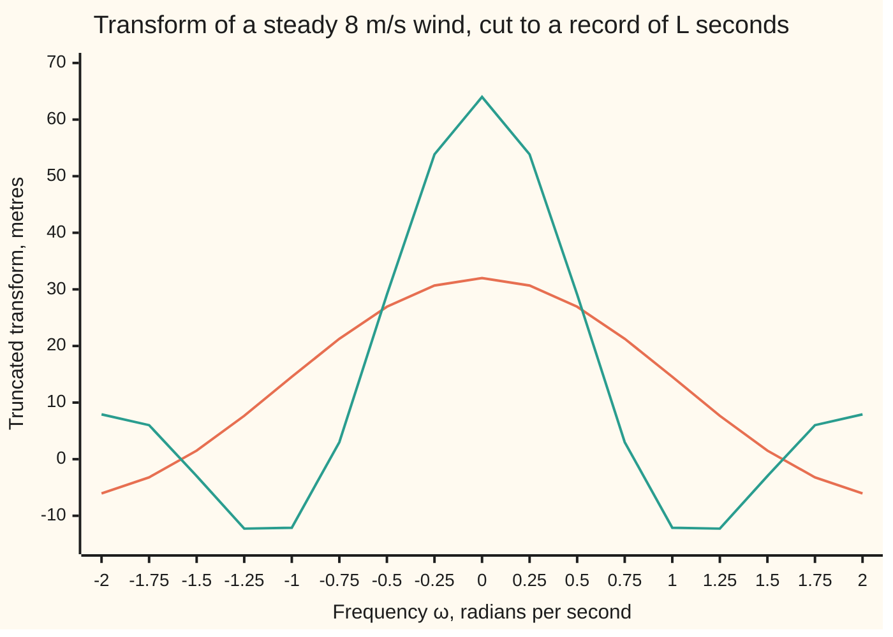

# Tempered distributions: taking the Fourier transform of a hum or a spike

[Syllabus](../../../SYLLABUS.md) → [Functional analysis](../README.md) → [Distributions and Sobolev Spaces](../README.md#s04) → Tempered distributions

---

## General Overview

An anemometer (a wind-speed meter) on a mast reads a steady 8 m/s. At t = 2 s a gust passes. For half a second the reading jumps to 14 m/s, then it falls back to 8. The gust carries 6 m/s × 0.5 s = 3 m of extra air past the meter. The numbers are illustrative.

An engineer wants the spectrum: how much of each frequency the wind holds. The Fourier transform from wing 07 cannot give it. The steady 8 m/s has infinite area, so the integral of 8 against a spinning wave never settles. Idealise the gust as an instant, a spike with area 3 m and no width, and it has no value at its own moment to integrate.

The fix is to stop transforming the signal. Transform the probe instead: a smooth bell that the signal is measured against. The probe always has a transform, and the signal only ever meets probes. The objects that survive this treatment are the **tempered distributions**, the term used from here on.

The answer for the wind is two pieces. The steady 8 m/s becomes a spike at frequency 0 with weight (the area the spike stands for) 2π × 8 = 50.265482. The gust becomes a flat spectrum of size 3 at every frequency, its phase turning with the 2 s delay.

**A tempered distribution is known only through its values on fast-fading smooth probes; its Fourier transform is defined by transforming the probe instead, so a constant becomes 2π times a delta, a delta becomes a constant, and the inverse transform brings both back.**

**What kind of fact this is:** a definition, the transform of a tempered distribution; the pairs for the constant and the delta, and inversion, are theorems proved on this card in Why it works, resting on the inversion theorem for smooth probes proved on [The Fourier transform](../../07-Complex%20analysis/08-Transforms%20in%20Outline/03-fourier-transform.md).

### The finite rehearsal: eight samples

Sample the wind every Δt = 0.5 s for 4 s. The record is the list 8 8 8 8 14 8 8 8, with the gust in the fifth sample, at t = 2 s.

Its discrete Fourier transform, times Δt so it approximates the integral, is the list 35, −3, 3, −3, 3, −3, 3, −3 ([The discrete Fourier transform](../../07-Complex%20analysis/08-Transforms%20in%20Outline/02-discrete-fourier-transform.md)). The steady wind puts 8 × 4 = 32 in the zero-frequency bin and nothing anywhere else. The gust adds 3 to every bin, with a sign that alternates because of its delay.

Nothing diverges in a list. The trouble starts when the record grows without end, as the picture shows.

### The picture: the steady wind's spectrum sharpens into a spike



Orange: a record of L = 4 s, peak 32. Green: L = 8 s, peak 64, half as wide. Each curve is 16 sin(ωL/2)/ω, the transform of a record of L seconds centred on t = 0. As L grows the peak grows without end, but the area under it stays 16π. In the limit there is no function left, only a weight at ω = 0: a delta.

---

## The formula

Notation first, in words.

- A **probe** φ (phi), or ψ (psi), is a smooth function that, with every derivative, fades faster than any power of 1/|t|. The set of all such probes is the **Schwartz space**, written $`\mathcal{S}`$. The bell $`e^{-t^2/2}`$ is one.
- A **tempered distribution** T is a rule that turns each probe into a number $`T(\varphi)`$, linearly and continuously in the sense below. Their set is written $`\mathcal{S}'`$. An ordinary signal f that grows at most like a power of t is one, through $`f(\varphi) = \int f(t)\,\varphi(t)\,dt`$.
- The hat is wing 07's transform, $`\hat\varphi(\omega) = \int \varphi(t)\,e^{-i\omega t}\,dt`$. The delta $`\delta_a`$ is the rule $`\delta_a(\varphi) = \varphi(a)`$, from [The delta](02-the-dirac-delta-and-derivatives-of-jumps.md); $`\delta`$ means $`\delta_0`$.

The definition:

```math
\hat T(\varphi) = T(\hat\varphi) \qquad \text{for every probe } \varphi \text{ in } \mathcal{S}
```

**Read it aloud:** the transform of T, measured with a probe, is T measured with the probe's transform.

A probe for a spectrum is a function of ω, so here its transform is $`\hat\varphi(t) = \int \varphi(\omega)\,e^{-i\omega t}\,d\omega`$, a function of time, which the signal T can read. The inverse below runs the other way: its probe ψ is a function of t.

The inverse runs the same way, with wing 07's inverse integral applied to the probe:

```math
(\mathcal{F}^{-1}T)(\psi) = T(\mathcal{F}^{-1}\psi), \qquad \mathcal{F}^{-1}\psi(\omega) = \frac{1}{2\pi}\int_{-\infty}^{\infty} \psi(t)\, e^{i\omega t}\, dt
```

**Read it aloud:** to undo the transform, undo it on the probe.

The three results this card proves:

```math
\hat\delta = 1, \qquad \hat 1 = 2\pi\,\delta, \qquad \widehat{8 + 3\,\delta_{2}} = 16\pi\,\delta + 3\,e^{-2i\omega}
```

**Read it aloud:** a spike's spectrum is flat; a constant's spectrum is 2π times a spike at zero frequency; the wind's spectrum is 16π at zero plus a flat 3 whose phase turns by 2 radians per radian-per-second.

"Continuously" has a precise meaning. A distribution T is tempered when one constant C and one whole number m bound it by the probe's worst weighted slopes:

```math
|T(\varphi)| \le C \max_{q,\, b \,\le\, m}\ \sup_t \big|\,t^q\, \varphi^{(b)}(t)\,\big|
```

Here $`t^q`$ is a power of t, $`\varphi^{(b)}`$ is the b-th derivative, and sup is the largest value over all t. For the constant 1 the bound holds with m = 2 and C = 2π; for the delta, with m = 0 and C = 1.

| Symbol | Plain meaning | In our example | Push it up and the answer… |
| --- | --- | --- | --- |
| $`t`$, $`\omega`$, $`\omega_0`$ | time in s; frequency in radians per second; a hum's own frequency | gust at t = 2 s | — |
| $`v(t)`$, $`\hat v(\omega)`$, $`t_0`$ | the wind signal; its spectrum; the gust's time | $`8 + 3\,\delta_2`$; $`16\pi\,\delta + 3\,e^{-2i\omega}`$ | later $`t_0`$: the phase turns faster, the size stays 3 |
| $`\delta_a`$, $`\delta`$ | the rule "read the probe at a"; $`\delta = \delta_0`$ | $`\delta_2(\varphi) = \varphi(2)`$ | — |
| $`\varphi`$, $`\psi`$ | probes: fast-fading smooth functions | the bell $`e^{-\omega^2/2}`$ | — |
| $`\hat\varphi`$ | the probe's transform | $`\sqrt{2\pi}\,e^{-t^2/2}`$ | — |
| $`\mathcal{S}`$, $`\mathcal{S}'`$ | Schwartz space: all probes; the tempered distributions on it | bells; constants, deltas, polynomials | — |
| $`T`$, $`T(\varphi)`$ | a distribution; its value on a probe | $`\delta`$ on the bell: 1 | — |
| $`x_n`$, $`X_k`$; $`y_k`$, $`Y_n`$ | the wind list and its discrete transform; a probe list and its transform | 8 8 8 8 14 8 8 8; 35, −3, 3, ... | — |
| $`\hat T`$, $`\mathcal{F}^{-1}`$ | the transform of T; the inverse transform | $`\hat 1 = 2\pi\delta`$ | — |
| $`C`$, $`m`$, $`q`$, $`b`$ | the constant and order in the tempered bound; the powers of t and orders of slope it uses | 2π and 2 for the constant | a rougher distribution |
| $`L`$, $`N`$, $`\Delta t`$, $`M`$ | record length in s; sample count; sample spacing; half-width of the window for $`e^t`$, s | 4 s, 8, 0.5 s; 8 s | the zero bin grows; its area stays 16π; $`e^t`$ gives 2M |
| $`\varepsilon`$ | width of the box standing in for the gust, s | 0.5 s | the spectrum fades sooner |

### When it holds

- **The probe must lie in $`\mathcal{S}`$.** A probe that is zero outside an interval, as on [Distributions](01-test-functions-and-distributions.md), has a transform that is not: so $`T(\hat\varphi)`$ would make no sense.
- **The signal must be tempered; growth no faster than a power of t is enough.** The signal $`e^t`$ against the probe sech t (a Schwartz bell, 1/cosh t) gives exactly 2M over −M to M: 16, 32, 64 for M = 8, 16, 32, no limit.
- **One transform convention.** This card uses wing 07's $`e^{-i\omega t}`$ with the 1/(2π) on the inverse. Drop the 2π from $`\hat 1 = 2\pi\delta`$ and the wind comes back as 1.273240 m/s, not 8.
- **A delta has no value at a point.** Only its pairings $`\delta_a(\varphi)`$ are numbers. Code needs a probe, or a stand-in of stated width ε.

---

## Why it works

### Step 0: a transform can be moved from the signal onto the probe

In the finite rehearsal the discrete transform is a matrix with entries $`e^{-2\pi i kn/N}`$. Swap k and n and the entry is unchanged: the matrix equals its transpose.

So pairing the transformed wind list X with any probe list y equals pairing the wind list x with the transformed probe Y. For y = 1, 1/2, ..., 1/8 both sums are 33.903571.

That symmetry is the whole idea. In infinite dimensions the wind has no transform as a function, but its probe always does. So the transform is defined on the probe's side.

### Step 1: for ordinary signals the definition changes nothing

For a signal f with finite area under |f|, the definition must agree with the integral. It does:

```math
\int \hat f(\omega)\, \varphi(\omega)\, d\omega = \int\!\!\int f(t)\, e^{-i\omega t}\, \varphi(\omega)\, dt\, d\omega = \int f(t)\, \hat\varphi(t)\, dt
```

The middle double integral may be taken in either order because its absolute value has finite double integral (Fubini's theorem, as on [Convolution](../../07-Complex%20analysis/08-Transforms%20in%20Outline/04-convolution-theorem.md)).

Take the real gust: a box 0.5 s wide and 6 m/s high at t = 2 s, area 3 m. Its transform paired with the bell probe gives 1.049343. The box itself paired with the bell's transform gives 1.049343 too.

### Step 2: the probes must survive the transform

A probe on [Distributions](01-test-functions-and-distributions.md) is zero outside an interval. Its transform extends to a holomorphic function of complex ω (differentiable in the complex sense), and a nonzero holomorphic function cannot vanish on a whole interval ([Zeros and the identity theorem](../../07-Complex%20analysis/04-Taylor%20Series%2C%20Zeros%20and%20Rigidity/03-zeros-and-the-identity-theorem.md)). So the transform of such a probe is never such a probe.

The Schwartz space is closed under the transform. The reason is two exchange rules, each one integration by parts:

- The transform of the slope $`\varphi'`$ is $`i\omega\,\hat\varphi(\omega)`$: smoothness in time becomes decay in frequency.
- The transform of $`-it\,\varphi(t)`$ is the slope $`\hat\varphi'(\omega)`$: decay in time becomes smoothness in frequency.

A Schwartz probe has every kind of smoothness and every kind of decay, so its transform does too. The bell is the cleanest case: $`e^{-t^2/2}`$ becomes $`\sqrt{2\pi}\,e^{-\omega^2/2}`$.

<details>
<summary>Detailed proof: the transform maps Schwartz space into itself</summary>

Let φ be in $`\mathcal{S}`$ and fix whole numbers q and b. Apply the two rules: $`\omega^q\,\hat\varphi^{(b)}(\omega)`$ is, up to a factor $`(-i)^{q+b}`$ of size 1, the transform of $`g = \frac{d^q}{dt^q}\big(t^b\,\varphi(t)\big)`$.

The function g is a finite sum of terms $`t^c\,\varphi^{(d)}(t)`$, each in $`\mathcal{S}`$. So $`(1+t^2)\,|g(t)|`$ is bounded by some K, and

$`\displaystyle \sup_\omega |\omega^q\,\hat\varphi^{(b)}(\omega)| \le \int |g(t)|\,dt \le K \int \frac{dt}{1+t^2} = \pi K.`$

So every weighted slope of $`\hat\varphi`$ is bounded: $`\hat\varphi`$ is in $`\mathcal{S}`$. The same estimate, read with K built from finitely many weighted slopes of φ, shows the map is continuous: each weighted slope of $`\hat\varphi`$ is bounded by a constant times finitely many of φ's. The rules themselves are integration by parts with no boundary terms, since φ fades, and differentiation under the integral, allowed because $`|t\,\varphi(t)|`$ has finite area.

</details>

### Step 3: tempered means the transform is tempered too

By Step 2, each weighted slope of $`\hat\varphi`$ is bounded by finitely many weighted slopes of φ. Put that into the tempered bound for T, and $`T(\hat\varphi)`$ obeys a tempered bound in φ. So $`\hat T`$ is again tempered: the transform maps $`\mathcal{S}'`$ to itself.

The constant 1 is tempered: $`|\int \varphi| \le \int (1+t^2)|\varphi| / (1+t^2) \le 2\pi \max(\sup|\varphi|, \sup|t^2\varphi|)`$. The delta is tempered: $`|\varphi(0)| \le \sup|\varphi|`$.

The signal $`e^t`$ is not. It is positive and outgrows every power of t, so no finite set of weighted slopes can bound its pairing: against sech t it gives 2M.

### Step 4: a spike's spectrum is flat

Apply the definition to the delta:

```math
\hat\delta(\varphi) = \delta(\hat\varphi) = \hat\varphi(0) = \int \varphi(\omega)\, d\omega = 1(\varphi)
```

So $`\hat\delta = 1`$. On the bell probe both sides are 2.506628, which is $`\sqrt{2\pi}`$.

Shift the spike to $`t_0`$ and the same line gives $`\hat\varphi(t_0) = \int \varphi(\omega)\,e^{-i\omega t_0}\,d\omega`$: the transform of $`\delta_{t_0}`$ is the function $`e^{-i\omega t_0}`$. Its size is 1 at every frequency; only its phase turns. The idealised gust, $`3\,\delta_2`$, has spectrum $`3\,e^{-2i\omega}`$.

The real 0.5 s gust is close but not equal. Its spectrum has size 2.968848 at ω = 1 and 0.718167 at ω = 10. Narrow the box to 0.02 s and the sizes are 2.999950 and 2.995002, closing on 3. On the bell probe the 0.5 s box gives 1.049343 and the delta gives 1.017706.

### Step 5: a constant's spectrum is a spike

Apply the definition to the constant 1, then wing 07's inversion theorem at t = 0:

```math
\hat 1(\varphi) = \int \hat\varphi(t)\, dt = 2\pi\,\varphi(0) = 2\pi\,\delta(\varphi)
```

So $`\hat 1 = 2\pi\,\delta`$. On the bell probe, the integral of its transform is 6.283185 = 2π × 1.

The record makes the limit visible. Cut the 8 m/s wind to a record of L seconds centred on t = 0. Its transform is the curve in the picture, $`16\sin(\omega L/2)/\omega`$. Paired with the bell probe it gives:

```
record L   pairing with the bell probe
   1 s     ███████████████                           19.247906
   2 s     ███████████████████████████               34.315717
   4 s     ██████████████████████████████████████    47.978390
   8 s     ████████████████████████████████████████  50.262299
   limit   ████████████████████████████████████████  50.265482 = 16π
```

The gap closes like a bell's tail, $`e^{-L^2/8}`$: 2.287093 at L = 4 s, 0.003184 at L = 8 s. Read pointwise, the same curves never settle: at ω = 1 they give −12.108840, 15.829732, −4.606453 for L = 8, 16, 32. The limit holds against probes, and only against probes.

The same argument with $`\varphi`$ shifted gives the spectrum of a pure hum: $`e^{i\omega_0 t}`$ becomes $`2\pi\,\delta_{\omega_0}`$, a spike at its own frequency.

### Step 6: the inverse brings the wind back

Inversion carries over by the same move. For a probe ψ in $`\mathcal{S}`$, inversion holds on ψ itself (wing 07), and the definition passes it through to every T. So $`\mathcal{F}^{-1}\hat T = T`$.

For the wind: $`\mathcal{F}^{-1}(16\pi\,\delta) = 16\pi/(2\pi) = 8`$, and $`\mathcal{F}^{-1}(3\,e^{-2i\omega}) = 3\,\delta_2`$. The steady wind and the gust come back.

Checked on the time probe $`\psi(t) = e^{-t^2/2}`$: the spectrum on $`\mathcal{F}^{-1}\psi`$ gives 20.459032. The wind on ψ gives 20.459032. The closed form $`8\sqrt{2\pi} + 3e^{-2}`$ is 20.459032.

### What the delta's flat spectrum says

The **Riemann–Lebesgue lemma** says the transform of a signal with finite area under |f| is continuous and fades to 0 at high frequency. The harmonic-analysis wing's card, The Fourier transform of an absolutely integrable signal, proves it. For piecewise-smooth signals, like the box, the argument is on [Convergence](../../08-Differential%20equations%20and%20dynamics/09-Fourier%20Series/02-convergence-jumps-and-gibbs.md).

The 0.5 s gust box fades as the lemma says: 0.718167 at ω = 10, 0.015882 at ω = 100, 0.011646 at ω = 1000. Each sits under the bound 12/ω (1.2, 0.12, 0.012), so the spectrum falls like 1/ω. The delta's spectrum stays at 3 for ever. So the delta is no signal with finite area: it lives only in $`\mathcal{S}'`$.

---

## Worked numbers, by hand

| Step | Arithmetic | Value |
| --- | --- | --- |
| Wind list, Δt = 0.5 s | 8 m/s, and 8 + 3/0.5 at t = 2 s | 8 8 8 8 14 8 8 8 |
| Zero bin | 0.5 × (7 × 8 + 14) | 35 |
| Other bins | 0.5 × 6 × e^(−iπk) | −3, 3, −3, ... |
| Steady part's weight, N = 8 | (35 − 3) × bin width 2π/4 = 32 × 1.570796 | 50.265482 |
| Same, N = 128, L = 64 s | (515 − 3) × 0.098175 | 50.265482 |
| Constant's transform | 8 × 2π δ | 16π δ, weight 50.265482 |
| Gust's transform | 3 × e^(−2iω) | size 3 at every ω |
| **Spectrum of the wind** | 16π δ(ω) + 3e^(−2iω) | **weight 50.265482 at ω = 0, flat size 3** |

The steady wind's whole 8 m/s sits at zero frequency; the gust's 3 m of air is spread evenly over every frequency, delayed 2 s.

### What breaks if you drop a piece

| Mistake | Comes out at | What went wrong |
| --- | --- | --- |
| Transforming 8 m/s pointwise at ω = 1 | −12.108840, 15.829732, −4.606453 for L = 8, 16, 32 s | no limit; only probe pairings settle |
| Writing $`\hat 1 = \delta`$, no 2π | the wind inverts to 1.273240 m/s, not 8 | the 2π belongs to the transform pair |
| A signal growing like $`e^t`$ | 16, 32, 64 against sech t for M = 8, 16, 32 | not tempered: it is positive and outgrows every power of t |
| Reading the 0.5 s box as a delta at ω = 10 | 0.718167, not 3 | a real gust has width, so its spectrum fades |

The code prints all four.

---

## Code, from first principles, and it actually runs

The code holds only the rehearsal: lists, records of finite length, and boxes of finite width. It takes five roads. The discrete transform checks Step 0's symmetry and the fixed area 16π at N = 8 to 128. The record's pairing with the bell is computed three ways: in frequency by Simpson's rule, moved onto the probe by Simpson's rule, and by a series for erf, the error function (a bell's area from its centre out to a point, scaled to approach 1). The gust box's transform by Simpson is checked against its closed form. Inversion is checked by pairing both sides with a time probe. The $`e^t`$ failure is checked against its closed form 2M.

What the truncation hides: every record is finite, so its zero bin always has a finite height 8L + 3. The true delta has no height at all, only a weight.

### Python

```python
# Tempered distributions -- the check behind the card.  Standard library only;
# Simpson's rule, the DFT and an erf series are written out here.  The signal is
# a steady 8 m/s wind plus one gust carrying 3 m of extra air at t0 = 2 s.  A
# delta has no value at a point, so the code only ever pairs it with probes or
# uses a gust box of stated width eps as its stand-in.
import math
PI, U, A, T0 = math.pi, 8.0, 3.0, 2.0          # wind m/s, gust m, gust time s

def simpson(f, a, b, n):                       # Simpson's rule, n even
    h = (b - a) / n
    s = f(a) + f(b) + sum((4 if k % 2 else 2) * f(a + k * h) for k in range(1, n))
    return s * h / 3

def erf(x):                                    # Taylor series, fine for x < 3
    term, total, n = x, x, 0
    while abs(term) > 1e-17:
        n += 1
        term *= -x * x / n
        total += term / (2 * n + 1)
    return 2 / math.sqrt(PI) * total

def z(x):                                      # print -0.000000 as 0.000000
    return 0.0 if abs(x) < 5e-13 else x

def cplx(c):
    return f"{z(c.real):.6f}{z(c.imag):+.6f}i"

def gauss(w):                                  # the probe: a bell 1 rad/s wide
    return math.exp(-w * w / 2)

def gauss_hat(t):                              # its transform, the wing 07 pair
    return math.sqrt(2 * PI) * math.exp(-t * t / 2)

def dft(x, dt):                                # dt * sum x_n e^(-2 pi i k n / N)
    N = len(x)
    return [dt * sum(x[n] * complex(math.cos(2 * PI * k * n / N), -math.sin(2 * PI * k * n / N))
                     for n in range(N)) for k in range(N)]

# ---- finite rehearsal: 8 samples, 0.5 s apart; the gust is one sample of +6 m/s ----
dt = 0.5
x = [U + (A / dt if n == round(T0 / dt) else 0) for n in range(8)]
X = dft(x, dt)
y = [1 / (1 + k) for k in range(8)]
Y = dft(y, dt)
left, right = sum(X[k] * y[k] for k in range(8)), sum(x[n] * Y[n] for n in range(8))
print("wind samples (m/s):", " ".join(f"{v:g}" for v in x))
print("dt * DFT:", " ".join(f"{z(c.real):g}" for c in X), "| imaginary parts all 0:",
      "yes" if all(abs(c.imag) < 1e-12 for c in X) else "no")
print(f"probe moved across: sum X_k y_k = {cplx(left)}, sum x_n Y_n = {cplx(right)}")
assert abs(left - right) < 1e-12                               # the DFT matrix is symmetric
for N in (8, 16, 32, 64, 128):
    L = N * dt
    XN = dft([U + (A / dt if n == round(T0 / dt) else 0) for n in range(N)], dt)
    mags = [abs(c) for c in XN[1:]]
    print(f"N={N:3d} record {L:4g} s: zero bin {XN[0].real:7.3f}, bin width {2 * PI / L:.6f} rad/s, "
          f"steady area {(XN[0].real - A) * 2 * PI / L:.6f}, gust bins {min(mags):.6f} to {max(mags):.6f}")
    assert abs((XN[0].real - A) * 2 * PI / L - 2 * PI * U) < 1e-9 and abs(max(mags) - A) < 1e-9

# ---- the constant: no pointwise transform, but a limit against every probe ----
FL = lambda w, L: U * L if abs(w) < 1e-12 else 2 * U * math.sin(w * L / 2) / w
print(f"truncated transform of {U:g} at w = 1:", ", ".join(f"L={L} {FL(1, L):.6f}" for L in (8, 16, 32)))
for L in (1, 2, 4, 8):
    r1 = simpson(lambda w: FL(w, L) * gauss(w), -12, 12, 6000)         # in frequency
    r2 = U * simpson(gauss_hat, -L / 2, L / 2, 2000)                     # moved onto the probe
    r3 = 2 * PI * U * erf(L / (2 * math.sqrt(2)))                        # erf series
    print(f"L={L}: pairing {r1:.6f} | moved {r2:.6f} | series {r3:.6f} | gap to limit {2 * PI * U - r3:.6f}")
    assert abs(r1 - r3) < 1e-6 and abs(r2 - r3) < 1e-9
print(f"limit 2 pi x {U:g} = {2 * PI * U:.6f}; without the 2 pi the wind inverts to {U / (2 * PI):.6f} m/s")
print("chart L=4:", ", ".join(f"{FL(k / 4, 4):.2f}" for k in range(-8, 9)))
print("chart L=8:", ", ".join(f"{FL(k / 4, 8):.2f}" for k in range(-8, 9)))

# ---- the gust: a box of width eps, height A/eps, centred at t0 = 2 s ----
def box_hat(w, eps):                           # transform of the box, by Simpson
    re = simpson(lambda t: A / eps * math.cos(w * t), T0 - eps / 2, T0 + eps / 2, 200)
    im = simpson(lambda t: -A / eps * math.sin(w * t), T0 - eps / 2, T0 + eps / 2, 200)
    return complex(re, im)
for eps in (0.5, 0.1, 0.02):
    vals = [abs(box_hat(w, eps)) for w in (1, 10)]
    exact = [A * abs(math.sin(w * eps / 2)) / (w * eps / 2) for w in (1, 10)]
    print(f"gust box {eps} s: |spectrum| at w=1 {vals[0]:.6f}, at w=10 {vals[1]:.6f}")
    assert max(abs(v - e) for v, e in zip(vals, exact)) < 1e-7
print("box 0.5 s fades:", ", ".join(f"w={w} {A * abs(math.sin(w / 4)) / (w / 4):.6f} (bound {12 / w:g})"
                                      for w in (10, 100, 1000)))
lhs = simpson(lambda w: (box_hat(w, 0.5) * gauss(w)).real, -12, 12, 1200)
rhs = simpson(lambda t: A / 0.5 * gauss_hat(t), T0 - 0.25, T0 + 0.25, 200)
print(f"box 0.5 s, transform on signal {lhs:.6f}, on probe {rhs:.6f}; delta limit {A * gauss_hat(T0):.6f}")
assert abs(lhs - rhs) < 1e-8
print(f"delta hat on the probe: integral of probe {simpson(gauss, -12, 12, 2000):.6f}; "
      f"1 hat on the probe: integral of its transform {simpson(gauss_hat, -12, 12, 2000):.6f} = 2 pi x probe(0)")

# ---- invert the whole spectrum 16 pi delta + 3 e^(-2 i w), against psi(t) = e^(-t^2/2) ----
inv_psi = lambda w: simpson(lambda t: math.exp(-t * t / 2) * math.cos(w * t), -10, 10, 400) / (2 * PI)
spec = 2 * PI * U * inv_psi(0) + A * simpson(lambda w: math.cos(T0 * w) * inv_psi(w), -10, 10, 400)
sig = U * simpson(lambda t: math.exp(-t * t / 2), -10, 10, 400) + A * math.exp(-T0 * T0 / 2)
print(f"inverse check: spectrum on inverse probe {spec:.6f}, wind on probe {sig:.6f}, "
      f"closed form {U * math.sqrt(2 * PI) + A * math.exp(-T0 * T0 / 2):.6f}")
assert abs(spec - sig) < 1e-9

# ---- not tempered: e^t against the probe sech t on [-M, M] ----
for M in (8, 16, 32):
    v = simpson(lambda t: math.exp(t) / math.cosh(t), -M, M, 4000)
    print(f"e^t against sech, M={M}: {v:.6f}; 1 against sech: {simpson(lambda t: 1 / math.cosh(t), -M, M, 4000):.6f}")
    assert abs(v - 2 * M) < 1e-6

# ---- try changing ----
c = A * complex(math.cos(3), -math.sin(3))
print(f"gust at 3 s, spectrum at w = 1: {cplx(c)}, size {abs(c):.6f}; wind 16 m/s weight {32 * PI:.6f}")
print(f"box 0.1 s at w = 10: {A * math.sin(0.5) / 0.5:.6f}")
print("ALL CHECKS PASS")
```

**Ran 2026-11-15 on macOS, Python 3.14.10, standard library only. All checks passed. Output, pasted from the run:**

```
wind samples (m/s): 8 8 8 8 14 8 8 8
dt * DFT: 35 -3 3 -3 3 -3 3 -3 | imaginary parts all 0: yes
probe moved across: sum X_k y_k = 33.903571+0.000000i, sum x_n Y_n = 33.903571+0.000000i
N=  8 record    4 s: zero bin  35.000, bin width 1.570796 rad/s, steady area 50.265482, gust bins 3.000000 to 3.000000
N= 16 record    8 s: zero bin  67.000, bin width 0.785398 rad/s, steady area 50.265482, gust bins 3.000000 to 3.000000
N= 32 record   16 s: zero bin 131.000, bin width 0.392699 rad/s, steady area 50.265482, gust bins 3.000000 to 3.000000
N= 64 record   32 s: zero bin 259.000, bin width 0.196350 rad/s, steady area 50.265482, gust bins 3.000000 to 3.000000
N=128 record   64 s: zero bin 515.000, bin width 0.098175 rad/s, steady area 50.265482, gust bins 3.000000 to 3.000000
truncated transform of 8 at w = 1: L=8 -12.108840, L=16 15.829732, L=32 -4.606453
L=1: pairing 19.247906 | moved 19.247906 | series 19.247906 | gap to limit 31.017576
L=2: pairing 34.315717 | moved 34.315717 | series 34.315717 | gap to limit 15.949766
L=4: pairing 47.978390 | moved 47.978390 | series 47.978390 | gap to limit 2.287093
L=8: pairing 50.262299 | moved 50.262299 | series 50.262299 | gap to limit 0.003184
limit 2 pi x 8 = 50.265482; without the 2 pi the wind inverts to 1.273240 m/s
chart L=4: -6.05, -3.21, 1.51, 7.66, 14.55, 21.28, 26.93, 30.68, 32.00, 30.68, 26.93, 21.28, 14.55, 7.66, 1.51, -3.21, -6.05
chart L=8: 7.91, 6.01, -2.98, -12.27, -12.11, 3.01, 29.10, 53.85, 64.00, 53.85, 29.10, 3.01, -12.11, -12.27, -2.98, 6.01, 7.91
gust box 0.5 s: |spectrum| at w=1 2.968848, at w=10 0.718167
gust box 0.1 s: |spectrum| at w=1 2.998750, at w=10 2.876553
gust box 0.02 s: |spectrum| at w=1 2.999950, at w=10 2.995002
box 0.5 s fades: w=10 0.718167 (bound 1.2), w=100 0.015882 (bound 0.12), w=1000 0.011646 (bound 0.012)
box 0.5 s, transform on signal 1.049343, on probe 1.049343; delta limit 1.017706
delta hat on the probe: integral of probe 2.506628; 1 hat on the probe: integral of its transform 6.283185 = 2 pi x probe(0)
inverse check: spectrum on inverse probe 20.459032, wind on probe 20.459032, closed form 20.459032
e^t against sech, M=8: 16.000000; 1 against sech: 3.140251
e^t against sech, M=16: 32.000000; 1 against sech: 3.141592
e^t against sech, M=32: 64.000000; 1 against sech: 3.141593
gust at 3 s, spectrum at w = 1: -2.969977-0.423360i, size 3.000000; wind 16 m/s weight 100.530965
box 0.1 s at w = 10: 2.876553
ALL CHECKS PASS
```

### Rust

Same numbers, same labels, built with `rustc --edition 2021 -O`.

```rust
// Tempered distributions -- the same check as the Python, in Rust.  No crates;
// Simpson's rule, the DFT, an erf series and complex numbers are written out.
// The signal is a steady 8 m/s wind plus one gust carrying 3 m of extra air at
// t0 = 2 s.  A delta has no value at a point, so the code only ever pairs it
// with probes or uses a gust box of stated width eps as its stand-in.
use std::f64::consts::PI;
const U: f64 = 8.0; // wind, m/s
const A: f64 = 3.0; // gust, m
const T0: f64 = 2.0; // gust time, s

#[derive(Clone, Copy)]
struct C { re: f64, im: f64 }
impl C {
    fn mul(self, o: C) -> C { C { re: self.re * o.re - self.im * o.im, im: self.re * o.im + self.im * o.re } }
    fn add(self, o: C) -> C { C { re: self.re + o.re, im: self.im + o.im } }
    fn abs(self) -> f64 { self.re.hypot(self.im) }
}
fn real(x: f64) -> C { C { re: x, im: 0.0 } }

fn simpson<F: Fn(f64) -> f64>(f: F, a: f64, b: f64, n: usize) -> f64 { // n even
    let h = (b - a) / n as f64;
    let mut s = 0.0;
    for k in 1..n { s += (if k % 2 == 1 { 4.0 } else { 2.0 }) * f(a + k as f64 * h) }
    (f(a) + f(b) + s) * h / 3.0
}

fn erf(x: f64) -> f64 { // Taylor series, fine for x < 3
    let (mut term, mut total, mut n) = (x, x, 0.0);
    while term.abs() > 1e-17 {
        n += 1.0;
        term *= -x * x / n;
        total += term / (2.0 * n + 1.0);
    }
    2.0 / PI.sqrt() * total
}

fn z(x: f64) -> f64 { if x.abs() < 5e-13 { 0.0 } else { x } } // print -0.000000 as 0.000000
fn cplx(c: C) -> String { format!("{:.6}{:+.6}i", z(c.re), z(c.im)) }
fn gauss(w: f64) -> f64 { (-w * w / 2.0).exp() } // the probe: a bell 1 rad/s wide
fn gauss_hat(t: f64) -> f64 { (2.0 * PI).sqrt() * (-t * t / 2.0).exp() } // its transform

fn dft(x: &[f64], dt: f64) -> Vec<C> { // dt * sum x_n e^(-2 pi i k n / N)
    let nn = x.len();
    (0..nn).map(|k| {
        let mut s = real(0.0);
        for n in 0..nn {
            let a = 2.0 * PI * (k * n) as f64 / nn as f64;
            s = s.add(real(x[n]).mul(C { re: a.cos(), im: -a.sin() }));
        }
        real(dt).mul(s)
    }).collect()
}

fn fl(w: f64, l: f64) -> f64 { if w.abs() < 1e-12 { U * l } else { 2.0 * U * (w * l / 2.0).sin() / w } }

fn box_hat(w: f64, eps: f64) -> C { // transform of the gust box, by Simpson
    let re = simpson(|t| A / eps * (w * t).cos(), T0 - eps / 2.0, T0 + eps / 2.0, 200);
    let im = simpson(|t| -A / eps * (w * t).sin(), T0 - eps / 2.0, T0 + eps / 2.0, 200);
    C { re, im }
}

fn join(v: Vec<String>, sep: &str) -> String { v.join(sep) }

fn main() {
    // ---- finite rehearsal: 8 samples, 0.5 s apart; the gust is one sample of +6 m/s ----
    let dt = 0.5;
    let x: Vec<f64> = (0..8).map(|n| U + if n == (T0 / dt).round() as usize { A / dt } else { 0.0 }).collect();
    let xs = dft(&x, dt);
    let y: Vec<f64> = (0..8).map(|k| 1.0 / (1.0 + k as f64)).collect();
    let ys = dft(&y, dt);
    let (mut left, mut right) = (real(0.0), real(0.0));
    for k in 0..8 { left = left.add(xs[k].mul(real(y[k]))); right = right.add(real(x[k]).mul(ys[k])); }
    println!("wind samples (m/s): {}", join(x.iter().map(|v| format!("{}", v)).collect(), " "));
    println!("dt * DFT: {} | imaginary parts all 0: {}", join(xs.iter().map(|c| format!("{:.0}", z(c.re))).collect(), " "),
             if xs.iter().all(|c| c.im.abs() < 1e-12) { "yes" } else { "no" });
    println!("probe moved across: sum X_k y_k = {}, sum x_n Y_n = {}", cplx(left), cplx(right));
    assert!((left.re - right.re).hypot(left.im - right.im) < 1e-12); // the DFT matrix is symmetric
    for nn in [8usize, 16, 32, 64, 128] {
        let l = nn as f64 * dt;
        let xn: Vec<f64> = (0..nn).map(|n| U + if n == (T0 / dt).round() as usize { A / dt } else { 0.0 }).collect();
        let xsn = dft(&xn, dt);
        let mags: Vec<f64> = xsn[1..].iter().map(|c| c.abs()).collect();
        let (mn, mx) = (mags.iter().cloned().fold(f64::MAX, f64::min), mags.iter().cloned().fold(0.0, f64::max));
        let area = (xsn[0].re - A) * 2.0 * PI / l;
        println!("N={:3} record {:4} s: zero bin {:7.3}, bin width {:.6} rad/s, steady area {:.6}, gust bins {:.6} to {:.6}",
                 nn, l, xsn[0].re, 2.0 * PI / l, area, mn, mx);
        assert!((area - 2.0 * PI * U).abs() < 1e-9 && (mx - A).abs() < 1e-9);
    }

    // ---- the constant: no pointwise transform, but a limit against every probe ----
    println!("truncated transform of {} at w = 1: {}", U,
             join([8, 16, 32].iter().map(|&l| format!("L={} {:.6}", l, fl(1.0, l as f64))).collect(), ", "));
    for l in [1.0f64, 2.0, 4.0, 8.0] {
        let r1 = simpson(|w| fl(w, l) * gauss(w), -12.0, 12.0, 6000); // in frequency
        let r2 = U * simpson(gauss_hat, -l / 2.0, l / 2.0, 2000); // moved onto the probe
        let r3 = 2.0 * PI * U * erf(l / (2.0 * 2f64.sqrt())); // erf series
        println!("L={}: pairing {:.6} | moved {:.6} | series {:.6} | gap to limit {:.6}", l, r1, r2, r3, 2.0 * PI * U - r3);
        assert!((r1 - r3).abs() < 1e-6 && (r2 - r3).abs() < 1e-9);
    }
    println!("limit 2 pi x {} = {:.6}; without the 2 pi the wind inverts to {:.6} m/s", U, 2.0 * PI * U, U / (2.0 * PI));
    for l in [4.0, 8.0] {
        println!("chart L={}: {}", l, join((-8..9).map(|k| format!("{:.2}", fl(k as f64 / 4.0, l))).collect(), ", "));
    }

    // ---- the gust: a box of width eps, height A/eps, centred at t0 = 2 s ----
    for eps in [0.5, 0.1, 0.02] {
        let vals: Vec<f64> = [1.0, 10.0].iter().map(|&w| box_hat(w, eps).abs()).collect();
        let exact: Vec<f64> = [1.0f64, 10.0].iter().map(|&w| A * (w * eps / 2.0).sin().abs() / (w * eps / 2.0)).collect();
        println!("gust box {} s: |spectrum| at w=1 {:.6}, at w=10 {:.6}", eps, vals[0], vals[1]);
        assert!((vals[0] - exact[0]).abs() < 1e-7 && (vals[1] - exact[1]).abs() < 1e-7);
    }
    println!("box 0.5 s fades: {}", join([10, 100, 1000].iter()
             .map(|&w| format!("w={} {:.6} (bound {})", w, A * (w as f64 / 4.0).sin().abs() / (w as f64 / 4.0), 12.0 / w as f64))
             .collect(), ", "));
    let lhs = simpson(|w| box_hat(w, 0.5).mul(real(gauss(w))).re, -12.0, 12.0, 1200);
    let rhs = simpson(|t| A / 0.5 * gauss_hat(t), T0 - 0.25, T0 + 0.25, 200);
    println!("box 0.5 s, transform on signal {:.6}, on probe {:.6}; delta limit {:.6}", lhs, rhs, A * gauss_hat(T0));
    assert!((lhs - rhs).abs() < 1e-8);
    println!("delta hat on the probe: integral of probe {:.6}; 1 hat on the probe: integral of its transform {:.6} = 2 pi x probe(0)",
             simpson(gauss, -12.0, 12.0, 2000), simpson(gauss_hat, -12.0, 12.0, 2000));

    // ---- invert the whole spectrum 16 pi delta + 3 e^(-2 i w), against psi(t) = e^(-t^2/2) ----
    let inv_psi = |w: f64| simpson(|t| (-t * t / 2.0).exp() * (w * t).cos(), -10.0, 10.0, 400) / (2.0 * PI);
    let spec = 2.0 * PI * U * inv_psi(0.0) + A * simpson(|w| (T0 * w).cos() * inv_psi(w), -10.0, 10.0, 400);
    let sig = U * simpson(|t| (-t * t / 2.0).exp(), -10.0, 10.0, 400) + A * (-T0 * T0 / 2.0).exp();
    println!("inverse check: spectrum on inverse probe {:.6}, wind on probe {:.6}, closed form {:.6}",
             spec, sig, U * (2.0 * PI).sqrt() + A * (-T0 * T0 / 2.0).exp());
    assert!((spec - sig).abs() < 1e-9);

    // ---- not tempered: e^t against the probe sech t on [-M, M] ----
    for m in [8, 16, 32] {
        let mf = m as f64;
        let v = simpson(|t: f64| t.exp() / t.cosh(), -mf, mf, 4000);
        println!("e^t against sech, M={}: {:.6}; 1 against sech: {:.6}", m, v, simpson(|t: f64| 1.0 / t.cosh(), -mf, mf, 4000));
        assert!((v - 2.0 * mf).abs() < 1e-6);
    }

    // ---- try changing ----
    let c = real(A).mul(C { re: 3f64.cos(), im: -3f64.sin() });
    println!("gust at 3 s, spectrum at w = 1: {}, size {:.6}; wind 16 m/s weight {:.6}", cplx(c), c.abs(), 32.0 * PI);
    println!("box 0.1 s at w = 10: {:.6}", A * 0.5f64.sin() / 0.5);
    println!("ALL CHECKS PASS");
}
```

**Ran 2026-11-15 on macOS, rustc 1.98.1, no crates. All checks passed. Output, pasted from the run:**

```
wind samples (m/s): 8 8 8 8 14 8 8 8
dt * DFT: 35 -3 3 -3 3 -3 3 -3 | imaginary parts all 0: yes
probe moved across: sum X_k y_k = 33.903571+0.000000i, sum x_n Y_n = 33.903571+0.000000i
N=  8 record    4 s: zero bin  35.000, bin width 1.570796 rad/s, steady area 50.265482, gust bins 3.000000 to 3.000000
N= 16 record    8 s: zero bin  67.000, bin width 0.785398 rad/s, steady area 50.265482, gust bins 3.000000 to 3.000000
N= 32 record   16 s: zero bin 131.000, bin width 0.392699 rad/s, steady area 50.265482, gust bins 3.000000 to 3.000000
N= 64 record   32 s: zero bin 259.000, bin width 0.196350 rad/s, steady area 50.265482, gust bins 3.000000 to 3.000000
N=128 record   64 s: zero bin 515.000, bin width 0.098175 rad/s, steady area 50.265482, gust bins 3.000000 to 3.000000
truncated transform of 8 at w = 1: L=8 -12.108840, L=16 15.829732, L=32 -4.606453
L=1: pairing 19.247906 | moved 19.247906 | series 19.247906 | gap to limit 31.017576
L=2: pairing 34.315717 | moved 34.315717 | series 34.315717 | gap to limit 15.949766
L=4: pairing 47.978390 | moved 47.978390 | series 47.978390 | gap to limit 2.287093
L=8: pairing 50.262299 | moved 50.262299 | series 50.262299 | gap to limit 0.003184
limit 2 pi x 8 = 50.265482; without the 2 pi the wind inverts to 1.273240 m/s
chart L=4: -6.05, -3.21, 1.51, 7.66, 14.55, 21.28, 26.93, 30.68, 32.00, 30.68, 26.93, 21.28, 14.55, 7.66, 1.51, -3.21, -6.05
chart L=8: 7.91, 6.01, -2.98, -12.27, -12.11, 3.01, 29.10, 53.85, 64.00, 53.85, 29.10, 3.01, -12.11, -12.27, -2.98, 6.01, 7.91
gust box 0.5 s: |spectrum| at w=1 2.968848, at w=10 0.718167
gust box 0.1 s: |spectrum| at w=1 2.998750, at w=10 2.876553
gust box 0.02 s: |spectrum| at w=1 2.999950, at w=10 2.995002
box 0.5 s fades: w=10 0.718167 (bound 1.2), w=100 0.015882 (bound 0.12), w=1000 0.011646 (bound 0.012)
box 0.5 s, transform on signal 1.049343, on probe 1.049343; delta limit 1.017706
delta hat on the probe: integral of probe 2.506628; 1 hat on the probe: integral of its transform 6.283185 = 2 pi x probe(0)
inverse check: spectrum on inverse probe 20.459032, wind on probe 20.459032, closed form 20.459032
e^t against sech, M=8: 16.000000; 1 against sech: 3.140251
e^t against sech, M=16: 32.000000; 1 against sech: 3.141592
e^t against sech, M=32: 64.000000; 1 against sech: 3.141593
gust at 3 s, spectrum at w = 1: -2.969977-0.423360i, size 3.000000; wind 16 m/s weight 100.530965
box 0.1 s at w = 10: 2.876553
ALL CHECKS PASS
```

The two outputs match line for line.

### Lean

Lean proves the three results of The formula, with wing 07's convention, for every constant, every delta time and every tempered distribution.

- Take any constant $`c`$. Then its transform is $`2\pi c\,\delta`$, a spike at zero frequency.
- Take a delta at time $`t_0`$. Then its transform is the function $`e^{-i\omega t_0}`$, read through every probe. At $`t_0 = 0`$ this is $`\hat\delta = 1`$.
- Take any tempered distribution $`T`$. Then $`\mathcal{F}^{-1}\hat T = T`$: the inverse brings it back.
- The rehearsal's numbers also check: the gust sample 14, zero bins 35 and 515, and the value 3 in bin 4.

The Python and Rust checks cover the rest: the record limits, the gust box, the probe pairings and the $`e^t`$ failure.

```lean
-- Tempered distributions: with the card's transform convention φ̂(ω) = ∫ φ(t) e^(−iωt) dt, moved onto Schwartz probes, a constant c transforms to 2πc times a delta, a delta at t₀ transforms to the function e^(−iωt₀), and the inverse transform brings every tempered distribution back.
import Mathlib.Analysis.Distribution.TemperedDistribution
import Mathlib.Analysis.SpecialFunctions.Trigonometric.Basic
import Mathlib.Tactic.NormNum

open SchwartzMap MeasureTheory FourierTransform Real

noncomputable section

namespace TemperedFourierCard

/-- Rescaling of frequency, `ω ↦ ω / (2π)`. Mathlib's transform uses `e^(−2πi ξ t)`; the card
uses `e^(−iωt)`, so the card's frequency `ω` is Mathlib's `ξ = ω / (2π)`. -/
def freqScale : ℝ ≃L[ℝ] ℝ :=
  ContinuousLinearEquiv.unitsEquivAut ℝ (Units.mk0 (2 * π) Real.two_pi_pos.ne')⁻¹

/-- The card's transform of a Schwartz probe, `φ̂(ω) = ∫ φ(t) e^(−iωt) dt`
(Mathlib's `𝓕 φ` read at `ω / (2π)`). -/
def cardHat : 𝓢(ℝ, ℂ) →L[ℂ] 𝓢(ℝ, ℂ) :=
  (compCLMOfContinuousLinearEquiv ℂ freqScale) ∘L fourierCLM ℂ 𝓢(ℝ, ℂ)

/-- The card's inverse transform of a Schwartz probe,
`𝓕⁻¹ψ(ω) = (1 / 2π) ∫ ψ(t) e^(iωt) dt`. -/
def cardHatInv : 𝓢(ℝ, ℂ) →L[ℂ] 𝓢(ℝ, ℂ) :=
  ((2 * π : ℂ)⁻¹) • ((compCLMOfContinuousLinearEquiv ℂ freqScale) ∘L fourierInvCLM ℂ 𝓢(ℝ, ℂ))

/-- The card's definition: the transform of a tempered distribution `T` is `T̂(φ) = T(φ̂)`. -/
def fourierT : 𝓢'(ℝ, ℂ) →L[ℂ] 𝓢'(ℝ, ℂ) :=
  PointwiseConvergenceCLM.precomp ℂ cardHat

/-- The card's inverse on tempered distributions: `(𝓕⁻¹T)(ψ) = T(𝓕⁻¹ψ)`. -/
def fourierInvT : 𝓢'(ℝ, ℂ) →L[ℂ] 𝓢'(ℝ, ℂ) :=
  PointwiseConvergenceCLM.precomp ℂ cardHatInv


lemma freqScale_apply (x : ℝ) : freqScale x = x * (2 * π)⁻¹ := by
  simp [freqScale, ContinuousLinearEquiv.unitsEquivAut_apply]

lemma cardHat_apply (φ : 𝓢(ℝ, ℂ)) (x : ℝ) :
    cardHat φ x = 𝓕 (φ : ℝ → ℂ) (x * (2 * π)⁻¹) := by
  simp [cardHat, freqScale_apply, SchwartzMap.fourier_coe]

lemma cardHatInv_apply (ψ : 𝓢(ℝ, ℂ)) (x : ℝ) :
    cardHatInv ψ x = (2 * π : ℂ)⁻¹ * 𝓕⁻ (ψ : ℝ → ℂ) (x * (2 * π)⁻¹) := by
  simp [cardHatInv, freqScale_apply, SchwartzMap.fourierInv_coe]

lemma integral_fourier_eq_apply_zero (φ : 𝓢(ℝ, ℂ)) :
    ∫ y : ℝ, 𝓕 (φ : ℝ → ℂ) y = φ 0 := by
  have h0 : 𝓕⁻ (𝓕 φ) = φ := fourierInv_fourier_eq φ
  have h := congrArg (fun f : 𝓢(ℝ, ℂ) => f 0) h0
  simp only [SchwartzMap.fourierInv_coe, SchwartzMap.fourier_coe, Real.fourierInv_eq] at h
  simpa using h

lemma cardHat_cardHatInv (ψ : 𝓢(ℝ, ℂ)) : cardHat (cardHatInv ψ) = ψ := by
  ext y
  rw [cardHat_apply, Real.fourier_real_eq]
  simp_rw [cardHatInv_apply]
  set h : ℝ → ℂ := 𝓕⁻ (ψ : ℝ → ℂ)
  have key : ∀ v : ℝ, 𝐞 (-(v * (y * (2 * π)⁻¹))) • ((2 * π : ℂ)⁻¹ * h (v * (2 * π)⁻¹)) =
      (2 * π : ℂ)⁻¹ * (fun u : ℝ => 𝐞 (-(u * y)) • h u) (v * (2 * π)⁻¹) := by
    intro v
    simp only [Circle.smul_def, smul_eq_mul]
    have : v * (y * (2 * π)⁻¹) = v * (2 * π)⁻¹ * y := by ring
    rw [this]; ring
  simp_rw [key]
  rw [integral_const_mul, Measure.integral_comp_mul_right (fun u : ℝ => 𝐞 (-(u * y)) • h u),
    ← Real.fourier_real_eq, inv_inv, abs_of_pos Real.two_pi_pos]
  have hψ0 : 𝓕 (𝓕⁻ ψ) = ψ := fourier_fourierInv_eq ψ
  have hψ := congrArg (fun f : 𝓢(ℝ, ℂ) => f y) hψ0
  simp only [SchwartzMap.fourier_coe, SchwartzMap.fourierInv_coe] at hψ
  rw [Complex.real_smul, hψ]
  have : (2 * π : ℂ) ≠ 0 := by exact_mod_cast Real.two_pi_pos.ne'
  push_cast
  field_simp

/-- A constant's spectrum is a spike: the constant signal `c` (the tempered distribution
`φ ↦ c ∫ φ`) has transform `2πc δ`, where `δ` reads a probe at frequency 0.
For the steady 8 m/s wind this is `16π δ`. -/
theorem fourier_of_constant_eq_two_pi_mul_delta (c : ℂ) :
    fourierT (c • (volume : Measure ℝ).toTemperedDistribution) =
      ((2 * π : ℂ) * c) • TemperedDistribution.delta (0 : ℝ) := by
  ext φ
  change c • ∫ x : ℝ, cardHat φ x = ((2 * π : ℂ) * c) • φ 0
  simp_rw [cardHat_apply]
  rw [Measure.integral_comp_mul_right (fun y : ℝ => 𝓕 (φ : ℝ → ℂ) y) ((2 * π)⁻¹),
    integral_fourier_eq_apply_zero, inv_inv, abs_of_pos Real.two_pi_pos, Complex.real_smul]
  simp only [smul_eq_mul]
  push_cast
  ring

/-- A spike's spectrum is flat: the delta at time `t₀` transforms to the function
`e^(−iωt₀)`, of size 1 at every frequency, read through probes:
`δ̂_{t₀}(φ) = ∫ e^(−iωt₀) φ(ω) dω`. At `t₀ = 0` this is `δ̂ = 1`. -/
theorem fourier_of_delta_eq_exp (t₀ : ℝ) (φ : 𝓢(ℝ, ℂ)) :
    fourierT (TemperedDistribution.delta t₀) φ =
      ∫ ω : ℝ, Complex.exp (-((ω * t₀ : ℝ) : ℂ) * Complex.I) * φ ω := by
  change cardHat φ t₀ = _
  rw [cardHat_apply, Real.fourier_real_eq]
  congr 1
  ext ω
  rw [Circle.smul_def, Real.fourierChar_apply, smul_eq_mul]
  congr 2
  have : (π : ℂ) ≠ 0 := by exact_mod_cast Real.pi_pos.ne'
  push_cast
  field_simp

/-- Inversion: the inverse transform, applied on the probe's side, brings every tempered
distribution back, `𝓕⁻¹ T̂ = T`. -/
theorem fourierInv_fourier_eq_self (T : 𝓢'(ℝ, ℂ)) :
    fourierInvT (fourierT T) = T := by
  ext ψ
  change T (cardHat (cardHatInv ψ)) = T ψ
  rw [cardHat_cardHatInv]

/-! Whole-number checks from the card's eight-sample rehearsal (Δt = 1/2 s). -/

/-- The wind list: 8 m/s, and `8 + 3 / (1/2) = 14` m/s in the gust sample. -/
example : (8 : ℚ) + 3 / (1 / 2) = 14 := by norm_num

/-- Zero bin of `Δt · DFT` for `8 8 8 8 14 8 8 8`: `(1/2)(7 · 8 + 14) = 35`. -/
example : ((List.range 8).map (fun n => (1 / 2 : ℚ) * (if n = 4 then 14 else 8))).sum = 35 := by
  norm_num [List.range_succ]

/-- Bin k = 4, where `e^(−2πi·4n/8) = (−1)^n`: `(1/2) Σ (−1)^n x_n = 3`, the gust's flat 3. -/
example : ((List.range 8).map
    (fun n => (1 / 2 : ℚ) * (-1) ^ n * (if n = 4 then 14 else 8))).sum = 3 := by
  norm_num [List.range_succ]

/-- Zero bin at N = 128 (a 64 s record): `(1/2)(127 · 8 + 14) = 515`. -/
example : (1 / 2 : ℚ) * (127 * 8 + 14) = 515 := by norm_num

#print axioms freqScale_apply
#print axioms cardHat_apply
#print axioms cardHatInv_apply
#print axioms integral_fourier_eq_apply_zero
#print axioms cardHat_cardHatInv
#print axioms fourier_of_constant_eq_two_pi_mul_delta
#print axioms fourier_of_delta_eq_exp
#print axioms fourierInv_fourier_eq_self

end TemperedFourierCard

end
```

**Checked 2026-11-15 on macOS, Lean 4.36.0-rc2, Mathlib v4.36.0-rc2. Every proof is complete and uses only Lean's standard axioms. Output, pasted from the run:**

```
'TemperedFourierCard.freqScale_apply' depends on axioms: [propext, Classical.choice, Quot.sound]
'TemperedFourierCard.cardHat_apply' depends on axioms: [propext, Classical.choice, Quot.sound]
'TemperedFourierCard.cardHatInv_apply' depends on axioms: [propext, Classical.choice, Quot.sound]
'TemperedFourierCard.integral_fourier_eq_apply_zero' depends on axioms: [propext, Classical.choice, Quot.sound]
'TemperedFourierCard.cardHat_cardHatInv' depends on axioms: [propext, Classical.choice, Quot.sound]
'TemperedFourierCard.fourier_of_constant_eq_two_pi_mul_delta' depends on axioms: [propext, Classical.choice, Quot.sound]
'TemperedFourierCard.fourier_of_delta_eq_exp' depends on axioms: [propext, Classical.choice, Quot.sound]
'TemperedFourierCard.fourierInv_fourier_eq_self' depends on axioms: [propext, Classical.choice, Quot.sound]
```

> [!TIP]
> **Try changing**
> - Guess first: if the gust arrives at 3 s, does its spectrum change size? Set `T0 = 3` and run it. The gust bins still read 3.000000 at every N, but the 8-sample transform's imaginary parts are no longer all 0: only the phase moves. The `gust at 3 s` line gives its value at ω = 1: −2.969977 − 0.423360i, size 3.000000.
> - Guess first: what weight does a 16 m/s wind put at zero frequency? Set `U = 16` and run it. The steady area on every N line doubles to 100.530965.
> - Guess first: how flat is a 0.1 s gust at ω = 10? Read the `gust box 0.1 s` line. The size is 2.876553, nearer 3 than the 0.5 s box's 0.718167.
> - Guess first: does a longer record change the steady wind's weight? Read the N = 128 line, a 64 s record. The zero bin reaches 515 and the weight stays 50.265482.

---

## The usual mistake

> [!warning]
> **Reading 16πδ(ω) as a value at zero frequency.** A delta has no value. The zero bin of a finite record reads 35, 67, 131, 259, 515 as the record grows from 4 s to 64 s, and it never settles. Only the steady part's weight settles: the zero bin minus the gust's 3, times the bin width, is 50.265482 every time.
>
> - **Dropping the 2π.** The constant's transform is 2πδ, not δ. Without the 2π the 8 m/s wind comes back as 1.273240 m/s.
> - **Expecting a pointwise limit.** The record's transform at ω = 1 swings: −12.108840, 15.829732, −4.606453. The limit is a statement about probes.
> - **Probing with functions that vanish outside an interval.** Their transforms never do, so the definition has no probe to work on. Use $`\mathcal{S}`$.
> - **Treating a real gust as a delta at every frequency.** The 0.5 s gust's spectrum is 0.718167 at ω = 10, not 3. The delta is a good model only below about 1/ε.

---

## Where you meet it in real life

- **Wind and wave loading.** A spectrum analyser on wind or sea data shows the mean as a spike at zero frequency. Engineers remove that mean before they read the gust spectrum.
- **Electronics.** A constant voltage offset (DC, direct current) shows as a spike at 0 Hz. A mains hum, a pure tone, shows as spikes at plus and minus its frequency.
- **Impact testing.** A hammer tap on a structure, or on a light switch, is close to a delta, so it excites all frequencies nearly equally. One tap measures the whole response.
- **Sampling.** A train of evenly spaced deltas transforms into another train: the starting point of [Sampling](06-sampling-the-dirac-comb-and-nyquist.md).
- **Solving equations.** A system's response to a spike solves a differential equation with δ on the right side. Transforming it turns the equation into division by a polynomial: [Fundamental solution](04-fundamental-solutions-and-the-response-to-a-spike.md).

> **Say it back**
> Some signals, like a steady wind or an instant gust, have no ordinary Fourier transform. A tempered distribution is known only through its values on Schwartz probes, smooth functions that fade faster than any power. Its transform is defined by transforming the probe, which agrees with the old transform for ordinary signals. A delta's transform is a constant, and a constant's is 2π times a delta, so the wind's spectrum is 16πδ plus a flat 3. Inversion works the same way and brings the wind back.

---

## What this builds on

- [Distributions](01-test-functions-and-distributions.md): a distribution as a rule on probes, T(φ). This card swaps its compactly supported probes for Schwartz probes.
- [Plancherel](../03-Bounded%20Operators/04-the-fourier-transform-as-a-unitary-operator.md): the transform keeps energy up to 2π on signals of finite energy. A constant has infinite energy, so this card goes beyond it.
- [The Fourier transform](../../07-Complex%20analysis/08-Transforms%20in%20Outline/03-fourier-transform.md): the transform, the Gaussian pair and the inversion theorem used in Steps 2, 5 and 6.
- [Convolution](../../07-Complex%20analysis/08-Transforms%20in%20Outline/04-convolution-theorem.md): the order swap of Step 1. Since the delta's transform is 1, smearing by a delta changes nothing.
- [The delta](02-the-dirac-delta-and-derivatives-of-jumps.md): the delta as the rule φ ↦ φ(a).
- [Convolution and mollifiers](03-convolution-and-mollifiers.md): smooth stand-ins for the delta, better than this card's box.

## Where this goes next

- [Sampling](06-sampling-the-dirac-comb-and-nyquist.md): the transform of a train of deltas, and why sampling copies a spectrum.
- [Schwartz space and tempered distributions](../../20-Harmonic%20analysis/02-The%20Fourier%20Transform/06-schwartz-space-and-tempered-distributions.md): the full topology of $`\mathcal{S}`$ and $`\mathcal{S}'`$.
- [Weak derivatives](07-weak-derivatives-and-sobolev-spaces.md): derivatives defined through probes, for kinks and jumps.

The question this card leaves open: the transform of a train of evenly spaced gusts is again a train of spikes, so what does that say about sampling a signal?

---

## Sources

Verified 2026-11-15: every link below resolves to the publisher's page.

- Schwartz, Laurent. "Généralisation de la notion de fonction, de dérivation, de transformation de Fourier et applications mathématiques et physiques." *Annales de l'université de Grenoble* 21 (1945): 57–74. [Numdam](http://www.numdam.org/item/AUG_1945__21__57_0/). The first announcement of distributions and their Fourier transform.
- Hörmander, Lars. *The Analysis of Linear Partial Differential Operators I*. Springer, 2003. [doi:10.1007/978-3-642-61497-2](https://doi.org/10.1007/978-3-642-61497-2). Chapter 7: the Schwartz space and tempered distributions in full.
- Strichartz, Robert S. *A Guide to Distribution Theory and Fourier Transforms*. World Scientific, 2003. [doi:10.1142/5314](https://doi.org/10.1142/5314). Transforming the probe, at a first-course level.
- Osgood, Brad. *Lecture Notes for EE261: The Fourier Transform and its Applications*. Stanford University. [Course notes](https://see.stanford.edu/materials/lsoftaee261/book-fall-07.pdf). Chapter 4: the transforms of 1 and δ, and the Riemann–Lebesgue lemma, for engineers.
