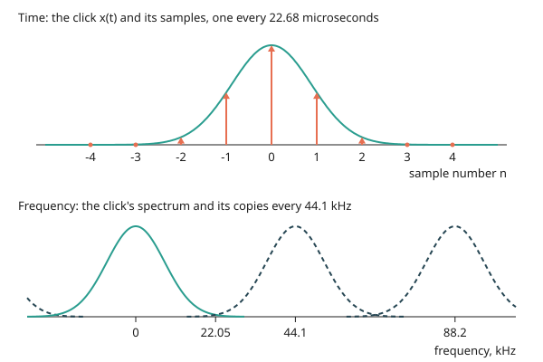
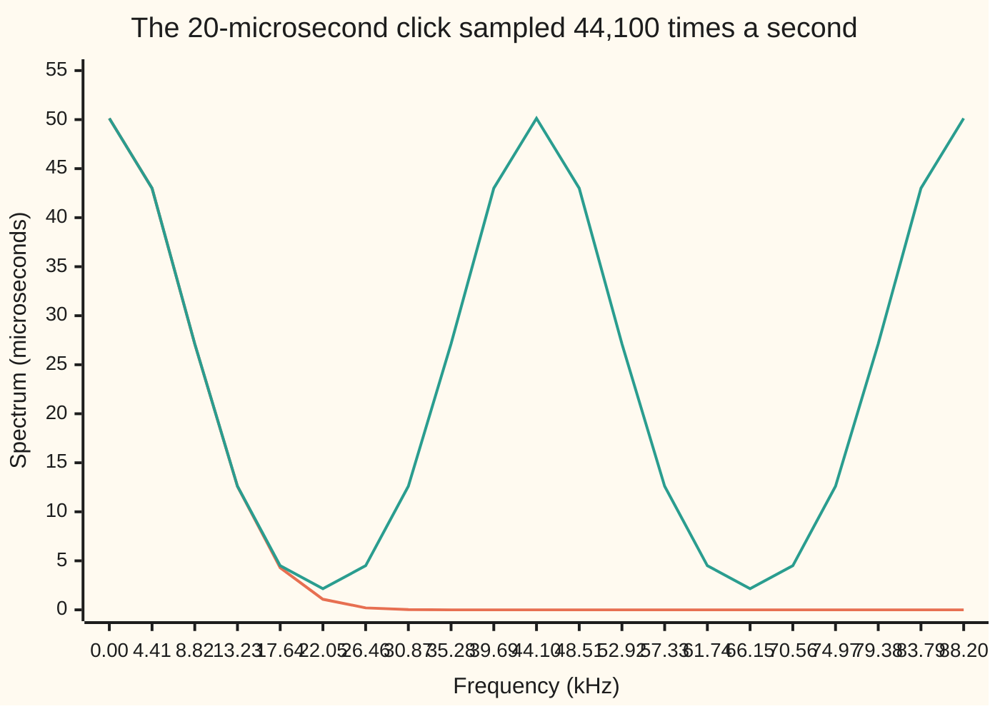

# Sampling: a row of spikes explains why evenly spaced samples suffice

[Syllabus](../../../SYLLABUS.md) → [Functional analysis](../README.md) → [Distributions and Sobolev Spaces](../README.md#s04) → Sampling

---

## General Overview

A CD stores music as numbers. A converter reads the microphone's voltage 44,100 times a second, once every 22.675737 microseconds (millionths of a second), and keeps nothing in between. Yet the music plays back whole, up to about 20,000 Hz (cycles per second), the usual figure for the top of human hearing.

Why is nothing lost in the gaps? The engineering wing answers with a rule: sample faster than twice the highest frequency ([Sampling](../../13-Engineering%20mathematics/05-Signals/01-sampling-and-the-nyquist-theorem.md)). Twice 20,000 Hz is 40,000 Hz, and 44,100 clears it. This card shows where the rule comes from.

The trick is to stop thinking of samples as a list. Write the sampled music as the music multiplied by a row of spikes, one spike at each sampling instant. That row of spikes is called the **Dirac comb**. Its spectrum (the amount of each frequency it holds) is again a row of spikes, spaced 44,100 Hz apart. Multiplying by spikes in time therefore copies the music's spectrum every 44,100 Hz.

The music lives between −20,000 and 20,000 Hz, so its first copy starts at 24,100 Hz. The copies do not touch. A filter that keeps 0 to 20,000 Hz cuts out the original, untouched, and the music comes back.

**Sampling multiplies a signal by a comb of spikes, the comb's transform is another comb, so the samples carry copies of the spectrum every sampling rate, and nothing is lost when the copies do not overlap.**

**What kind of fact this is:** a theorem. Poisson summation for rapidly decreasing signals, the comb's transform and the copies formula are proved on this card in Why it works. Rebuilding the signal from its samples is proved on the [Sampling](../../13-Engineering%20mathematics/05-Signals/01-sampling-and-the-nyquist-theorem.md) card. Poisson summation for wider classes of signals is stated, not proved here.

### The picture: spikes in time, copies in frequency

<p align="center"></p>

Top: a short click, 20 microseconds wide (an illustrative width), and its samples as arrows at heights 1.0000, 0.5259, 0.0765 and 0.0031 for samples 0 to 3. The arrows are schematic: a spike has no height, only a weight. Bottom, to scale: the click's spectrum (solid) and its copies (dashed), centred at 0, 44.1 and 88.2 kHz.

---

## The formula

Notation first. Time is $`t`$ in seconds, and samples are $`\Delta t`$ apart. The sampling rate is $`f_s = 1/\Delta t`$ samples a second. Frequency $`\omega`$ is in radians per second, as in [The Fourier transform](../../07-Complex%20analysis/08-Transforms%20in%20Outline/03-fourier-transform.md): $`\hat x(\omega) = \int x(t)\, e^{-i\omega t}\, dt`$, with $`i`$ the square root of −1.

A spike at the point $`a`$ is the delta $`\delta_a`$: a distribution (an object known only by what it does to smooth probe functions) that reads a probe's value at $`a`$ ([The delta](02-the-dirac-delta-and-derivatives-of-jumps.md)). The **Dirac comb** puts one spike at every sampling instant. This card introduces its symbol, Ш (the Cyrillic letter "sha", which looks like a comb):

```math
\text{Ш}_{\Delta t} = \sum_{n=-\infty}^{\infty} \delta_{n\Delta t}, \qquad \text{Ш}_{\Delta t}(\varphi) = \sum_{n=-\infty}^{\infty} \varphi(n\Delta t).
```

**Read it aloud:** the comb is a spike every Δt seconds, and it acts on a probe by adding up the probe's values at the sampling instants.

Sampling a signal $`x`$ is multiplying it by the comb: $`x\,\text{Ш}_{\Delta t} = \sum_n x(n\Delta t)\,\delta_{n\Delta t}`$, a spike at each instant weighted by the sample there. Call $`S(\omega)`$ the **sampled spectrum**: Δt times the transform of the sampled signal, scaled so that it is in the same units as $`\hat x`$. The card's two results are these, with $`\omega_s = 2\pi/\Delta t`$, the sampling rate in radians per second:

```math
\widehat{\text{Ш}_{\Delta t}} = \frac{2\pi}{\Delta t}\,\text{Ш}_{\omega_s} \qquad\text{and}\qquad S(\omega) = \Delta t \sum_{n} x(n\Delta t)\, e^{-i\omega n\Delta t} = \sum_{k} \hat x(\omega - k\omega_s).
```

**Read it aloud:** the comb's transform is a comb with spikes every ω_s and weight 2π/Δt; so the spectrum of the samples is the true spectrum plus copies of it shifted by every whole multiple of ω_s.

Copies landing on top of the true spectrum are called **aliases**.

In hertz, with $`X(f) = \int x(t)\, e^{-i2\pi f t}\, dt`$ as the engineering wing writes it, the comb's transform is $`f_s \sum_k \delta_{k f_s}`$: spikes every 44,100 Hz, of weight 44,100. The copies sit at every multiple of $`f_s`$.

**The rate at which nothing is lost.** If $`\hat x(\omega) = 0`$ whenever $`|\omega| > 2\pi B`$, that is, above $`B`$ hertz, the copies stay apart exactly when

```math
f_s > 2B.
```

For CD audio, $`2B`$ = 40,000 Hz and $`f_s`$ = 44,100 Hz.

| Symbol | Plain meaning | In our example | Push it up and the answer… |
| --- | --- | --- | --- |
| $`t`$, $`\Delta t`$ | time in seconds; spacing between samples | Δt = 22.675737 μs | larger Δt: copies crowd closer |
| $`f_s`$, $`f`$, $`B`$ | sampling rate; a frequency in hertz; band limit, nothing above it | 44,100; 30,000; 20,000 Hz | higher $`f_s`$: wider gap between copies |
| $`\omega`$, $`\omega_s`$, $`i`$ | frequency in rad/s, $`\omega = 2\pi f`$; copy spacing $`2\pi/\Delta t`$; square root of −1 | ω_s = 277,088.4720 rad/s | — |
| $`\delta_a`$, $`\text{Ш}_{\Delta t}`$ | a spike at $`a`$: reads a probe's value there; the Dirac comb: a spike every Δt | spikes 22.675737 μs apart | — |
| $`x`$, $`\hat x`$ | the signal; its transform, in seconds | the click; $`\hat x(0)`$ = 50.132565 μs | — |
| $`S`$ | sampled spectrum: Δt times the samples' transform | 2.157428 μs at 22,050 Hz | — |
| $`\sigma`$ | the click's width | 20 μs | wider σ: narrower spectrum, less aliasing |
| $`n`$, $`k`$ | sample index; copy index | 0 to ±7; 0 and ±1 | — |
| $`N`$, $`K`$ | where a sum over samples or copies is cut off | N = 7, K = 1 | sums settle |
| $`\varphi`$, $`\mathcal{S}`$, $`\mathcal{S}'`$ | a probe; rapidly decreasing smooth functions; tempered distributions | the click is in $`\mathcal{S}`$ | — |
| $`g`$, $`c_k`$, $`C`$, $`s`$, $`y`$, $`\nu`$ | in the proof: the click repeated every Δt; its Fourier coefficients; a bound on them; a shifted time; the signal times $`e^{-i\omega t}`$; its frequency variable | — | — |
| $`X[k]`$, $`Y[k]`$, $`m`$, $`r`$ | in the rehearsal: the tone's DFT at bin $`k`$; the DFT after keeping every 3rd point; a kept-point index; a copy index | tone at bin 5 | — |

The probe space $`\mathcal{S}`$ and the tempered distributions $`\mathcal{S}'`$ that act on it come from [Tempered distributions](05-tempered-distributions-and-the-fourier-transform.md). A function is **rapidly decreasing** when it and its derivatives fall faster than every power of 1/|t|.

### When it holds

- **The comb acts on probes, not on points.** The comb's transform has no value at any frequency. Cut its sum at $`\lvert n\rvert \le N`$ and evaluate it at 0 Hz: 3, 5, 23, 201 for N = 1, 2, 11, 100, growing for ever. Tested on a probe, it settles.
- **Rapid decay, for this card's proof.** The proof needs the sums over samples and over copies to converge absolutely. A signal falling only like 1/|t| has samples whose sum diverges, like the harmonic series. Wider classes are handled in Poisson summation and sampling (planned).
- **Strictly band-limited, for "nothing lost".** The click is not band-limited. So even at 44,100 samples a second its sampled spectrum at 10,000 Hz is 22.767389 μs, not the true 22.762227 μs. At 22,050 Hz it is doubled.
- **Even spacing.** Every sample must be Δt after the last. Jitter (small timing wobble) breaks the comb, and the copies blur.
- **Samples for ever.** A recording that stops is the comb times a window, so each copy is smeared; see [Windows](../../13-Engineering%20mathematics/05-Signals/03-windows-and-spectral-leakage.md).

---

## Why it works

### Step 0: spikes in time become spikes in frequency

Three facts make the result.

1. Sampling is multiplication by the comb.
2. Multiplication in time is convolution (a smearing of one function by another) in frequency ([Convolution](../../07-Complex%20analysis/08-Transforms%20in%20Outline/04-convolution-theorem.md)).
3. The comb's transform is again a comb.

Convolving a spectrum with a comb places a copy of the spectrum on every spike. So the samples carry copies, every $`\omega_s`$ apart. The only real work is fact 3, and that is Poisson summation.

### Step 1: sampling is multiplying by the comb

A delta times a smooth function keeps only the function's value at the spike: $`x\,\delta_a = x(a)\,\delta_a`$. Do that at every instant and the product $`x\,\text{Ш}_{\Delta t}`$ is a row of spikes weighted by the samples. Nothing else of $`x`$ survives. So a statement about the samples is a statement about $`x\,\text{Ш}_{\Delta t}`$.

The comb is a tempered distribution. On a probe $`\varphi`$ in $`\mathcal{S}`$, each term obeys $`\lvert\varphi(n\Delta t)\rvert \le \sup_t (1 + t^2)\lvert\varphi(t)\rvert \,/\, (1 + n^2\Delta t^2)`$, where sup is the largest value over all t. Adding over n bounds $`\lvert\text{Ш}_{\Delta t}(\varphi)\rvert`$ by that largest value times $`\sum_n 1/(1 + n^2\Delta t^2)`$, a finite number. That is the bound [Tempered distributions](05-tempered-distributions-and-the-fourier-transform.md) asks for.

### Step 2: the finite rehearsal, a 12-point grid

Put 12 points on a circle and keep every 3rd: a comb of spikes at points 0, 3, 6, 9. Its discrete Fourier transform ([The discrete Fourier transform](../../07-Complex%20analysis/08-Transforms%20in%20Outline/02-discrete-fourier-transform.md)) at bin $`k`$ adds four terms $`e^{-2\pi i \cdot 3mk/12}`$, for m = 0 to 3.

| Bin $`k`$ | The four terms | Sum |
| --- | --- | --- |
| 0, 4, 8 | each term is 1 | 4 |
| any other | points evenly round the circle, which cancel | 0 |

So the transform is 4 0 0 0 4 0 0 0 4 0 0 0: a comb with spacing 4 and height 4. Spacing 3 in time becomes spacing 12/3 = 4 in frequency. Spacing 4 becomes spacing 3: 3 0 0 3 0 0 3 0 0 3 0 0.

Now sample a tone. A cosine at bin 5 on the 12-point grid has DFT values 6 at bins 5 and 7. Keep every 3rd point. Multiplying by the comb averages copies of the DFT shifted by 4: $`Y[k] = \tfrac13 (X[k] + X[k-4] + X[k-8])`$. Both the direct DFT and the copies formula give 0 2 0 2 0 2 0 2 0 2 0 2.

The four kept points see a tone at bin 5 mod 4 = 1. That is aliasing on a grid of 12 points.

### Step 3: what changes when the grid becomes the real line

On 12 points the comb's transform is a list of numbers. On the real line, the same sum $`\sum_n e^{-i\omega n\Delta t}`$ has no value at any frequency.

Cut it at $`|n| \le N`$. At 0 Hz every term is 1, so the sum is 2N + 1: 3, 5, 23, 201 for N = 1, 2, 11, 100. At 22,050 Hz the terms alternate in sign, so the sum is −1 for odd N and 1 for even N: −1, 1, −1, 1 for the same N. It never settles.

The limit exists only in $`\mathcal{S}'`$, tested on probes. That is why the comb's transform must be read as a distribution. Step 4 finds it.

### Step 4: Poisson summation gives the comb's transform

**Poisson summation**, for $`x`$ in $`\mathcal{S}`$:

```math
\sum_{n} x(n\Delta t) = \frac{1}{\Delta t}\sum_{k} \hat x(k\omega_s).
```

**Read it aloud:** the sum of the samples equals the sum of the spectrum's values at the copy positions, divided by Δt.

The proof's shape: repeat $`x`$ every Δt to get a periodic function $`g`$. The Fourier series of $`g`$ ([Fourier series](../../08-Differential%20equations%20and%20dynamics/09-Fourier%20Series/01-fourier-series-and-orthogonality.md)) has coefficients $`\hat x(k\omega_s)/\Delta t`$, because stitching the periods back together turns the coefficient integral into the full transform. Evaluate the series at $`t = 0`$ and the sum of samples appears on the left.

Check it on the click $`x(t) = e^{-t^2/(2\sigma^2)}`$ with σ = 20 μs, whose transform is $`\sigma\sqrt{2\pi}\, e^{-\sigma^2\omega^2/2}`$.

| Side | Cut-off | Value |
| --- | --- | --- |
| samples | N = 0, 1, 2, 3 | 1.000000000, 2.051703123, 2.204629594, 2.210778510 |
| samples | N = 5 and beyond | 2.210847086 |
| copies | K = 0 | 2.210846138225 |
| copies | K = 1 | 2.210847086063 |

The copy at 44,100 Hz weighs 0.000000214361 of the central value. It is small, but the two sides only agree once it is counted.

Apply Poisson summation to the transform of a probe, and the comb's transform drops out: $`\widehat{\text{Ш}_{\Delta t}} = (2\pi/\Delta t)\,\text{Ш}_{\omega_s}`$. The fold has both proofs.

<details>
<summary>Detailed proof: Poisson summation for rapidly decreasing signals, and the comb's transform</summary>

Let $`x`$ be in $`\mathcal{S}`$ and set

$`\displaystyle g(t) = \sum_{n} x(t + n\Delta t).`$

Since $`x`$ and each derivative fall faster than $`1/|t|^2`$, this sum and its differentiated sums converge uniformly on every bounded interval. So $`g`$ is smooth and has period Δt.

Its Fourier coefficients, with $`\omega_s = 2\pi/\Delta t`$, are

$`\displaystyle c_k = \frac{1}{\Delta t}\int_0^{\Delta t} g(t)\, e^{-ik\omega_s t}\, dt = \frac{1}{\Delta t}\sum_n \int_{n\Delta t}^{(n+1)\Delta t} x(s)\, e^{-ik\omega_s s}\, ds = \frac{\hat x(k\omega_s)}{\Delta t}.`$

The sum and integral swap by uniform convergence. The middle step substitutes $`s = t + n\Delta t`$, using $`e^{-ik\omega_s n\Delta t} = e^{-2\pi i k n} = 1`$. The intervals then tile the real line.

Integrate by parts twice: $`|c_k| \le C/k^2`$ for a constant $`C`$, since $`g''`$ is bounded. So the Fourier series converges absolutely and uniformly, and it converges to $`g`$ ([Convergence](../../08-Differential%20equations%20and%20dynamics/09-Fourier%20Series/02-convergence-jumps-and-gibbs.md)). At $`t = 0`$:

$`\displaystyle \sum_n x(n\Delta t) = g(0) = \frac{1}{\Delta t}\sum_k \hat x(k\omega_s).`$

**The comb's transform.** A tempered distribution's transform acts on a probe $`\varphi`$ by acting on $`\hat\varphi`$ ([Tempered distributions](05-tempered-distributions-and-the-fourier-transform.md)). The transform of $`\hat\varphi`$ is $`2\pi\varphi(-\omega)`$, by the inversion theorem. Apply Poisson summation to $`\hat\varphi`$, which is in $`\mathcal{S}`$:

$`\displaystyle \widehat{\text{Ш}_{\Delta t}}(\varphi) = \sum_n \hat\varphi(n\Delta t) = \frac{1}{\Delta t}\sum_k 2\pi\,\varphi(-k\omega_s) = \frac{2\pi}{\Delta t}\,\text{Ш}_{\omega_s}(\varphi).`$

**The copies.** Fix ω and apply Poisson summation to $`y(t) = x(t)\,e^{-i\omega t}`$, also in $`\mathcal{S}`$, whose transform is $`\hat x(\nu + \omega)`$ at frequency ν. Then replace $`k`$ by $`-k`$:

$`\displaystyle \Delta t\sum_n x(n\Delta t)\, e^{-i\omega n\Delta t} = \sum_k \hat x(\omega - k\omega_s).`$

∎

</details>

Poisson summation for signals that are only integrable, with conditions on the sums, is the general theorem. It is proved in Poisson summation and sampling (planned).

### Step 5: the comb copies the spectrum

The last line of the fold is the copies formula. It is fact 2 of Step 0 made exact: transform the product $`x\,\text{Ш}_{\Delta t}`$, convolve $`\hat x`$ with the comb $`(2\pi/\Delta t)\,\text{Ш}_{\omega_s}`$, divide by 2π, and each spike drops a copy of $`\hat x`$ in its place.

The click shows the copies at work, in microseconds:

| Frequency | True $`\hat x`$ | Sampled $`S`$ | Ratio |
| --- | --- | --- | --- |
| 0 Hz | 50.132565 | 50.132587 | 1.000000 |
| 10,000 Hz | 22.762227 | 22.767389 | 1.000227 |
| 22,050 Hz | 1.078714 | 2.157428 | 2.000000 |

At 22,050 Hz, half the sampling rate, the point sits exactly halfway between the true spectrum's centre at 0 Hz and the copy's centre at 44,100 Hz. The two are equal there, so the sampled spectrum is doubled. The code also computes $`\hat x`$ by Simpson's rule (a numerical integral) and the copies sum directly; both agree with the table.

The click is 20 μs wide, so its spectrum is wide. A narrower click spreads wider and aliases more: at σ = 10 μs the copy at 44,100 Hz weighs 0.021517234355 of the centre. This is the trade-off of [Uncertainty](../../13-Engineering%20mathematics/09-Quantum%20Mechanics%20in%20Outline/05-uncertainty-principle.md).

### Step 6: the rate at which nothing is lost

Suppose the spectrum is zero above $`B`$ hertz. The copy centred at $`f_s`$ starts at $`f_s - B`$. It misses the original, which ends at $`B`$, exactly when $`f_s - B > B`$, that is $`f_s > 2B`$. Then a filter that keeps $`-B`$ to $`B`$ hands back $`\hat x`$, and so $`x`$. That filter, written in time, is the sinc sum proved on the [Sampling](../../13-Engineering%20mathematics/05-Signals/01-sampling-and-the-nyquist-theorem.md) card.

For CD audio the copy starts at 44,100 − 20,000 = 24,100 Hz, leaving a 4,100 Hz gap. An analogue filter before the converter must fall from full pass at 20,000 Hz to full cut by 24,100 Hz.

If a tone breaks the band, a copy lands on the music. A 30,000 Hz tone has a spike at −30,000 Hz. The comb shifts it by 44,100 Hz to 14,100 Hz, in the middle of the audible band. The samples of the two tones differ by less than 0.000000001.

### The picture: the click's spectrum, true and sampled



Orange: the click's true spectrum. Green: the sampled spectrum $`S`$, summed from 121 samples. It repeats every 44.1 kHz and meets the true spectrum only where the copies are small. The sums stop at 121 samples and 13 copies; the terms left out are far below the printed digits.

---

## Worked numbers, by hand

| Step | Arithmetic | Value |
| --- | --- | --- |
| spacing | 1 / 44,100 s | 22.675737 μs |
| copy spacing | 2π / Δt | 277,088.4720 rad/s, which is 44,100 Hz |
| weight of each spike in the comb's transform | 2π / Δt (hertz form: 1 / Δt) | 277,088.4720 (hertz form: 44,100) |
| Nyquist frequency | 44,100 / 2 | 22,050 Hz |
| rate needed for a 20,000 Hz band | 2 × 20,000 | 40,000 Hz |
| first copy of the band starts | 44,100 − 20,000 | 24,100 Hz |
| guard gap | 24,100 − 20,000 | 4,100 Hz |
| a 30,000 Hz tone lands at | 44,100 − 30,000 | 14,100 Hz |
| Poisson check on the click | samples side; copies side | 2.210847086; 2.210847086063 |
| verdict | 44,100 > 40,000 | **nothing below 20,000 Hz is lost** |

At 44,100 samples a second, the copies of a 20,000 Hz band sit 4,100 Hz clear of it, so the samples hold the music exactly, provided the filter before the converter removes everything above 24,100 Hz.

### What breaks if you drop a piece

| Mistake | Comes out at | What went wrong |
| --- | --- | --- |
| Read the comb's transform as a function | 201 at 0 Hz for N = 100, growing for ever | It exists only tested on probes, in $`\mathcal{S}'`$ |
| Use the ω-form weight 2π/Δt with the hertz copies | 13.891162 instead of 2.210847 | The two conventions differ by 2π; one form per calculation |
| Sample the click 8,000 times a second | sampled spectrum at 0 Hz 125.000001 μs, true 50.132565 μs | Copies every 8,000 Hz pile onto the click's wide spectrum |
| Sample a 20,000 Hz band 32,000 times a second | first copy starts at 12,000 Hz; 8,000 Hz of the band overlapped | $`f_s`$ = 32,000 is below $`2B`$ = 40,000 |

---

## Code, from first principles, and it actually runs

The code holds only the rehearsal: finite sums, cut off where the dropped terms are far below the printed digits. It takes four roads. A 12-point comb's DFT summed out against its closed form. Poisson summation, samples side against copies side. The sampled spectrum summed directly against the copies formula. The click's transform by Simpson's rule against its closed form. Both programs print the same lines.

### Python

```python
# Sampling and the Dirac comb -- the check behind the card.  Standard library only.
# Digital audio at 44,100 samples a second, and a 20-microsecond click as the probe.
# Roads: a finite comb's DFT summed out against its closed form; Poisson summation,
# samples side against spectrum side; the sampled spectrum summed directly against
# its copies; the click's transform by Simpson's rule against its closed form.
import math

FS = 44100.0                      # samples a second
DT = 1.0 / FS                     # spacing between samples, seconds
WS = 2.0 * math.pi / DT           # copy spacing, rad/s
SIG = 20e-6                       # the click's width, seconds (illustrative)
B = 20000.0                       # top of hearing, Hz

def click(t, s=SIG):              # x(t): peak 1, width s
    return math.exp(-t * t / (2.0 * s * s))

def click_hat(w, s=SIG):          # closed-form transform, seconds
    return s * math.sqrt(2.0 * math.pi) * math.exp(-s * s * w * w / 2.0)

def simpson_hat(w, s=SIG, m=4000):  # the transform by Simpson's rule on [-12s, 12s]
    a, h = -12.0 * s, 24.0 * s / m
    tot = sum((1 if j in (0, m) else 4 if j % 2 else 2) * click(a + j * h, s)
              * math.cos(w * (a + j * h)) for j in range(m + 1))
    return tot * h / 3.0

def sampled(f, dt=DT, s=SIG):     # dt * sum_n x(n dt) e^{-i w n dt}: real, since x is even
    w = 2.0 * math.pi * f
    return dt * sum(click(n * dt, s) * math.cos(w * n * dt) for n in range(-60, 61))

def copies(f, dt=DT, s=SIG):      # sum_k xhat(w - k ws): the comb's prediction
    w, ws = 2.0 * math.pi * f, 2.0 * math.pi / dt
    return sum(click_hat(w - k * ws, s) for k in range(-6, 7))

def alias(f, fs):                 # distance to the nearest multiple of fs
    return abs(f - round(f / fs) * fs)

def dft(v):                       # the DFT written out, real and imaginary parts
    n = len(v)
    return [(sum(v[j] * math.cos(2 * math.pi * j * k / n) for j in range(n)),
             -sum(v[j] * math.sin(2 * math.pi * j * k / n) for j in range(n))) for k in range(n)]

def ints(z):
    return " ".join(str(round(c[0])) for c in z)

print("== audio at 44,100 samples a second ==")
print(f"spacing dt = {DT * 1e6:.6f} microseconds")
print(f"copy spacing 2 pi / dt = {WS:.4f} rad/s = {WS / (2 * math.pi):.0f} Hz")
print(f"Nyquist frequency {FS / 2:.0f} Hz; rate needed for a {B:.0f} Hz band {2 * B:.0f} Hz")
print(f"first copy of the band starts at {FS - B:.0f} Hz; guard gap {FS - 2 * B:.0f} Hz")
tone = [abs(math.cos(2 * math.pi * 30000 * n * DT) - math.cos(2 * math.pi * alias(30000, FS) * n * DT))
        for n in range(50)]
print(f"30000 Hz tone aliases to {alias(30000, FS):.0f} Hz; largest sample difference {max(tone):.9f}")
assert alias(30000, FS) == 14100 and max(tone) < 1e-9

print("== finite rehearsal: a 12-point grid ==")
for sp in (3, 4):
    c = dft([1.0 if j % sp == 0 else 0.0 for j in range(12)])
    closed = [12 // sp if k % (12 // sp) == 0 else 0 for k in range(12)]
    print(f"DFT of comb spacing {sp}: {ints(c)}")
    assert all(abs(c[k][0] - closed[k]) < 1e-9 and abs(c[k][1]) < 1e-9 for k in range(12))
tone12 = [math.cos(2 * math.pi * 5 * j / 12) for j in range(12)]
X = dft(tone12)
Y = dft([tone12[j] if j % 3 == 0 else 0.0 for j in range(12)])
Yc = [sum(X[(k - 4 * r) % 12][0] for r in range(3)) / 3 for k in range(12)]
print(f"tone at bin 5, every 3rd point kept, DFT direct: {ints(Y)}")
print(f"same from copies (1/3) sum X[k - 4r]:          {ints([(v, 0) for v in Yc])}")
print(f"kept points heard at bin 5 mod 4 = {5 % 4}")
assert all(abs(Y[k][0] - Yc[k]) < 1e-9 for k in range(12))

print("== the comb's transform has no values ==")
Ns = (1, 2, 11, 100)
for f in (0.0, FS / 2):
    d = [sum(math.cos(2 * math.pi * f * n * DT) for n in range(-N, N + 1)) for N in Ns]
    print(f"partial sum at {f:.0f} Hz, N = 1 2 11 100: " + " ".join(f"{v:.3f}" for v in d))
    want = [2 * N + 1 if f == 0.0 else (-1) ** N for N in Ns]
    assert all(abs(d[i] - want[i]) < 1e-9 for i in range(4))

print("== tested on the 20-microsecond click: Poisson summation ==")
left = [sum(click(n * DT) for n in range(-N, N + 1)) for N in range(8)]
right = [sum(click_hat(k * WS) for k in range(-K, K + 1)) / DT for K in (0, 1)]
print("samples side, N = 0..7: " + " ".join(f"{v:.9f}" for v in left))
print(f"spectrum side, K = 0 and 1: {right[0]:.12f} {right[1]:.12f}")
print(f"copy weight xhat(ws) / xhat(0) = {click_hat(WS) / click_hat(0):.12f}")
assert abs(left[7] - right[1]) < 1e-12
assert abs(left[2] - right[1]) > 1e-3 and abs(right[0] - right[1]) > 1e-7

print("== sampled spectrum of the click, microseconds ==")
for f in (0.0, 10000.0, FS / 2):
    tr, sa, co, si = click_hat(2 * math.pi * f), sampled(f), copies(f), simpson_hat(2 * math.pi * f)
    print(f"f = {f:.0f} Hz: true {tr * 1e6:.6f} Simpson {si * 1e6:.6f} sampled {sa * 1e6:.6f} "
          f"copies {co * 1e6:.6f} ratio {sa / tr:.6f}")
    assert abs(tr - si) < 1e-15 and abs(sa - co) < 1e-15
assert abs(sampled(FS / 2) / click_hat(math.pi * FS) - 2) < 1e-6

print("== what breaks ==")
d8 = 1 / 8000.0
print(f"click sampled 8000 a second: sampled at 0 Hz {sampled(0, d8) * 1e6:.6f} vs true {click_hat(0) * 1e6:.6f}")
print(f"omega weight 2 pi / dt with hertz copies: sum reads {2 * math.pi * left[7]:.6f} not {left[7]:.6f}")
print(f"20000 Hz band at 32000 a second: copy starts {32000 - B:.0f} Hz, overlap {2 * B - 32000:.0f} Hz")
assert abs(sampled(0, d8) - copies(0, d8)) < 1e-12 and sampled(0, d8) > 2 * click_hat(0)

print("== try changing ==")
print(f"40000 Hz tone at 44100: heard at {alias(40000, FS):.0f} Hz")
print(f"at 48000: copy starts {48000 - B:.0f} Hz; 30000 Hz tone heard at {alias(30000, 48000):.0f} Hz")
print(f"10-microsecond click: copy weight {click_hat(WS, 10e-6) / click_hat(0, 10e-6):.12f}")

fk = [4.41 * i for i in range(21)]
print("chart, f kHz: " + " ".join(f"{v:.2f}" for v in fk))
print("chart, true: " + " ".join(f"{click_hat(2 * math.pi * v * 1e3) * 1e6:.2f}" for v in fk))
print("chart, sampled: " + " ".join(f"{sampled(v * 1e3) * 1e6:.2f}" for v in fk))
print("figure, sample heights n = 0..3: " + " ".join(f"{click(n * DT):.4f}" for n in range(4))
      + f"; copies centred at 0, {FS / 1e3:.1f}, {2 * FS / 1e3:.1f} kHz")
print("ALL CHECKS PASS")
```

**Ran 2026-11-15 on macOS, Python 3.14.10, standard library only. All checks passed. Output, pasted from the run:**

```
== audio at 44,100 samples a second ==
spacing dt = 22.675737 microseconds
copy spacing 2 pi / dt = 277088.4720 rad/s = 44100 Hz
Nyquist frequency 22050 Hz; rate needed for a 20000 Hz band 40000 Hz
first copy of the band starts at 24100 Hz; guard gap 4100 Hz
30000 Hz tone aliases to 14100 Hz; largest sample difference 0.000000000
== finite rehearsal: a 12-point grid ==
DFT of comb spacing 3: 4 0 0 0 4 0 0 0 4 0 0 0
DFT of comb spacing 4: 3 0 0 3 0 0 3 0 0 3 0 0
tone at bin 5, every 3rd point kept, DFT direct: 0 2 0 2 0 2 0 2 0 2 0 2
same from copies (1/3) sum X[k - 4r]:          0 2 0 2 0 2 0 2 0 2 0 2
kept points heard at bin 5 mod 4 = 1
== the comb's transform has no values ==
partial sum at 0 Hz, N = 1 2 11 100: 3.000 5.000 23.000 201.000
partial sum at 22050 Hz, N = 1 2 11 100: -1.000 1.000 -1.000 1.000
== tested on the 20-microsecond click: Poisson summation ==
samples side, N = 0..7: 1.000000000 2.051703123 2.204629594 2.210778510 2.210846876 2.210847086 2.210847086 2.210847086
spectrum side, K = 0 and 1: 2.210846138225 2.210847086063
copy weight xhat(ws) / xhat(0) = 0.000000214361
== sampled spectrum of the click, microseconds ==
f = 0 Hz: true 50.132565 Simpson 50.132565 sampled 50.132587 copies 50.132587 ratio 1.000000
f = 10000 Hz: true 22.762227 Simpson 22.762227 sampled 22.767389 copies 22.767389 ratio 1.000227
f = 22050 Hz: true 1.078714 Simpson 1.078714 sampled 2.157428 copies 2.157428 ratio 2.000000
== what breaks ==
click sampled 8000 a second: sampled at 0 Hz 125.000001 vs true 50.132565
omega weight 2 pi / dt with hertz copies: sum reads 13.891162 not 2.210847
20000 Hz band at 32000 a second: copy starts 12000 Hz, overlap 8000 Hz
== try changing ==
40000 Hz tone at 44100: heard at 4100 Hz
at 48000: copy starts 28000 Hz; 30000 Hz tone heard at 18000 Hz
10-microsecond click: copy weight 0.021517234355
chart, f kHz: 0.00 4.41 8.82 13.23 17.64 22.05 26.46 30.87 35.28 39.69 44.10 48.51 52.92 57.33 61.74 66.15 70.56 74.97 79.38 83.79 88.20
chart, true: 50.13 43.00 27.12 12.59 4.30 1.08 0.20 0.03 0.00 0.00 0.00 0.00 0.00 0.00 0.00 0.00 0.00 0.00 0.00 0.00 0.00
chart, sampled: 50.13 43.00 27.13 12.61 4.50 2.16 4.50 12.61 27.13 43.00 50.13 43.00 27.13 12.61 4.50 2.16 4.50 12.61 27.13 43.00 50.13
figure, sample heights n = 0..3: 1.0000 0.5259 0.0765 0.0031; copies centred at 0, 44.1, 88.2 kHz
ALL CHECKS PASS
```

### Rust

```rust
// Sampling and the Dirac comb -- the check behind the card.  Standard library only.
// Digital audio at 44,100 samples a second, and a 20-microsecond click as the probe.
// Roads: a finite comb's DFT summed out against its closed form; Poisson summation,
// samples side against spectrum side; the sampled spectrum summed directly against
// its copies; the click's transform by Simpson's rule against its closed form.
use std::f64::consts::PI;

const FS: f64 = 44100.0; // samples a second
const DT: f64 = 1.0 / FS; // spacing between samples, seconds
const SIG: f64 = 20e-6; // the click's width, seconds (illustrative)
const B: f64 = 20000.0; // top of hearing, Hz

fn click(t: f64, s: f64) -> f64 {
    (-t * t / (2.0 * s * s)).exp()
}

fn click_hat(w: f64, s: f64) -> f64 {
    s * (2.0 * PI).sqrt() * (-s * s * w * w / 2.0).exp()
}

fn simpson_hat(w: f64, s: f64) -> f64 {
    let m = 4000;
    let (a, h) = (-12.0 * s, 24.0 * s / m as f64);
    let mut tot = 0.0;
    for j in 0..=m {
        let c = if j == 0 || j == m { 1.0 } else if j % 2 == 1 { 4.0 } else { 2.0 };
        let t = a + j as f64 * h;
        tot += c * click(t, s) * (w * t).cos();
    }
    tot * h / 3.0
}

fn sampled(f: f64, dt: f64, s: f64) -> f64 {
    let w = 2.0 * PI * f;
    dt * (-60..=60).map(|n| click(n as f64 * dt, s) * (w * n as f64 * dt).cos()).sum::<f64>()
}

fn copies(f: f64, dt: f64, s: f64) -> f64 {
    let (w, ws) = (2.0 * PI * f, 2.0 * PI / dt);
    (-6..=6).map(|k| click_hat(w - k as f64 * ws, s)).sum()
}

fn alias(f: f64, fs: f64) -> f64 {
    (f - (f / fs).round() * fs).abs()
}

fn dft(v: &[f64]) -> Vec<(f64, f64)> {
    let n = v.len();
    (0..n)
        .map(|k| {
            let ang = |j: usize| 2.0 * PI * (j * k) as f64 / n as f64;
            ((0..n).map(|j| v[j] * ang(j).cos()).sum(), -(0..n).map(|j| v[j] * ang(j).sin()).sum::<f64>())
        })
        .collect()
}

fn ints(z: &[(f64, f64)]) -> String {
    z.iter().map(|c| format!("{}", c.0.round() as i64)).collect::<Vec<_>>().join(" ")
}

fn join(v: &[f64], d: usize) -> String {
    v.iter().map(|x| format!("{:.*}", d, x)).collect::<Vec<_>>().join(" ")
}

fn main() {
    let ws = 2.0 * PI / DT;
    println!("== audio at 44,100 samples a second ==");
    println!("spacing dt = {:.6} microseconds", DT * 1e6);
    println!("copy spacing 2 pi / dt = {:.4} rad/s = {:.0} Hz", ws, ws / (2.0 * PI));
    println!("Nyquist frequency {:.0} Hz; rate needed for a {:.0} Hz band {:.0} Hz", FS / 2.0, B, 2.0 * B);
    println!("first copy of the band starts at {:.0} Hz; guard gap {:.0} Hz", FS - B, FS - 2.0 * B);
    let a30 = alias(30000.0, FS);
    let tone = (0..50)
        .map(|n| ((2.0 * PI * 30000.0 * n as f64 * DT).cos() - (2.0 * PI * a30 * n as f64 * DT).cos()).abs())
        .fold(0.0, f64::max);
    println!("30000 Hz tone aliases to {:.0} Hz; largest sample difference {:.9}", a30, tone);
    assert!(a30 == 14100.0 && tone < 1e-9);

    println!("== finite rehearsal: a 12-point grid ==");
    for sp in [3usize, 4] {
        let c = dft(&(0..12).map(|j| if j % sp == 0 { 1.0 } else { 0.0 }).collect::<Vec<_>>());
        let l = 12 / sp;
        println!("DFT of comb spacing {}: {}", sp, ints(&c));
        for k in 0..12 {
            let closed = if k % l == 0 { l as f64 } else { 0.0 };
            assert!((c[k].0 - closed).abs() < 1e-9 && c[k].1.abs() < 1e-9);
        }
    }
    let tone12: Vec<f64> = (0..12).map(|j| (2.0 * PI * 5.0 * j as f64 / 12.0).cos()).collect();
    let x = dft(&tone12);
    let y = dft(&(0..12).map(|j| if j % 3 == 0 { tone12[j] } else { 0.0 }).collect::<Vec<_>>());
    let yc: Vec<(f64, f64)> =
        (0..12).map(|k| ((0..3).map(|r| x[(k + 12 - 4 * r) % 12].0).sum::<f64>() / 3.0, 0.0)).collect();
    println!("tone at bin 5, every 3rd point kept, DFT direct: {}", ints(&y));
    println!("same from copies (1/3) sum X[k - 4r]:          {}", ints(&yc));
    println!("kept points heard at bin 5 mod 4 = {}", 5 % 4);
    for k in 0..12 {
        assert!((y[k].0 - yc[k].0).abs() < 1e-9);
    }

    println!("== the comb's transform has no values ==");
    let ns = [1i64, 2, 11, 100];
    for f in [0.0, FS / 2.0] {
        let d: Vec<f64> =
            ns.iter().map(|&nn| (-nn..=nn).map(|n| (2.0 * PI * f * n as f64 * DT).cos()).sum()).collect();
        println!("partial sum at {:.0} Hz, N = 1 2 11 100: {}", f, join(&d, 3));
        for i in 0..4 {
            let want = if f == 0.0 { (2 * ns[i] + 1) as f64 } else if ns[i] % 2 == 1 { -1.0 } else { 1.0 };
            assert!((d[i] - want).abs() < 1e-9);
        }
    }

    println!("== tested on the 20-microsecond click: Poisson summation ==");
    let left: Vec<f64> = (0..8i64).map(|nn| (-nn..=nn).map(|n| click(n as f64 * DT, SIG)).sum()).collect();
    let right: Vec<f64> =
        [0i64, 1].iter().map(|&kk| (-kk..=kk).map(|k| click_hat(k as f64 * ws, SIG)).sum::<f64>() / DT).collect();
    println!("samples side, N = 0..7: {}", join(&left, 9));
    println!("spectrum side, K = 0 and 1: {:.12} {:.12}", right[0], right[1]);
    println!("copy weight xhat(ws) / xhat(0) = {:.12}", click_hat(ws, SIG) / click_hat(0.0, SIG));
    assert!((left[7] - right[1]).abs() < 1e-12);
    assert!((left[2] - right[1]).abs() > 1e-3 && (right[0] - right[1]).abs() > 1e-7);

    println!("== sampled spectrum of the click, microseconds ==");
    for f in [0.0, 10000.0, FS / 2.0] {
        let (tr, sa) = (click_hat(2.0 * PI * f, SIG), sampled(f, DT, SIG));
        let (co, si) = (copies(f, DT, SIG), simpson_hat(2.0 * PI * f, SIG));
        println!(
            "f = {:.0} Hz: true {:.6} Simpson {:.6} sampled {:.6} copies {:.6} ratio {:.6}",
            f, tr * 1e6, si * 1e6, sa * 1e6, co * 1e6, sa / tr
        );
        assert!((tr - si).abs() < 1e-15 && (sa - co).abs() < 1e-15);
    }
    assert!((sampled(FS / 2.0, DT, SIG) / click_hat(PI * FS, SIG) - 2.0).abs() < 1e-6);

    println!("== what breaks ==");
    let d8 = 1.0 / 8000.0;
    let s8 = sampled(0.0, d8, SIG);
    println!("click sampled 8000 a second: sampled at 0 Hz {:.6} vs true {:.6}", s8 * 1e6, click_hat(0.0, SIG) * 1e6);
    println!("omega weight 2 pi / dt with hertz copies: sum reads {:.6} not {:.6}", 2.0 * PI * left[7], left[7]);
    println!("20000 Hz band at 32000 a second: copy starts {:.0} Hz, overlap {:.0} Hz", 32000.0 - B, 2.0 * B - 32000.0);
    assert!((s8 - copies(0.0, d8, SIG)).abs() < 1e-12 && s8 > 2.0 * click_hat(0.0, SIG));

    println!("== try changing ==");
    println!("40000 Hz tone at 44100: heard at {:.0} Hz", alias(40000.0, FS));
    println!("at 48000: copy starts {:.0} Hz; 30000 Hz tone heard at {:.0} Hz", 48000.0 - B, alias(30000.0, 48000.0));
    println!("10-microsecond click: copy weight {:.12}", click_hat(ws, 10e-6) / click_hat(0.0, 10e-6));

    let fk: Vec<f64> = (0..21).map(|i| 4.41 * i as f64).collect();
    println!("chart, f kHz: {}", join(&fk, 2));
    println!("chart, true: {}", join(&fk.iter().map(|v| click_hat(2.0 * PI * v * 1e3, SIG) * 1e6).collect::<Vec<_>>(), 2));
    println!("chart, sampled: {}", join(&fk.iter().map(|v| sampled(v * 1e3, DT, SIG) * 1e6).collect::<Vec<_>>(), 2));
    println!(
        "figure, sample heights n = 0..3: {}; copies centred at 0, {:.1}, {:.1} kHz",
        join(&(0..4).map(|n| click(n as f64 * DT, SIG)).collect::<Vec<_>>(), 4),
        FS / 1e3,
        2.0 * FS / 1e3
    );
    println!("ALL CHECKS PASS");
}
```

**Ran 2026-11-15 on macOS, rustc 1.98.1, no crates. All checks passed. Output, pasted from the run:**

```
== audio at 44,100 samples a second ==
spacing dt = 22.675737 microseconds
copy spacing 2 pi / dt = 277088.4720 rad/s = 44100 Hz
Nyquist frequency 22050 Hz; rate needed for a 20000 Hz band 40000 Hz
first copy of the band starts at 24100 Hz; guard gap 4100 Hz
30000 Hz tone aliases to 14100 Hz; largest sample difference 0.000000000
== finite rehearsal: a 12-point grid ==
DFT of comb spacing 3: 4 0 0 0 4 0 0 0 4 0 0 0
DFT of comb spacing 4: 3 0 0 3 0 0 3 0 0 3 0 0
tone at bin 5, every 3rd point kept, DFT direct: 0 2 0 2 0 2 0 2 0 2 0 2
same from copies (1/3) sum X[k - 4r]:          0 2 0 2 0 2 0 2 0 2 0 2
kept points heard at bin 5 mod 4 = 1
== the comb's transform has no values ==
partial sum at 0 Hz, N = 1 2 11 100: 3.000 5.000 23.000 201.000
partial sum at 22050 Hz, N = 1 2 11 100: -1.000 1.000 -1.000 1.000
== tested on the 20-microsecond click: Poisson summation ==
samples side, N = 0..7: 1.000000000 2.051703123 2.204629594 2.210778510 2.210846876 2.210847086 2.210847086 2.210847086
spectrum side, K = 0 and 1: 2.210846138225 2.210847086063
copy weight xhat(ws) / xhat(0) = 0.000000214361
== sampled spectrum of the click, microseconds ==
f = 0 Hz: true 50.132565 Simpson 50.132565 sampled 50.132587 copies 50.132587 ratio 1.000000
f = 10000 Hz: true 22.762227 Simpson 22.762227 sampled 22.767389 copies 22.767389 ratio 1.000227
f = 22050 Hz: true 1.078714 Simpson 1.078714 sampled 2.157428 copies 2.157428 ratio 2.000000
== what breaks ==
click sampled 8000 a second: sampled at 0 Hz 125.000001 vs true 50.132565
omega weight 2 pi / dt with hertz copies: sum reads 13.891162 not 2.210847
20000 Hz band at 32000 a second: copy starts 12000 Hz, overlap 8000 Hz
== try changing ==
40000 Hz tone at 44100: heard at 4100 Hz
at 48000: copy starts 28000 Hz; 30000 Hz tone heard at 18000 Hz
10-microsecond click: copy weight 0.021517234355
chart, f kHz: 0.00 4.41 8.82 13.23 17.64 22.05 26.46 30.87 35.28 39.69 44.10 48.51 52.92 57.33 61.74 66.15 70.56 74.97 79.38 83.79 88.20
chart, true: 50.13 43.00 27.12 12.59 4.30 1.08 0.20 0.03 0.00 0.00 0.00 0.00 0.00 0.00 0.00 0.00 0.00 0.00 0.00 0.00 0.00
chart, sampled: 50.13 43.00 27.13 12.61 4.50 2.16 4.50 12.61 27.13 43.00 50.13 43.00 27.13 12.61 4.50 2.16 4.50 12.61 27.13 43.00 50.13
figure, sample heights n = 0..3: 1.0000 0.5259 0.0765 0.0031; copies centred at 0, 44.1, 88.2 kHz
ALL CHECKS PASS
```

### Lean

Lean proves the copies formula, the comb's transform and the rule $`f_s > 2B`$ for every rapidly decreasing signal, then checks the whole numbers.

- Take a rapidly decreasing signal $`x`$, a spacing $`\Delta t > 0`$ and any frequency $`\omega`$. Then $`S(\omega) = \sum_k \hat x(\omega - k\omega_s)`$. At $`\omega = 0`$ this is Poisson summation.
- Take a rapidly decreasing probe $`\varphi`$ and a spacing $`\Delta t > 0`$. Then $`\sum_n \hat\varphi(n\Delta t) = (2\pi/\Delta t)\sum_k \varphi(k\omega_s)`$. That is the comb's transform, $`(2\pi/\Delta t)\,\text{Ш}_{\omega_s}`$, acting on the probe.
- Suppose a rapidly decreasing $`x`$ has $`\hat x(\omega) = 0`$ whenever $`|\omega| > 2\pi B`$, and $`f_s > 2B`$. Then the copies miss the band: $`S(\omega) = \hat x(\omega)`$ whenever $`|\omega| \le 2\pi B`$.
- For CD audio, 2 × 20,000 = 40,000 is below 44,100. The first copy starts at 24,100 Hz, leaving a 4,100 Hz gap.
- The 30,000 Hz tone lands at 14,100 Hz. At 32,000 samples a second, the copy starts at 12,000 Hz and 8,000 Hz overlap.
- On the 12-point grid, spacing 3 becomes spacing 4 and back, and bin 5 is heard at bin 1.
- Cut at $`|n| \le N`$, the comb's sums at 0 Hz are 3, 5, 23, 201 for N = 1, 2, 11, 100.
- With each term $`(-1)^n`$, as at 22,050 Hz, the same sums are −1, 1, −1, 1.

The click's decimal values, the Simpson integrals, the 12-point DFTs and the chart are left to the Python and Rust checks.

```lean
-- Sampling: sampling a rapidly decreasing signal every Δt copies its spectrum every 2π/Δt, the Dirac comb's transform is (2π/Δt) times a comb, and no copy touches a band of B hertz when 1/Δt > 2B.
import Mathlib.Analysis.Fourier.PoissonSummation

open Complex Real MeasureTheory
open scoped SchwartzMap

/-- **The copies formula.** Sample a rapidly decreasing signal `x` every `Δt` seconds. The sampled
spectrum `S(ω) = Δt ∑ₙ x(nΔt) e^{-iωnΔt}` equals the true spectrum
`x̂(ω) = ∫ x(t) e^{-iωt} dt` plus its copies shifted by every whole multiple of `ω_s = 2π/Δt`:
`S(ω) = ∑ₖ x̂(ω - k ω_s)`. -/
theorem sampled_spectrum_eq_sum_of_copies (x : 𝓢(ℝ, ℂ)) {Δt : ℝ} (hΔt : 0 < Δt) (ω : ℝ) :
    (Δt : ℂ) * ∑' n : ℤ, x (n * Δt) * Complex.exp (-(↑(ω * (n * Δt)) * Complex.I)) =
      ∑' k : ℤ, ∫ t : ℝ, x t * Complex.exp (-(↑((ω - k * (2 * π / Δt)) * t) * Complex.I)) := by
  have hne : Δt ≠ 0 := hΔt.ne'
  let e : ℝ ≃L[ℝ] ℝ := ContinuousLinearEquiv.unitsEquivAut ℝ (Units.mk0 Δt hne)
  let y : 𝓢(ℝ, ℂ) := SchwartzMap.compCLMOfContinuousLinearEquiv ℝ e x
  have hyapp : ∀ s, y s = x (s * Δt) := fun s => rfl
  let f : 𝓢(ℝ, ℂ) := FourierTransformInv.fourierInv y
  have hP := SchwartzMap.tsum_eq_tsum_fourier f (-(ω * Δt / (2 * π)))
  have hFf : FourierTransform.fourier f = y := FourierInvPair.fourier_fourierInv_eq y
  have h1 : ∀ n : ℤ, FourierTransform.fourier f n *
      fourier n ((-(ω * Δt / (2 * π)) : ℝ) : UnitAddCircle) =
      x (n * Δt) * Complex.exp (-(↑(ω * (n * Δt)) * Complex.I)) := by
    intro n
    rw [hFf, hyapp, fourier_coe_apply]
    congr 2
    push_cast
    field_simp
  have h2 : ∀ n : ℤ, (Δt : ℂ) * f (-(ω * Δt / (2 * π)) + n) =
      ∫ t : ℝ, x t * Complex.exp (-(↑((ω - n * (2 * π / Δt)) * t) * Complex.I)) := by
    intro n
    have hf : (f : ℝ → ℂ) = FourierTransformInv.fourierInv (y : ℝ → ℂ) :=
      SchwartzMap.fourierInv_coe y
    rw [hf, Real.fourierInv_eq']
    let G : ℝ → ℂ := fun t => x t *
      Complex.exp (-(↑((ω - n * (2 * π / Δt)) * t) * Complex.I))
    have hG : ∀ s : ℝ, Complex.exp (↑(2 * π * inner ℝ s (-(ω * Δt / (2 * π)) + n)) * Complex.I) • y s
        = G (s * Δt) := by
      intro s
      simp only [G, hyapp, smul_eq_mul, RCLike.inner_apply, conj_trivial]
      rw [mul_comm]
      congr 2
      have hc : (Δt : ℂ) ≠ 0 := Complex.ofReal_ne_zero.mpr hne
      push_cast
      field_simp
      ring
    simp_rw [hG]
    rw [Measure.integral_comp_mul_right, abs_inv, abs_of_pos hΔt]
    rw [Complex.real_smul, ← mul_assoc, ← Complex.ofReal_mul, mul_inv_cancel₀ hne, Complex.ofReal_one, one_mul]
  rw [← tsum_congr h1, ← hP, ← tsum_mul_left]
  exact tsum_congr h2

/-- **The Dirac comb's transform is a comb.** Tested on any rapidly decreasing probe `φ`, the
transform of the comb `Ш_Δt` (a spike every `Δt`) acts as `2π/Δt` times the comb `Ш_{ω_s}` with
spikes every `ω_s = 2π/Δt`: `∑ₙ φ̂(nΔt) = (2π/Δt) ∑ₖ φ(k ω_s)`, where
`φ̂(s) = ∫ φ(ω) e^{-iωs} dω`. -/
theorem fourier_dirac_comb_eq_scaled_comb (φ : 𝓢(ℝ, ℂ)) {Δt : ℝ} (hΔt : 0 < Δt) :
    ∑' n : ℤ, (∫ ω : ℝ, φ ω * Complex.exp (-(↑(ω * (n * Δt)) * Complex.I))) =
      ((2 * π / Δt : ℝ) : ℂ) * ∑' k : ℤ, φ (k * (2 * π / Δt)) := by
  have hD : 0 < 2 * π / Δt := div_pos (by positivity) hΔt
  have h := sampled_spectrum_eq_sum_of_copies φ hD 0
  have hinv : 2 * π / (2 * π / Δt) = Δt := by
    have : (2 * π) ≠ 0 := by positivity
    field_simp
  rw [hinv] at h
  have hl : ∀ n : ℤ, φ (n * (2 * π / Δt)) * Complex.exp (-(↑((0:ℝ) * (n * (2 * π / Δt))) * Complex.I))
      = φ (n * (2 * π / Δt)) := by
    intro n; simp
  simp_rw [hl] at h
  rw [h, ← (Equiv.neg ℤ).tsum_eq]
  refine tsum_congr fun n => ?_
  congr 1
  funext t
  congr 3
  simp only [Equiv.neg_apply, Int.cast_neg]
  push_cast
  ring

/-- **The rate at which nothing is lost.** If the spectrum `x̂(ω) = ∫ x(t) e^{-iωt} dt` is zero
above `B` hertz (for `|ω| > 2πB`) and the sampling rate `1/Δt` exceeds `2B`, the copies do not
touch the band: on `|ω| ≤ 2πB` the sampled spectrum `Δt ∑ₙ x(nΔt) e^{-iωnΔt}` equals `x̂(ω)`. -/
theorem sampled_spectrum_eq_spectrum_of_rate_gt_twice_band (x : 𝓢(ℝ, ℂ)) {Δt B : ℝ}
    (hΔt : 0 < Δt)
    (hband : ∀ ω : ℝ, 2 * π * B < |ω| →
      ∫ t : ℝ, x t * Complex.exp (-(↑(ω * t) * Complex.I)) = 0)
    (hrate : 2 * B < 1 / Δt) (ω : ℝ) (hω : |ω| ≤ 2 * π * B) :
    (Δt : ℂ) * ∑' n : ℤ, x (n * Δt) * Complex.exp (-(↑(ω * (n * Δt)) * Complex.I)) =
      ∫ t : ℝ, x t * Complex.exp (-(↑(ω * t) * Complex.I)) := by
  rw [sampled_spectrum_eq_sum_of_copies x hΔt ω]
  rw [tsum_eq_single 0]
  · simp
  · intro k hk
    apply hband
    have hk1 : (1 : ℝ) ≤ |(k : ℝ)| := by
      rw [← Int.cast_abs]
      exact_mod_cast Int.one_le_abs hk
    have hs : 2 * π / Δt = 2 * π * (1 / Δt) := by ring
    have hpos : 0 < 2 * π / Δt := div_pos (by positivity) hΔt
    have h4 : 4 * π * B < 2 * π / Δt := by
      rw [hs]; nlinarith [Real.pi_pos]
    have htri : |(k : ℝ) * (2 * π / Δt)| - |ω| ≤ |ω - k * (2 * π / Δt)| := by
      have := abs_sub_abs_le_abs_sub ((k : ℝ) * (2 * π / Δt)) ω
      rw [abs_sub_comm] at this
      exact this
    rw [abs_mul, abs_of_pos hpos] at htri
    nlinarith

-- CD audio: the rate needed for a 20,000 Hz band, and 44,100 clears it.
example : 2 * 20000 = 40000 := by norm_num
example : (40000 : ℕ) < 44100 := by norm_num
-- The Nyquist frequency, the first copy of the band, and the guard gap.
example : 44100 / 2 = 22050 := by norm_num
example : 44100 - 20000 = 24100 := by norm_num
example : 24100 - 20000 = 4100 := by norm_num
-- A 30,000 Hz tone has a spike at -30,000 Hz, shifted by 44,100 Hz to 14,100 Hz.
example : (-30000 : ℤ) + 44100 = 14100 := by norm_num
-- What breaks: a 20,000 Hz band sampled 32,000 times a second.
example : (32000 : ℕ) < 2 * 20000 := by norm_num
example : 32000 - 20000 = 12000 ∧ 2 * 20000 - 32000 = 8000 := by norm_num
-- The 12-point rehearsal: spacing 3 in time becomes spacing 4 in frequency, and back;
-- the tone at bin 5 is heard at bin 5 mod 4 = 1.
example : 12 / 3 = 4 ∧ 12 / 4 = 3 := by norm_num
example : 5 % 4 = 1 := by norm_num
-- The comb's partial sums at 0 Hz: 2N + 1 ones, so 3, 5, 23, 201 for N = 1, 2, 11, 100.
example : (∑ _n ∈ Finset.Icc (-1 : ℤ) 1, (1 : ℤ)) = 3 := by decide
example : (∑ _n ∈ Finset.Icc (-2 : ℤ) 2, (1 : ℤ)) = 5 := by decide
example : (∑ _n ∈ Finset.Icc (-11 : ℤ) 11, (1 : ℤ)) = 23 := by decide
example : (∑ _n ∈ Finset.Icc (-100 : ℤ) 100, (1 : ℤ)) = 201 := by decide +kernel
-- At 22,050 Hz each term is e^{-iπn} = (-1)^n: the sums are -1, 1, -1, 1 for N = 1, 2, 11, 100.
example : (∑ n ∈ Finset.Icc (-1 : ℤ) 1, (-1 : ℤ) ^ n.natAbs) = -1 := by decide
example : (∑ n ∈ Finset.Icc (-2 : ℤ) 2, (-1 : ℤ) ^ n.natAbs) = 1 := by decide
example : (∑ n ∈ Finset.Icc (-11 : ℤ) 11, (-1 : ℤ) ^ n.natAbs) = -1 := by decide
example : (∑ n ∈ Finset.Icc (-100 : ℤ) 100, (-1 : ℤ) ^ n.natAbs) = 1 := by decide +kernel

#print axioms sampled_spectrum_eq_sum_of_copies
#print axioms fourier_dirac_comb_eq_scaled_comb
#print axioms sampled_spectrum_eq_spectrum_of_rate_gt_twice_band
```

**Checked 2026-11-15 on macOS, Lean 4.36.0-rc2, Mathlib v4.36.0-rc2. Every proof is complete and uses only Lean's standard axioms. Output, pasted from the run:**

```
'sampled_spectrum_eq_sum_of_copies' depends on axioms: [propext, Classical.choice, Quot.sound]
'fourier_dirac_comb_eq_scaled_comb' depends on axioms: [propext, Classical.choice, Quot.sound]
'sampled_spectrum_eq_spectrum_of_rate_gt_twice_band' depends on axioms: [propext, Classical.choice, Quot.sound]
```

> [!TIP]
> **Try changing**
> Guess first, then read the answer in the output, which works each case out alongside the main run. Editing `FS` or `SIG` instead stops the program at an assert, because the asserts are pinned to 44,100 samples a second and a 20 μs click.
> - **A 40,000 Hz tone.** Where does it land at 44,100 samples a second? It lands at 4,100 Hz.
> - **The video rate.** At 48,000 samples a second, where does the first copy of the band start, and where does the 30,000 Hz tone land? The copy starts at 28,000 Hz, and the tone lands at 18,000 Hz.
> - **A sharper click.** Halve the click's width to 10 μs. How much does the copy at 44,100 Hz weigh now? 0.021517234355 of the centre, not 0.000000214361.
> - **A wider comb.** Keep every 4th point of 12 instead of every 3rd. The DFT becomes 3 0 0 3 0 0 3 0 0 3 0 0.

---

## The usual mistake

> [!warning]
> **Thinking the copies appear only when sampling is too slow.** The copies are always there: every sampled signal has a spectrum that repeats every $`f_s`$. The rate decides only whether they overlap. At 44,100 samples a second each neighbouring copy still adds 0.000000214361 of the click's true value at 0 Hz, and the copies double its spectrum at 22,050 Hz.
>
> - **The comb's transform as a function.** Its partial sums at 0 Hz read 3, 5, 23, 201 and never settle; only its action on probes has a limit.
> - **Mixing conventions.** The ω form has spikes of weight 2π/Δt; the hertz form has weight 1/Δt. Mixing them gives 13.891162 for 2.210847.
> - **Sampling a sharp click slowly.** At 8,000 samples a second the sampled spectrum at 0 Hz reads 125.000001 μs against a true 50.132565 μs.
> - **Treating the rule as a rough guide.** The rule is $`f_s > 2B`$, strict: at exactly $`2B`$ the first copy already touches the band at $`B`$. Below it, at 32,000 samples a second, a 20,000 Hz band loses 8,000 Hz to overlap.

---

## Where you meet it in real life

- **CD audio.** 44,100 samples a second leaves a 4,100 Hz gap above 20,000 Hz for the filter before the converter.
- **Film and video sound.** The 48,000 rate widens that gap: the first copy starts at 28,000 Hz, so the filter can be gentler.
- **Crystals and X-rays.** A crystal's atoms form a three-dimensional comb. Its diffraction pattern is the comb's transform: a lattice of spots whose spacing is 2π over the atomic spacing.
- **MRI scans.** The scanner samples the image's spectrum on a grid. Too coarse a grid makes copies of the image overlap, and part of the body wraps onto the other side of the picture.

> **Say it back**
> Sampling multiplies a signal by a Dirac comb, a spike at every sampling instant. Poisson summation shows the comb's transform is again a comb, every 2π/Δt in frequency. So the samples' spectrum is the true spectrum plus copies at every multiple of the sampling rate. If the signal holds nothing above B hertz and the rate beats 2B, the copies stay apart and a filter returns the signal. For CD audio that is 44,100 against 40,000, a 4,100 Hz gap.

---

## What this builds on

- [Tempered distributions](05-tempered-distributions-and-the-fourier-transform.md): the probe space $`\mathcal{S}`$, and the transform of a distribution defined by its action on transformed probes.
- [The discrete Fourier transform](../../07-Complex%20analysis/08-Transforms%20in%20Outline/02-discrete-fourier-transform.md): the 12-point rehearsal, where a comb's transform is a finite list.
- [The Fourier transform](../../07-Complex%20analysis/08-Transforms%20in%20Outline/03-fourier-transform.md): the ω convention, the Gaussian's transform, and the inversion theorem used in the fold.
- [Sampling](../../13-Engineering%20mathematics/05-Signals/01-sampling-and-the-nyquist-theorem.md): the sampling theorem, the sinc rebuild and the anti-alias filter; this card supplies the comb behind them.
- [Uncertainty](../../13-Engineering%20mathematics/09-Quantum%20Mechanics%20in%20Outline/05-uncertainty-principle.md): a narrow pulse has a wide spectrum, which is why the sharper click aliases more.

## Where this goes next

- Poisson summation and sampling (planned): Poisson summation for signals that are only integrable, with the conditions it needs.
- [Weak derivatives](07-weak-derivatives-and-sobolev-spaces.md), the next card on this shelf: derivatives defined by probes, as the comb and the delta are.
- [Windows](../../13-Engineering%20mathematics/05-Signals/03-windows-and-spectral-leakage.md): what happens to each copy when the comb has only finitely many spikes.

This card needs signals that are rapidly decreasing; how far Poisson summation stretches to signals that decay slowly, such as the sinc bump itself, is left open.

---

## Sources

Verified 2026-11-15: every link below resolves to the publisher's page.

- H. Nyquist, [Certain topics in telegraph transmission theory](https://doi.org/10.1109/T-AIEE.1928.5055024), Transactions of the AIEE, 1928: the rate of twice the band, for telegraph signals.
- C. E. Shannon, [Communication in the presence of noise](https://doi.org/10.1109/JRPROC.1949.232969), Proceedings of the IRE, 1949: the sampling theorem and the sinc rebuild.
- A. J. Jerri, [The Shannon sampling theorem: its various extensions and applications, a tutorial review](https://doi.org/10.1109/PROC.1977.10771), Proceedings of the IEEE, 1977: aliasing errors and the theorem's variants.
- M. Unser, [Sampling: 50 years after Shannon](https://doi.org/10.1109/5.843002), Proceedings of the IEEE, 2000: sampling as projection, and the role of Poisson summation.
- R. S. Strichartz, [A Guide to Distribution Theory and Fourier Transforms](https://doi.org/10.1142/5314), World Scientific, 2003: tempered distributions, the Dirac comb and Poisson summation.
