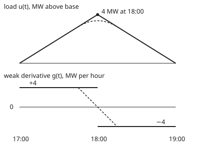

# Weak derivatives: differentiating a kink, and the spaces that keep score

[Syllabus](../../../SYLLABUS.md) → [Functional analysis](../README.md) → [Distributions and Sobolev Spaces](../README.md#s04) → Weak derivatives

---

## General Overview

A local power line, a feeder, carries an evening peak. At 17:00 the load is at its base level. It then climbs steadily to 4 MW (megawatts) above base at 18:00 and falls steadily back to base at 19:00. Plotted against time, the extra load is a tent. The numbers are illustrative.

The control room cares about the ramp rate: how fast the load changes, in MW per hour. It is +4 MW/h until 18:00 and −4 MW/h after. At 18:00 itself there is no rate. The slope from the left is +4 and from the right is −4, so ordinary calculus says the derivative does not exist there.

A **weak derivative**, the term used from here on, removes that problem. It never asks for a slope at a single instant. Instead it tests the load against smooth probe curves, moves the derivative onto the probe by integration by parts, and accepts any function that gives the same totals for every probe. The step, +4 then −4, passes. Its value at the one instant 18:00 does not matter.

A load that switches on all at once, a jump, fails the test. Its derivative is a spike, the delta, and not a function. That is the shelf's light switch and the hammer tap that flips it.

**Sobolev spaces** keep the score. The space $`W^{k,p}`$ holds the functions which, with their first $`k`$ weak derivatives, have a finite p-norm (a size: the p-th root of the integral of the p-th power). The tent lies in every $`W^{1,p}`$. It also lies in $`H^1_0`$, the functions of $`W^{1,2}`$ that are zero at both ends, because the tent is zero at 17:00 and at 19:00. It lies in no $`W^{2,p}`$: its second derivative is a spike at 18:00, −8 times the delta, because the ramp drops by 8 MW/h in an instant.

**A weak derivative is the function that integration by parts demands against every smooth probe; a kink has one, the step of its two slopes, a jump does not, and the Sobolev space $`W^{k,p}`$ counts how many such derivatives a function has in $`L^p`$.**

**What kind of fact this is:** definitions (weak derivative, $`W^{k,p}`$, $`H^1`$, $`H^1_0`$), with theorems proved on this card in Why it works: the tent's weak derivative is the step, weak derivatives are unique almost everywhere, and a jump has none. That $`W^{1,1}`$ on an interval is exactly the absolutely continuous functions is proved in Step 5, from [Absolutely continuous functions and the fundamental theorem](../../10-Measure%20and%20integration/11-Derivatives%20Meet%20the%20Lebesgue%20Integral/04-absolutely-continuous-functions-and-the-fundamental-theorem.md) and one lemma cited from Brezis. That smooth functions are dense in $`W^{k,p}`$ is stated with a source (Meyers and Serrin) and shown on the tent by the checks.

### The picture: the tent and its weak derivative

<p align="center"></p>

To scale: 160 px per hour across, 25 px per MW in the top panel and 10 px per MW/h in the bottom panel, from the checks' `figure,` line. Solid: the tent and its step. Dashed: the corner rounded by a parabola over 15 minutes each side, and its slope, which is continuous but steep.

---

## The formula

Notation first, in words. The time $`t`$ counts hours after 17:00, so the evening runs over the open interval $`(0, 2)`$. A **test function** $`\varphi`$ (phi), here called a probe, is a smooth curve that is zero outside a closed piece lying strictly inside $`(0, 2)`$. These form the space $`C_c^\infty(0, 2)`$ ([Distributions](01-test-functions-and-distributions.md)). The p-norm $`\lVert f\rVert_p`$ is the p-th root of $`\int \lvert f\rvert^p`$ ([Lp spaces](../../10-Measure%20and%20integration/07-Sizes%20of%20Functions/01-lp-spaces.md)).

A function $`g`$ is the **weak derivative** of $`u`$ on $`(0, 2)`$ when

```math
\int_0^2 u(t)\,\varphi'(t)\,dt = -\int_0^2 g(t)\,\varphi(t)\,dt \qquad \text{for every } \varphi \in C_c^\infty(0, 2).
```

**Read it aloud:** for every probe, the load weighted by the probe's slope adds up to minus the candidate rate weighted by the probe itself.

This is integration by parts with no end terms, because the probe is zero near both ends. When $`u`$ has an ordinary derivative, that derivative passes. The weak derivative is written $`u'`$ too.

The **Sobolev space** $`W^{k,p}(0, 2)`$, introduced here, holds the functions in $`L^p`$ whose weak derivatives up to order $`k`$ exist and lie in $`L^p`$. For $`k = 1`$ its norm is

```math
\lVert u\rVert_{W^{1,p}} = \big(\lVert u\rVert_p^p + \lVert u'\rVert_p^p\big)^{1/p}, \qquad \lVert u\rVert_{W^{1,\infty}} = \max\big(\lVert u\rVert_\infty, \lVert u'\rVert_\infty\big).
```

**Read it aloud:** the size of the function and the size of its weak derivative, combined by the same p-th power rule.

Two cases get their own names. $`H^1`$ is $`W^{1,2}`$, a Hilbert space (complete, with an inner product) with the inner product $`\langle u, v\rangle_{H^1} = \int uv + \int u'v'`$. $`H^1_0`$ is the closure of the probes in the $`H^1`$ norm (the probes plus all their limits); on an interval it is the $`H^1`$ functions that are zero at both ends. (On this wing a bare $`H`$ is a Hilbert space; $`H^1`$ is Sobolev's, and $`H(t)`$ is the step.)

The evening peak and its weak derivative:

```math
u(t) = 4\,\big(1 - \lvert t - 1\rvert\big), \qquad g(t) = \begin{cases} +4 & 0 < t < 1 \\ -4 & 1 < t < 2 \end{cases}, \qquad \lVert u\rVert_{H^1}^2 = \frac{32}{3} + 32 = \frac{128}{3}.
```

**Read it aloud:** the load rises 4 MW per hour to its peak and falls 4 MW per hour after; its squared $`H^1`$ size is the squared load, 32/3, plus the squared ramp rate, 32.

| Symbol | Plain meaning | In our example | Push it up and the answer… |
| --- | --- | --- | --- |
| $`t`$ | time after 17:00, hours | 0 to 2 | — |
| $`u(t)`$ | extra load above base, MW | 4 MW at $`t = 1`$, 18:00 | every norm grows in proportion |
| $`g`$, $`u'`$ | the weak derivative: the ramp rate, MW/h | +4, then −4 | — |
| $`\varphi`$, $`c`$, $`r`$ | a probe; its centre and half-width, hours | centre 0.7, half-width 0.4 | narrower $`r`$: the probe sees less of the load |
| $`C_c^\infty(0, 2)`$ | all probes: smooth, zero near both ends | every bump inside $`(0, 2)`$ | — |
| $`p`$, $`k`$, $`\lVert\cdot\rVert_p`$, $`L^p`$ | the exponent; the number of derivatives counted; the p-norm; the functions with finite p-norm | $`p`$ = 1, 2, ∞; $`k`$ = 1 | larger $`k`$: a stricter space |
| $`W^{k,p}`$, $`\lVert\cdot\rVert_{W^{1,p}}`$, $`u''`$ | the Sobolev space; its norm; the second weak derivative | the tent's norms: 12, 6.531973, 4 for $`p`$ = 1, 2, ∞ | — |
| $`H^1`$, $`H^1_0`$, $`\langle\cdot,\cdot\rangle_{H^1}`$, $`H^2`$ | $`W^{1,2}`$; its functions zero at both ends; its inner product; $`W^{2,2}`$ | $`\lVert u\rVert_{H^1}^2`$ = 42.666667 | — |
| $`s(t)`$, $`H(t)`$, $`\delta_1`$ | the switch $`4H(t - 1)`$: 0 MW, then 4 MW from 18:00; the step; the delta at $`t = 1`$ | weak derivative of $`s`$ would be $`4\delta_1`$ | — |
| $`N`$, $`h`$, $`u_i`$ | grid steps; step length $`h = 2/N`$; the load at node $`i`$ | $`N`$ = 16, $`h`$ = 0.125 | smaller $`h`$: grid sums settle or run away |
| $`\varepsilon`$, $`v_\varepsilon`$ | half-width of a rounded corner, hours; the rounded load | $`\varepsilon`$ = 0.25, peak 3.5 MW | smaller $`\varepsilon`$: $`H^1`$ distance shrinks like $`\sqrt\varepsilon`$ |
| $`f`$, $`g_1`$, $`g_2`$, $`u_n`$, $`v`$, $`x`$, $`G`$, $`\eta_r`$ | helpers: any integrable function; two candidate weak derivatives; a sequence of loads; a second load; the probe's distance from its centre in half-widths; the running integral of $`g`$; the smoothing bump of half-width $`r`$ and area 1 | — | — |

### When it holds

- **No jump at the kink.** The tent has the value 4 from both sides at 18:00, so the end terms of integration by parts cancel there. A jump leaves a term behind: the switch gives −1.471518 against a probe of any width, a delta, not a function.
- **Each derivative p-integrable.** A cusp like $`\sqrt{\lvert t - 1\rvert}`$ has a weak derivative, but the square of that derivative has an infinite integral near the cusp. It lies in $`W^{1,1}`$ and not in $`H^1`$.
- **Probes vanish near the ends.** The weak derivative sees only the inside of $`(0, 2)`$. Values at the ends are a separate question, answered by $`H^1_0`$ here and by [Boundary values and compactness](10-trace-and-rellich-kondrachov-in-outline.md) in general.
- **One dimension, for continuity.** On an interval every $`W^{1,1}`$ function has a continuous version (equal to it except on a set of length zero). In two dimensions an $`H^1`$ function can be unbounded ([Sobolev and Poincare](09-sobolev-embedding-and-poincare-inequality.md)).
- **A fixed time unit.** The $`H^1`$ norm adds MW²·h to (MW/h)²·h. Switch to minutes and the slope term shrinks from 32 to 0.533333.

---

## Why it works

### Step 0: on a grid, differences move from the probe to the load

Sample the load at $`N`$ = 16 nodes, every $`h`$ = 0.125 hours, and the probe at the same nodes. Summation by parts is the finite form of integration by parts:

```math
\sum_{i=0}^{N-1} u_i\,(\varphi_{i+1} - \varphi_i) = -\sum_{i=0}^{N-1} (u_{i+1} - u_i)\,\varphi_{i+1}.
```

**Read it aloud:** the load times the probe's steps adds up to minus the load's steps times the probe.

The end terms vanish because the probe is zero at both ends. With the probe centred at 0.7 hours, half-width 0.4, both sides are −0.712584772.

The load's steps exist at every node, kink or not. A grid never asks for a slope at a point. The weak derivative is what this identity becomes as $`N`$ grows: probe steps become $`\varphi'`$, load steps become $`g`$.

### Step 1: integrate by parts on each side of the kink

Split $`(0, 2)`$ at the kink. On each half the tent is a straight line, so ordinary integration by parts applies. Each half leaves end terms. At 0 and 2 the probe is zero. At 18:00 the left half leaves $`+u(1)\varphi(1)`$ and the right half $`-u(1)\varphi(1)`$. They cancel because the tent has one value there, 4 MW.

<details>
<summary>Detailed proof: the tent's weak derivative is the step</summary>

On $`(0, 1)`$, $`u(t) = 4t`$ and $`u' = 4`$. Integration by parts gives

$`\displaystyle \int_0^1 u\,\varphi'\,dt = \big[u\varphi\big]_0^1 - \int_0^1 4\,\varphi\,dt = 4\varphi(1) - \int_0^1 4\,\varphi\,dt,`$

since $`\varphi(0) = 0`$. On $`(1, 2)`$, $`u(t) = 8 - 4t`$ and $`u' = -4`$, so

$`\displaystyle \int_1^2 u\,\varphi'\,dt = \big[u\varphi\big]_1^2 + \int_1^2 4\,\varphi\,dt = -4\varphi(1) + \int_1^2 4\,\varphi\,dt,`$

since $`\varphi(2) = 0`$. Adding, the two $`4\varphi(1)`$ terms cancel:

$`\displaystyle \int_0^2 u\,\varphi'\,dt = -\int_0^2 g\,\varphi\,dt.`$

That is the definition, for every probe, with $`g`$ = +4 then −4.

</details>

The checks test three probes by quadrature (numerical integration). Centred at 0.9, 0.7 and 1.2 hours, with half-widths 0.5, 0.4 and 0.6 hours, both sides read −0.290331972, −0.687650163 and 0.566061522.

### Step 2: there is only one weak derivative, up to single instants

Suppose $`g_1`$ and $`g_2`$ both pass. Subtracting, $`\int (g_1 - g_2)\varphi = 0`$ for every probe. A locally integrable function (integrable over every closed piece inside the interval) that integrates to zero against every probe is zero almost everywhere. Smoothing proves it: each smoothed value of the function is its integral against a narrow probe, so it is 0, and the smoothed function converges to the function itself in the 1-norm (Step 4 of [Convolution and mollifiers](03-convolution-and-mollifiers.md)). So $`g_1 = g_2`$ except on a set of length zero.

<details>
<summary>Detailed proof: a function that integrates to zero against every probe is zero almost everywhere</summary>

Let $`f`$ be locally integrable on $`(0, 2)`$, with $`\int f\varphi = 0`$ for every probe $`\varphi`$. Fix a closed piece inside $`(0, 2)`$. Set $`f`$ to 0 outside a slightly wider closed piece, still inside $`(0, 2)`$; now $`f`$ is integrable on the whole line.

Let $`\eta_r`$ be the mollifier of [Convolution and mollifiers](03-convolution-and-mollifiers.md): a smooth bump of half-width $`r`$ and area 1. Take $`r`$ smaller than the gap between the two pieces. At a time $`t`$ in the inner piece, $`(\eta_r * f)(t)`$ is $`f`$ integrated against the bump $`\eta_r`$ centred at $`t`$. That bump lies inside the wider piece, where $`f`$ is unchanged, so it is a probe and the value is 0.

So $`\eta_r * f`$ is 0 on the inner piece, and the integral of $`\lvert f\rvert`$ over the inner piece is at most $`\lVert \eta_r * f - f\rVert_1`$. Step 4 of that card sends this to 0 as $`r`$ shrinks, so $`f = 0`$ almost everywhere on the inner piece. Taking inner pieces closer and closer to both ends, $`f = 0`$ almost everywhere on all of $`(0, 2)`$. ∎

</details>

This is why 18:00 needs no value. Set $`g(1)`$ to 0, to +4 or to 1000: the integrals do not change. A wrong rate does change them. Claiming +4 MW/h all evening leaves a residual of 0.887988 against a probe centred at 18:00 with half-width 0.5.

### Step 3: a jump leaves a spike, not a function

Now the switch: a 4 MW block switched on at 18:00, $`s(t) = 4H(t - 1)`$, where $`H(t)`$ is the step ([The delta](02-the-dirac-delta-and-derivatives-of-jumps.md)). Repeat Step 1. The left half has $`s = 0`$. The right half leaves $`-s(1^+)\varphi(1) = -4\varphi(1)`$, and nothing cancels it:

```math
\int_0^2 s\,\varphi'\,dt = -4\,\varphi(1).
```

**Read it aloud:** against any probe, the switch gives minus four times the probe's height at 18:00.

A weak derivative $`f`$ would need $`\int f\varphi = 4\varphi(1)`$ for every probe. Take bumps centred at 18:00, each of height $`\varphi(1)`$ = 0.367879, with half-widths 0.5, 0.05 and 0.005 hours. The left side stays at −1.471518. The bumps' areas shrink: 0.221997, 0.022200, 0.002220.

For any integrable $`f`$, $`\lvert\int f\varphi\rvert \le 0.367879 \int \lvert f\rvert`$ over the bump's window, and that window integral falls to 0 as the window shrinks. It cannot stay at 1.471518. So no function works. The switch's derivative is $`4\delta_1`$, the hammer tap, a distribution and not a function: $`s`$ lies in no $`W^{1,p}`$.

The same argument applied to the step $`g`$ gives $`\int g\,\varphi' = 8\varphi(1)`$ = 2.943036 at every width. So $`u'' = -8\delta_1`$, and the tent lies in no $`W^{2,p}`$.

### Step 4: keep the score

Each norm is a plain integral of the tent or the step.

- **$`W^{1,1}`$:** $`\int \lvert u\rvert`$ = 4, the extra energy in MWh. $`\int \lvert g\rvert`$ = 8, the total movement up and down in MW. Norm 12.
- **$`H^1 = W^{1,2}`$:** $`\int u^2`$ = 32/3 = 10.666667 and $`\int g^2`$ = 32. Norm squared 42.666667, norm 6.531973.
- **$`W^{1,\infty}`$:** the peak 4 MW and the steepest ramp 4 MW/h. Norm 4. A function is in $`W^{1,\infty}`$ on an interval exactly when it is Lipschitz: its slopes never exceed a fixed bound.
- **$`H^1_0`$:** $`u(0) = u(2) = 0`$, so the tent is in $`H^1_0`$. On an interval, $`H^1_0`$ is exactly the $`H^1`$ functions that vanish at the ends (Brezis, chapter 8).

On a bounded interval the spaces nest: $`W^{1,\infty} \subset H^1 \subset W^{1,1}`$, because a larger $`p`$ gives a smaller $`L^p`$ on an interval of finite length ([Lp spaces](../../10-Measure%20and%20integration/07-Sizes%20of%20Functions/01-lp-spaces.md)). The tent sits in the smallest.

### Step 5: in one dimension, $`W^{1,1}`$ is the absolutely continuous functions

A function on an interval is the running integral of an integrable rate exactly when it is absolutely continuous, and that rate is then its derivative almost everywhere ([Absolutely continuous functions and the fundamental theorem](../../10-Measure%20and%20integration/11-Derivatives%20Meet%20the%20Lebesgue%20Integral/04-absolutely-continuous-functions-and-the-fundamental-theorem.md)). Integration by parts holds for such functions, so the rate is the weak derivative.

Conversely, take $`u`$ in $`W^{1,1}`$ with weak derivative $`g`$. The running integral $`G(t) = \int_0^t g`$ is absolutely continuous with weak derivative $`g`$, so $`u - G`$ has weak derivative 0. A function with weak derivative 0 is constant almost everywhere (Brezis, Lemma 8.1). So $`u`$ equals $`G`$ plus a constant, almost everywhere, and $`W^{1,1}(0, 2)`$ is that card's class, with functions equal almost everywhere counted as one.

For the tent, $`u(t) = \int_0^t g`$: running the step forward from 0 rebuilds the tent, with a largest gap of 3.1e-15 MW in the checks. The Cantor staircase on that card is continuous with derivative 0 almost everywhere, yet not a running integral. It lies in no $`W^{1,p}`$.

### Step 6: smooth functions come arbitrarily close in $`H^1`$, never in $`H^2`$

$`H^1`$ is complete: weak derivatives survive limits. If $`u_n \to u`$ and $`u_n' \to g`$ in $`L^2`$, pass to the limit on both sides of the definition, and $`g`$ is the weak derivative of $`u`$.

Meyers and Serrin proved the converse picture: smooth functions are dense in $`W^{k,p}`$ for $`p < \infty`$ (they titled the paper "H = W"). Mollifying the tent gives smooth loads converging to it in $`H^1`$ ([Convolution and mollifiers](03-convolution-and-mollifiers.md)).

The checks use a simpler rounding: replace the tent between $`1 - \varepsilon`$ and $`1 + \varepsilon`$ by the parabola $`v_\varepsilon(t) = 4 - 2\varepsilon - 2(t - 1)^2/\varepsilon`$, which meets each side with the same value and slope. Its slope is continuous, so it lies in $`H^2`$, and closed forms give

```math
\lVert u - v_\varepsilon\rVert_{H^1}^2 = \frac{8\varepsilon^3}{5} + \frac{32\varepsilon}{3}, \qquad \int (v_\varepsilon'')^2\,dt = \frac{32}{\varepsilon}.
```

**Read it aloud:** the rounded load's $`H^1`$ distance from the tent shrinks like the square root of the rounding width, while its bending energy grows like one over that width.

At $`\varepsilon`$ = 0.25, 0.0625 and 0.015625 hours the distance is 1.640630, 0.816736 and 0.408256: it halves each time $`\varepsilon`$ is quartered. The bending energy is 128, 512 and 2048. The rounded loads reach the tent in $`H^1`$, and their $`H^2`$ size runs away. That is what "in $`H^1`$, not in $`H^2`$" means as a limit.

---

## Worked numbers, by hand

The evening peak, from the definition to its place among the spaces.

| Step | Arithmetic | Value |
| --- | --- | --- |
| ramp before 18:00 | (4 − 0) MW ÷ 1 h | +4 MW/h |
| ramp after 18:00 | (0 − 4) MW ÷ 1 h | −4 MW/h |
| end terms at 18:00 | $`4\varphi(1) - 4\varphi(1)`$ | 0 |
| squared load | 2 × (16 ÷ 3) | 10.666667 |
| squared ramp | 16 × 2 h | 32 |
| $`H^1`$ norm squared | 32/3 + 32 | 42.666667 |
| $`H^1`$ norm | square root of 128/3 | **6.531973** |
| $`W^{1,1}`$ norm | 4 MWh + 8 MW | 12 |
| ends | $`u(0)`$, $`u(2)`$ | 0 and 0, so in $`H^1_0`$ |
| jump in the ramp at 18:00 | −4 − 4 | −8, so $`u'' = -8\delta_1`$ |

The evening peak lies in $`H^1_0`$ with $`H^1`$ size 6.531973, and its ramp jumps by 8 MW/h at 18:00, which keeps it out of every $`W^{2,p}`$.

The finite rehearsal shows the same verdict as a trend. On a grid of $`N`$ steps through 18:00, the sums of $`h`$ times the squared values, squared steps and squared second steps give:

| $`N`$ | $`h`$ | sum $`u^2`$ | sum $`u'^2`$ | sum $`u''^2`$ |
| ---: | ---: | ---: | ---: | ---: |
| 4 | 0.5 | 12.000000 | 32.000000 | 128 |
| 16 | 0.125 | 10.750000 | 32.000000 | 512 |
| 64 | 0.03125 | 10.671875 | 32.000000 | 2048 |
| 256 | 0.00781 | 10.666992 | 32.000000 | 8192 |

The first column settles on 32/3, with error $`16h^2/3`$. The second is exactly 32 on every grid. The third is $`64/h`$ and grows fourfold each time: the one spike at 18:00, of height $`8/h`$, shows up as a trend that never closes. Every finite grid hides the delta behind a large finite number.

### What breaks if you drop a piece

| Mistake | Comes out at | What went wrong |
| --- | --- | --- |
| Ramp +4 MW/h all evening | residual 0.887988 against the probe at 18:00 | the identity fails: the sign change is part of the derivative |
| A jump instead of a kink: the switch | −1.471518 at half-widths 0.5, 0.05 and 0.005 | the end terms do not cancel; the derivative is $`4\delta_1`$, no function |
| Asking for $`H^2`$ | grid sums 128, 512, 2048, 8192 | the second derivative is a spike; the grid hides it as $`64/h`$ |
| Hours changed to minutes | slope term 0.533333, value term 640 | the $`H^1`$ norm adds two units; fix the unit first |

The code prints all four.

---

## Code, from first principles, and it actually runs

The code takes five roads to the same verdict.

1. **Closed forms:** 32/3, 32 and 128/3, and the $`W^{1,p}`$ norms.
2. **The grid at four sizes:** its sums must match the error formulas $`16h^2/3`$ and $`64/h`$.
3. **The definition itself:** the probe is $`e^{-1/(1-x^2)}`$, with $`x = (t - c)/r`$ the distance from the centre in half-widths. Each integral is a two-point Gauss rule on 2,000 pieces, split at 18:00, so the kink itself is never sampled.
4. **Absolute continuity:** the running integral of the step rebuilds the tent.
5. **Rounding:** the $`H^1`$ distance of the rounded corner, by quadrature, against its closed form.

What the truncation hides: every grid and every quadrature is finite, so the delta at 18:00 never appears as a delta. It appears as $`64/h`$ growing, or as −1.471518 refusing to shrink with the probe.

### Python

```python
# Weak derivatives and Sobolev spaces -- the check behind the card.  Standard
# library only.  The load: an illustrative evening peak on a feeder, 4 MW above
# base at 18:00, ramping up from 17:00 and down to 19:00.  With t in hours after
# 17:00, u(t) = 4(1 - |t - 1|) on (0, 2).  The kink at t = 1 has no slope; the
# weak derivative g = +4 then -4 MW/h is tested against smooth probes.
import math

def u(t): return 4.0 * (1.0 - abs(t - 1.0)) if 0.0 <= t <= 2.0 else 0.0
def g(t): return 4.0 if t < 1.0 else -4.0                     # the claimed weak derivative
def switch(t): return 4.0 if t > 1.0 else 0.0                 # a 4 MW block switched on at 18:00

def bump(t, c, r):                                            # smooth probe, zero off (c - r, c + r)
    s = (t - c) / r
    return math.exp(-1.0 / (1.0 - s * s)) if abs(s) < 1.0 else 0.0

def dbump(t, c, r):                                           # its slope, by the chain rule
    s = (t - c) / r
    return bump(t, c, r) * (-2.0 * s / (r * (1.0 - s * s) ** 2)) if abs(s) < 1.0 else 0.0

def gauss(f, a, b, n=2000):                                   # two-point Gauss on n pieces:
    h, q = (b - a) / n, (b - a) / n / (2.0 * math.sqrt(3.0))  # never samples an end point
    return sum(f(a + (k + 0.5) * h - q) + f(a + (k + 0.5) * h + q) for k in range(n)) * h / 2.0

def integral(f, a, b, cuts=(1.0,)):                           # split at kinks and jumps
    pts = [a] + [x for x in cuts if a < x < b] + [b]
    return sum(gauss(f, pts[k], pts[k + 1]) for k in range(len(pts) - 1))

def grid(n):                                                  # the finite rehearsal: n steps of h
    h = 2.0 / n
    vals = [u(i * h) for i in range(n + 1)]
    trap = h * sum(v * v for v in vals)                      # ends are 0, so this is the trapezoid sum
    slope = sum(h * ((vals[i + 1] - vals[i]) / h) ** 2 for i in range(n))
    bend = sum(h * ((vals[i + 1] - 2 * vals[i] + vals[i - 1]) / h ** 2) ** 2 for i in range(1, n))
    return h, vals, trap, slope, bend

print("finite rehearsal, N = 16 steps, probe centred 0.7, half-width 0.4:")
h, vals, _, _, _ = grid(16)
ph = [bump(i * h, 0.7, 0.4) for i in range(17)]
left = sum(vals[i] * (ph[i + 1] - ph[i]) for i in range(16))
right = -sum((vals[i + 1] - vals[i]) * ph[i + 1] for i in range(16))
print(f"  sum u_i (phi_i+1 - phi_i) = {left:.9f};  -sum (u_i+1 - u_i) phi_i+1 = {right:.9f}")
assert abs(left - right) < 1e-12                              # summation by parts, no boundary term

print("weak derivative test, integral u phi' against -integral g phi:")
for c, r in [(0.9, 0.5), (0.7, 0.4), (1.2, 0.6)]:
    lhs = integral(lambda t: u(t) * dbump(t, c, r), c - r, c + r)
    rhs = -integral(lambda t: g(t) * bump(t, c, r), c - r, c + r)
    print(f"  probe c = {c:.1f}, r = {r:.1f}:  {lhs:.9f}  {rhs:.9f}")
    assert abs(lhs - rhs) < 1e-9
c, r = 1.0, 0.5
bump_area = integral(lambda t: bump(t, c, r), c - r, c + r)
wrong = integral(lambda t: u(t) * dbump(t, c, r), c - r, c + r) + integral(lambda t: 4.0 * bump(t, c, r), c - r, c + r)
print(f"mistake 1, slope +4 everywhere: residual on probe c = 1.0, r = 0.5 is {wrong:.6f}")
assert abs(wrong - 4.0 * bump_area) < 1e-9                    # 8 times the right half of the probe

print(f"mistake 2, jumps: probes centred at 1, height phi(1) = {bump(1.0, 1.0, 0.5):.6f}")
for r in [0.5, 0.05, 0.005]:
    sp = integral(lambda t: switch(t) * dbump(t, 1.0, r), 1.0 - r, 1.0 + r)
    gp = integral(lambda t: g(t) * dbump(t, 1.0, r), 1.0 - r, 1.0 + r)
    area = integral(lambda t: bump(t, 1.0, r), 1.0 - r, 1.0 + r)
    print(f"  r = {r:<6} integral switch phi' {sp:.6f}  integral g phi' {gp:.6f}  integral phi {area:.6f}")
    assert abs(sp + 4.0 / math.e) < 1e-9 and abs(gp - 8.0 / math.e) < 1e-9   # -4 phi(1) and 8 phi(1)

run, worst = 0.0, 0.0                                         # absolute continuity: u is the running integral of g
for i in range(2000):
    run += g((i + 0.5) / 1000) / 1000
    worst = max(worst, abs(run - u((i + 1) / 1000)))
print(f"running integral of g reproduces u: largest gap {worst:.1e} MW")
assert worst < 1e-12

L2, D2 = 32 / 3, 32.0                                         # closed forms, MW^2 h and (MW/h)^2 h
norms = {}
for p in [1, 2]:
    up = integral(lambda t: abs(u(t)) ** p, 0.0, 2.0)
    gp = integral(lambda t: abs(g(t)) ** p, 0.0, 2.0)
    norms[p] = (up, gp, (up + gp) ** (1 / p))
    print(f"W^(1,{p}): integral |u|^{p} = {up:.6f}, integral |g|^{p} = {gp:.6f}, norm {norms[p][2]:.6f}")
    assert abs(norms[p][2] - (2 * 4 ** p * (p + 2) / (p + 1)) ** (1 / p)) < 1e-9
slopes = [abs(vals[i + 1] - vals[i]) / h for i in range(16)]
print(f"W^(1,inf): max |u| = {max(vals):.6f}, max |g| = {max(slopes):.6f}, norm {max(max(vals), max(slopes)):.6f}")
print(f"H^1 norm squared {norms[2][2] ** 2:.6f} = 32/3 + 32 = {L2 + D2:.6f}; u(0) = {u(0):.1f}, u(2) = {u(2):.1f}")
assert abs(norms[2][2] ** 2 - 128 / 3) < 1e-9

print("truncation:     N        h   sum u^2    sum u'^2    sum u''^2")
for n in [4, 16, 64, 256]:
    h, _, trap, slope, bend = grid(n)
    print(f"           {n:6d} {h:8.5f} {trap:9.6f} {slope:11.6f} {bend:12.3f}")
    assert abs(trap - (L2 + 16 * h * h / 3)) < 1e-9 and abs(slope - D2) < 1e-9 and abs(bend - 64 / h) < 1e-6

print("rounding the corner over 1 - eps to 1 + eps by a parabola:")
for eps in [0.25, 0.0625, 0.015625]:
    v = lambda t: 4 - 2 * eps - 2 * (t - 1) ** 2 / eps
    dv = lambda t: -4 * (t - 1) / eps
    d0 = integral(lambda t: (u(t) - v(t)) ** 2, 1 - eps, 1 + eps)
    d1 = integral(lambda t: (g(t) - dv(t)) ** 2, 1 - eps, 1 + eps)
    print(f"  eps {eps:<9} peak {4 - 2 * eps:.4f}  H^1 distance squared {d0 + d1:.6f}"
          f"  distance {math.sqrt(d0 + d1):.6f}  integral v''^2 {32 / eps:.0f}")
    assert abs(d0 + d1 - (8 * eps ** 3 / 5 + 32 * eps / 3)) < 1e-9

mins = 30.0                                                   # mistake 4: the same load in minutes
uvals = [0.0, 2.0, 4.0, 2.0, 0.0]
slope_min = sum(mins * ((uvals[i + 1] - uvals[i]) / mins) ** 2 for i in range(4))
print(f"mistake 4, minutes: integral u^2 = {L2 * 60:.3f} MW^2 min, integral u'^2 = {slope_min:.6f}")
assert abs(slope_min - D2 / 60) < 1e-12
X = lambda t: 40 + 160 * t                                    # figure scale: 160 px per hour,
Y = lambda m: 130 - 25 * m                                    # 25 px per MW, 10 px per MW/h
print(f"figure, tent px: ({X(0):.0f}, {Y(u(0)):.0f}) ({X(1):.0f}, {Y(u(1)):.0f}) ({X(2):.0f}, {Y(u(2)):.0f});"
      f" rounded peak ({X(1):.0f}, {Y(3.5):.1f}); slope px: +4 at y {220 - 40}, -4 at y {220 + 40},"
      f" rounded from x {X(0.75):.0f} to {X(1.25):.0f}")
print("ALL CHECKS PASS")
```

**Ran 2026-11-15 on macOS, Python 3.14.10, standard library only. All checks passed. Output, pasted from the run:**

```
finite rehearsal, N = 16 steps, probe centred 0.7, half-width 0.4:
  sum u_i (phi_i+1 - phi_i) = -0.712584772;  -sum (u_i+1 - u_i) phi_i+1 = -0.712584772
weak derivative test, integral u phi' against -integral g phi:
  probe c = 0.9, r = 0.5:  -0.290331972  -0.290331972
  probe c = 0.7, r = 0.4:  -0.687650163  -0.687650163
  probe c = 1.2, r = 0.6:  0.566061522  0.566061522
mistake 1, slope +4 everywhere: residual on probe c = 1.0, r = 0.5 is 0.887988
mistake 2, jumps: probes centred at 1, height phi(1) = 0.367879
  r = 0.5    integral switch phi' -1.471518  integral g phi' 2.943036  integral phi 0.221997
  r = 0.05   integral switch phi' -1.471518  integral g phi' 2.943036  integral phi 0.022200
  r = 0.005  integral switch phi' -1.471518  integral g phi' 2.943036  integral phi 0.002220
running integral of g reproduces u: largest gap 3.1e-15 MW
W^(1,1): integral |u|^1 = 4.000000, integral |g|^1 = 8.000000, norm 12.000000
W^(1,2): integral |u|^2 = 10.666667, integral |g|^2 = 32.000000, norm 6.531973
W^(1,inf): max |u| = 4.000000, max |g| = 4.000000, norm 4.000000
H^1 norm squared 42.666667 = 32/3 + 32 = 42.666667; u(0) = 0.0, u(2) = 0.0
truncation:     N        h   sum u^2    sum u'^2    sum u''^2
                4  0.50000 12.000000   32.000000      128.000
               16  0.12500 10.750000   32.000000      512.000
               64  0.03125 10.671875   32.000000     2048.000
              256  0.00781 10.666992   32.000000     8192.000
rounding the corner over 1 - eps to 1 + eps by a parabola:
  eps 0.25      peak 3.5000  H^1 distance squared 2.691667  distance 1.640630  integral v''^2 128
  eps 0.0625    peak 3.8750  H^1 distance squared 0.667057  distance 0.816736  integral v''^2 512
  eps 0.015625  peak 3.9688  H^1 distance squared 0.166673  distance 0.408256  integral v''^2 2048
mistake 4, minutes: integral u^2 = 640.000 MW^2 min, integral u'^2 = 0.533333
figure, tent px: (40, 130) (200, 30) (360, 130); rounded peak (200, 42.5); slope px: +4 at y 180, -4 at y 260, rounded from x 160 to 240
ALL CHECKS PASS
```

### Rust

Same numbers, same labels, built with `rustc --edition 2021 -O`.

```rust
// Weak derivatives and Sobolev spaces -- the same check as the Python, in Rust.
// No crates.  The load: an illustrative evening peak on a feeder, 4 MW above
// base at 18:00, ramping up from 17:00 and down to 19:00.  With t in hours after
// 17:00, u(t) = 4(1 - |t - 1|) on (0, 2).  The kink at t = 1 has no slope; the
// weak derivative g = +4 then -4 MW/h is tested against smooth probes.
fn u(t: f64) -> f64 { if (0.0..=2.0).contains(&t) { 4.0 * (1.0 - (t - 1.0).abs()) } else { 0.0 } }
fn g(t: f64) -> f64 { if t < 1.0 { 4.0 } else { -4.0 } }          // the claimed weak derivative
fn switch(t: f64) -> f64 { if t > 1.0 { 4.0 } else { 0.0 } }      // a 4 MW block switched on at 18:00

fn bump(t: f64, c: f64, r: f64) -> f64 {                           // smooth probe, zero off (c - r, c + r)
    let s = (t - c) / r;
    if s.abs() < 1.0 { (-1.0 / (1.0 - s * s)).exp() } else { 0.0 }
}

fn dbump(t: f64, c: f64, r: f64) -> f64 {                          // its slope, by the chain rule
    let s = (t - c) / r;
    if s.abs() < 1.0 { bump(t, c, r) * (-2.0 * s / (r * (1.0 - s * s).powi(2))) } else { 0.0 }
}

fn gauss(f: &dyn Fn(f64) -> f64, a: f64, b: f64) -> f64 {          // two-point Gauss on n pieces:
    let n = 2000;                                                  // never samples an end point
    let (h, q) = ((b - a) / n as f64, (b - a) / n as f64 / (2.0 * 3.0f64.sqrt()));
    let mut total = 0.0;
    for k in 0..n {
        let m = a + (k as f64 + 0.5) * h;
        total += f(m - q) + f(m + q);
    }
    total * h / 2.0
}

fn integral(f: &dyn Fn(f64) -> f64, a: f64, b: f64) -> f64 {       // split at the kink or jump at 1
    if a < 1.0 && 1.0 < b { gauss(f, a, 1.0) + gauss(f, 1.0, b) } else { gauss(f, a, b) }
}

fn grid(n: usize) -> (f64, Vec<f64>, f64, f64, f64) {              // the finite rehearsal: n steps of h
    let h = 2.0 / n as f64;
    let vals: Vec<f64> = (0..=n).map(|i| u(i as f64 * h)).collect();
    let trap = h * vals.iter().map(|v| v * v).sum::<f64>();       // ends are 0: the trapezoid sum
    let slope: f64 = (0..n).map(|i| h * ((vals[i + 1] - vals[i]) / h).powi(2)).sum();
    let bend: f64 = (1..n).map(|i| h * ((vals[i + 1] - 2.0 * vals[i] + vals[i - 1]) / (h * h)).powi(2)).sum();
    (h, vals, trap, slope, bend)
}

fn main() {
    println!("finite rehearsal, N = 16 steps, probe centred 0.7, half-width 0.4:");
    let (h, vals, _, _, _) = grid(16);
    let ph: Vec<f64> = (0..17).map(|i| bump(i as f64 * h, 0.7, 0.4)).collect();
    let left: f64 = (0..16).map(|i| vals[i] * (ph[i + 1] - ph[i])).sum();
    let right: f64 = -(0..16).map(|i| (vals[i + 1] - vals[i]) * ph[i + 1]).sum::<f64>();
    println!("  sum u_i (phi_i+1 - phi_i) = {:.9};  -sum (u_i+1 - u_i) phi_i+1 = {:.9}", left, right);
    assert!((left - right).abs() < 1e-12);                         // summation by parts, no boundary term

    println!("weak derivative test, integral u phi' against -integral g phi:");
    for &(c, r) in &[(0.9, 0.5), (0.7, 0.4), (1.2, 0.6)] {
        let lhs = integral(&|t| u(t) * dbump(t, c, r), c - r, c + r);
        let rhs = -integral(&|t| g(t) * bump(t, c, r), c - r, c + r);
        println!("  probe c = {:.1}, r = {:.1}:  {:.9}  {:.9}", c, r, lhs, rhs);
        assert!((lhs - rhs).abs() < 1e-9);
    }
    let (c, r) = (1.0, 0.5);
    let bump_area = integral(&|t| bump(t, c, r), c - r, c + r);
    let wrong = integral(&|t| u(t) * dbump(t, c, r), c - r, c + r) + integral(&|t| 4.0 * bump(t, c, r), c - r, c + r);
    println!("mistake 1, slope +4 everywhere: residual on probe c = 1.0, r = 0.5 is {:.6}", wrong);
    assert!((wrong - 4.0 * bump_area).abs() < 1e-9);               // 8 times the right half of the probe

    println!("mistake 2, jumps: probes centred at 1, height phi(1) = {:.6}", bump(1.0, 1.0, 0.5));
    for &r in &[0.5, 0.05, 0.005] {
        let sp = integral(&|t| switch(t) * dbump(t, 1.0, r), 1.0 - r, 1.0 + r);
        let gp = integral(&|t| g(t) * dbump(t, 1.0, r), 1.0 - r, 1.0 + r);
        let area = integral(&|t| bump(t, 1.0, r), 1.0 - r, 1.0 + r);
        println!("  r = {:<6} integral switch phi' {:.6}  integral g phi' {:.6}  integral phi {:.6}", r, sp, gp, area);
        let e = std::f64::consts::E;
        assert!((sp + 4.0 / e).abs() < 1e-9 && (gp - 8.0 / e).abs() < 1e-9);   // -4 phi(1) and 8 phi(1)
    }

    let (mut run, mut worst) = (0.0f64, 0.0f64);                   // absolute continuity: u is the running integral of g
    for i in 0..2000 {
        run += g((i as f64 + 0.5) / 1000.0) / 1000.0;
        worst = worst.max((run - u((i + 1) as f64 / 1000.0)).abs());
    }
    println!("running integral of g reproduces u: largest gap {:.1e} MW", worst);
    assert!(worst < 1e-12);

    let (l2, d2) = (32.0 / 3.0, 32.0);                              // closed forms, MW^2 h and (MW/h)^2 h
    let mut h1 = 0.0;
    for p in [1i32, 2] {
        let up = integral(&|t| u(t).abs().powi(p), 0.0, 2.0);
        let gp = integral(&|t| g(t).abs().powi(p), 0.0, 2.0);
        let norm = (up + gp).powf(1.0 / p as f64);
        println!("W^(1,{}): integral |u|^{} = {:.6}, integral |g|^{} = {:.6}, norm {:.6}", p, p, up, p, gp, norm);
        let exact = (2.0 * 4f64.powi(p) * (p + 2) as f64 / (p + 1) as f64).powf(1.0 / p as f64);
        assert!((norm - exact).abs() < 1e-9);
        h1 = norm;
    }
    let slopes: Vec<f64> = (0..16).map(|i| (vals[i + 1] - vals[i]).abs() / h).collect();
    let (mu, mg) = (vals.iter().cloned().fold(0.0, f64::max), slopes.iter().cloned().fold(0.0, f64::max));
    println!("W^(1,inf): max |u| = {:.6}, max |g| = {:.6}, norm {:.6}", mu, mg, mu.max(mg));
    println!("H^1 norm squared {:.6} = 32/3 + 32 = {:.6}; u(0) = {:.1}, u(2) = {:.1}", h1 * h1, l2 + d2, u(0.0), u(2.0));
    assert!((h1 * h1 - 128.0 / 3.0).abs() < 1e-9);

    println!("truncation:     N        h   sum u^2    sum u'^2    sum u''^2");
    for n in [4usize, 16, 64, 256] {
        let (h, _, trap, slope, bend) = grid(n);
        println!("           {:6} {:8.5} {:9.6} {:11.6} {:12.3}", n, h, trap, slope, bend);
        assert!((trap - (l2 + 16.0 * h * h / 3.0)).abs() < 1e-9 && (slope - d2).abs() < 1e-9 && (bend - 64.0 / h).abs() < 1e-6);
    }

    println!("rounding the corner over 1 - eps to 1 + eps by a parabola:");
    for eps in [0.25f64, 0.0625, 0.015625] {
        let v = |t: f64| 4.0 - 2.0 * eps - 2.0 * (t - 1.0).powi(2) / eps;
        let dv = |t: f64| -4.0 * (t - 1.0) / eps;
        let d0 = integral(&|t| (u(t) - v(t)).powi(2), 1.0 - eps, 1.0 + eps);
        let d1 = integral(&|t| (g(t) - dv(t)).powi(2), 1.0 - eps, 1.0 + eps);
        println!("  eps {:<9} peak {:.4}  H^1 distance squared {:.6}  distance {:.6}  integral v''^2 {:.0}",
                 eps, 4.0 - 2.0 * eps, d0 + d1, (d0 + d1).sqrt(), 32.0 / eps);
        assert!((d0 + d1 - (8.0 * eps.powi(3) / 5.0 + 32.0 * eps / 3.0)).abs() < 1e-9);
    }

    let mins = 30.0f64;                                             // mistake 4: the same load in minutes
    let uvals: [f64; 5] = [0.0, 2.0, 4.0, 2.0, 0.0];
    let slope_min: f64 = (0..4).map(|i| mins * ((uvals[i + 1] - uvals[i]) / mins).powi(2)).sum();
    println!("mistake 4, minutes: integral u^2 = {:.3} MW^2 min, integral u'^2 = {:.6}", l2 * 60.0, slope_min);
    assert!((slope_min - d2 / 60.0).abs() < 1e-12);
    let x = |t: f64| 40.0 + 160.0 * t;                              // figure scale: 160 px per hour,
    let y = |m: f64| 130.0 - 25.0 * m;                              // 25 px per MW, 10 px per MW/h
    println!("figure, tent px: ({:.0}, {:.0}) ({:.0}, {:.0}) ({:.0}, {:.0}); rounded peak ({:.0}, {:.1}); slope px: +4 at y {}, -4 at y {}, rounded from x {:.0} to {:.0}",
             x(0.0), y(u(0.0)), x(1.0), y(u(1.0)), x(2.0), y(u(2.0)), x(1.0), y(3.5), 220 - 40, 220 + 40, x(0.75), x(1.25));
    println!("ALL CHECKS PASS");
}
```

**Ran 2026-11-15 on macOS, rustc 1.98.1, no crates. All checks passed. Output, pasted from the run:**

```
finite rehearsal, N = 16 steps, probe centred 0.7, half-width 0.4:
  sum u_i (phi_i+1 - phi_i) = -0.712584772;  -sum (u_i+1 - u_i) phi_i+1 = -0.712584772
weak derivative test, integral u phi' against -integral g phi:
  probe c = 0.9, r = 0.5:  -0.290331972  -0.290331972
  probe c = 0.7, r = 0.4:  -0.687650163  -0.687650163
  probe c = 1.2, r = 0.6:  0.566061522  0.566061522
mistake 1, slope +4 everywhere: residual on probe c = 1.0, r = 0.5 is 0.887988
mistake 2, jumps: probes centred at 1, height phi(1) = 0.367879
  r = 0.5    integral switch phi' -1.471518  integral g phi' 2.943036  integral phi 0.221997
  r = 0.05   integral switch phi' -1.471518  integral g phi' 2.943036  integral phi 0.022200
  r = 0.005  integral switch phi' -1.471518  integral g phi' 2.943036  integral phi 0.002220
running integral of g reproduces u: largest gap 3.1e-15 MW
W^(1,1): integral |u|^1 = 4.000000, integral |g|^1 = 8.000000, norm 12.000000
W^(1,2): integral |u|^2 = 10.666667, integral |g|^2 = 32.000000, norm 6.531973
W^(1,inf): max |u| = 4.000000, max |g| = 4.000000, norm 4.000000
H^1 norm squared 42.666667 = 32/3 + 32 = 42.666667; u(0) = 0.0, u(2) = 0.0
truncation:     N        h   sum u^2    sum u'^2    sum u''^2
                4  0.50000 12.000000   32.000000      128.000
               16  0.12500 10.750000   32.000000      512.000
               64  0.03125 10.671875   32.000000     2048.000
              256  0.00781 10.666992   32.000000     8192.000
rounding the corner over 1 - eps to 1 + eps by a parabola:
  eps 0.25      peak 3.5000  H^1 distance squared 2.691667  distance 1.640630  integral v''^2 128
  eps 0.0625    peak 3.8750  H^1 distance squared 0.667057  distance 0.816736  integral v''^2 512
  eps 0.015625  peak 3.9688  H^1 distance squared 0.166673  distance 0.408256  integral v''^2 2048
mistake 4, minutes: integral u^2 = 640.000 MW^2 min, integral u'^2 = 0.533333
figure, tent px: (40, 130) (200, 30) (360, 130); rounded peak (200, 42.5); slope px: +4 at y 180, -4 at y 260, rounded from x 160 to 240
ALL CHECKS PASS
```

The two outputs match line for line.

### Lean

Lean proves the three theorems of Why it works for any interval, any kink and any jump height, not only the evening peak.

- Take a load that is continuous across one kink and has an integrable ordinary slope everywhere else. Then that slope is its weak derivative, whatever value it takes at the kink.
- Suppose two locally integrable functions both pass the weak-derivative test for the same load. Then they are equal almost everywhere.
- A switch from 0 to any nonzero height has no locally integrable weak derivative. So it lies in no $`W^{1,p}`$.
- The worked numbers by hand, from the ramps to the rounded corner and the change to minutes, hold as exact arithmetic.

The quadrature values against real probes and the running integral that rebuilds the tent are left to the Python and Rust checks.

```lean
-- Weak derivatives: a function with a kink but no jump on an interval has a weak derivative, the step of its slopes, which is unique almost everywhere, while a jump has no weak derivative at all.
import Mathlib.Analysis.Distribution.AEEqOfIntegralContDiff
import Mathlib.MeasureTheory.Integral.IntervalIntegral.IntegrationByParts

open MeasureTheory Set
open scoped ContDiff

lemma probe_inner_bounds {K : Set ℝ} {a b : ℝ} (hK : IsCompact K) (hKs : K ⊆ Ioo a b) :
    ∃ δ > 0, ∀ x ∈ K, a + δ < x ∧ x < b - δ := by
  obtain ⟨δ, hδ, hsub⟩ := hK.exists_thickening_subset_open isOpen_Ioo hKs
  refine ⟨δ / 2, by positivity, fun x hx => ⟨?_, ?_⟩⟩
  · have h : x - δ / 2 ∈ Metric.thickening δ K :=
      Metric.mem_thickening_iff.2 ⟨x, hx, by
        rw [Real.dist_eq, show x - δ / 2 - x = -(δ / 2) by ring, abs_neg, abs_of_pos (by positivity)]
        linarith⟩
    have := (hsub h).1
    linarith
  · have h : x + δ / 2 ∈ Metric.thickening δ K :=
      Metric.mem_thickening_iff.2 ⟨x, hx, by
        rw [Real.dist_eq, show x + δ / 2 - x = δ / 2 by ring, abs_of_pos (by positivity)]
        linarith⟩
    have := (hsub h).2
    linarith

lemma interval_integral_eq_of_zero_outside {F : ℝ → ℝ} {a a' b' b : ℝ} (h1 : a ≤ a')
    (h3 : b' ≤ b) (hF : IntervalIntegrable F volume a' b')
    (hz : ∀ t, t ≤ a' ∨ b' ≤ t → F t = 0) :
    ∫ t in a..b, F t = ∫ t in a'..b', F t := by
  have e1 : EqOn F 0 (uIcc a a') := fun t ht => by
    rw [uIcc_of_le h1] at ht; exact hz t (Or.inl ht.2)
  have e3 : EqOn F 0 (uIcc b' b) := fun t ht => by
    rw [uIcc_of_le h3] at ht; exact hz t (Or.inr ht.1)
  have z1 : IntervalIntegrable F volume a a' :=
    (intervalIntegrable_congr (fun t ht => (e1 (uIoc_subset_uIcc ht)).symm)).1
      (intervalIntegrable_const (c := (0 : ℝ)))
  have z3 : IntervalIntegrable F volume b' b :=
    (intervalIntegrable_congr (fun t ht => (e3 (uIoc_subset_uIcc ht)).symm)).1
      (intervalIntegrable_const (c := (0 : ℝ)))
  rw [← intervalIntegral.integral_add_adjacent_intervals z1 (hF.trans z3),
    ← intervalIntegral.integral_add_adjacent_intervals hF z3,
    intervalIntegral.integral_congr e1, intervalIntegral.integral_congr e3]
  simp

lemma interval_integral_eq_integral_probe {f φ : ℝ → ℝ} {a b : ℝ} (hab : a ≤ b)
    (hφs : tsupport φ ⊆ Ioo a b) :
    ∫ t in a..b, f t * φ t = ∫ t, φ t • f t := by
  rw [intervalIntegral.integral_of_le hab, setIntegral_eq_integral_of_forall_compl_eq_zero]
  · simp [smul_eq_mul, mul_comm]
  · intro x hx
    have : φ x = 0 := image_eq_zero_of_notMem_tsupport (fun h => hx (Ioo_subset_Ioc_self (hφs h)))
    simp [this]

lemma integrable_probe {g φ : ℝ → ℝ} {a b : ℝ} (hg : LocallyIntegrableOn g (Ioo a b))
    (hφ : Continuous φ) (hφc : HasCompactSupport φ) (hφs : tsupport φ ⊆ Ioo a b) :
    Integrable (fun t => φ t • g t) := by
  have h : IntegrableOn (fun t => g t * φ t) (tsupport φ) :=
    (hg.integrableOn_compact_subset hφs hφc).mul_continuousOn hφ.continuousOn hφc
  have h' := h.integrable_of_forall_notMem_eq_zero
    (fun x hx => by simp [image_eq_zero_of_notMem_tsupport hx])
  simpa [smul_eq_mul, mul_comm] using h'

#print axioms probe_inner_bounds
#print axioms interval_integral_eq_of_zero_outside
#print axioms interval_integral_eq_integral_probe
#print axioms integrable_probe

/-- A kink has a weak derivative, the step of its two slopes. On an interval `(a, b)` with a kink
at `c`, let `u` be continuous on `(a, b)` (so it has no jump at the kink), with ordinary slope
`g t` at every `t` other than `c`, and let `g` be integrable on `(a, b)`. Then `g` is the weak
derivative of `u`: for every probe `φ` (smooth, zero outside a closed and bounded piece lying
inside `(a, b)`), the integral of `u φ'` over `(a, b)` is minus the integral of `g φ`. The value
of `g` at the kink itself plays no part. -/
theorem weak_derivative_of_kink_is_step {u g : ℝ → ℝ} {a c b : ℝ} (hac : a < c) (hcb : c < b)
    (hu : ContinuousOn u (Ioo a b))
    (hderiv : ∀ t ∈ Ioo a c ∪ Ioo c b, HasDerivAt u (g t) t)
    (hg : IntervalIntegrable g volume a b)
    (φ : ℝ → ℝ) (hφ : ContDiff ℝ ∞ φ) (hφc : HasCompactSupport φ) (hφs : tsupport φ ⊆ Ioo a b) :
    ∫ t in a..b, u t * deriv φ t = -∫ t in a..b, g t * φ t := by
  obtain ⟨δ, hδ, hK⟩ := probe_inner_bounds hφc hφs
  set a' := min (a + δ) ((a + c) / 2) with ha'
  set b' := max (b - δ) ((c + b) / 2) with hb'
  have h1 : a < a' := lt_min (by linarith) (by linarith)
  have h2 : a' < c := lt_of_le_of_lt (min_le_right _ _) (by linarith)
  have h3 : c < b' := lt_of_lt_of_le (by linarith) (le_max_right _ _)
  have h4 : b' < b := max_lt (by linarith) (by linarith)
  have hsub : Icc a' b' ⊆ Ioo a b := Icc_subset_Ioo h1 h4
  have hout : ∀ t, t ≤ a' ∨ b' ≤ t → t ∉ tsupport φ := by
    intro t ht hmem
    have := hK t hmem
    rcases ht with ht | ht
    · have : a' ≤ a + δ := min_le_left _ _
      linarith
    · have : b - δ ≤ b' := le_max_left _ _
      linarith
  have hφ0 : ∀ t, t ≤ a' ∨ b' ≤ t → φ t = 0 := fun t ht =>
    image_eq_zero_of_notMem_tsupport (hout t ht)
  have hdφ0 : ∀ t, t ≤ a' ∨ b' ≤ t → deriv φ t = 0 := fun t ht =>
    Function.notMem_support.1 (fun h => hout t ht (support_deriv_subset h))
  have hdiff : Differentiable ℝ φ := hφ.differentiable (by simp)
  have hcd : Continuous (deriv φ) := hφ.continuous_deriv (by exact_mod_cast le_top)
  have hdφ : ∀ t, HasDerivAt φ (deriv φ t) t := fun t => (hdiff t).hasDerivAt
  have I1 : IntervalIntegrable (fun t => g t * φ t) volume a b :=
    hg.mul_continuousOn hφ.continuous.continuousOn
  have I1' : IntervalIntegrable (fun t => g t * φ t) volume a' b' :=
    I1.mono_set (by
      rw [uIcc_of_le (h1.trans (h2.trans (h3.trans h4))).le, uIcc_of_le (h2.trans h3).le]
      exact Icc_subset_Icc h1.le h4.le)
  have I2 : IntervalIntegrable (fun t => u t * deriv φ t) volume a' b' :=
    ContinuousOn.intervalIntegrable (by
      rw [uIcc_of_le (h2.trans h3).le]; exact (hu.mono hsub).mul hcd.continuousOn)
  have IF : IntervalIntegrable (fun t => g t * φ t + u t * deriv φ t) volume a' b' := I1'.add I2
  have IFl : IntervalIntegrable (fun t => g t * φ t + u t * deriv φ t) volume a' c :=
    IF.mono_set (by
      rw [uIcc_of_le h2.le, uIcc_of_le (h2.trans h3).le]; exact Icc_subset_Icc le_rfl h3.le)
  have IFr : IntervalIntegrable (fun t => g t * φ t + u t * deriv φ t) volume c b' :=
    IF.mono_set (by
      rw [uIcc_of_le h3.le, uIcc_of_le (h2.trans h3).le]; exact Icc_subset_Icc h2.le le_rfl)
  have hl : ∫ t in a'..c, (g t * φ t + u t * deriv φ t) = u c * φ c - u a' * φ a' :=
    intervalIntegral.integral_eq_sub_of_hasDerivAt_of_le h2.le
      ((hu.mono (Icc_subset_Ioo h1 (h3.trans h4))).mul hφ.continuous.continuousOn)
      (fun t ht => (hderiv t (Or.inl ⟨h1.trans ht.1, ht.2⟩)).mul (hdφ t)) IFl
  have hr : ∫ t in c..b', (g t * φ t + u t * deriv φ t) = u b' * φ b' - u c * φ c :=
    intervalIntegral.integral_eq_sub_of_hasDerivAt_of_le h3.le
      ((hu.mono (Icc_subset_Ioo (h1.trans h2) h4)).mul hφ.continuous.continuousOn)
      (fun t ht => (hderiv t (Or.inr ⟨ht.1, ht.2.trans h4⟩)).mul (hdφ t)) IFr
  have hsum := intervalIntegral.integral_add_adjacent_intervals IFl IFr
  rw [hl, hr, hφ0 a' (Or.inl le_rfl), hφ0 b' (Or.inr le_rfl),
    intervalIntegral.integral_add I1' I2] at hsum
  rw [interval_integral_eq_of_zero_outside h1.le h4.le I2
      (fun t ht => by simp [hdφ0 t ht]),
    interval_integral_eq_of_zero_outside h1.le h4.le I1'
      (fun t ht => by simp [hφ0 t ht])]
  linarith

/-- There is only one weak derivative, up to single instants. If `g₁` and `g₂` are both locally
integrable on `(a, b)` and both are weak derivatives of the same `u` (each passes the test
against every probe), then `g₁ = g₂` at almost every time in `(a, b)`. -/
theorem weak_derivative_unique_ae {u g₁ g₂ : ℝ → ℝ} {a b : ℝ}
    (hg₁ : LocallyIntegrableOn g₁ (Ioo a b)) (hg₂ : LocallyIntegrableOn g₂ (Ioo a b))
    (h₁ : ∀ φ : ℝ → ℝ, ContDiff ℝ ∞ φ → HasCompactSupport φ → tsupport φ ⊆ Ioo a b →
      ∫ t in a..b, u t * deriv φ t = -∫ t in a..b, g₁ t * φ t)
    (h₂ : ∀ φ : ℝ → ℝ, ContDiff ℝ ∞ φ → HasCompactSupport φ → tsupport φ ⊆ Ioo a b →
      ∫ t in a..b, u t * deriv φ t = -∫ t in a..b, g₂ t * φ t) :
    ∀ᵐ t, t ∈ Ioo a b → g₁ t = g₂ t := by
  by_cases hab : a ≤ b
  · have key := isOpen_Ioo.ae_eq_zero_of_integral_contDiff_smul_eq_zero
      (μ := volume) (f := fun t => g₁ t - g₂ t) (hg₁.sub hg₂) (by
        intro φ hφ hφc hφs
        have e1 := h₁ φ hφ hφc hφs
        have e2 := h₂ φ hφ hφc hφs
        rw [interval_integral_eq_integral_probe hab hφs] at e1 e2
        simp_rw [smul_sub]
        rw [integral_sub (integrable_probe hg₁ hφ.continuous hφc hφs)
          (integrable_probe hg₂ hφ.continuous hφc hφs)]
        linarith)
    filter_upwards [key] with t ht hmem
    exact sub_eq_zero.1 (ht hmem)
  · exact Filter.Eventually.of_forall fun t ht => absurd (ht.1.trans ht.2).le hab

/-- A jump has no weak derivative. The switch that is `0` before time `c` and `J ≠ 0` after it,
on an interval `(a, b)` containing `c`, has no locally integrable function `f` on `(a, b)` that
passes the weak-derivative test against every probe. (Its derivative is `J` times the delta at
`c`, a distribution and not a function, so the switch lies in no `W^{1,p}`.) -/
theorem jump_has_no_weak_derivative {a c b J : ℝ} (hac : a < c) (hcb : c < b) (hJ : J ≠ 0) :
    ¬ ∃ f : ℝ → ℝ, LocallyIntegrableOn f (Ioo a b) ∧
      ∀ φ : ℝ → ℝ, ContDiff ℝ ∞ φ → HasCompactSupport φ → tsupport φ ⊆ Ioo a b →
        ∫ t in a..b, (if c < t then J else 0) * deriv φ t = -∫ t in a..b, f t * φ t := by
  rintro ⟨f, hf, hweak⟩
  have hab : a ≤ b := (hac.trans hcb).le
  have key : ∀ φ : ℝ → ℝ, ContDiff ℝ ∞ φ → HasCompactSupport φ → tsupport φ ⊆ Ioo a b →
      ∫ t in a..b, f t * φ t = J * φ c := by
    intro φ hφ hφc hφs
    have hdiff : Differentiable ℝ φ := hφ.differentiable (by simp)
    have hcd : Continuous (deriv φ) := hφ.continuous_deriv (by exact_mod_cast le_top)
    have hb0 : φ b = 0 := image_eq_zero_of_notMem_tsupport (fun h => (hφs h).2.false)
    set F : ℝ → ℝ := fun t => (if c < t then J else 0) * deriv φ t with hF
    have eqL : EqOn F 0 (uIoc a c) := fun t ht => by
      rw [uIoc_of_le hac.le] at ht
      simp [F, not_lt.2 ht.2]
    have eqR : EqOn F (fun t => J * deriv φ t) (uIoc c b) := fun t ht => by
      rw [uIoc_of_le hcb.le] at ht
      simp [F, ht.1]
    have iL : IntervalIntegrable F volume a c :=
      (intervalIntegrable_congr (fun t ht => (eqL ht).symm)).1
        (intervalIntegrable_const (c := (0 : ℝ)))
    have iR : IntervalIntegrable F volume c b :=
      (intervalIntegrable_congr (fun t ht => (eqR ht).symm)).1
        ((hcd.const_mul J).intervalIntegrable c b)
    have hL : ∫ t in a..b, F t = -(J * φ c) := by
      rw [← intervalIntegral.integral_add_adjacent_intervals iL iR,
        intervalIntegral.integral_congr_ae (Filter.Eventually.of_forall fun t ht => eqL ht),
        intervalIntegral.integral_congr_ae (Filter.Eventually.of_forall fun t ht => eqR ht),
        intervalIntegral.integral_const_mul,
        intervalIntegral.integral_deriv_eq_sub (fun x _ => hdiff x) (hcd.intervalIntegrable c b),
        hb0]
      simp
    have := hweak φ hφ hφc hφs
    rw [hL] at this
    linarith
  set U : Set ℝ := Ioo a b \ {c} with hU
  have hUo : IsOpen U := isOpen_Ioo.sdiff isClosed_singleton
  have hae := hUo.ae_eq_zero_of_integral_contDiff_smul_eq_zero (μ := volume)
    (hf.mono_set sdiff_subset) (by
      intro φ hφ hφc hφs
      have hs : tsupport φ ⊆ Ioo a b := hφs.trans sdiff_subset
      have hc0 : φ c = 0 := image_eq_zero_of_notMem_tsupport (fun h => (hφs h).2 rfl)
      rw [← interval_integral_eq_integral_probe hab hs, key φ hφ hφc hs, hc0, mul_zero])
  set r : ℝ := min (c - a) (b - c) / 2 with hr
  have hr0 : 0 < r := by
    have : 0 < min (c - a) (b - c) := lt_min (by linarith) (by linarith)
    positivity
  have hra : r < c - a := by
    have : min (c - a) (b - c) ≤ c - a := min_le_left _ _
    linarith
  have hrb : r < b - c := by
    have : min (c - a) (b - c) ≤ b - c := min_le_right _ _
    linarith
  let ρ : ContDiffBump c := ⟨r / 2, r, by positivity, by linarith⟩
  have hρs : tsupport ρ ⊆ Ioo a b := by
    rw [ρ.tsupport_eq, Real.closedBall_eq_Icc]
    exact Icc_subset_Ioo (by linarith) (by linarith)
  have hρc : ρ c = 1 := ρ.one_of_mem_closedBall (Metric.mem_closedBall_self (by positivity))
  have h1 := key ρ ρ.contDiff ρ.hasCompactSupport hρs
  rw [interval_integral_eq_integral_probe hab hρs, hρc, mul_one] at h1
  have h0 : ∫ t, ρ t • f t = 0 := by
    apply integral_eq_zero_of_ae
    filter_upwards [hae, Measure.ae_ne volume c] with t ht htc
    by_cases hmem : t ∈ Ioo a b
    · simp [ht ⟨hmem, htc⟩]
    · simp [image_eq_zero_of_notMem_tsupport (fun h => hmem (hρs h))]
  exact hJ (h1.symm.trans h0)

-- Worked numbers from the card, exactly (MW, hours, MW/h), for the tent u(t) = 4(1 - |t - 1|).
-- The ramps: (4 - 0) MW over 1 h, and (0 - 4) MW over 1 h.
example : ((4 : ℚ) - 0) / 1 = 4 ∧ ((0 : ℚ) - 4) / 1 = -4 := by norm_num
-- The tent is zero at both ends, 17:00 and 19:00, and 4 MW at 18:00, so it lies in H^1_0.
example : (4 : ℝ) * (1 - |0 - 1|) = 0 ∧ (4 : ℝ) * (1 - |2 - 1|) = 0 ∧ (4 : ℝ) * (1 - |1 - 1|) = 4 := by
  norm_num
-- End terms at 18:00 cancel for any probe height φ(1).
example (x : ℝ) : 4 * x - 4 * x = 0 := by ring
-- Squared load 2 × 16/3 = 32/3, squared ramp 16 × 2 = 32, H^1 norm squared 32/3 + 32 = 128/3.
example : (2 : ℚ) * (16 / 3) = 32 / 3 ∧ (16 : ℚ) * 2 = 32 ∧ (32 / 3 : ℚ) + 32 = 128 / 3 := by norm_num
-- W^{1,1} norm: 4 MWh + 8 MW = 12; W^{1,∞} norm: max of 4 MW and 4 MW/h = 4.
example : (4 : ℕ) + 8 = 12 ∧ max (4 : ℕ) 4 = 4 := by decide
-- The ramp jumps by -4 - 4 = -8 at 18:00, so u'' = -8 δ₁.
example : (-4 : ℤ) - 4 = -8 := by decide
-- Grid at N = 4 (h = 1/2, nodes 0, 2, 4, 2, 0): sum u^2 = 12, sum u'^2 = 32, sum u''^2 = 128 = 64/h.
example : (1 / 2 : ℚ) * (0 ^ 2 + 2 ^ 2 + 4 ^ 2 + 2 ^ 2 + 0 ^ 2) = 12 := by norm_num
example : (1 / 2 : ℚ) * (((2 - 0) / (1 / 2)) ^ 2 + ((4 - 2) / (1 / 2)) ^ 2
    + ((2 - 4) / (1 / 2)) ^ 2 + ((0 - 2) / (1 / 2)) ^ 2) = 32 := by norm_num
example : (1 / 2 : ℚ) * (((4 - 2 * 2 + 0) / (1 / 2) ^ 2) ^ 2 + ((2 - 2 * 4 + 2) / (1 / 2) ^ 2) ^ 2
    + ((0 - 2 * 2 + 4) / (1 / 2) ^ 2) ^ 2) = 64 / (1 / 2) := by norm_num
-- Grid sums of u^2 at N = 16 and 64 are 32/3 + 16 h^2 / 3: 43/4 and 2049/192.
example : (32 / 3 : ℚ) + 16 * (1 / 8) ^ 2 / 3 = 43 / 4 := by norm_num
example : (32 / 3 : ℚ) + 16 * (1 / 32) ^ 2 / 3 = 2049 / 192 := by norm_num
-- Second-step sums 64/h at h = 1/8, 1/32, 1/128: 512, 2048, 8192.
example : (64 : ℚ) / (1 / 8) = 512 ∧ (64 : ℚ) / (1 / 32) = 2048 ∧ (64 : ℚ) / (1 / 128) = 8192 := by
  norm_num
-- Rounding the corner at ε = 1/4: H^1 distance squared 8ε³/5 + 32ε/3 = 323/120, bending energy 32/ε = 128.
example : (8 : ℚ) * (1 / 4) ^ 3 / 5 + 32 * (1 / 4) / 3 = 323 / 120 ∧ (32 : ℚ) / (1 / 4) = 128 := by
  norm_num
-- In minutes: value term 32/3 × 60 = 640, slope term 32/60 = 8/15.
example : (32 / 3 : ℚ) * 60 = 640 ∧ (32 : ℚ) / 60 = 8 / 15 := by norm_num

#print axioms weak_derivative_of_kink_is_step
#print axioms weak_derivative_unique_ae
#print axioms jump_has_no_weak_derivative
```

**Checked 2026-11-15 on macOS, Lean 4.36.0-rc2, Mathlib v4.36.0-rc2. Every proof is complete and uses only Lean's standard axioms. Output, pasted from the run:**

```
'probe_inner_bounds' depends on axioms: [propext, Classical.choice, Quot.sound]
'interval_integral_eq_of_zero_outside' depends on axioms: [propext, Classical.choice, Quot.sound]
'interval_integral_eq_integral_probe' depends on axioms: [propext, Classical.choice, Quot.sound]
'integrable_probe' depends on axioms: [propext, Classical.choice, Quot.sound]
'weak_derivative_of_kink_is_step' depends on axioms: [propext, Classical.choice, Quot.sound]
'weak_derivative_unique_ae' depends on axioms: [propext, Classical.choice, Quot.sound]
'jump_has_no_weak_derivative' depends on axioms: [propext, Classical.choice, Quot.sound]
```

> [!TIP]
> **Try changing**
> Guess first, then run it. The asserts are pinned to the evening peak, so expect one to stop the program.
> - **Put a jump in the load.** In `u`, add `0.5` for `t > 1.0`. Does the step still pass the weak-derivative test? No: the jump leaves an end term at 18:00, and the first probe's assert stops it.
> - **Miss 18:00 on the grid.** Change the truncation sizes to odd numbers such as 15. The kink now falls inside a step, the slope sum drops below 32, and the truncation assert stops it.
> - **Narrow the probe further.** Add `0.0005` to the list of half-widths for the switch. The switch's integral still reads −1.471518 while the probe's area keeps falling.
> - **Round the corner more gently.** Add `1.0` to the list of rounding widths. The parabola then covers the whole evening, the peak drops to 2 MW, and the closed form still matches the quadrature.

---

## The usual mistake

> [!warning]
> **"The slope does not exist at 18:00, so the load has no derivative."** A single instant has length zero, and $`L^p`$ cannot see it. The weak derivative is the step +4 then −4 MW/h, an element of $`L^p`$, and its value at 18:00 is never needed. The tent is in $`H^1_0`$ with norm 6.531973.
>
> - **Treating a jump like a kink.** The switch's integral stays at −1.471518 however narrow the probe. Its derivative is $`4\delta_1`$, not a function, so it is in no $`W^{1,p}`$.
> - **Dropping the sign change.** A ramp of +4 MW/h all evening leaves a residual of 0.887988. The weak derivative is unique, so a wrong rate always shows.
> - **Trusting a fine grid for $`H^2`$.** The second-step sum is finite on every grid: 128, 512, 2048, 8192. Finite on each grid is not finite in the limit; the growth is the verdict.
> - **Mixing units in the norm.** In minutes the value term is 640 and the slope term 0.533333; in hours they are 10.666667 and 32. Fix the unit, or weight the slope term by a stated time scale.

---

## Where you meet it in real life

- **Finite elements.** Each hat function is a tent like this one. Hats lie in $`H^1`$, so the weak form can use them, and their second derivatives are spikes, so the strong form cannot ([Finite elements](../../16-Numerical%20analysis/07-PDE%20Solvers/07-finite-elements-galerkin-and-hat-functions.md)).
- **Strings and beams.** A string's stored energy uses $`\int u'^2`$, so a string under a point load may kink: its shape is in $`H^1`$. A beam's energy uses $`\int u''^2`$, so a beam's shape must be in $`H^2`$, and a kinked beam would need infinite bending energy.
- **Ramp schedules.** A load or generator schedule built from straight ramps has a ramp rate in $`L^\infty`$ even at its corners. A block switched on all at once has no ramp rate at all, only a spike.
- **Image cleaning.** Edges in a photo are jumps, which no $`W^{1,1}`$ function can hold. Total-variation denoising works in the larger space of bounded variation (functions whose total up-and-down movement is finite) for exactly this reason.

> **Say it back**
> A weak derivative is the function that makes integration by parts work against every smooth probe. The evening peak has one: +4 MW/h, then −4 MW/h, with no value needed at 18:00, because a single instant has length zero. A jump has none, since the end terms at the jump do not cancel and leave a delta. The Sobolev space $`W^{k,p}`$ holds the functions with $`k`$ weak derivatives in $`L^p`$. The tent is in $`H^1_0`$ with norm 6.531973, and in no $`W^{2,p}`$, because its ramp jumps by 8 MW/h.

---

## What this builds on

- [Distributions](01-test-functions-and-distributions.md): test functions, and the derivative of a distribution, of which the weak derivative is the case where the answer is a function.
- [Convolution and mollifiers](03-convolution-and-mollifiers.md): the mollifier and its convergence in the p-norm, which prove in Step 2 that a function integrating to zero against every probe is zero almost everywhere, and the smoothing behind density.
- [Lp spaces](../../10-Measure%20and%20integration/07-Sizes%20of%20Functions/01-lp-spaces.md): the p-norms that score a function and its derivative, and functions equal almost everywhere counted as one.
- [Partial derivatives](../../06-Calculus%20and%20analysis/07-Several%20Variables/01-partial-derivatives.md): in several variables the same definition runs one partial derivative at a time.
- [Finite elements](../../16-Numerical%20analysis/07-PDE%20Solvers/07-finite-elements-galerkin-and-hat-functions.md): hat functions and the weak form, used there before this card says why hats are allowed.
- [Absolutely continuous functions and the fundamental theorem](../../10-Measure%20and%20integration/11-Derivatives%20Meet%20the%20Lebesgue%20Integral/04-absolutely-continuous-functions-and-the-fundamental-theorem.md): running integrals of a rate, which on an interval are exactly $`W^{1,1}`$.

## Where this goes next

- [Weak solutions](08-weak-solutions-of-differential-equations.md): a differential equation posed by probes in $`H^1_0`$, solved where no classical solution exists.
- [Sobolev and Poincare](09-sobolev-embedding-and-poincare-inequality.md): how much continuity an $`H^1`$ function must have, and why its slope controls its size when it vanishes at the ends.
- [Unbounded operators](../05-Unbounded%20Operators%20and%20Semigroups/01-unbounded-operators-and-domains.md): the derivative as an operator whose domain is a Sobolev space.
- [Weak solutions](08-weak-solutions-of-differential-equations.md): the partial differential equations wing's use of the same idea.
- [Leray's weak solutions](../../19-Partial%20differential%20equations/07-Nonlinear%20PDE%20and%20Fluids/02-leray-weak-solutions-of-navier-stokes.md): fluid flow posed in Sobolev spaces.
- Sobolev spaces (planned): the full theory in several dimensions.

Left open: how much does an $`H^1`$ bound on the load control its largest value, and how fast can it change between two instants?

---

## Sources

Verified 2026-11-15: every link below resolves to the publisher's page.

- Brezis, Haïm. *Functional Analysis, Sobolev Spaces and Partial Differential Equations*. Springer, 2011. [doi:10.1007/978-0-387-70914-7](https://doi.org/10.1007/978-0-387-70914-7). Chapter 8 is Sobolev spaces on an interval: weak derivatives, absolute continuity and $`H^1_0`$.
- Evans, Lawrence C. *Partial Differential Equations*, 2nd ed. American Mathematical Society, 2010. [doi:10.1090/gsm/019](https://doi.org/10.1090/gsm/019). Chapter 5 defines weak derivatives and $`W^{k,p}`$ in several variables.
- Leoni, Giovanni. *A First Course in Sobolev Spaces*, 2nd ed. American Mathematical Society, 2017. [doi:10.1090/gsm/181](https://doi.org/10.1090/gsm/181). The one-dimensional theory in full, with absolute continuity and the Cantor function.
- Meyers, Norman G., and James Serrin. "H = W." *Proceedings of the National Academy of Sciences* 51, no. 6 (1964): 1055–1056. [doi:10.1073/pnas.51.6.1055](https://doi.org/10.1073/pnas.51.6.1055). Smooth functions are dense in $`W^{k,p}`$.
