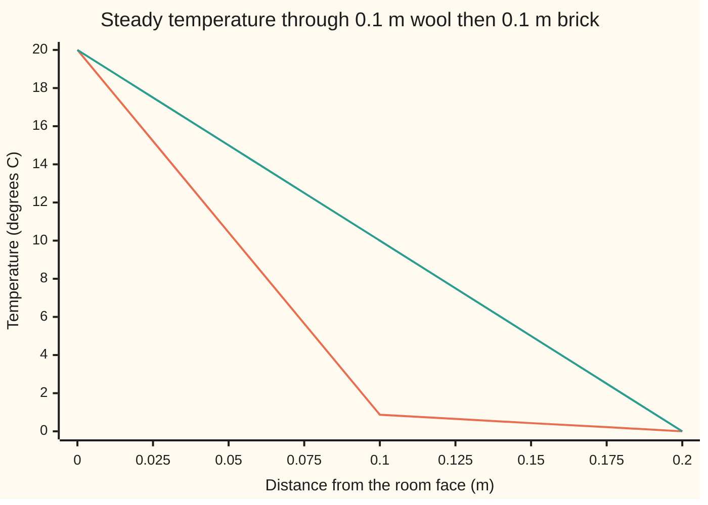
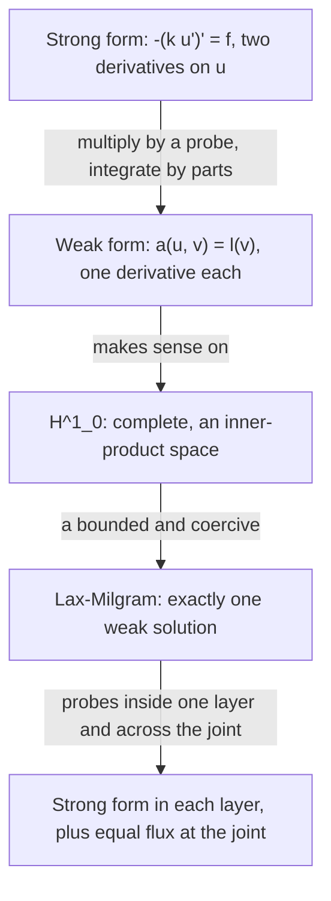

# Weak solutions: asking an equation to hold only against smooth probes

[Syllabus](../../../SYLLABUS.md) → [Functional analysis](../README.md) → [Distributions and Sobolev Spaces](../README.md#s04) → Weak solutions

---

## General Overview

A bedroom wall is 0.2 m thick: 0.1 m of mineral wool on the room side, then 0.1 m of brick. The inner face sits at 20 °C, the outer face at 0 °C. After a long, steady night, how warm is the joint between wool and brick, and how many watts leak through each square metre?

Resistances in series answer it ([Fourier's law](../../13-Engineering%20mathematics/08-Fluids%20and%20Heat/05-heat-conduction-and-fouriers-law.md)): 6.6957 W/m², with the joint at 0.8696 °C. The temperature falls steeply through the wool and almost not at all through the brick. At the joint the graph has a corner.

That corner is the trouble. The textbook heat equation needs the second derivative of the temperature, its bend, at every point. At a corner there is no bend to take. So, read literally, the equation has no solution for one of the most ordinary walls in a house.

The fix is to ask less. Multiply the equation by a smooth **probe** (a test function: a smooth bump that is zero at both faces), add up along the wall, and move one derivative onto the probe. Ask only that this total be zero for every probe. The corner profile passes every probe. A straight-line guess fails a probe that straddles the joint, by 27.0391.

This weaker statement is also what makes existence provable. Its natural home is a complete space of profiles (one that no settling sequence of profiles can escape), where a theorem called Lax-Milgram guarantees exactly one answer.

**A weak solution is a profile whose slope, weighted by the conductivity, balances every smooth probe; it needs one derivative instead of two, it builds the joint condition in for free, and it lives in a complete space where existence can be proved.**

**What kind of fact this is:** the weak form is a definition. That it agrees with the ordinary equation inside each layer and forces equal heat flow across the joint is proved on this card in Why it works. Existence and uniqueness come from the Lax-Milgram theorem, proved on [Lax-Milgram](../02-Hilbert%20Spaces/07-lax-milgram-theorem.md) and checked on this wall; its two hypotheses are proved for the wall on this card.

### The picture: the true profile against the straight line



Orange: the weak solution, exact, printed at 9 points by both checks; it has a corner at 0.1 m. Teal: the straight line, which keeps one slope across the joint and is wrong.

---

## The formula

Notation first, in words. Measure distance into the wall from the room face as $`x`$, in metres. The temperature is $`u(x)`$, in °C. A prime is a slope: $`u'`$ is how fast the temperature changes with distance. The conductivity $`k(x)`$ is 0.035 W/(m K) in the wool and 0.77 W/(m K) in the brick (typical values, illustrative). The heat made inside the wall per cubic metre is $`f`$; here $`f = 0`$.

The ordinary, or **strong**, form is the steady heat equation with fixed face temperatures:

```math
-\big(k(x)\,u'(x)\big)' = f(x) \quad \text{for } 0 < x < L, \qquad u(0) = 20, \quad u(L) = 0.
```

**Read it aloud:** the heat flux $`-k u'`$ changes along the wall only where heat is made, and the faces are held at 20 °C and 0 °C.

The **weak form** multiplies by a probe $`v`$ that is zero at both faces and integrates by parts once:

```math
a(u, v) = \int_0^L k\,u'\,v'\,dx \;=\; \int_0^L f\,v\,dx = \ell(v) \qquad \text{for every } v \text{ in } H^1_0(0, L).
```

**Read it aloud:** the conductivity times the temperature's slope times the probe's slope, added up along the wall, equals the heat made inside weighted by the probe, for every probe.

Asking this for every smooth probe or for every $`v`$ in $`H^1_0`$ is the same demand. Smooth probes are dense in $`H^1_0`$: every member is a limit of them in the slope size $`\lVert\cdot\rVert`$ defined below.

The spaces come from [Weak derivatives](07-weak-derivatives-and-sobolev-spaces.md). $`H^1(0, L)`$ holds the profiles whose values and weak slopes are square-integrable: their squares have a finite integral. A **weak slope** is the function that integration by parts against every probe agrees with. $`H^1_0(0, L)`$ is the part of $`H^1`$ that is zero at both faces. A corner profile is in $`H^1`$: its slope jumps, but a jump squares and integrates without trouble.

The weak solution is the $`u`$ in $`H^1`$, with the two face values, that satisfies the weak form. [Lax-Milgram](../02-Hilbert%20Spaces/07-lax-milgram-theorem.md), a theorem from the Hilbert-space shelf, says when exactly one exists:

```math
c\,\lVert v\rVert^2 \le a(v, v), \qquad \lvert a(w, v)\rvert \le C\,\lVert w\rVert\,\lVert v\rVert \quad\Longrightarrow\quad \text{exactly one } w \in H^1_0 \text{ with } a(w, v) = \ell(v) - a(g, v) \text{ for all } v.
```

**Read it aloud:** suppose the pairing is never smaller than $`c`$ times a profile's size squared, and never larger than $`C`$ times the two sizes. Then exactly one correction $`w`$ solves the problem, and $`u = g + w`$.

Here $`g`$ is any profile with the right face values, the straight line from 20 °C to 0 °C, and $`w`$ is zero at both faces. The size is $`\lVert v\rVert = \big(\int_0^L v'^2\,dx\big)^{1/2}`$. For the wall, $`c`$ = 0.035 and $`C`$ = 0.770: the smallest and largest conductivities.

| Symbol | Plain meaning | In our example | Push it up and the answer… |
| --- | --- | --- | --- |
| $`x`$, $`L`$ | distance from the room face; wall thickness, m | joint at 0.1 m; $`L`$ = 0.2 m | thicker: less heat leaks |
| $`k(x)`$ | conductivity, W/(m K); $`k_\text{wool}`$ and $`k_\text{brick}`$ in the two layers | 0.035 wool, 0.77 brick | that layer resists less |
| $`u`$, $`u'`$ | temperature, °C; its slope, K/m, written $`s_1`$ in the wool and $`s_2`$ in the brick where it is constant | joint 0.8696 °C; slopes −191.30 and −8.70 | — |
| $`q`$ | heat flux $`-k u'`$: watts through each m², outward | 6.6957 W/m², the same in both layers | — |
| $`f`$, $`\ell(v)`$ | heat made per m³, W/m³; that heat weighted by a probe | $`f = 0`$, so $`\ell = 0`$ | the profile bulges upward |
| $`v`$, $`\tau`$ | a probe: a smooth bump, zero at both faces; $`\tau v`$ is a nudge of size $`\tau`$ (Step 5) | $`e^{-1/(1-t^2)}`$, $`t`$ the scaled distance from the joint, $`e`$ Euler's number | — |
| $`a(u, v)`$ | the energy pairing $`\int k u' v'\,dx`$ | $`a(u, u)`$ = 133.9130 | — |
| $`H^1`$, $`H^1_0`$ | profiles with square-integrable value and weak slope; those zero at both faces | the corner profile is in $`H^1`$ | — |
| $`\lVert v\rVert`$ | size of a profile in $`H^1_0`$: root of $`\int v'^2`$ | $`\lVert w\rVert`$ = 40.8325 | — |
| $`c`$, $`C`$ | coercivity (lower) and bound (upper) constants of $`a`$ | 0.035 and 0.770 | $`c`$ up: a smaller guaranteed size |
| $`g`$, $`w`$ | a profile with the right face values; the correction $`u - g`$ | straight line; a tent, zero at both faces | — |
| $`N`$, $`\varepsilon`$ | number of mesh elements; how far a smoothed corner reaches into each layer, m | 2 to 129; 0.01 to 0.0001 m | — |

### When it holds

- **The conductivity is positive and bounded: $`0 < c \le k \le C`$.** A layer with $`k = 0`$ breaks the lower bound. No heat crosses it and the temperature on its far side is not decided by the room.
- **At least one face has a fixed temperature.** With heat flux given on both faces, any constant added to the profile still solves the problem. The finite matrix shows it: its last pivot is 0.0000 (What breaks, row 3).
- **The probes vanish where the temperature is fixed.** Then the end terms from integration by parts drop out. A face with a given flux instead keeps its end term, and that term carries the flux into $`\ell`$.
- **The heat source has a finite weighted total.** $`\ell(v)`$ must be bounded by a constant times $`\lVert v\rVert`$. A source that is square-integrable qualifies; so does a heater at one point, in one dimension.
- **Weak, not smooth.** The weak solution may have corners, where no bend exists. How smooth it is, where $`k`$ is smooth, is a separate question, for the PDE wing.

---

## Why it works

### Step 0: one derivative on each side

A corner profile has a slope at every point but the joint, and no bend at the joint. The strong form puts two derivatives on $`u`$. Integration by parts can move one of them onto the probe. The probe is smooth, so it can take as many derivatives as asked. After the move, $`u`$ needs only a slope, and a corner profile has one.

The price: the equation now holds only "against probes", as a weighted total. If it holds against every probe, that is enough to recover everything the strong form said, and one thing it left out.

### Step 1: every strong solution is a weak solution

Take a profile that obeys the strong form inside each layer. Multiply by a probe $`v`$ and integrate over the wool, $`0 < x < 0.1`$, and over the brick separately. Integration by parts on each piece gives the weak-form integral plus end terms. The terms at the faces vanish, because $`v`$ is zero there. Two terms remain, both at the joint:

```math
\int_0^L k\,u'\,v'\,dx - \int_0^L f\,v\,dx \;=\; \big(k_\text{wool}\,u'(0.1^-) - k_\text{brick}\,u'(0.1^+)\big)\,v(0.1).
```

**Read it aloud:** the weak-form residual equals the heat flux leaving into the brick minus the flux arriving from the wool, times the probe's height at the joint.

So the weak form holds exactly when the flux is continuous at the joint. Physically that is conservation: a joint of zero thickness stores no heat. The strong form inside each layer never said so. The weak form says it without being told.

### Step 2: every weak solution obeys the strong form, and the joint condition

Go the other way. A weak solution is known only to be in $`H^1`$, so $`(k u')'`$ need not exist yet: the weak form has to supply it. Choose a probe that lives inside the wool only. There $`k`$ is the constant $`k_\text{wool}`$, so the weak form says that the weak slope $`u'`$ has a weak derivative of its own, $`-f/k_\text{wool}`$ ([Weak derivatives](07-weak-derivatives-and-sobolev-spaces.md)). Here $`f = 0`$, and a function whose weak derivative is zero is a constant (Brezis, Lemma 8.1). So the profile is straight inside the wool and the strong form holds there; likewise inside the brick.

Now choose a probe that straddles the joint, with $`v(0.1) \neq 0`$. The profile obeys the strong form in each layer, so Step 1 applies and leaves only the joint term: the fluxes must match.

The check does this with a bump of radius 0.05 m centred on the joint:

- The straight line has flux 3.5000 W/m² in the wool and 77.0000 in the brick. Its residual is 27.0391.
- A profile with the joint at 0 °C gives −2.5752.
- The residual is a straight-line function of the joint temperature, so one secant step finds its zero: 0.869565 °C, the resistances' answer.
- A probe kept inside the wool (centre 0.05 m, radius 0.04 m) gives 0.000000 for the straight line. Both layers are straight, so only a probe that touches the joint can tell the profiles apart.

<details>
<summary>Detailed proof: the probe's residual for a profile that is straight in each layer</summary>

Let the profile have slope $`s_1`$ in the wool and $`s_2`$ in the brick. The probe $`v`$ is zero outside the interval from 0.05 m to 0.15 m and has height $`e^{-1}`$ at the joint. On the wool part, $`k u'`$ is the constant $`k_\text{wool} s_1`$, so its integral against $`v'`$ is that constant times the change in $`v`$:

$`\displaystyle \int_{0.05}^{0.1} k_\text{wool}\,s_1\,v'\,dx = k_\text{wool}\,s_1\,\big(v(0.1) - v(0.05)\big) = k_\text{wool}\,s_1\,e^{-1}.`$

The brick part gives $`-k_\text{brick}\,s_2\,e^{-1}`$. The residual is $`e^{-1}(k_\text{wool} s_1 - k_\text{brick} s_2)`$. For the straight line both slopes are −100 K/m, giving $`e^{-1} \times 73.5`$, which the check prints as 27.0391 after Simpson's rule. It is zero exactly when $`k_\text{wool} s_1 = k_\text{brick} s_2`$: equal flux. Any probe with $`v(0.1) \neq 0`$ gives the same condition, so the shape of the bump does not matter.

</details>

### Step 3: why existence proofs start from the weak form

Proving existence means showing a solution is there without writing it down. The standard route is to minimise. Among all profiles with the right face values, the true one has the lowest energy $`a(u, u) = \int k u'^2\,dx`$. For the wall that minimum is 133.9130, which equals flux times temperature drop. The straight line scores 805.0000.

On a finite mesh this route always works. With $`N`$ hat functions (tent-shaped profiles, one per node, as on [Finite elements](../../16-Numerical%20analysis/07-PDE%20Solvers/07-finite-elements-galerkin-and-hat-functions.md)), the energy is a quadratic in $`N - 1`$ numbers. Its matrix is positive definite, so it has one lowest point, found by solving a linear system. With a node on the joint, $`N`$ = 2 or 4 already returns the joint at 0.869565 °C.

In infinite dimensions there may be no lowest point among the profiles you started with. Try smooth profiles: replace the corner by a smooth blend that reaches $`\varepsilon`$ into each layer. Their energies close in on the minimum, but their bends blow up:

| Blend reach $`\varepsilon`$ | Energy above the minimum | Largest bend, K/m² |
| --- | --- | --- |
| 0.0100 m | 15.8185 | 13,696 |
| 0.0010 m | 1.5818 | 136,957 |
| 0.0001 m | 0.1582 | 1,369,565 |

The profiles form a sequence that settles in the slope size $`\lVert\cdot\rVert`$, but its limit is the corner profile, which has no bend. In the space of twice-differentiable profiles, the minimum is never reached. That space is not **complete** under $`\lVert\cdot\rVert`$: a sequence can settle down yet have no limit inside the space.

$`H^1_0`$ is complete under the size $`\lVert\cdot\rVert`$ ([Weak derivatives](07-weak-derivatives-and-sobolev-spaces.md)). The weak form only needs one slope, so it makes sense on all of it. Completeness alone does not make a minimising sequence settle; coercivity does. By the parallelogram law, half the difference of two profiles has energy equal to their average energy minus their midpoint's, and the midpoint has the right face values, so it scores no lower than the minimum. Two nearly minimal profiles therefore differ by nearly zero energy, and coercivity (Step 4) makes them close in $`\lVert\cdot\rVert`$: the argument of [Projection](../02-Hilbert%20Spaces/02-projection-theorem-and-orthogonal-complements.md). That is the whole reason existence proofs start there: every minimising sequence settles, and completeness keeps its limit in the space.



### Step 4: the two hypotheses of Lax-Milgram, for this wall

**Bounded.** At every point $`k \le C`$ = 0.770. The Cauchy-Schwarz inequality (the integral of a product is at most the product of the root-integrals of the squares) gives $`\lvert a(w, v)\rvert \le C\,\lVert w\rVert\,\lVert v\rVert`$.

**Coercive.** At every point $`k \ge c`$ = 0.035, so $`a(v, v) = \int k v'^2 \ge c \int v'^2 = c\,\lVert v\rVert^2`$. One gap remains: $`\lVert v\rVert`$ must be a genuine size on $`H^1_0`$, zero only for the zero profile. That holds because a profile pinned to zero at a face and with zero slope everywhere is zero. The fold makes this quantitative.

<details>
<summary>Detailed proof: the slope controls the value, for a profile pinned at a face</summary>

Let $`v`$ be in $`H^1_0(0, L)`$, so $`v(0) = 0`$. Then $`v(x)`$ is the integral of $`v'`$ from 0 to $`x`$. Cauchy-Schwarz on that integral gives

$`\displaystyle v(x)^2 \le x \int_0^x v'(s)^2\,ds \le x\,\lVert v\rVert^2.`$

Integrating over $`x`$ from 0 to $`L`$:

$`\displaystyle \int_0^L v^2\,dx \le \frac{L^2}{2}\,\lVert v\rVert^2.`$

So a profile with $`\lVert v\rVert = 0`$ has zero values too, and the slope-only size controls the full $`H^1`$ size. This is the one-dimensional case of the Poincaré inequality, treated in general on [Sobolev and Poincare](09-sobolev-embedding-and-poincare-inequality.md).

</details>

With both hypotheses, Lax-Milgram gives exactly one correction $`w`$ and a guaranteed size $`\lVert w\rVert \le (C/c)\,\lVert g\rVert`$. For the wall the guarantee is 983.8699; the actual size is 40.8325. The bound proves existence and puts a ceiling on the answer, but it is crude: it pays the full ratio of brick to wool conductivity.

### Step 5: why the minimum is the weak solution

Because $`a`$ is symmetric, $`a(w, v) = a(v, w)`$, Lax-Milgram here reduces to the Riesz representation theorem ([L2 as a Hilbert space](../../10-Measure%20and%20integration/07-Sizes%20of%20Functions/06-l2-as-a-hilbert-space.md)). It also matches the minimum of Step 3.

Nudge the minimiser $`u`$ by $`\tau v`$, with $`v`$ a probe and $`\tau`$ a small number. The energy $`a(u + \tau v, u + \tau v)`$ is lowest at $`\tau = 0`$, so its derivative in $`\tau`$ is zero there: $`2\,a(u, v) = 0`$. That is the weak form with $`f = 0`$.

Lax-Milgram matters for the cases with no energy to minimise, such as heat carried by a moving fluid, where $`a`$ is not symmetric.

---

## Worked numbers, by hand

| Step | Arithmetic | Value |
| --- | --- | --- |
| straight line's probe residual | $`e^{-1}`$ × (0.77 − 0.035) × 100 | 27.0391, not 0 |
| wool resistance | 0.1 ÷ 0.035 | 2.8571 m² K/W |
| brick resistance | 0.1 ÷ 0.77 | 0.1299 m² K/W |
| flux | 20 ÷ (2.8571 + 0.1299) | **6.6957 W/m²** |
| slopes | −6.6957 ÷ 0.035, −6.6957 ÷ 0.77 | −191.30 and −8.70 K/m |
| flux each side | 0.035 × 191.30, 0.77 × 8.70 | 6.6957 and 6.6957 W/m² |
| energy | 6.6957 × 20 | 133.9130 |
| joint temperature | 20 − 6.6957 × 2.8571 | **0.8696 °C** |

The joint sits at 0.8696 °C: the wool takes almost all of the 20 K drop. The weak form found the same number from one probe, with no rule about joints supplied.

### The finite rehearsal, at several N

Cut the wall into an odd number $`N`$ of equal elements, so that the joint falls inside an element instead of on a node. On that element the hat functions see the average conductivity, and the answer is off. The error, measured in energy, falls like $`1/\sqrt{N}`$:

| N | Galerkin flux, W/m² | Energy error | Error × √N |
| --- | --- | --- | --- |
| 3 | 9.2723 | 7.1786 | 12.4337 |
| 9 | 7.3792 | 3.6973 | 11.0920 |
| 33 | 6.8692 | 1.8630 | 10.7019 |
| 129 | 6.7392 | 0.9333 | 10.6001 |

Every finite $`N`$ is solvable, because every finite space is complete and every positive definite matrix can be inverted. The truncation hides the one thing that changes in infinite dimensions: whether the limit of better and better answers is still a profile you allowed. Step 3's smooth profiles show the answer is no for twice-differentiable profiles and yes for $`H^1`$.

### What breaks if you drop a piece

| Mistake | Comes out at | What went wrong |
| --- | --- | --- |
| Keep one slope across the joint: the straight line | flux 3.5000 in the wool, 77.0000 in the brick; energy 805.0000 | Slope is not continuous at a joint; flux is. A probe on the joint gives 27.0391, not 0 |
| Average the two conductivities, 0.4025 | 40.2500 W/m², not 6.6957 | In series the resistances add, not the conductivities |
| Give both faces a flux, no temperature | last pivot 0.0000 (N = 4) | Coercivity fails: a constant profile has zero energy, so any constant can be added |
| A mesh with no node on the joint, N = 3 | 9.2723 W/m² | The element across the joint averages the conductivity; the error falls only like $`1/\sqrt{N}`$ |

---

## Code, from first principles, and it actually runs

The code reaches the joint temperature by three roads that share no arithmetic. Road 1 adds resistances in series. Road 2 solves the hat-function system with the Thomas algorithm (elimination for a matrix with three diagonals), and a separate series formula checks its flux at every $`N`$. Road 3 integrates the weak-form residual against a smooth probe by Simpson's rule and takes one secant step to its zero. The code then runs the smoothed corners, the Lax-Milgram bound and the three mistakes. Each smoothed corner's energy is computed twice: by Simpson's rule on its blended slope, and cell by cell from the temperature profile itself, which also confirms that the blend keeps the 20 K drop.

### Python

```python
# Weak solutions -- the check behind the card.  Standard library only.
# A wall: 0.1 m of mineral wool (k = 0.035 W/(m K)) on the room side, then
# 0.1 m of brick (k = 0.77).  Faces held at 20 C and 0 C.  Steady state:
# -(k u')' = 0.  The conductivity jumps, so u'' does not exist at the joint.
# Roads to the joint temperature: resistances in series (closed form); hat
# functions solved by the Thomas algorithm (Galerkin); a smooth probe that
# straddles the joint (Simpson quadrature, then a secant step).
import math

K1, K2, L1, L2, TIN, TOUT = 0.035, 0.77, 0.1, 0.1, 20.0, 0.0
L, DT = L1 + L2, TIN - TOUT

def kbar(a, b):                         # mean conductivity over [a, b]
    wool = max(0.0, min(b, L1) - a)
    return (K1 * wool + K2 * (b - a - wool)) / (b - a)

def galerkin(n):                        # hats on n elements; returns nodes, flux, energy
    h = L / n
    ks = [kbar(e * h, (e + 1) * h) for e in range(n)]
    m = n - 1                           # inside nodes 1..n-1
    diag = [(ks[i] + ks[i + 1]) / h for i in range(m)]
    off = [-ks[i + 1] / h for i in range(m - 1)]
    rhs = [0.0] * m
    rhs[0] += ks[0] / h * TIN
    rhs[-1] += ks[-1] / h * TOUT
    c, d = [0.0] * m, [0.0] * m         # Thomas algorithm, written out
    for i in range(m):
        den = diag[i] - (off[i - 1] * c[i - 1] if i else 0.0)
        c[i] = off[i] / den if i < m - 1 else 0.0
        d[i] = (rhs[i] - (off[i - 1] * d[i - 1] if i else 0.0)) / den
    u = [0.0] * m
    for i in range(m - 1, -1, -1):
        u[i] = d[i] - (c[i] * u[i + 1] if i < m - 1 else 0.0)
    u = [TIN] + u + [TOUT]
    flux = -ks[0] * (u[1] - u[0]) / h
    energy = sum(ks[e] * (u[e + 1] - u[e]) ** 2 / h for e in range(n))
    series = DT / sum(h / ke for ke in ks)          # second road to the flux
    return u, flux, energy, series

def simpson(f, a, b, n=400):
    h = (b - a) / n
    s = f(a) + f(b) + sum((4 if i % 2 else 2) * f(a + i * h) for i in range(1, n))
    return s * h / 3

def dbump(x, centre, r):                # slope of the smooth probe exp(-1/(1-t^2))
    t = (x - centre) / r
    if abs(t) >= 1:
        return 0.0
    return math.exp(-1 / (1 - t * t)) * (-2 * t / (1 - t * t) ** 2) / r

def residual(tj, centre, r):            # integral of k u' v' for the profile with joint tj
    s1, s2 = (tj - TIN) / L1, (TOUT - tj) / L2
    lo, hi = max(0.0, centre - r), min(L, centre + r)
    left = simpson(lambda x: K1 * s1 * dbump(x, centre, r), lo, L1) if lo < L1 else 0.0
    right = simpson(lambda x: K2 * s2 * dbump(x, centre, r), max(lo, L1), hi) if hi > L1 else 0.0
    return left + right

def clean(x):                           # print a rounding-level number as 0
    return 0.0 if abs(x) < 5e-7 else x

R1, R2 = L1 / K1, L2 / K2
q = DT / (R1 + R2)
tj = TIN - q * R1
s1, s2 = -q / K1, -q / K2
energy = K1 * s1 ** 2 * L1 + K2 * s2 ** 2 * L2
print(f"road 1, resistances: wool {R1:.4f}, brick {R2:.4f} m^2 K/W; flux {q:.4f} W/m^2")
print(f"joint temperature {tj:.4f} C; slopes {s1:.2f} and {s2:.2f} K/m; energy a(u,u) {energy:.4f}")
print(f"flux times temperature drop {q * DT:.4f}; heat flux each side {-K1 * s1:.4f} and {-K2 * s2:.4f}")
u2 = galerkin(2)[0]
u4, f4 = galerkin(4)[:2]
print(f"road 2, Galerkin with a node on the joint: N=2 joint {u2[1]:.6f}, N=4 joint {u4[2]:.6f} C")
print("N=4 nodes " + ", ".join(f"{v:.4f}" for v in u4) + f"; flux {f4:.4f}")
mid = (TIN + TOUT) / 2                  # the straight line's joint temperature
r0, r1 = residual(mid, L1, 0.05), residual(TOUT, L1, 0.05)
tp = mid - r0 * (TOUT - mid) / (r1 - r0)            # one secant step: the residual is linear
print(f"road 3, probe on the joint (radius 0.05 m): residual {r0:.4f} at joint {mid:.0f} C, {r1:.4f} at {TOUT:.0f} C")
print(f"the probe's zero: joint {tp:.6f} C; residual for the true profile {clean(residual(tj, L1, 0.05)):.6f}")
print(f"probe inside the wool only (centre 0.05, radius 0.04): residual for the straight line "
      f"{clean(residual(mid, 0.05, 0.04)):.6f}")
print("profile at x = 0, 0.025 .. 0.2 m: weak solution, then straight line")
xs = [i * 0.025 for i in range(9)]
prof = [TIN + s1 * x if x <= L1 else tj + s2 * (x - L1) for x in xs]
print("chart," + ",".join(f"{clean(v):.2f}" for v in prof))
print("chart," + ",".join(f"{TIN - DT * x / L:.2f}" for x in xs))
print("mesh cutting the joint: N, flux, series flux, energy error, error x sqrt(N)")
errs = []
for n in [3, 5, 9, 17, 33, 65, 129]:
    _, fl, en, se = galerkin(n)
    err = math.sqrt(en - energy)
    errs.append((n, err, DT * (fl - q), fl, se))
    print(f"N={n:3d}  {fl:.4f}  {se:.4f}  {err:.4f}  {err * math.sqrt(n):.4f}")
def smooth(x, eps):                     # the C^2 profile itself: slope blended by 3t^2 - 2t^3
    t = min(max((x - L1 + eps) / (2 * eps), 0.0), 1.0)
    return TIN + s1 * min(x, L1 - eps) + 2 * eps * (s1 * t + (s2 - s1) * (t * t * t - t * t * t * t / 2)) + s2 * max(0.0, x - L1 - eps)
def cells(eps, n=2000):                 # second road: k (temperature step)^2 / width, cell by cell
    segs = [(0.0, L1 - eps, K1), (L1 - eps, L1, K1), (L1, L1 + eps, K2), (L1 + eps, L, K2)]
    return sum(kk * (smooth(a + (i + 1) * (b - a) / n, eps) - smooth(a + i * (b - a) / n, eps)) ** 2 * n / (b - a)
               for a, b, kk in segs for i in range(n))
print("smooth profiles closing on the corner: reach, energy excess (Simpson, cells), largest bend K/m^2")
excess, steps = [], []
for eps in [0.01, 0.001, 0.0001]:
    ds = s2 - s1
    blend = lambda t, k: k * (s1 + ds * (3 * t * t - 2 * t ** 3)) ** 2
    en = K1 * s1 ** 2 * (L1 - eps) + K2 * s2 ** 2 * (L2 - eps)
    en += 2 * eps * (simpson(lambda t: blend(t, K1), 0, 0.5) + simpson(lambda t: blend(t, K2), 0.5, 1))
    excess.append(en - energy)
    steps.append(cells(eps) - energy)
    print(f"reach {eps:.4f} m  excess {en - energy:.4f}, {steps[-1]:.4f}  bend {0.75 * ds / eps:.0f}")
cc, CC = min(K1, K2), max(K1, K2)
wnorm = math.sqrt((s1 + DT / L) ** 2 * L1 + (s2 + DT / L) ** 2 * L2)
bound = CC / cc * math.sqrt((DT / L) ** 2 * L)
print(f"Lax-Milgram: c = {cc:.3f}, C = {CC:.3f}; correction size {wnorm:.4f}, guaranteed below {bound:.4f}")
print(f"mistake 1, straight line: energy {(K1 + K2) * (DT / L) ** 2 * L1:.4f}; flux wool "
      f"{K1 * DT / L:.4f}, brick {K2 * DT / L:.4f}")
print(f"mistake 2, average conductivity {(K1 + K2) / 2:.4f}: flux {(K1 + K2) / 2 * DT / L:.4f}")
h4 = L / 4                              # mistake 3: both faces free, N = 4
k4 = [kbar(e * h4, (e + 1) * h4) for e in range(4)]
A = [[0.0] * 5 for _ in range(5)]
for e in range(4):
    for i, j, sgn in [(e, e, 1), (e + 1, e + 1, 1), (e, e + 1, -1), (e + 1, e, -1)]:
        A[i][j] += sgn * k4[e] / h4
for p in range(4):                      # elimination, no row swaps
    for i in range(p + 1, 5):
        f = A[i][p] / A[p][p]
        A[i] = [a - f * b for a, b in zip(A[i], A[p])]
piv = ", ".join(f"{A[i][i]:.4f}" for i in range(4))
print(f"mistake 3, both faces given a flux (N=4): pivots {piv}, last pivot {clean(A[4][4]):.4f}")
assert abs(u4[2] - tj) < 1e-9 and abs(f4 - q) < 1e-9          # Galerkin against resistances
assert abs(tp - tj) < 1e-6                                     # probe against resistances
assert abs(r0 - math.exp(-1) * (K2 - K1) * DT / L) < 1e-6      # quadrature against exact
assert all(abs(fl - se) < 1e-9 for _, _, _, fl, se in errs)    # Thomas against series formula
assert all(abs(e * e - d) < 1e-9 for _, e, d, _, _ in errs)      # energy gap = drop x flux gap
assert abs(errs[-1][1] * math.sqrt(129) / (errs[-2][1] * math.sqrt(65)) - 1) < 0.05  # rate 1/2
assert excess[0] > excess[1] > excess[2] > 0                   # smooth profiles cost more
assert all(abs(e - m) < 1e-5 * e for e, m in zip(excess, steps))  # Simpson on the slope against the cells
assert all(abs(smooth(L, e) - TOUT) < 1e-9 for e in [0.01, 0.001, 0.0001])  # the blend keeps the 20 K drop
assert abs(q * DT - energy) < 1e-9                             # energy balance: flux x drop
assert wnorm < bound                                           # Lax-Milgram's ceiling
assert abs(A[4][4]) < 1e-9                                     # both faces free: singular
print("ALL CHECKS PASS")
```

**Ran 2026-11-15 on macOS, Python 3.14.10, standard library only. All checks passed. Output, pasted from the run:**

```
road 1, resistances: wool 2.8571, brick 0.1299 m^2 K/W; flux 6.6957 W/m^2
joint temperature 0.8696 C; slopes -191.30 and -8.70 K/m; energy a(u,u) 133.9130
flux times temperature drop 133.9130; heat flux each side 6.6957 and 6.6957
road 2, Galerkin with a node on the joint: N=2 joint 0.869565, N=4 joint 0.869565 C
N=4 nodes 20.0000, 10.4348, 0.8696, 0.4348, 0.0000; flux 6.6957
road 3, probe on the joint (radius 0.05 m): residual 27.0391 at joint 10 C, -2.5752 at 0 C
the probe's zero: joint 0.869565 C; residual for the true profile 0.000000
probe inside the wool only (centre 0.05, radius 0.04): residual for the straight line 0.000000
profile at x = 0, 0.025 .. 0.2 m: weak solution, then straight line
chart,20.00,15.22,10.43,5.65,0.87,0.65,0.43,0.22,0.00
chart,20.00,17.50,15.00,12.50,10.00,7.50,5.00,2.50,0.00
mesh cutting the joint: N, flux, series flux, energy error, error x sqrt(N)
N=  3  9.2723  9.2723  7.1786  12.4337
N=  5  8.0354  8.0354  5.1764  11.5747
N=  9  7.3792  7.3792  3.6973  11.0920
N= 17  7.0409  7.0409  2.6278  10.8348
N= 33  6.8692  6.8692  1.8630  10.7019
N= 65  6.7826  6.7826  1.3190  10.6342
N=129  6.7392  6.7392  0.9333  10.6001
smooth profiles closing on the corner: reach, energy excess (Simpson, cells), largest bend K/m^2
reach 0.0100 m  excess 15.8185, 15.8185  bend 13696
reach 0.0010 m  excess 1.5818, 1.5818  bend 136957
reach 0.0001 m  excess 0.1582, 0.1582  bend 1369565
Lax-Milgram: c = 0.035, C = 0.770; correction size 40.8325, guaranteed below 983.8699
mistake 1, straight line: energy 805.0000; flux wool 3.5000, brick 77.0000
mistake 2, average conductivity 0.4025: flux 40.2500
mistake 3, both faces given a flux (N=4): pivots 0.7000, 0.7000, 15.4000, 15.4000, last pivot 0.0000
ALL CHECKS PASS
```

### Rust

Same numbers, same labels, built with `rustc --edition 2021 -O`.

```rust
// Weak solutions -- the same check as the Python, in Rust.  No crates.
// A wall: 0.1 m of mineral wool (k = 0.035 W/(m K)) on the room side, then
// 0.1 m of brick (k = 0.77).  Faces held at 20 C and 0 C.  Steady state:
// -(k u')' = 0.  The conductivity jumps, so u'' does not exist at the joint.
// Roads to the joint temperature: resistances in series (closed form); hat
// functions solved by the Thomas algorithm (Galerkin); a smooth probe that
// straddles the joint (Simpson quadrature, then a secant step).
const K1: f64 = 0.035;
const K2: f64 = 0.77;
const L1: f64 = 0.1;
const L2: f64 = 0.1;
const TIN: f64 = 20.0;
const TOUT: f64 = 0.0;
const L: f64 = L1 + L2;
const DT: f64 = TIN - TOUT;

fn kbar(a: f64, b: f64) -> f64 {                   // mean conductivity over [a, b]
    let wool = (b.min(L1) - a).max(0.0);
    (K1 * wool + K2 * (b - a - wool)) / (b - a)
}

fn galerkin(n: usize) -> (Vec<f64>, f64, f64, f64) { // nodes, flux, energy, series flux
    let h = L / n as f64;
    let ks: Vec<f64> = (0..n).map(|e| kbar(e as f64 * h, (e + 1) as f64 * h)).collect();
    let m = n - 1;                                  // inside nodes 1..n-1
    let diag: Vec<f64> = (0..m).map(|i| (ks[i] + ks[i + 1]) / h).collect();
    let off: Vec<f64> = (0..m.saturating_sub(1)).map(|i| -ks[i + 1] / h).collect();
    let mut rhs = vec![0.0; m];
    rhs[0] += ks[0] / h * TIN;
    rhs[m - 1] += ks[n - 1] / h * TOUT;
    let (mut c, mut d) = (vec![0.0; m], vec![0.0; m]); // Thomas algorithm, written out
    for i in 0..m {
        let den = diag[i] - if i > 0 { off[i - 1] * c[i - 1] } else { 0.0 };
        c[i] = if i < m - 1 { off[i] / den } else { 0.0 };
        d[i] = (rhs[i] - if i > 0 { off[i - 1] * d[i - 1] } else { 0.0 }) / den;
    }
    let mut u = vec![0.0; m];
    for i in (0..m).rev() {
        u[i] = d[i] - if i < m - 1 { c[i] * u[i + 1] } else { 0.0 };
    }
    let mut full = vec![TIN];
    full.extend(u);
    full.push(TOUT);
    let flux = -ks[0] * (full[1] - full[0]) / h;
    let energy: f64 = (0..n).map(|e| ks[e] * (full[e + 1] - full[e]).powi(2) / h).sum();
    let series = DT / ks.iter().map(|ke| h / ke).sum::<f64>(); // second road to the flux
    (full, flux, energy, series)
}

fn simpson(f: &dyn Fn(f64) -> f64, a: f64, b: f64) -> f64 {
    let n = 400;
    let h = (b - a) / n as f64;
    let mut s = f(a) + f(b);
    for i in 1..n { s += if i % 2 == 1 { 4.0 } else { 2.0 } * f(a + i as f64 * h) }
    s * h / 3.0
}

fn dbump(x: f64, centre: f64, r: f64) -> f64 {     // slope of the smooth probe exp(-1/(1-t^2))
    let t = (x - centre) / r;
    if t.abs() >= 1.0 { return 0.0 }
    (-1.0 / (1.0 - t * t)).exp() * (-2.0 * t / (1.0 - t * t).powi(2)) / r
}

fn residual(tj: f64, centre: f64, r: f64) -> f64 { // integral of k u' v' for the profile with joint tj
    let (s1, s2) = ((tj - TIN) / L1, (TOUT - tj) / L2);
    let (lo, hi) = ((centre - r).max(0.0), (centre + r).min(L));
    let left = if lo < L1 { simpson(&|x| K1 * s1 * dbump(x, centre, r), lo, L1) } else { 0.0 };
    let right = if hi > L1 { simpson(&|x| K2 * s2 * dbump(x, centre, r), lo.max(L1), hi) } else { 0.0 };
    left + right
}

fn clean(x: f64) -> f64 { if x.abs() < 5e-7 { 0.0 } else { x } } // a rounding-level number as 0

fn join(v: &[f64], dp: usize, sep: &str) -> String {
    v.iter().map(|x| format!("{:.*}", dp, x)).collect::<Vec<_>>().join(sep)
}

fn main() {
    let (r1, r2) = (L1 / K1, L2 / K2);
    let q = DT / (r1 + r2);
    let tj = TIN - q * r1;
    let (s1, s2) = (-q / K1, -q / K2);
    let energy = K1 * s1 * s1 * L1 + K2 * s2 * s2 * L2;
    println!("road 1, resistances: wool {:.4}, brick {:.4} m^2 K/W; flux {:.4} W/m^2", r1, r2, q);
    println!("joint temperature {:.4} C; slopes {:.2} and {:.2} K/m; energy a(u,u) {:.4}", tj, s1, s2, energy);
    println!("flux times temperature drop {:.4}; heat flux each side {:.4} and {:.4}", q * DT, -K1 * s1, -K2 * s2);
    let u2 = galerkin(2).0;
    let (u4, f4, _, _) = galerkin(4);
    println!("road 2, Galerkin with a node on the joint: N=2 joint {:.6}, N=4 joint {:.6} C", u2[1], u4[2]);
    println!("N=4 nodes {}; flux {:.4}", join(&u4, 4, ", "), f4);
    let mid = (TIN + TOUT) / 2.0;                  // the straight line's joint temperature
    let (p0, p1) = (residual(mid, L1, 0.05), residual(TOUT, L1, 0.05));
    let tp = mid - p0 * (TOUT - mid) / (p1 - p0);   // one secant step: the residual is linear
    println!("road 3, probe on the joint (radius 0.05 m): residual {:.4} at joint {:.0} C, {:.4} at {:.0} C", p0, mid, p1, TOUT);
    println!("the probe's zero: joint {:.6} C; residual for the true profile {:.6}", tp, clean(residual(tj, L1, 0.05)));
    println!("probe inside the wool only (centre 0.05, radius 0.04): residual for the straight line {:.6}",
             clean(residual(mid, 0.05, 0.04)));
    println!("profile at x = 0, 0.025 .. 0.2 m: weak solution, then straight line");
    let xs: Vec<f64> = (0..9).map(|i| i as f64 * 0.025).collect();
    let prof: Vec<f64> = xs.iter().map(|&x| clean(if x <= L1 { TIN + s1 * x } else { tj + s2 * (x - L1) })).collect();
    println!("chart,{}", join(&prof, 2, ","));
    let line: Vec<f64> = xs.iter().map(|&x| TIN - DT * x / L).collect();
    println!("chart,{}", join(&line, 2, ","));
    println!("mesh cutting the joint: N, flux, series flux, energy error, error x sqrt(N)");
    let mut errs: Vec<(f64, f64, f64, f64)> = Vec::new();
    for n in [3usize, 5, 9, 17, 33, 65, 129] {
        let (_, fl, en, se) = galerkin(n);
        let err = (en - energy).sqrt();
        errs.push((err * (n as f64).sqrt(), err, DT * (fl - q), (fl - se).abs()));
        println!("N={:3}  {:.4}  {:.4}  {:.4}  {:.4}", n, fl, se, err, err * (n as f64).sqrt());
    }
    let ds = s2 - s1;
    let smooth = |x: f64, eps: f64| {               // the C^2 profile itself: slope blended by 3t^2 - 2t^3
        let t = ((x - L1 + eps) / (2.0 * eps)).max(0.0).min(1.0);
        TIN + s1 * x.min(L1 - eps) + 2.0 * eps * (s1 * t + ds * (t * t * t - t * t * t * t / 2.0)) + s2 * (x - L1 - eps).max(0.0)
    };
    let cells = |eps: f64| {                        // second road: k (temperature step)^2 / width, cell by cell
        let segs = [(0.0, L1 - eps, K1), (L1 - eps, L1, K1), (L1, L1 + eps, K2), (L1 + eps, L, K2)];
        segs.iter().map(|&(a, b, kk)| (0..2000).map(|i| {
            let du = smooth(a + (i + 1) as f64 * (b - a) / 2000.0, eps) - smooth(a + i as f64 * (b - a) / 2000.0, eps);
            kk * (du * du) * 2000.0 / (b - a)
        }).sum::<f64>()).sum::<f64>()
    };
    println!("smooth profiles closing on the corner: reach, energy excess (Simpson, cells), largest bend K/m^2");
    let (mut excess, mut steps) = (Vec::new(), Vec::new());
    for eps in [0.01, 0.001, 0.0001] {
        let blend = |t: f64, k: f64| k * (s1 + ds * (3.0 * t * t - 2.0 * t.powi(3))).powi(2);
        let mut en = K1 * s1 * s1 * (L1 - eps) + K2 * s2 * s2 * (L2 - eps);
        en += 2.0 * eps * (simpson(&|t| blend(t, K1), 0.0, 0.5) + simpson(&|t| blend(t, K2), 0.5, 1.0));
        excess.push(en - energy);
        steps.push(cells(eps) - energy);
        println!("reach {:.4} m  excess {:.4}, {:.4}  bend {:.0}", eps, en - energy, steps[steps.len() - 1], 0.75 * ds / eps);
    }
    let (cc, cbig) = (K1.min(K2), K1.max(K2));
    let wnorm = ((s1 + DT / L).powi(2) * L1 + (s2 + DT / L).powi(2) * L2).sqrt();
    let bound = cbig / cc * ((DT / L).powi(2) * L).sqrt();
    println!("Lax-Milgram: c = {:.3}, C = {:.3}; correction size {:.4}, guaranteed below {:.4}", cc, cbig, wnorm, bound);
    println!("mistake 1, straight line: energy {:.4}; flux wool {:.4}, brick {:.4}",
             (K1 + K2) * (DT / L).powi(2) * L1, K1 * DT / L, K2 * DT / L);
    println!("mistake 2, average conductivity {:.4}: flux {:.4}", (K1 + K2) / 2.0, (K1 + K2) / 2.0 * DT / L);
    let h4 = L / 4.0;                               // mistake 3: both faces free, N = 4
    let k4: Vec<f64> = (0..4).map(|e| kbar(e as f64 * h4, (e + 1) as f64 * h4)).collect();
    let mut a = [[0.0f64; 5]; 5];
    for e in 0..4 {
        for (i, j, sgn) in [(e, e, 1.0), (e + 1, e + 1, 1.0), (e, e + 1, -1.0), (e + 1, e, -1.0)] {
            a[i][j] += sgn * k4[e] / h4;
        }
    }
    for p in 0..4 {                                 // elimination, no row swaps
        for i in p + 1..5 {
            let f = a[i][p] / a[p][p];
            for j in 0..5 { a[i][j] -= f * a[p][j] }
        }
    }
    let piv: Vec<f64> = (0..4).map(|i| a[i][i]).collect();
    println!("mistake 3, both faces given a flux (N=4): pivots {}, last pivot {:.4}", join(&piv, 4, ", "), clean(a[4][4]));
    assert!((u4[2] - tj).abs() < 1e-9 && (f4 - q).abs() < 1e-9);  // Galerkin against resistances
    assert!((tp - tj).abs() < 1e-6);                               // probe against resistances
    assert!((p0 - (-1.0f64).exp() * (K2 - K1) * DT / L).abs() < 1e-6); // quadrature against exact
    assert!(errs.iter().all(|e| e.3 < 1e-9));                      // Thomas against series formula
    assert!(errs.iter().all(|e| (e.1 * e.1 - e.2).abs() < 1e-9));  // energy gap = drop x flux gap
    assert!((errs[6].0 / errs[5].0 - 1.0).abs() < 0.05);           // rate 1/2
    assert!(excess[0] > excess[1] && excess[1] > excess[2] && excess[2] > 0.0); // smooth profiles cost more
    assert!(excess.iter().zip(&steps).all(|(e, m)| (e - m).abs() < 1e-5 * e)); // Simpson on the slope against the cells
    assert!([0.01, 0.001, 0.0001].iter().all(|&e| (smooth(L, e) - TOUT).abs() < 1e-9)); // the blend keeps the 20 K drop
    assert!((q * DT - energy).abs() < 1e-9);                       // energy balance: flux x drop
    assert!(wnorm < bound);                                        // Lax-Milgram's ceiling
    assert!(a[4][4].abs() < 1e-9);                                 // both faces free: singular
    println!("ALL CHECKS PASS");
}
```

**Ran 2026-11-15 on macOS, rustc 1.98.1, no crates. All checks passed. Output, pasted from the run:**

```
road 1, resistances: wool 2.8571, brick 0.1299 m^2 K/W; flux 6.6957 W/m^2
joint temperature 0.8696 C; slopes -191.30 and -8.70 K/m; energy a(u,u) 133.9130
flux times temperature drop 133.9130; heat flux each side 6.6957 and 6.6957
road 2, Galerkin with a node on the joint: N=2 joint 0.869565, N=4 joint 0.869565 C
N=4 nodes 20.0000, 10.4348, 0.8696, 0.4348, 0.0000; flux 6.6957
road 3, probe on the joint (radius 0.05 m): residual 27.0391 at joint 10 C, -2.5752 at 0 C
the probe's zero: joint 0.869565 C; residual for the true profile 0.000000
probe inside the wool only (centre 0.05, radius 0.04): residual for the straight line 0.000000
profile at x = 0, 0.025 .. 0.2 m: weak solution, then straight line
chart,20.00,15.22,10.43,5.65,0.87,0.65,0.43,0.22,0.00
chart,20.00,17.50,15.00,12.50,10.00,7.50,5.00,2.50,0.00
mesh cutting the joint: N, flux, series flux, energy error, error x sqrt(N)
N=  3  9.2723  9.2723  7.1786  12.4337
N=  5  8.0354  8.0354  5.1764  11.5747
N=  9  7.3792  7.3792  3.6973  11.0920
N= 17  7.0409  7.0409  2.6278  10.8348
N= 33  6.8692  6.8692  1.8630  10.7019
N= 65  6.7826  6.7826  1.3190  10.6342
N=129  6.7392  6.7392  0.9333  10.6001
smooth profiles closing on the corner: reach, energy excess (Simpson, cells), largest bend K/m^2
reach 0.0100 m  excess 15.8185, 15.8185  bend 13696
reach 0.0010 m  excess 1.5818, 1.5818  bend 136957
reach 0.0001 m  excess 0.1582, 0.1582  bend 1369565
Lax-Milgram: c = 0.035, C = 0.770; correction size 40.8325, guaranteed below 983.8699
mistake 1, straight line: energy 805.0000; flux wool 3.5000, brick 77.0000
mistake 2, average conductivity 0.4025: flux 40.2500
mistake 3, both faces given a flux (N=4): pivots 0.7000, 0.7000, 15.4000, 15.4000, last pivot 0.0000
ALL CHECKS PASS
```

The two outputs match line for line.

### Lean

Lean proves the joint condition for every two-layer wall with straight layers, and Lax-Milgram on any Hilbert space.

- Take any two-layer wall with positive conductivities, no heat made inside, and a profile straight in each layer, unbroken at the joint. Then the weak form holds against every probe exactly when the heat flux is equal on both sides of the joint.
- Take the same wall and profile, with any slopes, and any probe. Then the weak-form residual equals the flux mismatch at the joint times the probe's height there.
- Suppose $`a`$ is bounded, coercive on a complete part standing for $`H^1_0`$, and $`\ell`$ is bounded. Then for any $`g`$, exactly one correction $`w`$ in that part has $`a(w, v) = \ell(v) - a(g, v)`$ for every $`v`$ in it.
- The wall's numbers hold exactly as fractions: joint 20/23 °C, flux 154/23 W/m², energy 3080/23.
- The straight line's energy is exactly 805, and its flux mismatch at the joint exactly 73.5. The ratio $`C/c`$ is exactly 22.

Simpson's probe integrals, the meshes, the smoothed corners and the guaranteed size 983.8699 are left to the Python and Rust checks.

```lean
-- Weak solutions: for a two-layer wall the weak heat equation holds against every smooth probe exactly when the heat flux is equal on both sides of the joint, and a bounded coercive pairing has exactly one weak solution (Lax-Milgram).
import Mathlib.Analysis.Calculus.ContDiff.Defs
import Mathlib.Analysis.Calculus.Deriv.Basic
import Mathlib.Analysis.InnerProductSpace.LaxMilgram
import Mathlib.MeasureTheory.Integral.IntervalIntegral.FundThmCalculus
import Mathlib.Tactic.NormNum
import Mathlib.Analysis.Calculus.ContDiff.Deriv
import Mathlib.Analysis.Calculus.Deriv.Mul
import Mathlib.Analysis.Calculus.ContDiff.Operations

open scoped ContDiff

theorem weak_residual_aux
    (L₁ L k₁ k₂ T₀ s₁ s₂ : ℝ) (hL₁ : 0 < L₁) (hL : L₁ < L)
    (v : ℝ → ℝ) (hv : ContDiff ℝ ∞ v) (hv0 : v 0 = 0) (hvL : v L = 0) :
    let k : ℝ → ℝ := fun x => if x ≤ L₁ then k₁ else k₂
    let u : ℝ → ℝ := fun x => if x ≤ L₁ then T₀ + s₁ * x else T₀ + s₁ * L₁ + s₂ * (x - L₁)
    ∫ x in (0 : ℝ)..L, k x * deriv u x * deriv v x = (k₁ * s₁ - k₂ * s₂) * v L₁ := by
  intro k u
  have hdiff : Differentiable ℝ v := hv.differentiable (by simp)
  have hcont : Continuous (deriv v) := hv.continuous_deriv (by simp)
  have hu1 : ∀ x, x < L₁ → deriv u x = s₁ := by
    intro x hx
    have he : u =ᶠ[nhds x] fun y => T₀ + s₁ * y := by
      filter_upwards [Iio_mem_nhds hx] with y hy
      simp only [u, (Set.mem_Iio.mp hy).le, ite_true]
    rw [he.deriv_eq]
    exact (((hasDerivAt_id x).const_mul s₁).const_add T₀).deriv.trans (mul_one s₁)
  have hu2 : ∀ x, L₁ < x → deriv u x = s₂ := by
    intro x hx
    have he : u =ᶠ[nhds x] fun y => T₀ + s₁ * L₁ + s₂ * (y - L₁) := by
      filter_upwards [Ioi_mem_nhds hx] with y hy
      simp only [u, not_le.mpr (Set.mem_Ioi.mp hy), ite_false]
    rw [he.deriv_eq]
    exact ((((hasDerivAt_id x).sub_const L₁).const_mul s₂).const_add (T₀ + s₁ * L₁)).deriv.trans
      (mul_one s₂)
  have e1 : Set.EqOn (fun x => k x * deriv u x * deriv v x) (fun x => k₁ * s₁ * deriv v x)
      (Set.uIoo 0 L₁) := by
    intro x hx
    rw [Set.uIoo_of_le hL₁.le] at hx
    simp only [k, hx.2.le, ite_true, hu1 x hx.2]
  have e2 : Set.EqOn (fun x => k x * deriv u x * deriv v x) (fun x => k₂ * s₂ * deriv v x)
      (Set.uIoo L₁ L) := by
    intro x hx
    rw [Set.uIoo_of_le hL.le] at hx
    simp only [k, not_le.mpr hx.1, ite_false, hu2 x hx.1]
  have i1 : IntervalIntegrable (fun x => k x * deriv u x * deriv v x) MeasureTheory.volume 0 L₁ :=
    (intervalIntegrable_congr_uIoo e1).mpr ((hcont.const_mul _).intervalIntegrable _ _)
  have i2 : IntervalIntegrable (fun x => k x * deriv u x * deriv v x) MeasureTheory.volume L₁ L :=
    (intervalIntegrable_congr_uIoo e2).mpr ((hcont.const_mul _).intervalIntegrable _ _)
  rw [← intervalIntegral.integral_add_adjacent_intervals i1 i2,
    intervalIntegral.integral_congr_uIoo e1, intervalIntegral.integral_congr_uIoo e2,
    intervalIntegral.integral_const_mul, intervalIntegral.integral_const_mul,
    intervalIntegral.integral_deriv_eq_sub (fun x _ => hdiff x) (hcont.intervalIntegrable _ _),
    intervalIntegral.integral_deriv_eq_sub (fun x _ => hdiff x) (hcont.intervalIntegrable _ _),
    hv0, hvL]
  ring

#print axioms weak_residual_aux

/-- The weak form builds in the joint condition. A wall of thickness `L` has a layer of
conductivity `k₁ > 0` on `0 ≤ x ≤ L₁` and a layer of conductivity `k₂ > 0` beyond it, with no
heat made inside (`f = 0`). Take a temperature profile that is straight in each layer (so the
strong form holds inside each layer), with slope `s₁` in the first layer and `s₂` in the second,
and no jump at the joint. It satisfies the weak form `∫₀ᴸ k u' v' dx = 0` against every smooth
probe `v` that is zero at both faces exactly when the heat flux is the same on both sides of the
joint: `k₁ s₁ = k₂ s₂`. -/
theorem weak_form_iff_equal_flux_at_joint
    (L₁ L k₁ k₂ T₀ s₁ s₂ : ℝ) (hL₁ : 0 < L₁) (hL : L₁ < L) (hk₁ : 0 < k₁) (hk₂ : 0 < k₂) :
    let k : ℝ → ℝ := fun x => if x ≤ L₁ then k₁ else k₂
    let u : ℝ → ℝ := fun x => if x ≤ L₁ then T₀ + s₁ * x else T₀ + s₁ * L₁ + s₂ * (x - L₁)
    (∀ v : ℝ → ℝ, ContDiff ℝ ∞ v → v 0 = 0 → v L = 0 →
        ∫ x in (0 : ℝ)..L, k x * deriv u x * deriv v x = 0) ↔
      k₁ * s₁ = k₂ * s₂ := by
  intro k u
  constructor
  · intro h
    let w : ℝ → ℝ := fun x => x * (L - x)
    have hw : ContDiff ℝ ∞ w := contDiff_id.mul (contDiff_const.sub contDiff_id)
    have hw0 : w 0 = 0 := by simp [w]
    have hwL : w L = 0 := by simp [w]
    have e : ∫ x in (0 : ℝ)..L, k x * deriv u x * deriv w x = (k₁ * s₁ - k₂ * s₂) * w L₁ :=
      weak_residual_aux L₁ L k₁ k₂ T₀ s₁ s₂ hL₁ hL w hw hw0 hwL
    rw [h w hw hw0 hwL] at e
    have hpos : 0 < w L₁ := mul_pos hL₁ (sub_pos.mpr hL)
    have := (mul_eq_zero.mp e.symm).resolve_right hpos.ne'
    linarith
  · intro h v hv hv0 hvL
    have e : ∫ x in (0 : ℝ)..L, k x * deriv u x * deriv v x = (k₁ * s₁ - k₂ * s₂) * v L₁ :=
      weak_residual_aux L₁ L k₁ k₂ T₀ s₁ s₂ hL₁ hL v hv hv0 hvL
    rw [e, h, sub_self, zero_mul]

/-- Every strong solution's weak residual is the flux jump at the joint. For the same two-layer
wall and a profile straight in each layer, and any smooth probe `v` zero at both faces,
`∫₀ᴸ k u' v' dx = (k₁ s₁ − k₂ s₂) v(L₁)`: the flux mismatch at the joint times the probe's
height there. -/
theorem weak_residual_eq_flux_jump_times_probe
    (L₁ L k₁ k₂ T₀ s₁ s₂ : ℝ) (hL₁ : 0 < L₁) (hL : L₁ < L) (hk₁ : 0 < k₁) (hk₂ : 0 < k₂)
    (v : ℝ → ℝ) (hv : ContDiff ℝ ∞ v) (hv0 : v 0 = 0) (hvL : v L = 0) :
    let k : ℝ → ℝ := fun x => if x ≤ L₁ then k₁ else k₂
    let u : ℝ → ℝ := fun x => if x ≤ L₁ then T₀ + s₁ * x else T₀ + s₁ * L₁ + s₂ * (x - L₁)
    ∫ x in (0 : ℝ)..L, k x * deriv u x * deriv v x = (k₁ * s₁ - k₂ * s₂) * v L₁ := by
  exact weak_residual_aux L₁ L k₁ k₂ T₀ s₁ s₂ hL₁ hL v hv hv0 hvL

/-- Lax-Milgram for a weak solution with fixed face values. Let `W` be a real Hilbert space of
profiles (standing for `H¹`) and `V` a closed subspace of profiles zero at the fixed faces
(standing for `H¹₀`). Let the pairing `a` be bounded, `|a(w, v)| ≤ C ‖w‖ ‖v‖`, and coercive on
`V`, `c ‖v‖² ≤ a(v, v)` with `c > 0`, and let the source `ℓ` be a bounded functional. Then for
any profile `g` with the right face values there is exactly one correction `w` in `V` with
`a(w, v) = ℓ(v) − a(g, v)` for every `v` in `V`; the weak solution is `u = g + w`. -/
theorem exists_unique_weak_solution_of_bounded_coercive
    {W : Type*} [NormedAddCommGroup W] [InnerProductSpace ℝ W] [CompleteSpace W]
    (V : Submodule ℝ W) (hV : IsClosed (V : Set W))
    (a : W →L[ℝ] W →L[ℝ] ℝ) (c C : ℝ) (hc : 0 < c)
    (hbound : ∀ w v, |a w v| ≤ C * ‖w‖ * ‖v‖)
    (hcoer : ∀ v ∈ V, c * ‖v‖ ^ 2 ≤ a v v)
    (ℓ : W →L[ℝ] ℝ) (g : W) :
    ∃! w : V, ∀ v : V, a w v = ℓ v - a g v := by
  have : CompleteSpace V := hV.completeSpace_coe
  let B : V →L[ℝ] V →L[ℝ] ℝ := a.bilinearComp V.subtypeL V.subtypeL
  have hB : ∀ w v : V, B w v = a w v := fun w v => rfl
  have hBc : IsCoercive B := by
    refine ⟨c, hc, fun v => ?_⟩
    rw [hB]
    have := hcoer v v.2
    have hn : ‖(v : W)‖ = ‖v‖ := rfl
    rw [hn] at this
    nlinarith
  let f : StrongDual ℝ V := (ℓ - a g).comp V.subtypeL
  let y : V := (InnerProductSpace.toDual ℝ V).symm f
  refine ⟨hBc.continuousLinearEquivOfBilin.symm y, ?_, ?_⟩
  · intro v
    rw [← hB, ← hBc.continuousLinearEquivOfBilin_apply,
      ContinuousLinearEquiv.apply_symm_apply, InnerProductSpace.toDual_symm_apply]
    rfl
  · intro w hw
    apply hBc.continuousLinearEquivOfBilin.injective
    rw [ContinuousLinearEquiv.apply_symm_apply]
    apply (InnerProductSpace.toDual ℝ V).injective
    rw [LinearIsometryEquiv.apply_symm_apply]
    ext v
    rw [InnerProductSpace.toDual_apply_apply,
      hBc.continuousLinearEquivOfBilin_apply, hB, hw v]
    rfl

-- The wall, in exact rationals: wool k₁ = 0.035 = 7/200, brick k₂ = 0.77 = 77/100 W/(m K),
-- layers 1/10 m each, faces 20 °C and 0 °C. Joint 20/23 ≈ 0.8696 °C, slopes −4400/23 ≈ −191.30
-- and −200/23 ≈ −8.70 K/m: equal flux, and the profile reaches 0 °C at the outer face.
example :
    (7 / 200 : ℚ) * (-4400 / 23) = 77 / 100 * (-200 / 23) ∧
    (20 : ℚ) + (-4400 / 23) * (1 / 10) = 20 / 23 ∧
    (20 / 23 : ℚ) + (-200 / 23) * (1 / 10) = 0 := by
  norm_num
-- Resistances in series: 20 / (0.1/0.035 + 0.1/0.77) = 154/23 ≈ 6.6957 W/m², the flux −k₁ s₁.
example : (20 : ℚ) / ((1 / 10) / (7 / 200) + (1 / 10) / (77 / 100)) = 154 / 23 ∧
    -((7 / 200 : ℚ) * (-4400 / 23)) = 154 / 23 := by
  norm_num
-- Minimum energy a(u, u) = 3080/23 ≈ 133.9130 = flux × temperature drop; the straight line scores 805.
example : (7 / 200 : ℚ) * (-4400 / 23) ^ 2 * (1 / 10) + 77 / 100 * (-200 / 23) ^ 2 * (1 / 10)
      = 3080 / 23 ∧ (154 / 23 : ℚ) * 20 = 3080 / 23 := by
  norm_num
example : (7 / 200 : ℚ) * (-100) ^ 2 * (1 / 10) + 77 / 100 * (-100) ^ 2 * (1 / 10) = 805 := by
  norm_num
-- The straight line's flux mismatch at the joint: k₁ s₁ − k₂ s₂ = 73.5 = 147/2 (the probe's
-- residual is e⁻¹ times this); its fluxes are 3.5 and 77 W/m².
example : (7 / 200 : ℚ) * (-100) - 77 / 100 * (-100) = 147 / 2 ∧
    (7 / 200 : ℚ) * 100 = 7 / 2 ∧ (77 / 100 : ℚ) * 100 = 77 := by
  norm_num
-- Lax-Milgram constants c = 0.035, C = 0.77: the ratio C / c is 22.
example : (77 / 100 : ℚ) / (7 / 200) = 22 := by norm_num

#print axioms weak_form_iff_equal_flux_at_joint
#print axioms weak_residual_eq_flux_jump_times_probe
#print axioms exists_unique_weak_solution_of_bounded_coercive
```

**Checked 2026-11-15 on macOS, Lean 4.36.0-rc2, Mathlib v4.36.0-rc2. Every proof is complete and uses only Lean's standard axioms. Output, pasted from the run:**

```
'weak_residual_aux' depends on axioms: [propext, Classical.choice, Quot.sound]
'weak_form_iff_equal_flux_at_joint' depends on axioms: [propext, Classical.choice, Quot.sound]
'weak_residual_eq_flux_jump_times_probe' depends on axioms: [propext, Classical.choice, Quot.sound]
'exists_unique_weak_solution_of_bounded_coercive' depends on axioms: [propext, Classical.choice, Quot.sound]
```

> [!TIP]
> **Try changing**
> Guess first, then run the Python.
> - **Swap the layers.** Guess first: does the leak change if the brick goes on the room side? Set `K1, K2` to `0.77, 0.035`. The flux stays 6.6957 W/m², since resistances in series do not care about order. The joint moves to 19.1304 °C.
> - **A colder night.** Guess first: what does −10 °C outside do to the joint? Set `TOUT` to `-10.0`. The flux becomes 10.0435 W/m² and the joint −8.6957 °C. The probe's secant step still lands on it.
> - **Remove the jump.** Guess first: what happens to the meshes that cut the joint? Set `K2` to `0.035`, so both layers are wool. The answer is the straight line, every mesh is exact, the energy error is 0.0000 at every $`N`$, and the rate assert stops the run: there is no corner left to miss.
> - **A sharper contrast.** Guess first: does a ten times better conductor outside matter much? Set `K2` to `7.7`. The flux rises only to 6.9683 W/m², because the wool still sets almost all the resistance; the straight line's probe residual grows to 281.9796.

---

## The usual mistake

> [!warning]
> **Matching slopes at the joint instead of fluxes.** The strong form inside each layer says nothing about the joint, and the reflex is to make the graph smooth there. That gives the straight line: 3.5000 W/m² entering the joint from the wool and 77.0000 leaving into the brick, which would need a heat source at the joint. The weak form forces equal flux, 6.6957 W/m² on both sides, and a corner.
>
> - **Averaging conductivities.** The mean, 0.4025 W/(m K), gives 40.2500 W/m². Resistances add; conductivities do not.
> - **Thinking the weak solution is an approximation.** It is the exact answer, here the same 0.8696 °C as the resistances. "Weak" describes the question, not the accuracy.
> - **Trusting a mesh that ignores the joint.** With $`N`$ = 3 elements and no node at 0.1 m, the flux comes out at 9.2723 W/m². Put a node on every material boundary.
> - **Fixing no temperature anywhere.** With a flux given on both faces, the system matrix is singular, last pivot 0.0000. The profile is decided only up to a constant.

---

## Where you meet it in real life

- **Thermal-bridge software for buildings.** Programs that compute heat loss around window frames and wall ties solve exactly this weak form in two or three dimensions, with a conductivity that jumps at every material boundary.
- **Electronics boards.** A circuit board stacks copper and glass-fibre laminate, conductivities very far apart. The board's temperature map is a weak solution with corners at every layer.
- **Groundwater in layered soil.** Flow through sand over clay obeys the same equation with permeability in place of conductivity. The flow rate, not the pressure gradient, is continuous across the layers.
- **Structural analysis.** The principle of virtual work used in engineering stress analysis is the weak form of the equations of elasticity: the probe is a small imagined displacement.

> **Say it back**
> The steady heat equation needs a bend, and a wall of two materials has a corner at the joint, so read literally the equation has no solution. The weak form multiplies by smooth probes and integrates by parts, so the temperature needs only a slope. Holding against every probe gives the equation inside each layer and, for free, equal heat flux across the joint: 6.6957 W/m² with the joint at 0.8696 °C. Existence proofs start there because the weak form lives in $`H^1_0`$, which is complete, while smooth profiles close in on the corner without reaching it. On that space the energy pairing is bounded and coercive, so Lax-Milgram gives exactly one weak solution.

---

## What this builds on

- [Weak derivatives](07-weak-derivatives-and-sobolev-spaces.md): the weak slope and the complete spaces $`H^1`$ and $`H^1_0`$ that the weak form lives in.
- [Lax-Milgram](../02-Hilbert%20Spaces/07-lax-milgram-theorem.md): a bounded, coercive pairing on a Hilbert space has exactly one solution for every bounded right side.
- [A partial differential equation](../../08-Differential%20equations%20and%20dynamics/10-The%20Classical%20PDEs/01-what-a-pde-says.md): what it means for an equation in derivatives to hold, pointwise, with boundary conditions.
- [Boundary value problems](../../08-Differential%20equations%20and%20dynamics/07-Series%20Solutions%20and%20Boundary%20Problems/05-two-point-boundary-value-problems.md): the two-point problem with a value fixed at each end, the strong form used here.
- [Finite elements](../../16-Numerical%20analysis/07-PDE%20Solvers/07-finite-elements-galerkin-and-hat-functions.md): the weak form by integration by parts and the hat-function system, which this card uses as its finite rehearsal.
- [Fourier's law](../../13-Engineering%20mathematics/08-Fluids%20and%20Heat/05-heat-conduction-and-fouriers-law.md): the steady loss through a layered wall by resistances in series, road 1 here.

## Where this goes next

- [Sobolev and Poincare](09-sobolev-embedding-and-poincare-inequality.md): the inequality behind coercivity, in any dimension, and why an $`H^1`$ profile in one dimension is continuous.
- [Boundary values and compactness](10-trace-and-rellich-kondrachov-in-outline.md): what a face value such as $`u(0) = 20`$ means for a profile known only up to sets of zero length, in higher dimensions.
- [Weak solutions](../../19-Partial%20differential%20equations/06-Weak%20Solutions%20and%20Free%20Boundaries/01-weak-solutions-and-the-weak-formulation.md): the partial-differential-equations wing takes the weak form to two and three dimensions and asks when a weak solution is smooth.

This card leaves open how smooth a weak solution is: inside each layer here it is a straight line, but in a room corner or around a wall tie, how many derivatives does it really have?

---

## Sources

Verified 2026-11-15: every link below resolves to the publisher's page, and each DOI was checked against Crossref for title and first author.

- Brezis, H. *Functional Analysis, Sobolev Spaces and Partial Differential Equations*. Springer, 2011. [doi:10.1007/978-0-387-70914-7](https://doi.org/10.1007/978-0-387-70914-7). Lax-Milgram (Corollary 5.8) and Chapter 8, the weak formulation of boundary problems in one dimension.
- Evans, L. C. *Partial Differential Equations*, 2nd edition. American Mathematical Society, Graduate Studies in Mathematics 19, 2010. [doi:10.1090/gsm/019](https://doi.org/10.1090/gsm/019). Section 6.1 to 6.2: weak solutions of second-order elliptic equations and existence by Lax-Milgram.
- Lax, P. D., and A. N. Milgram. "Parabolic equations." In *Contributions to the Theory of Partial Differential Equations*, Annals of Mathematics Studies 33, Princeton University Press, 1954. [doi:10.1515/9781400882182-010](https://doi.org/10.1515/9781400882182-010). The original statement of the theorem.
- Bergman, T. L., A. S. Lavine, F. P. Incropera and D. P. DeWitt. *Fundamentals of Heat and Mass Transfer*, 8th edition. Wiley. [Publisher page](https://www.wiley.com/en-us/Fundamentals+of+Heat+and+Mass+Transfer%2C+8th+Edition-p-9781119353881). Composite walls in series; typical conductivities of the kind used here (the wall's values are illustrative).
