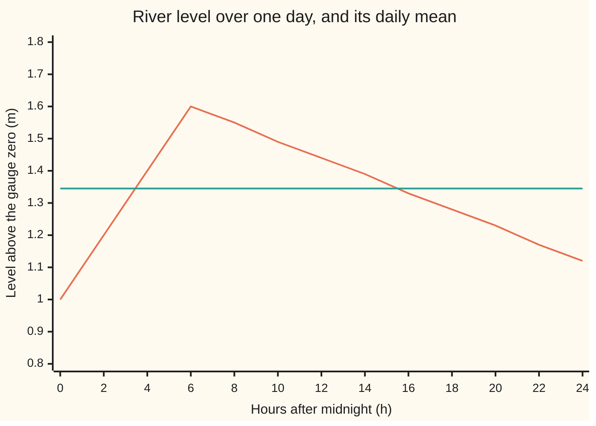

# Sobolev and Poincare: trading derivative control for size and smoothness

[Syllabus](../../../SYLLABUS.md) → [Functional analysis](../README.md) → [Distributions and Sobolev Spaces](../README.md#s04) → Sobolev and Poincare

---

## General Overview

A river gauge under a bridge logs the water level. Its pressure sensor drifts: after a few weeks the absolute level may be off by a few centimetres, but the rate of rise and fall stays trustworthy. Suppose that, to save battery, it radios home only one number a day: the day's **slope energy**, the integral of the slope squared over the 24 hours. A calm day scores near zero; a storm scores high.

Take one day after a storm (illustrative numbers). The level rises from 1.00 m to 1.60 m in the first 6 hours, then drains to 1.12 m by hour 24. The slope is +0.1 m/h on the rise and −0.026667 m/h on the drain, so the gauge sends a slope energy of 0.072800 m²/h. From that one number, how far can the level have wandered from its daily average? Could it have spiked at one instant? The answer has to hold for every day with the same score, because the number alone cannot tell those days apart.

Two theorems answer this. The **Poincare inequality** says the typical distance from the average is at most a fixed number of hours times the typical slope, with no information about the offset: here at most 0.420747 m. The **Sobolev embedding** says that, in one dimension, a curve with finite slope energy cannot spike: no point sits more than 1.321817 m from the average. The storm day itself, whose full record stays on the gauge, sits inside both, at 0.150250 m and 0.345000 m. Neither theorem needs the slope to exist at every instant. A weak derivative, the slope in the averaged sense of [Weak derivatives](07-weak-derivatives-and-sobolev-spaces.md), is enough. Existence proofs use the theorems the same way: the solution is unknown, only a bound on its energy is known, and these inequalities turn that bound into control of its size and its values.

**On a bounded stretch of time, the size of the slope controls how far a curve strays from its average (Poincare), and in one dimension it also forces the curve to be continuous with no spikes (Sobolev embedding); in two or more dimensions the second promise needs more derivatives than one.**

**What kind of fact this is:** two theorems. The one-dimensional versions, with the best constant $`L/\pi`$ for a record $`L`$ hours long, are proved on this card in Why it works. The versions for regions in two or more dimensions are stated with named sources (Evans; Brezis).

### The picture: the day after the storm



Orange: the level, printed at 13 points (every 2 hours) by both checks: two straight pieces with a kink at hour 6. At the kink the ordinary slope does not exist, but the weak derivative does. Teal: the daily mean, 1.345000 m. The theorems bound the gap between the two lines using only the day's slope energy.

---

## The formula

Notation first, in words. The record runs over the time interval $`(0, L)`$. For a function $`u`$ on it, $`\lVert u \rVert_2`$ is its **2-size**, the square root of the integral of $`u^2`$ ([Holder's inequality](../../10-Measure%20and%20integration/07-Sizes%20of%20Functions/02-holders-inequality.md) calls it the 2-norm). $`\lVert u \rVert_\infty`$ is its largest absolute value. The **mean** is $`\bar u = \frac{1}{L}\int_0^L u\,dt`$. The **root mean square** (RMS) of $`u`$ is $`\lVert u \rVert_2/\sqrt{L}`$, a typical size.

Reminder from [Weak derivatives](07-weak-derivatives-and-sobolev-spaces.md): $`H^1(0, L)`$ is the space of functions $`u`$ whose square and whose weak derivative's square, $`u'^2`$, have finite integrals. $`H^1_0(0, L)`$ is the part of it that is zero at both ends.

This card introduces two notations. $`X \hookrightarrow Y`$, read "$`X`$ **embeds** in $`Y`$", means every element of $`X`$ is an element of $`Y`$, and its $`Y`$-size is at most a fixed constant times its $`X`$-size. $`C_P`$ is the **Poincare constant**: the best number in the inequality below.

**Poincare inequality.** For every $`u`$ in $`H^1(0, L)`$,

```math
\lVert u - \bar u \rVert_2 \;\le\; C_P\, \lVert u' \rVert_2, \qquad C_P = \frac{L}{\pi}.
```

**Read it aloud:** the 2-size of the curve's departure from its mean is at most L over pi times the 2-size of its slope.

The same constant serves $`H^1_0(0, L)`$ with $`\bar u`$ replaced by 0: $`\lVert u \rVert_2 \le (L/\pi)\lVert u' \rVert_2`$ when $`u(0) = u(L) = 0`$. Divide both sides by $`\sqrt{L}`$ and the inequality says RMS departure $`\le (L/\pi) \times`$ RMS slope.

**Sobolev embedding, one dimension.** Every $`u`$ in $`H^1(0, L)`$ agrees, after a change on a set of length zero, with a continuous function, and for any two times $`s`$ and $`t`$,

```math
\lvert u(t) - u(s) \rvert \;\le\; \sqrt{\lvert t - s \rvert}\; \lVert u' \rVert_2, \qquad \lVert u - \bar u \rVert_\infty \;\le\; \sqrt{L}\,\lVert u' \rVert_2 = L \times \mathrm{RMS}(u').
```

**Read it aloud:** two readings a time gap apart differ by at most the square root of the gap times the slope's 2-size, so the curve has no jumps and no spikes.

In short, $`H^1(0, L) \hookrightarrow C[0, L]`$: an element of $`H^1`$ is a continuous function, and $`\lVert u \rVert_\infty \le \lVert u \rVert_2/\sqrt{L} + \sqrt{L}\,\lVert u' \rVert_2`$.

| Symbol | Plain meaning | In our example | Push it up and the answer… |
| --- | --- | --- | --- |
| $`h(t)`$, $`t`$, $`s`$, $`\tau`$ | river level in m at hour $`t`$; other times | 1.00 → 1.60 → 1.12 m | — |
| $`L`$ | length of the record, in hours | 24 h | $`C_P = L/\pi`$ grows with it |
| $`\bar h`$ | mean level over the record | 1.345000 m | an offset moves it; the bounds ignore it |
| $`h'`$ | weak derivative: the slope, in m/h | +0.1 then −0.026667 m/h | every bound grows with it |
| $`\lVert \cdot \rVert_2`$, $`\lVert \cdot \rVert_\infty`$ | 2-size; largest absolute value | $`\lVert h' \rVert_2`$ = 0.269815 m/√h | — |
| RMS | 2-size divided by $`\sqrt{L}`$ | departure 0.150250 m; slope 0.055076 m/h | — |
| $`C_P`$ | Poincare constant, the best factor | $`24/\pi`$ = 7.639437 h | — |
| $`H^1`$, $`H^1_0`$, $`C[0, L]`$, $`X \hookrightarrow Y`$ | finite slope energy; also zero at the ends; continuous functions; $`X`$ "embeds in" $`Y`$ | the river is in $`H^1(0, 24)`$ | — |
| $`u`$, $`f`$, $`a_n`$, $`n`$ | any function in $`H^1`$; a load in $`-u'' = f`$; the cosine amounts of $`u`$; their index | — | — |
| $`N`$, $`\Delta t`$, $`u_i`$, $`C_N`$, $`\lambda_1`$ | number of readings; their spacing; reading $`i`$; the best constant for $`N`$ readings; a matrix's smallest nonzero eigenvalue | 24 hourly means; 1 h; $`C_{24}`$ = 7.644894 h | $`C_N`$ falls to $`L/\pi`$ as $`N`$ grows |
| $`d`$, $`p`$, $`k`$ and Step 7's spaces | dimension; a power that is integrated; a count of weak derivatives; each defined in words in Step 7 | $`d = 1`$, $`p = 2`$, $`k = 1`$ | larger $`k`$ buys continuity in higher $`d`$ |
| $`r`$, $`\varepsilon`$, $`e`$ | distance from a disc's centre; a small cut-off radius; Euler's number | 2-D example, $`\varepsilon = 10^{-2}`$ down to $`10^{-32}`$ | smaller $`\varepsilon`$, higher peak |

### When it holds

- **A bounded stretch.** $`L`$ must be finite. On a record of 2400 h the best constant is 763.943727 h, and on the whole line there is none: a wide, gentle swell has small slope and large departure.
- **The mean removed, or zero ends.** A constant has slope 0. Without $`- \bar u`$ (or $`u(0) = u(L) = 0`$) the river's RMS level, 1.353366 m, breaks the bound 0.420747 m.
- **Slope with finite 2-size.** A jump has none. A sluice gate that lifts the level 0.6 m in 0.0001 h has $`\lVert h' \rVert_2`$ = 60 m/√h, and an instant jump has no finite value at all.
- **One dimension for the embedding.** In two dimensions, finite slope energy no longer stops a spike. The function $`\log\log(e/r)`$ on a disc has slope energy exactly $`2\pi`$ yet is unbounded at the centre.

---

## Why it works

### Step 0: a level far from its average had to climb there

If the level is 0.345 m below its mean at one moment, then at some other moment it is at or above the mean. Getting there takes slope. The fundamental theorem of calculus turns a difference in level into an integral of slope. Holder's inequality turns that integral into slope energy times the square root of the time taken. This one chain gives both theorems.

### Step 1: the level is the integral of its slope

For $`u`$ in $`H^1(0, L)`$ and any two times $`s < t`$,

```math
u(t) - u(s) = \int_s^t u'(\tau)\, d\tau .
```

Here $`\tau`$ is the variable of integration, a time between $`s`$ and $`t`$. For a smooth curve this is the fundamental theorem of calculus. For an $`H^1`$ function it holds after changing $`u`$ on a set of length zero. The argument has two parts:

- Put $`v(t) = \int_0^t u'(\tau)\,d\tau`$. It is continuous, and its derivative is $`u'`$ ([Absolutely continuous functions and the fundamental theorem](../../10-Measure%20and%20integration/11-Derivatives%20Meet%20the%20Lebesgue%20Integral/04-absolutely-continuous-functions-and-the-fundamental-theorem.md)).
- So $`u - v`$ has weak derivative 0. A function with weak derivative 0 on an interval equals a constant except on a set of length zero (Brezis, chapter 8). Hence $`u = v + \text{constant}`$.

On the river, the rise is $`\int_0^6 0.1\, d\tau = 0.6`$ m.

### Step 2: Holder turns climb into slope energy

Apply Holder's inequality with both exponents equal to 2 (the Cauchy-Schwarz case) to $`1 \cdot u'`$ on $`(s, t)`$:

```math
\lvert u(t) - u(s) \rvert \le \int_s^t 1 \cdot \lvert u' \rvert\, d\tau \le \Big(\int_s^t 1\, d\tau\Big)^{1/2} \Big(\int_s^t u'^2\, d\tau\Big)^{1/2} \le \sqrt{t - s}\; \lVert u' \rVert_2 .
```

So readings close in time are close in value, at the rate $`\sqrt{t - s}`$. That is continuity with a guaranteed rate. On the river's rise, with the slope energy of the rise only, the bound is $`\sqrt{6} \times \sqrt{0.06}`$ = 0.600000 m: exactly the true rise. Equality holds because the slope is constant there, which is Holder's equality case. With the whole day's slope energy, the bound is 0.660908 m.

Compare the [Mean value theorem](../../06-Calculus%20and%20analysis/03-What%20Derivatives%20Tell%20You/02-mean-value-theorem.md): it gives $`\lvert u(t) - u(s) \rvert \le (t - s)\max\lvert u' \rvert`$. That needs a largest slope, which a weak derivative need not have. The Sobolev bound needs only slope energy, and pays with $`\sqrt{t - s}`$ in place of $`t - s`$.

### Step 3: average over the day, and the embedding follows

The mean $`\bar u`$ is the average of $`u(s)`$ over $`s`$. So $`u(t) - \bar u`$ is the average of $`u(t) - u(s)`$, and each of those is at most $`\sqrt{L}\,\lVert u' \rVert_2`$ in size. Hence

```math
\lVert u - \bar u \rVert_\infty \le \sqrt{L}\,\lVert u' \rVert_2 .
```

On the river: $`\sqrt{24} \times 0.269815`$ = 1.321817 m, against the true largest departure 0.345000 m. Since some reading $`u(s)`$ has $`u(s)^2`$ no bigger than the average of $`u^2`$, also $`\lvert u(t) \rvert \le \lVert u \rVert_2/\sqrt{L} + \sqrt{L}\,\lVert u' \rVert_2`$. That is the embedding $`H^1(0, L) \hookrightarrow C[0, L]`$.

This is the sense in which a weak solution is genuinely continuous. A weak solution of $`-u'' = f`$, for a given square-integrable load $`f`$, on an interval lies in $`H^1_0`$ ([Weak solutions](08-weak-solutions-of-differential-equations.md)). Steps 2 and 3 then say it is a continuous function, with values you can read off at every point.

### Step 4: a first Poincare inequality, constant L

Square Step 3's pointwise bound and integrate over $`(0, L)`$:

```math
\lVert u - \bar u \rVert_2^2 \le L \cdot L\, \lVert u' \rVert_2^2, \quad\text{so}\quad \lVert u - \bar u \rVert_2 \le L\, \lVert u' \rVert_2 .
```

That is a Poincare inequality with constant $`L`$ = 24 h. It is true but loose: the best constant is $`L/\pi`$, about a third of it.

### Step 5: the best constant, L over pi, from cosines

Write $`u - \bar u`$ as a cosine series on $`(0, L)`$, the even extension of [Half-range series](../../08-Differential%20equations%20and%20dynamics/09-Fourier%20Series/04-half-range-sine-and-cosine-series.md):

```math
u(t) - \bar u = \sum_{n \ge 1} a_n \cos\frac{n\pi t}{L}.
```

There is no $`n = 0`$ term because the mean is removed. The slope then has sine amounts $`-a_n\, n\pi/L`$. By [Parseval's identity](../../08-Differential%20equations%20and%20dynamics/09-Fourier%20Series/03-parsevals-identity.md) and its companion, Bessel's inequality (the energy in the coefficients never exceeds the function's energy),

```math
\lVert u' \rVert_2^2 \;\ge\; \frac{L}{2}\sum_{n \ge 1} \Big(\frac{n\pi}{L}\Big)^2 a_n^2 \;\ge\; \Big(\frac{\pi}{L}\Big)^2 \frac{L}{2}\sum_{n \ge 1} a_n^2 = \Big(\frac{\pi}{L}\Big)^2 \lVert u - \bar u \rVert_2^2 .
```

Each mode $`n`$ pays slope energy $`(n\pi/L)^2`$ per unit of departure energy. The cheapest is $`n = 1`$. So $`C_P = L/\pi`$, with equality exactly for $`u = \bar u + a_1 \cos(\pi t/L)`$: one slow half-wave across the record.

<details>
<summary>Detailed proof: the sine amounts of the slope, and why Parseval applies</summary>

Multiply $`u'`$ by $`\sin(n\pi t/L)`$ and integrate by parts, using Step 1 on $`(0, L)`$:

$`\displaystyle \int_0^L u'(t)\sin\frac{n\pi t}{L}\,dt = \Big[u(t)\sin\frac{n\pi t}{L}\Big]_0^L - \frac{n\pi}{L}\int_0^L u(t)\cos\frac{n\pi t}{L}\,dt .`$

The bracket is 0 at both ends, because $`\sin 0 = \sin n\pi = 0`$. No condition on $`u(0)`$ or $`u(L)`$ is needed. That is why cosines suit the mean-removed inequality and sines suit $`H^1_0`$.

The cosine amount is $`a_n = \frac{2}{L}\int_0^L u(t)\cos(n\pi t/L)\,dt`$. So the sine amount of $`u'`$ is $`-a_n\, n\pi/L`$.

Parseval's identity for the cosines on $`(0, L)`$ gives $`\lVert u - \bar u \rVert_2^2 = \frac{L}{2}\sum a_n^2`$. That uses completeness: every square-integrable function is the 2-size limit of its cosine series. The wing 08 card proves this for piecewise smooth functions; [Completeness of sines and cosines](../02-Hilbert%20Spaces/04-completeness-of-the-trigonometric-system.md) extends it to all of them. For $`u'`$, Bessel's inequality alone (the energy in the coefficients never exceeds the function's energy) gives $`\lVert u' \rVert_2^2 \ge \frac{L}{2}\sum (n\pi a_n/L)^2`$, which is all Step 5 needs.

For $`H^1_0`$, use sines $`\sin(n\pi t/L)`$ for $`u`$ and cosines for $`u'`$. The same count gives $`\lVert u \rVert_2 \le (L/\pi)\lVert u' \rVert_2`$, with equality for $`\sin(\pi t/L)`$.

</details>

### Step 6: the finite rehearsal, N readings

Replace the curve by $`N`$ equally spaced readings $`u_0, \dots, u_{N-1}`$ (for $`N`$ = 24, the hourly means), spaced $`\Delta t = L/N`$ apart. The discrete Poincare inequality reads

```math
\Delta t \sum_i (u_i - \bar u)^2 \;\le\; C_N^2\; \Delta t \sum_i \Big(\frac{u_{i+1} - u_i}{\Delta t}\Big)^2, \qquad C_N = \frac{\Delta t}{2\sin\big(\pi/(2N)\big)} .
```

The right side is a quadratic form, the sum of squared steps. Its matrix has diagonal 1, 2, …, 2, 1 and −1 beside the diagonal. Its smallest nonzero eigenvalue is $`\lambda_1 = 4\sin^2(\pi/(2N))`$, and $`C_N = \Delta t/\sqrt{\lambda_1}`$. The best vector is the sampled half-wave $`\cos(\pi(i + 1/2)/N)`$, the discrete twin of Step 5.

As $`N`$ grows, $`C_N`$ falls: 7.727407 h at $`N = 6`$, 7.644894 h at $`N = 24`$, 7.639459 h at $`N = 384`$. It closes on $`24/\pi`$ = 7.639437 h, with the gap shrinking like $`1/N^2`$.

What the truncation hides: in finitely many numbers every size rule bounds every other, so some constant always exists. The theorem's content is that the constant stays bounded as $`N`$ grows. In one dimension the constant in the largest-value bound also stays bounded (Step 3). In two dimensions it does not: that is the trend Step 7 shows.

### Step 7: what changes in d dimensions (stated, not proved here)

On a bounded region in $`d`$ dimensions, with a smooth enough edge, write $`\nabla u`$ for the gradient (the slope in every direction). For a power $`p`$, $`W^{1,p}`$ holds the functions whose $`p`$-th power and gradient's $`p`$-th power integrate, and $`L^{p^*}`$ those whose $`p^*`$-th power integrates. $`H^k`$ holds those with $`k`$ weak derivatives whose squares integrate. The results are (Evans, chapter 5; Brezis, chapter 9):

| Case | Result | Name |
| --- | --- | --- |
| $`u`$ zero on the edge | $`\lVert u \rVert_2 \le C_P \lVert \nabla u \rVert_2`$, $`C_P`$ set by the region | Poincare |
| $`p < d`$ | $`W^{1,p} \hookrightarrow L^{p^*}`$ with $`p^* = dp/(d - p)`$ | Gagliardo-Nirenberg-Sobolev |
| $`p > d`$ | $`W^{1,p}`$ embeds in the functions continuous up to the edge, with exponent $`1 - d/p`$ where Step 2 has 1/2 | Morrey |
| $`k`$ weak derivatives in $`L^2`$ | $`H^k`$ embeds in the functions continuous up to the edge when $`k > d/2`$ | Sobolev |

The river is $`d = 1`$, $`p = 2 > 1`$: Morrey's exponent $`1 - 1/2 = 1/2`$ is Step 2's square root. At $`p = d \ge 2`$ the embedding in continuous functions fails (at $`p = d = 1`$ it still holds). On the unit disc, $`u = \log\log(e/r)`$ has slope energy

```math
\int \lvert \nabla u \rvert^2 = 2\pi \int_0^1 \frac{dr}{r\,\log^2(e/r)} = 2\pi ,
```

yet $`u`$ grows without bound at the centre. Cut it flat inside a small radius $`\varepsilon`$ and the peak is $`\log\log(e/\varepsilon)`$, while the energy stays under $`2\pi`$ = 6.283185. At $`\varepsilon = 10^{-32}`$ the peak is 4.313249. So in two and three dimensions, an $`H^1`$ weak solution is not automatically continuous. It needs $`k > d/2`$ derivatives, which is what elliptic regularity supplies (the planned wing 19 card Elliptic regularity).

---

## Worked numbers, by hand

The river: $`h`$ rises 1.00 → 1.60 m over hours 0 to 6, then falls 1.60 → 1.12 m over hours 6 to 24. $`L`$ = 24 h.

| Step | Arithmetic | Value |
| --- | --- | --- |
| slopes | $`(1.60 - 1.00)/6`$; $`(1.12 - 1.60)/18`$ | 0.1; −0.026667 m/h |
| mean | $`\big(6 \times \tfrac{1.00 + 1.60}{2} + 18 \times \tfrac{1.60 + 1.12}{2}\big)/24`$ | 1.345000 m |
| departures at hours 0, 6, 24 | level minus 1.345 | −0.345, 0.255, −0.225 m |
| $`\int (h - \bar h)^2`$ | each piece: width × $`(a^2 + ab + b^2)/3`$, $`a`$ and $`b`$ its end departures | 0.541800 m² h |
| RMS departure | $`\sqrt{0.5418/24}`$ | 0.150250 m |
| $`\int h'^2`$ | $`6 \times 0.1^2 + 18 \times 0.026667^2`$ = 0.06 + 0.0128 | 0.072800 m²/h |
| RMS slope | $`\sqrt{0.0728/24}`$ | 0.055076 m/h |
| largest departure | at hour 0 | 0.345000 m |
| mean value theorem bound | $`24 \times 0.1`$ | 2.400000 m |
| Poincare bound | $`7.639437 \times 0.055076`$ | **0.420747 m** |
| Sobolev bound | $`24 \times 0.055076`$ | **1.321817 m** |

The slope energy alone, 0.072800 m²/h, guarantees every day with that score a typical departure under 0.42 m and no departure over 1.32 m. A slow half-wave with the same slope energy reaches the first bound exactly. The storm day has room to spare, because it is not a slow half-wave: its ratio of RMS departure to RMS slope is 2.728059 h, well under the worst case 7.639437 h.

```
RMS departure, true            ██                                   0.150250 m
RMS departure, Poincare bound  ██████                               0.420747 m
largest departure, true        █████                                0.345000 m
largest, Sobolev bound         ███████████████████                  1.321817 m
largest, mean value bound      ██████████████████████████████████   2.400000 m
```

On the 24 hourly means, the discrete version gives a spread (root sum of squared departures) of 0.731938 m against a step size (root sum of squared hour-to-hour steps) of 0.251860 m, a ratio of 2.906134 h under $`C_{24}`$ = 7.644894 h. Over every pair of hourly means, the worst use of Step 2's bound is 0.828742 of the allowance.

### What breaks if you drop a piece

| Mistake | Comes out at | What went wrong |
| --- | --- | --- |
| Bound the level itself, not its departure from the mean | RMS level 1.353366 m, over the "bound" 0.420747 m | A constant offset has zero slope; slope cannot see it |
| Allow a jump: sluice gate lifts 0.6 m in 1, 0.01, 0.0001 h | $`\lVert h' \rVert_2`$ = 0.6, 6, 60 m/√h, and no finite value for an instant jump | A step, like the shelf's light switch, is not in $`H^1`$, so the embedding promises nothing |
| Keep the 24 h constant for longer records | best constant 7.639437, 76.394373, 763.943727 h at 24, 240, 2400 h | $`C_P = L/\pi`$; on an unbounded line no constant works |
| Expect the 1-D largest-value bound in 2-D | $`\log\log(e/r)`$ reaches 1.723689, 2.966339, 4.313249 at $`r = 10^{-2}, 10^{-8}, 10^{-32}`$; energy 5.162223, 5.959655, 6.199054 | At $`p = d = 2`$ finite slope energy allows an infinite spike |

---

## Code, from first principles, and it actually runs

The code takes two roads to the river's numbers: exact fractions on the two straight pieces, and a brute-force midpoint sum over 240,000 slices. It takes three roads to $`C_N`$: a Sturm-count bisection (halving an interval, and counting sign changes in a recurrence to see how many eigenvalues lie below its midpoint) for the matrix's smallest nonzero eigenvalue, the closed form, and the Rayleigh quotient (departure energy over slope energy) of the sampled half-wave. It also tests Step 2 on every pair of hourly means, prints each "what breaks" case, and checks the 2-D energy by a midpoint sum.

### Python

```python
# Sobolev and Poincare -- the check behind the card.  Standard library only.
# Example (illustrative): a river level h(t) over one day, L = 24 h. It rises
# 1.00 -> 1.60 m in 6 h, then drains to 1.12 m by hour 24: straight pieces with a kink.
from fractions import Fraction as F
from math import sqrt, pi, sin, cos, log

L = 24
KNOTS = [(F(0), F(1)), (F(6), F(8, 5)), (F(24), F(28, 25))]   # (hour, metres)

def stats(knots):
    # Road 1: exact fractions.  On a straight piece, int y^2 = width*(y0^2+y0*y1+y1^2)/3.
    segs = list(zip(knots, knots[1:]))
    mean = sum((t1 - t0) * (y0 + y1) / 2 for (t0, y0), (t1, y1) in segs) / L
    sq3 = lambda a, b: (a * a + a * b + b * b) / 3
    dev2 = sum((t1 - t0) * sq3(y0 - mean, y1 - mean) for (t0, y0), (t1, y1) in segs)
    raw2 = sum((t1 - t0) * sq3(y0, y1) for (t0, y0), (t1, y1) in segs)
    slopes = [(y1 - y0) / (t1 - t0) for (t0, y0), (t1, y1) in segs]
    pieces = [s * s * (t1 - t0) for s, ((t0, _), (t1, _)) in zip(slopes, segs)]  # int h'^2
    return mean, dev2, raw2, slopes, pieces

mean, dev2, raw2, slopes, pieces = stats(KNOTS)
slope2 = sum(pieces)

# Road 2: brute force, a midpoint sum on 240,000 slices, slope by finite differences.
n_fine = 240000
dt = L / n_fine
def hf(t): return 1.0 + 0.1 * t if t <= 6 else 1.6 - (t - 6) * 0.48 / 18
hv = [hf((i + 0.5) * dt) for i in range(n_fine)]
mean_bf = sum(hv) * dt / L
dev2_bf = sum((v - mean_bf) ** 2 for v in hv) * dt
slope2_bf = sum(((hf((i + 1) * dt) - hf(i * dt)) / dt) ** 2 for i in range(n_fine)) * dt

rms_dev, rms_slope = sqrt(dev2 / L), sqrt(slope2 / L)
CP = L / pi
rows = [("slope on the rise, m/h", float(slopes[0])), ("slope on the drain, m/h", float(slopes[1])),
        ("mean level, m", float(mean)), ("int (h - mean)^2, m^2 h", float(dev2)),
        ("int h'^2 on the rise, m^2/h", float(pieces[0])), ("int h'^2 on the drain, m^2/h", float(pieces[1])),
        ("int h'^2, m^2/h", float(slope2)), ("  brute force mean", mean_bf),
        ("  brute force int (h - mean)^2", dev2_bf), ("  brute force int h'^2", slope2_bf),
        ("||h'||_2, m/sqrt(h)", sqrt(slope2)),
        ("RMS deviation, m", rms_dev), ("RMS slope, m/h", rms_slope),
        ("C_P = L/pi, h", CP), ("Poincare bound C_P * RMS slope, m", CP * rms_slope),
        ("ratio RMS dev / RMS slope, h", rms_dev / rms_slope),
        ("largest |h - mean|, m", float(max(abs(y - mean) for _, y in KNOTS))),
        ("sup bound L * RMS slope, m", L * rms_slope),
        ("MVT bound L * max|h'|, m", L * float(max(abs(s) for s in slopes))),
        ("rise 0-6 h: actual, m", float(KNOTS[1][1] - KNOTS[0][1])),
        ("rise: local bound sqrt(6)*sqrt(int_0^6 h'^2)", sqrt(6 * pieces[0])),
        ("rise: global bound sqrt(6)*||h'||_2", sqrt(6 * slope2))]
for name, v in rows:
    print(f"{name:<46} {v:>12.6f}")
print(f"{'deviation from mean at hours 0, 6, 24, m':<46} " + " ".join(f"{float(y - mean):.6f}" for _, y in KNOTS))

# Hourly averages: the finite rehearsal.  Every pair of hours obeys the Holder bound.
u = [hf(i + 0.5) for i in range(24)]
worst = max(abs(u[i] - u[j]) / (sqrt(abs(i - j)) * sqrt(slope2))
            for i in range(24) for j in range(24) if i != j)
print(f"{'hourly pairs: worst |u_i - u_j| / bound':<46} {worst:>12.6f}")

# Discrete Poincare constant for N readings: smallest nonzero eigenvalue of the path
# matrix (diagonal 1,2,...,2,1; off-diagonal -1), by Sturm-count bisection.
def below(x, n):                              # how many eigenvalues lie below x
    d = 1.0 - x
    count = int(d < 0)
    for i in range(1, n):
        a = (1.0 if i == n - 1 else 2.0) - x
        d = a - 1.0 / (d if d != 0 else 1e-300)
        count += d < 0
    return count
def lam1(n):
    lo, hi = 1e-15, 4.0
    for _ in range(200):
        mid = (lo + hi) / 2
        lo, hi = (lo, mid) if below(mid, n) >= 2 else (mid, hi)
    return (lo + hi) / 2
print()
print(f"{'N':>5} {'C_N bisection':>14} {'C_N formula':>14} {'Rayleigh cos':>14} {'(C_N-L/pi)*N^2':>15}")
table = []
for N in (6, 24, 96, 384):
    d_t = L / N
    cb = d_t / sqrt(lam1(N))
    cf = d_t / (2 * sin(pi / (2 * N)))
    w = [cos(pi * (i + 0.5) / N) for i in range(N)]   # sampled cos(pi t / L); its mean is 0
    num = sum(x * x for x in w) * d_t
    den = sum(((w[i + 1] - w[i]) / d_t) ** 2 for i in range(N - 1)) * d_t
    cr = sqrt(num / den)
    table.append((N, cb, cf, cr))
    print(f"{N:>5} {cb:>14.6f} {cf:>14.6f} {cr:>14.6f} {(cb - CP) * N * N:>15.6f}")
ubar = sum(u) / 24
dev24 = sqrt(sum((x - ubar) ** 2 for x in u))
sl24 = sqrt(sum((u[i + 1] - u[i]) ** 2 for i in range(23)))
print(f"hourly data: spread {dev24:.6f}  slope {sl24:.6f}  ratio {dev24 / sl24:.6f}  C_24 {table[1][1]:.6f}")

# What breaks.
print()
print(f"{'break: RMS of h itself, no mean removed, m':<46} {sqrt(raw2 / L):>12.6f}")
for eps in (1.0, 0.01, 0.0001):              # a sluice gate: 0.6 m jump over eps hours
    print(f"break: jump 0.6 m over {eps:.4f} h, ||h'||_2 = {0.6 / sqrt(eps):>12.6f}")
for LL in (24, 240, 2400):                   # same cosine wave, longer and longer river record
    print(f"break: record of {LL:>5} h, best constant L/pi = {LL / pi:>12.6f}")
energies = []
for k in (2, 8, 32):                         # 2-D: u = log log(e/r) on the unit disc, cut at r = 10^-k
    e_closed = 2 * pi * (1 - 1 / (1 + k * log(10)))
    m, a, b = 20000, 1.0, 1 + k * log(10)    # energy = 2 pi int_1^{log(e/eps)} ds/s^2, midpoint sum
    e_num = 2 * pi * sum(1 / (a + (j + 0.5) * (b - a) / m) ** 2 for j in range(m)) * (b - a) / m
    energies.append((e_closed, e_num))
    print(f"break: 2-D, r = 1e-{k:<2}: u = {log(1 + k * log(10)):.6f}  energy {e_closed:.6f}  midpoint {e_num:.6f}")
print(f"{'break: 2-D energy ceiling 2 pi':<46} {2 * pi:>12.6f}")

# Try changing.
print()
m1, d1, _, _, _ = stats([(t, y + 1) for t, y in KNOTS])
print(f"try: sensor offset +1 m: mean {float(m1):.6f}  RMS dev {sqrt(d1 / L):.6f}")
m2, d2, _, s2, p2 = stats([(F(0), F(1)), (F(2), F(8, 5)), (F(24), F(28, 25))])
r2d, r2s = sqrt(d2 / L), sqrt(sum(p2) / L)
print(f"try: peak at hour 2: mean {float(m2):.6f}  RMS dev {r2d:.6f}  RMS slope {r2s:.6f}  ratio {r2d / r2s:.6f}")

print()
print("chart, hour   " + " ".join(f"{t:5d}" for t in range(0, 25, 2)))
print("chart, level  " + " ".join(f"{hf(t):5.2f}" for t in range(0, 25, 2)))

assert abs(mean_bf - float(mean)) < 1e-9, "exact mean vs brute force"
assert abs(dev2_bf - float(dev2)) < 1e-8, "exact spread vs brute force"
assert abs(slope2_bf - float(slope2)) < 1e-6, "exact slope energy vs brute force"
assert rms_dev <= CP * rms_slope and r2d <= CP * r2s, "Poincare inequality on both rivers"
assert worst <= 1.0, "Holder bound on every pair of hourly readings"
for N, cb, cf, cr in table:
    assert abs(cb - cf) < 1e-9 and abs(cr - cb) < 1e-9, "bisection vs formula vs Rayleigh"
assert abs(table[-1][1] - CP) < 1e-4 and table[0][1] > table[-1][1] > CP, "C_N falls to L/pi"
assert dev24 / sl24 <= table[1][1], "discrete Poincare on the hourly data"
assert all(abs(a - b) < 1e-4 for a, b in energies) and energies[-1][0] < 2 * pi, "2-D energy"
assert abs(sqrt(d1 / L) - rms_dev) < 1e-12, "an offset leaves the deviation alone"
print("ALL CHECKS PASS")
```

**Ran 2026-11-15 on macOS, Python 3.14.10, standard library only. All checks passed. Output, pasted from the run:**

```
slope on the rise, m/h                             0.100000
slope on the drain, m/h                           -0.026667
mean level, m                                      1.345000
int (h - mean)^2, m^2 h                            0.541800
int h'^2 on the rise, m^2/h                        0.060000
int h'^2 on the drain, m^2/h                       0.012800
int h'^2, m^2/h                                    0.072800
  brute force mean                                 1.345000
  brute force int (h - mean)^2                     0.541800
  brute force int h'^2                             0.072800
||h'||_2, m/sqrt(h)                                0.269815
RMS deviation, m                                   0.150250
RMS slope, m/h                                     0.055076
C_P = L/pi, h                                      7.639437
Poincare bound C_P * RMS slope, m                  0.420747
ratio RMS dev / RMS slope, h                       2.728059
largest |h - mean|, m                              0.345000
sup bound L * RMS slope, m                         1.321817
MVT bound L * max|h'|, m                           2.400000
rise 0-6 h: actual, m                              0.600000
rise: local bound sqrt(6)*sqrt(int_0^6 h'^2)       0.600000
rise: global bound sqrt(6)*||h'||_2                0.660908
deviation from mean at hours 0, 6, 24, m       -0.345000 0.255000 -0.225000
hourly pairs: worst |u_i - u_j| / bound            0.828742

    N  C_N bisection    C_N formula   Rayleigh cos  (C_N-L/pi)*N^2
    6       7.727407       7.727407       7.727407        3.166896
   24       7.644894       7.644894       7.644894        3.143163
   96       7.639778       7.639778       7.639778        3.141691
  384       7.639459       7.639459       7.639459        3.141599
hourly data: spread 0.731938  slope 0.251860  ratio 2.906134  C_24 7.644894

break: RMS of h itself, no mean removed, m         1.353366
break: jump 0.6 m over 1.0000 h, ||h'||_2 =     0.600000
break: jump 0.6 m over 0.0100 h, ||h'||_2 =     6.000000
break: jump 0.6 m over 0.0001 h, ||h'||_2 =    60.000000
break: record of    24 h, best constant L/pi =     7.639437
break: record of   240 h, best constant L/pi =    76.394373
break: record of  2400 h, best constant L/pi =   763.943727
break: 2-D, r = 1e-2 : u = 1.723689  energy 5.162223  midpoint 5.162223
break: 2-D, r = 1e-8 : u = 2.966339  energy 5.959655  midpoint 5.959654
break: 2-D, r = 1e-32: u = 4.313249  energy 6.199054  midpoint 6.199046
break: 2-D energy ceiling 2 pi                     6.283185

try: sensor offset +1 m: mean 2.345000  RMS dev 0.150250
try: peak at hour 2: mean 1.355000  RMS dev 0.142741  RMS slope 0.089086  ratio 1.602279

chart, hour       0     2     4     6     8    10    12    14    16    18    20    22    24
chart, level   1.00  1.20  1.40  1.60  1.55  1.49  1.44  1.39  1.33  1.28  1.23  1.17  1.12
ALL CHECKS PASS
```

### Rust

```rust
// Sobolev and Poincare -- the check behind the card.  Rust std only, no crates.
// Example (illustrative): a river level h(t) over one day, L = 24 h. It rises
// 1.00 -> 1.60 m in 6 h, then drains to 1.12 m by hour 24: straight pieces with a kink.
use std::f64::consts::PI;

#[derive(Clone, Copy)]
struct Q { n: i128, d: i128 } // an exact fraction n/d, kept in lowest terms
fn gcd(a: i128, b: i128) -> i128 { if b == 0 { a.abs() } else { gcd(b, a % b) } }
fn q(n: i128, d: i128) -> Q { let g = gcd(n, d) * d.signum(); Q { n: n / g, d: d / g } }
impl Q {
    fn add(self, o: Q) -> Q { q(self.n * o.d + o.n * self.d, self.d * o.d) }
    fn sub(self, o: Q) -> Q { q(self.n * o.d - o.n * self.d, self.d * o.d) }
    fn mul(self, o: Q) -> Q { q(self.n * o.n, self.d * o.d) }
    fn div(self, o: Q) -> Q { q(self.n * o.d, self.d * o.n) }
    fn f(self) -> f64 { self.n as f64 / self.d as f64 }
}

const L: f64 = 24.0;
fn hf(t: f64) -> f64 { if t <= 6.0 { 1.0 + 0.1 * t } else { 1.6 - (t - 6.0) * 0.48 / 18.0 } }

// How many eigenvalues of the path matrix (diagonal 1,2,...,2,1; off-diagonal -1) lie below x.
fn below(x: f64, n: usize) -> usize {
    let mut d = 1.0 - x;
    let mut count = (d < 0.0) as usize;
    for i in 1..n {
        let a = (if i == n - 1 { 1.0 } else { 2.0 }) - x;
        d = a - 1.0 / (if d != 0.0 { d } else { 1e-300 });
        count += (d < 0.0) as usize;
    }
    count
}
fn lam1(n: usize) -> f64 {
    let (mut lo, mut hi) = (1e-15, 4.0);
    for _ in 0..200 {
        let mid = (lo + hi) / 2.0;
        if below(mid, n) >= 2 { hi = mid } else { lo = mid }
    }
    (lo + hi) / 2.0
}

// Road 1: exact fractions.  On a straight piece, int y^2 = width*(y0^2+y0*y1+y1^2)/3.
// Returns mean, int (h - mean)^2, int h^2, the slopes and int h'^2 on each piece.
fn stats(knots: &[(Q, Q)]) -> (Q, Q, Q, Vec<Q>, Vec<Q>) {
    let segs: Vec<((Q, Q), (Q, Q))> = (0..knots.len() - 1).map(|i| (knots[i], knots[i + 1])).collect();
    let mut mean = q(0, 1);
    for &((t0, y0), (t1, y1)) in &segs { mean = mean.add(t1.sub(t0).mul(y0.add(y1)).div(q(2, 1))); }
    mean = mean.div(q(24, 1));
    let sq3 = |a: Q, b: Q| a.mul(a).add(a.mul(b)).add(b.mul(b)).div(q(3, 1));
    let (mut dev2, mut raw2, mut slopes, mut pieces) = (q(0, 1), q(0, 1), vec![], vec![]);
    for &((t0, y0), (t1, y1)) in &segs {
        let w = t1.sub(t0);
        dev2 = dev2.add(w.mul(sq3(y0.sub(mean), y1.sub(mean))));
        raw2 = raw2.add(w.mul(sq3(y0, y1)));
        let s = y1.sub(y0).div(w);
        slopes.push(s);
        pieces.push(s.mul(s).mul(w));
    }
    (mean, dev2, raw2, slopes, pieces)
}

fn main() {
    let knots = [(q(0, 1), q(1, 1)), (q(6, 1), q(8, 5)), (q(24, 1), q(28, 25))]; // (hour, metres)
    let (mean, dev2, raw2, slopes, pieces) = stats(&knots);
    let slope2 = pieces[0].add(pieces[1]);
    // Road 2: brute force, a midpoint sum on 240,000 slices, slope by finite differences.
    let n_fine = 240000usize;
    let dt = L / n_fine as f64;
    let hv: Vec<f64> = (0..n_fine).map(|i| hf((i as f64 + 0.5) * dt)).collect();
    let mean_bf = hv.iter().sum::<f64>() * dt / L;
    let dev2_bf = hv.iter().map(|v| (v - mean_bf).powi(2)).sum::<f64>() * dt;
    let slope2_bf = (0..n_fine).map(|i| ((hf((i + 1) as f64 * dt) - hf(i as f64 * dt)) / dt).powi(2)).sum::<f64>() * dt;

    let (rms_dev, rms_slope) = ((dev2.f() / L).sqrt(), (slope2.f() / L).sqrt());
    let cp = L / PI;
    let largest = knots.iter().map(|k| k.1.sub(mean).f().abs()).fold(0.0, f64::max);
    let maxslope = slopes.iter().map(|s| s.f().abs()).fold(0.0, f64::max);
    let pairs: Vec<(&str, f64)> = vec![
        ("slope on the rise, m/h", slopes[0].f()), ("slope on the drain, m/h", slopes[1].f()),
        ("mean level, m", mean.f()), ("int (h - mean)^2, m^2 h", dev2.f()),
        ("int h'^2 on the rise, m^2/h", pieces[0].f()), ("int h'^2 on the drain, m^2/h", pieces[1].f()),
        ("int h'^2, m^2/h", slope2.f()), ("  brute force mean", mean_bf),
        ("  brute force int (h - mean)^2", dev2_bf), ("  brute force int h'^2", slope2_bf),
        ("||h'||_2, m/sqrt(h)", slope2.f().sqrt()),
        ("RMS deviation, m", rms_dev), ("RMS slope, m/h", rms_slope),
        ("C_P = L/pi, h", cp), ("Poincare bound C_P * RMS slope, m", cp * rms_slope),
        ("ratio RMS dev / RMS slope, h", rms_dev / rms_slope),
        ("largest |h - mean|, m", largest),
        ("sup bound L * RMS slope, m", L * rms_slope),
        ("MVT bound L * max|h'|, m", L * maxslope),
        ("rise 0-6 h: actual, m", knots[1].1.sub(knots[0].1).f()),
        ("rise: local bound sqrt(6)*sqrt(int_0^6 h'^2)", (6.0 * pieces[0].f()).sqrt()),
        ("rise: global bound sqrt(6)*||h'||_2", (6.0 * slope2.f()).sqrt()),
    ];
    for (name, v) in &pairs { println!("{:<46} {:>12.6}", name, v); }
    println!("{:<46} {}", "deviation from mean at hours 0, 6, 24, m", knots.iter().map(|k| format!("{:.6}", k.1.sub(mean).f())).collect::<Vec<_>>().join(" "));

    // Hourly averages: the finite rehearsal.  Every pair of hours obeys the Holder bound.
    let u: Vec<f64> = (0..24).map(|i| hf(i as f64 + 0.5)).collect();
    let mut worst: f64 = 0.0;
    for i in 0..24 { for j in 0..24 { if i != j {
        let gap = (i as f64 - j as f64).abs();
        worst = worst.max((u[i] - u[j]).abs() / (gap.sqrt() * slope2.f().sqrt()));
    } } }
    println!("{:<46} {:>12.6}", "hourly pairs: worst |u_i - u_j| / bound", worst);

    println!();
    println!("{:>5} {:>14} {:>14} {:>14} {:>15}", "N", "C_N bisection", "C_N formula", "Rayleigh cos", "(C_N-L/pi)*N^2");
    let mut table = vec![];
    for &n in &[6usize, 24, 96, 384] {
        let d_t = L / n as f64;
        let cb = d_t / lam1(n).sqrt();
        let cf = d_t / (2.0 * (PI / (2.0 * n as f64)).sin());
        let w: Vec<f64> = (0..n).map(|i| (PI * (i as f64 + 0.5) / n as f64).cos()).collect();
        let num = w.iter().map(|x| x * x).sum::<f64>() * d_t;
        let den = (0..n - 1).map(|i| ((w[i + 1] - w[i]) / d_t).powi(2)).sum::<f64>() * d_t;
        let cr = (num / den).sqrt();
        table.push((cb, cf, cr));
        println!("{:>5} {:>14.6} {:>14.6} {:>14.6} {:>15.6}", n, cb, cf, cr, (cb - cp) * (n * n) as f64);
    }
    let ubar = u.iter().sum::<f64>() / 24.0;
    let dev24 = u.iter().map(|x| (x - ubar).powi(2)).sum::<f64>().sqrt();
    let sl24 = (0..23).map(|i| (u[i + 1] - u[i]).powi(2)).sum::<f64>().sqrt();
    println!("hourly data: spread {:.6}  slope {:.6}  ratio {:.6}  C_24 {:.6}", dev24, sl24, dev24 / sl24, table[1].0);

    // What breaks.
    println!();
    println!("{:<46} {:>12.6}", "break: RMS of h itself, no mean removed, m", (raw2.f() / L).sqrt());
    for &eps in &[1.0f64, 0.01, 0.0001] { // a sluice gate: 0.6 m jump over eps hours
        println!("break: jump 0.6 m over {:.4} h, ||h'||_2 = {:>12.6}", eps, 0.6 / eps.sqrt());
    }
    for &ll in &[24.0f64, 240.0, 2400.0] { // same cosine wave, longer and longer river record
        println!("break: record of {:>5} h, best constant L/pi = {:>12.6}", ll as i64, ll / PI);
    }
    let mut energies = vec![];
    for &k in &[2i32, 8, 32] { // 2-D: u = log log(e/r) on the unit disc
        let kf = k as f64;
        let e_closed = 2.0 * PI * (1.0 - 1.0 / (1.0 + kf * 10f64.ln()));
        let (m, a, b) = (20000usize, 1.0, 1.0 + kf * 10f64.ln());
        let e_num = 2.0 * PI * (0..m).map(|j| 1.0 / (a + (j as f64 + 0.5) * (b - a) / m as f64).powi(2)).sum::<f64>() * (b - a) / m as f64;
        energies.push((e_closed, e_num));
        println!("break: 2-D, r = 1e-{:<2}: u = {:.6}  energy {:.6}  midpoint {:.6}", k, (1.0 + kf * 10f64.ln()).ln(), e_closed, e_num);
    }
    println!("{:<46} {:>12.6}", "break: 2-D energy ceiling 2 pi", 2.0 * PI);

    // Try changing.
    println!();
    let shifted: Vec<(Q, Q)> = knots.iter().map(|&(t, y)| (t, y.add(q(1, 1)))).collect();
    let (m1, d1, _, _, _) = stats(&shifted);
    println!("try: sensor offset +1 m: mean {:.6}  RMS dev {:.6}", m1.f(), (d1.f() / L).sqrt());
    let (m2, d2, _, _, p2) = stats(&[(q(0, 1), q(1, 1)), (q(2, 1), q(8, 5)), (q(24, 1), q(28, 25))]);
    let (r2d, r2s) = ((d2.f() / L).sqrt(), (p2[0].add(p2[1]).f() / L).sqrt());
    println!("try: peak at hour 2: mean {:.6}  RMS dev {:.6}  RMS slope {:.6}  ratio {:.6}", m2.f(), r2d, r2s, r2d / r2s);

    println!();
    println!("chart, hour   {}", (0..13).map(|i| format!("{:5}", 2 * i)).collect::<Vec<_>>().join(" "));
    println!("chart, level  {}", (0..13).map(|i| format!("{:5.2}", hf(2.0 * i as f64))).collect::<Vec<_>>().join(" "));

    assert!((mean_bf - mean.f()).abs() < 1e-9, "exact mean vs brute force");
    assert!((dev2_bf - dev2.f()).abs() < 1e-8, "exact spread vs brute force");
    assert!((slope2_bf - slope2.f()).abs() < 1e-6, "exact slope energy vs brute force");
    assert!(rms_dev <= cp * rms_slope && r2d <= cp * r2s, "Poincare inequality on both rivers");
    assert!(worst <= 1.0, "Holder bound on every pair of hourly readings");
    for &(cb, cf, cr) in &table { assert!((cb - cf).abs() < 1e-9 && (cr - cb).abs() < 1e-9, "three roads to C_N"); }
    assert!((table[3].0 - cp).abs() < 1e-4 && table[0].0 > table[3].0 && table[3].0 > cp, "C_N falls to L/pi");
    assert!(dev24 / sl24 <= table[1].0, "discrete Poincare on the hourly data");
    assert!(energies.iter().all(|(a, b)| (a - b).abs() < 1e-4) && energies[2].0 < 2.0 * PI, "2-D energy");
    assert!(((d1.f() / L).sqrt() - rms_dev).abs() < 1e-12, "an offset leaves the deviation alone");
    println!("ALL CHECKS PASS");
}
```

**Ran 2026-11-15 on macOS, rustc 1.98.1, no crates. All checks passed. Output, pasted from the run:**

```
slope on the rise, m/h                             0.100000
slope on the drain, m/h                           -0.026667
mean level, m                                      1.345000
int (h - mean)^2, m^2 h                            0.541800
int h'^2 on the rise, m^2/h                        0.060000
int h'^2 on the drain, m^2/h                       0.012800
int h'^2, m^2/h                                    0.072800
  brute force mean                                 1.345000
  brute force int (h - mean)^2                     0.541800
  brute force int h'^2                             0.072800
||h'||_2, m/sqrt(h)                                0.269815
RMS deviation, m                                   0.150250
RMS slope, m/h                                     0.055076
C_P = L/pi, h                                      7.639437
Poincare bound C_P * RMS slope, m                  0.420747
ratio RMS dev / RMS slope, h                       2.728059
largest |h - mean|, m                              0.345000
sup bound L * RMS slope, m                         1.321817
MVT bound L * max|h'|, m                           2.400000
rise 0-6 h: actual, m                              0.600000
rise: local bound sqrt(6)*sqrt(int_0^6 h'^2)       0.600000
rise: global bound sqrt(6)*||h'||_2                0.660908
deviation from mean at hours 0, 6, 24, m       -0.345000 0.255000 -0.225000
hourly pairs: worst |u_i - u_j| / bound            0.828742

    N  C_N bisection    C_N formula   Rayleigh cos  (C_N-L/pi)*N^2
    6       7.727407       7.727407       7.727407        3.166896
   24       7.644894       7.644894       7.644894        3.143163
   96       7.639778       7.639778       7.639778        3.141691
  384       7.639459       7.639459       7.639459        3.141599
hourly data: spread 0.731938  slope 0.251860  ratio 2.906134  C_24 7.644894

break: RMS of h itself, no mean removed, m         1.353366
break: jump 0.6 m over 1.0000 h, ||h'||_2 =     0.600000
break: jump 0.6 m over 0.0100 h, ||h'||_2 =     6.000000
break: jump 0.6 m over 0.0001 h, ||h'||_2 =    60.000000
break: record of    24 h, best constant L/pi =     7.639437
break: record of   240 h, best constant L/pi =    76.394373
break: record of  2400 h, best constant L/pi =   763.943727
break: 2-D, r = 1e-2 : u = 1.723689  energy 5.162223  midpoint 5.162223
break: 2-D, r = 1e-8 : u = 2.966339  energy 5.959655  midpoint 5.959654
break: 2-D, r = 1e-32: u = 4.313249  energy 6.199054  midpoint 6.199046
break: 2-D energy ceiling 2 pi                     6.283185

try: sensor offset +1 m: mean 2.345000  RMS dev 0.150250
try: peak at hour 2: mean 1.355000  RMS dev 0.142741  RMS slope 0.089086  ratio 1.602279

chart, hour       0     2     4     6     8    10    12    14    16    18    20    22    24
chart, level   1.00  1.20  1.40  1.60  1.55  1.49  1.44  1.39  1.33  1.28  1.23  1.17  1.12
ALL CHECKS PASS
```

### Lean

Lean proves both one-dimensional theorems for every $`L > 0`$, for $`u`$ written as in Step 1, and checks the worked numbers.

- Take $`u`$ in $`H^1(0, L)`$. Then $`\lVert u - \bar u \rVert_2 \le (L/\pi)\lVert u' \rVert_2`$.
- Take $`u`$ in $`H^1(0, L)`$ with $`u(0) = u(L) = 0`$. Then $`\lVert u \rVert_2 \le (L/\pi)\lVert u' \rVert_2`$.
- Suppose a number $`C`$ makes $`\lVert u - \bar u \rVert_2 \le C\lVert u' \rVert_2`$ true for every $`u`$ in $`H^1(0, L)`$. Then $`C \ge L/\pi`$, so $`L/\pi`$ is the best constant.
- Take $`u`$ in $`H^1(0, L)`$. Then $`u`$ is continuous on $`[0, L]`$, and $`\lvert u(t) - u(s) \rvert \le \sqrt{\lvert t - s \rvert}\,\lVert u' \rVert_2`$.
- Take $`u`$ in $`H^1(0, L)`$ and a time $`t`$ in $`[0, L]`$. Then $`\lvert u(t) - \bar u \rvert \le \sqrt{L}\,\lVert u' \rVert_2`$.
- Take the same $`u`$ and $`t`$. Then $`\lvert u(t) \rvert \le \lVert u \rVert_2/\sqrt{L} + \sqrt{L}\,\lVert u' \rVert_2`$.
- The storm day's slopes, 0.1 and −2/75 m/h, and its mean, 1.345 m, check exactly.
- So do the departures −0.345, 0.255 and −0.225 m, and the energies 0.5418 m² h and 0.0728 m²/h.
- So do the mean value theorem bound, 2.4 m, the rise's Holder bound, 0.6 m, and the mean after a +1 m offset, 2.345 m.

The decimal bounds, the hourly constants $`C_N`$, the sluice gate and the 2-D spike are left to the Python and Rust checks.

```lean
-- Sobolev and Poincare: on an interval of length L, a function with square-integrable slope strays from its mean by at most L/π times the slope's 2-size (and L/π cannot be lowered), and it is continuous with two readings a gap apart differing by at most the square root of the gap times the slope's 2-size.
import Mathlib.MeasureTheory.Integral.IntervalIntegral.Basic
import Mathlib.MeasureTheory.Function.LpSeminorm.Basic
import Mathlib.Analysis.SpecialFunctions.Pow.Real
import Mathlib.Analysis.SpecialFunctions.Trigonometric.Basic
import Mathlib.Analysis.SpecialFunctions.Sqrt
import Mathlib.Tactic.NormNum
import Mathlib.MeasureTheory.Integral.IntervalIntegral.AbsolutelyContinuousFun
import Mathlib.MeasureTheory.Integral.IntervalIntegral.LebesgueDifferentiationThm
import Mathlib.MeasureTheory.Integral.IntervalIntegral.FundThmCalculus
import Mathlib.MeasureTheory.Function.L2Space
import Mathlib.Analysis.SpecialFunctions.Integrals.Basic
import Mathlib.Algebra.QuadraticDiscriminant

open MeasureTheory Set Real

/-- Cauchy-Schwarz for interval integrals. -/
theorem sob_cs {a b : ℝ} (hab : a ≤ b) {f h : ℝ → ℝ}
    (hf2 : IntervalIntegrable (fun t => f t ^ 2) volume a b)
    (hh2 : IntervalIntegrable (fun t => h t ^ 2) volume a b)
    (hfh : IntervalIntegrable (fun t => f t * h t) volume a b) :
    |∫ t in a..b, f t * h t| ≤
      Real.sqrt (∫ t in a..b, f t ^ 2) * Real.sqrt (∫ t in a..b, h t ^ 2) := by
  have key : ∀ s : ℝ, 0 ≤ (∫ t in a..b, h t ^ 2) * (s * s)
      + (-2 * ∫ t in a..b, f t * h t) * s + ∫ t in a..b, f t ^ 2 := by
    intro s
    have h1 : 0 ≤ ∫ t in a..b, (f t - s * h t) ^ 2 :=
      intervalIntegral.integral_nonneg hab (fun t _ => sq_nonneg _)
    have h2 : (∫ t in a..b, (f t - s * h t) ^ 2) = (∫ t in a..b, h t ^ 2) * (s * s)
      + (-2 * ∫ t in a..b, f t * h t) * s + ∫ t in a..b, f t ^ 2 := by
      have e : (fun t => (f t - s * h t) ^ 2) =
          fun t => (f t ^ 2 + (-2 * s) * (f t * h t)) + (s * s) * h t ^ 2 := by
        funext t; ring
      rw [e, intervalIntegral.integral_add (hf2.add (hfh.const_mul _)) (hh2.const_mul _),
        intervalIntegral.integral_add hf2 (hfh.const_mul _),
        intervalIntegral.integral_const_mul, intervalIntegral.integral_const_mul]
      ring
    linarith
  have hd := discrim_le_zero key
  unfold discrim at hd
  have hA : 0 ≤ ∫ t in a..b, f t ^ 2 := intervalIntegral.integral_nonneg hab (fun t _ => sq_nonneg _)
  rw [← Real.sqrt_mul hA]
  apply Real.abs_le_sqrt
  nlinarith

/-- Integration by parts against a running integral. -/
theorem sob_ibp {L : ℝ} (hL : 0 ≤ L) {w w' g : ℝ → ℝ} (hw : ∀ t, HasDerivAt w (w' t) t)
    (hw' : Continuous w') (hg : IntervalIntegrable g volume 0 L) :
    ∫ t in (0:ℝ)..L, w t * g t
      = w L * (∫ τ in (0:ℝ)..L, g τ) - ∫ t in (0:ℝ)..L, w' t * ∫ τ in (0:ℝ)..t, g τ := by
  have hderiv : deriv w = w' := funext fun t => (hw t).deriv
  have hC1 : ContDiff ℝ 1 w := by
    rw [contDiff_one_iff_deriv, hderiv]
    exact ⟨fun t => (hw t).differentiableAt, hw'⟩
  have hwAC : AbsolutelyContinuousOnInterval w 0 L :=
    hC1.contDiffOn.absolutelyContinuousOnInterval
  have hFAC := hg.absolutelyContinuousOnInterval_intervalIntegral (c := 0) (by simp [hL])
  have h := hwAC.integral_mul_deriv_eq_deriv_mul hFAC
  rw [hderiv] at h
  simp only [intervalIntegral.integral_same, mul_zero, sub_zero] at h
  rw [← h]
  apply intervalIntegral.integral_congr_ae
  filter_upwards [hg.ae_hasDerivAt_integral] with x hx hxI
  rw [(hx (uIoc_subset_uIcc hxI) 0 (by simp [hL])).deriv]
/-- Wirtinger with a shifted weight: for `δ > 0`, `π² ∫ w² ≤ (L + 2δ)² ∫ w'²`. -/
theorem sob_dirichlet_shift {L : ℝ} (hL : 0 < L) {w w' : ℝ → ℝ}
    (hw : ∀ t, HasDerivAt w (w' t) t) (hw' : Continuous w') (h0 : w 0 = 0) (hL0 : w L = 0)
    {δ : ℝ} (hδ : 0 < δ) :
    π ^ 2 * ∫ t in (0:ℝ)..L, w t ^ 2 ≤ (L + 2 * δ) ^ 2 * ∫ t in (0:ℝ)..L, w' t ^ 2 := by
  have hwc : Continuous w := continuous_iff_continuousAt.2 fun t => (hw t).continuousAt
  set k := π / (L + 2 * δ) with hk
  have hLd : 0 < L + 2 * δ := by linarith
  have hkpos : 0 < k := div_pos pi_pos hLd
  have hsin : ∀ t ∈ uIcc (0:ℝ) L, 0 < sin (k * (t + δ)) := by
    intro t ht
    rw [uIcc_of_le hL.le] at ht
    apply sin_pos_of_pos_of_lt_pi
    · have : 0 < t + δ := by linarith [ht.1]
      positivity
    · rw [hk, div_mul_eq_mul_div, div_lt_iff₀ hLd]
      have : t + δ < L + 2 * δ := by linarith [ht.2]
      nlinarith [pi_pos]
  set D : ℝ → ℝ := fun t => -k ^ 2 * w t ^ 2 / sin (k * (t + δ)) ^ 2
      + 2 * k * (cos (k * (t + δ)) / sin (k * (t + δ))) * w t * w' t with hD
  set H : ℝ → ℝ := fun t => k * (cos (k * (t + δ)) / sin (k * (t + δ))) * w t ^ 2 with hH
  have hderiv : ∀ t ∈ uIcc (0:ℝ) L, HasDerivAt H (D t) t := by
    intro t ht
    have hs := (hsin t ht).ne'
    have hθ : HasDerivAt (fun t => k * (t + δ)) k t := by
      simpa using ((hasDerivAt_id t).add_const δ).const_mul k
    have hc := (Real.hasDerivAt_cos (k * (t + δ))).comp t hθ
    have hsn := (Real.hasDerivAt_sin (k * (t + δ))).comp t hθ
    have hq := hc.div hsn hs
    have hw2 := (hw t).pow 2
    have := (hq.const_mul k).mul hw2
    convert this using 1
    · funext s; simp [hH, Function.comp_apply]
    rw [hD]
    simp only [Function.comp_apply, Pi.pow_apply, Pi.div_apply]
    have hsc := sin_sq_add_cos_sq (k * (t + δ))
    field_simp
    push_cast
    linear_combination (k * w t ^ 2) * hsc
  have hDc : ContinuousOn D (uIcc 0 L) := by
    apply ContinuousOn.add
    · apply ContinuousOn.div (by fun_prop) (by fun_prop)
      intro t ht; exact pow_ne_zero _ (hsin t ht).ne'
    · apply ContinuousOn.mul (ContinuousOn.mul (ContinuousOn.mul (by fun_prop) ?_) (by fun_prop))
        (by fun_prop)
      apply ContinuousOn.div (by fun_prop) (by fun_prop)
      intro t ht; exact (hsin t ht).ne'
  have hint : ∫ t in (0:ℝ)..L, D t = 0 := by
    rw [intervalIntegral.integral_eq_sub_of_hasDerivAt hderiv (hDc.intervalIntegrable)]
    simp [hH, h0, hL0]
  have hle : ∫ t in (0:ℝ)..L, D t ≤ ∫ t in (0:ℝ)..L, (w' t ^ 2 - k ^ 2 * w t ^ 2) := by
    apply intervalIntegral.integral_mono_on hL.le hDc.intervalIntegrable
      (by apply Continuous.intervalIntegrable; fun_prop)
    intro t ht
    have hs := hsin t (by rw [uIcc_of_le hL.le]; exact ht)
    have hsc := sin_sq_add_cos_sq (k * (t + δ))
    have key : w' t ^ 2 - k ^ 2 * w t ^ 2 - D t
        = (w' t - k * (cos (k * (t + δ)) / sin (k * (t + δ))) * w t) ^ 2 := by
      simp only [hD]
      field_simp
      linear_combination (-k ^ 2 * w t ^ 2) * hsc
    nlinarith [sq_nonneg (w' t - k * (cos (k * (t + δ)) / sin (k * (t + δ))) * w t)]
  rw [intervalIntegral.integral_sub (by apply Continuous.intervalIntegrable; fun_prop)
    (by apply Continuous.intervalIntegrable; fun_prop), intervalIntegral.integral_const_mul] at hle
  have hkL : k * (L + 2 * δ) = π := by rw [hk]; field_simp
  have : k ^ 2 * ∫ t in (0:ℝ)..L, w t ^ 2 ≤ ∫ t in (0:ℝ)..L, w' t ^ 2 := by linarith
  calc π ^ 2 * ∫ t in (0:ℝ)..L, w t ^ 2
      = (L + 2 * δ) ^ 2 * (k ^ 2 * ∫ t in (0:ℝ)..L, w t ^ 2) := by rw [← hkL]; ring
    _ ≤ (L + 2 * δ) ^ 2 * ∫ t in (0:ℝ)..L, w' t ^ 2 := by gcongr

/-- Wirtinger's inequality for a `C¹` function vanishing at both ends. -/
theorem sob_dirichlet_C1 {L : ℝ} (hL : 0 < L) {w w' : ℝ → ℝ}
    (hw : ∀ t, HasDerivAt w (w' t) t) (hw' : Continuous w') (h0 : w 0 = 0) (hL0 : w L = 0) :
    π ^ 2 * ∫ t in (0:ℝ)..L, w t ^ 2 ≤ L ^ 2 * ∫ t in (0:ℝ)..L, w' t ^ 2 := by
  have hT : Filter.Tendsto (fun δ : ℝ => (L + 2 * δ) ^ 2 * ∫ t in (0:ℝ)..L, w' t ^ 2)
      (nhdsWithin 0 (Ioi 0)) (nhds (L ^ 2 * ∫ t in (0:ℝ)..L, w' t ^ 2)) := by
    have hc : Continuous (fun δ : ℝ => (L + 2 * δ) ^ 2 * ∫ t in (0:ℝ)..L, w' t ^ 2) := by
      fun_prop
    simpa using (hc.tendsto 0).mono_left nhdsWithin_le_nhds
  exact ge_of_tendsto hT (eventually_nhdsWithin_of_forall fun δ hδ =>
    sob_dirichlet_shift hL hw hw' h0 hL0 hδ)

/-- A running integral of an integrable slope is continuous on the closed interval. -/
theorem sob_cont {L : ℝ} (hL : 0 < L) {u g : ℝ → ℝ} (hgi : IntervalIntegrable g volume 0 L)
    (hu : ∀ t ∈ Icc 0 L, u t = u 0 + ∫ τ in (0 : ℝ)..t, g τ) : ContinuousOn u (Icc 0 L) := by
  have h1 : ContinuousOn (fun x => ∫ t in (0:ℝ)..x, g t) (uIcc 0 L) :=
    intervalIntegral.continuousOn_primitive_interval
      (by rw [uIcc_of_le hL.le]; exact (intervalIntegrable_iff_integrableOn_Icc_of_le hL.le).1 hgi)
  rw [uIcc_of_le hL.le] at h1
  exact (continuousOn_const.add h1).congr hu

/-- Extend a function continuous on `[0, L]` to a continuous function on the line. -/
theorem sob_ext {L : ℝ} (hL : 0 < L) {u : ℝ → ℝ} (hc : ContinuousOn u (Icc 0 L)) :
    ∃ ue : ℝ → ℝ, Continuous ue ∧ ∀ t ∈ Icc 0 L, ue t = u t := by
  refine ⟨fun t => u (max 0 (min L t)), ?_, ?_⟩
  · exact hc.comp_continuous (continuous_const.max (continuous_const.min continuous_id))
      (fun t => ⟨le_max_left _ _, max_le hL.le (min_le_left _ _)⟩)
  · intro t ht
    simp [min_eq_right ht.2, max_eq_right ht.1]

/-- The closing algebra: `A ≤ √W √B` and `π² W ≤ L² A` give `π² A ≤ L² B`. -/
theorem sob_alg {A W B L : ℝ} (hA : 0 ≤ A) (hB : 0 ≤ B) (hW : 0 ≤ W)
    (h1 : A ≤ Real.sqrt W * Real.sqrt B) (h2 : π ^ 2 * W ≤ L ^ 2 * A) :
    π ^ 2 * A ≤ L ^ 2 * B := by
  have h3 : A ^ 2 ≤ W * B := by
    calc A ^ 2 ≤ (Real.sqrt W * Real.sqrt B) ^ 2 := by gcongr
      _ = W * B := by rw [mul_pow, sq_sqrt hW, sq_sqrt hB]
  rcases hA.eq_or_lt with h | h
  · rw [← h]; simp only [mul_zero]; positivity
  · have : (π ^ 2 * A) * A ≤ (L ^ 2 * B) * A := by
      nlinarith [sq_nonneg L, mul_nonneg (sq_nonneg L) hB, pi_pos]
    exact le_of_mul_le_mul_right this h

theorem sob_sqrt_of_sq {A B L : ℝ} (hL : 0 < L) (_hB : 0 ≤ B) (h : π ^ 2 * A ≤ L ^ 2 * B) :
    Real.sqrt A ≤ (L / π) * Real.sqrt B := by
  rw [show L / π * Real.sqrt B = Real.sqrt ((L / π) ^ 2 * B) by
    rw [Real.sqrt_mul (by positivity), Real.sqrt_sq (by positivity)]]
  apply Real.sqrt_le_sqrt
  rw [div_pow, div_mul_eq_mul_div, le_div_iff₀ (by positivity)]
  linarith

/-- Neumann-type Poincare inequality, squared form. -/
theorem sob_neumann_sq {L : ℝ} (hL : 0 < L) {u g : ℝ → ℝ}
    (hgi : IntervalIntegrable g volume 0 L)
    (hg2 : IntervalIntegrable (fun t => g t ^ 2) volume 0 L)
    (hu : ∀ t ∈ Icc 0 L, u t = u 0 + ∫ τ in (0 : ℝ)..t, g τ) :
    π ^ 2 * ∫ t in (0 : ℝ)..L, (u t - (1 / L) * ∫ s in (0 : ℝ)..L, u s) ^ 2
      ≤ L ^ 2 * ∫ t in (0 : ℝ)..L, g t ^ 2 := by
  obtain ⟨ue, hue, hue_eq⟩ := sob_ext hL (sob_cont hL hgi hu)
  set c := (1 / L) * ∫ s in (0 : ℝ)..L, u s with hc
  set v : ℝ → ℝ := fun t => ue t - c with hv_def
  have hv : Continuous v := hue.sub continuous_const
  set w : ℝ → ℝ := fun t => ∫ s in (0:ℝ)..t, v s with hw_def
  have hw : ∀ t, HasDerivAt w (v t) t := fun t => (hv.integral_hasStrictDerivAt 0 t).hasDerivAt
  have hIcc : ∀ t ∈ uIcc (0:ℝ) L, t ∈ Icc 0 L := fun t ht => by rwa [uIcc_of_le hL.le] at ht
  have hintu : ∫ t in (0:ℝ)..L, ue t = ∫ t in (0:ℝ)..L, u t :=
    intervalIntegral.integral_congr fun t ht => hue_eq t (hIcc t ht)
  have hw0 : w 0 = 0 := by simp [w]
  have hwL : w L = 0 := by
    simp only [w, v]
    rw [intervalIntegral.integral_sub (hue.intervalIntegrable _ _) intervalIntegrable_const,
      hintu, intervalIntegral.integral_const, hc]
    simp only [sub_zero, smul_eq_mul]
    rw [one_div, ← mul_assoc, mul_inv_cancel₀ hL.ne', one_mul, sub_self]
  have hA := sob_dirichlet_C1 hL hw hv hw0 hwL
  have hibp := sob_ibp hL.le hw hv hgi
  rw [hwL, zero_mul, zero_sub] at hibp
  set F : ℝ → ℝ := fun t => ∫ τ in (0:ℝ)..t, g τ with hF
  have hFc : ContinuousOn F (uIcc 0 L) :=
    intervalIntegral.continuousOn_primitive_interval
      (by rw [uIcc_of_le hL.le]; exact (intervalIntegrable_iff_integrableOn_Icc_of_le hL.le).1 hgi)
  have hvF : ∫ t in (0:ℝ)..L, v t ^ 2 = ∫ t in (0:ℝ)..L, v t * F t := by
    have e : ∫ t in (0:ℝ)..L, v t ^ 2 = ∫ t in (0:ℝ)..L, (v t * F t + (u 0 - c) * v t) := by
      apply intervalIntegral.integral_congr
      intro t ht
      have h1 := hue_eq t (hIcc t ht)
      have h2 := hu t (hIcc t ht)
      simp only [v, F, h1]
      rw [h2]; ring
    rw [e, intervalIntegral.integral_add (f := fun t => v t * F t)
      (g := fun t => (u 0 - c) * v t) ((hv.continuousOn.mul hFc).intervalIntegrable)
      ((hv.intervalIntegrable _ _).const_mul _), intervalIntegral.integral_const_mul]
    have : ∫ t in (0:ℝ)..L, v t = 0 := hwL
    rw [this]; ring
  have hkey : ∫ t in (0:ℝ)..L, v t ^ 2 = -∫ t in (0:ℝ)..L, w t * g t := by
    rw [hvF, hibp]; ring
  have hwc : Continuous w := continuous_iff_continuousAt.2 fun t => (hw t).continuousAt
  have hcs := sob_cs hL.le ((hwc.pow 2).intervalIntegrable 0 L) hg2
    (hgi.continuousOn_mul hwc.continuousOn)
  have hconc := sob_alg (A := ∫ t in (0:ℝ)..L, v t ^ 2) (W := ∫ t in (0:ℝ)..L, w t ^ 2)
    (B := ∫ t in (0:ℝ)..L, g t ^ 2) (L := L)
    (intervalIntegral.integral_nonneg hL.le fun t _ => sq_nonneg _)
    (intervalIntegral.integral_nonneg hL.le fun t _ => sq_nonneg _)
    (intervalIntegral.integral_nonneg hL.le fun t _ => sq_nonneg _)
    (by rw [hkey]; exact (neg_le_abs _).trans hcs) hA
  convert hconc using 2
  apply intervalIntegral.integral_congr
  intro t ht
  simp only [v, hue_eq t (hIcc t ht)]

/-- The slope is integrable and has integrable square on `[0, L]`. -/
theorem sob_int {L : ℝ} (hL : 0 < L) {g : ℝ → ℝ} (hg : MemLp g 2 (volume.restrict (Ioc 0 L))) :
    IntervalIntegrable g volume 0 L ∧ IntervalIntegrable (fun t => g t ^ 2) volume 0 L := by
  have : IsFiniteMeasure (volume.restrict (Ioc (0:ℝ) L)) :=
    isFiniteMeasure_restrict.2 measure_Ioc_lt_top.ne
  exact ⟨(intervalIntegrable_iff_integrableOn_Ioc_of_le hL.le).2 (hg.integrable one_le_two),
    (intervalIntegrable_iff_integrableOn_Ioc_of_le hL.le).2 hg.integrable_sq⟩

/-- The Holder step: `|u t - u s| ≤ √(t - s) ‖g‖₂` for `s ≤ t` in `[0, L]`. -/
theorem sob_holder {L : ℝ} {u g : ℝ → ℝ}
    (hgi : IntervalIntegrable g volume 0 L)
    (hg2 : IntervalIntegrable (fun t => g t ^ 2) volume 0 L)
    (hu : ∀ t ∈ Icc 0 L, u t = u 0 + ∫ τ in (0 : ℝ)..t, g τ)
    {s t : ℝ} (hs : s ∈ Icc 0 L) (ht : t ∈ Icc 0 L) (hst : s ≤ t) :
    |u t - u s| ≤ Real.sqrt (t - s) * Real.sqrt (∫ τ in (0 : ℝ)..L, g τ ^ 2) := by
  have hL : 0 ≤ L := hs.1.trans hs.2
  have hsub : ∀ x ∈ Icc 0 L, uIcc 0 x ⊆ uIcc 0 L := fun x hx =>
    uIcc_subset_uIcc left_mem_uIcc (by rw [uIcc_of_le hL]; exact hx)
  have hdiff : u t - u s = ∫ τ in s..t, g τ := by
    rw [hu t ht, hu s hs, add_sub_add_left_eq_sub,
      intervalIntegral.integral_interval_sub_left (hgi.mono_set (hsub t ht))
        (hgi.mono_set (hsub s hs))]
  have hsubst : uIcc s t ⊆ uIcc 0 L := by
    rw [uIcc_of_le hst, uIcc_of_le hL]; exact Icc_subset_Icc hs.1 ht.2
  have hcs := sob_cs hst (f := fun _ => (1:ℝ)) (h := g)
    (by simp) (hg2.mono_set hsubst) (by simpa using hgi.mono_set hsubst)
  simp only [one_mul, one_pow, intervalIntegral.integral_const, smul_eq_mul, mul_one] at hcs
  rw [hdiff]
  refine hcs.trans (mul_le_mul_of_nonneg_left ?_ (Real.sqrt_nonneg _))
  apply Real.sqrt_le_sqrt
  exact intervalIntegral.integral_mono_interval hs.1 hst ht.2
    (Filter.Eventually.of_forall fun x => sq_nonneg (g x)) hg2

/-- Poincare inequality on an interval, with the best constant `C_P = L/π`. Take a record of
finite length `L > 0` and a function `u` in `H^1(0, L)`: in its continuous version, `u` is the
running integral of its weak derivative `g`, `u t = u 0 + ∫₀ᵗ g`, and the slope `g` has finite
2-size on `(0, L)`. Then the 2-size of `u`'s departure from its mean `ū = (1/L) ∫₀ᴸ u` is at most
`L/π` times the 2-size of the slope: `‖u - ū‖₂ ≤ (L/π) ‖u'‖₂`. The same constant serves `H^1_0`:
if also `u 0 = 0` and `u L = 0`, then `‖u‖₂ ≤ (L/π) ‖u'‖₂`. -/
theorem poincare_inequality_interval {L : ℝ} (hL : 0 < L) {u g : ℝ → ℝ}
    (hg : MemLp g 2 (volume.restrict (Ioc 0 L)))
    (hu : ∀ t ∈ Icc 0 L, u t = u 0 + ∫ τ in (0 : ℝ)..t, g τ) :
    Real.sqrt (∫ t in (0 : ℝ)..L, (u t - (1 / L) * ∫ s in (0 : ℝ)..L, u s) ^ 2)
        ≤ (L / π) * Real.sqrt (∫ t in (0 : ℝ)..L, g t ^ 2) ∧
      (u 0 = 0 → u L = 0 →
        Real.sqrt (∫ t in (0 : ℝ)..L, u t ^ 2)
          ≤ (L / π) * Real.sqrt (∫ t in (0 : ℝ)..L, g t ^ 2)) := by
  obtain ⟨hgi, hg2⟩ := sob_int hL hg
  have hB : 0 ≤ ∫ t in (0 : ℝ)..L, g t ^ 2 :=
    intervalIntegral.integral_nonneg hL.le fun t _ => sq_nonneg _
  refine ⟨sob_sqrt_of_sq hL hB (sob_neumann_sq hL hgi hg2 hu), ?_⟩
  intro h0 hL0
  have hIcc : ∀ t ∈ uIcc (0:ℝ) L, t ∈ Icc 0 L := fun t ht => by rwa [uIcc_of_le hL.le] at ht
  obtain ⟨ue, hue, hue_eq⟩ := sob_ext hL (sob_cont hL hgi hu)
  set V : ℝ → ℝ := fun t => ∫ s in (0:ℝ)..t, ue s with hV
  have hN := sob_neumann_sq hL (hue.intervalIntegrable 0 L) ((hue.pow 2).intervalIntegrable 0 L)
    (u := V) (fun t _ => by simp [V])
  set cV := (1 / L) * ∫ s in (0 : ℝ)..L, V s with hcV
  set ψ : ℝ → ℝ := fun t => V t - cV with hψ_def
  have hψ : ∀ t, HasDerivAt ψ (ue t) t := fun t =>
    (hue.integral_hasStrictDerivAt 0 t).hasDerivAt.sub_const cV
  have hψc : Continuous ψ := continuous_iff_continuousAt.2 fun t => (hψ t).continuousAt
  have hibp := sob_ibp hL.le hψ hue hgi
  have hg0 : ∫ τ in (0:ℝ)..L, g τ = 0 := by
    have := hu L ⟨hL.le, le_rfl⟩
    rw [hL0, h0, zero_add] at this
    exact this.symm
  rw [hg0, mul_zero, zero_sub] at hibp
  have hkey : ∫ t in (0:ℝ)..L, u t ^ 2 = -∫ t in (0:ℝ)..L, ψ t * g t := by
    rw [hibp, neg_neg]
    apply intervalIntegral.integral_congr
    intro t ht
    simp only
    rw [hue_eq t (hIcc t ht)]
    have := hu t (hIcc t ht)
    rw [h0, zero_add] at this
    rw [← this]; ring
  have hue2 : ∫ t in (0:ℝ)..L, ue t ^ 2 = ∫ t in (0:ℝ)..L, u t ^ 2 :=
    intervalIntegral.integral_congr fun t ht => by simp only [hue_eq t (hIcc t ht)]
  rw [hue2] at hN
  have hcs := sob_cs hL.le ((hψc.pow 2).intervalIntegrable 0 L) hg2
    (hgi.continuousOn_mul hψc.continuousOn)
  have hconc := sob_alg (A := ∫ t in (0:ℝ)..L, u t ^ 2) (W := ∫ t in (0:ℝ)..L, ψ t ^ 2)
    (B := ∫ t in (0:ℝ)..L, g t ^ 2) (L := L)
    (intervalIntegral.integral_nonneg hL.le fun t _ => sq_nonneg _) hB
    (intervalIntegral.integral_nonneg hL.le fun t _ => sq_nonneg _)
    (by rw [hkey]; exact (neg_le_abs _).trans hcs) hN
  exact sob_sqrt_of_sq hL hB hconc

/-- `L/π` is the best Poincare constant: if a number `C` makes `‖u - ū‖₂ ≤ C ‖u'‖₂` true for
every `u` in `H^1(0, L)` (every running integral `u` of a slope `g` with finite 2-size), then
`C ≥ L/π`. The slow half-wave `cos(π t / L)` reaches `L/π` exactly. -/
theorem poincare_constant_optimal {L : ℝ} (hL : 0 < L) (C : ℝ)
    (hC : ∀ u g : ℝ → ℝ, MemLp g 2 (volume.restrict (Ioc 0 L)) →
      (∀ t ∈ Icc 0 L, u t = u 0 + ∫ τ in (0 : ℝ)..t, g τ) →
      Real.sqrt (∫ t in (0 : ℝ)..L, (u t - (1 / L) * ∫ s in (0 : ℝ)..L, u s) ^ 2)
        ≤ C * Real.sqrt (∫ t in (0 : ℝ)..L, g t ^ 2)) :
    L / π ≤ C := by
  set k := π / L with hk
  have hk0 : k ≠ 0 := (div_pos pi_pos hL).ne'
  have hkL : k * L = π := by rw [hk]; field_simp
  have : IsFiniteMeasure (volume.restrict (Ioc (0:ℝ) L)) :=
    isFiniteMeasure_restrict.2 measure_Ioc_lt_top.ne
  have hder : ∀ x : ℝ, HasDerivAt (fun t => cos (k * t)) (-sin (k * x) * k) x := by
    intro x
    have h1 : HasDerivAt (fun t => k * t) k x := by simpa using (hasDerivAt_id x).const_mul k
    exact h1.cos
  have hmem : MemLp (fun t => -sin (k * t) * k) 2 (volume.restrict (Ioc 0 L)) := by
    refine MemLp.of_bound (by fun_prop) |k| (Filter.Eventually.of_forall fun x => ?_)
    rw [Real.norm_eq_abs, abs_mul, abs_neg]
    exact mul_le_of_le_one_left (abs_nonneg _) (abs_sin_le_one _)
  have hu : ∀ t ∈ Icc 0 L, cos (k * t) = cos (k * 0) + ∫ τ in (0 : ℝ)..t, -sin (k * τ) * k := by
    intro t _
    rw [intervalIntegral.integral_eq_sub_of_hasDerivAt (fun x _ => hder x)
      (by apply Continuous.intervalIntegrable; fun_prop)]
    ring
  have h := hC _ _ hmem hu
  have hmean : ∫ s in (0 : ℝ)..L, cos (k * s) = 0 := by
    rw [intervalIntegral.integral_comp_mul_left (fun x => cos x) hk0, integral_cos, hkL]
    simp
  have hcos2 : ∫ t in (0 : ℝ)..L, cos (k * t) ^ 2 = L / 2 := by
    rw [intervalIntegral.integral_comp_mul_left (fun x => cos x ^ 2) hk0, integral_cos_sq, hkL]
    simp only [smul_eq_mul, mul_zero, sin_pi, sin_zero, sub_zero, zero_add]
    rw [hk]; field_simp
  have hsin2 : ∫ t in (0 : ℝ)..L, (-sin (k * t) * k) ^ 2 = k ^ 2 * (L / 2) := by
    have e : (fun t => (-sin (k * t) * k) ^ 2) = fun t => k ^ 2 * sin (k * t) ^ 2 := by
      funext t; ring
    rw [e, intervalIntegral.integral_const_mul,
      intervalIntegral.integral_comp_mul_left (fun x => sin x ^ 2) hk0, integral_sin_sq, hkL]
    simp only [smul_eq_mul, mul_zero, sin_pi, sin_zero, sub_zero, zero_add, zero_mul]
    rw [hk]; field_simp
  simp only [hmean, mul_zero, sub_zero] at h
  rw [hcos2, hsin2, Real.sqrt_mul (sq_nonneg _),
    Real.sqrt_sq (div_pos pi_pos hL).le] at h
  have hpos : 0 < Real.sqrt (L / 2) := Real.sqrt_pos.2 (by positivity)
  have h1 : 1 ≤ C * k := by
    have : 1 * Real.sqrt (L / 2) ≤ (C * k) * Real.sqrt (L / 2) := by linarith
    exact le_of_mul_le_mul_right this hpos
  rw [hk] at h1
  rw [div_le_iff₀ pi_pos]
  have := mul_le_mul_of_nonneg_right h1 hL.le
  rw [mul_assoc, div_mul_cancel₀ _ hL.ne'] at this
  linarith

/-- Sobolev embedding in one dimension, `H^1(0, L) ↪ C[0, L]`. For `u` in `H^1(0, L)` (the
running integral of a slope `g` with finite 2-size on a record of length `L > 0`): `u` is
continuous on `[0, L]`; any two readings differ by at most the square root of their time gap
times the slope's 2-size, `|u t - u s| ≤ √|t - s| ‖u'‖₂`; no reading is farther from the mean than
`√L ‖u'‖₂`; and every reading obeys `|u t| ≤ ‖u‖₂ / √L + √L ‖u'‖₂`. -/
theorem sobolev_embedding_one_dim {L : ℝ} (hL : 0 < L) {u g : ℝ → ℝ}
    (hg : MemLp g 2 (volume.restrict (Ioc 0 L)))
    (hu : ∀ t ∈ Icc 0 L, u t = u 0 + ∫ τ in (0 : ℝ)..t, g τ) :
    ContinuousOn u (Icc 0 L) ∧
      (∀ s ∈ Icc 0 L, ∀ t ∈ Icc 0 L,
        |u t - u s| ≤ Real.sqrt |t - s| * Real.sqrt (∫ τ in (0 : ℝ)..L, g τ ^ 2)) ∧
      (∀ t ∈ Icc 0 L, |u t - (1 / L) * ∫ s in (0 : ℝ)..L, u s|
        ≤ Real.sqrt L * Real.sqrt (∫ τ in (0 : ℝ)..L, g τ ^ 2)) ∧
      (∀ t ∈ Icc 0 L, |u t| ≤ Real.sqrt (∫ s in (0 : ℝ)..L, u s ^ 2) / Real.sqrt L
        + Real.sqrt L * Real.sqrt (∫ τ in (0 : ℝ)..L, g τ ^ 2)) := by
  obtain ⟨hgi, hg2⟩ := sob_int hL hg
  have hcont := sob_cont hL hgi hu
  have hcont' : ContinuousOn u (uIcc 0 L) := by rwa [uIcc_of_le hL.le]
  set M := Real.sqrt (∫ τ in (0 : ℝ)..L, g τ ^ 2) with hM
  have hM0 : 0 ≤ M := Real.sqrt_nonneg _
  have hhol : ∀ s ∈ Icc 0 L, ∀ t ∈ Icc 0 L, |u t - u s| ≤ Real.sqrt |t - s| * M := by
    intro s hs t ht
    rcases le_total s t with hst | hts
    · rw [abs_of_nonneg (sub_nonneg.2 hst)]
      exact sob_holder hgi hg2 hu hs ht hst
    · rw [abs_sub_comm (u t), abs_sub_comm t s, abs_of_nonneg (sub_nonneg.2 hts)]
      exact sob_holder hgi hg2 hu ht hs hts
  have hmean : ∀ t ∈ Icc 0 L, |u t - (1 / L) * ∫ s in (0 : ℝ)..L, u s| ≤ Real.sqrt L * M := by
    intro t ht
    have hbound : ∀ x ∈ uIoc (0:ℝ) L, ‖u t - u x‖ ≤ Real.sqrt L * M := by
      intro x hx
      rw [uIoc_of_le hL.le] at hx
      have hx' : x ∈ Icc 0 L := Ioc_subset_Icc_self hx
      rw [Real.norm_eq_abs, abs_sub_comm]
      refine (hhol t ht x hx').trans (mul_le_mul_of_nonneg_right ?_ hM0)
      apply Real.sqrt_le_sqrt
      rw [abs_le]; constructor <;> linarith [hx'.1, hx'.2, ht.1, ht.2]
    have hI := intervalIntegral.norm_integral_le_of_norm_le_const hbound
    rw [intervalIntegral.integral_sub intervalIntegrable_const hcont'.intervalIntegrable,
      intervalIntegral.integral_const, smul_eq_mul, sub_zero, Real.norm_eq_abs,
      abs_of_pos hL] at hI
    have e : u t - (1 / L) * ∫ s in (0 : ℝ)..L, u s = (1 / L) * (L * u t - ∫ s in (0:ℝ)..L, u s) := by
      field_simp
    rw [e, abs_mul, abs_of_pos (by positivity : (0:ℝ) < 1 / L)]
    calc 1 / L * |L * u t - ∫ s in (0:ℝ)..L, u s| ≤ 1 / L * (Real.sqrt L * M * L) := by gcongr
      _ = Real.sqrt L * M := by field_simp
  refine ⟨hcont, hhol, hmean, ?_⟩
  intro t ht
  have hcs := sob_cs hL.le (f := fun _ => (1:ℝ)) (h := u) (by simp)
    ((hcont'.pow 2).intervalIntegrable) (by simpa using hcont'.intervalIntegrable)
  simp only [one_mul, one_pow, intervalIntegral.integral_const, smul_eq_mul, mul_one,
    sub_zero] at hcs
  have hsL : 0 < Real.sqrt L := Real.sqrt_pos.2 hL
  have hc : |(1 / L) * ∫ s in (0 : ℝ)..L, u s| ≤ Real.sqrt (∫ s in (0 : ℝ)..L, u s ^ 2) / Real.sqrt L := by
    rw [abs_mul, abs_of_pos (by positivity : (0:ℝ) < 1 / L)]
    have hLs : L = Real.sqrt L * Real.sqrt L := (Real.mul_self_sqrt hL.le).symm
    calc 1 / L * |∫ s in (0 : ℝ)..L, u s|
        ≤ 1 / L * (Real.sqrt L * Real.sqrt (∫ s in (0 : ℝ)..L, u s ^ 2)) := by gcongr
      _ = Real.sqrt (∫ s in (0 : ℝ)..L, u s ^ 2) / Real.sqrt L := by
        field_simp; rw [Real.sq_sqrt hL.le]
  calc |u t| = |(1 / L) * (∫ s in (0 : ℝ)..L, u s) + (u t - (1 / L) * ∫ s in (0 : ℝ)..L, u s)| := by
        ring_nf
    _ ≤ |(1 / L) * ∫ s in (0 : ℝ)..L, u s| + |u t - (1 / L) * ∫ s in (0 : ℝ)..L, u s| :=
        abs_add_le _ _
    _ ≤ _ := add_le_add hc (hmean t ht)

-- The storm day, in exact fractions (hours, metres): 1 → 8/5 m over hours 0 to 6,
-- then 8/5 → 28/25 m over hours 6 to 24.
-- Slopes: +1/10 m/h on the rise, -2/75 m/h on the drain.
example : ((8 : ℚ) / 5 - 1) / 6 = 1 / 10 := by norm_num
example : ((28 : ℚ) / 25 - 8 / 5) / 18 = -2 / 75 := by norm_num
-- Mean level: (6 × (1 + 8/5)/2 + 18 × (8/5 + 28/25)/2) / 24 = 269/200 m (1.345 m).
example : ((6 : ℚ) * ((1 + 8 / 5) / 2) + 18 * ((8 / 5 + 28 / 25) / 2)) / 24 = 269 / 200 := by
  norm_num
-- Departures at hours 0, 6, 24: -69/200, 51/200, -9/40 m.
example : (1 : ℚ) - 269 / 200 = -69 / 200 ∧ (8 / 5 : ℚ) - 269 / 200 = 51 / 200 ∧
    (28 / 25 : ℚ) - 269 / 200 = -9 / 40 := by norm_num
-- Departure energy: each piece is width × (a² + ab + b²)/3; total 2709/5000 m² h (0.5418).
example : let a : ℚ := -69 / 200; let b : ℚ := 51 / 200; let c : ℚ := -9 / 40
    6 * ((a ^ 2 + a * b + b ^ 2) / 3) + 18 * ((b ^ 2 + b * c + c ^ 2) / 3) = 2709 / 5000 := by
  norm_num
-- Slope energy: 6 × (1/10)² + 18 × (2/75)² = 3/50 + 8/625 = 91/1250 m²/h (0.0728).
example : (6 : ℚ) * (1 / 10) ^ 2 = 3 / 50 ∧ (18 : ℚ) * (2 / 75) ^ 2 = 8 / 625 ∧
    (3 : ℚ) / 50 + 8 / 625 = 91 / 1250 := by norm_num
-- Mean value theorem bound: 24 h × 1/10 m/h = 12/5 m (2.4 m).
example : (24 : ℚ) * (1 / 10) = 12 / 5 := by norm_num
-- Holder on the rise: (√6 × √(3/50))² = 6 × 3/50 = 9/25 = (3/5)², exactly the true rise 0.6 m.
example : (6 : ℚ) * (3 / 50) = (3 / 5) ^ 2 := by norm_num
-- A sensor offset of +1 m moves the mean to 469/200 m (2.345 m).
example : (269 : ℚ) / 200 + 1 = 469 / 200 := by norm_num

#print axioms poincare_inequality_interval
#print axioms poincare_constant_optimal
#print axioms sobolev_embedding_one_dim
#print axioms sob_cs
#print axioms sob_ibp
#print axioms sob_dirichlet_shift
#print axioms sob_dirichlet_C1
#print axioms sob_cont
#print axioms sob_ext
#print axioms sob_alg
#print axioms sob_sqrt_of_sq
#print axioms sob_neumann_sq
#print axioms sob_int
#print axioms sob_holder
```

**Checked 2026-11-15 on macOS, Lean 4.36.0-rc2, Mathlib v4.36.0-rc2. Every proof is complete and uses only Lean's standard axioms. Output, pasted from the run:**

```
'poincare_inequality_interval' depends on axioms: [propext, Classical.choice, Quot.sound]
'poincare_constant_optimal' depends on axioms: [propext, Classical.choice, Quot.sound]
'sobolev_embedding_one_dim' depends on axioms: [propext, Classical.choice, Quot.sound]
'sob_cs' depends on axioms: [propext, Classical.choice, Quot.sound]
'sob_ibp' depends on axioms: [propext, Classical.choice, Quot.sound]
'sob_dirichlet_shift' depends on axioms: [propext, Classical.choice, Quot.sound]
'sob_dirichlet_C1' depends on axioms: [propext, Classical.choice, Quot.sound]
'sob_cont' depends on axioms: [propext, Classical.choice, Quot.sound]
'sob_ext' depends on axioms: [propext, Classical.choice, Quot.sound]
'sob_alg' depends on axioms: [propext, Classical.choice, Quot.sound]
'sob_sqrt_of_sq' depends on axioms: [propext, Classical.choice, Quot.sound]
'sob_neumann_sq' depends on axioms: [propext, Classical.choice, Quot.sound]
'sob_int' depends on axioms: [propext, Classical.choice, Quot.sound]
'sob_holder' depends on axioms: [propext, Classical.choice, Quot.sound]
```

> [!TIP]
> **Try changing**
> - Guess first: a calmer day, with every rise and fall halved. What happens to the two guarantees? Change `KNOTS` to `[(F(0), F(1)), (F(6), F(13, 10)), (F(24), F(53, 50))]` and `hf` to `1.0 + 0.05 * t if t <= 6 else 1.3 - (t - 6) * 0.24 / 18`. The slope energy falls to a quarter, 0.018200 m²/h, and both bounds halve, to 0.210374 m and 0.660908 m: they grow with the square root of the slope energy.
> - Guess first: the storm peaks at hour 2 instead of hour 6. Change the middle knot to `(F(2), F(8, 5))`, and `hf` to `1.0 + 0.3 * t if t <= 2 else 1.6 - (t - 2) * 0.48 / 22` so the brute-force road draws the same curve. The RMS slope rises to 0.089086 m/h, the RMS departure falls to 0.142741 m, and the ratio drops to 1.602279 h, still under 7.639437 h.
> - Guess first: how many readings until $`C_N`$ is within a ten-thousandth of $`L/\pi`$ = 7.639437? Add 192 to the list `(6, 24, 96, 384)`. It prints 7.639522, inside; $`N = 96`$ gave 7.639778, outside. So the answer lies between 96 and 192, as the $`1/N^2`$ gap predicts.
> - Guess first: cut the 2-D spike even closer to the centre. Add 64 to the list `(2, 8, 32)`. At $`r = 10^{-64}`$ the peak is 4.999678 while the energy is 6.240836, still under $`2\pi`$ = 6.283185.

---

## The usual mistake

> [!warning]
> **Reading Poincare as a bound on the level itself.** Slope says nothing about a constant offset. The river's RMS level is 1.353366 m, more than three times the bound 0.420747 m. The bound is on the departure from the mean, or on a function pinned to zero at both ends.
>
> - **Carrying the 1-D embedding into 2-D or 3-D.** $`\log\log(e/r)`$ has slope energy $`2\pi`$ = 6.283185 but no top value. A 2-D weak solution in $`H^1`$ is not automatically continuous.
> - **Reusing a constant on a longer record.** The best constant scales with $`L`$: 7.639437 h for a day, 76.394373 h for ten days.
> - **Reaching for the mean value theorem.** It needs a largest slope. Here it gives 2.400000 m, against 1.321817 m from slope energy, and for a weak derivative there may be no largest slope at all.
> - **Treating the hourly constant as the true one.** $`C_{24}`$ = 7.644894 h is slightly above $`L/\pi`$ = 7.639437 h.

---

## Where you meet it in real life

- **River and tide gauges.** Pressure sensors drift in offset while their rates stay reliable, so swings about the mean are what a gauge measures well. When only a summary of the rates survives, such as the slope energy, Poincare and the Sobolev embedding still bound those swings for every record with that summary.
- **Finite element methods.** Poincare makes the energy $`\int \lvert \nabla u \rvert^2`$ a true size on functions that are zero on the edge. That is the coercivity (energy bounded below by size squared) that [Lax-Milgram](../02-Hilbert%20Spaces/07-lax-milgram-theorem.md) needs to give a weak solution.
- **Stretched strings and beams.** A string fixed at both ends with finite stored energy lies in $`H^1_0`$. The 1-D embedding says its shape is continuous, so its largest sag is a real, bounded number.
- **Atoms in quantum mechanics.** In three dimensions, the Gagliardo-Nirenberg-Sobolev inequality bounds the $`L^6`$ size of a wave function by its kinetic energy. That is a standard step in showing an atom's energy has a floor.

> **Say it back**
> A curve with modest slope energy cannot stray far from its average over a bounded stretch. The best factor on an interval of length L is L over pi, reached by one slow half-wave. On a line, slope energy also bounds the gap between any two readings by the square root of their time gap, so an H^1 function is continuous. From the storm day's slope energy alone, every day with that score has an RMS departure under 0.42 m and no departure over 1.32 m. In two or more dimensions, one derivative is no longer enough for continuity.

---

## What this builds on

- [Weak derivatives](07-weak-derivatives-and-sobolev-spaces.md): the slope in the averaged sense, and the spaces $`H^1`$ and $`H^1_0`$ this card measures.
- [Holder's inequality](../../10-Measure%20and%20integration/07-Sizes%20of%20Functions/02-holders-inequality.md): the Cauchy-Schwarz step that turns total climb into slope energy times a square root.
- [Mean value theorem](../../06-Calculus%20and%20analysis/03-What%20Derivatives%20Tell%20You/02-mean-value-theorem.md): the classical bound by the largest slope, which this card replaces with slope energy.

## Where this goes next

- [Boundary values and compactness](10-trace-and-rellich-kondrachov-in-outline.md): what an $`H^1`$ function's edge value means in more than one dimension, and why bounded slope energy gives convergent subsequences.
- [Sobolev spaces](../../19-Partial%20differential%20equations/06-Weak%20Solutions%20and%20Free%20Boundaries/02-sobolev-spaces-for-pdes.md): the full $`W^{k,p}`$ theory that partial differential equations use, in any dimension.
- [Friedrichs extension](../05-Unbounded%20Operators%20and%20Semigroups/10-friedrichs-extension-and-energy-forms.md): start from the energy, and a lower-bounded operator gets one natural self-adjoint version.
- [Kato-Rellich](../05-Unbounded%20Operators%20and%20Semigroups/11-kato-rellich-and-perturbed-eigenvalues.md): a small enough addition keeps an operator self-adjoint, and eigenvalues move smoothly.
- [De Giorgi-Nash-Moser](../../19-Partial%20differential%20equations/06-Weak%20Solutions%20and%20Free%20Boundaries/15-de-giorgi-nash-moser.md): rough coefficients still give Hölder-continuous solutions.
- [The mountain pass](../../19-Partial%20differential%20equations/07-Nonlinear%20PDE%20and%20Fluids/11-mountain-pass-theorem.md): a solution that is a saddle of the energy, not a minimum.
- [Fractional integration](../../20-Harmonic%20analysis/06-Maximal%20Functions%20and%20Beyond/08-riesz-potentials-and-hardy-littlewood-sobolev.md): the Hardy-Littlewood-Sobolev inequality, and Sobolev embedding in one line.

Left open: a weak solution in two or three dimensions is in $`H^1`$ but need not be continuous, so when does it gain the extra derivatives that make it smooth?

---

## Sources

Verified 2026-11-15: every link below resolves to the publisher's page.

- Payne, L. E., and H. F. Weinberger. "An optimal Poincaré inequality for convex domains." *Archive for Rational Mechanics and Analysis* 5 (1960): 286–292. [doi:10.1007/BF00252910](https://doi.org/10.1007/BF00252910). The best constant diameter over pi for convex regions; on an interval it is this card's $`L/\pi`$.
- Evans, Lawrence C. *Partial Differential Equations*, 2nd ed. American Mathematical Society, Graduate Studies in Mathematics 19, 2010. [doi:10.1090/gsm/019](https://doi.org/10.1090/gsm/019). Chapter 5: the Gagliardo-Nirenberg-Sobolev, Morrey and Poincare inequalities in $`d`$ dimensions.
- Brezis, Haim. *Functional Analysis, Sobolev Spaces and Partial Differential Equations*. Springer, 2011. [doi:10.1007/978-0-387-70914-7](https://doi.org/10.1007/978-0-387-70914-7). Chapter 8 proves the one-dimensional embedding and Poincare inequality; chapter 9 the general case.
- Leoni, Giovanni. *A First Course in Sobolev Spaces*, 2nd ed. American Mathematical Society, Graduate Studies in Mathematics 181, 2017. [doi:10.1090/gsm/181](https://doi.org/10.1090/gsm/181). Sobolev functions of one variable in detail, including their continuous versions.
