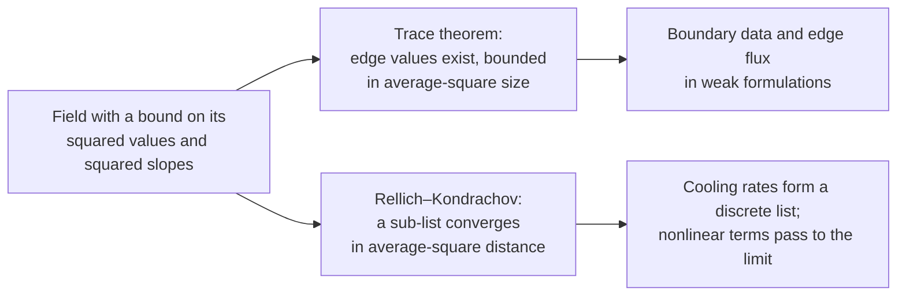
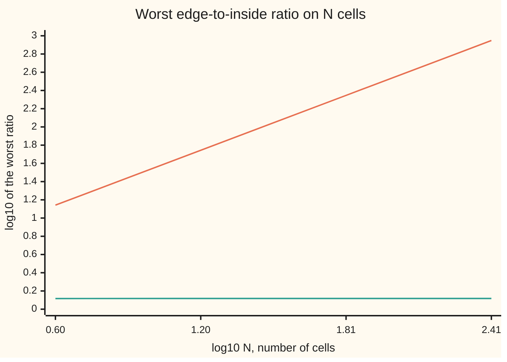

# Boundary values and compactness: the two Sobolev results existence proofs lean on

[Syllabus](../../../SYLLABUS.md) → [Functional analysis](../README.md) → [Distributions and Sobolev Spaces](../README.md#s04) → Boundary values and compactness

---

## General Overview

A steel plate, 1 m by 1 m, is heated along its left edge. An infrared camera watches the plate's face, but a clamp hides that edge. The camera sees only the inside, and the question is how hot the hidden edge runs, on average along its length.

Measured as an excess over room temperature, the steady field is $`w = 60\, e^{-\pi x} \sin(\pi y)`$ °C (illustrative), with $`x`$ metres from the left edge and $`y`$ metres up it. The hidden edge runs 60 °C above room in the middle. Its root-mean-square excess, the square root of the average of $`w^2`$ along the edge, is 42.4264 °C.

Two Sobolev results decide what inside data can say.

- **The trace theorem.** If the temperature and its slopes are square-integrable inside, the edge values exist and are bounded by the inside size. From 320 × 320 interior pixels, a formula on this card recovers the edge integral of $`w^2`$ as 1799.9845; the true value is 1800.
- **The Rellich–Kondrachov theorem.** On a bounded region, a list of fields with bounded size and slopes has a sub-list that settles down in the average-square sense. Bounded slopes forbid ever-faster ripples, the one way left to escape there.

Without the slopes, both fail. Take a layer 1 mm thick along the edge, 100 °C above room at the edge and falling straight to room temperature across the layer. Its inside integral of the square is only 3.3333 °C², yet its edge carries 10000 °C².

**A field whose values and slopes are square-integrable has well-defined edge values bounded by its inside energy, and on a bounded region a bounded list of such fields has a sub-list that converges in the average-square sense; existence proofs lean on the first for boundary data in heat and elasticity problems, and on the second for eigenvalue problems and nonlinear terms.**

**What kind of fact this is:** two theorems. The trace bound on one edge of the square and Rellich–Kondrachov on an interval are proved on this card in Why it works. The general versions are stated: Evans and Brezis prove them for bounded regions with a smooth edge, and Grisvard for edges with corners (Lipschitz edges), such as the plate's. This outline card leaves out the arguments for a general edge and the exact range of the trace.

### The picture: what an energy bound buys



Schematic. Both results start from the same energy bound and feed different steps of an existence proof.

---

## The formula

Notation first: three symbols carry the card.

- $`\Omega`$ is the region, here the open square plate, and $`\partial\Omega`$ is its edge. The region is **bounded** (fits in a box). Its edge is **Lipschitz**: locally the graph of a function with bounded slope, so corners are allowed.
- $`\gamma`$ (gamma) is the **trace map**: it sends a field to its profile along the edge.

$`H^1(\Omega)`$ is the space of fields $`u`$ whose values and weak slopes are square-integrable ([Weak derivatives](07-weak-derivatives-and-sobolev-spaces.md)). Its norm, the **energy**, is

```math
\|u\|_{H^1(\Omega)}^2 = \int_\Omega u^2 \, dx\, dy + \int_\Omega |\nabla u|^2 \, dx\, dy ,
```

where $`\nabla u = (u_x, u_y)`$ is the gradient, the pair of slopes. Lengths are in units of the plate's side, 1 m, so both pieces are in °C².

The trace theorem:

```math
\|\gamma u\|_{L^2(\partial\Omega)} \le C_\gamma \, \|u\|_{H^1(\Omega)}, \qquad \gamma u = u\big|_{\partial\Omega} \text{ whenever } u \text{ is continuous up to the edge.}
```

**Read it aloud:** the edge profile's average-square size is at most a fixed constant times the inside energy, and for a well-behaved field it is just the field's edge values.

The Rellich–Kondrachov theorem:

```math
\sup_n \|u_n\|_{H^1(\Omega)} < \infty \;\Longrightarrow\; \text{some sub-list } u_{n_j} \text{ converges in } L^2(\Omega).
```

**Read it aloud:** if a list of fields has bounded energy, some sub-list settles to a limit in the average-square distance.

In the language of [Sobolev and Poincare](09-sobolev-embedding-and-poincare-inequality.md), the inclusion $`H^1(\Omega) \hookrightarrow L^2(\Omega)`$ is a **compact embedding**: it sends bounded sets to sets whose closure is compact. The arrow $`\hookrightarrow`$ means "sits inside, with a norm bound".

| Symbol | Plain meaning | In our example | Push it up and the answer… |
| --- | --- | --- | --- |
| $`\Omega`$, $`\partial\Omega`$ | the region, and its edge | the 1 m square plate; its left edge $`x = 0`$ | a narrower plate gives a larger trace constant |
| $`x`$, $`y`$ | position, metres from the left edge and up it | from 0 to 1 | — |
| $`w`$, $`u`$, $`f`$ | $`w`$: temperature excess, °C; $`u`$: any field; $`f`$: $`w`$ along the midline $`y = 1/2`$ | $`w = 60\, e^{-\pi x}\sin(\pi y)`$, $`f = 60\, e^{-\pi x}`$ | squared norms grow with the amplitude squared |
| $`\nabla u`$, $`u_x`$ | gradient (both slopes); slope in $`x`$ | $`\Vert \nabla w\Vert ^2 = 5644.3066`$, $`\Vert w_x\Vert ^2 = 2822.1533`$ | steeper fields carry more energy |
| $`H^1(\Omega)`$, $`\Vert u\Vert _{H^1}`$ | fields with square-integrable values and slopes; their energy norm | $`\Vert w\Vert _{H^1}^2 = 5930.2506`$ | the edge bound grows with it |
| $`L^2(\Omega)`$, $`L^2(\partial\Omega)`$ | square-integrable functions on the plate; on the edge | $`\int_{\text{edge}} w^2 = 1800`$ | — |
| $`\gamma`$ | the trace map, field to edge profile | $`\gamma w = 60 \sin(\pi y)`$ | — |
| $`C_\gamma`$ | the trace constant; this card computes it for the left edge alone | $`C_\gamma^2 = \coth 1 = 1.3130352855`$ for the left edge | larger constant, weaker control |
| $`H^1_0(\Omega)`$ | $`H^1`$ fields with zero trace | fields held at room temperature on the edge | — |
| $`\hookrightarrow`$ | inclusion with a norm bound | $`H^1(\Omega) \hookrightarrow L^2(\Omega)`$, compact | — |
| $`N`$, $`\varepsilon`$ | cells or modes kept in a truncation; width of a hot layer | $`N`$ = 4 to 256 cells, or 1, 10, 100 modes; $`\varepsilon`$ = 0.1, 0.01, 0.001 m | larger $`N`$, smaller truncation error; smaller $`\varepsilon`$, steeper layer |
| $`s_n`$, $`c_k`$, $`k`$, $`l`$ | ripple $`\sqrt{2}\sin(n\pi x)`$; coefficient of cosine mode number $`k`$; $`l`$ counts modes in $`y`$ | $`s_{100}`$ has $`\Vert s_{100}\Vert _{H^1}^2 = 98697.0440`$ | higher $`n`$, wilder ripple, more energy |

### When it holds

- **Slopes are controlled, not just values.** Otherwise there is no trace: the 1 mm hot layer has inside size 3.3333 and edge size 10000.
- **The region is bounded.** On an endless rod, a tent-shaped bump slid 2 m at a time keeps energy 2.666667, but its copies stay 1.154701 apart, so no sub-list converges.
- **The edge is Lipschitz.** A sharp cusp can break both results; polygons and smooth curves are fine.
- **Convergence is in $`L^2`$, not in $`H^1`$.** Convergence in the energy itself would need control of second slopes.

---

## Why it works

### Step 0: the idea, slopes tie the edge to the inside

In finite dimensions both results are free. A field on a grid is a finite list of numbers. Reading its edge entries is a bounded linear map, and a bounded list of grids has a convergent sub-list (Bolzano–Weierstrass).

In infinite dimensions both fail without slopes. The edge is a null set, of zero area, so changing an $`L^2`$ field there changes nothing ([Null sets and almost everywhere](../../10-Measure%20and%20integration/01-Sets%20You%20Can%20Measure/07-null-sets-and-almost-everywhere.md)). And a bounded $`L^2`$ list can ripple ever faster and never settle.

A slope bound fixes both. Climbing steeply in a thin layer costs $`\int |\nabla u|^2`$, and a fast ripple costs $`n^2\pi^2`$.

### Step 1: the edge value from an inside integral

Take one horizontal line across the plate, at height $`y`$. Write $`u(x)`$ for the field along it, smooth on $`[0, 1]`$. The product rule gives

```math
\frac{d}{dx}\Big[(1 - x)\, u^2\Big] = -u^2 + 2(1 - x)\, u\, u_x .
```

Integrate from 0 to 1. The left side gives $`0 - u(0)^2`$. So

```math
u(0)^2 = \int_0^1 u^2 \, dx - 2 \int_0^1 (1 - x)\, u\, u_x \, dx .
```

**Read it aloud:** the edge value squared is an average over the inside, of the field and its slope.

On the plate, integrate over $`y`$ as well. This is the inside-data formula:

```math
\int_0^1 w(0, y)^2 \, dy = \int_0^1\!\!\int_0^1 \Big( w^2 - 2(1 - x)\, w\, w_x \Big)\, dx\, dy .
```

The right side uses only interior values and slopes. The checks evaluate it on pixel centres, with slopes by differences: 1799.9845 at 320 × 320 pixels.

### Step 2: the bound

Use $`2|u|\,|u_x| \le u^2 + u_x^2`$ and $`0 \le 1 - x \le 1`$ in Step 1:

```math
u(0)^2 \le \int_0^1 u^2 + \int_0^1 (u^2 + u_x^2) \le 2 \int_0^1 \big(u^2 + u_x^2\big) .
```

Integrate over $`y`$ and the left edge obeys $`\int_{\text{edge}} u^2 \le 2\,(\|u\|^2 + \|u_x\|^2) \le 2\,\|u\|_{H^1}^2`$. So, for the left edge alone, $`C_\gamma^2 \le 2`$. The best constant for that edge is $`\coth 1 = 1.3130352855`$.

<details>
<summary>Why the best constant is coth 1</summary>

Minimise $`\int_0^1 (u^2 + u_x^2)`$ over smooth $`u`$ with $`u(0) = 1`$. The minimiser satisfies $`u'' = u`$, with $`u'(1) = 0`$ because the right end is free. So

$`\displaystyle u(x) = \frac{\cosh(1 - x)}{\cosh 1}, \qquad \int_0^1 (u^2 + u'^2)\,dx = \big[u\,u'\big]_0^1 = -u'(0) = \tanh 1 .`$

Its edge value is 1 and its energy is $`\tanh 1 = 0.7615941560`$, so the ratio $`u(0)^2 / \|u\|_{H^1}^2`$ reaches $`\coth 1`$ and no field beats it. The same profile, constant in $`y`$, attains $`\coth 1`$ on the plate.

On an interval of length $`L`$ the minimiser is $`\cosh(L - x)/\cosh L`$ and the constant is $`\coth L`$. It grows as $`L`$ shrinks, which is the "narrower plate" entry of the symbol table.

</details>

### Step 3: from smooth fields to all of H¹

Steps 1 and 2 need $`u`$ smooth up to the edge. Two facts carry the bound to every $`H^1`$ field.

1. Fields smooth up to the edge are dense in $`H^1(\Omega)`$: every $`H^1`$ field is an energy-norm limit of them, by shifting each piece of the field slightly inward and mollifying ([Convolution and mollifiers](03-convolution-and-mollifiers.md)).
2. Take smooth fields converging to $`u`$ in $`H^1`$. By the bound, their edge profiles form a Cauchy list in $`L^2(\partial\Omega)`$: later entries get as close to each other as you like. That space is complete, so the profiles have a limit. Call it $`\gamma u`$.

For a general bounded region, straighten each piece of edge into a flat one and repeat Steps 1 and 2 there. Evans carries this out for a smooth edge.

Two facts are stated, not proved here. The fields with zero trace are exactly $`H^1_0(\Omega)`$. And not every $`L^2`$ edge profile is a trace: the traces form the smaller fractional space $`H^{1/2}(\partial\Omega)`$, which excludes jumps. Gagliardo characterised this space in 1957.

### Step 4: Rellich–Kondrachov on an interval, by modes

On $`(0, 1)`$ expand a field in the cosine modes $`1, \sqrt{2}\cos(\pi x), \sqrt{2}\cos(2\pi x), \ldots`$ with coefficients $`c_0, c_1, c_2, \ldots`$. These modes are orthonormal in $`L^2`$ (each has size 1, and each pair integrates to 0), and their slopes are orthogonal too. So

```math
\|u\|_{H^1}^2 = \sum_{k \ge 0} \big(1 + k^2\pi^2\big)\, c_k^2 .
```

Keep the first $`N`$ modes. What is left over has

```math
\sum_{k \ge N} c_k^2 \le \frac{1}{1 + N^2\pi^2} \sum_{k \ge N} \big(1 + k^2\pi^2\big)\, c_k^2 \le \frac{\|u\|_{H^1}^2}{1 + N^2\pi^2} .
```

**Read it aloud:** in the energy ball of radius 1, every field sits within $`1/\sqrt{1 + N^2\pi^2}`$ of a field built from $`N`$ modes.

The first $`N`$ modes span a finite-dimensional space, where finitely many small balls cover any bounded set. With the tail bound, finitely many $`L^2`$ balls of any radius cover the energy ball: it is totally bounded. In the complete space $`L^2`$, that makes its closure compact ([Compactness three ways](../../17-Topology/01-Metric%20Spaces/06-compactness-in-metric-spaces.md)). So every bounded list in $`H^1`$ has an $`L^2`$-convergent sub-list.

<details>
<summary>Why the slopes' energy is the weighted sum</summary>

For $`k \ge 1`$, integrate by parts:

$`\displaystyle \int_0^1 u_x\, \sqrt{2}\sin(k\pi x)\, dx = \Big[u\,\sqrt{2}\sin(k\pi x)\Big]_0^1 - k\pi \int_0^1 u\,\sqrt{2}\cos(k\pi x)\, dx = -k\pi\, c_k .`$

The boundary term vanishes because $`\sin(k\pi x)`$ is zero at both ends, so no boundary condition on $`u`$ is needed. The sines are orthonormal and complete in $`L^2`$, so Parseval gives $`\int_0^1 u_x^2 = \sum_{k \ge 1} k^2\pi^2 c_k^2`$.

</details>

### Step 5: what changes on the plate and beyond

On the square, the modes $`\cos(k\pi x)\cos(l\pi y)`$ play the same part. Every mode with $`k^2 + l^2 \ge N^2`$ has weight at least $`1 + N^2\pi^2`$, so the argument is unchanged. A general bounded region is handled by extending each field to a box around it.

The general theorem is wider: with other powers in place of squares, the embedding is compact into every Lebesgue space below the Sobolev exponent of [Sobolev and Poincare](09-sobolev-embedding-and-poincare-inequality.md). The trace map is compact too. This card computes only $`H^1`$ into $`L^2`$.

---

## Worked numbers, by hand

The plate's left edge, $`w = 60\, e^{-\pi x}\sin(\pi y)`$. All integrals are over the 1 m square.

| Step | Arithmetic | Value |
| --- | --- | --- |
| Edge integral | $`3600 \int_0^1 \sin^2(\pi y)\,dy = 3600 \times 0.5`$ | 1800 °C² |
| Inside size | $`1800\,(1 - e^{-2\pi})/(2\pi)`$ | $`\Vert w\Vert ^2 = 285.9439`$ |
| Slope in $`x`$ | $`w_x = -\pi w`$, so $`\pi^2 \times 285.9439`$ | $`\Vert w_x\Vert ^2 = 2822.1533`$ |
| Full slope energy | twice that, since $`w_y`$ carries the same | $`\Vert \nabla w\Vert ^2 = 5644.3066`$ |
| Energy norm | $`285.9439 + 5644.3066`$ | $`\Vert w\Vert _{H^1}^2 = 5930.2506`$ |
| Crude bound, Step 2 | $`2 \times (285.9439 + 2822.1533)`$ | 6216.1945 |
| Sharp bound | $`\coth 1 \times (285.9439 + 2822.1533)`$ | 4081.0413 |
| Inside-data formula, 320 × 320 pixels | Step 1's double integral, midpoint pixels | **1799.9845** |

The edge carries 1800 °C², a root-mean-square excess of 42.4264 °C. Interior pixels alone recover it to within 0.0155, and the trace bound guarantees 4081.0413 or less before any computing.

### What breaks if you drop a piece

| Mistake | Comes out at | What went wrong |
| --- | --- | --- |
| Bound the edge by the inside size alone | 1 mm hot layer: inside 3.3333, edge 10000, ratio 3000 | no slope term; the ratio is $`3/\varepsilon`$ and grows without limit |
| Same, on a grid of $`N`$ cells | best ratio $`2\sqrt{3}\, N`$: 886.810 at $`N = 256`$ | every finite grid has a bound, but it grows with $`N`$ |
| Expect compactness from an $`L^2`$ bound | ripples $`s_n`$ and $`s_{2n}`$ stay 1.414214 apart | ripple energy $`1 + n^2\pi^2`$ is unbounded: 98697.0440 at $`n = 100`$ |
| Drop "bounded region" | tent slides 2 m apart stay 1.154701 apart | energy fixed at 2.666667, but the mass escapes to infinity |

Each failure is a trend that never closes as $`N`$ grows, $`\varepsilon`$ shrinks or $`n`$ grows. No single finite size shows it.

### The trend in one chart



The orange line measures inside size by $`\int u^2`$ alone: it climbs with slope 1, so the ratio is proportional to $`N`$. The teal line uses the $`H^1`$ energy: it settles at $`\log_{10}\coth 1 = 0.118`$. Grid sizes $`N`$ = 4, 16, 64, 256.

---

## Code, from first principles, and it actually runs

The scripts take at least two independent roads to each claim.

- **Trace constant:** the closed form $`\coth 1`$ against a piecewise-linear truncation on $`N`$ cells, solved by a hand-written tridiagonal solver; the gap falls 16 times per 4 times the cells. The $`L^2`$-only ratio is checked against $`2\sqrt{3}\,N`$.
- **Edge integral:** the exact 1800 against Step 1's formula on interior pixels.
- **Rellich–Kondrachov:** closed-form cosine coefficients against quadrature, the weighted Parseval sum against the closed-form energy, and the tail bound tested on the plate's midline.

What the truncation hides: every grid is finite, so every grid has some trace bound and some convergent sub-list. Only the trend over $`N`$ shows which bounds survive.

### Python

```python
# Trace and Rellich-Kondrachov in outline: a 1 m square plate, temperatures in deg C above room.
# Every computation is a truncation (N cells, n x n pixels, N modes) shown at several sizes.
import math

def thomas(lo, di, up, rhs):
    # tridiagonal solve, written out: lo/up are the off-diagonals, di the diagonal
    n = len(di); c = [0.0] * n; d = [0.0] * n
    c[0] = up[0] / di[0]; d[0] = rhs[0] / di[0]
    for i in range(1, n):
        m = di[i] - lo[i] * c[i - 1]
        c[i] = up[i] / m if i < n - 1 else 0.0
        d[i] = (rhs[i] - lo[i] * d[i - 1]) / m
    x = [0.0] * n; x[-1] = d[-1]
    for i in range(n - 2, -1, -1):
        x[i] = d[i] - c[i] * x[i + 1]
    return x

def min_energy(N, stiff):
    # smallest ||u||^2 (stiff=1: H1 norm, stiff=0: L2 norm) over piecewise-linear u on N cells with u(0) = 1
    h = 1.0 / N
    a0 = stiff / h + h / 3; off = -stiff / h + h / 6
    di = [2 * a0] * (N - 1) + [a0]; lo = [off] * N; up = [off] * N
    rhs = [-off] + [0.0] * (N - 1)
    v = thomas(lo, di, up, rhs)
    return a0 + off * v[0]

coth1 = math.cosh(1) / math.sinh(1)
print("== Trace on the interval (0, 1): sharpest C with u(0)^2 <= C ||u||^2 ==")
print(f"closed form coth(1) = {coth1:.10f}  (minimiser cosh(1 - x)/cosh(1), energy tanh(1) = {math.tanh(1):.10f})")
errs = []
for N in (4, 16, 64, 256):
    r1 = 1 / min_energy(N, 1.0); r0 = 1 / min_energy(N, 0.0)
    errs.append(coth1 - r1)
    print(f"N={N:4d} cells: H1 ratio {r1:.10f}  gap {coth1 - r1:.3e}   L2-only ratio {r0:10.3f}  = {r0 / N:.6f} N")
    assert 0 < coth1 - r1 < 0.01 and abs(r0 / N - 2 * math.sqrt(3)) < 1e-3   # 2 sqrt(3): decay rate sqrt(3) - 2 per node
for a, b in zip(errs, errs[1:]):
    assert 14 < a / b < 18   # gap falls 16x per 4x cells: error ~ h^2
print(f"gap shrink per 4x cells: {errs[0] / errs[1]:.2f} {errs[1] / errs[2]:.2f} {errs[2] / errs[3]:.2f}")
print(f"L2-only ratio / N -> 2 sqrt(3) = {2 * math.sqrt(3):.6f}: no bound survives N -> infinity")
Ns = (4, 16, 64, 256)
print("chart,log10 N," + ",".join(f"{math.log10(N):.2f}" for N in Ns))
print("chart,log10 H1 ratio," + ",".join(f"{math.log10(1 / min_energy(N, 1.0)):.3f}" for N in Ns))
print("chart,log10 L2 ratio," + ",".join(f"{math.log10(1 / min_energy(N, 0.0)):.3f}" for N in Ns))

print("== The plate: w(x, y) = 60 exp(-pi x) sin(pi y), left edge x = 0 ==")
E = 1 - math.exp(-2 * math.pi)
L2 = 1800 * E / (2 * math.pi); GR = 1800 * math.pi * E; H1 = L2 + GR
print(f"||w||^2 = {L2:.4f}  ||grad w||^2 = {GR:.4f}  ||w||_H1^2 = {H1:.4f}")
print(f"edge integral of w^2 = 1800 (exact), rms edge excess = {math.sqrt(1800):.4f} C, peak 60 C")
WX = math.pi ** 2 * L2   # w_x = -pi w, half of the gradient's energy
print(f"||w_x||^2 = {WX:.4f}  bounds on 1800: crude 2(||w||^2 + ||w_x||^2) = {2 * (L2 + WX):.4f}")
print(f"  sharp coth(1)(||w||^2 + ||w_x||^2) = {coth1 * (L2 + WX):.4f}  coth(1)||w||_H1^2 = {coth1 * H1:.4f}")
assert abs(2 * WX - GR) < 1e-9 * GR
assert 1800 <= coth1 * (L2 + WX) <= 2 * (L2 + WX)
def edge_from_inside(n):
    # midpoint pixels only, never the edge: integral of w^2 - 2(1 - x) w w_x, w_x by differences
    h = 1.0 / n; tot = 0.0
    for j in range(n):
        y = (j + 0.5) * h
        col = [60 * math.exp(-math.pi * (i + 0.5) * h) * math.sin(math.pi * y) for i in range(n)]
        for i in range(n):
            if i == 0: wx = (-3 * col[0] + 4 * col[1] - col[2]) / (2 * h)
            elif i == n - 1: wx = (3 * col[i] - 4 * col[i - 1] + col[i - 2]) / (2 * h)
            else: wx = (col[i + 1] - col[i - 1]) / (2 * h)
            x = (i + 0.5) * h
            tot += (col[i] ** 2 - 2 * (1 - x) * col[i] * wx) * h * h
    return tot
prev = None
for n in (20, 80, 320):
    v = edge_from_inside(n); err = abs(v - 1800)
    print(f"{n:3d} x {n:<3d} interior pixels: edge integral {v:.4f}  error {err:.4f}")
    if prev: assert 15 < prev / err < 30; print(f"  error shrink {prev / err:.2f}x")   # 16x = second order
    prev = err
assert prev < 0.02

print("== What breaks: a hot layer of width eps on the left edge, 100 C at the edge ==")
for eps in (0.1, 0.01, 0.001):
    l2 = 1e4 * eps / 3; gx = 1e4 / eps
    # midpoint rule over the layer, independent of the closed forms
    m = 1000; s = sum((100 * (1 - (k + 0.5) / m)) ** 2 for k in range(m)) * eps / m
    assert abs(s - l2) < 1e-3 * l2
    print(f"eps={eps:<6}: ||u||^2 = {l2:.4f}  edge = 10000  ratio {1e4 / l2:.0f}  ||u_x||^2 = {gx:.0f}  H1 bound {coth1 * (l2 + gx):.0f}")
    assert coth1 * (l2 + gx) >= 1e4
tent = lambda x: max(0.0, 1 - abs(x))   # 1 m tent on an endless strip, slid 2 m
K = 40000; dx = 4 / K; xs = [-1 + (k + 0.5) * dx for k in range(K)]
dist2 = sum((tent(x) - tent(x - 2)) ** 2 for x in xs) * dx
h1t = sum(tent(x) ** 2 + (1 if abs(x) < 1 else 0) for x in xs) * dx
print(f"tent: ||tent||_H1^2 = {h1t:.6f} (8/3)  L2 distance between slides 2 m apart = {math.sqrt(dist2):.6f}")
assert abs(dist2 - 4 / 3) < 1e-6 and abs(h1t - 8 / 3) < 1e-6

print("== Rellich: ripples sqrt(2) sin(n pi x) on (0, 1) ==")
def l2dist2(n, m, K=4000):
    return sum((math.sqrt(2) * (math.sin(n * math.pi * (k + 0.5) / K) - math.sin(m * math.pi * (k + 0.5) / K))) ** 2 for k in range(K)) / K
for n in (1, 10, 100):
    d2 = l2dist2(n, 2 * n)
    print(f"n={n:3d}: ||s_n||_H1^2 = {1 + (n * math.pi) ** 2:.4f}  L2 distance to s_2n = {math.sqrt(d2):.6f}")
    assert abs(d2 - 2) < 1e-6
print("== Rellich: keep N cosine modes; worst L2 error over the H1 unit ball ==")
f0 = 60.0; e = math.exp(-math.pi)
def coef(k):   # cosine coefficient of f(x) = 60 exp(-pi x), basis 1, sqrt(2) cos(k pi x)
    if k == 0: return f0 * (1 - e) / math.pi
    return math.sqrt(2) * f0 * (1 - (-1) ** k * e) / (math.pi * (1 + k * k))
def coef_quad(k, K=20000):
    b = (lambda x: 1.0) if k == 0 else (lambda x: math.sqrt(2) * math.cos(k * math.pi * x))
    return sum(f0 * math.exp(-math.pi * (i + 0.5) / K) * b((i + 0.5) / K) for i in range(K)) / K
for k in (0, 1, 2, 7):
    assert abs(coef(k) - coef_quad(k)) < 1e-4
fH1 = (1 + math.pi ** 2) * 3600 * E / (2 * math.pi)
energy = sum((1 + (k * math.pi) ** 2) * coef(k) ** 2 for k in range(200000))
print(f"midline f = 60 exp(-pi x): ||f||_H1^2 = {fH1:.4f}, sum (1 + k^2 pi^2) c_k^2 = {energy:.4f}")
assert abs(energy - fH1) < 0.1
for N in (1, 10, 100):
    worst = 1 / math.sqrt(1 + (N * math.pi) ** 2)
    tail = math.sqrt(sum(coef(k) ** 2 for k in range(N, 200000)))
    print(f"N={N:3d}: worst {worst:.6f}  f's tail {tail:.6f} <= {worst * math.sqrt(fH1):.6f}  L2 ball worst 1")
    assert tail <= worst * math.sqrt(fH1)
print("ALL CHECKS PASS")
```

**Ran 2026-11-15 on macOS, Python 3.14.10, standard library only. All checks passed. Output, pasted from the run:**

```
== Trace on the interval (0, 1): sharpest C with u(0)^2 <= C ||u||^2 ==
closed form coth(1) = 1.3130352855  (minimiser cosh(1 - x)/cosh(1), energy tanh(1) = 0.7615941560)
N=   4 cells: H1 ratio 1.3077417219  gap 5.294e-03   L2-only ratio     13.857  = 3.464286 N
N=  16 cells: H1 ratio 1.3127037715  gap 3.315e-04   L2-only ratio     55.426  = 3.464102 N
N=  64 cells: H1 ratio 1.3130145633  gap 2.072e-05   L2-only ratio    221.703  = 3.464102 N
N= 256 cells: H1 ratio 1.3130339904  gap 1.295e-06   L2-only ratio    886.810  = 3.464102 N
gap shrink per 4x cells: 15.97 16.00 16.00
L2-only ratio / N -> 2 sqrt(3) = 3.464102: no bound survives N -> infinity
chart,log10 N,0.60,1.20,1.81,2.41
chart,log10 H1 ratio,0.117,0.118,0.118,0.118
chart,log10 L2 ratio,1.142,1.744,2.346,2.948
== The plate: w(x, y) = 60 exp(-pi x) sin(pi y), left edge x = 0 ==
||w||^2 = 285.9439  ||grad w||^2 = 5644.3066  ||w||_H1^2 = 5930.2506
edge integral of w^2 = 1800 (exact), rms edge excess = 42.4264 C, peak 60 C
||w_x||^2 = 2822.1533  bounds on 1800: crude 2(||w||^2 + ||w_x||^2) = 6216.1945
  sharp coth(1)(||w||^2 + ||w_x||^2) = 4081.0413  coth(1)||w||_H1^2 = 7786.6282
 20 x 20  interior pixels: edge integral 1791.0884  error 8.9116
 80 x 80  interior pixels: edge integral 1799.6774  error 0.3226
  error shrink 27.62x
320 x 320 interior pixels: edge integral 1799.9845  error 0.0155
  error shrink 20.87x
== What breaks: a hot layer of width eps on the left edge, 100 C at the edge ==
eps=0.1   : ||u||^2 = 333.3333  edge = 10000  ratio 30  ||u_x||^2 = 100000  H1 bound 131741
eps=0.01  : ||u||^2 = 33.3333  edge = 10000  ratio 300  ||u_x||^2 = 1000000  H1 bound 1313079
eps=0.001 : ||u||^2 = 3.3333  edge = 10000  ratio 3000  ||u_x||^2 = 10000000  H1 bound 13130357
tent: ||tent||_H1^2 = 2.666667 (8/3)  L2 distance between slides 2 m apart = 1.154701
== Rellich: ripples sqrt(2) sin(n pi x) on (0, 1) ==
n=  1: ||s_n||_H1^2 = 10.8696  L2 distance to s_2n = 1.414214
n= 10: ||s_n||_H1^2 = 987.9604  L2 distance to s_2n = 1.414214
n=100: ||s_n||_H1^2 = 98697.0440  L2 distance to s_2n = 1.414214
== Rellich: keep N cosine modes; worst L2 error over the H1 unit ball ==
midline f = 60 exp(-pi x): ||f||_H1^2 = 6216.1945, sum (1 + k^2 pi^2) c_k^2 = 6216.1584
N=  1: worst 0.303314  f's tail 15.426455 <= 23.914176  L2 ball worst 1
N= 10: worst 0.031815  f's tail 0.524615 <= 2.508375  L2 ball worst 1
N=100: worst 0.003183  f's tail 0.015715 <= 0.250963  L2 ball worst 1
ALL CHECKS PASS
```

### Rust

```rust
// Trace and Rellich-Kondrachov in outline: a 1 m square plate, temperatures in deg C above room.
// Every computation is a truncation (N cells, n x n pixels, N modes) shown at several sizes.
use std::f64::consts::PI;

fn thomas(lo: &[f64], di: &[f64], up: &[f64], rhs: &[f64]) -> Vec<f64> {
    // tridiagonal solve, written out: lo/up are the off-diagonals, di the diagonal
    let n = di.len();
    let (mut c, mut d) = (vec![0.0; n], vec![0.0; n]);
    (c[0], d[0]) = (up[0] / di[0], rhs[0] / di[0]);
    for i in 1..n {
        let m = di[i] - lo[i] * c[i - 1];
        c[i] = if i < n - 1 { up[i] / m } else { 0.0 };
        d[i] = (rhs[i] - lo[i] * d[i - 1]) / m;
    }
    let mut x = d.clone();
    for i in (0..n - 1).rev() {
        x[i] = d[i] - c[i] * x[i + 1];
    }
    x
}

fn min_energy(nc: usize, stiff: f64) -> f64 {
    // smallest ||u||^2 (stiff=1: H1 norm, stiff=0: L2 norm) over piecewise-linear u on N cells with u(0) = 1
    let h = 1.0 / nc as f64;
    let (a0, off) = (stiff / h + h / 3.0, -stiff / h + h / 6.0);
    let mut di = vec![2.0 * a0; nc];
    di[nc - 1] = a0;
    let mut rhs = vec![0.0; nc];
    rhs[0] = -off;
    let v = thomas(&vec![off; nc], &di, &vec![off; nc], &rhs);
    a0 + off * v[0]
}

fn sci3(x: f64) -> String {
    // Python's {:.3e}: two-digit signed exponent
    let s = format!("{:.3e}", x);
    let (m, e) = s.split_once('e').unwrap();
    let ev: i32 = e.parse().unwrap();
    format!("{}e{}{:02}", m, if ev < 0 { '-' } else { '+' }, ev.abs())
}

fn edge_from_inside(n: usize) -> f64 {
    // midpoint pixels only, never the edge: integral of w^2 - 2(1 - x) w w_x, w_x by differences
    let h = 1.0 / n as f64;
    let mut tot = 0.0;
    for j in 0..n {
        let y = (j as f64 + 0.5) * h;
        let col: Vec<f64> = (0..n).map(|i| 60.0 * (-PI * (i as f64 + 0.5) * h).exp() * (PI * y).sin()).collect();
        for i in 0..n {
            let wx = if i == 0 {
                (-3.0 * col[0] + 4.0 * col[1] - col[2]) / (2.0 * h)
            } else if i == n - 1 {
                (3.0 * col[i] - 4.0 * col[i - 1] + col[i - 2]) / (2.0 * h)
            } else {
                (col[i + 1] - col[i - 1]) / (2.0 * h)
            };
            let x = (i as f64 + 0.5) * h;
            tot += (col[i].powi(2) - 2.0 * (1.0 - x) * col[i] * wx) * h * h;
        }
    }
    tot
}

fn coef(k: usize) -> f64 {
    // cosine coefficient of f(x) = 60 exp(-pi x), basis 1, sqrt(2) cos(k pi x)
    let e = (-PI).exp();
    if k == 0 {
        return 60.0 * (1.0 - e) / PI;
    }
    let sgn = if k % 2 == 0 { 1.0 } else { -1.0 };
    2f64.sqrt() * 60.0 * (1.0 - sgn * e) / (PI * (1.0 + (k * k) as f64))
}

fn coef_quad(k: usize, kk: usize) -> f64 {
    let mut s = 0.0;
    for i in 0..kk {
        let x = (i as f64 + 0.5) / kk as f64;
        let b = if k == 0 { 1.0 } else { 2f64.sqrt() * (k as f64 * PI * x).cos() };
        s += 60.0 * (-PI * x).exp() * b;
    }
    s / kk as f64
}

fn main() {
    let coth1 = 1f64.cosh() / 1f64.sinh();
    println!("== Trace on the interval (0, 1): sharpest C with u(0)^2 <= C ||u||^2 ==");
    println!("closed form coth(1) = {:.10}  (minimiser cosh(1 - x)/cosh(1), energy tanh(1) = {:.10})", coth1, 1f64.tanh());
    let ns = [4usize, 16, 64, 256];
    let mut errs = vec![];
    for &n in &ns {
        let (r1, r0) = (1.0 / min_energy(n, 1.0), 1.0 / min_energy(n, 0.0));
        errs.push(coth1 - r1);
        println!("N={:4} cells: H1 ratio {:.10}  gap {}   L2-only ratio {:10.3}  = {:.6} N", n, r1, sci3(coth1 - r1), r0, r0 / n as f64);
        assert!(coth1 - r1 > 0.0 && coth1 - r1 < 0.01 && (r0 / n as f64 - 2.0 * 3f64.sqrt()).abs() < 1e-3);
    }
    errs.windows(2).for_each(|w| assert!(w[0] / w[1] > 14.0 && w[0] / w[1] < 18.0));
    println!("gap shrink per 4x cells: {:.2} {:.2} {:.2}", errs[0] / errs[1], errs[1] / errs[2], errs[2] / errs[3]);
    println!("L2-only ratio / N -> 2 sqrt(3) = {:.6}: no bound survives N -> infinity", 2.0 * 3f64.sqrt());
    let row = |f: &dyn Fn(usize) -> String| ns.iter().map(|&n| f(n)).collect::<Vec<_>>().join(",");
    println!("chart,log10 N,{}", row(&|n| format!("{:.2}", (n as f64).log10())));
    println!("chart,log10 H1 ratio,{}", row(&|n| format!("{:.3}", (1.0 / min_energy(n, 1.0)).log10())));
    println!("chart,log10 L2 ratio,{}", row(&|n| format!("{:.3}", (1.0 / min_energy(n, 0.0)).log10())));

    println!("== The plate: w(x, y) = 60 exp(-pi x) sin(pi y), left edge x = 0 ==");
    let e2 = 1.0 - (-2.0 * PI).exp();
    let l2 = 1800.0 * e2 / (2.0 * PI);
    let (gr, h1) = (1800.0 * PI * e2, l2 + 1800.0 * PI * e2);
    println!("||w||^2 = {:.4}  ||grad w||^2 = {:.4}  ||w||_H1^2 = {:.4}", l2, gr, h1);
    println!("edge integral of w^2 = 1800 (exact), rms edge excess = {:.4} C, peak 60 C", 1800f64.sqrt());
    let wx = PI * PI * l2; // w_x = -pi w, half of the gradient's energy
    println!("||w_x||^2 = {:.4}  bounds on 1800: crude 2(||w||^2 + ||w_x||^2) = {:.4}", wx, 2.0 * (l2 + wx));
    println!("  sharp coth(1)(||w||^2 + ||w_x||^2) = {:.4}  coth(1)||w||_H1^2 = {:.4}", coth1 * (l2 + wx), coth1 * h1);
    assert!((2.0 * wx - gr).abs() < 1e-9 * gr);
    assert!(1800.0 <= coth1 * (l2 + wx) && coth1 * (l2 + wx) <= 2.0 * (l2 + wx));
    let mut prev = 0.0;
    for &n in &[20usize, 80, 320] {
        let v = edge_from_inside(n);
        let err = (v - 1800.0).abs();
        println!("{:3} x {:<3} interior pixels: edge integral {:.4}  error {:.4}", n, n, v, err);
        if prev > 0.0 {
            assert!(prev / err > 15.0 && prev / err < 30.0);
            println!("  error shrink {:.2}x", prev / err);
        }
        prev = err;
    }
    assert!(prev < 0.02);

    println!("== What breaks: a hot layer of width eps on the left edge, 100 C at the edge ==");
    for &eps in &[0.1f64, 0.01, 0.001] {
        let (l2d, gx) = (1e4 * eps / 3.0, 1e4 / eps);
        // midpoint rule over the layer, independent of the closed forms
        let m = 1000;
        let s: f64 = (0..m).map(|k| (100.0 * (1.0 - (k as f64 + 0.5) / m as f64)).powi(2)).sum::<f64>() * eps / m as f64;
        assert!((s - l2d).abs() < 1e-3 * l2d);
        println!("eps={:<6}: ||u||^2 = {:.4}  edge = 10000  ratio {:.0}  ||u_x||^2 = {:.0}  H1 bound {:.0}", eps, l2d, 1e4 / l2d, gx, coth1 * (l2d + gx));
        assert!(coth1 * (l2d + gx) >= 1e4);
    }
    let tent = |x: f64| (1.0 - x.abs()).max(0.0); // 1 m tent on an endless strip, slid 2 m
    let xs: Vec<f64> = (0..40000).map(|k| -1.0 + (k as f64 + 0.5) * 1e-4).collect();
    let dist2 = xs.iter().map(|&x| (tent(x) - tent(x - 2.0)).powi(2)).sum::<f64>() * 1e-4;
    let h1t = xs.iter().map(|&x| tent(x).powi(2) + if x.abs() < 1.0 { 1.0 } else { 0.0 }).sum::<f64>() * 1e-4;
    println!("tent: ||tent||_H1^2 = {:.6} (8/3)  L2 distance between slides 2 m apart = {:.6}", h1t, dist2.sqrt());
    assert!((dist2 - 4.0 / 3.0).abs() < 1e-6 && (h1t - 8.0 / 3.0).abs() < 1e-6);

    println!("== Rellich: ripples sqrt(2) sin(n pi x) on (0, 1) ==");
    for &n in &[1usize, 10, 100] {
        let kk = 4000;
        let mut d2 = 0.0;
        for k in 0..kk {
            let x = (k as f64 + 0.5) / kk as f64;
            d2 += (2f64.sqrt() * ((n as f64 * PI * x).sin() - ((2 * n) as f64 * PI * x).sin())).powi(2);
        }
        d2 /= kk as f64;
        println!("n={:3}: ||s_n||_H1^2 = {:.4}  L2 distance to s_2n = {:.6}", n, 1.0 + (n as f64 * PI).powi(2), d2.sqrt());
        assert!((d2 - 2.0).abs() < 1e-6);
    }
    println!("== Rellich: keep N cosine modes; worst L2 error over the H1 unit ball ==");
    [0usize, 1, 2, 7].iter().for_each(|&k| assert!((coef(k) - coef_quad(k, 20000)).abs() < 1e-4));
    let fh1 = (1.0 + PI * PI) * 3600.0 * e2 / (2.0 * PI);
    let energy: f64 = (0..200000usize).map(|k| (1.0 + (k as f64 * PI).powi(2)) * coef(k).powi(2)).sum();
    println!("midline f = 60 exp(-pi x): ||f||_H1^2 = {:.4}, sum (1 + k^2 pi^2) c_k^2 = {:.4}", fh1, energy);
    assert!((energy - fh1).abs() < 0.1);
    for &n in &[1usize, 10, 100] {
        let worst = 1.0 / (1.0 + (n as f64 * PI).powi(2)).sqrt();
        let tail = (n..200000usize).map(|k| coef(k).powi(2)).sum::<f64>().sqrt();
        println!("N={:3}: worst {:.6}  f's tail {:.6} <= {:.6}  L2 ball worst 1", n, worst, tail, worst * fh1.sqrt());
        assert!(tail <= worst * fh1.sqrt());
    }
    println!("ALL CHECKS PASS");
}
```

**Ran 2026-11-15 on macOS, rustc 1.98.1, no crates. All checks passed. Output, pasted from the run:**

```
== Trace on the interval (0, 1): sharpest C with u(0)^2 <= C ||u||^2 ==
closed form coth(1) = 1.3130352855  (minimiser cosh(1 - x)/cosh(1), energy tanh(1) = 0.7615941560)
N=   4 cells: H1 ratio 1.3077417219  gap 5.294e-03   L2-only ratio     13.857  = 3.464286 N
N=  16 cells: H1 ratio 1.3127037715  gap 3.315e-04   L2-only ratio     55.426  = 3.464102 N
N=  64 cells: H1 ratio 1.3130145633  gap 2.072e-05   L2-only ratio    221.703  = 3.464102 N
N= 256 cells: H1 ratio 1.3130339904  gap 1.295e-06   L2-only ratio    886.810  = 3.464102 N
gap shrink per 4x cells: 15.97 16.00 16.00
L2-only ratio / N -> 2 sqrt(3) = 3.464102: no bound survives N -> infinity
chart,log10 N,0.60,1.20,1.81,2.41
chart,log10 H1 ratio,0.117,0.118,0.118,0.118
chart,log10 L2 ratio,1.142,1.744,2.346,2.948
== The plate: w(x, y) = 60 exp(-pi x) sin(pi y), left edge x = 0 ==
||w||^2 = 285.9439  ||grad w||^2 = 5644.3066  ||w||_H1^2 = 5930.2506
edge integral of w^2 = 1800 (exact), rms edge excess = 42.4264 C, peak 60 C
||w_x||^2 = 2822.1533  bounds on 1800: crude 2(||w||^2 + ||w_x||^2) = 6216.1945
  sharp coth(1)(||w||^2 + ||w_x||^2) = 4081.0413  coth(1)||w||_H1^2 = 7786.6282
 20 x 20  interior pixels: edge integral 1791.0884  error 8.9116
 80 x 80  interior pixels: edge integral 1799.6774  error 0.3226
  error shrink 27.62x
320 x 320 interior pixels: edge integral 1799.9845  error 0.0155
  error shrink 20.87x
== What breaks: a hot layer of width eps on the left edge, 100 C at the edge ==
eps=0.1   : ||u||^2 = 333.3333  edge = 10000  ratio 30  ||u_x||^2 = 100000  H1 bound 131741
eps=0.01  : ||u||^2 = 33.3333  edge = 10000  ratio 300  ||u_x||^2 = 1000000  H1 bound 1313079
eps=0.001 : ||u||^2 = 3.3333  edge = 10000  ratio 3000  ||u_x||^2 = 10000000  H1 bound 13130357
tent: ||tent||_H1^2 = 2.666667 (8/3)  L2 distance between slides 2 m apart = 1.154701
== Rellich: ripples sqrt(2) sin(n pi x) on (0, 1) ==
n=  1: ||s_n||_H1^2 = 10.8696  L2 distance to s_2n = 1.414214
n= 10: ||s_n||_H1^2 = 987.9604  L2 distance to s_2n = 1.414214
n=100: ||s_n||_H1^2 = 98697.0440  L2 distance to s_2n = 1.414214
== Rellich: keep N cosine modes; worst L2 error over the H1 unit ball ==
midline f = 60 exp(-pi x): ||f||_H1^2 = 6216.1945, sum (1 + k^2 pi^2) c_k^2 = 6216.1584
N=  1: worst 0.303314  f's tail 15.426455 <= 23.914176  L2 ball worst 1
N= 10: worst 0.031815  f's tail 0.524615 <= 2.508375  L2 ball worst 1
N=100: worst 0.003183  f's tail 0.015715 <= 0.250963  L2 ball worst 1
ALL CHECKS PASS
```

### Lean

Lean proves the left-edge trace bound for fields with continuous slopes, its best constant, and Rellich–Kondrachov on an interval by modes.

- Take a field $`u`$ on the closed square, with $`u`$ and its slope $`u_x`$ continuous up to the edge. Then the edge integral of $`u^2`$ is at most $`2 \int_\Omega (u^2 + u_x^2)\, dx\, dy`$.
- Take $`u`$ on $`[0, 1]`$ with a continuous slope $`u'`$. Then $`u(0)^2 \le \coth 1 \int_0^1 (u^2 + u'^2)\, dx`$.
- No smaller constant works for every such $`u`$: the field $`\cosh(1 - x)`$ attains $`\coth 1`$.
- Take a list of fields whose energies $`\sum_k (1 + k^2\pi^2) c_k^2`$ all stay below one bound. Then some sub-list of their coefficient lists converges in the average-square distance.
- The plate's edge integral of $`w^2`$ is $`3600 \times 0.5 = 1800`$.
- The hot layer's edge-to-inside ratio is 30, 300 and 3000 at widths 0.1, 0.01 and 0.001 m.
- The sliding tent has energy 8/3, and the squared distance between two copies is 4/3.

The pixel recovery of 1800, the grid trends over $`N`$ and the ripple distances are left to the Python and Rust checks.

```lean
-- Boundary values and compactness: the left-edge trace bound on the unit square with constant 2, its sharp constant coth 1, and the Rellich–Kondrachov compactness in cosine-mode form.
import Mathlib.MeasureTheory.Integral.IntervalIntegral.Basic
import Mathlib.Analysis.Calculus.Deriv.Basic
import Mathlib.Analysis.Normed.Lp.lpSpace
import Mathlib.Analysis.SpecialFunctions.Trigonometric.Basic
import Mathlib.Analysis.Complex.Trigonometric
import Mathlib.MeasureTheory.Integral.IntervalIntegral.FundThmCalculus
import Mathlib.MeasureTheory.Integral.DominatedConvergence
import Mathlib.Analysis.SpecialFunctions.Trigonometric.DerivHyp
import Mathlib.Analysis.SpecialFunctions.Pow.Real

open Real Filter Topology

theorem trace_helper_sharp (v v' : ℝ → ℝ)
    (hd : ∀ x ∈ Set.Icc (0 : ℝ) 1, HasDerivWithinAt v (v' x) (Set.Icc 0 1) x)
    (hc : ContinuousOn v' (Set.Icc (0 : ℝ) 1)) :
    Real.sinh 1 / Real.cosh 1 * v 0 ^ 2 ≤ ∫ x in (0 : ℝ)..1, (v x ^ 2 + v' x ^ 2) := by
  set a : ℝ → ℝ := fun x => Real.sinh (1 - x) / Real.cosh (1 - x) with ha_def
  have ha_deriv : ∀ x, HasDerivAt a (a x ^ 2 - 1) x := by
    intro x
    have h1 : HasDerivAt (fun x : ℝ => 1 - x) (-1) x := by
      simpa using (hasDerivAt_id x).const_sub 1
    have hs := (Real.hasDerivAt_sinh (1 - x)).comp x h1
    have hc' := (Real.hasDerivAt_cosh (1 - x)).comp x h1
    have hq := hs.div hc' (Real.cosh_pos _).ne'
    have hq' : HasDerivAt a _ x := hq
    refine hq'.congr_deriv ?_
    have hpos := (Real.cosh_pos (1 - x)).ne'
    simp only [ha_def, Function.comp_apply]
    field_simp
    ring
  have hvc : ContinuousOn v (Set.Icc (0 : ℝ) 1) := fun x hx => (hd x hx).continuousWithinAt
  have hac : Continuous a := continuous_iff_continuousAt.2 fun x => (ha_deriv x).continuousAt
  set F : ℝ → ℝ := fun x => -(a x * v x ^ 2) with hF
  set f : ℝ → ℝ := fun x => (1 - a x ^ 2) * v x ^ 2 - 2 * a x * v x * v' x with hf
  have hFc : ContinuousOn F (Set.Icc (0 : ℝ) 1) :=
    ((hac.continuousOn).mul (hvc.pow 2)).neg
  have hFd : ∀ x ∈ Set.Ioo (0 : ℝ) 1, HasDerivWithinAt F (f x) (Set.Ioi x) x := by
    intro x hx
    have hv : HasDerivAt v (v' x) x :=
      (hd x (Set.Ioo_subset_Icc_self hx)).hasDerivAt (Icc_mem_nhds hx.1 hx.2)
    have := ((ha_deriv x).mul (hv.pow 2)).neg
    refine HasDerivAt.hasDerivWithinAt ?_
    convert this using 1
    simp only [hf, Pi.pow_apply]
    ring
  have huIcc : Set.uIcc (0 : ℝ) 1 = Set.Icc 0 1 := Set.uIcc_of_le zero_le_one
  have hfi : IntervalIntegrable f MeasureTheory.volume 0 1 := by
    apply ContinuousOn.intervalIntegrable
    rw [huIcc]
    exact (((continuousOn_const.sub (hac.continuousOn.pow 2)).mul (hvc.pow 2)).sub
      (((continuousOn_const.mul hac.continuousOn).mul hvc).mul hc))
  have hgi : IntervalIntegrable (fun x => v x ^ 2 + v' x ^ 2) MeasureTheory.volume 0 1 := by
    apply ContinuousOn.intervalIntegrable
    rw [huIcc]
    exact (hvc.pow 2).add (hc.pow 2)
  have hFTC := intervalIntegral.integral_eq_sub_of_hasDeriv_right_of_le zero_le_one hFc hFd hfi
  have hval : F 1 - F 0 = Real.sinh 1 / Real.cosh 1 * v 0 ^ 2 := by
    simp [hF, ha_def]
  rw [← hval, ← hFTC]
  apply intervalIntegral.integral_mono_on zero_le_one hfi hgi
  intro x _
  simp only [hf]
  nlinarith [sq_nonneg (a x * v x + v' x)]

theorem half_le_tanh_one : (1 : ℝ) / 2 ≤ Real.sinh 1 / Real.cosh 1 := by
  rw [le_div_iff₀ (Real.cosh_pos 1), Real.sinh_eq, Real.cosh_eq]
  have h1 : 2 ≤ Real.exp 1 := by linarith [Real.add_one_le_exp (1 : ℝ)]
  have h2 : Real.exp (-1) * Real.exp 1 = 1 := by rw [← Real.exp_add]; simp
  have h3 : 0 < Real.exp (-1) := Real.exp_pos _
  nlinarith

theorem lp_two_norm_sq (x : lp (fun _ : ℕ => ℝ) 2) : ‖x‖ ^ 2 = ∑' k, x k ^ 2 := by
  have h := lp.norm_rpow_eq_tsum (p := 2) (by norm_num) x
  have h2 : (2 : ENNReal).toReal = 2 := by norm_num
  rw [h2] at h
  simpa [Real.rpow_two, Real.norm_eq_abs, sq_abs] using h

theorem mode_tail_bound (x : ℕ → ℝ) (M : ℝ)
    (hs : Summable fun k : ℕ => (1 + (k : ℝ) ^ 2 * π ^ 2) * x k ^ 2)
    (hb : ∑' k : ℕ, (1 + (k : ℝ) ^ 2 * π ^ 2) * x k ^ 2 ≤ M) (N : ℕ) :
    Summable (fun k : ℕ => x k ^ 2) ∧
    (1 + (N : ℝ) ^ 2 * π ^ 2) * ∑' k : ℕ, x (k + N) ^ 2 ≤ M := by
  set w : ℕ → ℝ := fun k => 1 + (k : ℝ) ^ 2 * π ^ 2 with hw
  have hw1 : ∀ k, 1 ≤ w k := fun k => by simp only [hw]; nlinarith [sq_nonneg (k : ℝ), sq_nonneg π]
  have hsq : Summable (fun k : ℕ => x k ^ 2) :=
    Summable.of_nonneg_of_le (fun k => sq_nonneg _)
      (fun k => le_mul_of_one_le_left (sq_nonneg _) (hw1 k)) hs
  refine ⟨hsq, ?_⟩
  have hs' : Summable (fun k : ℕ => w (k + N) * x (k + N) ^ 2) := (summable_nat_add_iff N).mpr hs
  have hmono : ∀ k : ℕ, w N * x (k + N) ^ 2 ≤ w (k + N) * x (k + N) ^ 2 := by
    intro k
    apply mul_le_mul_of_nonneg_right _ (sq_nonneg _)
    simp only [hw]
    have : (N : ℝ) ≤ ((k + N : ℕ) : ℝ) := by exact_mod_cast Nat.le_add_left N k
    have hN0 : (0 : ℝ) ≤ N := Nat.cast_nonneg N
    nlinarith [sq_nonneg π, mul_le_mul this this hN0 (by linarith)]
  have hs'' : Summable (fun k : ℕ => w N * x (k + N) ^ 2) :=
    Summable.of_nonneg_of_le (fun k => mul_nonneg (by linarith [hw1 N]) (sq_nonneg _)) hmono hs'
  have hsplit := hs.sum_add_tsum_nat_add N
  have hhead : 0 ≤ ∑ i ∈ Finset.range N, w i * x i ^ 2 :=
    Finset.sum_nonneg fun i _ => mul_nonneg (by linarith [hw1 i]) (sq_nonneg _)
  calc w N * ∑' k : ℕ, x (k + N) ^ 2 = ∑' k : ℕ, w N * x (k + N) ^ 2 := by
        rw [tsum_mul_left]
    _ ≤ ∑' k : ℕ, w (k + N) * x (k + N) ^ 2 := hs''.tsum_le_tsum hmono hs'
    _ ≤ ∑' k : ℕ, w k * x k ^ 2 := by
        simp only [hw] at hsplit ⊢
        linarith
    _ ≤ M := hb

/-- Trace theorem on the plate's left edge (Steps 1 and 2): for a field `u` on the closed unit
square, continuous up to the edge, with a continuous slope `ux` in `x`, the edge integral of `u²`
along `x = 0` is at most twice the inside integral of `u² + u_x²`. -/
theorem trace_bound_left_edge (u ux : ℝ → ℝ → ℝ)
    (hu : ContinuousOn (Function.uncurry u) (Set.Icc (0 : ℝ) 1 ×ˢ Set.Icc (0 : ℝ) 1))
    (hux : ContinuousOn (Function.uncurry ux) (Set.Icc (0 : ℝ) 1 ×ˢ Set.Icc (0 : ℝ) 1))
    (hderiv : ∀ y ∈ Set.Icc (0 : ℝ) 1, ∀ x ∈ Set.Icc (0 : ℝ) 1,
      HasDerivWithinAt (fun x => u x y) (ux x y) (Set.Icc 0 1) x) :
    ∫ y in (0 : ℝ)..1, u 0 y ^ 2
      ≤ 2 * ∫ y in (0 : ℝ)..1, ∫ x in (0 : ℝ)..1, (u x y ^ 2 + ux x y ^ 2) := by
  set P : ℝ → ℝ := fun t => (Set.projIcc (0 : ℝ) 1 zero_le_one t : ℝ) with hPdef
  have hP : ∀ t, P t ∈ Set.Icc (0 : ℝ) 1 := fun t => (Set.projIcc (0 : ℝ) 1 zero_le_one t).2
  have hPc : Continuous P := continuous_subtype_val.comp continuous_projIcc
  have hPid : ∀ t ∈ Set.Icc (0 : ℝ) 1, P t = t := fun t ht => by
    simp [hPdef, Set.projIcc_of_mem _ ht]
  have huIcc : Set.uIcc (0 : ℝ) 1 = Set.Icc 0 1 := Set.uIcc_of_le zero_le_one
  set g : ℝ → ℝ → ℝ := fun y x => u (P x) (P y) ^ 2 + ux (P x) (P y) ^ 2 with hg
  have hgc : Continuous (Function.uncurry g) := by
    have hmap : Continuous (fun p : ℝ × ℝ => (P p.2, P p.1)) :=
      (hPc.comp continuous_snd).prodMk (hPc.comp continuous_fst)
    have hmem : ∀ p : ℝ × ℝ, (P p.2, P p.1) ∈ Set.Icc (0 : ℝ) 1 ×ˢ Set.Icc (0 : ℝ) 1 :=
      fun p => ⟨hP _, hP _⟩
    have h1 := hu.comp_continuous hmap hmem
    have h2 := hux.comp_continuous hmap hmem
    exact (h1.pow 2).add (h2.pow 2)
  have hJ : Continuous fun y => ∫ x in (0 : ℝ)..1, g y x :=
    intervalIntegral.continuous_parametric_intervalIntegral_of_continuous' hgc 0 1
  have hIJ : Set.EqOn (fun y => ∫ x in (0 : ℝ)..1, (u x y ^ 2 + ux x y ^ 2))
      (fun y => ∫ x in (0 : ℝ)..1, g y x) (Set.Icc 0 1) := by
    intro y hy
    apply intervalIntegral.integral_congr
    intro x hx
    rw [huIcc] at hx
    simp [hg, hPid x hx, hPid y hy]
  have hIc : ContinuousOn (fun y => ∫ x in (0 : ℝ)..1, (u x y ^ 2 + ux x y ^ 2))
      (Set.Icc 0 1) := hJ.continuousOn.congr hIJ
  have hLc : ContinuousOn (fun y => u 0 y ^ 2) (Set.Icc 0 1) := by
    have h := hu.comp (continuousOn_const.prodMk continuousOn_id)
      (fun y hy => ⟨⟨le_refl (0 : ℝ), zero_le_one⟩, hy⟩)
    exact h.pow 2
  rw [← intervalIntegral.integral_const_mul]
  apply intervalIntegral.integral_mono_on zero_le_one
  · apply ContinuousOn.intervalIntegrable
    rw [huIcc]
    exact hLc
  · apply ContinuousOn.intervalIntegrable
    rw [huIcc]
    exact continuousOn_const.mul hIc
  · intro y hy
    have hc : ContinuousOn (fun x => ux x y) (Set.Icc (0 : ℝ) 1) :=
      hux.comp (continuousOn_id.prodMk continuousOn_const) (fun x hx => ⟨hx, hy⟩)
    have h := trace_helper_sharp (fun x => u x y) (fun x => ux x y) (hderiv y hy) hc
    have ht := half_le_tanh_one
    have hsq := sq_nonneg (u 0 y)
    nlinarith [mul_le_mul_of_nonneg_right ht hsq]

/-- The best trace constant for the left edge is `coth 1`: every field `u` that is continuously
differentiable on `[0, 1]` (slope `u'`) has `u(0)² ≤ coth 1 · ∫₀¹ (u² + u'²)`, and no smaller
constant works for all such fields. -/
theorem best_trace_constant_is_coth_one :
    IsLeast {C : ℝ | ∀ u u' : ℝ → ℝ,
        (∀ x ∈ Set.Icc (0 : ℝ) 1, HasDerivWithinAt u (u' x) (Set.Icc 0 1) x) →
        ContinuousOn u' (Set.Icc (0 : ℝ) 1) →
        u 0 ^ 2 ≤ C * ∫ x in (0 : ℝ)..1, (u x ^ 2 + u' x ^ 2)}
      (Real.cosh 1 / Real.sinh 1) := by
  have hs : 0 < Real.sinh 1 := Real.sinh_pos_iff.mpr one_pos
  have hc1 : 0 < Real.cosh 1 := Real.cosh_pos 1
  constructor
  · intro u u' hd hc
    have h := trace_helper_sharp u u' hd hc
    rw [div_mul_eq_mul_div, div_le_iff₀ hc1] at h
    rw [div_mul_eq_mul_div, le_div_iff₀ hs]
    linarith
  · intro C hC
    have h1 : ∀ x : ℝ, HasDerivAt (fun x : ℝ => 1 - x) (-1) x := fun x => by
      simpa using (hasDerivAt_id x).const_sub 1
    have hdu : ∀ x : ℝ, HasDerivAt (fun x => Real.cosh (1 - x)) (-Real.sinh (1 - x)) x := by
      intro x
      exact ((Real.hasDerivAt_cosh (1 - x)).comp x (h1 x)).congr_deriv (by ring)
    have hds : ∀ x : ℝ, HasDerivAt (fun x => Real.sinh (1 - x)) (-Real.cosh (1 - x)) x := by
      intro x
      exact ((Real.hasDerivAt_sinh (1 - x)).comp x (h1 x)).congr_deriv (by ring)
    have hu := hC (fun x => Real.cosh (1 - x)) (fun x => -Real.sinh (1 - x))
      (fun x _ => (hdu x).hasDerivWithinAt)
      ((Real.continuous_sinh.comp (continuous_const.sub continuous_id)).neg.continuousOn)
    have hint : ∫ x in (0 : ℝ)..1, (Real.cosh (1 - x) ^ 2 + (-Real.sinh (1 - x)) ^ 2)
        = Real.sinh 1 * Real.cosh 1 := by
      have hF : ∀ x ∈ Set.uIcc (0 : ℝ) 1, HasDerivAt
          (fun x => -(Real.sinh (1 - x) * Real.cosh (1 - x)))
          (Real.cosh (1 - x) ^ 2 + (-Real.sinh (1 - x)) ^ 2) x := by
        intro x _
        have := ((hds x).mul (hdu x)).neg
        convert this using 1
        ring
      rw [intervalIntegral.integral_eq_sub_of_hasDerivAt hF]
      · simp
      · apply Continuous.intervalIntegrable
        fun_prop
    rw [hint] at hu
    simp only [sub_zero] at hu
    rw [div_le_iff₀ hs]
    have : Real.cosh 1 * Real.cosh 1 ≤ (C * Real.sinh 1) * Real.cosh 1 := by nlinarith
    exact le_of_mul_le_mul_right this hc1

/-- Rellich–Kondrachov on an interval, by modes (Step 4): if a list of fields has cosine
coefficients `c n` with bounded energy `∑ₖ (1 + k²π²) c_k² ≤ M`, then some sub-list converges in
the average-square (ℓ², equivalently L²) distance. -/
theorem rellich_kondrachov_by_modes (c : ℕ → lp (fun _ : ℕ => ℝ) 2) (M : ℝ)
    (hsum : ∀ n, Summable fun k : ℕ => (1 + (k : ℝ) ^ 2 * π ^ 2) * (c n k) ^ 2)
    (hbd : ∀ n, ∑' k : ℕ, (1 + (k : ℝ) ^ 2 * π ^ 2) * (c n k) ^ 2 ≤ M) :
    ∃ φ : ℕ → ℕ, StrictMono φ ∧
      ∃ L : lp (fun _ : ℕ => ℝ) 2, Tendsto (fun j => c (φ j)) atTop (𝓝 L) := by
  set s := Set.range c with hsdef
  have hw1 : ∀ k : ℕ, 1 ≤ 1 + (k : ℝ) ^ 2 * π ^ 2 := fun k => by
    nlinarith [sq_nonneg (k : ℝ), sq_nonneg π]
  have hM : 0 ≤ M := le_trans (tsum_nonneg fun k =>
    mul_nonneg (by linarith [hw1 k]) (sq_nonneg _)) (hbd 0)
  -- each coordinate square is at most M
  have hcoord : ∀ n i, c n i ^ 2 ≤ M := by
    intro n i
    have hs := hsum n
    calc c n i ^ 2 ≤ (1 + (i : ℝ) ^ 2 * π ^ 2) * c n i ^ 2 :=
          le_mul_of_one_le_left (sq_nonneg _) (hw1 i)
      _ ≤ ∑' k : ℕ, (1 + (k : ℝ) ^ 2 * π ^ 2) * (c n k) ^ 2 :=
          hs.le_tsum i (fun j _ => mul_nonneg (by linarith [hw1 j]) (sq_nonneg _))
      _ ≤ M := hbd n
  have htb : TotallyBounded s := by
    apply Metric.totallyBounded_of_finite_discretization
    intro ε hε
    have hε2 : 0 < ε ^ 2 := by positivity
    obtain ⟨N, hN⟩ := exists_nat_gt (8 * M / ε ^ 2)
    set wN : ℝ := 1 + (N : ℝ) ^ 2 * π ^ 2 with hwN
    have hwNge : (N : ℝ) + 1 ≤ wN := by
      have hN0 : (0 : ℝ) ≤ N := Nat.cast_nonneg N
      have hpi : (1 : ℝ) ≤ π ^ 2 := by nlinarith [Real.two_le_pi]
      rcases Nat.eq_zero_or_pos N with h0 | hpos
      · simp [hwN, h0]
      · have h1 : (1 : ℝ) ≤ N := by exact_mod_cast hpos
        simp only [hwN]
        nlinarith
    have hwN8 : 8 * M < wN * ε ^ 2 := by
      have := (div_lt_iff₀ hε2).mp hN
      nlinarith
    have hwNpos : 0 < wN := by linarith [hw1 N]
    set δ : ℝ := ε / (2 * ((N : ℝ) + 1)) with hδ
    have hδpos : 0 < δ := by positivity
    have hNδ : (N : ℝ) * δ ^ 2 ≤ ε ^ 2 / 4 := by
      have hN1 : (0 : ℝ) < (N : ℝ) + 1 := by positivity
      have hδ' : δ * (2 * ((N : ℝ) + 1)) = ε := by
        simp only [hδ]; field_simp
      have hNle : (N : ℝ) ≤ ((N : ℝ) + 1) ^ 2 := by nlinarith
      nlinarith [mul_le_mul_of_nonneg_right hNle (sq_nonneg δ)]
    set K : ℤ := ⌈(M + 1) / δ⌉ with hK
    let F0 : s → (Fin N → ℤ) := fun x i => ⌊(x : lp (fun _ : ℕ => ℝ) 2) i / δ⌋
    have hrange : Set.range F0 ⊆ Set.pi Set.univ (fun _ => Set.Icc (-K) K) := by
      rintro _ ⟨⟨x, n, rfl⟩, rfl⟩ i _
      have hsq := hcoord n i
      have hab : |c n i| ≤ M + 1 := by
        rcases le_or_gt (|c n i|) 1 with h | h
        · linarith
        · have : |c n i| ≤ c n i ^ 2 := by
            rw [← sq_abs]; nlinarith
          linarith
      have habs := abs_le.mp hab
      have hKr : (M + 1) / δ ≤ (K : ℝ) := Int.le_ceil _
      have hdiv1 : c n i / δ ≤ (M + 1) / δ := div_le_div_of_nonneg_right habs.2 hδpos.le
      have hdiv2 : -((M + 1) / δ) ≤ c n i / δ := by
        rw [← neg_div]; exact div_le_div_of_nonneg_right habs.1 hδpos.le
      constructor
      · have h1 := Int.lt_floor_add_one (c n i / δ)
        have : ((-K : ℤ) : ℝ) - 1 < (⌊c n i / δ⌋ : ℝ) := by push_cast; linarith
        have : (-K : ℤ) - 1 < ⌊c n i / δ⌋ := by exact_mod_cast this
        show -K ≤ ⌊c n i / δ⌋
        omega
      · have h1 := Int.floor_le (c n i / δ)
        have : (⌊c n i / δ⌋ : ℝ) ≤ (K : ℝ) := by linarith
        show ⌊c n i / δ⌋ ≤ K
        exact_mod_cast this
    have hfin : (Set.range F0).Finite :=
      (Set.Finite.pi (fun _ => Set.finite_Icc (-K) K)).subset hrange
    refine ⟨Set.range F0, hfin.fintype, Set.rangeFactorization F0, ?_⟩
    rintro ⟨_, n, rfl⟩ ⟨_, m, rfl⟩ hxy
    have hF : F0 ⟨c n, n, rfl⟩ = F0 ⟨c m, m, rfl⟩ := congrArg Subtype.val hxy
    have hclose : ∀ i < N, (c n i - c m i) ^ 2 ≤ δ ^ 2 := by
      intro i hi
      have h := congrFun hF ⟨i, hi⟩
      have h2 := Int.abs_sub_lt_one_of_floor_eq_floor h
      rw [← sub_div, abs_div, abs_of_pos hδpos, div_lt_one hδpos] at h2
      have := abs_lt.mp h2
      nlinarith
    obtain ⟨hsn, htn⟩ := mode_tail_bound (fun k => c n k) M (hsum n) (hbd n) N
    obtain ⟨hsm, htm⟩ := mode_tail_bound (fun k => c m k) M (hsum m) (hbd m) N
    have hd : Summable (fun k : ℕ => (c n k - c m k) ^ 2) :=
      Summable.of_nonneg_of_le (fun k => sq_nonneg _)
        (fun k => by nlinarith [sq_nonneg (c n k + c m k)]) ((hsn.add hsm).mul_left 2)
    have hdist : dist (c n) (c m) ^ 2 = ∑' k, (c n k - c m k) ^ 2 := by
      rw [dist_eq_norm, lp_two_norm_sq]
      simp
    have hsplit := hd.sum_add_tsum_nat_add N
    have hhead : ∑ i ∈ Finset.range N, (c n i - c m i) ^ 2 ≤ ε ^ 2 / 4 := by
      calc ∑ i ∈ Finset.range N, (c n i - c m i) ^ 2 ≤ ∑ i ∈ Finset.range N, δ ^ 2 :=
            Finset.sum_le_sum fun i hi => hclose i (Finset.mem_range.mp hi)
        _ = (N : ℝ) * δ ^ 2 := by simp
        _ ≤ ε ^ 2 / 4 := hNδ
    have hsn' : Summable (fun k : ℕ => c n (k + N) ^ 2) := (summable_nat_add_iff N).mpr hsn
    have hsm' : Summable (fun k : ℕ => c m (k + N) ^ 2) := (summable_nat_add_iff N).mpr hsm
    have hd' : Summable (fun k : ℕ => (c n (k + N) - c m (k + N)) ^ 2) :=
      (summable_nat_add_iff N).mpr hd
    have htail : ∑' k : ℕ, (c n (k + N) - c m (k + N)) ^ 2
        ≤ 2 * ∑' k : ℕ, c n (k + N) ^ 2 + 2 * ∑' k : ℕ, c m (k + N) ^ 2 := by
      rw [← tsum_mul_left, ← tsum_mul_left, ← (hsn'.mul_left 2).tsum_add (hsm'.mul_left 2)]
      exact hd'.tsum_le_tsum (fun k => by nlinarith [sq_nonneg (c n (k + N) + c m (k + N))])
        ((hsn'.mul_left 2).add (hsm'.mul_left 2))
    have htail2 : ∑' k : ℕ, (c n (k + N) - c m (k + N)) ^ 2 < ε ^ 2 / 2 := by
      have h4 : wN * ∑' k : ℕ, (c n (k + N) - c m (k + N)) ^ 2 ≤ 4 * M := by
        simp only [hwN]
        nlinarith
      nlinarith
    have hlt : dist (c n) (c m) ^ 2 < ε ^ 2 := by
      rw [hdist, ← hsplit]
      linarith
    have hd0 := dist_nonneg (x := c n) (y := c m)
    nlinarith
  have hcpt : IsCompact (closure s) := htb.closure.isCompact_of_isClosed isClosed_closure
  obtain ⟨L, _, φ, hφ, hlim⟩ := hcpt.tendsto_subseq (x := c) (fun n => subset_closure ⟨n, rfl⟩)
  exact ⟨φ, hφ, L, hlim⟩

-- Edge integral of w² on the plate: 3600 × 1/2 = 1800.
example : (3600 : ℚ) * (1 / 2) = 1800 := by norm_num

-- Hot layer of width ε, 100 above room at the edge: inside size 10000 ε / 3, edge 10000,
-- ratio 3 / ε: 30, 300, 3000 at ε = 1/10, 1/100, 1/1000.
example : (10000 : ℚ) * (1 / 1000) / 3 = 10 / 3 := by norm_num
example : (10000 : ℚ) / (10000 * (1 / 10) / 3) = 30 := by norm_num
example : (10000 : ℚ) / (10000 * (1 / 100) / 3) = 300 := by norm_num
example : (10000 : ℚ) / (10000 * (1 / 1000) / 3) = 3000 := by norm_num

-- Sliding tent: energy 2/3 (values) + 2 (slopes) = 8/3; squared distance between copies 2 × 2/3 = 4/3.
example : (2 : ℚ) / 3 + 2 = 8 / 3 := by norm_num
example : (2 : ℚ) * (2 / 3) = 4 / 3 := by norm_num

#print axioms trace_helper_sharp
#print axioms half_le_tanh_one
#print axioms lp_two_norm_sq
#print axioms mode_tail_bound
#print axioms trace_bound_left_edge
#print axioms best_trace_constant_is_coth_one
#print axioms rellich_kondrachov_by_modes
```

**Checked 2026-11-15 on macOS, Lean 4.36.0-rc2, Mathlib v4.36.0-rc2. Every proof is complete and uses only Lean's standard axioms. Output, pasted from the run:**

```
'trace_helper_sharp' depends on axioms: [propext, Classical.choice, Quot.sound]
'half_le_tanh_one' depends on axioms: [propext, Classical.choice, Quot.sound]
'lp_two_norm_sq' depends on axioms: [propext, Classical.choice, Quot.sound]
'mode_tail_bound' depends on axioms: [propext, Classical.choice, Quot.sound]
'trace_bound_left_edge' depends on axioms: [propext, Classical.choice, Quot.sound]
'best_trace_constant_is_coth_one' depends on axioms: [propext, Classical.choice, Quot.sound]
'rellich_kondrachov_by_modes' depends on axioms: [propext, Classical.choice, Quot.sound]
```

> [!TIP]
> **Try changing**
> - Guess first: in the trace loop, call `min_energy(N, 0.0)` for the H1 ratio too. Answer: the first row prints 13.857 for both ratios, and the first assert fails, because no fixed constant survives.
> - Guess first: compare each ripple with $`s_{n+1}`$ instead of $`s_{2n}`$. Answer: still 1.414214. Any two different ripples are orthogonal, each of size 1.
> - Guess first: in the mode table, raise $`N`$ from 100 to 1000. Answer: the worst error falls about 10 times again, since $`1/\sqrt{1 + N^2\pi^2}`$ is close to $`1/(N\pi)`$; the $`L^2`$ ball's worst stays 1.

---

## The usual mistake

> [!warning]
> **Treating the trace as point values on the edge.** $`\gamma u`$ is an element of $`L^2(\partial\Omega)`$, defined only almost everywhere. The bound controls the edge's average-square, here 1800 against at most 4081.0413. It says nothing about the temperature at one point of the edge, and in two dimensions an $`H^1`$ field can even be unbounded near a point.
>
> Smaller traps:
> - **Bounding edge values by inside values alone.** The 1 mm layer gives ratio 3000, and on a grid the best ratio is 886.810 at 256 cells, growing with $`N`$.
> - **Expecting convergence in $`H^1`$.** Rellich–Kondrachov gives a sub-list converging in $`L^2`$ only. The energy itself can stay away from the limit's energy.
> - **Using it on an unbounded region.** The sliding tent keeps energy 2.666667 and every pair of copies stays 1.154701 apart.
> - **Prescribing any edge profile.** A boundary temperature with a jump is in $`L^2(\partial\Omega)`$ but is no field's trace, since traces lie in $`H^{1/2}(\partial\Omega)`$.

---

## Where you meet it in real life

- **Finite element software.** A fixed edge temperature or displacement is imposed on the trace. A heat flux or a load on an edge enters as an edge integral of the flux times the test field's trace, which is bounded because of the trace inequality.
- **Lifting boundary data.** To solve for the plate with a given edge temperature, pick any $`H^1`$ field with that trace and subtract it. The remainder lies in $`H^1_0(\Omega)`$, where Lax–Milgram applies ([Weak solutions](08-weak-solutions-of-differential-equations.md)).
- **Minimisers in mechanics.** An elastic body settles at the shape of least energy. For a purely quadratic energy, Lax–Milgram already gives that shape, with no compactness ([Weak solutions](08-weak-solutions-of-differential-equations.md)). When the energy has a nonlinear lower-order part, such as a membrane resting on a nonlinear spring bed, a minimising sequence has bounded energy, Rellich–Kondrachov extracts a sub-list converging in $`L^2`$, and that convergence carries the nonlinear part to the limit.
- **Vibration and cooling modes.** A drum or a cooling plate has a discrete list of frequencies or decay rates. The reason: solving the heat or wave equation's space part, with the edge held fixed, is a compact operator, by Rellich–Kondrachov.
- **Medical imaging.** Electrical impedance tomography reads voltages and currents at electrodes on the skin, traces on the body's edge, to infer the conductivity inside.

> **Say it back**
> A field in $`H^1`$ has square-integrable values and slopes. The trace theorem says its edge profile exists and is bounded by its inside energy, because a field cannot climb steeply near the edge without paying in slope energy. The Rellich–Kondrachov theorem says a list with bounded energy has a sub-list converging in $`L^2`$ on a bounded region, because bounded energy forbids fast ripples and leaves only finitely many modes that matter. Values alone are not enough for either: thin hot layers and fast ripples break them. Existence proofs use the trace for boundary data, and the compactness for discrete lists of modes and for carrying nonlinear terms to the limit.

---

## What this builds on

- [Sobolev and Poincare](09-sobolev-embedding-and-poincare-inequality.md): the $`H^1`$ bounds and the embedding arrow $`\hookrightarrow`$; one proof of Poincaré on a general region uses this card's compactness.
- [Compact operators](../03-Bounded%20Operators/05-compact-operators.md): maps that send bounded sets to sets with compact closure; Rellich–Kondrachov says the inclusion $`H^1 \hookrightarrow L^2`$ is one.
- [Null sets and almost everywhere](../../10-Measure%20and%20integration/01-Sets%20You%20Can%20Measure/07-null-sets-and-almost-everywhere.md): the edge has zero area, which is why an $`L^2`$ field has no edge values of its own.
- [Compactness three ways](../../17-Topology/01-Metric%20Spaces/06-compactness-in-metric-spaces.md): complete and totally bounded means compact, the last move of Step 4.

On this shelf, [Weak derivatives](07-weak-derivatives-and-sobolev-spaces.md) defines $`H^1`$ and $`H^1_0`$, and [Weak solutions](08-weak-solutions-of-differential-equations.md) uses face values, the one-dimensional trace.

## Where this goes next

- [Sobolev spaces](../../19-Partial%20differential%20equations/06-Weak%20Solutions%20and%20Free%20Boundaries/02-sobolev-spaces-for-pdes.md): fractional-order spaces such as $`H^{1/2}(\partial\Omega)`$, the exact set of traces, and the full chain of embeddings.

Which edge profiles are traces, exactly, and how to measure half a derivative, is the question this card leaves open.

---

## Sources

Verified 2026-11-15: every link below resolves to the publisher's page.

- Evans, Lawrence C. *Partial Differential Equations*, 2nd edition. American Mathematical Society, Graduate Studies in Mathematics 19 (2010). [doi:10.1090/gsm/019](https://doi.org/10.1090/gsm/019). Chapter 5 proves the trace theorem (Section 5.5) and the Rellich–Kondrachov theorem (Section 5.7) for bounded regions with a smooth edge.
- Brezis, Haim. *Functional Analysis, Sobolev Spaces and Partial Differential Equations*. Springer (2011). [doi:10.1007/978-0-387-70914-7](https://doi.org/10.1007/978-0-387-70914-7). Chapter 9 proves Rellich–Kondrachov and sets boundary value problems in Sobolev spaces in several dimensions.
- Grisvard, Pierre. *Elliptic Problems in Nonsmooth Domains*. SIAM Classics in Applied Mathematics, 2011. [doi:10.1137/1.9781611972030](https://doi.org/10.1137/1.9781611972030). Chapter 1, Sobolev Spaces: the trace theorem and the compact embeddings for bounded regions with a Lipschitz edge, corners included, such as the plate.
- Gagliardo, Emilio. "Caratterizzazioni delle tracce sulla frontiera relative ad alcune classi di funzioni in n variabili." *Rendiconti del Seminario Matematico della Università di Padova* 27 (1957), 284–305. [Numdam record](https://www.numdam.org/item/RSMUP_1957__27__284_0/). Identifies the exact range of the trace map, the fractional space of edge profiles.
