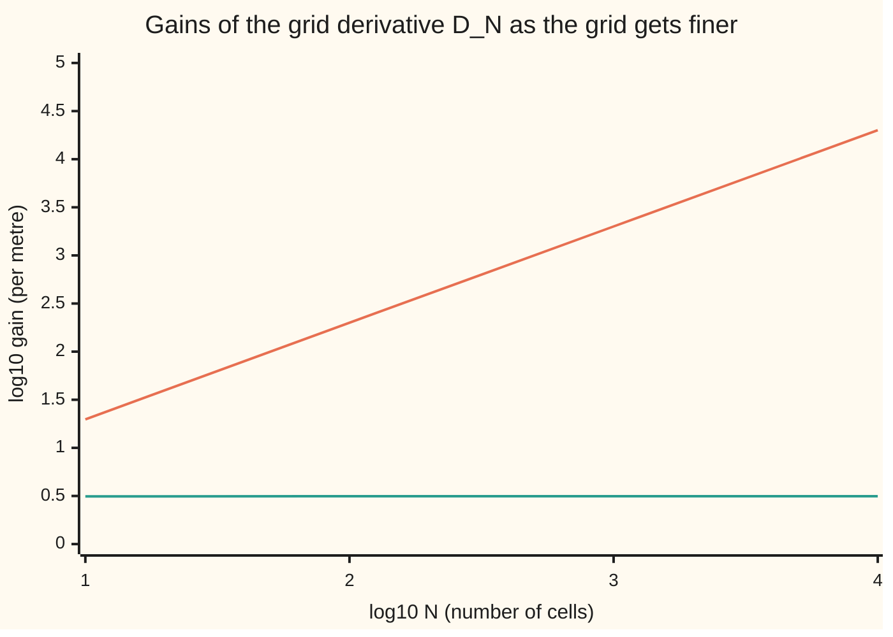

# Unbounded operators: differentiation only works where you let it

[Syllabus](../../../SYLLABUS.md) → [Functional analysis](../README.md) → [Unbounded Operators and Semigroups](../README.md#s05) → Unbounded operators

---

## General Overview

A steel bar 1 m long sits with both ends held at room temperature. Its middle is warmer. A row of thermometers reads the temperature rise along it: about $`u(x) = 10\sin(\pi x)`$ kelvin at distance $`x`$ metres from the left end (numbers illustrative). Heat flows downhill in temperature, so the number an engineer wants is the slope, the **temperature gradient** $`u'(x)`$ in K/m.

Now add a tiny sensor ripple: $`0.01\sin(1000\pi x)`$ K, a hundredth of a kelvin that wiggles every 2 mm. Measure size by the root-mean-square (RMS) over the bar. The ripple's size is 0.007071 K, a thousandth of the profile's 7.071068 K. Its gradient's size is 22.214415 K/m: exactly as large as the true gradient. A ripple too small to see in the temperature adds a second gradient as large as the real one.

So differentiation has no worst-case gain: no single number bounds the gradient's size divided by the signal's size. That ratio is 3.141593 per metre for the profile and 3141.592654 per metre for the ripple. The inputs are the square-integrable signals: profiles whose square has a finite integral along the bar. Some of them, such as a temperature that jumps at a joint, have no slope that is a signal at all. Differentiation works only on a chosen set of inputs, called its **domain**. This card picks that set, checks that it is the right size, and finds the operator's mirror image, its **adjoint**, on it.

**An unbounded operator is a rule together with a domain: differentiation on square-integrable signals needs a domain that is closed under limits of inputs and outputs, and the domain you choose, including its end conditions, decides the adjoint.**

**What kind of fact this is:** three definitions (domain, closed operator, adjoint), and two theorems proved on this card in Why it works: the derivative on its natural domain is closed, and its adjoint is minus the derivative with the end conditions moved across. The fact that a closed operator defined on every signal is bounded is the closed graph theorem, stated here and proved on [Three Banach theorems](../01-Normed%20and%20Banach%20Spaces/08-open-mapping-closed-graph-and-uniform-boundedness.md).

### The picture: a tiny ripple, a full-size slope

Sizes on the 1 m bar, as RMS values. The ripple's bar is too short to see; its gradient's bar matches the profile's.

```
profile u, size (K)               |##########                        7.071068
profile gradient u', size (K/m)   |###############################  22.214415
ripple, size (K)                  |                                  0.007071
ripple gradient, size (K/m)       |###############################  22.214415
```

---

## The formula

Notation first. The signals live in $`H = L^2(0,1)`$: real functions on the bar whose square has a finite integral ([Lp spaces](../../10-Measure%20and%20integration/07-Sizes%20of%20Functions/01-lp-spaces.md)). Two signals that agree almost everywhere count as one.

- The **inner product** is $`\langle f, g\rangle = \int_0^1 f(x)\,g(x)\,dx`$. Scalars are real on this card.
- The **size** is $`\lVert f\rVert = \langle f, f\rangle^{1/2}`$. On a bar 1 m long it equals the RMS value.
- An **operator** $`A`$ is a linear rule taking signals to signals.
- Its **domain** $`D(A)`$ is the set of signals the rule accepts. It must be a subspace (closed under adding and scaling), and here it is **dense**: every signal in $`H`$ is a limit, in the size $`\lVert\cdot\rVert`$, of signals in $`D(A)`$.
- $`A`$ is **bounded** if one constant $`C`$ gives $`\lVert Af\rVert \le C\lVert f\rVert`$ for every $`f`$ in the domain; otherwise **unbounded**.

The adjoint $`A^*`$ is defined by moving $`A`$ across the inner product. For bounded operators this mirror is taught on [Adjoints](../03-Bounded%20Operators/03-adjoints-self-adjoint-and-unitary-operators.md); what is new here is its domain.

```math
\langle Af, g\rangle = \langle f, A^*g\rangle \quad \text{for every } f \in D(A).
```

**Read it aloud:** the adjoint is the operator that gives the same pairing when it acts on the second signal instead of the first, for every input in the domain.

Its domain $`D(A^*)`$ is every $`g`$ for which the pairing $`f \mapsto \langle Af, g\rangle`$ has a finite worst-case gain, $`\lvert\langle Af, g\rangle\rvert \le C_g \lVert f\rVert`$. For the bar, with the ends held at zero, the card proves:

```math
A = \frac{d}{dx},\ D(A) = H^1_0(0,1) \quad\Longrightarrow\quad A^* = -\frac{d}{dx},\ D(A^*) = H^1(0,1).
```

Here $`H^1(0,1)`$ is the set of signals whose weak derivative is also square-integrable ([Weak derivatives](../04-Distributions%20and%20Sobolev%20Spaces/07-weak-derivatives-and-sobolev-spaces.md)). A **weak derivative** is the slope defined by integration by parts against smooth probes, so a kink has one and a jump does not. $`H^1_0(0,1)`$ is the part of $`H^1(0,1)`$ that is zero at both ends.

| Symbol | Plain meaning | In our example | Push it up and the answer… |
| --- | --- | --- | --- |
| $`H`$ | the space of signals, $`L^2(0,1)`$ | temperature rises along the 1 m bar | — |
| $`\langle f, g\rangle`$ | inner product: the integral of $`f`$ times $`g`$ | $`\langle f', g\rangle = -0.636620`$ for $`f = \sin(\pi x)`$, $`g = x^2`$ | — |
| $`\lVert f\rVert`$ | size of a signal, its RMS value on the bar | profile 7.071068 K, ripple 0.007071 K | scaling a signal by 10 scales its slope's size by 10 too |
| $`x`$; $`f, g, u`$ | position along the bar in metres; signals: an input, a test partner, the measured profile | $`u = 10\sin(\pi x)`$ K | — |
| $`n`$ | number of half-waves of a ripple | 1000 | the slope's size grows like $`n\pi`$ |
| $`A`$, $`C`$ | the operator: here differentiation, $`d/dx`$; $`C`$, a bound on its gain | turns kelvin into K/m; no finite $`C`$ exists | a larger $`C`$ still fails at a larger $`n`$ |
| $`D(A)`$ | domain: the signals $`A`$ accepts | $`H^1_0(0,1)`$, ends held at zero | a bigger domain gives a smaller adjoint domain |
| $`\bar A`$ | the closure of $`A`$: add every limit of inputs whose outputs also converge | closure of $`d/dx`$ on smooth signals is $`d/dx`$ on $`H^1`$ | — |
| $`A^*`$, $`D(A^*)`$ | the adjoint and its domain | $`-d/dx`$ on $`H^1(0,1)`$, no end conditions | grows when $`D(A)`$ shrinks |
| $`H^1, H^1_0, C^1, \varphi`$ | signals with a square-integrable weak slope; with subscript 0, also zero at both ends; $`C^1`$: a continuous classical slope; $`\varphi`$: a smooth probe that vanishes near both ends | the tent $`\tfrac12 - \lvert x - \tfrac12\rvert`$ is in $`H^1_0`$, not in $`C^1`$ | — |
| $`N, h, D_N`$ | number of grid cells; their width $`1/N`$ in metres; the forward-difference matrix on them | $`N = 10`$, largest gain 19.753767 | largest gain grows like $`2N`$ |
| $`\varepsilon, f_\varepsilon`$ | rounding width in metres; the smooth signal rounded over that width | $`\varepsilon = 0.001`$ m | $`f_\varepsilon`$ moves further from the tent |

### When it holds

- **The domain is dense.** If some signal stayed away from every domain signal, many choices of $`A^*g`$ would satisfy the pairing, and the adjoint would not be a single operator.
- **The domain carries the end conditions on purpose.** Hold the ends of $`f`$ at zero and $`A^*`$ needs none. Drop them and $`A^*`$ must carry them: with $`f = x`$ and $`g = x^2`$ the two sides become 0.333333 and −0.666667.
- **The operator is closed, or at least closable.** If not, a limit of inputs whose outputs converge can fall outside the domain, and proofs cannot pass to the limit. On smooth signals alone, $`d/dx`$ is not closed: smooth signals converge to the tent, a signal with a corner. The closure fixes this by adding the limit.

---

## Why it works

### Step 0: give up "every input", keep "closed under limits"

A bounded operator is continuous. Small input changes give small output changes, so it extends to every signal. Differentiation fails this: the ripple shows a tiny input with a full-size output.

The fix has two parts. First, accept only a subspace of inputs, the domain. Second, ask for the next best thing to continuity: if inputs converge and their outputs converge, the limit input is accepted and its output is the limit output. That property is **closedness**. It is what lets proofs pass to limits.

A third object follows. Once $`A`$ has a domain, the pairing $`\langle Af, g\rangle`$ defines its mirror image $`A^*`$. Its domain is fixed by $`A`$'s domain, not chosen freely.

### Step 1: differentiation has no worst-case gain

Take $`f_n(x) = \sin(n\pi x)`$. Its square averages to one half, so $`\lVert f_n\rVert = 1/\sqrt2 = 0.707107`$ for every $`n`$.

Its slope is $`n\pi\cos(n\pi x)`$, with size $`n\pi/\sqrt2`$. The ratio of output size to input size is $`n\pi`$: 3.141593 at $`n = 1`$, 3141.592654 at $`n = 1000`$. No single constant $`C`$ bounds every ratio, so $`d/dx`$ is unbounded.

The closed graph theorem says more. A closed operator defined on the whole of a Hilbert space is bounded ([Three Banach theorems](../01-Normed%20and%20Banach%20Spaces/08-open-mapping-closed-graph-and-uniform-boundedness.md)). So a closed derivative cannot be defined on every signal. The domain is forced on us.

### Step 2: the finite rehearsal, a matrix that is bounded only because it is small

Put $`N`$ equal cells on the bar, spacing $`h = 1/N`$. Hold $`f_0 = f_N = 0`$ at the ends, so the inputs are the $`N - 1`$ inside values. The forward difference $`D_N`$ outputs the $`N`$ cell slopes $`(f_{k+1} - f_k)/h`$.

Every matrix is bounded, closed and defined on every input. There is no domain question. The cost shows up in the gain. $`D_N^{T} D_N`$ is $`N^2`$ times the matrix with 2 on the diagonal and −1 beside it, whose eigenvalues are known. The largest gain, the largest singular value of $`D_N`$, is $`2N\cos(\pi/2N)`$:

| $`N`$ | largest gain | largest gain / $`N`$ | smallest gain |
| ---: | ---: | ---: | ---: |
| 10 | 19.753767 | 1.975377 | 3.128689 |
| 100 | 199.975326 | 1.999753 | 3.141463 |
| 1000 | 1999.997533 | 1.999998 | 3.141591 |
| 10000 | 19999.999753 | 2.000000 | 3.141593 |

The smallest gain settles on $`\pi`$, the true slope ratio of the gentlest profile $`\sin(\pi x)`$. The largest gain grows like $`2N`$ and never settles. That trend is the unboundedness, seen through a truncation. Every finite $`N`$ hides it.



The upper line is the largest gain of $`D_N`$, rising one decade per decade of $`N`$. The lower line is the smallest gain, flat at $`\log_{10}\pi = 0.497`$.

### Step 3: the derivative on H¹ is closed

The graph of $`A`$ is the set of pairs $`(f, Af)`$ with $`f`$ in the domain. $`A`$ is closed when its graph is closed: whenever $`f_k \to f`$ and $`Af_k \to g`$ in size, then $`f`$ is in $`D(A)`$ and $`Af = g`$.

For $`A = d/dx`$ on $`H^1(0,1)`$ the proof rests on one identity, the fundamental theorem of calculus in weak form:

```math
f_k(x) = c_k + \int_0^x f_k'(t)\,dt .
```

The integral part converges, because integrating over a 1 m bar cannot increase size. So the constants $`c_k`$ converge too. In the limit, $`f(x) = c + \int_0^x g`$, which says exactly that $`f`$ has weak derivative $`g`$. The fold has the details.

<details>
<summary>Detailed proof: d/dx on H¹(0,1) is closed</summary>

Let $`f_k \in H^1(0,1)`$ with $`\lVert f_k - f\rVert \to 0`$ and $`\lVert f_k' - g\rVert \to 0`$.

Write $`F_k(x) = \int_0^x f_k'`$ and $`G(x) = \int_0^x g`$. By the Cauchy-Schwarz inequality, for each $`x`$ in $`[0, 1]`$:

$`\displaystyle \lvert F_k(x) - G(x)\rvert \le \int_0^1 \lvert f_k' - g\rvert \le \lVert f_k' - g\rVert .`$

So $`F_k \to G`$ uniformly, hence in size. Then $`c_k = f_k - F_k`$ is a constant signal converging in size to $`f - G`$. A limit of constants is a constant $`c`$, so $`f = c + G`$ almost everywhere.

Now take any smooth probe $`\varphi`$ that vanishes near both ends. Integration by parts gives $`\int f\varphi' = -\int g\varphi`$. That is the definition of "$`g`$ is the weak derivative of $`f`$". Both $`f`$ and $`g`$ are in $`L^2`$, so $`f \in H^1(0,1)`$ and $`f' = g`$.

The same argument with $`f_k(0) = f_k(1) = 0`$ shows the end values pass to the limit, because $`f_k(x) \to f(x)`$ uniformly. So $`d/dx`$ on $`H^1_0(0,1)`$ is closed as well.

</details>

### Step 4: on smooth signals the derivative is not closed, and the closure repairs it

Start instead with $`A_0 = d/dx`$ on $`C^1[0,1]`$, the signals with a continuous classical slope. Round the tent $`f(x) = \tfrac12 - \lvert x - \tfrac12\rvert`$ over a width $`\varepsilon`$:

```math
f_\varepsilon(x) = \sqrt{\tfrac14 + \varepsilon^2} - \sqrt{(x - \tfrac12)^2 + \varepsilon^2}.
```

Each $`f_\varepsilon`$ is smooth and zero at both ends. In the bar, the tent is the steady temperature with a point heat source at the middle; $`f_\varepsilon`$ spreads that source over about $`\varepsilon`$ metres.

| $`\varepsilon`$ (m) | $`\lVert f_\varepsilon - f\rVert`$ | $`\lVert f_\varepsilon' - f'\rVert`$ |
| ---: | ---: | ---: |
| 0.1 | 0.02785744 | 0.292766 |
| 0.01 | 0.00110961 | 0.092650 |
| 0.001 | 0.00003631 | 0.029299 |

Inputs converge to the tent. Outputs converge to its slope, +1 on the left half and −1 on the right. The slope error falls like the square root of $`\varepsilon`$. But the tent has a corner at 0.5 m, so it is not in $`C^1`$. The graph of $`A_0`$ is missing a limit point: $`A_0`$ is not closed.

$`A_0`$ is **closable**: adding all such limits gives a graph of an operator, the closure $`\bar A_0`$. The closure sits inside $`d/dx`$ on $`H^1(0,1)`$, because that operator is closed (Step 3) and extends $`A_0`$. The closure is all of it: every $`f`$ in $`H^1(0,1)`$ is a limit of $`C^1`$ signals whose slopes converge too. Pick continuous $`g_k`$ with $`\lVert g_k - f'\rVert \to 0`$ (continuous signals are dense in $`L^2`$) and set $`f_k(x) = f(0) + \int_0^x g_k`$. Then $`f_k`$ is in $`C^1`$, $`f_k' = g_k \to f'`$, and $`f_k \to f`$ by the bound in Step 3's fold. A domain whose closure gives the full closed operator is called a **core**. So $`C^1[0,1]`$ is a core for $`d/dx`$ on $`H^1(0,1)`$. Code works on a core. Proofs work on the closure.

### Step 5: the adjoint, computed by integration by parts

Take $`A = d/dx`$ on $`D(A) = H^1_0(0,1)`$, ends held at zero. For $`g`$ in $`H^1(0,1)`$, integration by parts gives

```math
\langle f', g\rangle = f(1)g(1) - f(0)g(0) - \langle f, g'\rangle = \langle f, -g'\rangle .
```

The end term vanishes because $`f`$ is zero at both ends, whatever $`g`$ does there. So every $`g`$ in $`H^1(0,1)`$ is in $`D(A^*)`$, with $`A^*g = -g'`$.

Conversely, suppose $`g`$ is in $`D(A^*)`$ with $`A^*g = h`$. Then $`\langle \varphi', g\rangle = \langle \varphi, h\rangle`$ for every smooth probe $`\varphi`$ vanishing near the ends. That is the definition of "$`g`$ has weak derivative $`-h`$". So $`g \in H^1(0,1)`$ and $`A^* = -d/dx`$ on $`H^1(0,1)`$, with no end conditions.

The grid shows the same bookkeeping. The transpose of $`D_N`$ sends the $`N`$ cell values $`g_k`$ to $`(g_{j-1} - g_j)/h`$ at the inside nodes: minus a backward difference, with no condition on $`g`$. At $`N = 10`$, with $`f`$ sampled from $`\sin(\pi x)`$ and $`g`$ from $`x^2`$, both sides of the pairing equal −0.631375. The continuous value is $`-2/\pi = -0.636620`$.

### Step 6: move the end conditions and the adjoint moves them back

Drop the end conditions: $`A = d/dx`$ on all of $`H^1(0,1)`$. Now the end term $`f(1)g(1) - f(0)g(0)`$ survives unless $`g`$ kills it. Is the constant $`g = 1`$ in $`D(A^*)`$? Test with $`f_n = x^n`$:

- $`\langle f_n', 1\rangle = f_n(1) - f_n(0) = 1`$ for every $`n`$;
- $`\lVert f_n\rVert = 1/\sqrt{2n+1}`$, which shrinks to zero.

The ratio $`\sqrt{2n+1}`$ grows without bound: 44.732538 at $`n = 1000`$. So $`g = 1`$ fails the test.

The same test settles every $`g`$. A bigger operator has a smaller adjoint, so any $`g`$ in $`D(A^*)`$ is already in $`H^1(0,1)`$ with $`A^*g = -g'`$ (Step 5). Integration by parts then gives $`g(1) = \langle f_n', g\rangle - \langle f_n, -g'\rangle`$. Each pairing is at most a constant times $`\lVert f_n\rVert`$, which shrinks to zero, so $`g(1) = 0`$. The probes $`(1 - x)^n`$ give $`g(0) = 0`$ the same way. Conversely, every $`g`$ in $`H^1_0(0,1)`$ passes, because the end term vanishes. So

```math
A = \frac{d}{dx},\ D(A) = H^1(0,1) \quad\Longrightarrow\quad A^* = -\frac{d}{dx},\ D(A^*) = H^1_0(0,1).
```

Bigger domain for $`A`$, smaller domain for $`A^*`$. Neither choice makes $`A^*`$ equal to $`A`$, and the minus sign blocks it anyway. With complex scalars, the derivative times the imaginary unit can equal its own adjoint, on a domain in between such as $`f(0) = f(1)`$; Schmüdgen's book (Sources) works this case. Which domains achieve that in general is the subject of [Self-adjoint extensions](02-self-adjoint-extensions-and-the-spectral-theorem.md).

One more fact, used on every later card: an adjoint is always closed. Its graph is the set of pairs $`(g, A^*g)`$ orthogonal to every rotated pair $`(-Af, f)`$, and a set of vectors orthogonal to a fixed collection is closed.

---

## Worked numbers, by hand

The adjoint check on the bar, with $`f = \sin(\pi x)`$ (ends held at zero) and $`g = x^2`$ (no end conditions).

| Step | Arithmetic | Value |
| --- | --- | --- |
| ripple size | $`0.01/\sqrt2`$ | 0.007071 K |
| ripple gradient size | $`0.01 \times 1000\pi/\sqrt2`$ | 22.214415 K/m |
| profile gradient size | $`10\pi/\sqrt2`$ | 22.214415 K/m |
| end term | $`f(1)g(1) - f(0)g(0) = 0 \times 1 - 0 \times 0`$ | 0 |
| $`\langle f, g'\rangle`$ | $`\int_0^1 2x\sin(\pi x)\,dx = 2/\pi`$ | 0.636620 |
| $`\langle f, A^*g\rangle = \langle f, -g'\rangle`$ | $`-2/\pi`$ | −0.636620 |
| $`\langle Af, g\rangle = \langle f', g\rangle`$ | $`\int_0^1 \pi\cos(\pi x)\,x^2\,dx`$: antiderivative $`x^2\sin(\pi x) + \tfrac{2x}{\pi}\cos(\pi x) - \tfrac{2}{\pi^2}\sin(\pi x)`$, from 0 to 1 | −0.636620 |
| **pairing** | **both sides agree** | **−0.636620** |

The two sides agree because $`f`$'s zero end values remove the end term: $`A^* = -d/dx`$ needs nothing from $`g`$ at the ends.

### What breaks if you drop a piece

| Mistake | Comes out at | What went wrong |
| --- | --- | --- |
| Bound $`d/dx`$ by the $`N = 10`$ grid's largest gain, 19.753767 | ripple gradient at most 0.139680 K/m; really 22.214415 K/m | a finite grid's gain is a truncation; the true gain has no ceiling |
| Drop $`A`$'s end conditions, keep $`A^* = -d/dx`$ with none | $`f = x`$, $`g = x^2`$: $`\langle f', g\rangle = 0.333333`$, $`\langle f, -g'\rangle = -0.666667`$ | the end term $`f(1)g(1) = 1`$ survives; $`A^*`$ must now hold $`g`$ at zero |
| Forget the minus sign, $`A^* = +d/dx`$ | $`\langle f, g'\rangle = 0.636620`$ against the true −0.636620 | integration by parts moves the slope with a sign change |
| Keep the domain at $`C^1`$ | slopes $`f_\varepsilon'`$ within 0.029299 of a limit that jumps from +1 to −1 at $`x = 0.5`$ | the limit is outside $`C^1`$; the operator is not closed until the closure adds it |

---

## Code, from first principles, and it actually runs

The scripts compute every number above in seven parts. They take three independent roads. Closed forms meet Simpson's rule for every integral. A Sturm count (counting negative pivots to bracket each eigenvalue) finds the grid matrix's gains, checked against $`2N\cos(\pi/2N)`$. An explicit matrix transpose meets the summation-by-parts formula. What the truncation hides: every grid gain is finite, and only the trend over $`N`$ shows the unbounded operator.

### Python

```python
# Unbounded operators and domains -- the check behind the card.  Standard library only.
# Space: H = L2(0, 1), real signals on a 1 m bar, <f, g> = integral of f*g.
# Roads: closed forms against Simpson's rule, a Sturm-count eigenvalue search on
# the grid matrix, and an explicit matrix transpose against summation by parts.
import math

PI = math.pi

def simpson(f, a, b, m):
    h = (b - a) / m
    s = f(a) + f(b)
    for k in range(1, m):
        s += (4 if k % 2 else 2) * f(a + k * h)
    return s * h / 3

def l2(f, m=200000):
    return math.sqrt(simpson(lambda x: f(x) ** 2, 0.0, 1.0, m))

def close(a, b, tol):
    assert abs(a - b) <= tol * max(1.0, abs(b)), (a, b)

# 1. Differentiation is unbounded: sin(n pi x) keeps size 1/sqrt2, its slope grows like n pi.
print("unbounded, n, size of sin(n pi x), size of its derivative, ratio, n pi")
for n in (1, 10, 100, 1000):
    a = l2(lambda x: math.sin(n * PI * x))
    b = l2(lambda x: n * PI * math.cos(n * PI * x))
    close(a, 1 / math.sqrt(2), 1e-9)
    close(b / a, n * PI, 1e-9)
    print(f"unbounded, {n}, {a:.6f}, {b:.6f}, {b / a:.6f}, {n * PI:.6f}")
u, du = l2(lambda x: 10 * math.sin(PI * x)), l2(lambda x: 10 * PI * math.cos(PI * x))
r, dr = l2(lambda x: 0.01 * math.sin(1000 * PI * x)), l2(lambda x: 10 * PI * math.cos(1000 * PI * x))
close(dr, du, 1e-9)
print(f"bar, profile 10 sin(pi x): size {u:.6f} K, gradient size {du:.6f} K/m")
print(f"bar, ripple 0.01 sin(1000 pi x): size {r:.6f} K, gradient size {dr:.6f} K/m")

# 2. The finite rehearsal: forward differences on N cells, ends held at 0.
#    D_N^T D_N = N^2 tridiag(-1, 2, -1); its eigenvalues found by Sturm counts.
def count_below(n, x):
    c, d = 0, 2.0 - x
    for k in range(n):
        if k:
            d = 2.0 - x - 1.0 / (d if d != 0 else 1e-300)
        if d < 0:
            c += 1
    return c

def kth_eig(n, k):
    lo, hi = 0.0, 4.0
    for _ in range(64):
        mid = (lo + hi) / 2
        if count_below(n, mid) >= k:
            hi = mid
        else:
            lo = mid
    return (lo + hi) / 2

print("grid, N, largest gain, closed form, largest/N, smallest gain, closed form")
chart_top, chart_bot = [], []
for N in (10, 100, 1000, 10000):
    top, bot = N * math.sqrt(kth_eig(N - 1, N - 1)), N * math.sqrt(kth_eig(N - 1, 1))
    close(top, 2 * N * math.cos(PI / (2 * N)), 1e-10)
    close(bot, 2 * N * math.sin(PI / (2 * N)), 1e-8)
    chart_top.append(f"{math.log10(top):.3f}")
    chart_bot.append(f"{math.log10(bot):.3f}")
    print(f"grid, {N}, {top:.6f}, {2 * N * math.cos(PI / (2 * N)):.6f}, {top / N:.6f}, {bot:.6f}, {2 * N * math.sin(PI / (2 * N)):.6f}")
    if N == 10:
        gain10 = top
print("chart, log10 N, 1, 2, 3, 4")
print("chart, log10 largest gain, " + ", ".join(chart_top))
print("chart, log10 smallest gain, " + ", ".join(chart_bot))

# 3. The grid adjoint: transpose the matrix entry by entry, compare with minus a backward difference.
N, h = 10, 0.1
D = [[0.0] * (N - 1) for _ in range(N)]        # row k: (f[k+1] - f[k]) / h, f[0] = f[N] = 0
for k in range(N):
    if k >= 1:
        D[k][k - 1] = -1 / h
    if k <= N - 2:
        D[k][k] = 1 / h
f = [math.sin(PI * j * h) for j in range(1, N)]
g = [(k * h + h / 2) ** 2 for k in range(N)]
Df = [sum(D[k][j] * f[j] for j in range(N - 1)) for k in range(N)]
DTg = [sum(D[k][j] * g[k] for k in range(N)) for j in range(N - 1)]
for j in range(N - 1):
    close(DTg[j], -(g[j + 1] - g[j]) / h, 1e-12)
left, right = h * sum(a * b for a, b in zip(Df, g)), h * sum(a * b for a, b in zip(f, DTg))
close(left, right, 1e-12)
print(f"grid adjoint, N = 10, <D f, g> = {left:.6f}, <f, D^T g> = {right:.6f}")

# 4. The continuous adjoint, A = d/dx with f(0) = f(1) = 0:  <f', g> = <f, -g'> for any g.
lhs = simpson(lambda x: PI * math.cos(PI * x) * x * x, 0, 1, 2000)
rhs = simpson(lambda x: -math.sin(PI * x) * 2 * x, 0, 1, 2000)
close(lhs, -2 / PI, 1e-10)
close(rhs, -2 / PI, 1e-10)
print(f"adjoint, f = sin(pi x), g = x^2: <f', g> = {lhs:.6f}, <f, -g'> = {rhs:.6f}, -2/pi = {-2 / PI:.6f}")
b1, b2 = simpson(lambda x: x * x, 0, 1, 2000), simpson(lambda x: -x * 2 * x, 0, 1, 2000)
close(b1 - b2, 1.0, 1e-10)
print(f"boundary, f = x, g = x^2: <f', g> = {b1:.6f}, <f, -g'> = {b2:.6f}, gap = {b1 - b2:.6f}, f(1)g(1) - f(0)g(0) = 1")

# 5. Is g = 1 in the adjoint's domain when A has no end conditions?  Test f_n = x^n.
print("domain test, n, size of x^n, 1/sqrt(2n+1), <f_n', 1>, ratio")
for n in (1, 10, 100, 1000):
    s = l2(lambda x: x ** n)
    p = simpson(lambda x: n * x ** (n - 1), 0, 1, 200000)
    close(s, 1 / math.sqrt(2 * n + 1), 1e-9)
    close(p, 1.0, 1e-9)
    print(f"domain test, {n}, {s:.6f}, {1 / math.sqrt(2 * n + 1):.6f}, {p:.6f}, {p / s:.6f}")

# 6. Closedness: smooth f_eps converge to the tent f(x) = 1/2 - |x - 1/2|, slopes to -sign(x - 1/2).
def tent_closed(e):
    S, q = 1 / (2 * e), math.sqrt(0.25 + e * e)
    c = q - 0.5
    iw = 0.5 * q + e * e * math.log((0.5 + q) / e) - 0.25
    iw2 = 2 * e ** 3 * (2 * S ** 3 / 3 + S - (2 / 3) * (S * S + 1) ** 1.5 + 2 / 3)
    d2 = 2 * e * (2 * S - math.atan(S) - 2 * math.sqrt(1 + S * S) + 2)
    return math.sqrt(c * c - 2 * c * iw + iw2), math.sqrt(d2)

print("closed, eps (m), size of f_eps - f, closed form, size of f_eps' - f', closed form")
for e in (0.1, 0.01, 0.001):
    a, b = tent_closed(e)
    q = math.sqrt(0.25 + e * e)
    sa = math.sqrt(2 * simpson(lambda x: (q - math.sqrt((x - .5) ** 2 + e * e) - x) ** 2, 0, .5, 20000))
    sb = math.sqrt(2 * simpson(lambda x: ((.5 - x) / math.sqrt((x - .5) ** 2 + e * e) - 1) ** 2, 0, .5, 20000))
    close(sa, a, 1e-6 * a)
    close(sb, b, 1e-6 * b)
    print(f"closed, {e}, {sa:.8f}, {a:.8f}, {sb:.6f}, {b:.6f}")
    if e == 0.001:
        slope_err = b

# 7. What breaks.
print(f"breaks, bound from the N = 10 grid: ripple gradient at most {gain10 * r:.6f} K/m, really {dr:.6f} K/m")
print(f"breaks, drop the end conditions of A only: <f', g> = {b1:.6f} but <f, -g'> = {b2:.6f}")
print(f"breaks, forget the minus sign: <f, +g'> = {-rhs:.6f}, true value {lhs:.6f}")
print(f"breaks, stay in C1: slopes f_eps' within {slope_err:.6f} of a limit that jumps from +1 to -1 at x = 0.5")
assert gain10 * r < dr / 100
print("ALL CHECKS PASS")
```

**Ran 2026-11-15 on macOS, Python 3.14.10, standard library only. All checks passed. Output, pasted from the run:**

```
unbounded, n, size of sin(n pi x), size of its derivative, ratio, n pi
unbounded, 1, 0.707107, 2.221441, 3.141593, 3.141593
unbounded, 10, 0.707107, 22.214415, 31.415927, 31.415927
unbounded, 100, 0.707107, 222.144147, 314.159265, 314.159265
unbounded, 1000, 0.707107, 2221.441469, 3141.592654, 3141.592654
bar, profile 10 sin(pi x): size 7.071068 K, gradient size 22.214415 K/m
bar, ripple 0.01 sin(1000 pi x): size 0.007071 K, gradient size 22.214415 K/m
grid, N, largest gain, closed form, largest/N, smallest gain, closed form
grid, 10, 19.753767, 19.753767, 1.975377, 3.128689, 3.128689
grid, 100, 199.975326, 199.975326, 1.999753, 3.141463, 3.141463
grid, 1000, 1999.997533, 1999.997533, 1.999998, 3.141591, 3.141591
grid, 10000, 19999.999753, 19999.999753, 2.000000, 3.141593, 3.141593
chart, log10 N, 1, 2, 3, 4
chart, log10 largest gain, 1.296, 2.301, 3.301, 4.301
chart, log10 smallest gain, 0.495, 0.497, 0.497, 0.497
grid adjoint, N = 10, <D f, g> = -0.631375, <f, D^T g> = -0.631375
adjoint, f = sin(pi x), g = x^2: <f', g> = -0.636620, <f, -g'> = -0.636620, -2/pi = -0.636620
boundary, f = x, g = x^2: <f', g> = 0.333333, <f, -g'> = -0.666667, gap = 1.000000, f(1)g(1) - f(0)g(0) = 1
domain test, n, size of x^n, 1/sqrt(2n+1), <f_n', 1>, ratio
domain test, 1, 0.577350, 0.577350, 1.000000, 1.732051
domain test, 10, 0.218218, 0.218218, 1.000000, 4.582576
domain test, 100, 0.070535, 0.070535, 1.000000, 14.177447
domain test, 1000, 0.022355, 0.022355, 1.000000, 44.732538
closed, eps (m), size of f_eps - f, closed form, size of f_eps' - f', closed form
closed, 0.1, 0.02785744, 0.02785744, 0.292766, 0.292766
closed, 0.01, 0.00110961, 0.00110961, 0.092650, 0.092650
closed, 0.001, 0.00003631, 0.00003631, 0.029299, 0.029299
breaks, bound from the N = 10 grid: ripple gradient at most 0.139680 K/m, really 22.214415 K/m
breaks, drop the end conditions of A only: <f', g> = 0.333333 but <f, -g'> = -0.666667
breaks, forget the minus sign: <f, +g'> = 0.636620, true value -0.636620
breaks, stay in C1: slopes f_eps' within 0.029299 of a limit that jumps from +1 to -1 at x = 0.5
ALL CHECKS PASS
```

### Rust

```rust
// Unbounded operators and domains -- the same check as the Python, in Rust.  No crates.
// Space: H = L2(0, 1), real signals on a 1 m bar, <f, g> = integral of f*g.
// Roads: closed forms against Simpson's rule, a Sturm-count eigenvalue search on
// the grid matrix, and an explicit matrix transpose against summation by parts.
use std::f64::consts::PI;

fn simpson(f: &dyn Fn(f64) -> f64, a: f64, b: f64, m: usize) -> f64 {
    let h = (b - a) / m as f64;
    let mut s = f(a) + f(b);
    for k in 1..m {
        s += (if k % 2 == 1 { 4.0 } else { 2.0 }) * f(a + k as f64 * h);
    }
    s * h / 3.0
}

fn l2(f: &dyn Fn(f64) -> f64) -> f64 {
    simpson(&|x| f(x).powi(2), 0.0, 1.0, 200000).sqrt()
}

fn close(a: f64, b: f64, tol: f64) {
    assert!((a - b).abs() <= tol * b.abs().max(1.0), "{} {}", a, b);
}

fn count_below(n: usize, x: f64) -> usize {
    let (mut c, mut d) = (0, 2.0 - x);
    for k in 0..n {
        if k > 0 {
            d = 2.0 - x - 1.0 / (if d != 0.0 { d } else { 1e-300 });
        }
        if d < 0.0 {
            c += 1;
        }
    }
    c
}

fn kth_eig(n: usize, k: usize) -> f64 {
    let (mut lo, mut hi) = (0.0f64, 4.0f64);
    for _ in 0..64 {
        let mid = (lo + hi) / 2.0;
        if count_below(n, mid) >= k { hi = mid } else { lo = mid }
    }
    (lo + hi) / 2.0
}

fn tent_closed(e: f64) -> (f64, f64) {
    let (s, q) = (1.0 / (2.0 * e), (0.25 + e * e).sqrt());
    let c = q - 0.5;
    let iw = 0.5 * q + e * e * ((0.5 + q) / e).ln() - 0.25;
    let iw2 = 2.0 * e.powf(3.0) * (2.0 * s.powf(3.0) / 3.0 + s - (2.0 / 3.0) * (s * s + 1.0).powf(1.5) + 2.0 / 3.0);
    let d2 = 2.0 * e * (2.0 * s - s.atan() - 2.0 * (1.0 + s * s).sqrt() + 2.0);
    ((c * c - 2.0 * c * iw + iw2).sqrt(), d2.sqrt())
}

fn main() {
    // 1. Differentiation is unbounded: sin(n pi x) keeps size 1/sqrt2, its slope grows like n pi.
    println!("unbounded, n, size of sin(n pi x), size of its derivative, ratio, n pi");
    for n in [1.0f64, 10.0, 100.0, 1000.0] {
        let a = l2(&|x| (n * PI * x).sin());
        let b = l2(&|x| n * PI * (n * PI * x).cos());
        close(a, 1.0 / 2f64.sqrt(), 1e-9);
        close(b / a, n * PI, 1e-9);
        println!("unbounded, {}, {:.6}, {:.6}, {:.6}, {:.6}", n, a, b, b / a, n * PI);
    }
    let (u, du) = (l2(&|x| 10.0 * (PI * x).sin()), l2(&|x| 10.0 * PI * (PI * x).cos()));
    let (r, dr) = (l2(&|x| 0.01 * (1000.0 * PI * x).sin()), l2(&|x| 10.0 * PI * (1000.0 * PI * x).cos()));
    close(dr, du, 1e-9);
    println!("bar, profile 10 sin(pi x): size {:.6} K, gradient size {:.6} K/m", u, du);
    println!("bar, ripple 0.01 sin(1000 pi x): size {:.6} K, gradient size {:.6} K/m", r, dr);

    // 2. The finite rehearsal: forward differences on N cells, ends held at 0.
    //    D_N^T D_N = N^2 tridiag(-1, 2, -1); its eigenvalues found by Sturm counts.
    println!("grid, N, largest gain, closed form, largest/N, smallest gain, closed form");
    let (mut chart_top, mut chart_bot, mut gain10) = (vec![], vec![], 0.0);
    for nn in [10usize, 100, 1000, 10000] {
        let n = nn as f64;
        let top = n * kth_eig(nn - 1, nn - 1).sqrt();
        let bot = n * kth_eig(nn - 1, 1).sqrt();
        let (ct, cb) = (2.0 * n * (PI / (2.0 * n)).cos(), 2.0 * n * (PI / (2.0 * n)).sin());
        close(top, ct, 1e-10);
        close(bot, cb, 1e-8);
        chart_top.push(format!("{:.3}", top.log10()));
        chart_bot.push(format!("{:.3}", bot.log10()));
        println!("grid, {}, {:.6}, {:.6}, {:.6}, {:.6}, {:.6}", nn, top, ct, top / n, bot, cb);
        if nn == 10 {
            gain10 = top;
        }
    }
    println!("chart, log10 N, 1, 2, 3, 4");
    println!("chart, log10 largest gain, {}", chart_top.join(", "));
    println!("chart, log10 smallest gain, {}", chart_bot.join(", "));

    // 3. The grid adjoint: transpose the matrix entry by entry, compare with minus a backward difference.
    let (nn, h) = (10usize, 0.1f64);
    let mut d = vec![vec![0.0f64; nn - 1]; nn]; // row k: (f[k+1] - f[k]) / h, f[0] = f[N] = 0
    for k in 0..nn {
        if k >= 1 {
            d[k][k - 1] = -1.0 / h;
        }
        if k + 2 <= nn {
            d[k][k] = 1.0 / h;
        }
    }
    let f: Vec<f64> = (1..nn).map(|j| (PI * j as f64 * h).sin()).collect();
    let g: Vec<f64> = (0..nn).map(|k| (k as f64 * h + h / 2.0).powi(2)).collect();
    let df: Vec<f64> = (0..nn).map(|k| (0..nn - 1).map(|j| d[k][j] * f[j]).sum()).collect();
    let dtg: Vec<f64> = (0..nn - 1).map(|j| (0..nn).map(|k| d[k][j] * g[k]).sum()).collect();
    for j in 0..nn - 1 {
        close(dtg[j], -(g[j + 1] - g[j]) / h, 1e-12);
    }
    let left = h * df.iter().zip(&g).map(|(a, b)| a * b).sum::<f64>();
    let right = h * f.iter().zip(&dtg).map(|(a, b)| a * b).sum::<f64>();
    close(left, right, 1e-12);
    println!("grid adjoint, N = 10, <D f, g> = {:.6}, <f, D^T g> = {:.6}", left, right);

    // 4. The continuous adjoint, A = d/dx with f(0) = f(1) = 0:  <f', g> = <f, -g'> for any g.
    let lhs = simpson(&|x| PI * (PI * x).cos() * x * x, 0.0, 1.0, 2000);
    let rhs = simpson(&|x| -(PI * x).sin() * 2.0 * x, 0.0, 1.0, 2000);
    close(lhs, -2.0 / PI, 1e-10);
    close(rhs, -2.0 / PI, 1e-10);
    println!("adjoint, f = sin(pi x), g = x^2: <f', g> = {:.6}, <f, -g'> = {:.6}, -2/pi = {:.6}", lhs, rhs, -2.0 / PI);
    let (b1, b2) = (simpson(&|x| x * x, 0.0, 1.0, 2000), simpson(&|x| -x * 2.0 * x, 0.0, 1.0, 2000));
    close(b1 - b2, 1.0, 1e-10);
    println!("boundary, f = x, g = x^2: <f', g> = {:.6}, <f, -g'> = {:.6}, gap = {:.6}, f(1)g(1) - f(0)g(0) = 1", b1, b2, b1 - b2);

    // 5. Is g = 1 in the adjoint's domain when A has no end conditions?  Test f_n = x^n.
    println!("domain test, n, size of x^n, 1/sqrt(2n+1), <f_n', 1>, ratio");
    for n in [1.0f64, 10.0, 100.0, 1000.0] {
        let s = l2(&|x| x.powf(n));
        let p = simpson(&|x| n * x.powf(n - 1.0), 0.0, 1.0, 200000);
        let c = 1.0 / (2.0 * n + 1.0).sqrt();
        close(s, c, 1e-9);
        close(p, 1.0, 1e-9);
        println!("domain test, {}, {:.6}, {:.6}, {:.6}, {:.6}", n, s, c, p, p / s);
    }

    // 6. Closedness: smooth f_eps converge to the tent f(x) = 1/2 - |x - 1/2|, slopes to -sign(x - 1/2).
    println!("closed, eps (m), size of f_eps - f, closed form, size of f_eps' - f', closed form");
    let mut slope_err = 0.0;
    for e in [0.1f64, 0.01, 0.001] {
        let (a, b) = tent_closed(e);
        let q = (0.25 + e * e).sqrt();
        let sa = (2.0 * simpson(&|x| (q - ((x - 0.5f64).powi(2) + e * e).sqrt() - x).powi(2), 0.0, 0.5, 20000)).sqrt();
        let sb = (2.0 * simpson(&|x| ((0.5 - x) / ((x - 0.5f64).powi(2) + e * e).sqrt() - 1.0).powi(2), 0.0, 0.5, 20000)).sqrt();
        close(sa, a, 1e-6 * a);
        close(sb, b, 1e-6 * b);
        println!("closed, {}, {:.8}, {:.8}, {:.6}, {:.6}", e, sa, a, sb, b);
        if e == 0.001 {
            slope_err = b;
        }
    }

    // 7. What breaks.
    println!("breaks, bound from the N = 10 grid: ripple gradient at most {:.6} K/m, really {:.6} K/m", gain10 * r, dr);
    println!("breaks, drop the end conditions of A only: <f', g> = {:.6} but <f, -g'> = {:.6}", b1, b2);
    println!("breaks, forget the minus sign: <f, +g'> = {:.6}, true value {:.6}", -rhs, lhs);
    println!("breaks, stay in C1: slopes f_eps' within {:.6} of a limit that jumps from +1 to -1 at x = 0.5", slope_err);
    assert!(gain10 * r < dr / 100.0);
    println!("ALL CHECKS PASS");
}
```

**Ran 2026-11-15 on macOS, rustc 1.98.1, no crates. All checks passed. Output, pasted from the run:**

```
unbounded, n, size of sin(n pi x), size of its derivative, ratio, n pi
unbounded, 1, 0.707107, 2.221441, 3.141593, 3.141593
unbounded, 10, 0.707107, 22.214415, 31.415927, 31.415927
unbounded, 100, 0.707107, 222.144147, 314.159265, 314.159265
unbounded, 1000, 0.707107, 2221.441469, 3141.592654, 3141.592654
bar, profile 10 sin(pi x): size 7.071068 K, gradient size 22.214415 K/m
bar, ripple 0.01 sin(1000 pi x): size 0.007071 K, gradient size 22.214415 K/m
grid, N, largest gain, closed form, largest/N, smallest gain, closed form
grid, 10, 19.753767, 19.753767, 1.975377, 3.128689, 3.128689
grid, 100, 199.975326, 199.975326, 1.999753, 3.141463, 3.141463
grid, 1000, 1999.997533, 1999.997533, 1.999998, 3.141591, 3.141591
grid, 10000, 19999.999753, 19999.999753, 2.000000, 3.141593, 3.141593
chart, log10 N, 1, 2, 3, 4
chart, log10 largest gain, 1.296, 2.301, 3.301, 4.301
chart, log10 smallest gain, 0.495, 0.497, 0.497, 0.497
grid adjoint, N = 10, <D f, g> = -0.631375, <f, D^T g> = -0.631375
adjoint, f = sin(pi x), g = x^2: <f', g> = -0.636620, <f, -g'> = -0.636620, -2/pi = -0.636620
boundary, f = x, g = x^2: <f', g> = 0.333333, <f, -g'> = -0.666667, gap = 1.000000, f(1)g(1) - f(0)g(0) = 1
domain test, n, size of x^n, 1/sqrt(2n+1), <f_n', 1>, ratio
domain test, 1, 0.577350, 0.577350, 1.000000, 1.732051
domain test, 10, 0.218218, 0.218218, 1.000000, 4.582576
domain test, 100, 0.070535, 0.070535, 1.000000, 14.177447
domain test, 1000, 0.022355, 0.022355, 1.000000, 44.732538
closed, eps (m), size of f_eps - f, closed form, size of f_eps' - f', closed form
closed, 0.1, 0.02785744, 0.02785744, 0.292766, 0.292766
closed, 0.01, 0.00110961, 0.00110961, 0.092650, 0.092650
closed, 0.001, 0.00003631, 0.00003631, 0.029299, 0.029299
breaks, bound from the N = 10 grid: ripple gradient at most 0.139680 K/m, really 22.214415 K/m
breaks, drop the end conditions of A only: <f', g> = 0.333333 but <f, -g'> = -0.666667
breaks, forget the minus sign: <f, +g'> = 0.636620, true value -0.636620
breaks, stay in C1: slopes f_eps' within 0.029299 of a limit that jumps from +1 to -1 at x = 0.5
ALL CHECKS PASS
```

### Lean

Lean proves the domain and adjoint facts of Steps 3, 5 and 6 for every signal, and checks the end-term numbers.

- Take $`A = d/dx`$ with domain $`H^1_0(0,1)`$. Then its domain is dense, $`A`$ is closed, and $`A^* = -d/dx`$ on all of $`H^1(0,1)`$.
- Take $`A = d/dx`$ with domain $`H^1(0,1)`$. Then $`A`$ is closed.
- Take the same $`A`$ on $`H^1(0,1)`$. Then $`A^* = -d/dx`$ with domain $`H^1_0(0,1)`$, so $`g`$ must be zero at both ends.
- Take $`f = x`$ and $`g = x^2`$. Then $`\langle f', g\rangle = 1/3`$ and $`\langle f, -g'\rangle = -2/3`$. Their gap is the end term $`f(1)g(1) - f(0)g(0) = 1`$.

The unbounded gain, the grid matrix $`D_N`$, the rounded tents and the sine example are left to the Python and Rust checks.

```lean
-- Unbounded operators: the derivative on square-integrable signals on (0, 1), with the ends held at zero, is closed and densely defined, and its adjoint is minus the derivative with no end conditions.
import Mathlib.MeasureTheory.Function.L2Space
import Mathlib.Analysis.InnerProductSpace.LinearPMap
import Mathlib.Analysis.Calculus.ContDiff.Basic
import Mathlib.MeasureTheory.Integral.IntervalIntegral.FundThmCalculus
import Mathlib.Analysis.SpecialFunctions.Integrals.Basic
import Mathlib.MeasureTheory.Integral.IntervalIntegral.AbsolutelyContinuousFun
import Mathlib.MeasureTheory.Integral.IntervalIntegral.LebesgueDifferentiationThm
import Mathlib.Analysis.Distribution.AEEqOfIntegralContDiff
import Mathlib.Analysis.Calculus.BumpFunction.Normed
import Mathlib.Analysis.InnerProductSpace.Projection.Submodule

open MeasureTheory Set
open scoped LinearPMap

noncomputable section

/-- The signals on the bar: `H = L²(0, 1)`, real functions on `(0, 1)` whose square has a
finite integral, two functions equal almost everywhere counting as one. -/
abbrev Bar : Type := Lp ℝ 2 (volume.restrict (Ioo (0 : ℝ) 1))

/-- A smooth probe: a smooth function whose support is a compact subset of `(0, 1)`,
so it vanishes near both ends. -/
def IsProbe (φ : ℝ → ℝ) : Prop :=
  ContDiff ℝ (⊤ : ℕ∞) φ ∧ HasCompactSupport φ ∧ tsupport φ ⊆ Ioo 0 1

/-- `g` is the weak derivative of `f` on `(0, 1)`: integration by parts against every smooth
probe, `∫ f φ' = -∫ g φ`. A signal with such a `g` in `L²` lies in `H¹(0, 1)`. -/
def HasWeakDeriv (f g : Bar) : Prop :=
  ∀ φ : ℝ → ℝ, IsProbe φ →
    ∫ x in Ioo (0 : ℝ) 1, f x * deriv φ x = -∫ x in Ioo (0 : ℝ) 1, g x * φ x

/-- `f` is zero at both ends: it agrees almost everywhere on `(0, 1)` with a function that is
continuous on `[0, 1]` and equals zero at `0` and at `1`. -/
def ZeroAtEnds (f : Bar) : Prop :=
  ∃ F : ℝ → ℝ, ContinuousOn F (Icc 0 1) ∧ F 0 = 0 ∧ F 1 = 0 ∧
    (f : ℝ → ℝ) =ᵐ[volume.restrict (Ioo (0 : ℝ) 1)] F

lemma bar_integrableOn (f : Bar) : IntegrableOn (f : ℝ → ℝ) (Ioo 0 1) :=
  (Lp.memLp f).integrable one_le_two

lemma bar_intervalIntegrable (f : Bar) : IntervalIntegrable (f : ℝ → ℝ) volume 0 1 :=
  (intervalIntegrable_iff_integrableOn_Ioo_of_le zero_le_one).2 (bar_integrableOn f)

lemma inner_bar (f g : Bar) : inner ℝ f g = ∫ x in Ioo (0 : ℝ) 1, f x * g x := by
  rw [L2.inner_def]
  refine integral_congr_ae (Filter.Eventually.of_forall fun x => ?_)
  simp [mul_comm]

lemma inner_bar_ae (f v : Bar) (ψ : ℝ → ℝ) (hv : (v : ℝ → ℝ) =ᵐ[volume.restrict (Ioo (0 : ℝ) 1)] ψ) :
    inner ℝ f v = ∫ x in Ioo (0 : ℝ) 1, f x * ψ x := by
  rw [inner_bar]
  refine integral_congr_ae ?_
  filter_upwards [hv] with x hx
  rw [hx]

lemma exists_toBar (ψ : ℝ → ℝ) (hψ : Continuous ψ) :
    ∃ v : Bar, (v : ℝ → ℝ) =ᵐ[volume.restrict (Ioo (0 : ℝ) 1)] ψ := by
  obtain ⟨C, hC⟩ := (isCompact_Icc (a := (0:ℝ)) (b := 1)).exists_bound_of_continuousOn
    hψ.continuousOn
  have hm : MemLp ψ 2 (volume.restrict (Ioo (0 : ℝ) 1)) := by
    refine MemLp.of_bound hψ.aestronglyMeasurable C ?_
    rw [ae_restrict_iff' measurableSet_Ioo]
    exact Filter.Eventually.of_forall fun x hx => hC x (Ioo_subset_Icc_self hx)
  exact ⟨hm.toLp ψ, hm.coeFn_toLp⟩

lemma interval_eq_Ioo (f : ℝ → ℝ) :
    ∫ x in (0:ℝ)..1, f x = ∫ x in Ioo (0:ℝ) 1, f x := by
  rw [intervalIntegral.integral_of_le zero_le_one, integral_Ioc_eq_integral_Ioo]

lemma ac_ibp {k V : ℝ → ℝ} (hk : IntervalIntegrable k volume 0 1) (c : ℝ)
    (hV : AbsolutelyContinuousOnInterval V 0 1) :
    ∫ x in Ioo (0:ℝ) 1, (c + ∫ t in (0:ℝ)..x, k t) * deriv V x =
      (c + ∫ t in (0:ℝ)..1, k t) * V 1 - c * V 0 - ∫ x in Ioo (0:ℝ) 1, k x * V x := by
  have hP := hk.absolutelyContinuousOnInterval_intervalIntegral (c := 0) (by simp)
  have hF : AbsolutelyContinuousOnInterval (fun x => c + ∫ t in (0:ℝ)..x, k t) 0 1 := by
    have h1 : AbsolutelyContinuousOnInterval (fun _ : ℝ => c) 0 1 :=
      (LipschitzWith.const c).lipschitzOnWith.absolutelyContinuousOnInterval
    exact h1.add hP
  have h := hF.integral_mul_deriv_eq_deriv_mul hV
  have hd : ∫ x in (0:ℝ)..1, deriv (fun x => c + ∫ t in (0:ℝ)..x, k t) x * V x =
      ∫ x in (0:ℝ)..1, k x * V x := by
    refine intervalIntegral.integral_congr_ae ?_
    filter_upwards [hk.ae_hasDerivAt_integral] with x hx hxI
    have hx' := hx (uIoc_subset_uIcc hxI) 0 (by simp)
    rw [(hx'.const_add c).deriv]
  rw [hd] at h
  simp only [intervalIntegral.integral_same, add_zero] at h
  rw [← interval_eq_Ioo (fun x => (c + ∫ t in (0:ℝ)..x, k t) * deriv V x),
    ← interval_eq_Ioo (fun x => k x * V x)]
  exact h

lemma probe_eq_zero {φ : ℝ → ℝ} (hφ : IsProbe φ) {x : ℝ} (hx : x ∉ Ioo (0:ℝ) 1) : φ x = 0 :=
  image_eq_zero_of_notMem_tsupport fun h => hx (hφ.2.2 h)

lemma probe_zero {φ : ℝ → ℝ} (hφ : IsProbe φ) : φ 0 = 0 := probe_eq_zero hφ (by simp)

lemma probe_one {φ : ℝ → ℝ} (hφ : IsProbe φ) : φ 1 = 0 := probe_eq_zero hφ (by simp)

lemma probe_contDiff_one {φ : ℝ → ℝ} (hφ : IsProbe φ) : ContDiff ℝ 1 φ :=
  hφ.1.of_le (by exact_mod_cast le_top)

lemma probe_ac {φ : ℝ → ℝ} (hφ : IsProbe φ) : AbsolutelyContinuousOnInterval φ 0 1 :=
  (probe_contDiff_one hφ).contDiffOn.absolutelyContinuousOnInterval

lemma intOn_mul_cont {w φ : ℝ → ℝ} (hw : IntegrableOn w (Ioo (0:ℝ) 1)) (hφ : Continuous φ) :
    IntegrableOn (fun x => w x * φ x) (Ioo (0:ℝ) 1) :=
  hw.mul_continuousOn_of_subset hφ.continuousOn measurableSet_Ioo isCompact_Icc Ioo_subset_Icc_self

lemma fundamental {w : ℝ → ℝ} (hw : IntegrableOn w (Ioo (0:ℝ) 1))
    (h : ∀ φ, IsProbe φ → ∫ x in Ioo (0:ℝ) 1, w x * φ x = 0) :
    ∀ᵐ x ∂(volume.restrict (Ioo (0:ℝ) 1)), w x = 0 := by
  have := isOpen_Ioo.ae_eq_zero_of_integral_contDiff_smul_eq_zero (μ := volume)
    hw.locallyIntegrableOn ?_
  · rw [ae_restrict_iff' measurableSet_Ioo]; exact this
  intro g hg hgc hgs
  have h' := h g ⟨hg, hgc, hgs⟩
  rw [← setIntegral_eq_integral_of_forall_compl_eq_zero (s := Ioo (0:ℝ) 1)]
  · simpa [mul_comm] using h'
  · intro x hx; simp [image_eq_zero_of_notMem_tsupport (fun h => hx (hgs h))]

lemma smooth_ibp {u φ : ℝ → ℝ} (hu : ContDiff ℝ 1 u) (hφ : IsProbe φ) :
    ∫ x in Ioo (0:ℝ) 1, u x * deriv φ x = -∫ x in Ioo (0:ℝ) 1, deriv u x * φ x := by
  have hua : AbsolutelyContinuousOnInterval u 0 1 := hu.contDiffOn.absolutelyContinuousOnInterval
  have h := hua.integral_mul_deriv_eq_deriv_mul (probe_ac hφ)
  rw [interval_eq_Ioo, interval_eq_Ioo, probe_zero hφ, probe_one hφ] at h
  simpa using h

lemma hasWeakDeriv_smooth {u : ℝ → ℝ} (hu : ContDiff ℝ 1 u) (f g : Bar)
    (hf : (f : ℝ → ℝ) =ᵐ[volume.restrict (Ioo (0 : ℝ) 1)] u)
    (hg : (g : ℝ → ℝ) =ᵐ[volume.restrict (Ioo (0 : ℝ) 1)] deriv u) : HasWeakDeriv f g := by
  intro φ hφ
  have e1 : ∫ x in Ioo (0:ℝ) 1, f x * deriv φ x = ∫ x in Ioo (0:ℝ) 1, u x * deriv φ x :=
    integral_congr_ae (by filter_upwards [hf] with x hx; rw [hx])
  have e2 : ∫ x in Ioo (0:ℝ) 1, g x * φ x = ∫ x in Ioo (0:ℝ) 1, deriv u x * φ x :=
    integral_congr_ae (by filter_upwards [hg] with x hx; rw [hx])
  rw [e1, e2]
  exact smooth_ibp hu hφ

lemma exists_bump : ∃ ψ : ℝ → ℝ, IsProbe ψ ∧ ∫ x in Ioo (0:ℝ) 1, ψ x = 1 := by
  let b : ContDiffBump (1/2 : ℝ) := ⟨1/8, 1/4, by norm_num, by norm_num⟩
  have hsub : tsupport (b.normed volume) ⊆ Ioo 0 1 := by
    rw [b.tsupport_normed_eq]
    intro x hx
    rw [Metric.mem_closedBall, Real.dist_eq, abs_le] at hx
    have : b.rOut = 1/4 := rfl
    rw [this] at hx
    constructor <;> linarith [hx.1, hx.2]
  refine ⟨b.normed volume, ⟨b.contDiff_normed, b.hasCompactSupport_normed, hsub⟩, ?_⟩
  rw [setIntegral_eq_integral_of_forall_compl_eq_zero]
  · exact b.integral_normed
  · intro x hx; exact image_eq_zero_of_notMem_tsupport fun h => hx (hsub h)

lemma probe_sub_smul {ψ ψ₀ : ℝ → ℝ} (hψ : IsProbe ψ) (hψ₀ : IsProbe ψ₀) (a : ℝ) :
    IsProbe (fun x => ψ x - a * ψ₀ x) := by
  refine ⟨hψ.1.sub (contDiff_const.mul hψ₀.1), hψ.2.1.sub (hψ₀.2.1.mul_left), ?_⟩
  have hs : tsupport (fun x => ψ x - a * ψ₀ x) ⊆ tsupport ψ ∪ tsupport ψ₀ := by
    refine closure_minimal ?_ ((isClosed_tsupport _).union (isClosed_tsupport _))
    intro x hx
    by_contra hn
    simp only [mem_union, not_or] at hn
    apply hx
    simp [image_eq_zero_of_notMem_tsupport hn.1, image_eq_zero_of_notMem_tsupport hn.2]
  exact hs.trans (union_subset hψ.2.2 hψ₀.2.2)

lemma compact_in_Ioo {K : Set ℝ} (hK : IsCompact K) (hKs : K ⊆ Ioo 0 1) :
    ∃ a b : ℝ, 0 < a ∧ b < 1 ∧ K ⊆ Icc a b := by
  rcases K.eq_empty_or_nonempty with rfl | hne
  · exact ⟨1/2, 1/2, by norm_num, by norm_num, empty_subset _⟩
  obtain ⟨m, hm, hmin⟩ := hK.exists_isLeast hne
  obtain ⟨M, hM, hmax⟩ := hK.exists_isGreatest hne
  exact ⟨m, M, (hKs hm).1, (hKs hM).2, fun x hx => ⟨hmin hx, hmax hx⟩⟩

lemma probe_prim {χ : ℝ → ℝ} (hχ : IsProbe χ) (h0 : ∫ x in (0:ℝ)..1, χ x = 0) :
    IsProbe (fun x => ∫ t in (0:ℝ)..x, χ t) ∧ deriv (fun x => ∫ t in (0:ℝ)..x, χ t) = χ := by
  have hc : Continuous χ := hχ.1.continuous
  have hder : ∀ x, HasDerivAt (fun x => ∫ t in (0:ℝ)..x, χ t) (χ x) x :=
    fun x => (hc.integral_hasStrictDerivAt 0 x).hasDerivAt
  have hd : deriv (fun x => ∫ t in (0:ℝ)..x, χ t) = χ := funext fun x => (hder x).deriv
  refine ⟨⟨?_, ?_⟩, hd⟩
  · rw [contDiff_infty_iff_deriv, hd]
    exact ⟨fun x => (hder x).differentiableAt, hχ.1⟩
  obtain ⟨a, b, ha, hb, hK⟩ := compact_in_Ioo hχ.2.1 hχ.2.2
  have hz : ∀ x, x ∉ Icc a b → χ x = 0 := fun x hx =>
    image_eq_zero_of_notMem_tsupport fun h => hx (hK h)
  have hzero : ∀ x, x ∉ Icc a b → ∫ t in (0:ℝ)..x, χ t = 0 := by
    intro x hx
    rw [mem_Icc, not_and_or, not_le, not_le] at hx
    rcases hx with hx | hx
    · have : EqOn χ (fun _ => 0) (uIcc 0 x) := by
        intro t ht
        apply hz
        rw [mem_Icc, not_and_or, not_le]
        left
        rcases le_total 0 x with h | h
        · rw [uIcc_of_le h] at ht; linarith [ht.2]
        · rw [uIcc_of_ge h] at ht; linarith [ht.2]
      rw [intervalIntegral.integral_congr this]; simp
    · have hii : ∀ p q : ℝ, IntervalIntegrable χ volume p q := fun p q =>
        hc.intervalIntegrable p q
      rw [← intervalIntegral.integral_add_adjacent_intervals (hii 0 1) (hii 1 x), h0, zero_add]
      have : EqOn χ (fun _ => 0) (uIcc 1 x) := by
        intro t ht
        apply hz
        rw [mem_Icc, not_and_or, not_le]
        right
        rcases le_total 1 x with h | h
        · rw [uIcc_of_le h] at ht; linarith [ht.1]
        · rw [uIcc_of_ge h] at ht; linarith [ht.1]
      rw [intervalIntegral.integral_congr this]; simp
  have hsupp : tsupport (fun x => ∫ t in (0:ℝ)..x, χ t) ⊆ Icc a b := by
    refine closure_minimal ?_ isClosed_Icc
    intro x hx
    by_contra hn
    exact hx (hzero x hn)
  refine ⟨HasCompactSupport.intro isCompact_Icc hzero, ?_⟩
  exact hsupp.trans (Icc_subset_Ioo ha hb)

lemma prim_continuousOn (g : Bar) :
    ContinuousOn (fun x => ∫ t in (0:ℝ)..x, g t) (Icc 0 1) := by
  have := intervalIntegral.continuousOn_primitive_interval (μ := volume) (a := (0:ℝ)) (b := 1)
    (f := (g : ℝ → ℝ)) (by
      rw [uIcc_of_le zero_le_one, integrableOn_Icc_iff_integrableOn_Ioo]
      exact bar_integrableOn g)
  rwa [uIcc_of_le zero_le_one] at this

lemma rep {f g : Bar} (h : HasWeakDeriv f g) :
    ∃ c : ℝ, (f : ℝ → ℝ) =ᵐ[volume.restrict (Ioo (0 : ℝ) 1)]
      fun x => c + ∫ t in (0:ℝ)..x, g t := by
  set G : ℝ → ℝ := fun x => ∫ t in (0:ℝ)..x, g t with hGdef
  have hgi := bar_intervalIntegrable g
  have hGi : IntegrableOn G (Ioo (0:ℝ) 1) :=
    ((prim_continuousOn g).integrableOn_Icc).mono_set Ioo_subset_Icc_self
  have hwi : IntegrableOn (fun x => f x - G x) (Ioo (0:ℝ) 1) := (bar_integrableOn f).sub hGi
  have key : ∀ φ, IsProbe φ → ∫ x in Ioo (0:ℝ) 1, (f x - G x) * deriv φ x = 0 := by
    intro φ hφ
    have h1 := h φ hφ
    have h2 := ac_ibp hgi 0 (probe_ac hφ)
    rw [probe_zero hφ, probe_one hφ] at h2
    simp only [zero_add, mul_zero, sub_zero, zero_sub] at h2
    have hdc : Continuous (deriv φ) := hφ.1.continuous_deriv (by exact_mod_cast le_top)
    simp_rw [sub_mul]
    rw [integral_sub (intOn_mul_cont (bar_integrableOn f) hdc) (intOn_mul_cont hGi hdc), h1]
    rw [hGdef] at *
    rw [h2]; ring
  obtain ⟨ψ₀, hψ₀, hint⟩ := exists_bump
  set c := ∫ x in Ioo (0:ℝ) 1, (f x - G x) * ψ₀ x with hc
  refine ⟨c, ?_⟩
  have hz := fundamental (w := fun x => f x - G x - c) (hwi.sub (integrableOn_const (by simp)))
    (by
      intro ψ hψ
      set I := ∫ x in Ioo (0:ℝ) 1, ψ x with hI
      have hχ := probe_sub_smul hψ hψ₀ I
      have hψc : Continuous ψ := hψ.1.continuous
      have hψ₀c : Continuous ψ₀ := hψ₀.1.continuous
      have hψi : IntegrableOn ψ (Ioo (0:ℝ) 1) :=
        (hψc.continuousOn.integrableOn_Icc).mono_set Ioo_subset_Icc_self
      have hψ₀i : IntegrableOn ψ₀ (Ioo (0:ℝ) 1) :=
        (hψ₀c.continuousOn.integrableOn_Icc).mono_set Ioo_subset_Icc_self
      have hχ0 : ∫ x in (0:ℝ)..1, (ψ x - I * ψ₀ x) = 0 := by
        rw [interval_eq_Ioo, integral_sub hψi (hψ₀i.const_mul I), integral_const_mul, hint]
        ring
      obtain ⟨hΦ, hdΦ⟩ := probe_prim hχ hχ0
      have hk := key _ hΦ
      rw [hdΦ] at hk
      simp only [mul_sub] at hk
      rw [integral_sub (intOn_mul_cont hwi hψc) (intOn_mul_cont hwi (by fun_prop : Continuous (fun x => I * ψ₀ x)))]
        at hk
      have e : ∫ x in Ioo (0:ℝ) 1, (f x - G x) * (I * ψ₀ x) = I * c := by
        rw [hc, ← integral_const_mul]; congr 1; funext x; ring
      rw [e] at hk
      have e3 : ∫ x in Ioo (0:ℝ) 1, (f x - G x - c) * ψ x =
          (∫ x in Ioo (0:ℝ) 1, (f x - G x) * ψ x) - c * I := by
        rw [hI, ← integral_const_mul, ← integral_sub (intOn_mul_cont hwi hψc) (hψi.const_mul c)]
        congr 1; funext x; ring
      refine e3.trans ?_
      linarith)
  filter_upwards [hz] with x hx
  linarith

lemma weak_iff_inner (f g : Bar) : HasWeakDeriv f g ↔
    ∀ φ : ℝ → ℝ, IsProbe φ → ∀ v w : Bar,
      (v : ℝ → ℝ) =ᵐ[volume.restrict (Ioo (0 : ℝ) 1)] deriv φ →
      (w : ℝ → ℝ) =ᵐ[volume.restrict (Ioo (0 : ℝ) 1)] φ →
      inner ℝ f v = -inner ℝ g w := by
  constructor
  · intro h φ hφ v w hv hw
    rw [inner_bar_ae f v _ hv, inner_bar_ae g w _ hw]
    exact h φ hφ
  · intro h φ hφ
    obtain ⟨v, hv⟩ := exists_toBar (deriv φ) (hφ.1.continuous_deriv (by exact_mod_cast le_top))
    obtain ⟨w, hw⟩ := exists_toBar φ hφ.1.continuous
    have := h φ hφ v w hv hw
    rwa [inner_bar_ae f v _ hv, inner_bar_ae g w _ hw] at this

lemma weak_add {f g f' g' : Bar} (h : HasWeakDeriv f g) (h' : HasWeakDeriv f' g') :
    HasWeakDeriv (f + f') (g + g') := by
  rw [weak_iff_inner] at *
  intro φ hφ v w hv hw
  rw [inner_add_left, inner_add_left, h φ hφ v w hv hw, h' φ hφ v w hv hw]
  ring

lemma weak_smul {f g : Bar} (a : ℝ) (h : HasWeakDeriv f g) : HasWeakDeriv (a • f) (a • g) := by
  rw [weak_iff_inner] at *
  intro φ hφ v w hv hw
  rw [real_inner_smul_left, real_inner_smul_left, h φ hφ v w hv hw]
  ring

lemma weak_zero : HasWeakDeriv 0 0 := by
  rw [weak_iff_inner]
  intro φ hφ v w hv hw
  simp

lemma weak_zero_left {g : Bar} (h : HasWeakDeriv 0 g) : g = 0 := by
  rw [Lp.eq_zero_iff_ae_eq_zero]
  refine fundamental (bar_integrableOn g) fun φ hφ => ?_
  have h1 := h φ hφ
  have e : ∫ x in Ioo (0:ℝ) 1, (0 : Bar) x * deriv φ x = 0 := by
    rw [integral_congr_ae (g := fun _ => (0:ℝ))]
    · simp
    · filter_upwards [Lp.coeFn_zero ℝ 2 (volume.restrict (Ioo (0 : ℝ) 1))] with x hx
      rw [hx]; simp
  linarith

lemma zae_add {f f' : Bar} (h : ZeroAtEnds f) (h' : ZeroAtEnds f') : ZeroAtEnds (f + f') := by
  obtain ⟨F, hc, h0, h1, hF⟩ := h
  obtain ⟨F', hc', h0', h1', hF'⟩ := h'
  refine ⟨fun x => F x + F' x, hc.add hc', by simp [h0, h0'], by simp [h1, h1'], ?_⟩
  filter_upwards [Lp.coeFn_add f f', hF, hF'] with x hx h2 h3
  rw [hx, Pi.add_apply, h2, h3]

lemma zae_smul {f : Bar} (a : ℝ) (h : ZeroAtEnds f) : ZeroAtEnds (a • f) := by
  obtain ⟨F, hc, h0, h1, hF⟩ := h
  refine ⟨fun x => a * F x, continuousOn_const.mul hc, by simp [h0], by simp [h1], ?_⟩
  filter_upwards [Lp.coeFn_smul a f, hF] with x hx h2
  rw [hx, Pi.smul_apply, h2, smul_eq_mul]

lemma zae_zero : ZeroAtEnds 0 := by
  refine ⟨fun _ => 0, continuousOn_const, rfl, rfl, ?_⟩
  filter_upwards [Lp.coeFn_zero ℝ 2 (volume.restrict (Ioo (0 : ℝ) 1))] with x hx
  rw [hx]; rfl

lemma exists_weak_submodule : ∃ S : Submodule ℝ (Bar × Bar),
    ∀ p : Bar × Bar, p ∈ S ↔ HasWeakDeriv p.1 p.2 :=
  ⟨{ carrier := {p | HasWeakDeriv p.1 p.2}
     add_mem' := fun ha hb => weak_add ha hb
     zero_mem' := weak_zero
     smul_mem' := fun a _ hp => weak_smul a hp }, fun _ => Iff.rfl⟩

lemma exists_zero_submodule : ∃ S : Submodule ℝ (Bar × Bar),
    ∀ p : Bar × Bar, p ∈ S ↔ ZeroAtEnds p.1 ∧ HasWeakDeriv p.1 p.2 :=
  ⟨{ carrier := {p | ZeroAtEnds p.1 ∧ HasWeakDeriv p.1 p.2}
     add_mem' := fun ha hb => ⟨zae_add ha.1 hb.1, weak_add ha.2 hb.2⟩
     zero_mem' := ⟨zae_zero, weak_zero⟩
     smul_mem' := fun a _ hp => ⟨zae_smul a hp.1, weak_smul a hp.2⟩ }, fun _ => Iff.rfl⟩

lemma mem_adjoint_graph (T : Bar →ₗ.[ℝ] Bar) (hT : Dense (T.domain : Set Bar)) (y z : Bar) :
    (y, z) ∈ T†.graph ↔ ∀ x w : Bar, (x, w) ∈ T.graph → inner ℝ z x = inner ℝ y w := by
  constructor
  · intro hyz x w hxw
    rw [LinearPMap.mem_graph_iff] at hyz hxw
    obtain ⟨y', hy1, hy2⟩ := hyz
    obtain ⟨x', hx1, hx2⟩ := hxw
    have := LinearPMap.adjoint_isFormalAdjoint hT y' x'
    simp only at hy1 hy2 hx1 hx2
    rw [← hy1, ← hy2, ← hx1, ← hx2]
    exact this
  · intro H
    have hy : y ∈ T†.domain :=
      LinearPMap.mem_adjoint_domain_of_exists y ⟨z, fun x => H x (T x) (T.mem_graph x)⟩
    have hval : T† ⟨y, hy⟩ = z :=
      LinearPMap.adjoint_apply_eq hT ⟨y, hy⟩ fun x => H x (T x) (T.mem_graph x)
    rw [LinearPMap.mem_graph_iff]
    exact ⟨⟨y, hy⟩, by simp [hval]⟩

lemma dense_of_probes (D : Submodule ℝ Bar)
    (h : ∀ φ : ℝ → ℝ, IsProbe φ → ∀ v : Bar,
      (v : ℝ → ℝ) =ᵐ[volume.restrict (Ioo (0 : ℝ) 1)] φ → v ∈ D) :
    Dense (D : Set Bar) := by
  rw [Submodule.dense_iff_topologicalClosure_eq_top, Submodule.topologicalClosure_eq_top_iff,
    Submodule.eq_bot_iff]
  intro v hv
  rw [Submodule.mem_orthogonal] at hv
  rw [Lp.eq_zero_iff_ae_eq_zero]
  refine fundamental (bar_integrableOn v) fun φ hφ => ?_
  obtain ⟨w, hw⟩ := exists_toBar φ hφ.1.continuous
  have := hv w (h φ hφ w hw)
  rw [real_inner_comm, inner_bar_ae v w φ hw] at this
  exact this

lemma ac_const_prim {k : ℝ → ℝ} (hk : IntervalIntegrable k volume 0 1) (d : ℝ) :
    AbsolutelyContinuousOnInterval (fun x => d + ∫ t in (0:ℝ)..x, k t) 0 1 :=
  (LipschitzWith.const d).lipschitzOnWith.absolutelyContinuousOnInterval.add
    (hk.absolutelyContinuousOnInterval_intervalIntegral (c := 0) (by simp))

lemma deriv_prim_ae {k : ℝ → ℝ} (hk : IntervalIntegrable k volume 0 1) (d : ℝ) :
    ∀ᵐ x ∂(volume.restrict (Ioo (0 : ℝ) 1)),
      deriv (fun x => d + ∫ t in (0:ℝ)..x, k t) x = k x := by
  rw [ae_restrict_iff' measurableSet_Ioo]
  filter_upwards [hk.ae_hasDerivAt_integral] with x hx hxI
  have hx' := hx (by rw [uIcc_of_le zero_le_one]; exact Ioo_subset_Icc_self hxI) 0 (by simp)
  exact (hx'.const_add d).deriv

lemma master {g f f' k : Bar} {c d : ℝ}
    (hg : (g : ℝ → ℝ) =ᵐ[volume.restrict (Ioo (0 : ℝ) 1)] fun x => c + ∫ t in (0:ℝ)..x, k t)
    (hf : (f : ℝ → ℝ) =ᵐ[volume.restrict (Ioo (0 : ℝ) 1)] fun x => d + ∫ t in (0:ℝ)..x, f' t) :
    inner ℝ g f' = (c + ∫ t in (0:ℝ)..1, k t) * (d + ∫ t in (0:ℝ)..1, f' t) - c * d
      - inner ℝ k f := by
  have h := ac_ibp (bar_intervalIntegrable k) c (ac_const_prim (bar_intervalIntegrable f') d)
  simp only [intervalIntegral.integral_same, add_zero] at h
  rw [inner_bar, inner_bar]
  have e1 : ∫ x in Ioo (0:ℝ) 1, g x * f' x = ∫ x in Ioo (0:ℝ) 1,
      (c + ∫ t in (0:ℝ)..x, k t) * deriv (fun x => d + ∫ t in (0:ℝ)..x, f' t) x := by
    refine integral_congr_ae ?_
    filter_upwards [hg, deriv_prim_ae (bar_intervalIntegrable f') d] with x h1 h2
    rw [h1, h2]
  have e2 : ∫ x in Ioo (0:ℝ) 1, k x * f x = ∫ x in Ioo (0:ℝ) 1,
      k x * (d + ∫ t in (0:ℝ)..x, f' t) := by
    refine integral_congr_ae ?_
    filter_upwards [hf] with x h1
    rw [h1]
  rw [e1, e2, h]

lemma zeroAtEnds_rep {f : Bar} {a : ℝ → ℝ} {c : ℝ} (hz : ZeroAtEnds f)
    (hf : (f : ℝ → ℝ) =ᵐ[volume.restrict (Ioo (0 : ℝ) 1)] fun x => c + ∫ t in (0:ℝ)..x, a t)
    (ha : ContinuousOn (fun x => ∫ t in (0:ℝ)..x, a t) (Icc 0 1)) :
    c = 0 ∧ c + ∫ t in (0:ℝ)..1, a t = 0 := by
  obtain ⟨F, hFc, hF0, hF1, hF⟩ := hz
  have hae : F =ᵐ[volume.restrict (Ioo (0 : ℝ) 1)] fun x => c + ∫ t in (0:ℝ)..x, a t :=
    hF.symm.trans hf
  have hc2 : ContinuousOn (fun x => c + ∫ t in (0:ℝ)..x, a t) (Icc 0 1) :=
    continuousOn_const.add ha
  have hEq := (Measure.eqOn_open_of_ae_eq hae isOpen_Ioo (hFc.mono Ioo_subset_Icc_self)
    (hc2.mono Ioo_subset_Icc_self)).of_subset_closure hFc hc2 Ioo_subset_Icc_self
    (by rw [closure_Ioo zero_ne_one])
  have e0 := hEq (left_mem_Icc.2 zero_le_one)
  have e1 := hEq (right_mem_Icc.2 zero_le_one)
  simp only [intervalIntegral.integral_same, add_zero] at e0 e1
  constructor <;> linarith

lemma weak_of_tests {g h : Bar}
    (H : ∀ φ : ℝ → ℝ, IsProbe φ → ∀ v v' : Bar,
      (v : ℝ → ℝ) =ᵐ[volume.restrict (Ioo (0 : ℝ) 1)] φ →
      (v' : ℝ → ℝ) =ᵐ[volume.restrict (Ioo (0 : ℝ) 1)] deriv φ →
      inner ℝ h v = inner ℝ g v') : HasWeakDeriv g (-h) := by
  intro φ hφ
  obtain ⟨v', hv'⟩ := exists_toBar (deriv φ) (hφ.1.continuous_deriv (by exact_mod_cast le_top))
  obtain ⟨v, hv⟩ := exists_toBar φ hφ.1.continuous
  have := H φ hφ v v' hv hv'
  rw [inner_bar_ae h v φ hv, inner_bar_ae g v' _ hv'] at this
  have e : ∫ x in Ioo (0:ℝ) 1, (-h : Bar) x * φ x = ∫ x in Ioo (0:ℝ) 1, -(h x * φ x) := by
    refine integral_congr_ae ?_
    filter_upwards [Lp.coeFn_neg h] with x hx
    rw [hx, Pi.neg_apply, neg_mul]
  rw [e, integral_neg, neg_neg, this]

lemma probe_in_graph (A : Bar →ₗ.[ℝ] Bar)
    (hA : ∀ f g : Bar, (f, g) ∈ A.graph ↔ HasWeakDeriv f g) {φ : ℝ → ℝ} (hφ : IsProbe φ)
    (v : Bar) (hv : (v : ℝ → ℝ) =ᵐ[volume.restrict (Ioo (0 : ℝ) 1)] φ)
    (v' : Bar) (hv' : (v' : ℝ → ℝ) =ᵐ[volume.restrict (Ioo (0 : ℝ) 1)] deriv φ) :
    (v, v') ∈ A.graph :=
  (hA v v').2 (hasWeakDeriv_smooth (probe_contDiff_one hφ) v v' hv hv')

lemma H1_dense (A : Bar →ₗ.[ℝ] Bar)
    (hA : ∀ f g : Bar, (f, g) ∈ A.graph ↔ HasWeakDeriv f g) : Dense (A.domain : Set Bar) := by
  refine dense_of_probes A.domain fun φ hφ v hv => ?_
  obtain ⟨v', hv'⟩ := exists_toBar (deriv φ) (hφ.1.continuous_deriv (by exact_mod_cast le_top))
  exact LinearPMap.mem_domain_iff.2 ⟨v', probe_in_graph A hA hφ v hv v' hv'⟩

lemma H1_op_exists : ∃ A : Bar →ₗ.[ℝ] Bar,
    (∀ f g : Bar, (f, g) ∈ A.graph ↔ HasWeakDeriv f g) ∧ A.IsClosed := by
  obtain ⟨S, hS⟩ := exists_weak_submodule
  have hS0 : ∀ (x : Bar × Bar) (_hx : x ∈ S) (_hx' : x.fst = 0), x.snd = 0 := by
    intro x hx hx0
    rw [hS, hx0] at hx
    exact weak_zero_left hx
  refine ⟨S.toLinearPMap, fun f g => by rw [Submodule.toLinearPMap_graph_eq S hS0, hS], ?_⟩
  unfold LinearPMap.IsClosed
  rw [Submodule.toLinearPMap_graph_eq S hS0]
  have : (S : Set (Bar × Bar)) = ⋂ (φ : ℝ → ℝ) (_ : IsProbe φ) (v : Bar) (w : Bar)
      (_ : (v : ℝ → ℝ) =ᵐ[volume.restrict (Ioo (0 : ℝ) 1)] deriv φ)
      (_ : (w : ℝ → ℝ) =ᵐ[volume.restrict (Ioo (0 : ℝ) 1)] φ),
      {p : Bar × Bar | inner ℝ p.1 v = -inner ℝ p.2 w} := by
    ext p
    simp only [SetLike.mem_coe, hS, weak_iff_inner, mem_iInter, mem_ofPred_eq]
  rw [this]
  refine isClosed_iInter fun φ => isClosed_iInter fun _ => isClosed_iInter fun v =>
    isClosed_iInter fun w => isClosed_iInter fun _ => isClosed_iInter fun _ => ?_
  exact isClosed_eq (continuous_fst.inner continuous_const)
    (continuous_snd.inner continuous_const).neg

lemma adj_H1 (A : Bar →ₗ.[ℝ] Bar)
    (hA : ∀ f g : Bar, (f, g) ∈ A.graph ↔ HasWeakDeriv f g) :
    ∀ g h : Bar, (g, h) ∈ A†.graph ↔ ZeroAtEnds g ∧ HasWeakDeriv g (-h) := by
  intro g h
  rw [mem_adjoint_graph A (H1_dense A hA)]
  constructor
  · intro H
    have hw : HasWeakDeriv g (-h) := weak_of_tests fun φ hφ v v' hv hv' =>
      H v v' (probe_in_graph A hA hφ v hv v' hv')
    refine ⟨?_, hw⟩
    obtain ⟨c, hc⟩ := rep hw
    obtain ⟨one, hone⟩ := exists_toBar (fun _ => (1:ℝ)) continuous_const
    obtain ⟨e, he⟩ := exists_toBar (fun x => x) continuous_id
    have hw1 : HasWeakDeriv one 0 := hasWeakDeriv_smooth (u := fun _ => (1:ℝ)) contDiff_const
      one 0 hone (by
        filter_upwards [Lp.coeFn_zero ℝ 2 (volume.restrict (Ioo (0 : ℝ) 1))] with x hx
        rw [hx]; simp)
    have hw2 : HasWeakDeriv e one := hasWeakDeriv_smooth (u := fun x => x) contDiff_id
      e one he (by filter_upwards [hone] with x hx; rw [hx]; simp)
    have h1 := H one 0 ((hA one 0).2 hw1)
    have h2 := H e one ((hA e one).2 hw2)
    rw [inner_zero_right, inner_bar_ae h one _ hone] at h1
    simp only [mul_one] at h1
    rw [inner_bar_ae h e _ he, inner_bar_ae g one _ hone] at h2
    have hK1 : ∫ t in (0:ℝ)..1, (-h : Bar) t = 0 := by
      rw [interval_eq_Ioo, integral_congr_ae (Lp.coeFn_neg h)]
      simp only [Pi.neg_apply]
      rw [integral_neg, h1, neg_zero]
    have hI := ac_ibp (bar_intervalIntegrable (-h)) c (V := fun x => x)
      (contDiff_id.contDiffOn.absolutelyContinuousOnInterval)
    have e1 : ∫ x in Ioo (0:ℝ) 1, g x * 1 = ∫ x in Ioo (0:ℝ) 1,
        (c + ∫ t in (0:ℝ)..x, (-h : Bar) t) * deriv (fun x => x) x := by
      refine integral_congr_ae ?_
      filter_upwards [hc] with x hx
      rw [hx]; simp
    have e2 : ∫ x in Ioo (0:ℝ) 1, (-h : Bar) x * x = -∫ x in Ioo (0:ℝ) 1, h x * x := by
      rw [← integral_neg]
      refine integral_congr_ae ?_
      filter_upwards [Lp.coeFn_neg h] with x hx
      rw [hx, Pi.neg_apply, neg_mul]
    rw [hK1, e2] at hI
    have hc0 : c = 0 := by linarith
    refine ⟨fun x => c + ∫ t in (0:ℝ)..x, (-h : Bar) t,
      continuousOn_const.add (prim_continuousOn _), by simp [hc0],
      by show c + ∫ t in (0:ℝ)..1, (-h : Bar) t = 0; rw [hK1, hc0, add_zero], hc⟩
  · rintro ⟨hz, hw⟩ f f' hff'
    rw [hA] at hff'
    obtain ⟨c, hc⟩ := rep hw
    obtain ⟨hc0, hc1⟩ := zeroAtEnds_rep hz hc (prim_continuousOn _)
    obtain ⟨d, hd⟩ := rep hff'
    rw [master hc hd, hc1, hc0, inner_neg_left]
    ring

/-- Main claim. Let `A = d/dx` on `L²(0, 1)` with domain `H¹₀(0, 1)` (signals with a
square-integrable weak slope that are zero at both ends). Such an operator exists; its domain is
dense; it is closed; and its adjoint is `A* = -d/dx` on all of `H¹(0, 1)`, with no end
conditions: `g` is in `D(A*)` with `A* g = h` exactly when `g` has weak derivative `-h`. -/
theorem adjoint_of_derivative_with_zero_ends :
    ∃ A : Bar →ₗ.[ℝ] Bar,
      (∀ f g : Bar, (f, g) ∈ A.graph ↔ ZeroAtEnds f ∧ HasWeakDeriv f g) ∧
      Dense (A.domain : Set Bar) ∧ A.IsClosed ∧
      ∀ g h : Bar, (g, h) ∈ A†.graph ↔ HasWeakDeriv g (-h) := by
  obtain ⟨S, hS⟩ := exists_zero_submodule
  have hS0 : ∀ (x : Bar × Bar) (_hx : x ∈ S) (_hx' : x.fst = 0), x.snd = 0 := by
    intro x hx hx0
    rw [hS, hx0] at hx
    exact weak_zero_left hx.2
  have hgr := Submodule.toLinearPMap_graph_eq S hS0
  have hprobe : ∀ φ : ℝ → ℝ, IsProbe φ → ∀ v v' : Bar,
      (v : ℝ → ℝ) =ᵐ[volume.restrict (Ioo (0 : ℝ) 1)] φ →
      (v' : ℝ → ℝ) =ᵐ[volume.restrict (Ioo (0 : ℝ) 1)] deriv φ →
      (v, v') ∈ S.toLinearPMap.graph := by
    intro φ hφ v v' hv hv'
    rw [hgr, hS]
    exact ⟨⟨φ, hφ.1.continuous.continuousOn, probe_zero hφ, probe_one hφ, hv⟩,
      hasWeakDeriv_smooth (probe_contDiff_one hφ) v v' hv hv'⟩
  have hdense : Dense (S.toLinearPMap.domain : Set Bar) := by
    refine dense_of_probes _ fun φ hφ v hv => ?_
    obtain ⟨v', hv'⟩ :=
      exists_toBar (deriv φ) (hφ.1.continuous_deriv (by exact_mod_cast le_top))
    exact LinearPMap.mem_domain_iff.2 ⟨v', hprobe φ hφ v v' hv hv'⟩
  obtain ⟨B, hB, -⟩ := H1_op_exists
  refine ⟨S.toLinearPMap, fun f g => by rw [hgr, hS], hdense, ?_, ?_⟩
  · unfold LinearPMap.IsClosed
    rw [hgr]
    have : (S : Set (Bar × Bar)) = (fun p : Bar × Bar => (p.1, -p.2)) ⁻¹' (B†.graph : Set _) := by
      ext p
      simp only [SetLike.mem_coe, mem_preimage, hS, adj_H1 B hB, neg_neg]
    rw [this]
    exact (LinearPMap.adjoint_isClosed (H1_dense B hB)).preimage
      (continuous_fst.prodMk continuous_snd.neg)
  · intro g h
    rw [mem_adjoint_graph _ hdense]
    constructor
    · intro H
      exact weak_of_tests fun φ hφ v v' hv hv' => H v v' (hprobe φ hφ v v' hv hv')
    · intro hw f f' hff'
      rw [hgr, hS] at hff'
      obtain ⟨hz, hff⟩ := hff'
      obtain ⟨c, hc⟩ := rep hw
      obtain ⟨d, hd⟩ := rep hff
      obtain ⟨hd0, hd1⟩ := zeroAtEnds_rep hz hd (prim_continuousOn _)
      rw [master hc hd, hd1, hd0, inner_neg_left]
      ring

/-- The derivative on its natural domain is closed: `A = d/dx` with domain `H¹(0, 1)` exists as
an operator on `L²(0, 1)`, and whenever `fₖ → f` and `fₖ' → g` in size, `f` is in `H¹(0, 1)`
with `f' = g`. -/
theorem derivative_on_H1_is_closed :
    ∃ A : Bar →ₗ.[ℝ] Bar,
      (∀ f g : Bar, (f, g) ∈ A.graph ↔ HasWeakDeriv f g) ∧ A.IsClosed := by
  exact H1_op_exists

/-- Move the end conditions and the adjoint moves them back: for `A = d/dx` with domain all of
`H¹(0, 1)`, the adjoint is `A* = -d/dx` with domain `H¹₀(0, 1)`, so `g` must be zero at both
ends. -/
theorem adjoint_of_derivative_without_end_conditions (A : Bar →ₗ.[ℝ] Bar)
    (hA : ∀ f g : Bar, (f, g) ∈ A.graph ↔ HasWeakDeriv f g) :
    ∀ g h : Bar, (g, h) ∈ A†.graph ↔ ZeroAtEnds g ∧ HasWeakDeriv g (-h) := by
  exact adj_H1 A hA

/-! The card's exact worked numbers. With `f = x` and `g = x²` (no end conditions on `f`):
`⟨f', g⟩ = 1/3`, `⟨f, -g'⟩ = -2/3`, and the gap is the end term `f(1)g(1) - f(0)g(0) = 1`. -/

example : ∫ x in (0 : ℝ)..1, (1 : ℝ) * x ^ 2 = 1 / 3 := by
  norm_num [integral_pow]

example : ∫ x in (0 : ℝ)..1, x * (-(2 * x)) = -2 / 3 := by
  have : (fun x : ℝ => x * (-(2 * x))) = fun x => -2 * x ^ 2 := by funext x; ring
  rw [this, intervalIntegral.integral_const_mul]; norm_num [integral_pow]

example : (1 : ℚ) / 3 - (-2 / 3) = 1 * 1 ^ 2 - 0 * 0 ^ 2 := by
  norm_num

#print axioms adjoint_of_derivative_with_zero_ends
#print axioms derivative_on_H1_is_closed
#print axioms adjoint_of_derivative_without_end_conditions
#print axioms bar_integrableOn
#print axioms bar_intervalIntegrable
#print axioms inner_bar
#print axioms inner_bar_ae
#print axioms exists_toBar
#print axioms interval_eq_Ioo
#print axioms ac_ibp
#print axioms probe_eq_zero
#print axioms probe_zero
#print axioms probe_one
#print axioms probe_contDiff_one
#print axioms probe_ac
#print axioms intOn_mul_cont
#print axioms fundamental
#print axioms smooth_ibp
#print axioms hasWeakDeriv_smooth
#print axioms exists_bump
#print axioms probe_sub_smul
#print axioms compact_in_Ioo
#print axioms probe_prim
#print axioms prim_continuousOn
#print axioms rep
#print axioms weak_iff_inner
#print axioms weak_add
#print axioms weak_smul
#print axioms weak_zero
#print axioms weak_zero_left
#print axioms zae_add
#print axioms zae_smul
#print axioms zae_zero
#print axioms exists_weak_submodule
#print axioms exists_zero_submodule
#print axioms mem_adjoint_graph
#print axioms dense_of_probes
#print axioms ac_const_prim
#print axioms deriv_prim_ae
#print axioms master
#print axioms zeroAtEnds_rep
#print axioms weak_of_tests
#print axioms probe_in_graph
#print axioms H1_dense
#print axioms H1_op_exists
#print axioms adj_H1
```

**Checked 2026-11-15 on macOS, Lean 4.36.0-rc2, Mathlib v4.36.0-rc2. Every proof is complete and uses only Lean's standard axioms. Output, pasted from the run:**

```
'adjoint_of_derivative_with_zero_ends' depends on axioms: [propext, Classical.choice, Quot.sound]
'derivative_on_H1_is_closed' depends on axioms: [propext, Classical.choice, Quot.sound]
'adjoint_of_derivative_without_end_conditions' depends on axioms: [propext, Classical.choice, Quot.sound]
'bar_integrableOn' depends on axioms: [propext, Classical.choice, Quot.sound]
'bar_intervalIntegrable' depends on axioms: [propext, Classical.choice, Quot.sound]
'inner_bar' depends on axioms: [propext, Classical.choice, Quot.sound]
'inner_bar_ae' depends on axioms: [propext, Classical.choice, Quot.sound]
'exists_toBar' depends on axioms: [propext, Classical.choice, Quot.sound]
'interval_eq_Ioo' depends on axioms: [propext, Classical.choice, Quot.sound]
'ac_ibp' depends on axioms: [propext, Classical.choice, Quot.sound]
'probe_eq_zero' depends on axioms: [propext, Classical.choice, Quot.sound]
'probe_zero' depends on axioms: [propext, Classical.choice, Quot.sound]
'probe_one' depends on axioms: [propext, Classical.choice, Quot.sound]
'probe_contDiff_one' depends on axioms: [propext, Classical.choice, Quot.sound]
'probe_ac' depends on axioms: [propext, Classical.choice, Quot.sound]
'intOn_mul_cont' depends on axioms: [propext, Classical.choice, Quot.sound]
'fundamental' depends on axioms: [propext, Classical.choice, Quot.sound]
'smooth_ibp' depends on axioms: [propext, Classical.choice, Quot.sound]
'hasWeakDeriv_smooth' depends on axioms: [propext, Classical.choice, Quot.sound]
'exists_bump' depends on axioms: [propext, Classical.choice, Quot.sound]
'probe_sub_smul' depends on axioms: [propext, Classical.choice, Quot.sound]
'compact_in_Ioo' depends on axioms: [propext, Classical.choice, Quot.sound]
'probe_prim' depends on axioms: [propext, Classical.choice, Quot.sound]
'prim_continuousOn' depends on axioms: [propext, Classical.choice, Quot.sound]
'rep' depends on axioms: [propext, Classical.choice, Quot.sound]
'weak_iff_inner' depends on axioms: [propext, Classical.choice, Quot.sound]
'weak_add' depends on axioms: [propext, Classical.choice, Quot.sound]
'weak_smul' depends on axioms: [propext, Classical.choice, Quot.sound]
'weak_zero' depends on axioms: [propext, Classical.choice, Quot.sound]
'weak_zero_left' depends on axioms: [propext, Classical.choice, Quot.sound]
'zae_add' depends on axioms: [propext, Classical.choice, Quot.sound]
'zae_smul' depends on axioms: [propext, Classical.choice, Quot.sound]
'zae_zero' depends on axioms: [propext, Classical.choice, Quot.sound]
'exists_weak_submodule' depends on axioms: [propext, Classical.choice, Quot.sound]
'exists_zero_submodule' depends on axioms: [propext, Classical.choice, Quot.sound]
'mem_adjoint_graph' depends on axioms: [propext, Classical.choice, Quot.sound]
'dense_of_probes' depends on axioms: [propext, Classical.choice, Quot.sound]
'ac_const_prim' depends on axioms: [propext, Classical.choice, Quot.sound]
'deriv_prim_ae' depends on axioms: [propext, Classical.choice, Quot.sound]
'master' depends on axioms: [propext, Classical.choice, Quot.sound]
'zeroAtEnds_rep' depends on axioms: [propext, Classical.choice, Quot.sound]
'weak_of_tests' depends on axioms: [propext, Classical.choice, Quot.sound]
'probe_in_graph' depends on axioms: [propext, Classical.choice, Quot.sound]
'H1_dense' depends on axioms: [propext, Classical.choice, Quot.sound]
'H1_op_exists' depends on axioms: [propext, Classical.choice, Quot.sound]
'adj_H1' depends on axioms: [propext, Classical.choice, Quot.sound]
```

> [!TIP]
> **Try changing**
> - Guess first: does the largest gain double when the grid does? Change the grid sizes `(10, 100, 1000, 10000)` to `(10, 20, 40, 80)`. Yes: 19.753767, 39.876693, 79.938323, 159.969158, while the smallest gain creeps up to 3.141391, close to $`\pi`$.
> - Guess first: how close does a finer grid bring the pairing to $`-2/\pi`$? Set `N, h = 100, 0.01` in part 3. Both sides read −0.636567 (the label still says N = 10), against −0.631375 at $`N = 10`$ and −0.636620 in the limit.
> - Guess first: halve the rounding width again. Add `0.0005` to the loop over `e` in part 6. The slope error falls from 0.029299 to 0.020717, a factor of $`\sqrt 2`$, as the square-root rate of Step 4 predicts.

---

## The usual mistake

> [!warning]
> **Treating "the derivative" as one operator.** It is a rule plus a domain. The rule $`d/dx`$ on $`H^1_0(0,1)`$ and the rule $`d/dx`$ on $`H^1(0,1)`$ are different operators with different adjoints: $`-d/dx`$ on $`H^1(0,1)`$ and $`-d/dx`$ on $`H^1_0(0,1)`$. Mixing them up leaves an end term of 1 in the pairing for $`f = x`$, $`g = x^2`$.
>
> Smaller traps:
> - **Trusting a grid's bound.** The $`N = 10`$ grid promises the ripple gradient is at most 0.139680 K/m. It is 22.214415 K/m.
> - **Forgetting the minus sign.** The adjoint of $`d/dx`$ is $`-d/dx`$. With the sign dropped the pairing reads +0.636620 instead of −0.636620.
> - **Calling a smooth-signal domain closed.** Rounded tents converge to a tent with a corner; the slope error at $`\varepsilon = 0.001`$ m is already 0.029299. Take the closure.
> - **Thinking "defined on a dense set" means "bounded".** Smooth signals are dense in $`L^2`$, and differentiation on them still has no worst-case gain.

---

## Where you meet it in real life

- **Heat flow along a bar.** Fourier's law makes heat flow proportional to minus the temperature gradient. The gradient operator is $`d/dx`$, and the end conditions (ends held cold, or ends insulated) are its domain.
- **Differentiating measured data.** A finite-difference slope of noisy readings multiplies noise of $`n`$ half-waves by about $`n\pi`$. Smoothing first is a choice of domain in practice.
- **Quantum mechanics.** Momentum is a fixed imaginary constant times $`d/dx`$. Which boundary condition is allowed decides whether momentum is a valid observable: [Self-adjoint extensions](02-self-adjoint-extensions-and-the-spectral-theorem.md).
- **Finite-element and finite-difference codes.** Summation by parts, the transpose of $`D_N`$, is how stable schemes copy the adjoint and its end terms.
- **Evolution equations.** The heat equation says the rate of change of temperature is the diffusivity times the second slope in space. That is "rate equals operator times state" for an unbounded operator. Its domain encodes the boundary condition: [Evolution as an equation](03-the-abstract-cauchy-problem-and-the-operator-exponential.md).

> **Say it back**
> Differentiation has no worst-case gain: a 0.007 K ripple on a bar can carry a 22 K/m gradient. So it can only act on a chosen domain, and a closed derivative cannot act on every signal. The derivative on $`H^1`$ is closed, because limits of inputs and slopes pass through the integral $`f(x) = c + \int_0^x f'`$; smooth signals form a core whose closure gives it. The adjoint moves the derivative across the inner product with a minus sign, and the end conditions move with it: hold $`f`$ at the ends and $`g`$ is free, free $`f`$ and $`g`$ must be held.

---

## What this builds on

- [Bounded operators](../03-Bounded%20Operators/01-bounded-operators-and-the-operator-norm.md): the operators with a worst-case gain, and the norm $`\lVert A\rVert`$. This card is about losing that bound.
- [Weak derivatives](../04-Distributions%20and%20Sobolev%20Spaces/07-weak-derivatives-and-sobolev-spaces.md): the slope of a kink, and the spaces $`H^1`$ and $`H^1_0`$ that serve here as domains.
- [The derivative](../../06-Calculus%20and%20analysis/02-Derivatives/01-the-derivative.md): the classical slope as a limit of average rates, the rule this card gives a domain.
- [Lp spaces](../../10-Measure%20and%20integration/07-Sizes%20of%20Functions/01-lp-spaces.md): the space $`L^2`$ and its size, in which every convergence on this card is measured.

## Where this goes next

- [Self-adjoint extensions](02-self-adjoint-extensions-and-the-spectral-theorem.md): when $`A^* = A`$, domain included, and which end conditions achieve it.
- [Evolution as an equation](03-the-abstract-cauchy-problem-and-the-operator-exponential.md): the state of the bar changes at a rate set by an unbounded operator, so the domain decides which evolutions make sense.

Related cards on this shelf: [Semigroups](04-strongly-continuous-semigroups.md), [Hille-Yosida](05-hille-yosida-and-generators.md), [Duhamel](06-duhamels-principle-for-a-forced-evolution.md), [Splitting](07-operator-splitting-and-the-trotter-formula.md), [Feller semigroups](08-feller-semigroups-and-markov-processes.md) and [Two evolutions](09-the-heat-and-schrodinger-semigroups.md).

The question this card leaves open: neither end condition makes the derivative equal to its own adjoint, so which domains make an operator exactly self-adjoint?

---

## Sources

Verified 2026-11-15: every link below resolves to the publisher's page.

- von Neumann, John. "Allgemeine Eigenwerttheorie Hermitescher Funktionaloperatoren." *Mathematische Annalen* 102 (1930): 49–131. [doi:10.1007/BF01782338](https://doi.org/10.1007/BF01782338). The origin of domains, closed operators and adjoints for unbounded operators.
- Reed, Michael, and Barry Simon. *Methods of Modern Mathematical Physics I: Functional Analysis*. Academic Press, 1980. [Publisher page](https://shop.elsevier.com/books/i-functional-analysis/reed/978-0-08-057048-8). Chapter VIII: unbounded operators, closures, cores, and the derivative on an interval as the standard example.
- Kato, Tosio. *Perturbation Theory for Linear Operators*. Springer, Classics in Mathematics. [doi:10.1007/978-3-642-66282-9](https://doi.org/10.1007/978-3-642-66282-9). Chapter III: closed and closable operators and their adjoints, in full generality.
- Brezis, Haim. *Functional Analysis, Sobolev Spaces and Partial Differential Equations*. Springer, 2011. [doi:10.1007/978-0-387-70914-7](https://doi.org/10.1007/978-0-387-70914-7). Section 2.6 on unbounded operators and their adjoints; Chapter 8 on $`H^1`$ of an interval, the domain used here.
- Schmüdgen, Konrad. *Unbounded Self-adjoint Operators on Hilbert Space*. Springer, Graduate Texts in Mathematics 265, 2012. [doi:10.1007/978-94-007-4753-1](https://doi.org/10.1007/978-94-007-4753-1). Worked examples of $`d/dx`$ on an interval with different end conditions and their adjoints.
