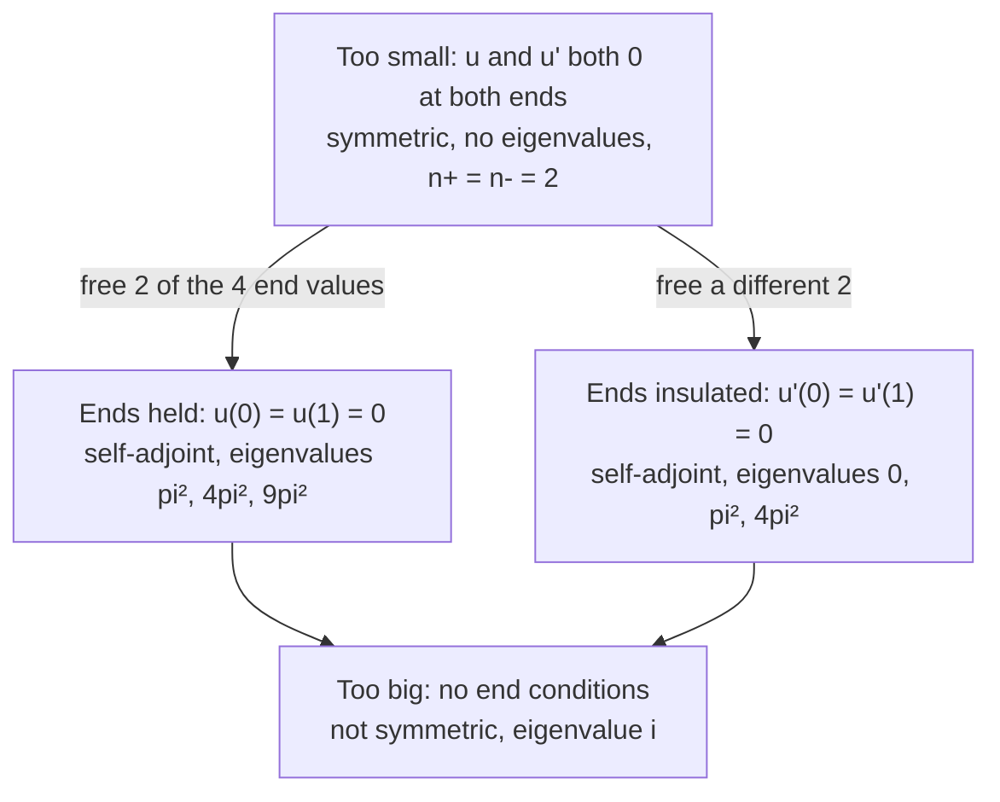
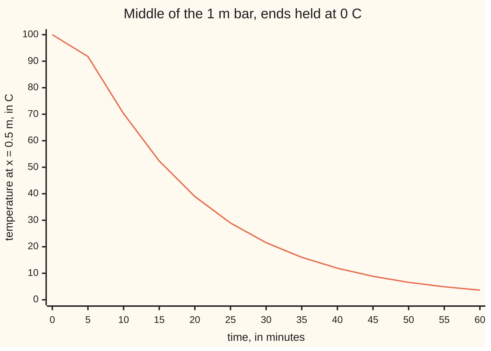

# Self-adjoint extensions: symmetric is not enough, the domain decides

[Syllabus](../../../SYLLABUS.md) → [Functional analysis](../README.md) → [Unbounded Operators and Semigroups](../README.md#s05) → Self-adjoint extensions

---

## General Overview

Take a copper-like bar 1 m long, heated evenly to 100 °C. Do one of two things to its ends.

- **Ends held:** dip both ends in ice water, so they stay at 0 °C.
- **Ends insulated:** wrap both ends, so no heat crosses them.

After 10 minutes the held bar's middle has fallen to 70.22 °C and its average to 44.88 °C. The insulated bar is still at 100 °C everywhere, and stays there forever.

Inside the bar both cases obey the same rule. Heat flows from hot to cold at a rate set by the bend of the temperature profile: the operator "minus the second derivative", A for short. The only difference is the list of profiles A is allowed to act on, called its **domain**. The ends live in the domain, not in the formula.

This card asks which domains are legal. "Legal" means **self-adjoint**: the operator equals its own mirror image, domain included. On the bar, both choices above are self-adjoint, with real eigenvalues, a full set of modes, and a heat flow that never grows. Self-adjoint alone does not promise modes: on a bar that runs forever they give way to integrals (Step 6). A merely **symmetric** operator only passes the mirror test on its own domain, and that is not enough.

The answer comes from a count. Solve "minus the second derivative of u equals i times u" and count the solutions of finite size. On the bar there are 2, so the ends need 2 conditions between them. On a bar that runs forever in both directions there are 0, so no choice is needed at all.

**A symmetric operator becomes self-adjoint only on a domain of the right size; the deficiency indices count how many conditions are missing, and once the domain is right the spectral theorem writes the operator as multiplication by real numbers.**

**What kind of fact this is:** theorems. The ±i test is proved on this card in Why it works, and applied there to the bar's two choices. Von Neumann's count of extensions and the general spectral theorem are stated, with their sources named; the code checks instances on the bar.

### The picture: one formula, a ladder of domains



Every box is the same formula, minus the second derivative. Only the domain changes.

---

## The formula

Notation first, in words. The bar runs from x = 0 to x = 1 m. A temperature profile u is a complex-valued function on the bar with finite **squared size** $`\int_0^1 \lvert u\rvert^2\,dx`$; such functions form the space $`L^2(0,1)`$. Its **size** $`\lVert u\rVert`$ is the square root, as on [Unbounded operators](01-unbounded-operators-and-domains.md). The inner product $`\langle u, v\rangle = \int_0^1 \overline{u}\,v\,dx`$ conjugates its first slot, as wing 07's $`v^*w`$ does; texts differ.

The operator is $`Au = -u''`$ on a domain $`D(A)`$: the profiles A may act on ([Unbounded operators](01-unbounded-operators-and-domains.md)). Its **adjoint** $`A^*`$ acts on every v for which some w gives $`\langle Au, v\rangle = \langle u, w\rangle`$ for all u in $`D(A)`$; then $`A^*v = w`$. A is **symmetric** when $`A^*`$ agrees with A on $`D(A)`$, and **self-adjoint** when also $`D(A^*) = D(A)`$.

The **deficiency indices** count the obstructions:

```math
n_\pm = \dim \ker\,(A^* \mp i)
```

**Read it aloud:** n-plus is the number of independent solutions of "A-star u equals i times u", and n-minus the same with minus i.

Von Neumann's theorem turns the count into an answer:

```math
\bar A \text{ is self-adjoint} \iff n_+ = n_- = 0, \qquad A \text{ has a self-adjoint extension} \iff n_+ = n_-
```

**Read it aloud:** the closure is self-adjoint exactly when both counts are zero; some self-adjoint extension exists exactly when the two counts are equal.

Here $`\bar A`$ is the **closure**: A with every limit of its **graph** (the pairs $`(u, Au)`$) added ([Unbounded operators](01-unbounded-operators-and-domains.md)). When $`\bar A`$ is self-adjoint, A is **essentially self-adjoint**: there is exactly one legal domain, and nothing to choose.

Once the domain is legal, the **spectral theorem** for the bar reads

```math
Au = \sum_{n} \lambda_n \langle e_n, u\rangle\, e_n, \qquad D(A) = \Big\{u : \sum_{n} \lambda_n^2\, \lvert\langle e_n, u\rangle\rvert^2 < \infty\Big\}
```

**Read it aloud:** A multiplies each mode's amount by that mode's eigenvalue, and a profile is in the domain exactly when the multiplied amounts still have finite total size.

| Symbol | Plain meaning | In our example | Push it up and the answer… |
| --- | --- | --- | --- |
| $`x`$, $`R`$ | position along the bar, in m; R is how far a half-line is followed | 0 to 1; R = 1 to 20 | larger R: a growing solution's squared size never settles |
| $`u`$, $`v`$ | temperature profiles, or test functions, in $`L^2(0,1)`$ | 100 °C everywhere; x(1 − x) | — |
| $`A`$ | minus the second derivative: turns a profile in °C into its bend, in °C/m² | $`-u''`$ | — |
| $`D(A)`$ | the domain: the profiles A may act on | ends held, or ends insulated | bigger domain, smaller adjoint domain |
| $`A^*`$ | the adjoint: A's mirror image under the inner product | no end conditions, when A's domain fixes u and u′ at both ends | — |
| $`\bar A`$ | the closure: A with limits of its graph added | — | — |
| $`\langle u, v\rangle`$ | the inner product, conjugating u | $`\int_0^1 \overline{u}\,v\,dx`$ | — |
| $`i`$, $`a`$ | the square root of −1; $`a = (1 - i)/\sqrt 2`$, so $`a^2 = -i`$ | $`e^{\pm a x}`$ solve $`-u'' = iu`$ | — |
| $`n_+`$, $`n_-`$ | deficiency indices: finite-size solutions of $`A^*u = \pm iu`$ | 2 and 2 on the bar | more end conditions needed |
| $`\lambda_n`$, $`e_n`$ | eigenvalues, in 1/m², and their modes of size 1 | held: $`n^2\pi^2`$, $`\sqrt 2 \sin(n\pi x)`$ | faster decay |
| $`c_n`$, $`N`$ | amount of mode n in a profile: $`\langle e_n, u\rangle`$; N is how many modes or grid points are kept | 0.900316 for n = 1; N = 10, 100, 1000 | larger N: closer to the infinite bar |
| $`\kappa`$, $`t`$ | heat diffusivity, in m²/s; time, in s | $`10^{-4}`$ (illustrative, about copper's); 600 s | faster cooling |

### When it holds

- **A symmetric starting operator.** The ±i test needs $`\langle Au, u\rangle`$ real. With no end conditions the test fails at once: the profile $`e^{ax}`$ gives $`\langle u, Au\rangle / \langle u, u\rangle = i`$, not a real number.
- **Equal counts.** The momentum operator $`-i\,d/dx`$ on a half-line $`(0, \infty)`$ has $`n_+ = 1`$ and $`n_- = 0`$, since $`e^{-x}`$ has finite size and $`e^{x}`$ does not. It has no self-adjoint extension at all.
- **Complex scalars.** The counts use $`\pm i`$. Over real numbers the test has nothing to aim at; the card keeps profiles complex wherever the test is run.
- **The full spectral theorem needs self-adjoint, not symmetric.** On the too-small domain the operator has no eigenvalues at all; on the too-big one every complex number is an eigenvalue.

---

## Why it works

### Step 0: the domain sets the mirror

A symmetric matrix passes the test $`u \cdot Av = Au \cdot v`$ for every pair of vectors, and every vector is allowed. On functions, integration by parts moves the two derivatives from u to v but leaves terms at the ends. The domain decides whether those end terms vanish.

Shrink the domain and the end terms vanish more easily. But then more v pass the adjoint's test, so the adjoint's domain grows. Self-adjoint is the balance point: the domain and the adjoint's domain are the same set.

### Step 1: the end terms

Integrate by parts twice, as on [Sturm-Liouville](../../08-Differential%20equations%20and%20dynamics/07-Series%20Solutions%20and%20Boundary%20Problems/09-sturm-liouville-and-orthogonality.md):

```math
\langle Au, v\rangle - \langle u, Av\rangle = \Big[-\overline{u'}\,v + \overline{u}\,v'\Big]_0^1
```

**Read it aloud:** the mirror test fails by exactly the end terms.

The checks compute both sides by Simpson's rule and by the end terms:

- held with held, $`u = x(1-x)`$, $`v = \sin(\pi x)`$: both sides 0.
- insulated with insulated, $`u = x^2 - 2x^3/3`$, $`v = \cos(\pi x)`$: both sides 0.
- held with insulated, $`u = x(1-x)`$, $`v = 1`$: both sides 2.

So each of the two choices is symmetric on its own. Mixing them is not.

### Step 2: too small and too big

Take the smallest sensible domain: u and u′ both zero at both ends. Every end term vanishes whatever v does, so the adjoint accepts every v with two derivatives, with no end conditions. The adjoint's domain is far bigger than A's.

On that big domain, $`-u'' = iu`$ has two independent solutions, $`e^{ax}`$ and $`e^{-ax}`$ with $`a^2 = -i`$. Both have finite squared size on a bar 1 m long: 0.535197 and 2.201400. So $`n_+ = 2`$, and the conjugate equation gives $`n_- = 2`$.

A self-adjoint operator cannot have i as an eigenvalue: $`\langle u, Au\rangle`$ would equal $`i\langle u,u\rangle`$, and the left side is real for a symmetric operator. That is the obstruction the count measures.

### Step 3: the ±i test

For a symmetric A and any u in its domain, the cross terms cancel:

```math
\lVert (A \pm i)u\rVert^2 = \lVert Au\rVert^2 + \lVert u\rVert^2
```

**Read it aloud:** shifting by plus or minus i never shrinks a profile, so the shifted operator loses nothing.

So $`A \pm i`$ is one-to-one. A is self-adjoint exactly when $`A \pm i`$ also reaches every profile. What it misses is perpendicular to its range, and those missed directions are exactly the solutions of $`A^*v = \pm iv`$. Zero missed directions means self-adjoint after closure.

<details>
<summary>Detailed proof: the ±i test</summary>

Cross terms. $`\lVert (A+i)u\rVert^2 = \lVert Au\rVert^2 + \lVert u\rVert^2 + 2\,\mathrm{Re}\,\langle Au, iu\rangle`$, and $`\langle Au, iu\rangle = i\langle Au, u\rangle`$ is purely imaginary, since $`\langle Au, u\rangle`$ is real for a symmetric A. So the cross term is 0.

Range and kernel. A vector v is perpendicular to every $`(A + i)u`$ exactly when $`\langle Au, v\rangle = \langle u, iv\rangle`$ for every u in $`D(A)`$. By the adjoint's definition, that says v is in $`D(A^*)`$ with $`A^*v = iv`$. So:

$`\displaystyle \mathrm{ran}(A + i)^\perp = \ker(A^* - i), \qquad \mathrm{ran}(A - i)^\perp = \ker(A^* + i).`$

Self-adjoint means both ranges are everything. If $`A = A^*`$ and $`A^*v = iv`$, then $`\langle v, Av\rangle = i\lVert v\rVert^2`$ is real, so v = 0; with a closed A the ranges are closed by the first identity, hence everything. Conversely, if both ranges are everything and $`v \in D(A^*)`$, pick u in $`D(A)`$ with $`(A - i)u = (A^* - i)v`$. Then $`(A^* - i)(v - u) = 0`$, and since $`\ker(A^* - i)`$ is the perpendicular of the range of $`A + i`$, which is everything, v = u. So $`D(A^*) = D(A)`$.

For a general symmetric A, apply this to the closure $`\bar A`$, whose adjoint is the same $`A^*`$.

</details>

### Step 4: the count decides how many conditions

Von Neumann proved (1930) that the adjoint's domain splits into three pieces: the closure's domain, the solutions for +i, and the solutions for −i. A self-adjoint extension keeps "half" of the extra room, by pairing each +i solution with a −i solution through a rotation. That pairing needs equal counts. On the bar, the pairings form a family with 2 × 2 = 4 real parameters, the 2 × 2 unitary matrices (matrices that keep sizes).

Each pairing is a pair of end conditions. Ends held and ends insulated are two members. Ends joined into a ring, $`u(0) = u(1)`$ and $`u'(0) = u'(1)`$, is another. A single condition is too few: the left end held alone still lets $`e^{ax} - e^{-ax}`$ through, with eigenvalue i.

**Checking the two choices.** Start from smooth profiles with both ends held. In Step 1's end terms, $`u(0) = u(1) = 0`$ while $`u'(0)`$ and $`u'(1)`$ are free, so v passes the adjoint's test only if $`v(0) = v(1) = 0`$: the adjoint keeps the held ends. Now run Step 3's ±i test. The solutions of $`-v'' = iv`$ with $`v(0) = 0`$ are the multiples of $`\sinh(ax)`$, where $`\sinh z = (e^z - e^{-z})/2`$, the hyperbolic sine. So $`v(1) = 0`$ would need $`\sinh a = 0`$. But $`\sinh a = 0.583505 - 0.818927i`$. The −i case is the complex conjugate. So $`n_+ = n_- = 0`$: minus the second derivative on smooth profiles with held ends is essentially self-adjoint, and its closure is the held-ends operator. Insulated ends go the same way. The adjoint keeps $`v'(0) = v'(1) = 0`$. The condition at 0 leaves the multiples of $`\cosh(ax)`$, whose slope at 1 m is $`a\sinh a`$ times the multiple, again not 0.

### Step 5: why an infinite bar needs no choice

On a half-line $`(0, \infty)`$, the solution $`e^{-ax}`$ decays and $`e^{ax}`$ grows, since a has real part $`1/\sqrt 2`$. Their squared sizes out to distance R:

- $`e^{-ax}`$: 0.706506 at R = 5, 0.707107 at R = 20, settling at $`1/\sqrt 2`$.
- $`e^{ax}`$: 831.8437 at R = 5, $`1.358901 \times 10^{12}`$ at R = 20, never settling.

So the half-line has $`n_\pm = 1`$: one condition at its one end. On the whole line, the decaying solution grows at the other end, so $`n_\pm = 0`$. Minus the second derivative on smooth functions that vanish outside a bounded interval is essentially self-adjoint there.

### Step 6: the spectral theorem

On a legal domain the bar has a full list of modes ([Eigenvalue problems](../../08-Differential%20equations%20and%20dynamics/07-Series%20Solutions%20and%20Boundary%20Problems/08-eigenvalues-and-eigenfunctions.md)). The general theorem says the same for any self-adjoint operator, with integrals replacing sums: some unitary (size-keeping) change of variables turns A into multiplication by a real function, with domain the functions that still have finite size after the multiplication. Its proof takes the **Cayley transform** $`(A - i)(A + i)^{-1}`$, a size-keeping (unitary) operator that Step 3 shows is defined on everything. A unitary operator is not symmetric, so the theorem of [Bounded and symmetric](../03-Bounded%20Operators/10-spectral-theorem-for-bounded-self-adjoint-operators.md) does not apply as it stands; its version for normal operators (those that commute with their adjoint, cited there) does.

The domain test in the formula is now concrete. Take the flat profile 1, the 100 °C bar measured in units of 100 °C. Its held-ends amounts are $`c_n = 2\sqrt 2/(n\pi)`$ for odd n. The sums $`\sum c_n^2`$ approach 1, the bar's own squared size. But $`\sum \lambda_n^2 c_n^2`$ grows like $`N^3`$: 13,027.88 at N = 10, then $`1.315946 \times 10^{10}`$ at N = 1000. The uniform 100 °C profile is not in the held-ends domain: it breaks the condition at the ends. It is in the insulated domain, as its single mode with $`\lambda_0 = 0`$.

The payoff is functions of A. The heat flow is $`e^{-\kappa t A}`$: multiply mode n by $`e^{-\kappa \lambda_n t}`$. Every multiplier is at most 1, so heat flow is defined on every profile, in or out of the domain.

---

## Worked numbers, by hand

The held bar's middle after 600 s, by the modes. The midpoint value of mode n is $`\pm 1`$ for odd n, so the series is $`100 \cdot \tfrac{4}{\pi}\big(e^{-\kappa\pi^2 t} - \tfrac13 e^{-9\kappa\pi^2 t} + \tfrac15 e^{-25\kappa\pi^2 t} - \dots\big)`$.

| Step | Arithmetic | Value |
| --- | --- | --- |
| decay exponent of mode 1 | $`10^{-4} \times \pi^2 \times 600`$ | 0.592176 |
| its decay factor | $`e^{-0.592176}`$ | 0.553122 |
| mode 1 at the middle | $`(400/\pi) \times 0.553122`$ | 70.4257 °C |
| mode 3 at the middle | $`-(400/3\pi) \times e^{-9 \times 0.592176}`$ | −0.2057 °C |
| mode 5 at the middle | $`(400/5\pi) \times e^{-25 \times 0.592176}`$ | 0.000009 °C |
| ends held, middle | sum of the modes | **70.2200 °C** |
| ends insulated, middle | only $`\lambda_0 = 0`$ is present, factor $`e^0 = 1`$ | **100.0000 °C** |

A grid of 99 points stepped every 0.25 s gives 70.2131 °C for the held bar, and keeps the insulated bar's average at exactly 100.0000 °C. Same formula, same starting heat: only the domain differs.



The line is the held bar's middle, summed over modes 1 to 399. The insulated bar would be a flat line at 100 °C, since its only mode has eigenvalue 0.

### What breaks if you drop a piece

| Mistake | Comes out at | What went wrong |
| --- | --- | --- |
| Held-ends modes used for the insulated bar | 70.2200 °C at the middle, not 100.0000 | The modes belong to the domain, not to the formula |
| Only the left end held | $`\langle u, Au\rangle/\langle u, u\rangle = 0.000000 + 1.000000i`$ for $`e^{ax} - e^{-ax}`$ | One condition is too few: $`n_\pm = 2`$ needs two |
| No end conditions at all | $`0.000000 + 1.000000i`$ for $`e^{ax}`$ | The domain is too big to be symmetric |
| Mixing held and insulated profiles | mirror test off by 2 | The end terms vanish only inside one choice |

---

## Code, from first principles, and it actually runs

The code holds only the rehearsal: a grid, a few integrals, sums cut at N terms. It takes four independent roads. The grid eigenvalues come from a Sturm-sequence bisection (counting negative pivots), checked against the grid's closed form and against $`n^2\pi^2`$ as N grows. Each mirror test runs by Simpson's rule against the end terms. The deficiency squared sizes run by Simpson against the exact integral, at growing R, and the ±i test on the bar computes $`\sinh a`$ from exponentials, against the library's sinh and cosh. The heat in the middle comes from the mode series and from stepping the grid in time.

**What the truncation hides.** Every grid matrix is symmetric with domain all of $`\mathbb{R}^N`$, so it is automatically self-adjoint; the end conditions are baked into its corner entries. The domain question exists only in infinite dimensions. The code shows it as trends over N or R that do not close: $`\sum \lambda_n^2 c_n^2`$ and the growing solution's squared size.

### Python

```python
# Self-adjoint extensions -- the check behind the card.  Standard library only.
# A 1 m bar; the operator is A = -d^2/dx^2 (minus the bending).  Two choices of
# boundary condition: ends held at 0 C (Dirichlet) or ends insulated (Neumann).
import math
PI = math.pi

def z(x):                                  # print a tiny rounding residue as 0
    return 0.0 if abs(x) < 5e-7 else x

def count_below(d, e, x):                  # Sturm count: eigenvalues of the tridiagonal matrix below x
    q, k = 1.0, 0
    for i in range(len(d)):
        q = d[i] - x - (e * e / q if i else 0.0)
        if q == 0.0:
            q = 1e-300
        k += q < 0
    return k

def kth_eig(d, e, k):                      # k-th smallest eigenvalue (k = 0, 1, ...) by bisection
    lo, hi = -1.0, 4.0 * max(d) + 1.0
    for _ in range(100):
        mid = 0.5 * (lo + hi)
        lo, hi = (lo, mid) if count_below(d, e, mid) > k else (mid, hi)
    return 0.5 * (lo + hi)

def simpson(f, a, b, m=2000):              # Simpson's rule, m even
    h = (b - a) / m
    s = f(a) + f(b) + sum((4 if j % 2 else 2) * f(a + j * h) for j in range(1, m))
    return s * h / 3

print("finite rehearsal: the bar on a grid; every grid matrix is symmetric, domain = all vectors")
print("N     held: lam1     error vs pi^2   insulated: lam0  lam1")
for N in (10, 100, 1000):
    h = 1.0 / (N + 1)                      # held ends: N inside points, end values 0
    dD, hN = [2.0 / h**2] * N, 1.0 / N     # insulated ends: N cells, mirror at each end
    dN = [1.0 / hN**2] + [2.0 / hN**2] * (N - 2) + [1.0 / hN**2]
    l1, n0, n1 = kth_eig(dD, -1.0 / h**2, 0), kth_eig(dN, -1.0 / hN**2, 0), kth_eig(dN, -1.0 / hN**2, 1)
    print(f"{N:<5} {l1:.9f}   {l1 - PI**2:.3e}      {z(n0):.9f}      {n1:.9f}")
    assert abs(l1 - 4 / h**2 * math.sin(PI * h / 2)**2) < 1e-6 * l1          # discrete closed form
    assert 0 < PI**2 - l1 < 1.1 * PI**4 * h**2 / 12 and abs(n0) < 1e-6        # error falls like h^2
print(f"limits: held n^2 pi^2 = {PI**2:.9f}, {4*PI**2:.9f}, {9*PI**2:.9f}; insulated adds 0")
print("boundary form <Au, v> - <u, Av> on (0, 1): Simpson against the end terms [-u'v + u v']")
pairs = [("held/held", lambda x: x*(1-x), lambda x: 1-2*x, lambda x: 2.0, lambda x: math.sin(PI*x),
          lambda x: PI*math.cos(PI*x), lambda x: PI**2*math.sin(PI*x)),
         ("insulated/insulated", lambda x: x*x - 2*x**3/3, lambda x: 2*x - 2*x*x, lambda x: 4*x - 2,
          lambda x: math.cos(PI*x), lambda x: -PI*math.sin(PI*x), lambda x: PI**2*math.cos(PI*x)),
         ("held/insulated", lambda x: x*(1-x), lambda x: 1-2*x, lambda x: 2.0, lambda x: 1.0,
          lambda x: 0.0, lambda x: 0.0)]                 # (u, u', Au, v, v', Av), Au = -u''
for name, u, du, Au, v, dv, Av in pairs:
    lhs = simpson(lambda x: Au(x)*v(x) - u(x)*Av(x), 0.0, 1.0)
    rhs = (-du(1)*v(1) + u(1)*dv(1)) - (-du(0)*v(0) + u(0)*dv(0))
    print(f"  {name:<20} Simpson {z(lhs):.6f}   end terms {z(rhs):.6f}")
    assert abs(lhs - rhs) < 1e-9
s2 = math.sqrt(2.0)
ar, ai = 1 / s2, -1 / s2                    # a = (1 - i)/sqrt 2, so a^2 = -i and -u'' = i u for u = e^(a x)
def ue(x, sign=1.0):                       # e^(sign a x) as (real, imaginary)
    return (math.exp(sign*ar*x)*math.cos(sign*ai*x), math.exp(sign*ar*x)*math.sin(sign*ai*x))
def rayleigh(u, hh=1e-3):                  # pointwise eigen-check: <u, Au>/<u, u>, Au by differences
    num_r = num_i = den = 0.0
    for j in range(1, 1000):
        x, w = j * hh, (2 if j % 2 == 0 else 4)
        (ur, ui), (pr, pq), (mr, mq) = u(x), u(x + hh), u(x - hh)
        Ar, Ai = -(pr - 2*ur + mr) / hh**2, -(pq - 2*ui + mq) / hh**2
        num_r, num_i = num_r + w*(ur*Ar + ui*Ai), num_i + w*(ur*Ai - ui*Ar)   # conjugate first slot
        den += w * (ur*ur + ui*ui)
    return num_r / den, num_i / den
def sh(x):                                 # e^(a x) - e^(-a x): zero at the left end only
    return (ue(x)[0] - ue(x, -1.0)[0], ue(x)[1] - ue(x, -1.0)[1])
rr, ri = rayleigh(ue)
print(f"no conditions at all: u = e^(a x), a = (1 - i)/sqrt2; <u, Au>/<u, u> = {z(rr):.6f} + {ri:.6f}i")
assert abs(rr) < 1e-5 and abs(ri - 1) < 1e-5
print("deficiency count: squared size int_0^R |u|^2 dx of the two solutions of -u'' = i u")
print("R     decaying e^(-a x)          growing e^(a x)")
size = {}
for R in (1, 5, 10, 20):
    dec = simpson(lambda x: math.exp(-s2*x), 0.0, float(R))
    gro = simpson(lambda x: math.exp(s2*x), 0.0, float(R), 20000)
    size[R] = (dec, gro)
    print(f"{R:<5} {dec:.6f} (exact {(1-math.exp(-s2*R))/s2:.6f})  {gro:.6e} (exact {(math.exp(s2*R)-1)/s2:.6e})")
    assert abs(dec - (1 - math.exp(-s2*R)) / s2) < 1e-9 and abs(gro / ((math.exp(s2*R) - 1) / s2) - 1) < 1e-8
settled = [size[20][k] - size[10][k] < 1e-3 for k in (0, 1)]   # does the size stop growing?
n_bar = sum(math.isfinite(v) for v in size[1])                # on the bar (0, 1) both squared sizes are finite
n_half, n_line = sum(settled), sum(settled[k] and settled[1 - k] for k in (0, 1))
print(f"so n+ = n- = {n_bar} on the bar (0, 1), {n_half} on the half-line, {n_line} on the whole line; "
      f"bar extensions: {n_bar} x {n_bar} = {n_bar * n_bar} real parameters")
assert (n_half, n_line) == (1, 0)
sa = [(p - m) / 2 for p, m in zip(ue(1.0), ue(1.0, -1.0))]   # sinh(a); v(0) = 0 leaves sinh(a x), v'(0) = 0 cosh(a x)
print(f"+-i test on the bar: held ends need sinh(a) = 0, insulated ends a sinh(a) = 0; "
      f"sinh(a) = {sa[0]:.6f} - {-sa[1]:.6f}i, so n+ = n- = 0 for both")
assert abs(sa[0] - math.sinh(ar)*math.cos(ai)) < 1e-12 and abs(sa[1] - math.cosh(ar)*math.sin(ai)) < 1e-12 and math.hypot(*sa) > 0.5
mom = [simpson(lambda x: math.exp(-2*x), 0.0, float(R)) for R in (5, 20)]
print(f"momentum -i d/dx on the half-line: |e^(-x)|^2 to R = 5, 20: {mom[0]:.6f}, {mom[1]:.6f}; e^x unbounded: n+ = 1, n- = 0")
assert abs(mom[1] - 0.5) < 1e-9
print("spectral domain test for f = 1 (100 C everywhere), held-ends modes sqrt2 sin(n pi x)")
print("N      sum c_n^2    sum lam_n^2 c_n^2")
for N in (10, 100, 1000):
    c = [s2 * (1 - (-1)**n) / (n*PI) for n in range(1, N + 1)]
    s, sl = sum(t*t for t in c), sum((n*PI)**4 * c[n-1]**2 for n in range(1, N + 1))
    print(f"{N:<6} {s:.6f}     {sl:.6e}")
    assert 0 < 1 - s < 4.1 / (PI**2 * N)                  # Parseval: tends to ||f||^2 = 1
cs = [simpson(lambda x: s2 * math.sin(n*PI*x), 0.0, 1.0) for n in (1, 2, 3)]
print(f"c_1, c_2, c_3 by Simpson: {cs[0]:.6f}, {z(cs[1]):.6f}, {cs[2]:.6f}; closed form 2sqrt2/(n pi) for odd n")
assert abs(cs[0] - 2*s2/PI) < 1e-9 and abs(cs[2] - 2*s2/(3*PI)) < 1e-9
kap, T0 = 1.0e-4, 100.0                    # diffusivity m^2/s (illustrative, about copper's); start 100 C
def mid_series(t):                         # midpoint temperature, held ends, by the modes
    return T0 * sum(4/(n*PI) * (-1)**((n-1)//2) * math.exp(-kap*(n*PI)**2*t) for n in range(1, 400, 2))
def mean_series(t):
    return T0 * sum(8/(n*PI)**2 * math.exp(-kap*(n*PI)**2*t) for n in range(1, 400, 2))
h, dt = 0.01, 0.25                         # grid road: 99 inside points, explicit steps of 0.25 s
uD, uN = [T0] * 99, [T0] * 100
for _ in range(2400):                      # 600 s
    uD = [uD[i] + kap*dt/h**2 * ((uD[i-1] if i else 0.0) - 2*uD[i] + (uD[i+1] if i < 98 else 0.0)) for i in range(99)]
    uN = [uN[i] + kap*dt/h**2 * (uN[max(i-1, 0)] - 2*uN[i] + uN[min(i+1, 99)]) for i in range(100)]
e1 = kap * PI**2 * 600
print(f"by hand at 600 s: kappa pi^2 t = {e1:.6f}; e^(-that) = {math.exp(-e1):.6f}; modes 1, 3, 5 give "
      f"{400/PI*math.exp(-e1):.4f}, {-400/(3*PI)*math.exp(-9*e1):.4f}, {400/(5*PI)*math.exp(-25*e1):.6f} C")
print(f"after 600 s, ends held at 0 C: midpoint {mid_series(600):.4f} C by modes, {uD[49]:.4f} C by grid; mean {mean_series(600):.4f} C")
print(f"after 600 s, ends insulated: midpoint 100.0000 C by modes (only lam0 = 0 survives), {uN[50]:.4f} C by grid; mean {sum(uN)/100:.4f} C")
assert abs(mid_series(600) - uD[49]) < 0.02 and abs(sum(uN)/100 - T0) < 1e-9
print(f"mistake: held-ends modes used for the insulated bar give {mid_series(600):.4f} C, not 100.0000 C")
sr, si = rayleigh(sh)
print(f"mistake: only the left end held, u = e^(a x) - e^(-a x): <u, Au>/<u, u> = {z(sr):.6f} + {si:.6f}i, not real")
assert abs(sr) < 1e-5 and abs(si - 1) < 1e-5
print("chart, ends held: minutes 0,5,...,60 ->", ", ".join(["100.00"] + [f"{mid_series(60*m):.2f}" for m in range(5, 61, 5)]))
print("ALL CHECKS PASS")
```

**Ran 2026-11-15 on macOS, Python 3.14.10, standard library only. All checks passed. Output, pasted from the run:**

```
finite rehearsal: the bar on a grid; every grid matrix is symmetric, domain = all vectors
N     held: lam1     error vs pi^2   insulated: lam0  lam1
10    9.802700385   -6.690e-02      0.000000000      9.788696741
100   9.868808679   -7.957e-04      0.000000000      9.868792685
1000  9.869596300   -8.101e-06      0.000000000      9.869596284
limits: held n^2 pi^2 = 9.869604401, 39.478417604, 88.826439610; insulated adds 0
boundary form <Au, v> - <u, Av> on (0, 1): Simpson against the end terms [-u'v + u v']
  held/held            Simpson 0.000000   end terms 0.000000
  insulated/insulated  Simpson 0.000000   end terms 0.000000
  held/insulated       Simpson 2.000000   end terms 2.000000
no conditions at all: u = e^(a x), a = (1 - i)/sqrt2; <u, Au>/<u, u> = 0.000000 + 1.000000i
deficiency count: squared size int_0^R |u|^2 dx of the two solutions of -u'' = i u
R     decaying e^(-a x)          growing e^(a x)
1     0.535197 (exact 0.535197)  2.201400e+00 (exact 2.201400e+00)
5     0.706506 (exact 0.706506)  8.318437e+02 (exact 8.318437e+02)
10    0.707106 (exact 0.707106)  9.802484e+05 (exact 9.802484e+05)
20    0.707107 (exact 0.707107)  1.358901e+12 (exact 1.358901e+12)
so n+ = n- = 2 on the bar (0, 1), 1 on the half-line, 0 on the whole line; bar extensions: 2 x 2 = 4 real parameters
+-i test on the bar: held ends need sinh(a) = 0, insulated ends a sinh(a) = 0; sinh(a) = 0.583505 - 0.818927i, so n+ = n- = 0 for both
momentum -i d/dx on the half-line: |e^(-x)|^2 to R = 5, 20: 0.499977, 0.500000; e^x unbounded: n+ = 1, n- = 0
spectral domain test for f = 1 (100 C everywhere), held-ends modes sqrt2 sin(n pi x)
N      sum c_n^2    sum lam_n^2 c_n^2
10     0.959605     1.302788e+04
100    0.995947     1.315816e+07
1000   0.999595     1.315946e+10
c_1, c_2, c_3 by Simpson: 0.900316, 0.000000, 0.300105; closed form 2sqrt2/(n pi) for odd n
by hand at 600 s: kappa pi^2 t = 0.592176; e^(-that) = 0.553122; modes 1, 3, 5 give 70.4257, -0.2057, 0.000009 C
after 600 s, ends held at 0 C: midpoint 70.2200 C by modes, 70.2131 C by grid; mean 44.8780 C
after 600 s, ends insulated: midpoint 100.0000 C by modes (only lam0 = 0 survives), 100.0000 C by grid; mean 100.0000 C
mistake: held-ends modes used for the insulated bar give 70.2200 C, not 100.0000 C
mistake: only the left end held, u = e^(a x) - e^(-a x): <u, Au>/<u, u> = 0.000000 + 1.000000i, not real
chart, ends held: minutes 0,5,...,60 -> 100.00, 91.75, 70.22, 52.36, 38.95, 28.97, 21.55, 16.02, 11.92, 8.86, 6.59, 4.90, 3.65
ALL CHECKS PASS
```

### Rust

Same numbers, same labels, built with `rustc --edition 2021 -O`.

```rust
// Self-adjoint extensions -- the same check as the Python, in Rust.  No crates.
// A 1 m bar; the operator is A = -d^2/dx^2 (minus the bending).  Two choices of
// boundary condition: ends held at 0 C (Dirichlet) or ends insulated (Neumann).
use std::f64::consts::PI;

fn z(x: f64) -> f64 { if x.abs() < 5e-7 { 0.0 } else { x } }   // print a tiny rounding residue as 0

fn sci(x: f64, d: usize) -> String {       // Python's {:.de}: two-digit signed exponent
    let s = format!("{:.*e}", d, x);
    let (m, e) = s.split_once('e').unwrap();
    let e: i32 = e.parse().unwrap();
    format!("{}e{}{:02}", m, if e < 0 { '-' } else { '+' }, e.abs())
}

fn count_below(d: &[f64], e: f64, x: f64) -> usize {   // Sturm count: eigenvalues below x
    let (mut q, mut k) = (1.0f64, 0);
    for i in 0..d.len() {
        q = d[i] - x - if i > 0 { e * e / q } else { 0.0 };
        if q == 0.0 { q = 1e-300 }
        if q < 0.0 { k += 1 }
    }
    k
}

fn kth_eig(d: &[f64], e: f64, k: usize) -> f64 {        // k-th smallest eigenvalue by bisection
    let (mut lo, mut hi) = (-1.0, 4.0 * d.iter().cloned().fold(f64::MIN, f64::max) + 1.0);
    for _ in 0..100 {
        let mid = 0.5 * (lo + hi);
        if count_below(d, e, mid) > k { hi = mid } else { lo = mid }
    }
    0.5 * (lo + hi)
}

fn simpson(f: &dyn Fn(f64) -> f64, a: f64, b: f64, m: usize) -> f64 {   // Simpson's rule, m even
    let h = (b - a) / m as f64;
    let inner: f64 = (1..m).map(|j| (if j % 2 == 1 { 4.0 } else { 2.0 }) * f(a + j as f64 * h)).sum();
    (f(a) + f(b) + inner) * h / 3.0
}

const AR: f64 = std::f64::consts::FRAC_1_SQRT_2;
fn ue(x: f64, sg: f64) -> (f64, f64) {      // e^(sg a x), a = (1 - i)/sqrt 2, as (real, imaginary)
    ((sg * AR * x).exp() * (-sg * AR * x).cos(), (sg * AR * x).exp() * (-sg * AR * x).sin())
}
fn sh(x: f64) -> (f64, f64) { let (p, m) = (ue(x, 1.0), ue(x, -1.0)); (p.0 - m.0, p.1 - m.1) }

fn rayleigh(u: &dyn Fn(f64) -> (f64, f64)) -> (f64, f64) {  // pointwise eigen-check, Au by differences
    let hh = 1e-3;
    let (mut nr, mut ni, mut den) = (0.0, 0.0, 0.0);
    for j in 1..1000 {
        let (x, w) = (j as f64 * hh, if j % 2 == 0 { 2.0 } else { 4.0 });
        let ((ur, ui), (pr, pq), (mr, mq)) = (u(x), u(x + hh), u(x - hh));
        let (ar, ai) = (-(pr - 2.0 * ur + mr) / (hh * hh), -(pq - 2.0 * ui + mq) / (hh * hh));
        nr += w * (ur * ar + ui * ai);       // conjugate first slot
        ni += w * (ur * ai - ui * ar);
        den += w * (ur * ur + ui * ui);
    }
    (nr / den, ni / den)
}

fn main() {
    let pi2 = PI * PI;
    println!("finite rehearsal: the bar on a grid; every grid matrix is symmetric, domain = all vectors");
    println!("N     held: lam1     error vs pi^2   insulated: lam0  lam1");
    for n in [10usize, 100, 1000] {
        let h = 1.0 / (n as f64 + 1.0);
        let hn = 1.0 / n as f64;
        let dd = vec![2.0 / (h * h); n];
        let mut dn = vec![2.0 / (hn * hn); n];
        dn[0] = 1.0 / (hn * hn);
        dn[n - 1] = 1.0 / (hn * hn);
        let (l1, n0, n1) = (kth_eig(&dd, -1.0 / (h * h), 0), kth_eig(&dn, -1.0 / (hn * hn), 0), kth_eig(&dn, -1.0 / (hn * hn), 1));
        println!("{:<5} {:.9}   {}      {:.9}      {:.9}", n, l1, sci(l1 - pi2, 3), z(n0), n1);
        assert!((l1 - 4.0 / (h * h) * (PI * h / 2.0).sin().powi(2)).abs() < 1e-6 * l1);
        assert!(pi2 - l1 > 0.0 && pi2 - l1 < 1.1 * pi2 * pi2 * h * h / 12.0 && n0.abs() < 1e-6);
    }
    println!("limits: held n^2 pi^2 = {:.9}, {:.9}, {:.9}; insulated adds 0", pi2, 4.0 * pi2, 9.0 * pi2);
    println!("boundary form <Au, v> - <u, Av> on (0, 1): Simpson against the end terms [-u'v + u v']");
    type F = Box<dyn Fn(f64) -> f64>;
    let pairs: Vec<(&str, F, F, F, F, F, F)> = vec![
        ("held/held", Box::new(|x| x * (1.0 - x)), Box::new(|x| 1.0 - 2.0 * x), Box::new(|_| 2.0),
         Box::new(|x| (PI * x).sin()), Box::new(|x| PI * (PI * x).cos()), Box::new(|x| PI * PI * (PI * x).sin())),
        ("insulated/insulated", Box::new(|x| x * x - 2.0 * x * x * x / 3.0), Box::new(|x| 2.0 * x - 2.0 * x * x),
         Box::new(|x| 4.0 * x - 2.0), Box::new(|x| (PI * x).cos()), Box::new(|x| -PI * (PI * x).sin()),
         Box::new(|x| PI * PI * (PI * x).cos())),
        ("held/insulated", Box::new(|x| x * (1.0 - x)), Box::new(|x| 1.0 - 2.0 * x), Box::new(|_| 2.0),
         Box::new(|_| 1.0), Box::new(|_| 0.0), Box::new(|_| 0.0))];
    for (name, u, du, au, v, dv, av) in &pairs {
        let lhs = simpson(&|x| au(x) * v(x) - u(x) * av(x), 0.0, 1.0, 2000);
        let rhs = (-du(1.0) * v(1.0) + u(1.0) * dv(1.0)) - (-du(0.0) * v(0.0) + u(0.0) * dv(0.0));
        println!("  {:<20} Simpson {:.6}   end terms {:.6}", name, z(lhs), z(rhs));
        assert!((lhs - rhs).abs() < 1e-9);
    }
    let (rr, ri) = rayleigh(&|x| ue(x, 1.0));
    println!("no conditions at all: u = e^(a x), a = (1 - i)/sqrt2; <u, Au>/<u, u> = {:.6} + {:.6}i", z(rr), ri);
    assert!(rr.abs() < 1e-5 && (ri - 1.0).abs() < 1e-5);
    let s2 = 2f64.sqrt();
    println!("deficiency count: squared size int_0^R |u|^2 dx of the two solutions of -u'' = i u");
    println!("R     decaying e^(-a x)          growing e^(a x)");
    let mut size = vec![];
    for r in [1.0f64, 5.0, 10.0, 20.0] {
        let dec = simpson(&|x| (-s2 * x).exp(), 0.0, r, 2000);
        let gro = simpson(&|x| (s2 * x).exp(), 0.0, r, 20000);
        let (de, ge) = ((1.0 - (-s2 * r).exp()) / s2, ((s2 * r).exp() - 1.0) / s2);
        println!("{:<5} {:.6} (exact {:.6})  {} (exact {})", r, dec, de, sci(gro, 6), sci(ge, 6));
        assert!((dec - de).abs() < 1e-9 && (gro / ge - 1.0).abs() < 1e-8);
        size.push((dec, gro));
    }
    let settled = [size[3].0 - size[2].0 < 1e-3, size[3].1 - size[2].1 < 1e-3];   // does the size stop growing?
    let n_bar = [size[0].0, size[0].1].iter().filter(|v| v.is_finite()).count(); // on the bar both are finite
    let n_half = settled.iter().filter(|&&b| b).count();
    let n_line = (0..2).filter(|&k| settled[k] && settled[1 - k]).count();
    println!("so n+ = n- = {} on the bar (0, 1), {} on the half-line, {} on the whole line; bar extensions: {} x {} = {} real parameters",
             n_bar, n_half, n_line, n_bar, n_bar, n_bar * n_bar);
    assert!((n_half, n_line) == (1, 0));
    let (p1, m1) = (ue(1.0, 1.0), ue(1.0, -1.0));
    let sa = ((p1.0 - m1.0) / 2.0, (p1.1 - m1.1) / 2.0); // sinh(a); v(0) = 0 leaves sinh(a x), v'(0) = 0 cosh(a x)
    println!("+-i test on the bar: held ends need sinh(a) = 0, insulated ends a sinh(a) = 0; sinh(a) = {:.6} - {:.6}i, so n+ = n- = 0 for both", sa.0, -sa.1);
    assert!((sa.0 - AR.sinh() * AR.cos()).abs() < 1e-12 && (sa.1 + AR.cosh() * AR.sin()).abs() < 1e-12 && sa.0.hypot(sa.1) > 0.5);
    let mom: Vec<f64> = [5.0, 20.0].iter().map(|&r| simpson(&|x| (-2.0 * x).exp(), 0.0, r, 2000)).collect();
    println!("momentum -i d/dx on the half-line: |e^(-x)|^2 to R = 5, 20: {:.6}, {:.6}; e^x unbounded: n+ = 1, n- = 0", mom[0], mom[1]);
    assert!((mom[1] - 0.5).abs() < 1e-9);
    println!("spectral domain test for f = 1 (100 C everywhere), held-ends modes sqrt2 sin(n pi x)");
    println!("N      sum c_n^2    sum lam_n^2 c_n^2");
    for nn in [10usize, 100, 1000] {
        let c: Vec<f64> = (1..=nn).map(|n| s2 * (if n % 2 == 1 { 2.0 } else { 0.0 }) / (n as f64 * PI)).collect();
        let s: f64 = c.iter().map(|t| t * t).sum();
        let sl: f64 = (1..=nn).map(|n| (n as f64 * PI).powi(4) * c[n - 1] * c[n - 1]).sum();
        println!("{:<6} {:.6}     {}", nn, s, sci(sl, 6));
        assert!(1.0 - s > 0.0 && 1.0 - s < 4.1 / (pi2 * nn as f64));
    }
    let cs: Vec<f64> = [1.0, 2.0, 3.0].iter().map(|&n| simpson(&|x| s2 * (n * PI * x).sin(), 0.0, 1.0, 2000)).collect();
    println!("c_1, c_2, c_3 by Simpson: {:.6}, {:.6}, {:.6}; closed form 2sqrt2/(n pi) for odd n", cs[0], z(cs[1]), cs[2]);
    assert!((cs[0] - 2.0 * s2 / PI).abs() < 1e-9 && (cs[2] - 2.0 * s2 / (3.0 * PI)).abs() < 1e-9);
    let (kap, t0) = (1.0e-4, 100.0);       // diffusivity m^2/s (illustrative, about copper's); start 100 C
    let mid = |t: f64| t0 * (1..400).step_by(2).map(|n| { let nf = n as f64;
        4.0 / (nf * PI) * (if (n - 1) / 2 % 2 == 0 { 1.0 } else { -1.0 }) * (-kap * (nf * PI).powi(2) * t).exp() }).sum::<f64>();
    let mean = |t: f64| t0 * (1..400).step_by(2).map(|n| { let nf = n as f64;
        8.0 / (nf * PI).powi(2) * (-kap * (nf * PI).powi(2) * t).exp() }).sum::<f64>();
    let (h, dt) = (0.01, 0.25);            // grid road: 99 inside points, explicit steps of 0.25 s
    let (mut ud, mut un) = (vec![t0; 99], vec![t0; 100]);
    let r = kap * dt / (h * h);
    for _ in 0..2400 {                     // 600 s
        ud = (0..99).map(|i| ud[i] + r * ((if i > 0 { ud[i - 1] } else { 0.0 }) - 2.0 * ud[i] + (if i < 98 { ud[i + 1] } else { 0.0 }))).collect();
        un = (0..100).map(|i| un[i] + r * (un[i.saturating_sub(1)] - 2.0 * un[i] + un[(i + 1).min(99)])).collect();
    }
    let un_mean = un.iter().sum::<f64>() / 100.0;
    let e1 = kap * pi2 * 600.0;
    println!("by hand at 600 s: kappa pi^2 t = {:.6}; e^(-that) = {:.6}; modes 1, 3, 5 give {:.4}, {:.4}, {:.6} C", e1, (-e1).exp(),
             400.0 / PI * (-e1).exp(), -400.0 / (3.0 * PI) * (-9.0 * e1).exp(), 400.0 / (5.0 * PI) * (-25.0 * e1).exp());
    println!("after 600 s, ends held at 0 C: midpoint {:.4} C by modes, {:.4} C by grid; mean {:.4} C", mid(600.0), ud[49], mean(600.0));
    println!("after 600 s, ends insulated: midpoint 100.0000 C by modes (only lam0 = 0 survives), {:.4} C by grid; mean {:.4} C", un[50], un_mean);
    assert!((mid(600.0) - ud[49]).abs() < 0.02 && (un_mean - t0).abs() < 1e-9);
    println!("mistake: held-ends modes used for the insulated bar give {:.4} C, not 100.0000 C", mid(600.0));
    let (sr, si) = rayleigh(&sh);
    println!("mistake: only the left end held, u = e^(a x) - e^(-a x): <u, Au>/<u, u> = {:.6} + {:.6}i, not real", z(sr), si);
    assert!(sr.abs() < 1e-5 && (si - 1.0).abs() < 1e-5);
    let pts: Vec<String> = (5..61).step_by(5).map(|m| format!("{:.2}", mid(60.0 * m as f64))).collect();
    println!("chart, ends held: minutes 0,5,...,60 -> 100.00, {}", pts.join(", "));
    println!("ALL CHECKS PASS");
}
```

**Ran 2026-11-15 on macOS, rustc 1.98.1, no crates. All checks passed. Output, pasted from the run:**

```
finite rehearsal: the bar on a grid; every grid matrix is symmetric, domain = all vectors
N     held: lam1     error vs pi^2   insulated: lam0  lam1
10    9.802700385   -6.690e-02      0.000000000      9.788696741
100   9.868808679   -7.957e-04      0.000000000      9.868792685
1000  9.869596300   -8.101e-06      0.000000000      9.869596284
limits: held n^2 pi^2 = 9.869604401, 39.478417604, 88.826439610; insulated adds 0
boundary form <Au, v> - <u, Av> on (0, 1): Simpson against the end terms [-u'v + u v']
  held/held            Simpson 0.000000   end terms 0.000000
  insulated/insulated  Simpson 0.000000   end terms 0.000000
  held/insulated       Simpson 2.000000   end terms 2.000000
no conditions at all: u = e^(a x), a = (1 - i)/sqrt2; <u, Au>/<u, u> = 0.000000 + 1.000000i
deficiency count: squared size int_0^R |u|^2 dx of the two solutions of -u'' = i u
R     decaying e^(-a x)          growing e^(a x)
1     0.535197 (exact 0.535197)  2.201400e+00 (exact 2.201400e+00)
5     0.706506 (exact 0.706506)  8.318437e+02 (exact 8.318437e+02)
10    0.707106 (exact 0.707106)  9.802484e+05 (exact 9.802484e+05)
20    0.707107 (exact 0.707107)  1.358901e+12 (exact 1.358901e+12)
so n+ = n- = 2 on the bar (0, 1), 1 on the half-line, 0 on the whole line; bar extensions: 2 x 2 = 4 real parameters
+-i test on the bar: held ends need sinh(a) = 0, insulated ends a sinh(a) = 0; sinh(a) = 0.583505 - 0.818927i, so n+ = n- = 0 for both
momentum -i d/dx on the half-line: |e^(-x)|^2 to R = 5, 20: 0.499977, 0.500000; e^x unbounded: n+ = 1, n- = 0
spectral domain test for f = 1 (100 C everywhere), held-ends modes sqrt2 sin(n pi x)
N      sum c_n^2    sum lam_n^2 c_n^2
10     0.959605     1.302788e+04
100    0.995947     1.315816e+07
1000   0.999595     1.315946e+10
c_1, c_2, c_3 by Simpson: 0.900316, 0.000000, 0.300105; closed form 2sqrt2/(n pi) for odd n
by hand at 600 s: kappa pi^2 t = 0.592176; e^(-that) = 0.553122; modes 1, 3, 5 give 70.4257, -0.2057, 0.000009 C
after 600 s, ends held at 0 C: midpoint 70.2200 C by modes, 70.2131 C by grid; mean 44.8780 C
after 600 s, ends insulated: midpoint 100.0000 C by modes (only lam0 = 0 survives), 100.0000 C by grid; mean 100.0000 C
mistake: held-ends modes used for the insulated bar give 70.2200 C, not 100.0000 C
mistake: only the left end held, u = e^(a x) - e^(-a x): <u, Au>/<u, u> = 0.000000 + 1.000000i, not real
chart, ends held: minutes 0,5,...,60 -> 100.00, 91.75, 70.22, 52.36, 38.95, 28.97, 21.55, 16.02, 11.92, 8.86, 6.59, 4.90, 3.65
ALL CHECKS PASS
```

The two outputs match line for line.

### Lean

Lean proves Step 3's ±i test and the zero-count half of von Neumann's theorem, for $`L^2(0,1)`$ and every space like it.

- Take a symmetric A whose domain is dense: every profile is a limit of profiles in $`D(A)`$. Then $`\lVert (A \pm i)u\rVert^2 = \lVert Au\rVert^2 + \lVert u\rVert^2`$ for every u in $`D(A)`$.
- Take such an A that is also closed. Then A is self-adjoint exactly when $`A + i`$ and $`A - i`$ both reach every profile.
- Take such an A, closed or not. Then its closure $`\bar A`$ is self-adjoint exactly when $`n_+ = n_- = 0`$.
- Step 1's end terms come out exactly: 0 for held with held, 0 for insulated with insulated, and 2 for held with insulated.

The bar's grids, integrals, counts and heat values are left to the Python and Rust checks; the extension count and spectral theorem stay cited.

```lean
-- Self-adjoint extensions: a densely defined symmetric operator on a complex Hilbert space has a self-adjoint closure exactly when both deficiency indices are zero, by the ±i test.
import Mathlib.Analysis.InnerProductSpace.LinearPMap
import Mathlib.Analysis.SpecialFunctions.Trigonometric.Basic

open scoped LinearPMap
open scoped ComplexConjugate

namespace SelfAdjointExtensions

variable {H : Type*} [NormedAddCommGroup H] [InnerProductSpace ℂ H] [CompleteSpace H]

theorem symm_inner_aux (A : H →ₗ.[ℂ] H) (hdense : Dense (A.domain : Set H)) (hsymm : A ≤ A†)
    (u v : A.domain) : inner ℂ (A u) (v : H) = inner ℂ (u : H) (A v) := by
  have h := LinearPMap.adjoint_isFormalAdjoint hdense ⟨u, hsymm.1 u.2⟩ v
  rw [← hsymm.2 (x := u) (y := ⟨u, hsymm.1 u.2⟩) rfl] at h
  exact h

theorem inner_self_im_aux (A : H →ₗ.[ℂ] H) (hdense : Dense (A.domain : Set H)) (hsymm : A ≤ A†)
    (u : A.domain) : (inner ℂ (A u) (u : H)).im = 0 := by
  have h := symm_inner_aux A hdense hsymm u u
  have h2 : conj (inner ℂ (A u) (u : H)) = inner ℂ (A u) (u : H) := by
    rw [inner_conj_symm]; exact h.symm
  exact Complex.conj_eq_iff_im.mp h2

/-- The norm identity `‖(A ± i)u‖² = ‖Au‖² + ‖u‖²` for a symmetric operator. -/
theorem norm_sq_add_I_smul_aux
    (A : H →ₗ.[ℂ] H) (hdense : Dense (A.domain : Set H)) (hsymm : A ≤ A†) (u : A.domain) :
    ‖A u + Complex.I • (u : H)‖ ^ 2 = ‖A u‖ ^ 2 + ‖(u : H)‖ ^ 2 ∧
      ‖A u - Complex.I • (u : H)‖ ^ 2 = ‖A u‖ ^ 2 + ‖(u : H)‖ ^ 2 := by
  have h := inner_self_im_aux A hdense hsymm u
  constructor
  · rw [@norm_add_sq ℂ, inner_smul_right, norm_smul, Complex.norm_I, one_mul]
    simp [h]
  · rw [@norm_sub_sq ℂ, inner_smul_right, norm_smul, Complex.norm_I, one_mul]
    simp [h]


/-- Norm identity for the shifted operator `c • id +ᵥ T` with `c = ±i`. -/
theorem norm_vadd_sq_aux (T : H →ₗ.[ℂ] H) (hdense : Dense (T.domain : Set H)) (hsymm : T ≤ T†)
    {c : ℂ} (hc : c = Complex.I ∨ c = -Complex.I) (u : T.domain) :
    ‖((c • LinearMap.id : H →ₗ[ℂ] H) +ᵥ T) u‖ ^ 2 = ‖T u‖ ^ 2 + ‖(u : H)‖ ^ 2 := by
  rw [LinearPMap.vadd_apply]
  have h := norm_sq_add_I_smul_aux T hdense hsymm u
  rcases hc with rfl | rfl
  · simpa [add_comm] using h.1
  · simpa [neg_smul, ← sub_eq_add_neg, add_comm, sub_eq_neg_add] using h.2

/-- A kernel vector of `T† + conj c` is orthogonal to the range of `T + c`. -/
theorem inner_vadd_eq_zero_aux (T : H →ₗ.[ℂ] H) (hdense : Dense (T.domain : Set H)) (c : ℂ)
    (y : T†.domain) (hy : T† y = -conj c • (y : H)) (x : T.domain) :
    inner ℂ (((c • LinearMap.id : H →ₗ[ℂ] H) +ᵥ T) x) (y : H) = 0 := by
  rw [LinearPMap.vadd_apply, inner_add_left,
    (LinearPMap.adjoint_isFormalAdjoint hdense).symm x y, hy]
  simp [inner_smul_left, inner_smul_right]

/-- A vector orthogonal to the range of `T + c` lies in the kernel of `T† + conj c`. -/
theorem mem_adjoint_of_inner_vadd_aux (T : H →ₗ.[ℂ] H) (hdense : Dense (T.domain : Set H))
    (c : ℂ) (y : H) (h : ∀ x : T.domain,
      inner ℂ (((c • LinearMap.id : H →ₗ[ℂ] H) +ᵥ T) x) y = 0) :
    ∃ hy : y ∈ T†.domain, T† ⟨y, hy⟩ = -conj c • y := by
  have key : ∀ x : T.domain, inner ℂ (-conj c • y) (x : H) = inner ℂ y (T x) := by
    intro x
    have hx := h x
    rw [LinearPMap.vadd_apply, inner_add_left] at hx
    have hx' : inner ℂ (T x) y = - inner ℂ (c • (x : H)) y := eq_neg_of_add_eq_zero_right hx
    rw [← inner_conj_symm y, hx', inner_smul_left, inner_smul_left]
    simp [inner_conj_symm]
  have hy : y ∈ T†.domain := LinearPMap.mem_adjoint_domain_of_exists y ⟨_, key⟩
  exact ⟨hy, LinearPMap.adjoint_apply_eq hdense ⟨y, hy⟩ key⟩


/-- For a closed symmetric operator, the range of `T ± i` is closed. -/
theorem isClosed_range_vadd_aux (T : H →ₗ.[ℂ] H) (hdense : Dense (T.domain : Set H))
    (hsymm : T ≤ T†) (hclosed : T.IsClosed) {c : ℂ} (hc : c = Complex.I ∨ c = -Complex.I) :
    IsClosed (LinearMap.range ((c • LinearMap.id : H →ₗ[ℂ] H) +ᵥ T).toFun : Set H) := by
  have : IsClosed (T.graph : Set (H × H)) := hclosed
  have : CompleteSpace T.graph := IsClosed.completeSpace_coe (s := (T.graph : Set (H × H)))
  let Φ : (H × H) →L[ℂ] H :=
    ContinuousLinearMap.snd ℂ H H + c • ContinuousLinearMap.fst ℂ H H
  let g : T.graph →L[ℂ] H := Φ.comp T.graph.subtypeL
  have hg : AntilipschitzWith 1 g := by
    refine g.antilipschitz_of_bound fun p => ?_
    obtain ⟨⟨a, b⟩, hp⟩ := p
    obtain ⟨u, hu1, hu2⟩ := (T.mem_graph_iff).mp hp
    simp only at hu1 hu2
    subst hu1 hu2
    have hn := norm_vadd_sq_aux T hdense hsymm hc u
    rw [LinearPMap.vadd_apply, LinearMap.smul_apply, LinearMap.id_apply] at hn
    have hgp : g ⟨((u : H), T u), hp⟩ = c • (u : H) + T u := by
      simp [g, Φ, add_comm]
    rw [hgp, NNReal.coe_one, one_mul]
    show ‖((u : H), T u)‖ ≤ _
    rw [Prod.norm_def]
    apply max_le <;> dsimp only
    · nlinarith [norm_nonneg (u : H), norm_nonneg (c • (u : H) + T u), sq_nonneg ‖T u‖]
    · nlinarith [norm_nonneg (T u), norm_nonneg (c • (u : H) + T u), sq_nonneg ‖(u : H)‖]
  convert hg.isClosed_range g.uniformContinuous using 1
  ext z
  simp only [SetLike.mem_coe, LinearMap.mem_range, Set.mem_range]
  constructor
  · rintro ⟨u, rfl⟩
    refine ⟨⟨((u : H), T u), T.mem_graph u⟩, ?_⟩
    simp [g, Φ, add_comm]
  · rintro ⟨⟨⟨a, b⟩, hp⟩, rfl⟩
    obtain ⟨u, hu1, hu2⟩ := (T.mem_graph_iff).mp hp
    simp only at hu1 hu2
    subst hu1 hu2
    refine ⟨u, ?_⟩
    simp [g, Φ, add_comm]


/-- If `T + c` reaches every vector, then `T† + conj c` has trivial kernel. -/
theorem eq_zero_of_range_eq_top_aux (T : H →ₗ.[ℂ] H) (hdense : Dense (T.domain : Set H)) (c : ℂ)
    (htop : LinearMap.range ((c • LinearMap.id : H →ₗ[ℂ] H) +ᵥ T).toFun = ⊤)
    (y : T†.domain) (hy : T† y = -conj c • (y : H)) : (y : H) = 0 := by
  have hyK : (y : H) ∈ LinearMap.range ((c • LinearMap.id : H →ₗ[ℂ] H) +ᵥ T).toFun :=
    htop ▸ Submodule.mem_top
  obtain ⟨x, hx⟩ := LinearMap.mem_range.mp hyK
  have h0 := inner_vadd_eq_zero_aux T hdense c y hy x
  have hx' : ((c • LinearMap.id : H →ₗ[ℂ] H) +ᵥ T) x = (y : H) := hx
  rw [hx'] at h0
  exact inner_self_eq_zero.mp h0

/-- For a closed symmetric operator, `T + c` (`c = ±i`) reaches every vector exactly when
`T† + conj c` has trivial kernel. -/
theorem range_vadd_eq_top_iff_aux (T : H →ₗ.[ℂ] H) (hdense : Dense (T.domain : Set H))
    (hsymm : T ≤ T†) (hclosed : T.IsClosed) {c : ℂ} (hc : c = Complex.I ∨ c = -Complex.I) :
    LinearMap.range ((c • LinearMap.id : H →ₗ[ℂ] H) +ᵥ T).toFun = ⊤ ↔
      ∀ y : T†.domain, T† y = -conj c • (y : H) → (y : H) = 0 := by
  set K := LinearMap.range ((c • LinearMap.id : H →ₗ[ℂ] H) +ᵥ T).toFun with hK
  constructor
  · exact eq_zero_of_range_eq_top_aux T hdense c
  · intro hker
    have hcl : IsClosed (K : Set H) := isClosed_range_vadd_aux T hdense hsymm hclosed hc
    have hperp : Kᗮ = ⊥ := by
      rw [Submodule.eq_bot_iff]
      intro y hy
      rw [Submodule.mem_orthogonal] at hy
      obtain ⟨hyd, hyeq⟩ := mem_adjoint_of_inner_vadd_aux T hdense c y
        (fun x => hy _ (LinearMap.mem_range_self _ x))
      exact hker ⟨y, hyd⟩ hyeq
    rw [← Submodule.topologicalClosure_eq_top_iff] at hperp
    rwa [hcl.submodule_topologicalClosure_eq] at hperp

/-- The extension step of the ±i test: if `T ± i` both reach every vector, then `T† ≤ T`. -/
theorem adjoint_le_of_range_aux (T : H →ₗ.[ℂ] H) (hdense : Dense (T.domain : Set H))
    (hsymm : T ≤ T†)
    (hp : LinearMap.range ((Complex.I • LinearMap.id : H →ₗ[ℂ] H) +ᵥ T).toFun = ⊤)
    (hm : LinearMap.range ((-Complex.I • LinearMap.id : H →ₗ[ℂ] H) +ᵥ T).toFun = ⊤) :
    T† ≤ T := by
  have hdom : T†.domain ≤ T.domain := by
    intro y hy
    set z : H := T† ⟨y, hy⟩ - Complex.I • y with hz
    have hzK : z ∈ LinearMap.range ((-Complex.I • LinearMap.id : H →ₗ[ℂ] H) +ᵥ T).toFun :=
      hm ▸ Submodule.mem_top
    obtain ⟨x, hx⟩ := LinearMap.mem_range.mp hzK
    have hx' : -Complex.I • (x : H) + T x = z := by
      rw [← hx]; rfl
    let x' : T†.domain := ⟨x, hsymm.1 x.2⟩
    have hTx : T x = T† x' := hsymm.2 rfl
    let w : T†.domain := ⟨y, hy⟩ - x'
    have hsub : T† w = T† ⟨y, hy⟩ - T† x' := T†.toFun.map_sub _ _
    have hw : T† w = -conj Complex.I • (w : H) := by
      rw [hsub, ← hTx]
      have : T x = z + Complex.I • (x : H) := by
        rw [← hx']; simp
      rw [this, hz]
      simp only [w, Submodule.coe_sub, Complex.conj_I, neg_neg, smul_sub]
      abel
    have hw0 : (w : H) = 0 := eq_zero_of_range_eq_top_aux T hdense _ hp w hw
    have hyx : y = (x : H) := by
      have : (w : H) = y - x := rfl
      rw [hw0] at this
      exact (sub_eq_zero.mp this.symm)
    rw [hyx]; exact x.2
  refine ⟨hdom, fun a b hab => ?_⟩
  have := hsymm.2 (x := b) (y := a) hab.symm
  exact this.symm


/-- Facts about the closure of a densely defined symmetric operator: it is closed, densely
defined, has the same adjoint, and is again symmetric. -/
theorem closure_facts_aux (A : H →ₗ.[ℂ] H) (hdense : Dense (A.domain : Set H)) (hsymm : A ≤ A†) :
    A.closure.IsClosed ∧ Dense (A.closure.domain : Set H) ∧ A.closure† = A† ∧
      A.closure ≤ A.closure† := by
  have hcl : A.IsClosable := LinearPMap.isClosable_iff_exists_closed_extension.mpr
    ⟨A†, LinearPMap.adjoint_isClosed hdense, hsymm⟩
  have hBd : Dense (A.closure.domain : Set H) := hdense.mono A.le_closure.1
  have hBle : A.closure ≤ A† := by
    apply LinearPMap.le_of_le_graph
    rw [← hcl.graph_closure_eq_closure_graph]
    exact Submodule.topologicalClosure_minimal _ (LinearPMap.le_graph_of_le hsymm)
      (LinearPMap.adjoint_isClosed hdense)
  have h1 : A.closure† ≤ A† := by
    apply LinearPMap.IsFormalAdjoint.le_adjoint hdense
    intro x y
    have := (LinearPMap.adjoint_isFormalAdjoint hBd).symm ⟨x, A.le_closure.1 x.2⟩ y
    rw [← A.le_closure.2 (x := x) rfl] at this
    exact this
  have h2 : A† ≤ A.closure† := by
    apply LinearPMap.IsFormalAdjoint.le_adjoint hBd
    intro x y
    have hS : IsClosed {p : H × H | inner ℂ p.2 (y : H) = inner ℂ p.1 (A† y)} :=
      isClosed_eq (by fun_prop) (by fun_prop)
    have hsub : (A.graph : Set (H × H)) ⊆ {p : H × H | inner ℂ p.2 (y : H) = inner ℂ p.1 (A† y)} := by
      intro p hp
      obtain ⟨u, hu1, hu2⟩ := (A.mem_graph_iff).mp hp
      simp only [Set.mem_ofPred_eq, ← hu1, ← hu2]
      exact (LinearPMap.adjoint_isFormalAdjoint hdense).symm u y
    have hmem : ((x : H), A.closure x) ∈ (A.graph.topologicalClosure : Set (H × H)) := by
      rw [hcl.graph_closure_eq_closure_graph]
      exact A.closure.mem_graph x
    rw [Submodule.topologicalClosure_coe] at hmem
    exact closure_minimal hsub hS hmem
  have hBadj : A.closure† = A† := le_antisymm h1 h2
  exact ⟨hcl.closure_isClosed, hBd, hBadj, hBadj ▸ hBle⟩

omit [CompleteSpace H] in
/-- Rank zero of the kernel of `T + d` means: `T y = e • y` forces `y = 0`, where `d = -e`. -/
theorem rank_ker_vadd_eq_zero_iff_aux (T : H →ₗ.[ℂ] H) {d e : ℂ} (he : d = -e) :
    Module.rank ℂ ((d • LinearMap.id : H →ₗ[ℂ] H) +ᵥ T).ker = 0 ↔
      ∀ y : T.domain, T y = e • (y : H) → (y : H) = 0 := by
  rw [rank_zero_iff_forall_zero]
  constructor
  · intro h y hy
    have hmem : (y : H) ∈ ((d • LinearMap.id : H →ₗ[ℂ] H) +ᵥ T).ker :=
      LinearPMap.mem_ker_iff.mpr ⟨y, rfl, by
        rw [LinearPMap.vadd_apply, LinearMap.smul_apply, LinearMap.id_apply]
        show d • (y : H) + T y = 0
        rw [hy, he, neg_smul, neg_add_cancel]⟩
    exact congrArg Subtype.val (h ⟨y, hmem⟩)
  · rintro h ⟨x, hx⟩
    obtain ⟨y, rfl, hy⟩ := LinearPMap.mem_ker_iff.mp hx
    rw [LinearPMap.vadd_apply, LinearMap.smul_apply, LinearMap.id_apply] at hy
    have hy' : d • (y : H) + T y = 0 := hy
    ext
    apply h y
    rw [he, neg_smul] at hy'
    exact (neg_add_eq_zero.mp hy').symm

/-- The ±i test for a closed, densely defined symmetric operator. -/
theorem isSelfAdjoint_iff_range_aux
    (A : H →ₗ.[ℂ] H) (hdense : Dense (A.domain : Set H)) (hsymm : A ≤ A†)
    (hclosed : A.IsClosed) :
    IsSelfAdjoint A ↔
      LinearMap.range ((Complex.I • LinearMap.id : H →ₗ[ℂ] H) +ᵥ A).toFun = ⊤ ∧
      LinearMap.range ((-Complex.I • LinearMap.id : H →ₗ[ℂ] H) +ᵥ A).toFun = ⊤ := by
  constructor
  · intro hsa
    have hadj : A† = A := hsa
    have hdense' : Dense (A†.domain : Set H) := by rw [hadj]; exact hdense
    have hsymm' : A† ≤ A†† := by rw [hadj, hadj]
    have hker : ∀ c : ℂ, (c = Complex.I ∨ c = -Complex.I) →
        ∀ y : A†.domain, A† y = -conj c • (y : H) → (y : H) = 0 := by
      intro c hc y hy
      have hc' : conj c = Complex.I ∨ conj c = -Complex.I := by
        rcases hc with rfl | rfl <;> simp
      have hn := norm_vadd_sq_aux A† hdense' hsymm' hc' y
      rw [LinearPMap.vadd_apply, LinearMap.smul_apply, LinearMap.id_apply, hy, neg_smul,
        add_neg_cancel, norm_zero] at hn
      have : ‖(y : H)‖ ^ 2 = 0 := by nlinarith [sq_nonneg ‖A† y‖, sq_nonneg ‖(y : H)‖]
      exact norm_eq_zero.mp (pow_eq_zero_iff (n := 2) (by norm_num) |>.mp this)
    exact ⟨(range_vadd_eq_top_iff_aux A hdense hsymm hclosed (Or.inl rfl)).mpr
        (hker _ (Or.inl rfl)),
      (range_vadd_eq_top_iff_aux A hdense hsymm hclosed (Or.inr rfl)).mpr
        (hker _ (Or.inr rfl))⟩
  · rintro ⟨hp, hm⟩
    exact le_antisymm (adjoint_le_of_range_aux A hdense hsymm hp hm) hsymm

/-- Essential self-adjointness by counting (von Neumann's first criterion, proved on the card by
the ±i test). Let `A` be a densely defined symmetric operator on a complex Hilbert space `H`:
its adjoint `A†` agrees with `A` on the domain of `A` (`A ≤ A†`). Then the closure of `A` is
self-adjoint exactly when both deficiency indices are zero:
`n₊ = dim ker (A† - i) = 0` and `n₋ = dim ker (A† + i) = 0`.
Here `A† - i` is `A†` shifted by `-i` times the identity, on the same domain as `A†`. -/
theorem closure_isSelfAdjoint_iff_deficiency_indices_zero
    (A : H →ₗ.[ℂ] H) (hdense : Dense (A.domain : Set H)) (hsymm : A ≤ A†) :
    IsSelfAdjoint A.closure ↔
      Module.rank ℂ ((-Complex.I • LinearMap.id : H →ₗ[ℂ] H) +ᵥ A†).ker = 0 ∧
      Module.rank ℂ ((Complex.I • LinearMap.id : H →ₗ[ℂ] H) +ᵥ A†).ker = 0 := by
  obtain ⟨hBcl, hBd, hBadj, hBsymm⟩ := closure_facts_aux A hdense hsymm
  rw [isSelfAdjoint_iff_range_aux A.closure hBd hBsymm hBcl,
    range_vadd_eq_top_iff_aux A.closure hBd hBsymm hBcl (Or.inl rfl),
    range_vadd_eq_top_iff_aux A.closure hBd hBsymm hBcl (Or.inr rfl), hBadj,
    rank_ker_vadd_eq_zero_iff_aux A† (e := -conj Complex.I) (by simp),
    rank_ker_vadd_eq_zero_iff_aux A† (e := -conj (-Complex.I)) (by simp)]

/-- The ±i test for a closed operator. A closed, densely defined, symmetric operator `A` on a
complex Hilbert space is self-adjoint exactly when `A + i` and `A - i` both reach every vector
of `H`. -/
theorem isSelfAdjoint_iff_range_add_I_and_sub_I_eq_top
    (A : H →ₗ.[ℂ] H) (hdense : Dense (A.domain : Set H)) (hsymm : A ≤ A†)
    (hclosed : A.IsClosed) :
    IsSelfAdjoint A ↔
      LinearMap.range ((Complex.I • LinearMap.id : H →ₗ[ℂ] H) +ᵥ A).toFun = ⊤ ∧
      LinearMap.range ((-Complex.I • LinearMap.id : H →ₗ[ℂ] H) +ᵥ A).toFun = ⊤ := by
  exact isSelfAdjoint_iff_range_aux A hdense hsymm hclosed

/-- Shifting by ±i never shrinks a vector: for a densely defined symmetric operator `A` and every
`u` in its domain, `‖(A ± i)u‖² = ‖Au‖² + ‖u‖²`, because the cross terms cancel. -/
theorem norm_sq_add_I_smul_eq_of_symmetric
    (A : H →ₗ.[ℂ] H) (hdense : Dense (A.domain : Set H)) (hsymm : A ≤ A†) (u : A.domain) :
    ‖A u + Complex.I • (u : H)‖ ^ 2 = ‖A u‖ ^ 2 + ‖(u : H)‖ ^ 2 ∧
      ‖A u - Complex.I • (u : H)‖ ^ 2 = ‖A u‖ ^ 2 + ‖(u : H)‖ ^ 2 := by
  exact norm_sq_add_I_smul_aux A hdense hsymm u


/- The card's Step 1 end terms `[-u'·v + u·v']` from 0 to 1, with `Au = -u''`. -/

-- held with insulated: u = x(1 - x), v = 1; the mirror test is off by 2.
example :
    (-(1 - 2 * (1 : ℚ)) * 1 + 1 * (1 - 1) * 0) - (-(1 - 2 * (0 : ℚ)) * 1 + 0 * (1 - 0) * 0) = 2 := by
  norm_num

-- held with held: u = x(1 - x), v = sin(πx); the end terms are 0.
example :
    (-(1 - 2 * (1 : ℝ)) * Real.sin (Real.pi * 1) + 1 * (1 - 1) * (Real.pi * Real.cos (Real.pi * 1)))
      - (-(1 - 2 * (0 : ℝ)) * Real.sin (Real.pi * 0) + 0 * (1 - 0) * (Real.pi * Real.cos (Real.pi * 0)))
      = 0 := by
  norm_num [Real.sin_pi]

-- insulated with insulated: u = x² - 2x³/3, v = cos(πx); the end terms are 0.
example :
    (-(2 * (1 : ℝ) - 2 * 1 ^ 2) * Real.cos (Real.pi * 1)
        + (1 ^ 2 - 2 * 1 ^ 3 / 3) * (-Real.pi * Real.sin (Real.pi * 1)))
      - (-(2 * (0 : ℝ) - 2 * 0 ^ 2) * Real.cos (Real.pi * 0)
        + (0 ^ 2 - 2 * 0 ^ 3 / 3) * (-Real.pi * Real.sin (Real.pi * 0)))
      = 0 := by
  norm_num [Real.sin_pi]

end SelfAdjointExtensions

open SelfAdjointExtensions

#print axioms symm_inner_aux
#print axioms inner_self_im_aux
#print axioms norm_sq_add_I_smul_aux
#print axioms norm_vadd_sq_aux
#print axioms inner_vadd_eq_zero_aux
#print axioms mem_adjoint_of_inner_vadd_aux
#print axioms isClosed_range_vadd_aux
#print axioms eq_zero_of_range_eq_top_aux
#print axioms range_vadd_eq_top_iff_aux
#print axioms adjoint_le_of_range_aux
#print axioms closure_facts_aux
#print axioms rank_ker_vadd_eq_zero_iff_aux
#print axioms isSelfAdjoint_iff_range_aux
#print axioms closure_isSelfAdjoint_iff_deficiency_indices_zero
#print axioms isSelfAdjoint_iff_range_add_I_and_sub_I_eq_top
#print axioms norm_sq_add_I_smul_eq_of_symmetric
```

**Checked 2026-11-15 on macOS, Lean 4.36.0-rc2, Mathlib v4.36.0-rc2. Every proof is complete and uses only Lean's standard axioms. Output, pasted from the run:**

```
'SelfAdjointExtensions.symm_inner_aux' depends on axioms: [propext, Classical.choice, Quot.sound]
'SelfAdjointExtensions.inner_self_im_aux' depends on axioms: [propext, Classical.choice, Quot.sound]
'SelfAdjointExtensions.norm_sq_add_I_smul_aux' depends on axioms: [propext, Classical.choice, Quot.sound]
'SelfAdjointExtensions.norm_vadd_sq_aux' depends on axioms: [propext, Classical.choice, Quot.sound]
'SelfAdjointExtensions.inner_vadd_eq_zero_aux' depends on axioms: [propext, Classical.choice, Quot.sound]
'SelfAdjointExtensions.mem_adjoint_of_inner_vadd_aux' depends on axioms: [propext, Classical.choice, Quot.sound]
'SelfAdjointExtensions.isClosed_range_vadd_aux' depends on axioms: [propext, Classical.choice, Quot.sound]
'SelfAdjointExtensions.eq_zero_of_range_eq_top_aux' depends on axioms: [propext, Classical.choice, Quot.sound]
'SelfAdjointExtensions.range_vadd_eq_top_iff_aux' depends on axioms: [propext, Classical.choice, Quot.sound]
'SelfAdjointExtensions.adjoint_le_of_range_aux' depends on axioms: [propext, Classical.choice, Quot.sound]
'SelfAdjointExtensions.closure_facts_aux' depends on axioms: [propext, Classical.choice, Quot.sound]
'SelfAdjointExtensions.rank_ker_vadd_eq_zero_iff_aux' depends on axioms: [propext, Classical.choice, Quot.sound]
'SelfAdjointExtensions.isSelfAdjoint_iff_range_aux' depends on axioms: [propext, Classical.choice, Quot.sound]
'SelfAdjointExtensions.closure_isSelfAdjoint_iff_deficiency_indices_zero' depends on axioms: [propext, Classical.choice, Quot.sound]
'SelfAdjointExtensions.isSelfAdjoint_iff_range_add_I_and_sub_I_eq_top' depends on axioms: [propext, Classical.choice, Quot.sound]
'SelfAdjointExtensions.norm_sq_add_I_smul_eq_of_symmetric' depends on axioms: [propext, Classical.choice, Quot.sound]
```

> [!TIP]
> **Try changing**
> - Guess first: set `kap` to `1.1e-4`, closer to pure copper. The held bar's middle after 600 s falls to 66.2556 °C by the modes and 66.2483 °C by the grid; every assert still passes.
> - Guess first: change the grid sizes `(10, 100, 1000)` to `(10, 20, 40)`. The error against $`\pi^2`$ goes −6.690e-02, −1.839e-02, −4.828e-03: about 4 times smaller each time the grid doubles.
> - Guess first: in `dN`, change both end entries from `1.0` to `2.0`. The insulated matrix loses its mirror ends, its lowest eigenvalue leaves 0, and the second assert stops the run.
> - Guess first: add R = 40 to the deficiency loop. The decaying squared size stays 0.707107 while the growing one reaches 2.611505e+24; then the first deficiency assert stops the run, because 2000 Simpson steps over 40 m miss its 1e-9 tolerance.

---

## The usual mistake

> [!warning]
> **Checking that an operator is symmetric and stopping there.** Minus the second derivative is symmetric on the too-small domain, yet it has no eigenvalues and no well-defined heat flow. Its adjoint has the eigenvalue i. Symmetric says the end terms vanish on the domain; self-adjoint also says the adjoint's domain is no bigger.
>
> - **Putting the ends in the formula.** Ends held and ends insulated share the formula $`-u''`$. Using one domain's modes for the other bar gives 70.2200 °C where the truth is 100.0000 °C.
> - **Too few conditions.** Holding only the left end leaves $`e^{ax} - e^{-ax}`$ in the domain, with eigenvalue $`0.000000 + 1.000000i`$.
> - **Counting on a grid.** Every grid matrix is self-adjoint. The deficiency count is invisible at any N; it shows only as a squared size that does not settle, $`1.358901 \times 10^{12}`$ at R = 20.
> - **Taking every profile as in the domain.** The 100 °C bar is not in the held-ends domain: $`\sum \lambda_n^2 c_n^2`$ reaches $`1.315946 \times 10^{10}`$ at N = 1000 and keeps growing.

---

## Where you meet it in real life

- **Heat in rods and walls.** An insulated end and an end held at a set temperature are two self-adjoint domains; engineers pick the one that matches the physical end.
- **Quantum mechanics.** Energy and momentum must be self-adjoint, so that measured values are real. A particle in a box needs end conditions; on the half-line, momentum $`-i\,d/dx`$ has $`n_+ = 1`$ and $`n_- = 0`$, so it is not an observable there.
- **Atoms.** The hydrogen atom's energy operator adds a $`1/r`$ pull to minus the Laplacian, the second derivative in three directions. The Kato-Rellich theorem, cited here and not taught, shows that this keeps the operator self-adjoint on the same domain.
- **Point interactions.** Models of an atom-sized scatterer, or a junction in a wire, are exactly a choice of end conditions among the self-adjoint extensions.

> **Say it back**
> One formula, minus the second derivative, gives different operators on different domains. Symmetric means the end terms vanish on the domain; self-adjoint means the adjoint's domain is the same set. The deficiency indices count the finite-size solutions of $`A^*u = \pm iu`$: 2 each on a bar, 1 on a half-line, 0 on a whole line. Equal counts allow self-adjoint extensions, and zero counts force exactly one. On a self-adjoint domain the spectral theorem makes A a multiplication by real eigenvalues, so the heat flow is a multiplication by decay factors.

---

## What this builds on

- [Unbounded operators](01-unbounded-operators-and-domains.md): the domain $`D(A)`$ and the closure $`\bar A`$.
- [Bounded and symmetric](../03-Bounded%20Operators/10-spectral-theorem-for-bounded-self-adjoint-operators.md): the adjoint and the spectral theorem when no domain question arises.
- [Eigenvalue problems](../../08-Differential%20equations%20and%20dynamics/07-Series%20Solutions%20and%20Boundary%20Problems/08-eigenvalues-and-eigenfunctions.md): the modes $`\sin(n\pi x)`$ and eigenvalues $`n^2\pi^2`$.
- [Sturm-Liouville](../../08-Differential%20equations%20and%20dynamics/07-Series%20Solutions%20and%20Boundary%20Problems/09-sturm-liouville-and-orthogonality.md): end conditions that make the operator symmetric, with real eigenvalues.

## Where this goes next

- [Evolution as an equation](03-the-abstract-cauchy-problem-and-the-operator-exponential.md): the next card. Rate of change equals an operator times the state, solved by the exponential for three tanks, and what breaks when the operator is a derivative.
- [Semigroups](04-strongly-continuous-semigroups.md): the family $`e^{-\kappa t A}`$ that composes like elapsed time.
- [Hille-Yosida](05-hille-yosida-and-generators.md): which operators drive a well-behaved evolution, self-adjoint or not.
- [Two evolutions](09-the-heat-and-schrodinger-semigroups.md): the same self-adjoint A driving heat and the Schrödinger equation.

The card leaves one question open: when an operator is not self-adjoint, such as heat with a drift, what decides whether its evolution still exists?

---

## Sources

Verified 2026-11-15: every link below resolves to the publisher's page.

- von Neumann, J. "Allgemeine Eigenwerttheorie Hermitescher Funktionaloperatoren." *Mathematische Annalen* 102 (1930), 49–131. [DOI 10.1007/BF01782338](https://doi.org/10.1007/BF01782338). The original deficiency count and extension theory.
- Schmüdgen, Konrad. *Unbounded Self-adjoint Operators on Hilbert Space*. Springer, Graduate Texts in Mathematics 265, 2012. [DOI 10.1007/978-94-007-4753-1](https://doi.org/10.1007/978-94-007-4753-1). The ±i test, von Neumann's formula, the spectral theorem and Kato-Rellich, with full proofs.
- Teschl, Gerald. *Mathematical Methods in Quantum Mechanics*, 2nd ed. AMS, Graduate Studies in Mathematics 157, 2014. [DOI 10.1090/gsm/157](https://doi.org/10.1090/gsm/157). Self-adjointness, the spectral theorem, and one-dimensional operators on intervals and half-lines.
- Bonneau, Guy, Jacques Faraut and Galliano Valent. "Self-adjoint extensions of operators and the teaching of quantum mechanics." *American Journal of Physics* 69 (2001), 322–331. [DOI 10.1119/1.1328351](https://doi.org/10.1119/1.1328351). Worked deficiency counts for a particle in a box and on a half-line.
