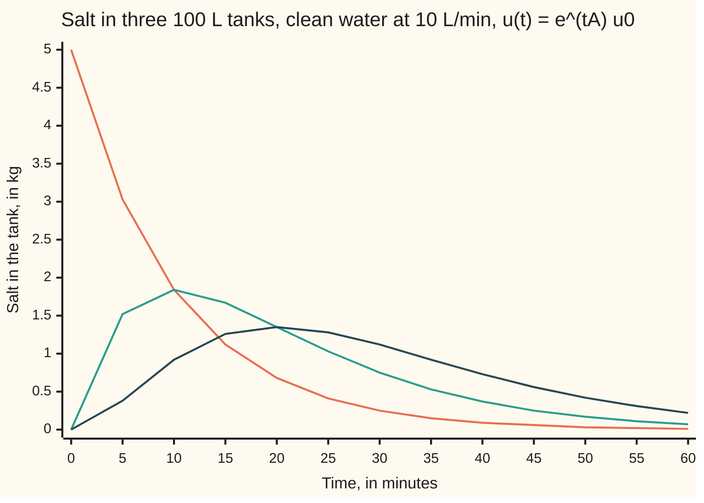
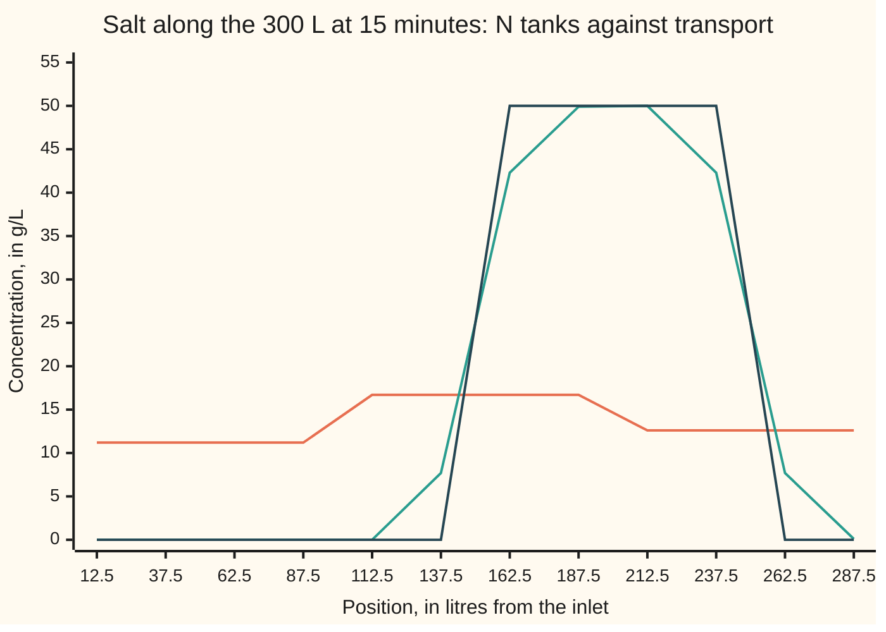

# Evolution as an equation: rate of change equals an operator times the state

[Syllabus](../../../SYLLABUS.md) → [Functional analysis](../README.md) → [Unbounded Operators and Semigroups](../README.md#s05) → Evolution as an equation

---

## General Overview

Three stirred tanks stand in a row, 100 L each. Clean water flows through them at 10 L/min: into tank 1, on to tank 2, on to tank 3, then out to a drain. A spill puts 5 kg of salt into tank 1. Where is the salt 15 minutes later? (Numbers illustrative.)

Each tank loses a tenth of its salt per minute to the next one, because 10 L/min is a tenth of 100 L. That rule, for all three tanks at once, says: the rate of change of the state equals a fixed matrix times the state. The answer comes from the matrix exponential, a power series in the matrix that carries the start forward in time: 1.115651, 1.673476 and 1.255107 kg in the three tanks, with 0.955766 kg gone down the drain.

Now cut the same 300 L into more and more, smaller tanks. The chain turns into a pipe, and the matrix turns into a derivative: minus the flow times the slope of the salt profile. The exponential's power series, which worked for every matrix, stops working. This card shows exactly what breaks and what survives.

**An evolution "rate of change = operator × state" is solved by exponentiating the operator when the operator is bounded; when the operator is a derivative, the power series fails, but the solution can still exist as a map that carries each start forward in time.**

**What kind of fact this is:** a definition (the abstract Cauchy problem) and a theorem proved on this card in Why it works: for a bounded operator the exponential series solves it, uniquely. The pipe's solution is checked on the card. That it is the only classical solution is stated, not proved: Pazy's Chapter 4 (Sources) proves uniqueness for every evolution whose forward maps form a semigroup, the family built on [Semigroups](04-strongly-continuous-semigroups.md).

### The picture: the spill moving down three tanks



Orange: tank 1. Teal: tank 2. Dark blue: tank 3. Each downstream tank peaks later and lower: the slug of salt spreads as it travels.

---

## The formula

The general problem, called the **abstract Cauchy problem**, has three parts:

- a **state space** $`X`$: a complete normed space, or Banach space, here the possible salt contents (normed: every state has a size, its norm; complete: every sequence whose terms bunch together has a limit in the space);
- an **operator** $`A`$ with a **domain** $`D(A)`$: the states the rule accepts ([Unbounded operators](01-unbounded-operators-and-domains.md));
- a starting state $`u_0`$ in $`X`$.

```math
u'(t) = A\,u(t) \quad (t \ge 0), \qquad u(0) = u_0 .
```

**Read it aloud:** the state changes at a rate equal to the operator applied to the current state, starting from $`u_0`$.

A **classical solution** is a map $`t \mapsto u(t)`$ that stays in $`D(A)`$, has a rate of change that is continuous when measured by the norm of $`X`$, and satisfies both equations. When $`A`$ is bounded, the solution is the operator exponential, built from the same series as for matrices:

```math
u(t) = e^{tA}u_0, \qquad e^{tA} = \sum_{m=0}^{\infty} \frac{t^m A^m}{m!}, \qquad \lVert e^{tA}\rVert \le e^{t\lVert A\rVert}.
```

**Read it aloud:** the state at time $`t`$ is the exponential of $`t`$ times the operator, applied to the start; its gain is at most $`e`$ to the $`t`$ times the operator's gain.

For the tanks, $`A = k(S - I)`$, where $`S`$ moves each tank's salt to the next tank and $`k = 0.1`$ per minute. In the pipe limit, $`A = -c\,d/dx`$.

| Symbol | Plain meaning | In our example | Push it up and the answer… |
| --- | --- | --- | --- |
| $`u(t)`$, $`u_0`$, $`f`$ | the state at time $`t`$; the start; a salt profile along the pipe, kg/L | $`u_0 = (5, 0, 0)`$ kg; the plume $`f`$ | the answer scales in proportion |
| $`t`$ | time since the spill, in minutes | 15 min | more salt reaches the drain |
| $`X`$, $`\lVert\cdot\rVert_1`$, $`L^1`$ | the state space and its size: total salt, in kg; $`L^1`$ is the pipe's version | 4.044234 kg left at 15 min | — |
| $`A`$, $`A_N`$ | the operator: the rate of change per unit of state; $`A_N`$ for $`N`$ tanks | $`k(S - I)`$; later $`-c\,d/dx`$ | faster flushing |
| $`D(A)`$, $`W^{1,1}`$ | the domain: states $`A`$ accepts | all of $`X`$ for tanks; $`W^{1,1}`$, profiles with an integrable slope, for the pipe | — |
| $`e^{tA}`$, $`m`$ | the operator exponential: start to time $`t`$; $`m`$ counts the series' terms | weights 1, 1.5, 1.125 times $`e^{-1.5}`$ | — |
| $`\lVert A\rVert`$ | worst-case gain of $`A`$, largest column total | 0.2 per min for three tanks | the bound $`e^{t\lVert A\rVert}`$ loosens |
| $`k`$ | flushing rate: flow over one tank's volume | $`10/100 = 0.1`$ per min | salt leaves sooner |
| $`S`$, $`I`$ | the shift: moves each tank's salt to the next; the identity, which changes nothing | $`(a, b, c) \mapsto (0, a, b)`$ | — |
| $`N`$, $`h`$, $`j`$ | number of tanks in the 300 L; volume of each, $`300/N`$ L; a tank's place in the row | $`N = 3`$, $`h = 100`$ L | the chain becomes a pipe |
| $`c`$, $`x`$ | the flow, in L/min; position along the line, in litres from the inlet | 10 L/min; the slug fills 0 to 100 L | the slug moves faster |
| $`q_\delta`$, $`\delta`$, $`z`$ | difference quotient over a time step $`\delta`$ minutes; distance from the plume's centre in units of 50 L | $`\delta = 0.01`$ min; $`z = -2`$ at 10 min | — |

### When it holds

- **The operator is bounded.** Then the series converges for every start and every $`t`$. For $`A = -c\,d/dx`$ it fails: the terms $`A^m u_0`$ may not exist, and even when they all exist the sum can diverge (Step 4).
- **The operator does not change with time.** With a time-varying $`A(t)`$, exponentiating the accumulated operator is wrong in general, as it is for matrices ([The matrix exponential](../../08-Differential%20equations%20and%20dynamics/04-Systems%20and%20the%20Matrix%20Exponential/04-the-matrix-exponential.md)).
- **The space is complete.** The series proof sums a sequence of operators whose sizes add up to a finite total. Without completeness that sequence need not have a limit in the space.
- **The start is in the domain, for a classical solution.** A slug with sharp edges is not in the domain of $`-c\,d/dx`$. Its state still moves along the pipe, but it has no rate of change (Step 5).

---

## Why it works

### Step 0: one rule for the rate fixes the whole future

The equation says how fast the state changes, given the state now. If $`A`$ is a fixed linear rule, the future is a fixed linear map applied to the start. For a matrix that map is $`e^{tA}`$, and its power series uses only multiplying and adding.

A bounded operator on a Banach space can also be multiplied and added, and has a size that behaves like a matrix norm. So the same series works. A derivative has no size: its gain is unbounded. The series then breaks, and the job becomes finding the forward map without it.

### Step 1: three tanks, solved exactly

Write $`u = (u_1, u_2, u_3)`$ for the salt in the three tanks, in kg. Tank $`j`$ gains $`k u_{j-1}`$ from upstream and loses $`k u_j`$ downstream, with $`k = 0.1`$ per minute:

```math
u' = A u, \qquad A = \frac{1}{10}\begin{pmatrix} -1 & 0 & 0 \\ 1 & -1 & 0 \\ 0 & 1 & -1 \end{pmatrix} = k\,(S - I).
```

The [Mixing tanks](../../08-Differential%20equations%20and%20dynamics/01-Rate%20Equations/06-mixing-tanks-and-compartments.md) card builds each row: rate in minus rate out, and the outflow carries the tank's own strength. [The matrix exponential](../../08-Differential%20equations%20and%20dynamics/04-Systems%20and%20the%20Matrix%20Exponential/04-the-matrix-exponential.md) proves that $`u(t) = e^{tA}u_0`$ for every square matrix.

Here the series sums by hand. $`-kI`$ and $`kS`$ commute, so $`e^{tA} = e^{-kt}e^{ktS}`$. The shift moves salt one tank on, so $`S^3 = 0`$: after three moves nothing is left in a three-tank chain. The series for $`e^{ktS}`$ stops after three terms:

```math
e^{tA} = e^{-kt}\Big(I + kt\,S + \tfrac12 (kt)^2 S^2\Big).
```

Applied to $`u_0 = (5, 0, 0)`$: $`u(t) = 5e^{-kt}\,\big(1,\ kt,\ \tfrac12 (kt)^2\big)`$. These are Poisson weights: the chance that a grain of salt has made 0, 1 or 2 moves by time $`t`$.

### Step 2: any bounded operator, and a better bound than the series gives

Let $`X`$ be a Banach space and $`A`$ a bounded operator on it, with gain $`\lVert A\rVert`$. Every step of the matrix proof survives:

1. $`\lVert A^m\rVert \le \lVert A\rVert^m`$, so the series' sizes add up to at most $`e^{t\lVert A\rVert}`$.
2. The bounded operators on a Banach space form a Banach space, so the series converges in operator size.
3. Differentiating term by term gives $`(e^{tA})' = A\,e^{tA}`$, so $`u(t) = e^{tA}u_0`$ solves the problem.
4. $`e^{-tA}`$ undoes $`e^{tA}`$, which makes the solution unique.

<details>
<summary>Detailed proof: the series solves the problem, and nothing else does</summary>

Write $`B(X)`$ for the bounded operators on $`X`$, with the operator size $`\lVert A\rVert`$ (the worst-case gain). It is a Banach space, and $`\lVert AB\rVert \le \lVert A\rVert\,\lVert B\rVert`$.

**Convergence.** The terms satisfy $`\lVert t^m A^m/m!\rVert \le (t\lVert A\rVert)^m/m!`$. These sizes sum to $`e^{t\lVert A\rVert}`$, so the partial sums form a Cauchy sequence in $`B(X)`$ and converge. The same estimate gives $`\lVert e^{tA}\rVert \le e^{t\lVert A\rVert}`$.

**The rate.** For a small step $`s`$,

$`\displaystyle \frac{e^{(t+s)A} - e^{tA}}{s} - A e^{tA} = e^{tA}\Big(\frac{e^{sA} - I}{s} - A\Big),`$

and the bracket has size at most $`\sum_{m\ge2} \lvert s\rvert^{m-1}\lVert A\rVert^m/m!`$, which tends to 0 with $`s`$. So $`u(t) = e^{tA}u_0`$ has rate $`Au(t)`$, and $`u(0) = u_0`$.

**Uniqueness.** Let $`v`$ be any solution and set $`w(t) = e^{-tA}v(t)`$. By the product rule $`w' = -Ae^{-tA}v + e^{-tA}Av = 0`$, because $`A`$ commutes with its own series. So $`w`$ stays at $`u_0`$, and $`v(t) = e^{tA}u_0`$.

</details>

The bound $`e^{t\lVert A\rVert}`$ is often far too generous. Measure the state by total salt, $`\lVert u\rVert_1 = \lvert u_1\rvert + \lvert u_2\rvert + \lvert u_3\rvert`$. The gain of $`A`$ is its largest column total, $`k + k = 0.2`$ per minute, so the series promises a gain of at most $`e^{3} = 10^{1.303}`$ at 15 minutes.

The structure gives far better. The shift never creates salt, so $`\lVert S\rVert_1 = 1`$ and $`\lVert e^{ktS}\rVert_1 \le e^{kt}`$. Then $`\lVert e^{tA}\rVert_1 = e^{-kt}\lVert e^{ktS}\rVert_1 \le 1`$: the tanks never hold more salt than was spilled. This "split off the decay, bound the rest" idea is what survives in infinite dimensions.

### Step 3: more, smaller tanks turn the chain into a pipe

Cut the 300 L into $`N`$ tanks of $`h = 300/N`$ litres each. Each now flushes at $`k = c/h = N/30`$ per minute. Write the salt as a concentration, $`f_j = u_j/h`$ in kg/L. Then tank $`j`$ obeys

```math
f_j' = -c\,\frac{f_j - f_{j-1}}{h} \quad\longrightarrow\quad \frac{\partial f}{\partial t} = -c\,\frac{\partial f}{\partial x} \quad \text{as } h \to 0 .
```

The difference quotient becomes a slope. The limit operator is $`A = -c\,d/dx`$: **transport**, the state sliding down the pipe at $`c`$ litres per minute without spreading. Its solution is a shift, $`u(t)(x) = u_0(x - ct)`$.

The spill fills the first 100 L at $`50`$ g/L. At 15 minutes, transport puts it at 150 to 250 L. The table compares $`N`$ tanks with that answer averaged over each tank, measuring the gap by total salt (the $`L^1`$ size, [Lp spaces](../../10-Measure%20and%20integration/07-Sizes%20of%20Functions/01-lp-spaces.md)) over the 300 L. For 30, 300 and 3000 tanks the slug's edges at 150 and 250 L fall on tank walls, so the average is the slug itself. The 300 L is a stretch of a long pipe: no salt enters from upstream, and nothing flows back from downstream.

| $`N`$ tanks | $`\lVert A_N\rVert_1`$ per min | series bound $`e^{15\lVert A_N\rVert}`$ | salt in the 300 L (kg) | gap to transport, averaged over each tank (kg) | gap $`\times\sqrt N`$ |
| ---: | ---: | ---: | ---: | ---: | ---: |
| 3 | 0.200 | $`10^{1.303}`$ | 4.044234 | 3.187067 | 5.5202 |
| 30 | 2.000 | $`10^{13.029}`$ | 4.894029 | 2.953143 | 16.1750 |
| 300 | 20.000 | $`10^{130.288}`$ | 4.999992 | 0.976655 | 16.9162 |
| 3000 | 200.000 | $`10^{1302.883}`$ | 5.000000 | 0.309002 | 16.9247 |

Read the table in two halves.

- **Left half: the operator grows without limit.** $`\lVert A_N\rVert_1 = 2k = N/15`$ per minute. The series bound on 15 minutes of evolution reaches $`10^{1302.883}`$ at 3000 tanks. The true gain stays at most 1 for every $`N`$, by Step 2's split.
- **Right half: the evolution converges.** The gap falls like $`1/\sqrt N`$. Each edge of the slug is blurred by the tanks' mixing into a ramp of standard deviation $`300/\sqrt{2N}`$ litres. The central limit theorem then predicts gap $`\times\sqrt N \to 30/\sqrt\pi = 16.9257`$.



Orange: $`N = 3`$ tanks. Teal: $`N = 300`$ tanks. Dark blue: transport, the slug at 150 to 250 L. What the truncation hides: every $`A_N`$ is a bounded matrix, defined on every state, with an exact exponential series. Only the trend over $`N`$ shows the unbounded operator.

### Step 4: the series breaks for the derivative

From here the state space is $`L^1`$ of the long pipe, with size $`\lVert f\rVert_1 = \int \lvert f(x)\rvert\,dx`$: total salt, in kg. The domain of $`A = -c\,d/dx`$ is the profiles whose weak slope is also integrable, $`W^{1,1}`$ ([Weak derivatives](../04-Distributions%20and%20Sobolev%20Spaces/07-weak-derivatives-and-sobolev-spaces.md)). A **weak slope** is the slope defined by integration by parts, so a kink has one and a jump does not. The series $`\sum t^m A^m u_0/m!`$ fails in two ways.

**The terms may not exist.** The slug jumps from 0 to 50 g/L at the inlet end and back at 100 L. It has no integrable slope, so $`Au_0`$ is not a profile at all. The series cannot take its first step.

**The terms can all exist and the sum still diverge.** Take a separate, illustrative start, not the 5 kg spill. It is a smooth plume centred at 150 L:

```math
f(x) = \frac{0.05}{1 + \big((x - 150)/50\big)^2} \ \text{kg/L}.
```

Every slope of every order is integrable, so $`f`$ is in the domain of every power of $`A`$. Read at 150 L, the series $`\sum (-ct)^m f^{(m)}(150)/m!`$ is the Taylor series of $`f`$ about 150 L, evaluated at $`150 - ct`$. With $`z = (x - 150)/50`$ the plume is $`0.05/(1 + z^2) = 0.05(1 - z^2 + z^4 - \cdots)`$. That series converges only for $`\lvert z\rvert < 1`$, because $`1/(1 + z^2)`$ blows up at the complex points $`z = \pm i`$. So it reaches 50 L either side, which the flow covers in 5 minutes.

| time | true value $`f(150 - ct)`$ | partial sums to powers 0, 2, 4, 6, 8 | sum to power 200 |
| --- | --- | --- | --- |
| 4 min | 0.030488 kg/L | 0.050000, 0.018000, 0.038480, 0.025373, 0.033761 | 0.030488 |
| 10 min | 0.010000 kg/L | 0.050000, −0.150000, 0.650000, −2.550000, 10.250000 | size $`10^{58.8}`$ |

The salt at 150 L after 10 minutes is the plume's value at 50 L: 0.010000 kg/L, an ordinary number. The series cannot produce it. The same divergence holds at every point within 86.6 L of the centre, where the reach is shorter than the 100 L travelled, so the series diverges in the $`L^1`$ size too.

### Step 5: what survives is the forward map, not the series

Transport still has an answer for every start: slide the profile by $`ct`$. That map is defined on all of $`L^1`$, keeps total salt the same on the long pipe, and so has gain exactly 1. It exists even though $`e^{tA}`$, read as a series, does not.

But a start outside the domain has no rate of change. Test the rate at $`t = 0`$ with the difference quotient over a time step of $`\delta`$ minutes, $`q_\delta = \big(u_0(\cdot - c\delta) - u_0\big)/\delta`$. If a rate existed, $`q_\delta`$ and $`q_{\delta/2}`$ would draw together as $`\delta`$ shrinks.

| step $`\delta`$ | slug: $`\lVert q_\delta - q_{\delta/2}\rVert_1`$ | plume: $`\lVert q_\delta - q_{\delta/2}\rVert_1`$ |
| ---: | ---: | ---: |
| 1.00 min | 1.000000 kg/min | 0.064710 kg/min |
| 0.10 min | 1.000000 kg/min | 0.006495 kg/min |
| 0.01 min | 1.000000 kg/min | 0.000650 kg/min |

For the plume the gap shrinks in step with $`\delta`$, as Taylor's theorem predicts: $`(c^2/4)\lVert f''\rVert_1\,\delta = 0.064952\,\delta`$ kg/min. For the slug it never moves from $`2 \times 0.05 \times c = 1.000000`$ kg/min: each edge carries a thin block of salt whose height grows like $`1/\delta`$. So the slug's evolution is not a classical solution. It is a **mild solution**: it moves continuously in the $`L^1`$ size, and it is the limit, uniformly over any finite time span, of classical solutions from smooth starts.

The way forward: solve classically for starts in the domain, check that the forward maps have a uniform gain, and extend them to every start by continuity. That family of maps is a semigroup, the subject of [Semigroups](04-strongly-continuous-semigroups.md).

---

## Worked numbers, by hand

Three tanks, 5 kg spilled into tank 1, $`k = 0.1`$ per minute, $`t = 15`$ minutes.

| Step | Arithmetic | Value |
| --- | --- | --- |
| flushing rate | $`10 \text{ L/min} \div 100 \text{ L}`$ | $`k = 0.1`$ per min |
| moves expected by 15 min | $`kt = 0.1 \times 15`$ | 1.5 |
| decay factor | $`e^{-1.5}`$ | 0.223130 |
| Poisson weights | $`1,\ kt,\ (kt)^2/2`$ | 1, 1.5, 1.125 |
| tank 1 | $`5 \times 0.223130 \times 1`$ | 1.115651 kg |
| tank 2 | $`5 \times 0.223130 \times 1.5`$ | 1.673476 kg |
| tank 3 | $`5 \times 0.223130 \times 1.125`$ | 1.255107 kg |
| still in the tanks | $`1.115651 + 1.673476 + 1.255107`$ | **4.044234 kg** |

After 15 minutes 4.044234 kg of the 5 kg is still in the tanks, and 0.955766 kg has drained. A pipe of the same 300 L would still hold all 5 kg, packed between 150 and 250 L.

### What breaks if you drop a piece

| Mistake | Comes out at | What went wrong |
| --- | --- | --- |
| $`e`$ of each entry of $`tA`$ | tank 2 at 22.408445 kg from a 5 kg spill | the exponential uses operator products, not entries |
| Bound the 3000-tank chain by $`e^{t\lVert A_N\rVert}`$ | $`10^{1302.883}`$ at 15 min; the true gain is at most 1 | $`\lVert A_N\rVert`$ grows with $`N`$; only the decay split keeps the bound |
| Treat three tanks as a pipe | gap 3.187067 kg of salt at 15 min, against transport averaged over each tank | stirring spreads the slug; transport does not |
| Sum the series for the plume at 10 min | partial sums 0.05, −0.15, 0.65, −2.55, 10.25; true 0.010000 kg/L | $`A`$ is unbounded; the Taylor series reaches only 5 min |

---

## Code, from first principles, and it actually runs

The scripts compute every number above. For the three tanks they take four roads: the closed form from Step 1, the power series of $`tA`$ to 60 terms, Runge-Kutta time steps (RK4, a standard fourth-order stepping rule) and a salt balance by Simpson's rule. For $`N`$ tanks, Poisson weights meet RK4 at $`N = 30`$, and the gap meets the central-limit prediction. The plume's series and the rate test are checked against Taylor's theorem. What the truncation hides: every chain is a bounded matrix, and only the trend over $`N`$ shows the derivative.

### Python

```python
# Evolution as an equation -- the check behind the card.  Standard library only.
# Three 100 L stirred tanks in a row, clean water through at c = 10 L/min,
# 5 kg of salt spilled into tank 1: u' = A u with A = k(S - I), k = 0.1 per min.
# Roads: the nilpotent closed form, the power series of tA, RK4 time steps and a
# salt balance.  Then N tanks along the same 300 L: the operator tends to -c d/dx.
import math
C, M0, T = 10.0, 5.0, 15.0                     # L/min, kg spilled, minutes

def closed3(t, k=0.1):                         # e^{-kt}(I + ktS + (kt)^2 S^2/2) u0
    a, e = k * t, math.exp(-k * t)
    return [M0 * e, M0 * e * a, M0 * e * a * a / 2]

def rate(u, k):                                # (A u)_j = k(u_{j-1} - u_j), chain
    return [k * ((u[j - 1] if j else 0.0) - u[j]) for j in range(len(u))]

def series3(t, terms=60, k=0.1):               # sum of (tA)^m u0 / m!
    term, tot = [M0, 0.0, 0.0], [M0, 0.0, 0.0]
    for m in range(1, terms):
        term = [t * v / m for v in rate(term, k)]
        tot = [x + y for x, y in zip(tot, term)]
    return tot

def rk4(u, k, t_end, dt):                      # classical Runge-Kutta steps
    for _ in range(round(t_end / dt)):
        a = rate(u, k)
        b = rate([x + dt / 2 * y for x, y in zip(u, a)], k)
        c = rate([x + dt / 2 * y for x, y in zip(u, b)], k)
        d = rate([x + dt * y for x, y in zip(u, c)], k)
        u = [x + dt / 6 * (p + 2 * q + 2 * r + s) for x, p, q, r, s in zip(u, a, b, c, d)]
    return u

def chain(n, t, length):                       # N tanks of 300/N L, slug in first 100 L
    k, s, lam = n / 30.0, n // 3, n / 30.0 * t
    lf, cdf, run = 0.0, [], 0.0                # Poisson weights e^{-lam} lam^m / m!
    for m in range(length):
        if m: lf += math.log(m)
        run += math.exp(-lam + m * math.log(lam) - lf) if lam > 0 else float(m == 0)
        cdf.append(run)
    cd = lambda i: cdf[i] if i >= 0 else 0.0
    return [M0 / s * (cd(j) - cd(j - s)) for j in range(length)], cdf[-1]

def plug(n, t, length):                        # exact transport: slug at [ct, ct + 100]
    h, a = 300.0 / n, C * t
    return [0.05 * max(0.0, min((j + 1) * h, a + 100) - max(j * h, a)) for j in range(length)]

f3 = lambda v: " ".join(f"{x:.6f}" for x in v)
u, s, r = closed3(T), series3(T), rk4([M0, 0.0, 0.0], 0.1, T, 0.01)
g = lambda x: closed3(x)[2] * 0.1              # salt leaving tank 3, kg/min
w = sum((1 if i in (0, 600) else 4 if i % 2 else 2) * g(i * T / 600) for i in range(601)) * T / 1800
print("three tanks, t = 15 min, closed form (kg):", f3(u))
print(f"kt = {0.1 * T:.1f}, e^(-kt) = {math.exp(-0.1 * T):.6f}, weights 1, kt, (kt)^2/2 =", f3([1, 0.1 * T, (0.1 * T) ** 2 / 2]))
print("power series of tA, 60 terms (kg):        ", f3(s))
print("RK4, step 0.01 min (kg):                  ", f3(r))
print(f"in tanks {sum(u):.6f} kg + flushed (Simpson) {w:.6f} kg = {sum(u) + w:.6f} kg")
assert max(abs(x - y) for x, y in zip(u, s)) < 1e-12 and max(abs(x - y) for x, y in zip(u, r)) < 1e-9
assert abs(sum(u) + w - M0) < 1e-9
for i in range(3):
    print(f"chart tank {i + 1} (kg), t = 0..60 by 5:", " ".join(f"{closed3(5.0 * m)[i]:.2f}" for m in range(13)))
E = [math.exp(T * a) for a in (-0.1, 0.1, 0.0)]  # mistake: e of each entry of tA
print("mistake, entrywise e^(tA) (kg):", f3([M0 * x for x in E]))
print("N, norm of A_N (1/min), log10 e^(15 norm), salt in the 300 L (kg), L1 gap to plug flow (kg), gap*sqrt(N)")
gaps = []
for n in (3, 30, 300, 3000):
    m, mass = chain(n, T, 2 * n + 40)
    gap = sum(abs(x - y) for x, y in zip(m[:n], plug(n, T, n)))
    gaps.append(gap)
    print(f"{n:5d} {n / 15:9.3f} {T * n / 15 / math.log(10):10.3f} {sum(m[:n]):.6f} {gap:.6f} {gap * math.sqrt(n):.4f}")
    assert abs(mass - 1) < 1e-9                   # Poisson weights sum to 1: no salt made
print(f"central-limit prediction of gap*sqrt(N): 30/sqrt(pi) = {30 / math.sqrt(math.pi):.4f}")
assert gaps == sorted(gaps, reverse=True) and abs(gaps[-1] * math.sqrt(3000) / (30 / math.sqrt(math.pi)) - 1) < 0.02
m30 = rk4([M0 / 10] * 10 + [0.0] * 90, 1.0, T, 0.01)
assert max(abs(x - y) for x, y in zip(m30, chain(30, T, 100)[0])) < 1e-8
print("N = 30 by RK4 against the closed form: agree to 1e-8 kg")
xs = [12.5 + 25 * i for i in range(12)]
for n in (3, 300):
    m = chain(n, T, 2 * n + 40)[0]
    print(f"chart N = {n} (g/L):", " ".join(f"{1000 * m[int(x // (300 / n))] / (300 / n):.1f}" for x in xs))
print("chart plug (g/L):", " ".join(f"{50.0 if 150 < x < 250 else 0.0:.1f}" for x in xs))
# a smooth plume f(x) = 0.05/(1 + ((x-150)/50)^2) kg/L; its Taylor series at 150 L
co, ps = [1.0, 0.0], []                        # coefficients of 1/(1+z^2): g_n = -g_{n-2}
for i in range(2, 201):
    co.append(-co[i - 2])
for t in (4.0, 10.0):
    z, tot, ps = -C * t / 50, 0.0, []
    for i in range(201):
        tot += 0.05 * co[i] * z ** i
        if i % 2 == 0: ps.append(tot)
    true = 0.05 / (1 + z * z)                  # the shifted plume, f(150 - ct)
    print(f"plume at 150 L, t = {t:.0f} min: true {true:.6f} kg/L, partial sums", " ".join(f"{p:.6f}" for p in ps[:5]))
    print("   sum to power 200:", f"{ps[-1]:.6f}" if t < 5 else f"size 10^{math.log10(abs(ps[-1])):.1f}")
    assert (abs(ps[-1] - true) < 1e-12) if t < 5 else (abs(ps[-1]) > 1e50)
print(f"series reach: radius 50 L / c = {50 / C:.1f} min; at 10 min it diverges wherever |x - 150| < {math.sqrt(100 ** 2 - 50 ** 2):.1f} L")
def quot_gap(f, h, lo, hi, dx):                # L1 size of q_h - q_{h/2}, q_h = (u0(x-ch)-u0(x))/h
    n = round((hi - lo) / dx)
    return sum(abs((f(x - C * h) - f(x)) / h - (f(x - C * h / 2) - f(x)) / (h / 2))
               for x in (lo + (i + 0.5) * dx for i in range(n))) * dx
slug = lambda x: 0.05 if 0 <= x < 100 else 0.0
plume = lambda x: 0.05 / (1 + ((x - 150) / 50) ** 2)
pred = C * C / 4 * 0.05 / 50 * 3 * math.sqrt(3) / 2   # (c^2/4) times the size of f''
print(f"Taylor prediction for the plume gap: {pred:.6f} h kg/min; for the slug: 2 x 0.05 x c = {0.1 * C:.6f}")
for h in (1.0, 0.1, 0.01):
    a, b = quot_gap(slug, h, -1.0, 111.0, 0.001), quot_gap(plume, h, -19850.0, 20150.0, 0.02)
    print(f"rate test step = {h:.2f} min: slug gap {a:.6f} kg/min, plume gap {b:.6f} kg/min")
    assert abs(a - 0.1 * C) < 1e-6 and abs(b / h / pred - 1) < 0.01 * max(1, 10 * h)
print("ALL CHECKS PASS")
```

**Ran 2026-11-15 on macOS, Python 3.14.10, standard library only. All checks passed. Output, pasted from the run:**

```
three tanks, t = 15 min, closed form (kg): 1.115651 1.673476 1.255107
kt = 1.5, e^(-kt) = 0.223130, weights 1, kt, (kt)^2/2 = 1.000000 1.500000 1.125000
power series of tA, 60 terms (kg):         1.115651 1.673476 1.255107
RK4, step 0.01 min (kg):                   1.115651 1.673476 1.255107
in tanks 4.044234 kg + flushed (Simpson) 0.955766 kg = 5.000000 kg
chart tank 1 (kg), t = 0..60 by 5: 5.00 3.03 1.84 1.12 0.68 0.41 0.25 0.15 0.09 0.06 0.03 0.02 0.01
chart tank 2 (kg), t = 0..60 by 5: 0.00 1.52 1.84 1.67 1.35 1.03 0.75 0.53 0.37 0.25 0.17 0.11 0.07
chart tank 3 (kg), t = 0..60 by 5: 0.00 0.38 0.92 1.26 1.35 1.28 1.12 0.92 0.73 0.56 0.42 0.31 0.22
mistake, entrywise e^(tA) (kg): 1.115651 22.408445 5.000000
N, norm of A_N (1/min), log10 e^(15 norm), salt in the 300 L (kg), L1 gap to plug flow (kg), gap*sqrt(N)
    3     0.200      1.303 4.044234 3.187067 5.5202
   30     2.000     13.029 4.894029 2.953143 16.1750
  300    20.000    130.288 4.999992 0.976655 16.9162
 3000   200.000   1302.883 5.000000 0.309002 16.9247
central-limit prediction of gap*sqrt(N): 30/sqrt(pi) = 16.9257
N = 30 by RK4 against the closed form: agree to 1e-8 kg
chart N = 3 (g/L): 11.2 11.2 11.2 11.2 16.7 16.7 16.7 16.7 12.6 12.6 12.6 12.6
chart N = 300 (g/L): 0.0 0.0 0.0 0.0 0.0 7.7 42.3 49.9 50.0 42.3 7.7 0.1
chart plug (g/L): 0.0 0.0 0.0 0.0 0.0 0.0 50.0 50.0 50.0 50.0 0.0 0.0
plume at 150 L, t = 4 min: true 0.030488 kg/L, partial sums 0.050000 0.018000 0.038480 0.025373 0.033761
   sum to power 200: 0.030488
plume at 150 L, t = 10 min: true 0.010000 kg/L, partial sums 0.050000 -0.150000 0.650000 -2.550000 10.250000
   sum to power 200: size 10^58.8
series reach: radius 50 L / c = 5.0 min; at 10 min it diverges wherever |x - 150| < 86.6 L
Taylor prediction for the plume gap: 0.064952 h kg/min; for the slug: 2 x 0.05 x c = 1.000000
rate test step = 1.00 min: slug gap 1.000000 kg/min, plume gap 0.064710 kg/min
rate test step = 0.10 min: slug gap 1.000000 kg/min, plume gap 0.006495 kg/min
rate test step = 0.01 min: slug gap 1.000000 kg/min, plume gap 0.000650 kg/min
ALL CHECKS PASS
```

### Rust

```rust
// Evolution as an equation -- the check behind the card.  std only, no crates.
// Three 100 L stirred tanks in a row, clean water through at c = 10 L/min,
// 5 kg of salt spilled into tank 1: u' = A u with A = k(S - I), k = 0.1 per min.
// Roads: the nilpotent closed form, the power series of tA, RK4 time steps and a
// salt balance.  Then N tanks along the same 300 L: the operator tends to -c d/dx.
const C: f64 = 10.0; // L/min
const M0: f64 = 5.0; // kg spilled
const T: f64 = 15.0; // minutes

fn closed3(t: f64) -> Vec<f64> {
    // e^{-kt}(I + ktS + (kt)^2 S^2/2) u0, k = 0.1
    let (a, e) = (0.1 * t, (-0.1 * t).exp());
    vec![M0 * e, M0 * e * a, M0 * e * a * a / 2.0]
}

fn rate(u: &[f64], k: f64) -> Vec<f64> {
    // (A u)_j = k(u_{j-1} - u_j), chain
    (0..u.len()).map(|j| k * ((if j > 0 { u[j - 1] } else { 0.0 }) - u[j])).collect()
}

fn series3(t: f64) -> Vec<f64> {
    // sum of (tA)^m u0 / m!, 60 terms
    let (mut term, mut tot) = (vec![M0, 0.0, 0.0], vec![M0, 0.0, 0.0]);
    for m in 1..60 {
        term = rate(&term, 0.1).iter().map(|v| t * v / m as f64).collect();
        for i in 0..3 { tot[i] += term[i]; }
    }
    tot
}

fn rk4(mut u: Vec<f64>, k: f64, t_end: f64, dt: f64) -> Vec<f64> {
    let step = |u: &[f64], d: &[f64], s: f64| -> Vec<f64> { u.iter().zip(d).map(|(x, y)| x + s * y).collect() };
    for _ in 0..(t_end / dt).round() as usize {
        let a = rate(&u, k);
        let b = rate(&step(&u, &a, dt / 2.0), k);
        let c = rate(&step(&u, &b, dt / 2.0), k);
        let d = rate(&step(&u, &c, dt), k);
        u = (0..u.len()).map(|i| u[i] + dt / 6.0 * (a[i] + 2.0 * b[i] + 2.0 * c[i] + d[i])).collect();
    }
    u
}

fn chain(n: usize, t: f64, length: usize) -> (Vec<f64>, f64) {
    // N tanks of 300/N L, slug in first 100 L; Poisson weights e^{-lam} lam^m / m!
    let (s, lam) = (n / 3, n as f64 / 30.0 * t);
    let (mut lf, mut run, mut cdf) = (0.0f64, 0.0f64, Vec::new());
    for m in 0..length {
        if m > 0 { lf += (m as f64).ln(); }
        run += (-lam + m as f64 * lam.ln() - lf).exp();
        cdf.push(run);
    }
    let cd = |i: i64| if i >= 0 { cdf[i as usize] } else { 0.0 };
    let m = (0..length as i64).map(|j| M0 / s as f64 * (cd(j) - cd(j - s as i64))).collect();
    (m, cdf[length - 1])
}

fn plug(n: usize, t: f64, length: usize) -> Vec<f64> {
    // exact transport: slug at [ct, ct + 100]
    let (h, a) = (300.0 / n as f64, C * t);
    (0..length).map(|j| 0.05 * (((j + 1) as f64 * h).min(a + 100.0) - (j as f64 * h).max(a)).max(0.0)).collect()
}

fn f3(v: &[f64]) -> String { v.iter().map(|x| format!("{:.6}", x)).collect::<Vec<_>>().join(" ") }
fn gapv(x: &[f64], y: &[f64]) -> f64 { x.iter().zip(y).map(|(a, b)| (a - b).abs()).fold(0.0, f64::max) }

fn quot_gap(f: &dyn Fn(f64) -> f64, h: f64, lo: f64, hi: f64, dx: f64) -> f64 {
    // L1 size of q_h - q_{h/2}, q_h = (u0(x-ch)-u0(x))/h
    let n = ((hi - lo) / dx).round() as usize;
    (0..n).map(|i| {
        let x = lo + (i as f64 + 0.5) * dx;
        ((f(x - C * h) - f(x)) / h - (f(x - C * h / 2.0) - f(x)) / (h / 2.0)).abs()
    }).sum::<f64>() * dx
}

fn main() {
    let (u, s, r) = (closed3(T), series3(T), rk4(vec![M0, 0.0, 0.0], 0.1, T, 0.01));
    let g = |x: f64| closed3(x)[2] * 0.1; // salt leaving tank 3, kg/min
    let w = (0..601).map(|i| (if i == 0 || i == 600 { 1.0 } else if i % 2 == 1 { 4.0 } else { 2.0 }) * g(i as f64 * T / 600.0)).sum::<f64>() * T / 1800.0;
    let su: f64 = u.iter().sum();
    println!("three tanks, t = 15 min, closed form (kg): {}", f3(&u));
    println!("kt = {:.1}, e^(-kt) = {:.6}, weights 1, kt, (kt)^2/2 = {}", 0.1 * T, (-0.1 * T).exp(), f3(&[1.0, 0.1 * T, (0.1 * T).powi(2) / 2.0]));
    println!("power series of tA, 60 terms (kg):         {}", f3(&s));
    println!("RK4, step 0.01 min (kg):                   {}", f3(&r));
    println!("in tanks {:.6} kg + flushed (Simpson) {:.6} kg = {:.6} kg", su, w, su + w);
    assert!(gapv(&u, &s) < 1e-12 && gapv(&u, &r) < 1e-9);
    assert!((su + w - M0).abs() < 1e-9);
    for i in 0..3 {
        let row: Vec<String> = (0..13).map(|m| format!("{:.2}", closed3(5.0 * m as f64)[i])).collect();
        println!("chart tank {} (kg), t = 0..60 by 5: {}", i + 1, row.join(" "));
    }
    let e: Vec<f64> = [-0.1, 0.1, 0.0].iter().map(|a: &f64| M0 * (T * a).exp()).collect(); // mistake
    println!("mistake, entrywise e^(tA) (kg): {}", f3(&e));
    println!("N, norm of A_N (1/min), log10 e^(15 norm), salt in the 300 L (kg), L1 gap to plug flow (kg), gap*sqrt(N)");
    let mut gaps = Vec::new();
    for n in [3usize, 30, 300, 3000] {
        let (m, mass) = chain(n, T, 2 * n + 40);
        let p = plug(n, T, n);
        let gap: f64 = (0..n).map(|j| (m[j] - p[j]).abs()).sum();
        let kept: f64 = m[..n].iter().sum();
        gaps.push(gap);
        let nf = n as f64;
        println!("{:5} {:9.3} {:10.3} {:.6} {:.6} {:.4}", n, nf / 15.0, T * nf / 15.0 / 10f64.ln(), kept, gap, gap * nf.sqrt());
        assert!((mass - 1.0).abs() < 1e-9); // Poisson weights sum to 1: no salt made
    }
    let clt = 30.0 / std::f64::consts::PI.sqrt();
    println!("central-limit prediction of gap*sqrt(N): 30/sqrt(pi) = {:.4}", clt);
    assert!(gaps.windows(2).all(|p| p[0] >= p[1]) && (gaps[3] * 3000f64.sqrt() / clt - 1.0).abs() < 0.02);
    let mut start = vec![M0 / 10.0; 10];
    start.extend(vec![0.0; 90]);
    let m30 = rk4(start, 1.0, T, 0.01);
    assert!(gapv(&m30, &chain(30, T, 100).0) < 1e-8);
    println!("N = 30 by RK4 against the closed form: agree to 1e-8 kg");
    let xs: Vec<f64> = (0..12).map(|i| 12.5 + 25.0 * i as f64).collect();
    for n in [3usize, 300] {
        let (m, h) = (chain(n, T, 2 * n + 40).0, 300.0 / n as f64);
        let row: Vec<String> = xs.iter().map(|x| format!("{:.1}", 1000.0 * m[(x / h).floor() as usize] / h)).collect();
        println!("chart N = {} (g/L): {}", n, row.join(" "));
    }
    let row: Vec<String> = xs.iter().map(|&x| format!("{:.1}", if 150.0 < x && x < 250.0 { 50.0 } else { 0.0 })).collect();
    println!("chart plug (g/L): {}", row.join(" "));
    // a smooth plume f(x) = 0.05/(1 + ((x-150)/50)^2) kg/L; its Taylor series at 150 L
    let mut co = vec![1.0f64, 0.0]; // coefficients of 1/(1+z^2): g_n = -g_{n-2}
    for i in 2..201 { let v = -co[i - 2]; co.push(v); }
    for t in [4.0f64, 10.0] {
        let (z, mut tot, mut ps) = (-C * t / 50.0, 0.0f64, Vec::new());
        for i in 0..201 {
            tot += 0.05 * co[i] * z.powi(i as i32);
            if i % 2 == 0 { ps.push(tot); }
        }
        let truev = 0.05 / (1.0 + z * z); // the shifted plume, f(150 - ct)
        let last = ps[ps.len() - 1];
        println!("plume at 150 L, t = {:.0} min: true {:.6} kg/L, partial sums {}", t, truev, f3(&ps[..5]));
        let tail = if t < 5.0 { format!("{:.6}", last) } else { format!("size 10^{:.1}", last.abs().log10()) };
        println!("   sum to power 200: {}", tail);
        assert!(if t < 5.0 { (last - truev).abs() < 1e-12 } else { last.abs() > 1e50 });
    }
    println!("series reach: radius 50 L / c = {:.1} min; at 10 min it diverges wherever |x - 150| < {:.1} L", 50.0 / C, (100f64.powi(2) - 50f64.powi(2)).sqrt());
    let slug = |x: f64| if 0.0 <= x && x < 100.0 { 0.05 } else { 0.0 };
    let plume = |x: f64| 0.05 / (1.0 + ((x - 150.0) / 50.0).powi(2));
    let pred = C * C / 4.0 * 0.05 / 50.0 * 3.0 * 3f64.sqrt() / 2.0; // (c^2/4) times the size of f''
    println!("Taylor prediction for the plume gap: {:.6} h kg/min; for the slug: 2 x 0.05 x c = {:.6}", pred, 0.1 * C);
    for h in [1.0f64, 0.1, 0.01] {
        let (a, b) = (quot_gap(&slug, h, -1.0, 111.0, 0.001), quot_gap(&plume, h, -19850.0, 20150.0, 0.02));
        println!("rate test step = {:.2} min: slug gap {:.6} kg/min, plume gap {:.6} kg/min", h, a, b);
        assert!((a - 0.1 * C).abs() < 1e-6 && (b / h / pred - 1.0).abs() < 0.01 * 1f64.max(10.0 * h));
    }
    println!("ALL CHECKS PASS");
}
```

**Ran 2026-11-15 on macOS, rustc 1.98.1, no crates. All checks passed. Output, pasted from the run:**

```
three tanks, t = 15 min, closed form (kg): 1.115651 1.673476 1.255107
kt = 1.5, e^(-kt) = 0.223130, weights 1, kt, (kt)^2/2 = 1.000000 1.500000 1.125000
power series of tA, 60 terms (kg):         1.115651 1.673476 1.255107
RK4, step 0.01 min (kg):                   1.115651 1.673476 1.255107
in tanks 4.044234 kg + flushed (Simpson) 0.955766 kg = 5.000000 kg
chart tank 1 (kg), t = 0..60 by 5: 5.00 3.03 1.84 1.12 0.68 0.41 0.25 0.15 0.09 0.06 0.03 0.02 0.01
chart tank 2 (kg), t = 0..60 by 5: 0.00 1.52 1.84 1.67 1.35 1.03 0.75 0.53 0.37 0.25 0.17 0.11 0.07
chart tank 3 (kg), t = 0..60 by 5: 0.00 0.38 0.92 1.26 1.35 1.28 1.12 0.92 0.73 0.56 0.42 0.31 0.22
mistake, entrywise e^(tA) (kg): 1.115651 22.408445 5.000000
N, norm of A_N (1/min), log10 e^(15 norm), salt in the 300 L (kg), L1 gap to plug flow (kg), gap*sqrt(N)
    3     0.200      1.303 4.044234 3.187067 5.5202
   30     2.000     13.029 4.894029 2.953143 16.1750
  300    20.000    130.288 4.999992 0.976655 16.9162
 3000   200.000   1302.883 5.000000 0.309002 16.9247
central-limit prediction of gap*sqrt(N): 30/sqrt(pi) = 16.9257
N = 30 by RK4 against the closed form: agree to 1e-8 kg
chart N = 3 (g/L): 11.2 11.2 11.2 11.2 16.7 16.7 16.7 16.7 12.6 12.6 12.6 12.6
chart N = 300 (g/L): 0.0 0.0 0.0 0.0 0.0 7.7 42.3 49.9 50.0 42.3 7.7 0.1
chart plug (g/L): 0.0 0.0 0.0 0.0 0.0 0.0 50.0 50.0 50.0 50.0 0.0 0.0
plume at 150 L, t = 4 min: true 0.030488 kg/L, partial sums 0.050000 0.018000 0.038480 0.025373 0.033761
   sum to power 200: 0.030488
plume at 150 L, t = 10 min: true 0.010000 kg/L, partial sums 0.050000 -0.150000 0.650000 -2.550000 10.250000
   sum to power 200: size 10^58.8
series reach: radius 50 L / c = 5.0 min; at 10 min it diverges wherever |x - 150| < 86.6 L
Taylor prediction for the plume gap: 0.064952 h kg/min; for the slug: 2 x 0.05 x c = 1.000000
rate test step = 1.00 min: slug gap 1.000000 kg/min, plume gap 0.064710 kg/min
rate test step = 0.10 min: slug gap 1.000000 kg/min, plume gap 0.006495 kg/min
rate test step = 0.01 min: slug gap 1.000000 kg/min, plume gap 0.000650 kg/min
ALL CHECKS PASS
```

### Lean

Lean proves the series theorem for every bounded operator on a Banach space, and the three-tank formula for every flushing rate and time.

- Take a bounded operator $`A`$ on a Banach space and a start $`u_0`$. Then $`u(t) = e^{tA}u_0`$ starts at $`u_0`$, with continuous rate $`Au(t)`$ at every $`t \ge 0`$.
- Suppose a map $`v`$ has $`v(0) = u_0`$ and rate $`Av(t)`$ at every $`t \ge 0`$, one-sided at 0. Then $`v(t) = e^{tA}u_0`$ for every $`t \ge 0`$.
- Take a bounded operator $`A`$ and a time $`t \ge 0`$. Then the series $`\sum t^m A^m/m!`$ converges in operator size to $`e^{tA}`$. Its gain is at most $`e^{t\lVert A\rVert}`$.
- Take any flushing rate $`k`$, any time $`t`$ and $`A = k(S - I)`$ for three tanks. Then $`e^{tA} = e^{-kt}(I + kt\,S + (kt)^2 S^2/2)`$.
- The shift dies after three moves: $`S^3 = 0`$.
- The worked numbers hold exactly: $`k = 0.1`$ per minute, $`kt = 1.5`$ at 15 minutes, and weights 1, 1.5 and 1.125.
- The chain's gain arithmetic, $`2k = N/15`$ per minute, gives 0.2 for three tanks and 200 for 3000.

The decimals, the many-tank chains, the plume's diverging series and the rate test are left to the Python and Rust checks.

```lean
-- Evolution as an equation: for a bounded operator A on a Banach space, the exponential series e^(tA) converges with size at most e^(t‖A‖), u(t) = e^(tA) u0 is the one and only solution of u' = A u, u(0) = u0, and for three tanks in a row e^(tA) = e^(-kt)(I + kt S + (kt)^2 S^2 / 2).
import Mathlib.Analysis.SpecialFunctions.Exponential
import Mathlib.Analysis.Normed.Algebra.MatrixExponential
import Mathlib.Analysis.Normed.Operator.Completeness
import Mathlib.Analysis.SpecialFunctions.Exp
import Mathlib.LinearAlgebra.Matrix.Notation
import Mathlib.Tactic.NormNum
import Mathlib.Tactic.FinCases
import Mathlib.Analysis.ODE.Gronwall
import Mathlib.Analysis.Calculus.Deriv.Mul

open NormedSpace

/-- The abstract Cauchy problem with a bounded operator. Let `X` be a Banach space (a complete
normed space) and `A` a bounded operator on it. Then `u(t) = e^(tA) u0` is a classical solution of
`u' = A u, u(0) = u0`: it starts at `u0`, at every time `t ≥ 0` its rate of change is `A u(t)`, and
that rate is continuous in time. And it is the only one: any map `v` with `v(0) = u0` whose rate of
change at every `t ≥ 0` (one-sided at `t = 0`) is `A v(t)` equals `e^(tA) u0` at every `t ≥ 0`. -/
theorem bounded_operator_exponential_solves_cauchy_problem_uniquely
    {X : Type*} [NormedAddCommGroup X] [NormedSpace ℝ X] [CompleteSpace X]
    (A : X →L[ℝ] X) (u0 : X) :
    (exp ((0 : ℝ) • A) u0 = u0 ∧
      (∀ t : ℝ, 0 ≤ t → HasDerivAt (fun s : ℝ => exp (s • A) u0) (A (exp (t • A) u0)) t) ∧
      Continuous (fun t : ℝ => A (exp (t • A) u0))) ∧
    ∀ v : ℝ → X, v 0 = u0 →
      (∀ t : ℝ, 0 ≤ t → HasDerivWithinAt v (A (v t)) (Set.Ici 0) t) →
      ∀ t : ℝ, 0 ≤ t → v t = exp (t • A) u0 := by
  have hd : ∀ t : ℝ, HasDerivAt (fun s : ℝ => exp (s • A) u0) (A (exp (t • A) u0)) t := by
    intro t
    have h2 := (hasDerivAt_exp_smul_const' (𝕂 := ℝ) A t).clm_apply (hasDerivAt_const t u0)
    simpa using h2
  have hc : Continuous (fun s : ℝ => exp (s • A) u0) :=
    continuous_iff_continuousAt.2 fun t => (hd t).continuousAt
  refine ⟨⟨by simp, fun t _ => hd t, A.continuous.comp hc⟩, ?_⟩
  intro v hv0 hv t ht
  have key := eq_zero_of_abs_deriv_le_mul_abs_self_of_eq_zero_right
    (f := fun s => v s - exp (s • A) u0)
    (f' := fun s => A (v s) - A (exp (s • A) u0)) (K := ‖A‖) (a := 0) (b := t)
    (fun x hx => ((hv x hx.1).continuousWithinAt.mono Set.Icc_subset_Ici_self).sub
      hc.continuousWithinAt)
    (fun x hx => ((hv x hx.1).mono (Set.Ici_subset_Ici.2 hx.1)).sub (hd x).hasDerivWithinAt)
    (by simp [hv0])
    (fun x _ => by rw [← map_sub]; exact A.le_opNorm _)
    t ⟨ht, le_rfl⟩
  exact sub_eq_zero.1 key

/-- The series converges, with a size bound. For a bounded operator `A` on a Banach space and any
time `t ≥ 0`, the series `∑ t^m A^m / m!` converges in operator size to `e^(tA)`, and the gain of
`e^(tA)` is at most `e` to the `t` times the gain of `A`. -/
theorem operator_exponential_series_converges_and_norm_le
    {X : Type*} [NormedAddCommGroup X] [NormedSpace ℝ X] [CompleteSpace X]
    (A : X →L[ℝ] X) (t : ℝ) (ht : 0 ≤ t) :
    HasSum (fun m : ℕ => (t ^ m / (m.factorial : ℝ)) • A ^ m) (exp (t • A)) ∧
      ‖exp (t • A)‖ ≤ Real.exp (t * ‖A‖) := by
  have h := NormedSpace.exp_series_hasSum_exp' (𝕂 := ℝ) (t • A)
  have hs : HasSum (fun m : ℕ => (t ^ m / (m.factorial : ℝ)) • A ^ m) (exp (t • A)) := by
    convert h using 1
    funext m
    rw [smul_pow, smul_smul, div_eq_inv_mul]
  refine ⟨hs, ?_⟩
  have hr := NormedSpace.exp_series_hasSum_exp' (𝕂 := ℝ) (t * ‖A‖)
  rw [← Real.exp_eq_exp_ℝ] at hr
  rw [← hs.tsum_eq]
  refine tsum_of_norm_bounded hr fun m => ?_
  have hA : ‖A ^ m‖ ≤ ‖A‖ ^ m := by
    rcases Nat.eq_zero_or_pos m with rfl | hm
    · rw [pow_zero, pow_zero]; exact ContinuousLinearMap.norm_id_le
    · exact norm_pow_le' A hm
  rw [norm_smul, Real.norm_of_nonneg (by positivity), smul_eq_mul, mul_pow, div_eq_inv_mul,
    mul_assoc]
  gcongr

/-- Three tanks in a row, solved exactly. With the shift `S` moving each tank's salt to the next
tank and flushing rate `k`, the operator is `A = k(S - I)`, and its exponential is
`e^(tA) = e^(-kt) (I + kt S + (kt)^2 S^2 / 2)`, because `S^3 = 0`. -/
theorem three_tank_exponential_closed_form (k t : ℝ) :
    let S : Matrix (Fin 3) (Fin 3) ℝ := !![0, 0, 0; 1, 0, 0; 0, 1, 0]
    exp (t • (k • (S - 1))) =
      Real.exp (-(k * t)) • (1 + (k * t) • S + ((k * t) ^ 2 / 2) • S ^ 2) := by
  intro S
  set c : ℝ := k * t with hc
  have hS3 : S ^ 3 = 0 := by
    ext i j
    fin_cases i <;> fin_cases j <;>
      simp [S, pow_succ, Matrix.mul_apply, Fin.sum_univ_three]
  have hsplit : t • (k • (S - 1)) = c • S + (-c) • (1 : Matrix (Fin 3) (Fin 3) ℝ) := by
    rw [hc, smul_sub, smul_sub, smul_smul, smul_smul, neg_smul, sub_eq_add_neg, mul_comm]
  have hcomm : Commute (c • S) ((-c) • (1 : Matrix (Fin 3) (Fin 3) ℝ)) :=
    ((Commute.one_right S).smul_right _).smul_left _
  have hnil : exp (c • S) = 1 + c • S + (c ^ 2 / 2) • S ^ 2 := by
    rw [congrFun (NormedSpace.exp_eq_tsum ℝ) (c • S)]
    rw [tsum_eq_sum (s := Finset.range 3)]
    · simp [Finset.sum_range_succ, smul_pow, smul_smul, Nat.factorial]
      rw [div_eq_inv_mul]
    · intro n hn
      simp only [Finset.mem_range, not_lt] at hn
      obtain ⟨m, rfl⟩ := Nat.exists_eq_add_of_le hn
      rw [smul_pow, pow_add S, hS3, zero_mul, smul_zero, smul_zero]
  have hdiag : exp ((-c) • (1 : Matrix (Fin 3) (Fin 3) ℝ)) = Real.exp (-c) • 1 := by
    have h1 : (-c) • (1 : Matrix (Fin 3) (Fin 3) ℝ) = Matrix.diagonal (fun _ => -c) := by
      rw [Matrix.smul_one_eq_diagonal]
    rw [h1, Matrix.exp_diagonal, Matrix.smul_one_eq_diagonal]
    congr 1
    funext i
    rw [Pi.exp_def, Real.exp_eq_exp_ℝ]
  rw [hsplit, Matrix.exp_add_of_commute _ _ hcomm, hnil, hdiag, mul_smul_comm, mul_one]

-- The shift on three tanks dies after three moves: S^3 = 0.
example : (!![0, 0, 0; 1, 0, 0; 0, 1, 0] : Matrix (Fin 3) (Fin 3) ℤ) ^ 3 = 0 := by decide

-- The tanks' matrix: A = k(S - I) with k = 10 L/min over 100 L = 1/10 per minute.
example : (10 : ℚ) / 100 = 1 / 10 := by norm_num
example : ((1 / 10 : ℚ) • ((!![0, 0, 0; 1, 0, 0; 0, 1, 0] : Matrix (Fin 3) (Fin 3) ℚ) - 1)) =
    !![-1 / 10, 0, 0; 1 / 10, -1 / 10, 0; 0, 1 / 10, -1 / 10] := by
  ext i j; fin_cases i <;> fin_cases j <;> norm_num

-- Moves expected by 15 minutes, kt = 3/2, and the Poisson weights 1, kt, (kt)^2/2 = 1, 3/2, 9/8.
example : (1 / 10 : ℚ) * 15 = 3 / 2 := by norm_num
example : ((3 / 2 : ℚ)) ^ 2 / 2 = 9 / 8 := by norm_num

-- Gain of A_N in total salt: 2k with k = N/30, so N/15; 1/5 per minute for 3 tanks, 200 for 3000.
example : 2 * ((3 : ℚ) / 30) = 1 / 5 := by norm_num
example : 2 * ((3000 : ℚ) / 30) = 200 := by norm_num

#print axioms bounded_operator_exponential_solves_cauchy_problem_uniquely
#print axioms operator_exponential_series_converges_and_norm_le
#print axioms three_tank_exponential_closed_form
```

**Checked 2026-11-15 on macOS, Lean 4.36.0-rc2, Mathlib v4.36.0-rc2. Every proof is complete and uses only Lean's standard axioms. Output, pasted from the run:**

```
'bounded_operator_exponential_solves_cauchy_problem_uniquely' depends on axioms: [propext, Classical.choice, Quot.sound]
'operator_exponential_series_converges_and_norm_le' depends on axioms: [propext, Classical.choice, Quot.sound]
'three_tank_exponential_closed_form' depends on axioms: [propext, Classical.choice, Quot.sound]
```

> [!TIP]
> **Try changing**
> - Guess first: does the series of $`tA`$ itself stop after three terms, like the shift's? Change `terms=60` to `terms=3` in `series3`. No: the series line reads 3.125000, −3.750000 and 5.625000 kg, negative salt in tank 2, and the first assert stops the run. Only the series of $`e^{ktS}`$ stops early, once $`e^{-kt}`$ is split off (Step 1).
> - Guess first: how close do 30000 tanks come to the pipe? Add `30000` to the loop over `n`, and change the `3000` in the central-limit assert to `30000`. The gap falls to 0.097720 kg, and the gap times $`\sqrt N`$ reads 16.9256 against $`30/\sqrt\pi = 16.9257`$.
> - Guess first: does a still finer step $`\delta`$ give the slug a rate? Add `0.001` to the loop over steps `h`. No: the slug's gap stays at 1.000000 kg/min, while the plume's falls to 0.000065 kg/min (the label rounds the step to 0.00).

---

## The usual mistake

> [!warning]
> **Writing $`e^{tA}`$ as a power series when $`A`$ is a derivative.** The series needs the start in the domain of every power of $`A`$, and even then it can diverge. For the plume at 10 minutes its partial sums run 0.05, −0.15, 0.65, −2.55, 10.25 kg/L, while the true value is 0.010000 kg/L. The forward map exists; the series does not reach it.
>
> Smaller traps:
> - **Exponentiating entry by entry.** It puts 22.408445 kg into tank 2 from a 5 kg spill.
> - **Trusting $`e^{t\lVert A\rVert}`$.** For 3000 tanks it promises a gain up to $`10^{1302.883}`$; the true gain is at most 1.
> - **Mistaking a tank chain for a pipe.** Three tanks miss transport, averaged over each tank, by 3.187067 kg of salt at 15 minutes; the gap falls only like $`1/\sqrt N`$.
> - **Giving a sharp-edged start a rate of change.** The slug's difference quotients stay 1.000000 kg/min apart at every step size.

---

## Where you meet it in real life

- **Chemical reactors.** Engineers model a tubular reactor as $`N`$ stirred tanks in series, and choose $`N`$ to match the measured spread of a tracer pulse. Few tanks means strong mixing; many tanks means plug flow, the pipe of Step 3.
- **Numerical schemes for flow.** The $`N`$-tank chain is exactly the upwind difference scheme for $`-c\,d/dx`$. Its smearing of sharp fronts, numerical diffusion, is the $`1/\sqrt N`$ gap in the table.
- **Drug compartments.** Doses moving between blood, organs and tissue follow $`u' = Au`$ with a matrix $`A`$, solved by the matrix exponential.
- **Heat in a bar.** The temperature along a metal bar obeys $`u' = \kappa u''`$, with $`\kappa`$ the diffusivity. It is the same abstract problem with a second derivative, also unbounded: [Two evolutions](09-the-heat-and-schrodinger-semigroups.md).
- **Quantum mechanics.** Schrödinger's equation is $`u' = -iHu`$, in units where the reduced Planck constant is 1, with an unbounded energy operator $`H`$. Its solution is a forward map, not a series.

> **Say it back**
> An evolution "rate equals operator times state" is solved by exponentiating the operator. For three tanks the series stops after three terms and leaves 4.044234 kg of the 5 kg after 15 minutes. With more tanks the operator's size grows without limit and the chain becomes a pipe, whose operator is a derivative. Then the series fails: sharp starts are outside the domain, and even a smooth plume's series diverges after 5 minutes. What survives is the forward map, sliding the profile down the pipe, which works for every start and gives a classical solution only for starts in the domain.

---

## What this builds on

- [Unbounded operators](01-unbounded-operators-and-domains.md): the domain and the closed derivative; here the domain decides which starts have a classical solution.
- [The matrix exponential](../../08-Differential%20equations%20and%20dynamics/04-Systems%20and%20the%20Matrix%20Exponential/04-the-matrix-exponential.md): the series $`e^{tA}`$ for a matrix, its convergence and the product rule for commuting matrices, used here to split $`e^{tA} = e^{-kt}e^{ktS}`$ for the three tanks.
- [Mixing tanks](../../08-Differential%20equations%20and%20dynamics/01-Rate%20Equations/06-mixing-tanks-and-compartments.md): rate in minus rate out for one stirred tank, the row of each tank's equation.

## Where this goes next

- [Semigroups](04-strongly-continuous-semigroups.md): the forward maps as a family of operators with a growth bound, defined on every start, with the operator recovered as their rate at time 0.

Related cards on this shelf: [Self-adjoint extensions](02-self-adjoint-extensions-and-the-spectral-theorem.md), [Hille-Yosida](05-hille-yosida-and-generators.md), [Duhamel](06-duhamels-principle-for-a-forced-evolution.md), [Splitting](07-operator-splitting-and-the-trotter-formula.md), [Feller semigroups](08-feller-semigroups-and-markov-processes.md) and [Two evolutions](09-the-heat-and-schrodinger-semigroups.md).

The question this card leaves open: without the series, which unbounded operators have a forward map at all, and how can one tell from the operator alone?

---

## Sources

Verified 2026-11-15: every link below resolves to the publisher's page.

- Engel, Klaus-Jochen, and Rainer Nagel. *One-Parameter Semigroups for Linear Evolution Equations*. Springer, Graduate Texts in Mathematics 194, 2000. [doi:10.1007/b97696](https://doi.org/10.1007/b97696). Chapter I on the exponential of a bounded operator and on shift (translation) evolutions; Chapter II on the abstract Cauchy problem with classical and mild solutions.
- Pazy, Amnon. *Semigroups of Linear Operators and Applications to Partial Differential Equations*. Springer, 1983. [doi:10.1007/978-1-4612-5561-1](https://doi.org/10.1007/978-1-4612-5561-1). Chapter 4: the abstract Cauchy problem and when it has a unique classical solution.
- Arendt, Wolfgang, Charles Batty, Matthias Hieber, and Frank Neubrander. *Vector-valued Laplace Transforms and Cauchy Problems*. 2nd ed. Birkhäuser, 2011. [doi:10.1007/978-3-0348-0087-7](https://doi.org/10.1007/978-3-0348-0087-7). Chapter 3: Cauchy problems, mild solutions and well-posedness in full generality.
- Moler, Cleve, and Charles Van Loan. "Nineteen Dubious Ways to Compute the Exponential of a Matrix, Twenty-Five Years Later." *SIAM Review* 45 (2003): 3–49. [doi:10.1137/S00361445024180](https://doi.org/10.1137/S00361445024180). Why summing the series fails in floating point when $`t\lVert A\rVert`$ is large.
- Danckwerts, P. V. "Continuous Flow Systems: Distribution of Residence Times." *Chemical Engineering Science* 2 (1953): 1–13. [doi:10.1016/0009-2509(53)80001-1](https://doi.org/10.1016/0009-2509%2853%2980001-1). Stirred tanks against plug flow, and the spread of a tracer as it passes through.
