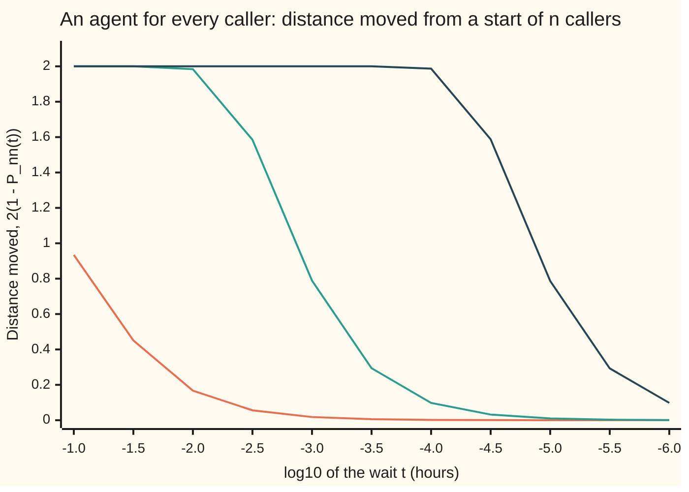

# Semigroups: a family of operators that composes like elapsed time

[Syllabus](../../../SYLLABUS.md) → [Functional analysis](../README.md) → [Unbounded Operators and Semigroups](../README.md#s05) → Semigroups

---

## General Overview

A help desk takes calls at random, 4 an hour on average. One agent finishes calls at 5 an hour on average, and callers who find the agent busy wait on hold. The line moves one step at a time: an arrival adds one caller, a finished call removes one. The desk opens empty.

Ask for the chance that the desk is idle after 45 minutes. Two routes give it. Wait 45 minutes in one go. Or wait 15 minutes, then wait 30 more from wherever the desk has got to. Without a hold line both routes give 0.556076. Waiting composes: two waits in a row are one longer wait.

So each waiting time $`t`$ gives one fixed rule, "wait $`t`$ hours", that turns today's chances into later ones. The family of these rules is a **semigroup**: a family of operators (linear rules on a space) with a product law that copies addition of times. This card checks that law on the queue and asks the second question: as the wait shrinks to zero, does the rule shrink to "nothing happens"?

Measure how far a start has moved by the chance that left it, counted twice: once where it left and once where it arrived. That distance runs from 0 (nothing moved) to 2 (everything moved).

The answer depends on the desk. With one agent, all starts come back together: after 3.6 seconds (0.001 h), no start is more than 0.0179 from where it began. Give every caller an agent of their own and each start still comes back to where it began, but large starts need much shorter waits. At 3.6 seconds the distance is 0.0179 from 1 caller and 1.9863 from 1000 callers.

**A semigroup is a family of operators T(t), one for each elapsed time, with T(0) doing nothing and T(s + t) = T(s)T(t); it is strongly continuous when every single state drifts back to itself as t shrinks to 0, a weaker demand than the whole operator returning at once, and the two part company exactly when the rates of change have no ceiling.**

**What kind of fact this is:** a definition (semigroup, strong continuity). The semigroup law for the queue, its continuity with one agent, and the failure of norm continuity with an agent for every caller are theorems, proved on this card in Why it works. Step 7 proves that a bounded generator gives norm continuity; the converse is stated with a named source (Pazy).

### The picture: how far a start has moved, against the wait



Orange: start with 1 caller. Green: 100 callers. Dark blue: 10,000 callers. Every line falls to 0 as the wait shrinks, so each start returns to itself. Each hundredfold larger start needs a hundredfold shorter wait, so no single wait brings every start close at once. The values are exact, from the closed form in Step 4, with no truncation.

---

## The formula

Notation first. A **row of chances** $`p = (p_0, p_1, p_2, \dots)`$ gives the chance $`p_n`$ of $`n`$ callers in the system, counting the ones on hold and the ones being served. The row $`\delta_n`$ puts all the chance on $`n`$. The **size** of a row is $`\lVert p\rVert = \sum_n \lvert p_n\rvert`$, the $`\ell^1`$ norm ([Sequence spaces](../01-Normed%20and%20Banach%20Spaces/02-sequence-spaces-lp-and-c0.md)). For the difference of two rows of chances, it is twice the chance that has moved.

The desk's **rate matrix** $`G`$ holds, off the diagonal, the rate of each one-step jump, and on the diagonal minus the leaving rate $`q_n`$ ([Continuous-time chains](../../11-Stochastic%20processes%20and%20calculus/04-Poisson%20and%20Jump%20Processes/05-continuous-time-markov-chains-and-queues.md), which writes it $`G`$ too). The **transition table** $`P(t) = e^{tG}`$ has entry $`P_{nm}(t)`$, the chance of $`m`$ callers after a wait $`t`$ from a start of $`n`$. The operator "wait $`t`$" is $`T(t)p = p\,P(t)`$.

A **semigroup** on a complete normed space $`X`$ (a Banach space, [Normed and Banach spaces](../01-Normed%20and%20Banach%20Spaces/01-normed-spaces-and-banach-spaces.md)) is a family of bounded operators $`T(t)`$, one for each $`t \ge 0`$, with

```math
T(0) = I, \qquad T(s + t) = T(s)\,T(t) \quad \text{for all } s, t \ge 0.
```

It is **strongly continuous** (a $`C_0`$-semigroup) if each state returns to itself as the wait shrinks:

```math
\lim_{t \downarrow 0} \lVert T(t)x - x\rVert = 0 \quad \text{for every } x \in X.
```

It is **norm continuous** if the worst case returns too: $`\lVert T(t) - I\rVert \to 0`$, where $`\lVert T(t) - I\rVert`$ is the largest $`\lVert T(t)x - x\rVert`$ over states of size 1. Every strongly continuous semigroup obeys a growth bound with two constants $`M \ge 1`$ and $`\omega`$:

```math
\lVert T(t)\rVert \le M e^{\omega t} \quad \text{for all } t \ge 0.
```

**Read it aloud:** waiting nothing changes nothing; waiting s then t is waiting s plus t; each single state drifts back to itself as the wait shrinks; and the operators can grow at most exponentially in time.

The rate at which $`T(t)`$ leaves $`I`$ is the **generator**, $`Ax = \lim_{t \downarrow 0} (T(t)x - x)/t`$, taken on the states $`x`$ where the limit exists. Those states form the domain $`D(A)`$ ([Unbounded operators](01-unbounded-operators-and-domains.md)). For the queue, $`Ap = p\,G`$.

With an agent for every caller, $`G`$ is unbounded, and $`D(A)`$ is the set of rows $`p`$ for which $`(T(t)p - p)/t`$ converges in $`\ell^1`$. Every row with finitely many nonzero entries is in it. Row $`n`$ of $`(P(t) - I)/t`$ tends to row $`n`$ of $`G`$ entry by entry. Its off-diagonal entries are never negative, and their total $`(1 - P_{nn}(t))/t`$ tends to $`q_n`$, the matching total for $`G`$. So the convergence holds in $`\ell^1`$ too.

| Symbol | Plain meaning | In our example | Push it up and the answer… |
| --- | --- | --- | --- |
| $`t, s, h`$ | waiting times, in hours; $`h`$ a short one | 0.25 then 0.5, together 0.75 | more chance moves |
| $`n, m, k`$ | number of callers in the system, a state; $`k`$ counts finished calls or clock ticks | start at 0, 1, 10, 100, 1000 | larger starts need shorter waits to stay close |
| $`\nu`$ | mean number of newcomers still on a call after a wait $`t`$ | $`\tfrac45(1 - e^{-5t})`$, from 4 arrivals and 5 completions an hour | |
| $`G, q_n`$ | rate matrix, the generator; total leaving rate from $`n`$ | $`q_n = 9`$ with one agent; $`4 + 5n`$ with one each | $`\lVert P(t) - I\rVert`$ grows |
| $`P(t), P_{nm}(t), B`$ | table of chances over a wait $`t`$, equal to $`e^{tG}`$; one entry; $`B`$ any table acting on rows | $`P_{00}(0.75) = 0.556076`$ with no hold line | |
| $`p, \delta_n, \lVert p\rVert, \varepsilon`$ | a row of chances; all chance on $`n`$; size, the sum of $`\lvert p_n\rvert`$; $`\varepsilon`$ a small tolerance | $`\lVert \delta_n\rVert = 1`$ | |
| $`X, x, T(t), I, A, D(A)`$ | a complete normed space and a state in it; the operator "wait $`t`$", here $`p \mapsto pP(t)`$; the operator that changes nothing; the generator, here $`p \mapsto pG`$, and its domain | $`T(0.25)\,T(0.5) = T(0.75)`$ | |
| $`\lVert T(t) - I\rVert`$ | worst distance moved, over all starts of size 1 | 0.0179 at $`t = 0.001`$ with one agent | approaches 2 |
| $`M, \omega, \tau, j, r`$ | constants of the growth bound; $`\tau`$ a span on which $`\lVert T(t)\rVert \le M`$; a wait $`t = j\tau + r`$ split into $`j`$ whole spans and a remainder $`r`$ | $`M = 1`$, $`\omega = 0`$ for every desk here | |
| $`N, p^N`$ | number of states kept in a truncation, arrivals refused at $`N - 1`$; $`p`$ cut to its first entries, tail set to 0 | 10, 40, 80 | the truncation's generator grows: 90, 990, 9990 |
| $`f, \lVert f\rVert_\infty`$ | a score on counts, acted on by $`(P(t)f)(n) = \sum_m P_{nm}(t)f(m)`$; its largest $`\lvert f(n)\rvert`$ | parity $`f(n) = (-1)^n`$ | |
| $`C, K, \pi, \Pi`$ | uniformization clock rate and jump table $`K = I + G/C`$; stationary row; the table with every row equal to it | $`C = 9`$; $`\pi_n \propto 0.8^n`$ | |

### When it holds

- **The rates do not depend on the clock.** If arrivals double at the half-hour mark, "wait 30 minutes" is two different rules. For the desk with no hold line, the chance of idle again from idle is 0.560493 over the first half hour and 0.385541 over the second, so no single $`T(0.5)`$ exists.
- **The norm measures moved chance.** On rows of chances with the $`\ell^1`$ size, the desk with an agent for every caller is strongly continuous. On scores with the sup norm $`\lVert f\rVert_\infty`$ it is not: the parity score loses up to 1.0000 at every wait.
- **Strong is not norm.** Each start returning to itself does not make the worst start return. With an agent for every caller, $`\lVert T(t) - I\rVert`$ equals 2 for every wait $`t > 0`$ (Step 4).
- **The space is complete.** The growth bound comes from the uniform boundedness principle, which needs completeness (Step 6). Without it, $`\lVert T(t)\rVert`$ can grow without limit as $`t \downarrow 0`$ even when every single state returns, and no bound $`Me^{\omega t}`$ holds. The space $`\ell^1`$, where the rows of chances live, is complete.
- **The operators are linear.** The colony flow of [The flow](../../08-Differential%20equations%20and%20dynamics/02-Existence%2C%20Uniqueness%20and%20Sensitivity/05-the-flow-of-an-equation.md) composes the same way but is not linear. Bounds like $`Me^{\omega t}`$ and the generator theory below need linearity.

---

## Why it works

### Step 0: waiting composes, and continuity at zero spreads

Two facts carry the card. First, the desk's future depends only on its present count, and the rates ignore the clock. So "wait $`s`$, then wait $`t`$" equals "wait $`s + t`$". Second, if each state comes back to itself as the wait shrinks to zero, the semigroup law carries that continuity to every later time.

What is new in infinite dimensions is the gap between two meanings of "comes back". The whole operator can stay far from $`I`$ while every single state comes back. A finite matrix never shows this gap.

### Step 1: the semigroup law, by hand and in general

Without a hold line the desk has two states, idle and busy, and $`G`$ = `[[-4, 4], [5, -5]]`. Its eigenvalues are 0 and −9 ([Diagonalisation](../../03-Algebra/07-Eigenvalues%20and%20Symmetric%20Matrices/03-diagonalisation-and-matrix-powers.md)). Write $`\Pi`$ for the table with both rows equal to $`(5/9, 4/9)`$, the long-run split. Then

```math
P(t) = \Pi + e^{-9t}\,(I - \Pi).
```

Here $`\Pi^2 = \Pi`$ and $`\Pi(I - \Pi) = 0`$. Multiply two of these and the cross terms vanish, leaving $`\Pi + e^{-9s}e^{-9t}(I - \Pi) = P(s + t)`$. The law is the exponent rule $`e^{-9s}e^{-9t} = e^{-9(s+t)}`$, seen through the eigenvectors.

In general $`P(s)P(t) = P(s + t)`$ is the Chapman–Kolmogorov equation. It follows from the Markov property, which [Continuous-time chains](../../11-Stochastic%20processes%20and%20calculus/04-Poisson%20and%20Jump%20Processes/05-continuous-time-markov-chains-and-queues.md) proves. It is the same composition rule as [The flow](../../08-Differential%20equations%20and%20dynamics/02-Existence%2C%20Uniqueness%20and%20Sensitivity/05-the-flow-of-an-equation.md), now for a linear operator on chances.

### Step 2: measuring "nothing happened"

A start $`\delta_n`$ goes to row $`n`$ of $`P(t)`$. That row sums to 1, so the chance that left $`n`$ is $`1 - P_{nn}(t)`$, and it arrived somewhere else. The distance moved is

```math
\lVert \delta_n P(t) - \delta_n\rVert = (1 - P_{nn}(t)) + \sum_{m \ne n} P_{nm}(t) = 2\,(1 - P_{nn}(t)).
```

On $`\ell^1`$ the worst start of size 1 is a single count: for any table $`B`$, $`\lVert pB\rVert \le \sum_n \lvert p_n\rvert \sum_m \lvert B_{nm}\rvert`$, and $`p = \delta_n`$ attains row $`n`$. So

```math
\lVert T(t) - I\rVert = \sup_n\ 2\,(1 - P_{nn}(t)).
```

The same reasoning with $`B = P(t)`$ gives $`\lVert T(t)\rVert = 1`$, since rows of chances are nonnegative and sum to 1. So $`M = 1`$ and $`\omega = 0`$ for every desk on this card.

### Step 3: one agent, continuous in norm

A desk that sees no event at all in $`[0, t]`$ is still at $`n`$. Events from $`n`$ come at total rate $`q_n \le 9`$, so $`P_{nn}(t) \ge e^{-q_n t} \ge e^{-9t}`$. Hence

```math
\lVert T(t) - I\rVert \le 2\,(1 - e^{-9t}) \;\longrightarrow\; 0.
```

The checks compute the left side on 10 and on 40 states. They agree to four places, so the cut does not matter here: 1.0159, 0.1685 and 0.0179 at waits of 0.1, 0.01 and 0.001 hours, under the bound 1.1869, 0.1721 and 0.0179.

### Step 4: an agent for every caller, exact

Now each call in progress ends at 5 an hour on its own (the M/M/∞ queue, "∞" for unlimited servers). From $`n`$ callers, the leaving rate is $`q_n = 4 + 5n`$, with no ceiling. After a wait $`t`$ the count splits into two independent parts:

- survivors of the first $`n`$ calls, each still running with chance $`e^{-5t}`$, a binomial count;
- newcomers still on a call, a Poisson count with mean $`\tfrac45(1 - e^{-5t})`$.

To be back at $`n`$, the number of newcomers must equal the number of finished calls, $`k`$:

```math
P_{nn}(t) = \sum_{k=0}^{n} \binom{n}{k} e^{-5t(n-k)}\,(1 - e^{-5t})^k \cdot e^{-\nu}\frac{\nu^k}{k!}, \qquad \nu = \tfrac45\,(1 - e^{-5t}).
```

The Poisson chances add to at most 1, so $`P_{nn}(t)`$ is at most the largest binomial chance. For fixed $`t > 0`$ the binomial spreads over about $`\sqrt{n\,e^{-5t}(1 - e^{-5t})}`$ values as $`n`$ grows, so by the normal approximation to the binomial its largest chance falls to 0, like one over that spread. So $`\sup_n 2(1 - P_{nn}(t)) = 2`$ for every $`t > 0`$:

```math
\lVert T(t) - I\rVert = 2 \quad \text{for every wait } t > 0.
```

<details>
<summary>Why survivors and newcomers are independent, and why the newcomers are Poisson</summary>

Each call in progress ends after its own exponential time, independent of everything else. So the $`n`$ starting calls survive to time $`t`$ independently, each with chance $`e^{-5t}`$.

A newcomer arriving at time $`s \le t`$ is still on a call at $`t`$ with chance $`e^{-5(t-s)}`$. Arrivals form a Poisson stream of rate 4, and keeping each point independently gives another Poisson stream. [Splitting and merging](../../11-Stochastic%20processes%20and%20calculus/04-Poisson%20and%20Jump%20Processes/03-splitting-and-superposition.md) proves this for a fixed keep chance; the same argument on short time slices allows a keep chance that changes with the arrival time. Its mean is

$`\displaystyle \nu = \int_0^t 4\,e^{-5(t-s)}\,ds = \tfrac45\,(1 - e^{-5t}).`$

The starting calls and the arrival stream share no randomness, so the two counts are independent and the chance of a total of $`n`$ is the sum in Step 4. The checks compare it with uniformization on 80 states from 10 callers at $`t = 0.05`$: both give 0.107425.

</details>

### Step 5: strongly continuous all the same

For one start, an event-free wait again gives $`2(1 - P_{nn}(t)) \le 2(1 - e^{-(4+5n)t})`$, which goes to 0. Every row of chances is close, in $`\ell^1`$ size, to a row with only finitely many nonzero entries, and $`\lVert T(t)\rVert = 1`$ stops the far tail from growing. Together these give strong continuity.

<details>
<summary>The three-part estimate, for any row p</summary>

Fix $`p`$ with $`\lVert p\rVert < \infty`$ and a tolerance $`\varepsilon > 0`$. Choose $`N`$ so that the tail beyond $`N`$ has size $`\sum_{n > N}\lvert p_n\rvert < \varepsilon`$. Let $`p^N`$ be $`p`$ with that tail set to 0. Then

$`\displaystyle \lVert T(t)p - p\rVert \le \lVert T(t)(p - p^N)\rVert + \lVert T(t)p^N - p^N\rVert + \lVert p^N - p\rVert \le 2\varepsilon + \sum_{n \le N} \lvert p_n\rvert\, 2\,(1 - e^{-(4+5N)t}).`$

The last term goes to 0 as $`t \downarrow 0`$, so $`\lVert T(t)p - p\rVert`$ ends below $`3\varepsilon`$. The tolerance was arbitrary. The same argument works for any semigroup that is bounded near 0 and continuous on a dense set of states.

</details>

### Step 6: from time zero to every time

Strong continuity is asked only as $`t \downarrow 0`$. The law spreads it. After a short extra wait $`h`$,

```math
\lVert T(t + h)x - T(t)x\rVert = \lVert T(t)\,(T(h)x - x)\rVert \le \lVert T(t)\rVert\,\lVert T(h)x - x\rVert.
```

A short wait $`h`$ earlier works the same way, using $`T(t) = T(t - h)T(h)`$. Both need $`\lVert T(t)\rVert`$ to stay bounded, and that is the growth bound $`Me^{\omega t}`$. On the queue it is free, since $`M = 1`$. In general it comes from the uniform boundedness principle ([Three Banach theorems](../01-Normed%20and%20Banach%20Spaces/08-open-mapping-closed-graph-and-uniform-boundedness.md)).

<details>
<summary>Detailed proof of the growth bound</summary>

First, $`\lVert T(t)\rVert`$ is bounded near 0. If not, some waits $`t_k \to 0`$ have $`\lVert T(t_k)\rVert \to \infty`$. But for each $`x`$, $`T(t_k)x \to x`$, so the sizes $`\lVert T(t_k)x\rVert`$ are bounded for each $`x`$. On a complete space the uniform boundedness principle then bounds $`\lVert T(t_k)\rVert`$, a contradiction. So $`\lVert T(t)\rVert \le M`$ for $`0 \le t \le \tau`$, some $`\tau > 0`$, $`M \ge 1`$.

Second, write any $`t = j\tau + r`$ with $`j`$ a whole number and $`0 \le r < \tau`$. The law gives $`T(t) = T(\tau)^j\,T(r)`$, so

$`\displaystyle \lVert T(t)\rVert \le M^{j+1} \le M \cdot M^{t/\tau} = M e^{\omega t}, \qquad \omega = \frac{\ln M}{\tau}.`$

</details>

### Step 7: what the finite rehearsal hides

Every matrix generator is bounded, and a bounded generator forces norm continuity:

```math
\lVert e^{tA} - I\rVert = \Big\lVert \sum_{k \ge 1} \frac{t^k A^k}{k!} \Big\rVert \le e^{t\lVert A\rVert} - 1 \;\longrightarrow\; 0.
```

The converse also holds: a semigroup with $`\lVert T(t) - I\rVert \to 0`$ has a bounded generator (Pazy, Section 1.1, in Sources). So norm continuity is exactly a bounded generator, and the gap of Step 4 is exactly an unbounded one.

Cut the desk with an agent for every caller at $`N`$ states and its generator has size $`\lVert G_N\rVert`$ = 90, 990 and 9990 at $`N`$ = 10, 100 and 1000, twice the top leaving rate. Each cut is norm continuous. Only the trend over $`N`$, a ceiling that never settles, shows the true generator is unbounded.

---

## Worked numbers, by hand

The semigroup law for the desk with no hold line, from idle: wait 0.25 h then 0.5 h, against 0.75 h at once.

| Step | Arithmetic | Value |
| --- | --- | --- |
| long-run share idle | $`5/9`$ | 0.555556 |
| idle to idle in 0.25 h | $`5/9 + 4/9 \times e^{-2.25} = 5/9 + 4/9 \times 0.105399`$ | 0.602400 |
| idle to busy in 0.25 h | $`1 - 0.602400`$ | 0.397600 |
| idle to idle in 0.5 h | $`5/9 + 4/9 \times e^{-4.5} = 5/9 + 4/9 \times 0.011109`$ | 0.560493 |
| busy to idle in 0.5 h | $`5/9 \times (1 - 0.011109)`$ | 0.549384 |
| through idle at 0.25 h | $`0.602400 \times 0.560493`$ | 0.337641 |
| through busy at 0.25 h | $`0.397600 \times 0.549384`$ | 0.218435 |
| two waits | $`0.337641 + 0.218435`$ | 0.556076 |
| one wait of 0.75 h | $`5/9 + 4/9 \times e^{-6.75} = 5/9 + 4/9 \times 0.001171`$ | **0.556076** |

The two routes agree: in chances, "wait 15 minutes, then 30" is the same operator as "wait 45".

Then the continuity question at a wait of 0.001 h (3.6 seconds). One agent: $`2(1 - e^{-0.009})`$ = 0.0179 bounds every start. An agent for every caller: from 1 caller the distance is 0.0179, from 1000 callers it is 1.9863.

### What breaks if you drop a piece

| Mistake | Comes out at | What went wrong |
| --- | --- | --- |
| Trust the cut at $`N = 10`$ for the desk with an agent for every caller | promises a distance of at most 0.0880 at $`t = 0.001`$ for every start; from 1000 callers it is 1.9863 | the cut's top leaving rate is 45 an hour; the true rates have no ceiling |
| Read "each start returns" as norm continuity | starts 1, 10, 100, 1000 at $`t = 0.001`$: 0.0179, 0.1047, 0.7894, 1.9863 | the worst start keeps moving away, so $`\lVert T(t) - I\rVert`$ equals 2 at every wait (Step 4) |
| Use the sup norm on scores instead of $`\ell^1`$ on chances | parity $`f(n) = (-1)^n`$ at $`t = 0.001`$: gaps 0.0178, 0.1026, 0.6360, 1.0000 for $`n`$ = 1, 10, 100, 1000 | on scores the semigroup is not even strongly continuous: the gap tends to 1 as $`n`$ grows, at every wait |
| Let the arrival rate change at the half-hour mark (4, then 8 an hour), for the desk with no hold line | idle to idle 0.560493 over the first half hour, 0.385541 over the second | the rule depends on the start time, so there is no single $`T(0.5)`$ |

---

## Code, from first principles, and it actually runs

The scripts compute every number above and take four independent roads. Closed forms: the two-state table and the survivor-plus-newcomer formula. Uniformization: a Poisson clock of rate $`C`$ driving the jump table $`K = I + G/C`$, so $`P(t) = \sum_k e^{-Ct}(Ct)^k/k!\,K^k`$. A Taylor series of $`e^{tG}`$ with repeated squaring. The stationary row $`\pi_n \propto 0.8^n`$ as an invariant. The asserts pit each road against another and hold each distance under its event-free bound. What the truncation hides: every cut desk is norm continuous, and only the trend over $`N`$ or over the start shows the unbounded generator.

### Python

```python
# Strongly continuous semigroups -- the check behind the card.  Standard library only.
# A help desk queue moves one step at a time: an arrival adds a caller, a finished call removes one.
# Space: rows of chances p over the counts 0, 1, 2, ...; size ||p|| = sum of |p_n| (the l1 norm).
# Roads: closed forms; uniformization (a Poisson clock driving a jump table); Taylor series with
# repeated squaring; the stationary row as an invariant.  Every computation is a truncation.
import math
LAM, MU = 4.0, 5.0                      # arrivals and completions per hour

def chain(N, servers):                  # up and down rates on states 0..N-1, arrivals stop at N-1
    up = [LAM if n < N - 1 else 0.0 for n in range(N)]
    dn = [MU * min(n, servers) for n in range(N)]
    return up, dn

def row_at(up, dn, start, t, f=None):   # row start of P(t) = sum_k Poisson(Ct; k) K^k, K = I + G/C
    N = len(up); C = max(u + d for u, d in zip(up, dn))
    v = [0.0] * N; v[start] = 1.0
    w = math.exp(-C * t); out = [w * x for x in v]; k = 0; mass = w
    while mass < 1 - 1e-15 or k < C * t:
        k += 1
        v = [v[m] * (1 - (up[m] + dn[m]) / C) + (v[m - 1] * up[m - 1] / C if m else 0.0)
             + (v[m + 1] * dn[m + 1] / C if m + 1 < N else 0.0) for m in range(N)]
        w *= C * t / k; mass += w; out = [o + w * x for o, x in zip(out, v)]
    return out

def matrix(up, dn, t): return [row_at(up, dn, n, t) for n in range(len(up))]
def mul(A, B): return [[sum(a * b for a, b in zip(r, c)) for c in zip(*B)] for r in A]
def gap(A, B): return max(abs(a - b) for r, s in zip(A, B) for a, b in zip(r, s))
def dist_from_start(P): return max(2 * (1 - P[n][n]) for n in range(len(P)))  # ||P(t) - I||

def taylor_exp(up, dn, t, s=12):        # second road: e^{tG} by Taylor series, then square s times
    N = len(up); G = [[0.0] * N for _ in range(N)]
    for n in range(N):
        G[n][n] = -(up[n] + dn[n])
        if n + 1 < N: G[n][n + 1] = up[n]
        if n: G[n][n - 1] = dn[n]
    A = [[g * t / 2 ** s for g in r] for r in G]; E = [[float(i == j) for j in range(N)] for i in range(N)]
    term = [r[:] for r in E]
    for k in range(1, 12):
        term = [[x / k for x in r] for r in mul(term, A)]; E = [[e + x for e, x in zip(r, q)] for r, q in zip(E, term)]
    for _ in range(s): E = mul(E, E)
    return E

# 1. The desk with no hold line (N = 2): closed form against uniformization.
def two_state(t, lam=LAM):
    e = math.exp(-(lam + MU) * t); s = lam + MU
    return [[MU / s + lam / s * e, lam / s * (1 - e)], [MU / s * (1 - e), lam / s + MU / s * e]]
up2, dn2 = chain(2, 1)
for t in (0.25, 0.5, 0.75):
    P = two_state(t); assert gap(P, matrix(up2, dn2, t)) < 1e-12
    print(f"no hold line, P({t}) = [[{P[0][0]:.6f}, {P[0][1]:.6f}], [{P[1][0]:.6f}, {P[1][1]:.6f}]]")
PP = mul(two_state(0.25), two_state(0.5))
print(f"no hold line, P(0.25) P(0.5) row 0 = {PP[0][0]:.6f}, {PP[0][1]:.6f}; P(0.75) row 0 = {two_state(0.75)[0][0]:.6f}")
h1, h2 = two_state(0.25)[0][0] * two_state(0.5)[0][0], two_state(0.25)[0][1] * two_state(0.5)[1][0]
print(f"by hand, 5/9 = {5 / 9:.6f}, e^-2.25 = {math.exp(-2.25):.6f}, e^-4.5 = {math.exp(-4.5):.6f}, e^-6.75 = {math.exp(-6.75):.6f}, products {h1:.6f} + {h2:.6f}")
assert gap(PP, two_state(0.75)) < 1e-12 and gap(two_state(0.0), [[1, 0], [0, 1]]) < 1e-15

# 2. One agent with a hold line (M/M/1), cut at N = 40 states: the semigroup laws.
up, dn = chain(40, 1)
A, B, C = matrix(up, dn, 0.25), matrix(up, dn, 0.5), matrix(up, dn, 0.75)
law = gap(mul(A, B), C); road = gap(C, taylor_exp(up, dn, 0.75))
pi = [0.8 ** n for n in range(40)]; pi = [x / sum(pi) for x in pi]
inv = sum(abs(sum(pi[m] * C[m][n] for m in range(40)) - pi[n]) for n in range(40))
yes = lambda ok: "yes" if ok else "no"
print(f"M/M/1, N = 40, agree to 1e-12: P(0.25)P(0.5) with P(0.75) {yes(law < 1e-12)}; uniformization with Taylor {yes(road < 1e-12)}")
print(f"M/M/1, N = 40, P(0.75): rows sum to 1 {yes(max(abs(sum(r) - 1) for r in C) < 1e-12)}; no negative entry {yes(min(map(min, C)) > -1e-15)}; "
      f"stationary row unmoved {yes(inv < 1e-12)}; P(0) = I {yes(gap(matrix(up, dn, 0.0), taylor_exp(up, dn, 0.0)) < 1e-15)}")
assert law < 1e-12 and road < 1e-12 and inv < 1e-12 and min(map(min, C)) > -1e-15
print("norm continuity, t (h), ||P(t) - I|| on N = 10, on N = 40, bound 2(1 - e^{-9t})")
for t in (0.1, 0.01, 0.001):
    d10, d40 = dist_from_start(matrix(*chain(10, 1), t)), dist_from_start(matrix(up, dn, t)); bd = -2 * math.expm1(-9 * t)
    print(f"norm continuity, {t}, {d10:.4f}, {d40:.4f}, {bd:.4f}"); assert d40 <= bd and abs(d40 - d10) < 1e-3

# 3. An agent for every caller (M/M/infinity): exact P_nn(t) from survivors (binomial) plus newcomers (Poisson).
LF = [0.0]
for k in range(1, 10001): LF.append(LF[-1] + math.log(k))
def stay(n, t):                         # chance to be at n again after t hours, starting from n
    p, q = math.exp(-MU * t), -math.expm1(-MU * t); m = LAM / MU * q
    return sum(math.exp(LF[n] - LF[k] - LF[n - k] + (n - k) * math.log(p) + k * math.log(q)
                        - m + k * math.log(m) - LF[k]) for k in range(min(n, 200) + 1))
def parity(n, t):                       # (P(t)f)(n) for f(n) = (-1)^n, in closed form
    return (-1) ** n * (2 * math.exp(-MU * t) - 1) ** n * math.exp(-2 * LAM / MU * -math.expm1(-MU * t))
r = row_at(*chain(80, 80), 10, 0.05); pf = sum(x * (-1) ** m for m, x in enumerate(r))
print(f"M/M/inf, start 10, t = 0.05: P_10,10 exact {stay(10, 0.05):.6f}, uniformization on 80 states {r[10]:.6f}; "
      f"(P f)(10) exact {parity(10, 0.05):.6f}, uniformization {pf:.6f}")
assert abs(stay(10, 0.05) - r[10]) < 1e-9 and abs(parity(10, 0.05) - pf) < 1e-9
assert abs(sum(r) - 1) < 1e-12 and abs(sum(abs(x - (m == 10)) for m, x in enumerate(r)) - 2 * (1 - r[10])) < 1e-12
print("strong continuity, t (h), distance 2(1 - P_nn(t)) from start n = 1, 10, 100, 1000")
for t in (0.1, 0.01, 0.001):
    d = [2 * (1 - stay(n, t)) for n in (1, 10, 100, 1000)]
    print("strong continuity, " + f"{t}, " + ", ".join(f"{x:.4f}" for x in d))
    assert all(x <= -2 * math.expm1(-(LAM + MU * n) * t) for x, n in zip(d, (1, 10, 100, 1000)))
assert 2 * (1 - stay(1000, 0.001)) > 1.98 and 2 * (1 - stay(1, 0.001)) < 0.02
print("chart, log10 t, " + ", ".join(f"{-e / 2:.1f}" for e in range(2, 13)))
for n in (1, 100, 10000):
    print(f"chart, start {n}, " + ", ".join(f"{2 * (1 - stay(n, 10 ** (-e / 2))):.3f}" for e in range(2, 13)))
print("generator size ||G_N|| for M/M/inf cut at N = 10, 100, 1000: " + ", ".join(f"{2 * max(map(sum, zip(*chain(N, N)))):.0f}" for N in (10, 100, 1000)) + f"; M/M/1: {2 * (LAM + MU):.0f}")

# 4. What breaks.
q10 = max(u + d for u, d in zip(*chain(10, 10))); cut = -2 * math.expm1(-q10 * 0.001)
print(f"breaks, trust the N = 10 cut (top leaving rate {q10:.0f} an hour): distance at most {cut:.4f} at t = 0.001 for every start; from 1000 callers it is {2 * (1 - stay(1000, 0.001)):.4f}")
assert cut < 0.1 < 2 * (1 - stay(1000, 0.001))
print("breaks, sup norm on f(n) = (-1)^n at t = 0.001, gap |P(t)f(n) - f(n)| for n = 1, 10, 100, 1000: "
      + ", ".join(f"{abs(parity(n, 0.001) - (-1) ** n):.4f}" for n in (1, 10, 100, 1000)))
assert abs(parity(1000, 0.001) - 1) > 0.99
a, b = two_state(0.5)[0][0], two_state(0.5, 8.0)[0][0]
print(f"breaks, rush hour (arrivals 4 then 8 an hour): idle to idle over the first half hour {a:.6f}, over the second {b:.6f}")
assert abs(a - b) > 0.1
print("ALL CHECKS PASS")
```

**Ran 2026-11-15 on macOS, Python 3.14.10, standard library only. All checks passed. Output, pasted from the run:**

```
no hold line, P(0.25) = [[0.602400, 0.397600], [0.497000, 0.503000]]
no hold line, P(0.5) = [[0.560493, 0.439507], [0.549384, 0.450616]]
no hold line, P(0.75) = [[0.556076, 0.443924], [0.554905, 0.445095]]
no hold line, P(0.25) P(0.5) row 0 = 0.556076, 0.443924; P(0.75) row 0 = 0.556076
by hand, 5/9 = 0.555556, e^-2.25 = 0.105399, e^-4.5 = 0.011109, e^-6.75 = 0.001171, products 0.337641 + 0.218435
M/M/1, N = 40, agree to 1e-12: P(0.25)P(0.5) with P(0.75) yes; uniformization with Taylor yes
M/M/1, N = 40, P(0.75): rows sum to 1 yes; no negative entry yes; stationary row unmoved yes; P(0) = I yes
norm continuity, t (h), ||P(t) - I|| on N = 10, on N = 40, bound 2(1 - e^{-9t})
norm continuity, 0.1, 1.0159, 1.0159, 1.1869
norm continuity, 0.01, 0.1685, 0.1685, 0.1721
norm continuity, 0.001, 0.0179, 0.0179, 0.0179
M/M/inf, start 10, t = 0.05: P_10,10 exact 0.107425, uniformization on 80 states 0.107425; (P f)(10) exact 0.002040, uniformization 0.002040
strong continuity, t (h), distance 2(1 - P_nn(t)) from start n = 1, 10, 100, 1000
strong continuity, 0.1, 0.9337, 1.9590, 2.0000, 2.0000
strong continuity, 0.01, 0.1667, 0.8099, 1.9843, 2.0000
strong continuity, 0.001, 0.0179, 0.1047, 0.7894, 1.9863
chart, log10 t, -1.0, -1.5, -2.0, -2.5, -3.0, -3.5, -4.0, -4.5, -5.0, -5.5, -6.0
chart, start 1, 0.934, 0.451, 0.167, 0.056, 0.018, 0.006, 0.002, 0.001, 0.000, 0.000, 0.000
chart, start 100, 2.000, 2.000, 1.984, 1.585, 0.789, 0.294, 0.098, 0.032, 0.010, 0.003, 0.001
chart, start 10000, 2.000, 2.000, 2.000, 2.000, 2.000, 2.000, 1.987, 1.588, 0.787, 0.293, 0.098
generator size ||G_N|| for M/M/inf cut at N = 10, 100, 1000: 90, 990, 9990; M/M/1: 18
breaks, trust the N = 10 cut (top leaving rate 45 an hour): distance at most 0.0880 at t = 0.001 for every start; from 1000 callers it is 1.9863
breaks, sup norm on f(n) = (-1)^n at t = 0.001, gap |P(t)f(n) - f(n)| for n = 1, 10, 100, 1000: 0.0178, 0.1026, 0.6360, 1.0000
breaks, rush hour (arrivals 4 then 8 an hour): idle to idle over the first half hour 0.560493, over the second 0.385541
ALL CHECKS PASS
```

### Rust

```rust
// Strongly continuous semigroups -- the check behind the card.  Rust std only, no crates.
// A help desk queue moves one step at a time: an arrival adds a caller, a finished call removes one.
// Space: rows of chances p over the counts 0, 1, 2, ...; size ||p|| = sum of |p_n| (the l1 norm).
// Roads: closed forms; uniformization (a Poisson clock driving a jump table); Taylor series with
// repeated squaring; the stationary row as an invariant.  Every computation is a truncation.
const LAM: f64 = 4.0;
const MU: f64 = 5.0; // arrivals and completions per hour
type M = Vec<Vec<f64>>;

fn chain(n: usize, servers: usize) -> (Vec<f64>, Vec<f64>) {
    // up and down rates on states 0..n-1, arrivals stop at n-1
    let up = (0..n).map(|k| if k + 1 < n { LAM } else { 0.0 }).collect();
    let dn = (0..n).map(|k| MU * k.min(servers) as f64).collect();
    (up, dn)
}

fn row_at(up: &[f64], dn: &[f64], start: usize, t: f64) -> Vec<f64> {
    // row start of P(t) = sum_k Poisson(Ct; k) K^k, K = I + G/C
    let n = up.len();
    let c = (0..n).map(|m| up[m] + dn[m]).fold(0.0, f64::max);
    let mut v = vec![0.0; n];
    v[start] = 1.0;
    let mut w = (-c * t).exp();
    let mut out: Vec<f64> = v.iter().map(|x| w * x).collect();
    let (mut k, mut mass) = (0usize, w);
    while mass < 1.0 - 1e-15 || (k as f64) < c * t {
        k += 1;
        v = (0..n)
            .map(|m| {
                let mut s = v[m] * (1.0 - (up[m] + dn[m]) / c);
                if m > 0 { s += v[m - 1] * up[m - 1] / c; }
                if m + 1 < n { s += v[m + 1] * dn[m + 1] / c; }
                s
            })
            .collect();
        w *= c * t / k as f64;
        mass += w;
        for m in 0..n { out[m] += w * v[m]; }
    }
    out
}

fn matrix(up: &[f64], dn: &[f64], t: f64) -> M { (0..up.len()).map(|s| row_at(up, dn, s, t)).collect() }
fn mul(a: &M, b: &M) -> M {
    let n = b[0].len();
    a.iter().map(|r| (0..n).map(|j| r.iter().zip(b.iter()).map(|(x, br)| x * br[j]).sum()).collect()).collect()
}
fn gap(a: &M, b: &M) -> f64 {
    a.iter().zip(b).flat_map(|(r, s)| r.iter().zip(s).map(|(x, y)| (x - y).abs())).fold(0.0, f64::max)
}
fn dist_from_start(p: &M) -> f64 { (0..p.len()).map(|n| 2.0 * (1.0 - p[n][n])).fold(0.0, f64::max) }

fn taylor_exp(up: &[f64], dn: &[f64], t: f64) -> M {
    // second road: e^{tG} by Taylor series, then square s = 12 times
    let n = up.len();
    let s = 12;
    let mut g = vec![vec![0.0; n]; n];
    for k in 0..n {
        g[k][k] = -(up[k] + dn[k]);
        if k + 1 < n { g[k][k + 1] = up[k]; }
        if k > 0 { g[k][k - 1] = dn[k]; }
    }
    let a: M = g.iter().map(|r| r.iter().map(|x| x * t / 2f64.powi(s)).collect()).collect();
    let mut e: M = (0..n).map(|i| (0..n).map(|j| if i == j { 1.0 } else { 0.0 }).collect()).collect();
    let mut term = e.clone();
    for k in 1..12 {
        term = mul(&term, &a).iter().map(|r| r.iter().map(|x| x / k as f64).collect()).collect();
        for i in 0..n { for j in 0..n { e[i][j] += term[i][j]; } }
    }
    for _ in 0..s { e = mul(&e, &e); }
    e
}

fn two_state(t: f64, lam: f64) -> M {
    let e = (-(lam + MU) * t).exp();
    let s = lam + MU; vec![vec![MU / s + lam / s * e, lam / s * (1.0 - e)], vec![MU / s * (1.0 - e), lam / s + MU / s * e]]
}
fn yes(ok: bool) -> &'static str { if ok { "yes" } else { "no" } }

fn main() {
    // 1. The desk with no hold line (N = 2): closed form against uniformization.
    let (up2, dn2) = chain(2, 1);
    for &t in &[0.25, 0.5, 0.75] {
        let p = two_state(t, LAM);
        assert!(gap(&p, &matrix(&up2, &dn2, t)) < 1e-12);
        println!("no hold line, P({}) = [[{:.6}, {:.6}], [{:.6}, {:.6}]]", t, p[0][0], p[0][1], p[1][0], p[1][1]);
    }
    let pp = mul(&two_state(0.25, LAM), &two_state(0.5, LAM));
    println!("no hold line, P(0.25) P(0.5) row 0 = {:.6}, {:.6}; P(0.75) row 0 = {:.6}", pp[0][0], pp[0][1], two_state(0.75, LAM)[0][0]);
    let (h1, h2) = (two_state(0.25, LAM)[0][0] * two_state(0.5, LAM)[0][0], two_state(0.25, LAM)[0][1] * two_state(0.5, LAM)[1][0]);
    println!("by hand, 5/9 = {:.6}, e^-2.25 = {:.6}, e^-4.5 = {:.6}, e^-6.75 = {:.6}, products {:.6} + {:.6}", 5.0 / 9.0, (-2.25f64).exp(), (-4.5f64).exp(), (-6.75f64).exp(), h1, h2);
    assert!(gap(&pp, &two_state(0.75, LAM)) < 1e-12 && gap(&two_state(0.0, LAM), &vec![vec![1.0, 0.0], vec![0.0, 1.0]]) < 1e-15);

    // 2. One agent with a hold line (M/M/1), cut at N = 40 states: the semigroup laws.
    let (up, dn) = chain(40, 1);
    let (a, b, c) = (matrix(&up, &dn, 0.25), matrix(&up, &dn, 0.5), matrix(&up, &dn, 0.75));
    let law = gap(&mul(&a, &b), &c);
    let road = gap(&c, &taylor_exp(&up, &dn, 0.75));
    let tot: f64 = (0..40).map(|n| 0.8f64.powi(n)).sum();
    let pi: Vec<f64> = (0..40).map(|n| 0.8f64.powi(n) / tot).collect();
    let inv: f64 = (0..40).map(|n| ((0..40).map(|m| pi[m] * c[m][n]).sum::<f64>() - pi[n]).abs()).sum();
    let rows = c.iter().map(|r| (r.iter().sum::<f64>() - 1.0).abs()).fold(0.0, f64::max);
    let low = c.iter().flatten().cloned().fold(f64::INFINITY, f64::min);
    println!("M/M/1, N = 40, agree to 1e-12: P(0.25)P(0.5) with P(0.75) {}; uniformization with Taylor {}", yes(law < 1e-12), yes(road < 1e-12));
    println!("M/M/1, N = 40, P(0.75): rows sum to 1 {}; no negative entry {}; stationary row unmoved {}; P(0) = I {}",
        yes(rows < 1e-12), yes(low > -1e-15), yes(inv < 1e-12), yes(gap(&matrix(&up, &dn, 0.0), &taylor_exp(&up, &dn, 0.0)) < 1e-15));
    assert!(law < 1e-12 && road < 1e-12 && inv < 1e-12 && low > -1e-15);
    println!("norm continuity, t (h), ||P(t) - I|| on N = 10, on N = 40, bound 2(1 - e^{{-9t}})");
    let (up10, dn10) = chain(10, 1);
    for &t in &[0.1, 0.01, 0.001] {
        let (d10, d40, bd) = (dist_from_start(&matrix(&up10, &dn10, t)), dist_from_start(&matrix(&up, &dn, t)), -2.0 * (-9.0 * t).exp_m1());
        println!("norm continuity, {}, {:.4}, {:.4}, {:.4}", t, d10, d40, bd);
        assert!(d40 <= bd && (d40 - d10).abs() < 1e-3);
    }

    // 3. An agent for every caller (M/M/infinity): exact P_nn(t) from survivors (binomial) plus newcomers (Poisson).
    let mut lf = vec![0.0f64];
    for k in 1..=10000 { let l = lf[k - 1] + (k as f64).ln(); lf.push(l); }
    let stay = |n: usize, t: f64| -> f64 {
        // chance to be at n again after t hours, starting from n
        let (p, q) = ((-MU * t).exp(), -(-MU * t).exp_m1());
        let m = LAM / MU * q;
        (0..=n.min(200)).map(|k| (lf[n] - lf[k] - lf[n - k] + (n - k) as f64 * p.ln() + k as f64 * q.ln()
            - m + k as f64 * m.ln() - lf[k]).exp()).sum()
    };
    let sgn = |n: usize| if n % 2 == 0 { 1.0 } else { -1.0 };
    let parity = |n: usize, t: f64| -> f64 {
        // (P(t)f)(n) for f(n) = (-1)^n, in closed form
        sgn(n) * (2.0 * (-MU * t).exp() - 1.0).powi(n as i32) * (-2.0 * LAM / MU * -(-MU * t).exp_m1()).exp()
    };
    let (u80, d80) = chain(80, 80);
    let r = row_at(&u80, &d80, 10, 0.05);
    let pf: f64 = r.iter().enumerate().map(|(m, x)| x * sgn(m)).sum();
    println!("M/M/inf, start 10, t = 0.05: P_10,10 exact {:.6}, uniformization on 80 states {:.6}; (P f)(10) exact {:.6}, uniformization {:.6}",
        stay(10, 0.05), r[10], parity(10, 0.05), pf);
    assert!((stay(10, 0.05) - r[10]).abs() < 1e-9 && (parity(10, 0.05) - pf).abs() < 1e-9);
    let l1: f64 = r.iter().enumerate().map(|(m, x)| (x - if m == 10 { 1.0 } else { 0.0 }).abs()).sum();
    assert!((r.iter().sum::<f64>() - 1.0).abs() < 1e-12 && (l1 - 2.0 * (1.0 - r[10])).abs() < 1e-12);
    println!("strong continuity, t (h), distance 2(1 - P_nn(t)) from start n = 1, 10, 100, 1000");
    let starts = [1usize, 10, 100, 1000];
    for &t in &[0.1, 0.01, 0.001] {
        let d: Vec<f64> = starts.iter().map(|&n| 2.0 * (1.0 - stay(n, t))).collect();
        println!("strong continuity, {}, {}", t, d.iter().map(|x| format!("{:.4}", x)).collect::<Vec<_>>().join(", "));
        for (x, &n) in d.iter().zip(&starts) { assert!(*x <= -2.0 * (-(LAM + MU * n as f64) * t).exp_m1()); }
    }
    assert!(2.0 * (1.0 - stay(1000, 0.001)) > 1.98 && 2.0 * (1.0 - stay(1, 0.001)) < 0.02);
    println!("chart, log10 t, {}", (2..13).map(|e| format!("{:.1}", -(e as f64) / 2.0)).collect::<Vec<_>>().join(", "));
    for &n in &[1usize, 100, 10000] {
        let pts: Vec<String> = (2..13).map(|e| format!("{:.3}", 2.0 * (1.0 - stay(n, 10f64.powf(-(e as f64) / 2.0))))).collect();
        println!("chart, start {}, {}", n, pts.join(", "));
    }
    println!("generator size ||G_N|| for M/M/inf cut at N = 10, 100, 1000: {}; M/M/1: {:.0}",
        [10usize, 100, 1000].iter().map(|&n| { let (u, d) = chain(n, n); format!("{:.0}", 2.0 * (0..n).map(|m| u[m] + d[m]).fold(0.0, f64::max)) }).collect::<Vec<_>>().join(", "), 2.0 * (LAM + MU));

    // 4. What breaks.
    let (u10, d10) = chain(10, 10);
    let q10 = (0..10).map(|m| u10[m] + d10[m]).fold(0.0, f64::max);
    let cut = -2.0 * (-q10 * 0.001).exp_m1();
    println!("breaks, trust the N = 10 cut (top leaving rate {:.0} an hour): distance at most {:.4} at t = 0.001 for every start; from 1000 callers it is {:.4}",
        q10, cut, 2.0 * (1.0 - stay(1000, 0.001)));
    assert!(cut < 0.1 && 0.1 < 2.0 * (1.0 - stay(1000, 0.001)));
    println!("breaks, sup norm on f(n) = (-1)^n at t = 0.001, gap |P(t)f(n) - f(n)| for n = 1, 10, 100, 1000: {}",
        starts.iter().map(|&n| format!("{:.4}", (parity(n, 0.001) - sgn(n)).abs())).collect::<Vec<_>>().join(", "));
    assert!((parity(1000, 0.001) - 1.0).abs() > 0.99);
    let (ra, rb) = (two_state(0.5, LAM)[0][0], two_state(0.5, 8.0)[0][0]);
    println!("breaks, rush hour (arrivals 4 then 8 an hour): idle to idle over the first half hour {:.6}, over the second {:.6}", ra, rb);
    assert!((ra - rb).abs() > 0.1);
    println!("ALL CHECKS PASS");
}
```

**Ran 2026-11-15 on macOS, rustc 1.98.1, no crates. All checks passed. Output, pasted from the run:**

```
no hold line, P(0.25) = [[0.602400, 0.397600], [0.497000, 0.503000]]
no hold line, P(0.5) = [[0.560493, 0.439507], [0.549384, 0.450616]]
no hold line, P(0.75) = [[0.556076, 0.443924], [0.554905, 0.445095]]
no hold line, P(0.25) P(0.5) row 0 = 0.556076, 0.443924; P(0.75) row 0 = 0.556076
by hand, 5/9 = 0.555556, e^-2.25 = 0.105399, e^-4.5 = 0.011109, e^-6.75 = 0.001171, products 0.337641 + 0.218435
M/M/1, N = 40, agree to 1e-12: P(0.25)P(0.5) with P(0.75) yes; uniformization with Taylor yes
M/M/1, N = 40, P(0.75): rows sum to 1 yes; no negative entry yes; stationary row unmoved yes; P(0) = I yes
norm continuity, t (h), ||P(t) - I|| on N = 10, on N = 40, bound 2(1 - e^{-9t})
norm continuity, 0.1, 1.0159, 1.0159, 1.1869
norm continuity, 0.01, 0.1685, 0.1685, 0.1721
norm continuity, 0.001, 0.0179, 0.0179, 0.0179
M/M/inf, start 10, t = 0.05: P_10,10 exact 0.107425, uniformization on 80 states 0.107425; (P f)(10) exact 0.002040, uniformization 0.002040
strong continuity, t (h), distance 2(1 - P_nn(t)) from start n = 1, 10, 100, 1000
strong continuity, 0.1, 0.9337, 1.9590, 2.0000, 2.0000
strong continuity, 0.01, 0.1667, 0.8099, 1.9843, 2.0000
strong continuity, 0.001, 0.0179, 0.1047, 0.7894, 1.9863
chart, log10 t, -1.0, -1.5, -2.0, -2.5, -3.0, -3.5, -4.0, -4.5, -5.0, -5.5, -6.0
chart, start 1, 0.934, 0.451, 0.167, 0.056, 0.018, 0.006, 0.002, 0.001, 0.000, 0.000, 0.000
chart, start 100, 2.000, 2.000, 1.984, 1.585, 0.789, 0.294, 0.098, 0.032, 0.010, 0.003, 0.001
chart, start 10000, 2.000, 2.000, 2.000, 2.000, 2.000, 2.000, 1.987, 1.588, 0.787, 0.293, 0.098
generator size ||G_N|| for M/M/inf cut at N = 10, 100, 1000: 90, 990, 9990; M/M/1: 18
breaks, trust the N = 10 cut (top leaving rate 45 an hour): distance at most 0.0880 at t = 0.001 for every start; from 1000 callers it is 1.9863
breaks, sup norm on f(n) = (-1)^n at t = 0.001, gap |P(t)f(n) - f(n)| for n = 1, 10, 100, 1000: 0.0178, 0.1026, 0.6360, 1.0000
breaks, rush hour (arrivals 4 then 8 an hour): idle to idle over the first half hour 0.560493, over the second 0.385541
ALL CHECKS PASS
```

### Lean

Lean proves Steps 6 and 7 for every complete normed space, and checks the desk's two-state numbers as exact fractions.

- Take a strongly continuous semigroup $`T(t)`$ on a complete normed space. Then some $`M \ge 1`$ and $`\omega`$ give $`\lVert T(t)\rVert \le M e^{\omega t}`$ for every $`t \ge 0`$.
- Take the same semigroup and any state $`x`$. Then the path $`t \mapsto T(t)x`$ is continuous at every $`t \ge 0`$, not only at 0.
- Take a bounded operator $`A`$ on a complete normed space. Then $`\lVert e^{tA} - I\rVert \le e^{t\lVert A\rVert} - 1`$ for every $`t \ge 0`$. So $`e^{tA}`$ is norm continuous.
- Take the desk with no hold line, $`G`$ = `[[-4, 4], [5, -5]]`, and $`\Pi`$ with both rows $`(5/9, 4/9)`$. Then $`\Pi^2 = \Pi`$, $`\Pi(I - \Pi) = 0`$ and $`G = 9(\Pi - I)`$, exactly.
- The waits add exactly: 15 and 30 minutes make 45, since $`1/4 + 1/2 = 3/4`$ hours.
- With one agent, the top leaving rate is 4 + 5 = 9 an hour, and the generator size is 18.
- Cut the desk with an agent for every caller at $`N`$ states. Then the generator size is 90, 990 and 9990 at $`N`$ = 10, 100 and 1000.
- At $`N`$ = 10 the top leaving rate of that cut is 45 an hour.

The queue's own semigroup, Steps 4 and 5, and every computed chance and distance are left to the Python and Rust checks.

```lean
-- Semigroups: every strongly continuous semigroup of bounded operators on a complete normed space grows at most exponentially and moves each state continuously in time, a bounded generator makes e^(tA) return to I in norm, and the help desk's two-state numbers check exactly.
import Mathlib.Analysis.Normed.Operator.BanachSteinhaus
import Mathlib.Analysis.Normed.Algebra.Exponential
import Mathlib.Analysis.SpecialFunctions.Exp
import Mathlib.Analysis.SpecialFunctions.Exponential
import Mathlib.Analysis.SpecialFunctions.Pow.Real
import Mathlib.LinearAlgebra.Matrix.Notation
import Mathlib.Data.Matrix.Mul
import Mathlib.Tactic.NormNum
import Mathlib.Tactic.FinCases

open Filter Topology

/-- Helper: a strongly continuous semigroup is uniformly bounded on some interval `[0, δ]`. -/
theorem scs_local_bound
    {𝕜 : Type*} [NontriviallyNormedField 𝕜]
    {X : Type*} [NormedAddCommGroup X] [NormedSpace 𝕜 X] [CompleteSpace X]
    (T : ℝ → X →L[𝕜] X)
    (h_zero : T 0 = 1)
    (h_strong : ∀ x : X, Tendsto (fun t : ℝ => T t x) (𝓝[>] 0) (𝓝 x)) :
    ∃ δ : ℝ, 0 < δ ∧ ∃ C : ℝ, 1 ≤ C ∧ ∀ t : ℝ, 0 ≤ t → t ≤ δ → ‖T t‖ ≤ C := by
  by_contra h
  push Not at h
  have hex : ∀ n : ℕ, ∃ t : ℝ, 0 ≤ t ∧ t ≤ 1 / ((n : ℝ) + 1) ∧ (n : ℝ) + 1 < ‖T t‖ := by
    intro n
    exact h _ (by positivity) _ (by linarith [(Nat.cast_nonneg n : (0 : ℝ) ≤ n)])
  choose t ht0 ht1 ht2 using hex
  have hpos : ∀ n, 0 < t n := by
    intro n
    rcases (ht0 n).eq_or_lt with h' | h'
    · exfalso
      have := ht2 n
      rw [← h', h_zero] at this
      have h1 : ‖(1 : X →L[𝕜] X)‖ ≤ 1 := ContinuousLinearMap.norm_id_le
      linarith [(Nat.cast_nonneg n : (0 : ℝ) ≤ n)]
    · exact h'
  have hlim : Tendsto t atTop (𝓝[>] 0) := by
    refine tendsto_nhdsWithin_iff.2 ⟨?_, Eventually.of_forall hpos⟩
    exact squeeze_zero ht0 ht1 tendsto_one_div_add_atTop_nhds_zero_nat
  have hpt : ∀ x : X, ∃ C, ∀ n, ‖T (t n) x‖ ≤ C := by
    intro x
    obtain ⟨C, hC⟩ := isBounded_iff_forall_norm_le.1
      (Metric.isBounded_range_of_tendsto _ ((h_strong x).comp hlim))
    exact ⟨C, fun n => hC _ ⟨n, rfl⟩⟩
  obtain ⟨C', hC'⟩ := banach_steinhaus (g := fun n => T (t n)) hpt
  obtain ⟨n, hn⟩ := exists_nat_gt C'
  have := hC' n
  have := ht2 n
  linarith

#print axioms scs_local_bound

/-- The growth bound. Let `X` be a complete normed space and `T(t)`, one for each wait `t ≥ 0`,
a family of bounded linear operators on it that is a semigroup (`T(0) = I` and
`T(s + t) = T(s) T(t)` for all `s, t ≥ 0`) and strongly continuous (for every state `x`,
`T(t) x → x` as `t` shrinks to 0). Then there are constants `M ≥ 1` and `ω` with
`‖T(t)‖ ≤ M e^(ω t)` for every `t ≥ 0`. -/
theorem strongly_continuous_semigroup_growth_bound
    {𝕜 : Type*} [NontriviallyNormedField 𝕜]
    {X : Type*} [NormedAddCommGroup X] [NormedSpace 𝕜 X] [CompleteSpace X]
    (T : ℝ → X →L[𝕜] X)
    (h_zero : T 0 = 1)
    (h_law : ∀ s t : ℝ, 0 ≤ s → 0 ≤ t → T (s + t) = T s * T t)
    (h_strong : ∀ x : X, Tendsto (fun t : ℝ => T t x) (𝓝[>] 0) (𝓝 x)) :
    ∃ M : ℝ, 1 ≤ M ∧ ∃ ω : ℝ, ∀ t : ℝ, 0 ≤ t → ‖T t‖ ≤ M * Real.exp (ω * t) := by
  obtain ⟨δ, hδ, C, hC1, hC⟩ := scs_local_bound T h_zero h_strong
  have key : ∀ n : ℕ, ∀ t : ℝ, 0 ≤ t → t ≤ ((n : ℝ) + 1) * δ → ‖T t‖ ≤ C ^ (n + 1) := by
    intro n
    induction n with
    | zero =>
      intro t h0 h1
      simpa using hC t h0 (by simpa using h1)
    | succ n ih =>
      intro t h0 h1
      push_cast at h1
      by_cases ht : t ≤ δ
      · calc ‖T t‖ ≤ C := hC t h0 ht
          _ ≤ C ^ (n + 1 + 1) := le_self_pow₀ hC1 (by omega)
      · push Not at ht
        have e : T t = T δ * T (t - δ) := by
          rw [← h_law δ (t - δ) hδ.le (by linarith)]
          congr 1
          ring
        rw [e]
        calc ‖T δ * T (t - δ)‖ ≤ ‖T δ‖ * ‖T (t - δ)‖ := norm_mul_le _ _
          _ ≤ C * C ^ (n + 1) :=
            mul_le_mul (hC δ hδ.le le_rfl) (ih (t - δ) (by linarith) (by linarith))
              (norm_nonneg _) (by linarith)
          _ = C ^ (n + 1 + 1) := by ring
  refine ⟨C, hC1, Real.log C / δ, fun t ht => ?_⟩
  set n := ⌊t / δ⌋₊ with hn
  have hn1 : t ≤ ((n : ℝ) + 1) * δ := by
    have := Nat.lt_floor_add_one (t / δ)
    rw [div_lt_iff₀ hδ] at this
    exact this.le
  have hn2 : (n : ℝ) ≤ t / δ := Nat.floor_le (div_nonneg ht hδ.le)
  calc ‖T t‖ ≤ C ^ (n + 1) := key n t ht hn1
    _ = C * C ^ ((n : ℕ) : ℝ) := by rw [Real.rpow_natCast]; ring
    _ ≤ C * C ^ (t / δ) := by
        gcongr
    _ = C * Real.exp (Real.log C / δ * t) := by
        rw [Real.rpow_def_of_pos (by linarith)]
        congr 2
        ring

/-- From time zero to every time. For a strongly continuous semigroup `T(t)` of bounded linear
operators on a complete normed space, each single state moves continuously at every time:
for every `x`, the path `t ↦ T(t) x` is continuous on `t ≥ 0`. -/
theorem strongly_continuous_semigroup_orbit_continuous
    {𝕜 : Type*} [NontriviallyNormedField 𝕜]
    {X : Type*} [NormedAddCommGroup X] [NormedSpace 𝕜 X] [CompleteSpace X]
    (T : ℝ → X →L[𝕜] X)
    (h_zero : T 0 = 1)
    (h_law : ∀ s t : ℝ, 0 ≤ s → 0 ≤ t → T (s + t) = T s * T t)
    (h_strong : ∀ x : X, Tendsto (fun t : ℝ => T t x) (𝓝[>] 0) (𝓝 x)) (x : X) :
    ContinuousOn (fun t : ℝ => T t x) (Set.Ici 0) := by
  obtain ⟨M, hM, ω, hb⟩ := strongly_continuous_semigroup_growth_bound T h_zero h_law h_strong
  intro t0 ht0
  have ht0' : (0 : ℝ) ≤ t0 := ht0
  have hset : Set.Ici (0 : ℝ) = Set.Ico 0 t0 ∪ Set.Ici t0 := by
    ext s
    simp only [Set.mem_Ici, Set.mem_Ico, Set.mem_union]
    constructor
    · intro h
      by_cases hs : s < t0
      · exact Or.inl ⟨h, hs⟩
      · exact Or.inr (not_lt.1 hs)
    · rintro (h | h)
      · exact h.1
      · linarith
  rw [hset]
  apply ContinuousWithinAt.union
  · rcases ht0'.eq_or_lt with h | h
    · subst h
      rw [Set.Ico_self, ContinuousWithinAt, nhdsWithin_empty]
      exact tendsto_bot
    · set K := M * Real.exp (|ω| * t0) with hK
      have hT : ∀ t ∈ Set.Ico 0 t0, ‖T t x - T t0 x‖ ≤ K * ‖x - T (t0 - t) x‖ := by
        intro t ht
        have e : T t0 x = T t (T (t0 - t) x) := by
          have : T t0 = T t * T (t0 - t) := by
            rw [← h_law t (t0 - t) ht.1 (by linarith [ht.2])]
            congr 1
            ring
          rw [this]
          rfl
        rw [e, ← map_sub]
        calc ‖T t (x - T (t0 - t) x)‖ ≤ ‖T t‖ * ‖x - T (t0 - t) x‖ := (T t).le_opNorm _
          _ ≤ K * ‖x - T (t0 - t) x‖ := by
            gcongr
            calc ‖T t‖ ≤ M * Real.exp (ω * t) := hb t ht.1
              _ ≤ K := by
                rw [hK]
                have h0 : 0 ≤ t := ht.1
                have h1 : t < t0 := ht.2
                exact mul_le_mul_of_nonneg_left (Real.exp_le_exp.2
                  (by nlinarith [le_abs_self ω, abs_nonneg ω])) (by linarith)
      have hlim : Tendsto (fun t => t0 - t) (𝓝[Set.Ico 0 t0] t0) (𝓝[>] 0) := by
        refine tendsto_nhdsWithin_iff.2 ⟨?_, eventually_nhdsWithin_of_forall
          fun t ht => sub_pos.2 ht.2⟩
        have : Tendsto (fun t : ℝ => t0 - t) (𝓝 t0) (𝓝 (t0 - t0)) :=
          tendsto_const_nhds.sub tendsto_id
        rw [sub_self] at this
        exact this.mono_left nhdsWithin_le_nhds
      have h2 : Tendsto (fun t => K * ‖x - T (t0 - t) x‖) (𝓝[Set.Ico 0 t0] t0) (𝓝 0) := by
        have h3 : Tendsto (fun t => x - T (t0 - t) x) (𝓝[Set.Ico 0 t0] t0) (𝓝 (x - x)) :=
          tendsto_const_nhds.sub ((h_strong x).comp hlim)
        rw [sub_self] at h3
        simpa using (h3.norm).const_mul K
      rw [ContinuousWithinAt, tendsto_iff_norm_sub_tendsto_zero]
      exact squeeze_zero' (Eventually.of_forall fun _ => norm_nonneg _)
        (eventually_nhdsWithin_of_forall hT) h2
  · rw [← continuousWithinAt_Ioi_iff_Ici]
    have hlim : Tendsto (fun t => t - t0) (𝓝[>] t0) (𝓝[>] 0) := by
      refine tendsto_nhdsWithin_iff.2 ⟨?_, eventually_nhdsWithin_of_forall
        fun t ht => Set.mem_Ioi.2 (sub_pos.2 ht)⟩
      have : Tendsto (fun t : ℝ => t - t0) (𝓝 t0) (𝓝 (t0 - t0)) :=
        tendsto_id.sub tendsto_const_nhds
      rw [sub_self] at this
      exact this.mono_left nhdsWithin_le_nhds
    have h1 : Tendsto (fun t => T t0 (T (t - t0) x)) (𝓝[>] t0) (𝓝 (T t0 x)) :=
      ((T t0).continuous.tendsto x).comp ((h_strong x).comp hlim)
    refine h1.congr' (eventually_nhdsWithin_of_forall fun t ht => ?_)
    have ht' : t0 < t := ht
    have e : T t = T t0 * T (t - t0) := by
      rw [← h_law t0 (t - t0) ht0' (by linarith), add_sub_cancel]
    show T t0 (T (t - t0) x) = T t x
    rw [e]
    rfl

/-- A bounded generator forces norm continuity. For a bounded operator `A` on a complete normed
space, the semigroup `e^(tA)` satisfies `‖e^(tA) - I‖ ≤ e^(t‖A‖) - 1` for every `t ≥ 0`, so the
whole operator `e^(tA)` returns to `I` in norm as `t` shrinks to 0. -/
theorem bounded_generator_norm_continuous
    {𝕜 : Type*} [RCLike 𝕜]
    {X : Type*} [NormedAddCommGroup X] [NormedSpace 𝕜 X] [CompleteSpace X]
    (A : X →L[𝕜] X) :
    (∀ t : ℝ, 0 ≤ t →
        ‖NormedSpace.exp ((t : 𝕜) • A) - 1‖ ≤ Real.exp (t * ‖A‖) - 1) ∧
      Tendsto (fun t : ℝ => NormedSpace.exp ((t : 𝕜) • A)) (𝓝[>] 0) (𝓝 1) := by
  have hbound : ∀ B : X →L[𝕜] X, ‖NormedSpace.exp B - 1‖ ≤ Real.exp ‖B‖ - 1 := by
    intro B
    have h1 := NormedSpace.exp_series_hasSum_exp' (𝕂 := 𝕜) B
    have h2 := (hasSum_nat_add_iff' 1).mpr h1
    rw [Finset.sum_range_one] at h2
    simp only [Nat.factorial_zero, Nat.cast_one, inv_one, pow_zero, one_smul] at h2
    have h3 : HasSum (fun n : ℕ => ‖B‖ ^ (n + 1) / ((n + 1).factorial : ℝ))
        (Real.exp ‖B‖ - 1) := by
      have h4 := NormedSpace.expSeries_div_hasSum_exp ‖B‖
      rw [← Real.exp_eq_exp_ℝ] at h4
      have h5 := (hasSum_nat_add_iff' 1).mpr h4
      rw [Finset.sum_range_one] at h5
      simpa using h5
    refine h2.norm_le_of_bounded h3 (fun n => ?_)
    rw [norm_smul, norm_inv, RCLike.norm_natCast, div_eq_inv_mul]
    gcongr
    exact norm_pow_le' B n.succ_pos
  constructor
  · intro t ht
    refine (hbound _).trans ?_
    rw [norm_smul, RCLike.norm_ofReal, abs_of_nonneg ht]
  · have hc : Continuous (fun t : ℝ => NormedSpace.exp ((t : 𝕜) • A)) := by
      rw [continuous_iff_continuousAt]
      intro t
      exact (NormedSpace.exp_analytic (𝕂 := 𝕜) _).continuousAt.comp
        (f := fun t : ℝ => (t : 𝕜) • A)
        ((by fun_prop : Continuous fun t : ℝ => (t : 𝕜) • A).continuousAt)
    have := hc.tendsto 0
    simp only [RCLike.ofReal_zero, zero_smul, NormedSpace.exp_zero] at this
    exact this.mono_left nhdsWithin_le_nhds

-- The desk with no hold line: rate matrix G = [[-4, 4], [5, -5]] and the long-run table Π
-- with both rows (5/9, 4/9). Then Π² = Π, Π(I - Π) = 0, and G = 9(Π - I), so the eigenvalues are 0 and -9.
example : (!![5/9, 4/9; 5/9, 4/9] : Matrix (Fin 2) (Fin 2) ℚ) * !![5/9, 4/9; 5/9, 4/9] =
    !![5/9, 4/9; 5/9, 4/9] := by
  ext i j; fin_cases i <;> fin_cases j <;> simp [Matrix.mul_apply, Fin.sum_univ_two] <;> norm_num
example : (!![5/9, 4/9; 5/9, 4/9] : Matrix (Fin 2) (Fin 2) ℚ) * (1 - !![5/9, 4/9; 5/9, 4/9]) = 0 := by
  ext i j; fin_cases i <;> fin_cases j <;> simp [Matrix.mul_apply, Fin.sum_univ_two, Matrix.one_apply] <;> norm_num
example : (!![-4, 4; 5, -5] : Matrix (Fin 2) (Fin 2) ℚ) = 9 • (!![5/9, 4/9; 5/9, 4/9] - 1) := by
  ext i j; fin_cases i <;> fin_cases j <;> simp [Matrix.one_apply] <;> norm_num

-- Waits of 15 and 30 minutes make one of 45: 1/4 h + 1/2 h = 3/4 h.
example : (1 / 4 : ℚ) + 1 / 2 = 3 / 4 := by norm_num

-- One agent: top leaving rate 4 + 5 = 9 an hour, generator size 2 × 9 = 18.
example : 2 * (4 + 5) = 18 := by norm_num

-- An agent for every caller cut at N states: top leaving rate 5(N - 1), generator size
-- 90, 990 and 9990 at N = 10, 100 and 1000; at N = 10 the top leaving rate is 45 an hour.
example : 5 * (10 - 1) = 45 := by norm_num
example : 2 * (5 * (10 - 1)) = 90 := by norm_num
example : 2 * (5 * (100 - 1)) = 990 := by norm_num
example : 2 * (5 * (1000 - 1)) = 9990 := by norm_num

#print axioms strongly_continuous_semigroup_growth_bound
#print axioms strongly_continuous_semigroup_orbit_continuous
#print axioms bounded_generator_norm_continuous
```

**Checked 2026-11-15 on macOS, Lean 4.36.0-rc2, Mathlib v4.36.0-rc2. Every proof is complete and uses only Lean's standard axioms. Output, pasted from the run:**

```
'scs_local_bound' depends on axioms: [propext, Classical.choice, Quot.sound]
'strongly_continuous_semigroup_growth_bound' depends on axioms: [propext, Classical.choice, Quot.sound]
'strongly_continuous_semigroup_orbit_continuous' depends on axioms: [propext, Classical.choice, Quot.sound]
'bounded_generator_norm_continuous' depends on axioms: [propext, Classical.choice, Quot.sound]
```

> [!TIP]
> **Try changing**
> - Guess first: split the 45 minutes as 0.4 h then 0.35 h. In the `PP` line, use `two_state(0.4)` and `two_state(0.35)`. Row 0 still prints 0.556076, 0.443924, and the assert still passes: every split of 0.75 h gives the same operator.
> - Guess first: add a fourth wait, `0.0001`, to the `strong continuity` loop. How far has the start of 1000 callers moved? 0.7872, while starts of 1, 10 and 100 sit at 0.0018, 0.0108 and 0.0983. Each tenfold larger start needs a tenfold shorter wait.
> - Guess first: in the rush-hour line, set the second arrival rate `8.0` back to `4.0`. Both half hours then give 0.560493, and the last assert fails, because the rule no longer depends on the start time.
> - Guess first: in the `sup norm` line, shorten the wait in `parity(n, 0.001)` to `0.0001`. Do the parity gaps close? They shrink to 0.0018, 0.0107, 0.0959 and 0.6325, but the largest start is still far off: a shorter wait only moves the trouble to larger starts.

---

## The usual mistake

> [!warning]
> **Reading strong continuity as "T(t) is close to I".** Strong continuity promises only that each state comes back, at its own pace. With an agent for every caller, every start returns, yet $`\lVert T(t) - I\rVert`$ equals 2 at every wait (Step 4): from 1000 callers the distance at 0.001 h is 1.9863.
>
> Smaller traps:
> - **Trusting a truncation's bound.** The cut at 10 states promises at most 0.0880 at 0.001 h. The true desk reaches 1.9863.
> - **Choosing the wrong space.** The same queue acting on scores with the sup norm loses strong continuity: the parity gap reaches 1.0000.
> - **Forgetting the clock.** With arrivals at 4 then 8 an hour at the desk with no hold line, the two half hours give 0.560493 and 0.385541, so waiting does not compose.
> - **Checking continuity at every time separately.** It is enough to check $`t \downarrow 0`$: the semigroup law and the growth bound carry it to every $`t`$.

---

## Where you meet it in real life

- **Call centres and queues.** Staffing models forecast the queue an hour ahead with $`P(t) = e^{tG}`$, and the semigroup law lets a forecast for 45 minutes be built from 15 and 30.
- **Credit ratings.** Rating agencies publish migration tables between grades. Modelling them with a rate matrix makes the two-year table the square of the one-year table, an assumption that real data test.
- **Heat along a metal bar.** The heat equation's solution operators form a strongly continuous semigroup that is not norm continuous at 0, because the second derivative is unbounded: fine ripples fade at rates with no ceiling ([Two evolutions](09-the-heat-and-schrodinger-semigroups.md)).
- **Averages along random paths.** Scores of a random state, $`P(t)f`$, form the semigroups behind option pricing and diffusion; which space makes them continuous is the question of [Feller semigroups](08-feller-semigroups-and-markov-processes.md).
- **Transport and delay.** A conveyor moving at 1 metre an hour shifts a load profile by $`t`$ metres in $`t`$ hours. These shifts form a strongly continuous semigroup on $`L^1`$ that is never close to $`I`$ in norm, for the same reason: its generator, $`-d/dx`$, is unbounded ([Unbounded operators](01-unbounded-operators-and-domains.md)).

> **Say it back**
> A semigroup is one operator for each waiting time, with waiting nothing changing nothing and two waits making one longer wait. For the help desk, 15 then 30 minutes gives the same idle chance as 45, 0.556076. Strong continuity asks each state to come back as the wait shrinks; norm continuity asks the worst state to come back too. One agent passes both, with every start within 0.0179 after 3.6 seconds. An agent for every caller passes only the first, because its rates have no ceiling: its generator is unbounded.

---

## What this builds on

- [Evolution as an equation](03-the-abstract-cauchy-problem-and-the-operator-exponential.md): the equation $`u' = Au`$ whose solutions this card's operators carry forward in time.
- [The flow](../../08-Differential%20equations%20and%20dynamics/02-Existence%2C%20Uniqueness%20and%20Sensitivity/05-the-flow-of-an-equation.md): the composition rule for a flow, here made linear and set on an infinite space.
- [Diagonalisation](../../03-Algebra/07-Eigenvalues%20and%20Symmetric%20Matrices/03-diagonalisation-and-matrix-powers.md): the eigenvector split that turns the two-state law into the exponent rule.
- [Continuous-time chains](../../11-Stochastic%20processes%20and%20calculus/04-Poisson%20and%20Jump%20Processes/05-continuous-time-markov-chains-and-queues.md): the rate matrix, the desk's numbers, uniformization and the Chapman–Kolmogorov equation.

## Where this goes next

- [Hille-Yosida](05-hille-yosida-and-generators.md): which unbounded operators generate a strongly continuous semigroup, tested by the size of their resolvents.
- [Friedrichs extension](10-friedrichs-extension-and-energy-forms.md): start from the energy, and a lower-bounded operator gets one natural self-adjoint version.

Related cards on this shelf: [Unbounded operators](01-unbounded-operators-and-domains.md), [Self-adjoint extensions](02-self-adjoint-extensions-and-the-spectral-theorem.md), [Duhamel](06-duhamels-principle-for-a-forced-evolution.md), [Splitting](07-operator-splitting-and-the-trotter-formula.md), [Feller semigroups](08-feller-semigroups-and-markov-processes.md) and [Two evolutions](09-the-heat-and-schrodinger-semigroups.md).

The question this card leaves open: given an unbounded operator such as $`d/dx`$ or the leaving rates $`4 + 5n`$, how can one tell, without solving anything, that it generates a strongly continuous semigroup?

---

## Sources

Verified 2026-11-15: every link below resolves to the publisher's page.

- Hille, Einar, and Ralph S. Phillips. *Functional Analysis and Semi-Groups*. American Mathematical Society Colloquium Publications 31, revised edition 1957. [doi:10.1090/coll/031](https://doi.org/10.1090/coll/031). The founding treatment of strongly continuous semigroups and their generators.
- Yosida, Kôsaku. "On the differentiability and the representation of one-parameter semi-group of linear operators." *Journal of the Mathematical Society of Japan* 1, no. 1 (1948): 15–21. [doi:10.2969/jmsj/00110015](https://doi.org/10.2969/jmsj/00110015). The paper that characterises generators by their resolvents, the result taken up in Hille-Yosida.
- Pazy, Amnon. *Semigroups of Linear Operators and Applications to Partial Differential Equations*. Springer, Applied Mathematical Sciences 44, 1983. [doi:10.1007/978-1-4612-5561-1](https://doi.org/10.1007/978-1-4612-5561-1). Section 1.1: norm continuity holds exactly for bounded generators; Section 1.2: the growth bound and continuity at every time.
- Engel, Klaus-Jochen, and Rainer Nagel. *One-Parameter Semigroups for Linear Evolution Equations*. Springer, Graduate Texts in Mathematics 194, 2000. [doi:10.1007/b97696](https://doi.org/10.1007/b97696). Chapter I: the three kinds of continuity, with shift and multiplication semigroups as examples.
- Norris, J. R. *Markov Chains*. Cambridge University Press, 1997. [doi:10.1017/CBO9780511810633](https://doi.org/10.1017/CBO9780511810633). Chapters 2 and 3: continuous-time chains, their transition semigroups and Chapman–Kolmogorov; Section 5.2: queues.
