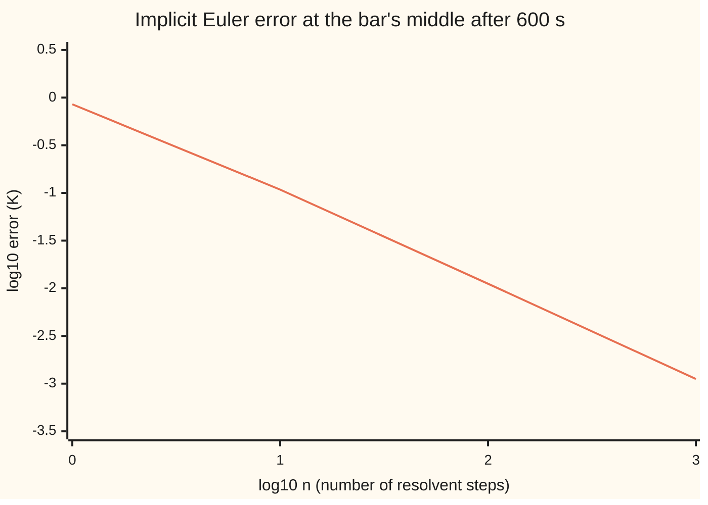

# Hille-Yosida: exactly which operators drive a well-behaved evolution

[Syllabus](../../../SYLLABUS.md) → [Functional analysis](../README.md) → [Unbounded Operators and Semigroups](../README.md#s05) → Hille-Yosida

---

## General Overview

A copper bar 1 m long has both ends held in iced water. Its middle starts warmer, in one smooth arch: a temperature rise of $`10\sin(\pi x)`$ kelvin at $`x`$ metres from the left end. Copper spreads heat at a diffusivity of $`1.11\times10^{-4}`$ m²/s (illustrative). After 600 s the middle has cooled to 5.182406 K.

The heat equation gives the rule: the rate of change of temperature is the diffusivity times the second slope in space (how sharply the temperature curve bends). That rule is an operator $`A`$, a machine that turns a profile into its rate of change. Does it really drive a well-behaved flow, one future for every start, never growing?

The direct route, "solve the equation and look", fails in general. $`A`$ is unbounded: a profile of size 1 can have a rate of change of any size. The Hille-Yosida theorem replaces it with a test that is easy to run.

Wrap the bar in a jacket that pulls each point toward a reference profile at a rate $`\lambda`$ per second. Ask for the steady balance between the jacket's pull and the bar's own spreading. If that balance problem has exactly one answer for every reference and every pull rate $`\lambda`$, and the answer is never bigger than the reference, a cooling flow exists. The same balance answers, applied many times in short time steps, then rebuild the flow.

For the copper bar the test passes. At $`\lambda = 0.01`$ per second, the balance for the 10 K arch peaks at 9.012642 K, below the reference's 10 K. Ten balance steps of 60 s each put the middle at 5.290804 K after 600 s, and a thousand steps put it at 5.183525 K, closing on the true 5.182406 K. Run the bar backward in time and the same test fails: no growth allowance makes it pass.

**An operator drives a well-behaved evolution exactly when its resolvent, the answer map of the balance problem $`(\lambda I - A)u = f`$, exists for every large $`\lambda`$ and shrinks like $`1/\lambda`$; the flow is then rebuilt from that resolvent as a limit of implicit time steps.**

**What kind of fact this is:** a theorem, proved on this card in Why it works for the case $`M = 1`$, with the heat operator's test as the example. The exponential formula and the version with $`M > 1`$ are stated with named sources.

### The picture: the middle of the bar after 600 s, exact and rebuilt

```
exact, 10 exp(-kappa pi^2 t)       |##############################  5.182406 K
one resolvent step, n = 1          |###################################  6.033854 K
10 resolvent steps                 |###############################  5.290804 K
1000 resolvent steps               |##############################  5.183525 K
Yosida's approximation, lambda = 1 |##############################  5.186135 K
```

Each bar is the temperature rise at $`x = 0.5`$ m after 600 s. One big step overshoots by 0.851448 K. More steps, or a larger $`\lambda`$, close the gap.

---

## The formula

Notation first. The bar's profiles live in $`H = L^2(0,1)`$, the square-integrable functions on the bar, with size $`\lVert f\rVert`$ equal to the root-mean-square value over the 1 m bar. The inner product is $`\langle f, g\rangle = \int_0^1 f(x)\,g(x)\,dx`$, so $`\lVert f\rVert^2 = \langle f, f\rangle`$.

- An **operator** $`A`$ with **domain** $`D(A)`$ is a linear rule that accepts the profiles in $`D(A)`$ ([Unbounded operators](01-unbounded-operators-and-domains.md)).
- A **semigroup** $`T(t)`$ moves a starting profile forward by $`t`$ seconds. It is **strongly continuous** when $`T(t)f \to f`$ in size as $`t \to 0`$ ([Semigroups](04-strongly-continuous-semigroups.md)).
- Its **generator** is $`Af = \lim_{t\to0}(T(t)f - f)/t`$, on the profiles where that limit exists ([The generator](../../11-Stochastic%20processes%20and%20calculus/08-Generators%2C%20Densities%20and%20Simulation/01-infinitesimal-generator.md) computes this for diffusions).
- The **resolvent set** $`\rho(A)`$ is the set of numbers $`\lambda`$ for which $`\lambda I - A`$ has a bounded inverse defined on all of $`H`$. That inverse is the **resolvent** $`R(\lambda, A) = (\lambda I - A)^{-1}`$ (planned card Spectrum).

The theorem, in the form a contraction-type flow needs:

```math
A \text{ generates } T(t) \text{ with } \lVert T(t)\rVert \le e^{\omega t} \iff A \text{ closed, } D(A) \text{ dense, } (\omega, \infty) \subset \rho(A), \text{ and } \lVert R(\lambda, A)\rVert \le \frac{1}{\lambda - \omega} \text{ for every real } \lambda > \omega .
```

**Read it aloud:** an operator generates a flow that grows no faster than $`e^{\omega t}`$ exactly when, for every real $`\lambda`$ above $`\omega`$, the balance problem $`(\lambda I - A)u = f`$ has one answer for every $`f`$, and the answer is at most $`1/(\lambda - \omega)`$ times the size of $`f`$.

The flow is rebuilt from the resolvent by either of two limits, both converging in size for every starting profile $`f`$:

```math
T(t)f = \lim_{n\to\infty} \Big(\tfrac{n}{t} R\big(\tfrac{n}{t}, A\big)\Big)^{n} f = \lim_{\lambda\to\infty} e^{tA_\lambda} f, \qquad A_\lambda = \lambda A R(\lambda, A) = \lambda^2 R(\lambda, A) - \lambda I .
```

The first limit is $`n`$ implicit Euler steps of length $`t/n`$. The second uses **Yosida's approximation** $`A_\lambda`$, a bounded operator that stands in for $`A`$.

For the bar, $`A = \kappa\, d^2/dx^2`$ with $`D(A)`$ the profiles in $`H^2(0,1)`$ that are zero at both ends. $`H^2`$ means the second weak slope is square-integrable. The bar passes the test with $`\omega = 0`$.

| Symbol | Plain meaning | In our example | Push it up and the answer… |
| --- | --- | --- | --- |
| $`H, \lVert f\rVert, \langle f, g\rangle`$ | the space of temperature profiles; a profile's RMS size; the inner product | $`L^2(0,1)`$ on the 1 m bar | |
| $`A, D(A), B`$ | the candidate generator and the profiles it accepts; $`B`$, the generator of the rebuilt flow (proof only) | $`\kappa\, d^2/dx^2`$, ends held at zero | |
| $`\kappa`$ | diffusivity, how fast the bar spreads heat, m²/s | $`1.11\times10^{-4}`$ (copper, illustrative) | the arch cools faster |
| $`f, g, u, w, u_0`$ | profiles: a reference, a test profile, an answer, the discounted average $`w = \lambda u`$, the start, K | $`u_0`$ is the arch $`10\sin(\pi x)`$ | |
| $`T(t)`$ | the flow: start profile to profile $`t`$ seconds later | middle at 5.182406 K after 600 s | |
| $`M, \omega`$ | growth constants in $`\lVert T(t)\rVert \le M e^{\omega t}`$; $`\omega`$ in 1/s | $`M = 1`$, $`\omega = 0`$ | a weaker promise, easier to pass |
| $`\lambda, \mu`$ | pull rates in the balance problem, 1/s | $`\lambda = 0.01`$ | the resolvent shrinks like $`1/\lambda`$ |
| $`R(\lambda, A), \rho(A), I`$ | resolvent $`(\lambda I - A)^{-1}`$, in seconds; the set of $`\lambda`$ where it exists; the identity | $`\lVert R(0.01, A)\rVert = 90.1264`$ s | |
| $`A_\lambda`$ | Yosida's approximation, a bounded stand-in for $`A`$ | at $`\lambda = 1`$: middle 5.186135 K | closer to $`A`$ |
| $`n, t, a`$ | number of implicit steps (or a power); elapsed time, s; the arch's decay exponent $`\kappa\pi^2 t`$ | $`n = 10`$, $`t = 600`$, $`a = 0.657316`$ | error falls like $`1/n`$ |
| $`N, h, A_N`$ | grid cells on the bar; their width $`1/N`$ m; the grid matrix for $`A`$ | $`N = 1000`$ | $`\lVert A_N\rVert`$ grows like $`4\kappa N^2`$ |
| $`x, s, m, G, k, \varepsilon`$ | positions on the bar, m; Green's function rate $`\sqrt{\lambda/\kappa}`$, 1/m; the Green's function; a mode number; a small distance in the proof | $`m = 9.491580`$; mode $`\sin(k\pi x)`$ | |

### When it holds

- **The resolvent exists for every large real $`\lambda`$.** If the spectrum contains real numbers beyond every bound, as for the backward heat equation, some mode grows faster than any $`e^{\omega t}`$ and there is no flow.
- **The bound is $`1/(\lambda - \omega)`$ with constant 1.** With a constant $`M > 1`$ every power must satisfy $`\lVert R(\lambda, A)^n\rVert \le M/(\lambda - \omega)^n`$; checking only $`n = 1`$ can pass an operator that has no flow.
- **$`A`$ is closed and densely defined.** On a domain that is not dense, the flow could not start from every profile. For the bar, smooth profiles vanishing at both ends are dense, and an operator with a bounded inverse is automatically closed.
- **The domain carries the end conditions.** Drop the zero ends and $`\lambda I - A`$ is no longer one-to-one: $`\cosh`$-shaped solutions of $`\lambda u = \kappa u''`$ are new answers to $`f = 0`$.

---

## Why it works

### Step 0: the resolvent is the flow, averaged with exponential weights

Picture the flow already running. Average the profiles $`T(t)f`$ over all future times, with weight $`\lambda e^{-\lambda t}`$. That is the profile seen at a random moment whose mean wait is $`1/\lambda`$ seconds. The result is $`\lambda R(\lambda, A) f`$. It is also the jacket's balance from the overview: setting the jacket's pull $`\lambda(f - u)`$ plus the spreading $`Au`$ to zero gives $`u = \lambda R(\lambda, A)f`$.

A flow that never grows has averages that never grow, so $`\lVert \lambda R(\lambda, A)\rVert \le 1`$. That is the test.

The converse runs the same idea backward. $`\lambda R(\lambda, A)`$ is one implicit Euler step of length $`1/\lambda`$. The bound says each step never grows a profile. Many short steps, each harmless, add up to the flow.

### Step 1: a flow forces the resolvent bound

Suppose $`A`$ generates $`T(t)`$ with $`\lVert T(t)\rVert \le e^{\omega t}`$. For $`\lambda > \omega`$, set

```math
R f = \int_0^\infty e^{-\lambda t}\, T(t) f \, dt .
```

The integrand has size at most $`e^{-(\lambda - \omega)t}\lVert f\rVert`$, so $`\lVert Rf\rVert \le \lVert f\rVert/(\lambda - \omega)`$. Differentiating under the integral and integrating by parts gives $`(\lambda I - A)Rf = f`$, and $`R(\lambda I - A)u = u`$ for $`u`$ in $`D(A)`$. So $`R`$ is the resolvent, and the bound holds.

The theorem's other two conditions come with the flow too. $`A`$ is closed: the graph of $`\lambda I - A`$ is the graph of the bounded operator $`R`$ with its two coordinates swapped, so it contains its own limits. $`D(A)`$ is dense in $`H`$, in size: each $`\lambda Rf`$ lies in $`D(A)`$, and $`\lambda Rf - f = \int_0^\infty \lambda e^{-\lambda t}\,(T(t)f - f)\,dt`$ averages $`T(t)f - f`$ with weights that crowd toward $`t = 0`$ as $`\lambda`$ grows, so strong continuity drives it to 0.

For the bar's arch, $`T(t)`$ multiplies it by $`e^{-\kappa\pi^2 t}`$. The integral is $`1/(\lambda + \kappa\pi^2) = 90.1264`$ s at $`\lambda = 0.01`$, below $`1/\lambda = 100`$ s.

### Step 2: the heat operator passes the test

Solve $`\lambda u - \kappa u'' = f`$ with $`u(0) = u(1) = 0`$, for any square-integrable $`f`$ and any $`\lambda > 0`$.

**Existence.** With $`m = \sqrt{\lambda/\kappa}`$ the answer is an integral against a Green's function $`G(x, s)`$, the bar's response at $`x`$ to a point source at $`s`$ ([Green's function](../../08-Differential%20equations%20and%20dynamics/07-Series%20Solutions%20and%20Boundary%20Problems/10-greens-function-for-a-boundary-problem.md)):

```math
u(x) = \int_0^1 G(x, s) f(s)\, ds, \qquad G(x, s) = \frac{\sinh(m\, x_<)\,\sinh\big(m(1 - x_>)\big)}{\kappa\, m \sinh m},
```

where $`x_<`$ and $`x_>`$ are the smaller and the larger of $`x`$ and $`s`$. At $`\lambda = 0.01`$ per second, $`m = 9.491580`$ per metre.

**The bound.** Multiply the equation by $`u`$ and integrate over the bar. Integration by parts moves one slope across; the zero ends kill the end term:

```math
\lambda \lVert u\rVert^2 + \kappa \lVert u'\rVert^2 = \langle f, u\rangle \le \lVert f\rVert\,\lVert u\rVert .
```

Drop the $`\kappa\lVert u'\rVert^2 \ge 0`$ term and divide by $`\lVert u\rVert`$: $`\lambda\lVert u\rVert \le \lVert f\rVert`$. That is $`\lVert R(\lambda, A)\rVert \le 1/\lambda`$ with $`\omega = 0`$.

The check runs this on a profile that is not a single mode: a flat 1 K start. Its discounted average has size 0.827121 K, below 1 K. With $`w = \lambda u`$, the energy identity in the form $`\lVert w\rVert^2 + (\kappa/\lambda)\lVert w'\rVert^2 = \langle f, w\rangle`$ balances at 0.789319 on both sides.

This step is the **Lumer-Phillips** shortcut. On a Hilbert space, the two facts $`\langle Au, u\rangle \le 0`$ (the operator is **dissipative**: it never feeds energy in) and "$`\lambda I - A`$ is onto for one $`\lambda > 0`$" together give the Hille-Yosida bound.

### Step 3: rebuild the flow with Yosida's approximation

$`A`$ itself is unbounded, so the power series for $`e^{tA}`$ makes no sense. Replace $`A`$ with $`A_\lambda = \lambda^2 R(\lambda, A) - \lambda I`$. It is bounded, its norm at most $`2\lambda`$, so $`e^{tA_\lambda}`$ is an ordinary power series.

Three facts finish the proof, detailed in the fold:

1. **Each approximate flow is a contraction.** $`e^{tA_\lambda} = e^{-\lambda t} e^{\lambda t\cdot \lambda R(\lambda, A)}`$, so its norm is at most $`e^{-\lambda t}e^{\lambda t} = 1`$.
2. **$`A_\lambda`$ approaches $`A`$ on its domain**, because $`\lambda R(\lambda, A) g \to g`$ for every profile $`g`$.
3. **The approximate flows settle** as $`\lambda`$ grows, so they have a limit, and its generator is $`A`$. On the bar, $`A_\lambda`$ multiplies the arch by $`-\lambda\kappa\pi^2/(\lambda + \kappa\pi^2)`$, which tends to $`-\kappa\pi^2`$. The middle after 600 s is 5.529902 K at $`\lambda = 0.01`$, 5.219452 K at $`\lambda = 0.1`$ and 5.186135 K at $`\lambda = 1`$. The error falls from 0.347496 K to 0.037046 K to 0.003729 K.

<details>
<summary>Detailed proof: Yosida's approximate flows converge to a contraction semigroup generated by A</summary>

Write $`R_\lambda = R(\lambda, A)`$ and assume $`\lVert \lambda R_\lambda\rVert \le 1`$ for all $`\lambda > 0`$. This is the case $`\omega = 0`$; for any other $`\omega`$, apply it to $`A - \omega I`$, whose flow is $`e^{-\omega t}T(t)`$.

**$`\lambda R_\lambda g \to g`$.** For $`u`$ in $`D(A)`$, $`\lambda R_\lambda u - u = R_\lambda A u`$, of size at most $`\lVert Au\rVert/\lambda`$. For any $`g`$, pick $`u`$ in $`D(A)`$ within $`\varepsilon`$ of $`g`$, which density allows. Then

$`\displaystyle \lVert \lambda R_\lambda g - g\rVert \le \lVert \lambda R_\lambda (g - u)\rVert + \lVert \lambda R_\lambda u - u\rVert + \lVert u - g\rVert \le 2\varepsilon + \lVert Au\rVert/\lambda .`$

**$`A_\lambda u \to Au`$.** For $`u`$ in $`D(A)`$, $`A_\lambda u = \lambda A R_\lambda u = \lambda R_\lambda A u`$, which tends to $`Au`$ by the previous line.

**Cauchy in $`\lambda`$.** The resolvents at different $`\lambda`$ commute, so $`A_\lambda`$ and $`A_\mu`$ commute. Then

$`\displaystyle e^{tA_\lambda}u - e^{tA_\mu}u = \int_0^t \frac{d}{ds}\Big(e^{sA_\lambda} e^{(t-s)A_\mu}u\Big)\, ds = \int_0^t e^{sA_\lambda} e^{(t-s)A_\mu} (A_\lambda u - A_\mu u)\, ds ,`$

of size at most $`t\,\lVert A_\lambda u - A_\mu u\rVert`$, since both flows are contractions. So $`e^{tA_\lambda}u`$ converges, uniformly for $`t`$ in a bounded interval. The operators have norm at most 1, so convergence extends from the dense set $`D(A)`$ to every $`g`$. Call the limit $`T(t)g`$.

**The limit is the flow.** $`T(t)`$ inherits $`T(t+s) = T(t)T(s)`$, $`\lVert T(t)\rVert \le 1`$ and continuity in $`t`$ from the approximations. For $`u`$ in $`D(A)`$, passing to the limit in $`e^{tA_\lambda}u - u = \int_0^t e^{sA_\lambda} A_\lambda u\, ds`$ gives

$`\displaystyle T(t)u - u = \int_0^t T(s) A u\, ds ,`$

so the generator $`B`$ of $`T(t)`$ extends $`A`$. Both $`\lambda I - A`$ and $`\lambda I - B`$ are one-to-one and onto (the second by Step 1), and one extends the other, so they are equal and $`B = A`$.

</details>

### Step 4: rebuild the flow with implicit Euler steps

The second route needs no exponential at all. One implicit Euler step of length $`t/n`$ solves $`u_{k+1} - (t/n) A u_{k+1} = u_k`$, which is $`u_{k+1} = \tfrac{n}{t}R(\tfrac{n}{t}, A)\, u_k`$. The resolvent bound says each step has norm at most 1, so the steps are stable for any step length.

The **exponential formula** says $`n`$ such steps converge to $`T(t)f`$ as $`n \to \infty`$. Its proof uses the same commuting-and-telescoping argument as the fold (Engel and Nagel, Pazy). On the arch each step divides by $`1 + \kappa\pi^2 t/n`$, so the error is exactly computable:

| steps $`n`$ | middle after 600 s (K) | error (K) | $`n`$ × error |
| ---: | ---: | ---: | ---: |
| 1 | 6.033854 | 0.851448 | 0.851448 |
| 10 | 5.290804 | 0.108398 | 1.083984 |
| 100 | 5.193565 | 0.011159 | 1.115883 |
| 1000 | 5.183525 | 0.001119 | 1.119196 |

The last column settles at $`10\,e^{-a}a^2/2 = 1.119565`$ K, with $`a = \kappa\pi^2 t`$. So the error falls like $`1/n`$. The grid with $`N = 1000`$ cells, solving each step as a tridiagonal system, lands within a few millionths of a kelvin of these values (the `euler` lines below).



The line is the error of $`n`$ resolvent steps against the exact 5.182406 K, on the arch, with no grid. It drops one decade per decade of $`n`$: first-order convergence.

### Step 5: the finite rehearsal, and what changes as N grows

Cut the bar into $`N`$ cells of width $`h = 1/N`$. The grid matrix $`A_N`$ has $`-2\kappa/h^2`$ on its diagonal and $`\kappa/h^2`$ beside it. Every matrix generates a flow $`e^{tA_N}`$, by the power series. So at a fixed $`N`$ the test never fails; it only returns a growth rate. The real question is whether one growth rate serves every $`N`$:

| $`N`$ | $`\lVert R(0.01, A_N)\rVert`$ (s), power iteration | closed form (s) | top growth rate of $`-A_N`$ (1/s), Sturm bisection and closed form |
| ---: | ---: | ---: | ---: |
| 10 | 90.1994 | 90.1994 | 0.0433 |
| 100 | 90.1271 | 90.1271 | 4.4389 |
| 1000 | 90.1264 | 90.1264 | 443.9989 |

**Power iteration** applies the resolvent again and again to one vector; the stretch factor settles on the largest eigenvalue, which for a symmetric matrix is its norm. **Sturm bisection** finds the top eigenvalue of $`-A_N`$ without its formula: the signs of the pivots in elimination count how many eigenvalues lie below a trial number, and halving the interval pins the top one. The forward resolvent norm stays under 100 s and settles on the bar's 90.1264 s. The backward growth rate rises like $`4\kappa N^2`$ and never settles. Only that trend shows that $`-A`$ generates nothing.

On the true bar the failure is exact. $`-A`$ has the eigenvalues $`\kappa\pi^2 k^2`$ for every whole number $`k`$, an unbounded set. Every half-line $`(\omega, \infty)`$ contains some of them, so it never lies in $`\rho(-A)`$.

---

## Worked numbers, by hand

The test and the rebuild on the arch, $`u_0 = 10\sin(\pi x)`$ K. On the arch, $`A`$ acts as multiplication by $`-\kappa\pi^2`$.

| Step | Arithmetic | Value |
| --- | --- | --- |
| arch decay rate | $`\kappa\pi^2 = 1.11\times10^{-4} \times 9.869604`$ | 0.00109553 1/s |
| balance problem on the arch | $`(\lambda + \kappa\pi^2)u = f`$, with $`\lambda + \kappa\pi^2 = 0.01 + 0.00109553`$ | 0.01109553 1/s |
| resolvent on the arch | $`1/0.01109553`$ | 90.1264 s |
| test | $`90.1264 \le 1/\lambda = 100`$ | passes |
| discounted average, middle | $`10 \times 0.01 \times 90.1264`$ | 9.012642 K |
| decay exponent at 600 s | $`a = 0.00109553 \times 600`$ | 0.657316 |
| one implicit step of 60 s | $`1/(1 + 0.657316/10)`$ | 0.938323 |
| ten steps, middle | $`10 \times 0.938323^{10}`$ | 5.290804 K |
| exact, middle | $`10\,e^{-0.657316} = 10 \times 0.5182406`$ | **5.182406 K** |

Ten resolvent steps land 0.108398 K above the true 5.182406 K. The test passed, and the resolvent alone rebuilt the cooling.

### What breaks if you drop a piece

| Mistake | Comes out at | What went wrong |
| --- | --- | --- |
| Run the bar backward: test $`-A`$ | $`\lVert R(0.01, -A)\rVert = 7129.4`$ s, against the bound 100 s | the third mode reversed grows at 0.00985973 1/s, just under $`\lambda`$; past every $`\lambda`$ lies a faster mode |
| Trust one grid for the backward bar | growth rate 0.0433, 4.4389, 443.9989 1/s at $`N`$ = 10, 100, 1000 | each matrix passes with its own $`\omega`$; no $`\omega`$ serves every $`N`$ |
| Step with $`I + (t/n)A`$ (explicit Euler) instead of the resolvent | $`N = 100`$, 10 steps of 60 s: worst mode × −265.3343 per step, $`10^{24.24}`$ in all | the explicit step uses the unbounded $`A`$; it is stable only for steps up to about 0.4505 s |
| Stop at one resolvent step | 6.033854 K against 5.182406 K | the exponential formula is a limit; the error falls like 1.119565/n K |

---

## Code, from first principles, and it actually runs

The scripts compute every number above in four parts: the resolvent test, the true resolvent, the two rebuilds, and the failures. They take four independent roads. Closed forms on sine modes meet a Green's-function integral by Simpson's rule. Tridiagonal solves on an $`N`$-cell grid meet both. Power iteration finds each grid resolvent's norm, and Sturm bisection each backward growth rate, both checked against closed forms. Yosida's series, a Poisson-weighted sum of resolvent powers, rebuilds the flow without implicit Euler. What the truncation hides: every grid matrix generates a flow, forward or backward, and only the trend over $`N`$ separates them.

### Python

```python
# Hille-Yosida and generators -- the check behind the card.  Standard library only.
# Bar: 1 m, ends held at 0 K rise, H = L2(0, 1).  A = kappa d^2/dx^2 on H^2 with zero ends.
# Roads: closed forms on sine modes, a Green's-function integral by Simpson's rule,
# tridiagonal solves on an N-cell grid, power iteration for norms, Yosida's series.
import math

KAPPA = 1.11e-4            # m^2/s, copper's thermal diffusivity (illustrative)
T, LAM = 600.0, 0.01       # s, 1/s
MU1 = KAPPA * math.pi ** 2  # decay rate of the arch sin(pi x), 1/s

def solve(lam, f, N, sign=1.0):
    # (lam I - sign*A_N) u = f on the N - 1 inside points; Thomas algorithm.
    h2 = (1.0 / N) ** 2
    a, b = -sign * KAPPA / h2, lam + 2 * sign * KAPPA / h2
    n = len(f); c, d = [0.0] * n, [0.0] * n
    for i in range(n):
        m = b - (a * c[i - 1] if i else 0.0)
        c[i] = a / m
        d[i] = (f[i] - (a * d[i - 1] if i else 0.0)) / m
    for i in range(n - 2, -1, -1):
        d[i] -= c[i] * d[i + 1]
    return d

def rnorm(v, N):
    return math.sqrt(sum(x * x for x in v) / N)

def power_norm(lam, N, its=400):
    # Largest eigenvalue of the symmetric resolvent matrix = its operator norm.
    v = [1.0] * (N - 1); r = 0.0
    for _ in range(its):
        w = solve(lam, v, N)
        r = sum(x * y for x, y in zip(v, w)) / sum(x * x for x in v)
        s = math.sqrt(sum(x * x for x in w)); v = [x / s for x in w]
    return r

def top_eig(N):
    # Largest eigenvalue of -A_N by Sturm bisection: the LDL^T pivots of -A_N - x I
    # that are negative count the eigenvalues below x.  No eigenvalue formula used.
    d, e2 = 2 * KAPPA * N * N, (KAPPA * N * N) ** 2
    def below(x):
        c, q = 0, 1.0
        for i in range(N - 1):
            q = d - x - (e2 / q if i else 0.0); q = q or 1e-300; c += q < 0
        return c
    lo, hi = 0.0, 2 * d
    for _ in range(100):
        mid = (lo + hi) / 2; lo, hi = (lo, mid) if below(mid) == N - 1 else (mid, hi)
    return (lo + hi) / 2

def simpson(f, a, b, m=2000):
    h = (b - a) / m
    return (f(a) + f(b) + sum((4 if k % 2 else 2) * f(a + k * h) for k in range(1, m))) * h / 3

ok = []
def check(name, got, want, tol):
    ok.append(abs(got - want) <= tol)
    assert ok[-1], (name, got, want)

print(f"setup, kappa = 1.11e-4 m^2/s, arch decay rate kappa pi^2 = {MU1:.8f} 1/s, lambda = 0.01 1/s")
# 1. The resolvent test on the grid, at several N.
print("test, N, ||R(lambda, A_N)|| by power iteration (s), closed form (s), bar limit 1/(lambda + kappa pi^2) (s), bound 1/lambda (s)")
for N in (10, 100, 1000):
    pw = power_norm(LAM, N)
    cf = 1 / (LAM + 4 * KAPPA * N * N * math.sin(math.pi / (2 * N)) ** 2)
    print(f"test, {N}, {pw:.4f}, {cf:.4f}, {1 / (LAM + MU1):.4f}, {1 / LAM:.4f}")
    check("power", pw, cf, 1e-6); assert pw <= 1 / LAM
check("bar limit", cf, 1 / (LAM + MU1), 1e-3)
# 2. The true resolvent through its Green's function, against modes and grid.
m = math.sqrt(LAM / KAPPA)
print(f"green, m = sqrt(lambda / kappa) = {m:.6f} 1/m")
def G(x, s):
    lo, hi = min(x, s), max(x, s)
    return math.sinh(m * lo) * math.sinh(m * (1 - hi)) / (KAPPA * m * math.sinh(m))
arch = lambda s: 10 * math.sin(math.pi * s)
green = LAM * (simpson(lambda s: G(0.5, s) * arch(s), 0, 0.5) + simpson(lambda s: G(0.5, s) * arch(s), 0.5, 1))
mode = 10 * LAM / (LAM + MU1)
N = 1000; xs = [j / N for j in range(1, N)]
grid = LAM * solve(LAM, [arch(x) for x in xs], N)[N // 2 - 1]
print(f"discounted arch, midpoint of lambda R u0: Green {green:.6f} K, mode {mode:.6f} K, grid N=1000 {grid:.6f} K")
check("green", green, mode, 1e-8); check("grid", grid, mode, 1e-5)
u = [LAM * y for y in solve(LAM, [1.0] * (N - 1), N)]
flat = lambda x: 1 - math.cosh(m * (x - 0.5)) / math.cosh(m / 2)
flat_norm = math.sqrt(simpson(lambda x: flat(x) ** 2, 0, 1))
print(f"discounted flat 1 K source: ||lambda R f|| closed form {flat_norm:.6f} K, grid {rnorm(u, N):.6f} K, ||f|| = 1 K")
check("flat", rnorm(u, N), flat_norm, 1e-3); assert flat_norm <= 1
energy = lambda x: math.sinh(m * (x - 0.5)) * m / math.cosh(m / 2)
lhs = flat_norm ** 2 + KAPPA * simpson(lambda x: energy(x) ** 2, 0, 1) / LAM
print(f"energy identity, w = lambda R f: ||w||^2 + (kappa/lambda) ||w'||^2 = {lhs:.6f}, <f, w> = {simpson(flat, 0, 1):.6f}")
check("energy", lhs, simpson(flat, 0, 1), 1e-9)
# 3. Recover the semigroup: implicit Euler (n steps) and Yosida's approximation.
exact = 10 * math.exp(-MU1 * T)
print(f"hand, pi^2 = {math.pi ** 2:.6f}, lambda + kappa pi^2 = {LAM + MU1:.8f} 1/s, a = kappa pi^2 t = {MU1 * T:.6f}, one step factor at n = 10: {1 / (1 + MU1 * T / 10):.6f}, e^(-a) = {math.exp(-MU1 * T):.7f}")
print(f"exact, midpoint after {T:.0f} s: 10 exp(-kappa pi^2 t) = {exact:.6f} K")
print("euler, n, mode formula (K), grid N=1000 (K), error (K), n * error")
errs = []
for n in (1, 10, 100, 1000):
    mf = 10 * (1 + MU1 * T / n) ** (-n)
    v = [arch(x) for x in xs]
    for _ in range(n):
        v = [(n / T) * y for y in solve(n / T, v, N)]
    errs.append(mf - exact)
    print(f"euler, {n}, {mf:.6f}, {v[N // 2 - 1]:.6f}, {mf - exact:.6f}, {n * (mf - exact):.6f}")
    check("euler grid", v[N // 2 - 1], mf, 1e-3)
lim = 10 * math.exp(-MU1 * T) * (MU1 * T) ** 2 / 2
print(f"euler, limit of n * error = 10 e^(-a) a^2 / 2 with a = kappa pi^2 t: {lim:.6f}")
check("rate", 1000 * errs[-1], lim, 2e-3)
print("chart, log10 n, 0, 1, 2, 3")
print("chart, log10 error, " + ", ".join(f"{math.log10(e):.3f}" for e in errs))
print("yosida, lambda (1/s), mode formula (K), grid N=200 series (K), error (K)")
N2 = 200; xs2 = [j / N2 for j in range(1, N2)]
for lam in (0.01, 0.1, 1.0):
    mf = 10 * math.exp(-T * lam * MU1 / (lam + MU1))
    v = [arch(x) for x in xs2]; acc = [0.0] * len(v); w = math.exp(-lam * T)
    for k in range(int(lam * T + 12 * math.sqrt(lam * T) + 20)):
        acc = [p + w * q for p, q in zip(acc, v)]
        v = [lam * y for y in solve(lam, v, N2)]; w *= lam * T / (k + 1)
    print(f"yosida, {lam:.2f}, {mf:.6f}, {acc[N2 // 2 - 1]:.6f}, {mf - exact:.6f}")
    check("yosida", acc[N2 // 2 - 1], mf, 5e-4)
# 4. What breaks.
print("backward, N, top growth rate of -A_N by Sturm bisection (1/s), closed form 4 kappa N^2 sin^2((N-1) pi/(2N)) (1/s), row-sum bound 4 kappa N^2 (1/s)")
for N in (10, 100, 1000):
    st, w = top_eig(N), 4 * KAPPA * N * N * math.sin((N - 1) * math.pi / (2 * N)) ** 2
    print(f"backward, {N}, {st:.4f}, {w:.4f}, {4 * KAPPA * N * N:.4f}"); check("sturm", st, w, 1e-6)
bk = max(1 / abs(LAM - MU1 * k * k) for k in range(1, 50))
print(f"breaks, backward heat at lambda = 0.01: ||R(lambda, -A)|| = {bk:.1f} s against the bound 1/lambda = 100 s (mode n = 3, kappa pi^2 9 = {9 * MU1:.8f} 1/s)")
assert bk > 1 / LAM
dt = T / 10; wN = 4 * KAPPA * 100 ** 2 * math.sin(99 * math.pi / 200) ** 2
print(f"breaks, explicit Euler, N=100, 10 steps of {dt:.0f} s: worst mode factor per step {1 - dt * wN:.4f}, after 10 steps 10^{10 * math.log10(abs(1 - dt * wN)):.2f}, stable only for steps up to h^2/(2 kappa) = {0.0001 / (2 * KAPPA):.4f} s")
print(f"breaks, one implicit step: {10 / (1 + MU1 * T):.6f} K against {exact:.6f} K")
print(f"breaks, Yosida with lambda = 0.01: {10 * math.exp(-T * 0.01 * MU1 / (0.01 + MU1)):.6f} K against {exact:.6f} K")
print("ALL CHECKS PASS")
```

**Ran 2026-11-15 on macOS, Python 3.14.10, standard library only. All checks passed. Output, pasted from the run:**

```
setup, kappa = 1.11e-4 m^2/s, arch decay rate kappa pi^2 = 0.00109553 1/s, lambda = 0.01 1/s
test, N, ||R(lambda, A_N)|| by power iteration (s), closed form (s), bar limit 1/(lambda + kappa pi^2) (s), bound 1/lambda (s)
test, 10, 90.1994, 90.1994, 90.1264, 100.0000
test, 100, 90.1271, 90.1271, 90.1264, 100.0000
test, 1000, 90.1264, 90.1264, 90.1264, 100.0000
green, m = sqrt(lambda / kappa) = 9.491580 1/m
discounted arch, midpoint of lambda R u0: Green 9.012642 K, mode 9.012642 K, grid N=1000 9.012642 K
discounted flat 1 K source: ||lambda R f|| closed form 0.827121 K, grid 0.827120 K, ||f|| = 1 K
energy identity, w = lambda R f: ||w||^2 + (kappa/lambda) ||w'||^2 = 0.789319, <f, w> = 0.789319
hand, pi^2 = 9.869604, lambda + kappa pi^2 = 0.01109553 1/s, a = kappa pi^2 t = 0.657316, one step factor at n = 10: 0.938323, e^(-a) = 0.5182406
exact, midpoint after 600 s: 10 exp(-kappa pi^2 t) = 5.182406 K
euler, n, mode formula (K), grid N=1000 (K), error (K), n * error
euler, 1, 6.033854, 6.033856, 0.851448, 0.851448
euler, 10, 5.290804, 5.290807, 0.108398, 1.083984
euler, 100, 5.193565, 5.193568, 0.011159, 1.115883
euler, 1000, 5.183525, 5.183528, 0.001119, 1.119196
euler, limit of n * error = 10 e^(-a) a^2 / 2 with a = kappa pi^2 t: 1.119565
chart, log10 n, 0, 1, 2, 3
chart, log10 error, -0.070, -0.965, -1.952, -2.951
yosida, lambda (1/s), mode formula (K), grid N=200 series (K), error (K)
yosida, 0.01, 5.529902, 5.529962, 0.347496
yosida, 0.10, 5.219452, 5.219521, 0.037046
yosida, 1.00, 5.186135, 5.186205, 0.003729
backward, N, top growth rate of -A_N by Sturm bisection (1/s), closed form 4 kappa N^2 sin^2((N-1) pi/(2N)) (1/s), row-sum bound 4 kappa N^2 (1/s)
backward, 10, 0.0433, 0.0433, 0.0444
backward, 100, 4.4389, 4.4389, 4.4400
backward, 1000, 443.9989, 443.9989, 444.0000
breaks, backward heat at lambda = 0.01: ||R(lambda, -A)|| = 7129.4 s against the bound 1/lambda = 100 s (mode n = 3, kappa pi^2 9 = 0.00985973 1/s)
breaks, explicit Euler, N=100, 10 steps of 60 s: worst mode factor per step -265.3343, after 10 steps 10^24.24, stable only for steps up to h^2/(2 kappa) = 0.4505 s
breaks, one implicit step: 6.033854 K against 5.182406 K
breaks, Yosida with lambda = 0.01: 5.529902 K against 5.182406 K
ALL CHECKS PASS
```

### Rust

```rust
// Hille-Yosida and generators -- the check behind the card.  Rust std only.
// Bar: 1 m, ends held at 0 K rise, H = L2(0, 1).  A = kappa d^2/dx^2 on H^2 with zero ends.
// Roads: closed forms on sine modes, a Green's-function integral by Simpson's rule,
// tridiagonal solves on an N-cell grid, power iteration for norms, Yosida's series.
use std::f64::consts::PI;

const KAPPA: f64 = 1.11e-4; // m^2/s, copper's thermal diffusivity (illustrative)
const T: f64 = 600.0; // s
const LAM: f64 = 0.01; // 1/s

// (lam I - A_N) u = f on the N - 1 inside points; Thomas algorithm.
fn solve(lam: f64, f: &[f64], n_cells: usize) -> Vec<f64> {
    let h2 = (1.0 / n_cells as f64).powi(2);
    let (a, b) = (-KAPPA / h2, lam + 2.0 * KAPPA / h2);
    let n = f.len();
    let (mut c, mut d) = (vec![0.0; n], vec![0.0; n]);
    for i in 0..n {
        let m = b - if i > 0 { a * c[i - 1] } else { 0.0 };
        c[i] = a / m;
        d[i] = (f[i] - if i > 0 { a * d[i - 1] } else { 0.0 }) / m;
    }
    for i in (0..n - 1).rev() { d[i] -= c[i] * d[i + 1]; }
    d
}

fn dot(v: &[f64], w: &[f64]) -> f64 { v.iter().zip(w).map(|(x, y)| x * y).sum() }

// Largest eigenvalue of the symmetric resolvent matrix = its operator norm.
fn power_norm(lam: f64, n: usize, its: usize) -> f64 {
    let mut v = vec![1.0; n - 1];
    let mut r = 0.0;
    for _ in 0..its {
        let w = solve(lam, &v, n);
        r = dot(&v, &w) / dot(&v, &v);
        let s = dot(&w, &w).sqrt();
        v = w.iter().map(|x| x / s).collect();
    }
    r
}

// Largest eigenvalue of -A_N by Sturm bisection: the LDL^T pivots of -A_N - x I
// that are negative count the eigenvalues below x.  No eigenvalue formula used.
fn top_eig(nb: usize) -> f64 {
    let (d, e2) = (2.0 * KAPPA * (nb * nb) as f64, (KAPPA * (nb * nb) as f64).powi(2));
    let below = |x: f64| {
        let (mut c, mut q) = (0, 1.0);
        for i in 0..nb - 1 { q = d - x - if i > 0 { e2 / q } else { 0.0 }; if q == 0.0 { q = 1e-300; } if q < 0.0 { c += 1; } }
        c
    };
    let (mut lo, mut hi) = (0.0, 2.0 * d);
    for _ in 0..100 { let mid = (lo + hi) / 2.0; if below(mid) == nb - 1 { hi = mid; } else { lo = mid; } }
    (lo + hi) / 2.0
}

fn simpson(f: &dyn Fn(f64) -> f64, a: f64, b: f64) -> f64 {
    let (m, h) = (2000, (b - a) / 2000.0);
    let s: f64 = (1..m).map(|k| (if k % 2 == 1 { 4.0 } else { 2.0 }) * f(a + k as f64 * h)).sum();
    (f(a) + f(b) + s) * h / 3.0
}

fn check(ok: &mut Vec<bool>, name: &str, got: f64, want: f64, tol: f64) {
    ok.push((got - want).abs() <= tol);
    assert!(*ok.last().unwrap(), "{} {} {}", name, got, want);
}

fn main() {
    let mu1 = KAPPA * PI.powi(2); // decay rate of the arch sin(pi x), 1/s
    let mut ok: Vec<bool> = Vec::new();
    println!("setup, kappa = 1.11e-4 m^2/s, arch decay rate kappa pi^2 = {:.8} 1/s, lambda = 0.01 1/s", mu1);
    // 1. The resolvent test on the grid, at several N.
    println!("test, N, ||R(lambda, A_N)|| by power iteration (s), closed form (s), bar limit 1/(lambda + kappa pi^2) (s), bound 1/lambda (s)");
    let mut cf = 0.0;
    for &n in &[10usize, 100, 1000] {
        let pw = power_norm(LAM, n, 400);
        let nf = n as f64;
        cf = 1.0 / (LAM + 4.0 * KAPPA * nf * nf * (PI / (2.0 * nf)).sin().powi(2));
        println!("test, {}, {:.4}, {:.4}, {:.4}, {:.4}", n, pw, cf, 1.0 / (LAM + mu1), 1.0 / LAM);
        check(&mut ok, "power", pw, cf, 1e-6);
        assert!(pw <= 1.0 / LAM);
    }
    check(&mut ok, "bar limit", cf, 1.0 / (LAM + mu1), 1e-3);
    // 2. The true resolvent through its Green's function, against modes and grid.
    let m = (LAM / KAPPA).sqrt();
    println!("green, m = sqrt(lambda / kappa) = {:.6} 1/m", m);
    let g = |x: f64, s: f64| {
        let (lo, hi) = (x.min(s), x.max(s));
        (m * lo).sinh() * (m * (1.0 - hi)).sinh() / (KAPPA * m * m.sinh())
    };
    let arch = |s: f64| 10.0 * (PI * s).sin();
    let green = LAM * (simpson(&|s| g(0.5, s) * arch(s), 0.0, 0.5) + simpson(&|s| g(0.5, s) * arch(s), 0.5, 1.0));
    let mode = 10.0 * LAM / (LAM + mu1);
    let n = 1000usize;
    let xs: Vec<f64> = (1..n).map(|j| j as f64 / n as f64).collect();
    let a0: Vec<f64> = xs.iter().map(|&x| arch(x)).collect();
    let grid = LAM * solve(LAM, &a0, n)[n / 2 - 1];
    println!("discounted arch, midpoint of lambda R u0: Green {:.6} K, mode {:.6} K, grid N=1000 {:.6} K", green, mode, grid);
    check(&mut ok, "green", green, mode, 1e-8);
    check(&mut ok, "grid", grid, mode, 1e-5);
    let u: Vec<f64> = solve(LAM, &vec![1.0; n - 1], n).iter().map(|y| LAM * y).collect();
    let flat = |x: f64| 1.0 - (m * (x - 0.5)).cosh() / (m / 2.0).cosh();
    let flat_norm = simpson(&|x| flat(x).powi(2), 0.0, 1.0).sqrt();
    println!("discounted flat 1 K source: ||lambda R f|| closed form {:.6} K, grid {:.6} K, ||f|| = 1 K", flat_norm, (dot(&u, &u) / n as f64).sqrt());
    check(&mut ok, "flat", (dot(&u, &u) / n as f64).sqrt(), flat_norm, 1e-3);
    assert!(flat_norm <= 1.0);
    let energy = |x: f64| (m * (x - 0.5)).sinh() * m / (m / 2.0).cosh();
    let lhs = flat_norm.powi(2) + KAPPA * simpson(&|x| energy(x).powi(2), 0.0, 1.0) / LAM;
    let fu = simpson(&flat, 0.0, 1.0);
    println!("energy identity, w = lambda R f: ||w||^2 + (kappa/lambda) ||w'||^2 = {:.6}, <f, w> = {:.6}", lhs, fu);
    check(&mut ok, "energy", lhs, fu, 1e-9);
    // 3. Recover the semigroup: implicit Euler (n steps) and Yosida's approximation.
    let exact = 10.0 * (-mu1 * T).exp();
    println!("hand, pi^2 = {:.6}, lambda + kappa pi^2 = {:.8} 1/s, a = kappa pi^2 t = {:.6}, one step factor at n = 10: {:.6}, e^(-a) = {:.7}", PI * PI, LAM + mu1, mu1 * T, 1.0 / (1.0 + mu1 * T / 10.0), (-mu1 * T).exp());
    println!("exact, midpoint after {:.0} s: 10 exp(-kappa pi^2 t) = {:.6} K", T, exact);
    println!("euler, n, mode formula (K), grid N=1000 (K), error (K), n * error");
    let mut errs = Vec::new();
    for &steps in &[1usize, 10, 100, 1000] {
        let sf = steps as f64;
        let mf = 10.0 * (1.0 + mu1 * T / sf).powf(-sf);
        let mut v = a0.clone();
        for _ in 0..steps {
            v = solve(sf / T, &v, n).iter().map(|y| (sf / T) * y).collect();
        }
        errs.push(mf - exact);
        println!("euler, {}, {:.6}, {:.6}, {:.6}, {:.6}", steps, mf, v[n / 2 - 1], mf - exact, sf * (mf - exact));
        check(&mut ok, "euler grid", v[n / 2 - 1], mf, 1e-3);
    }
    let lim = 10.0 * (-mu1 * T).exp() * (mu1 * T).powi(2) / 2.0;
    println!("euler, limit of n * error = 10 e^(-a) a^2 / 2 with a = kappa pi^2 t: {:.6}", lim);
    check(&mut ok, "rate", 1000.0 * errs[3], lim, 2e-3);
    println!("chart, log10 n, 0, 1, 2, 3");
    let ch: Vec<String> = errs.iter().map(|e| format!("{:.3}", e.log10())).collect();
    println!("chart, log10 error, {}", ch.join(", "));
    println!("yosida, lambda (1/s), mode formula (K), grid N=200 series (K), error (K)");
    let n2 = 200usize;
    let a2: Vec<f64> = (1..n2).map(|j| arch(j as f64 / n2 as f64)).collect();
    for &lam in &[0.01f64, 0.1, 1.0] {
        let mf = 10.0 * (-T * lam * mu1 / (lam + mu1)).exp();
        let mut v = a2.clone();
        let mut acc = vec![0.0; v.len()];
        let mut w = (-lam * T).exp();
        let terms = (lam * T + 12.0 * (lam * T).sqrt() + 20.0) as usize;
        for k in 0..terms {
            for (p, q) in acc.iter_mut().zip(&v) {
                *p += w * q;
            }
            v = solve(lam, &v, n2).iter().map(|y| lam * y).collect();
            w *= lam * T / (k as f64 + 1.0);
        }
        println!("yosida, {:.2}, {:.6}, {:.6}, {:.6}", lam, mf, acc[n2 / 2 - 1], mf - exact);
        check(&mut ok, "yosida", acc[n2 / 2 - 1], mf, 5e-4);
    }
    // 4. What breaks.
    println!("backward, N, top growth rate of -A_N by Sturm bisection (1/s), closed form 4 kappa N^2 sin^2((N-1) pi/(2N)) (1/s), row-sum bound 4 kappa N^2 (1/s)");
    for &nb in &[10usize, 100, 1000] {
        let nf = nb as f64;
        let (st, w) = (top_eig(nb), 4.0 * KAPPA * nf * nf * ((nf - 1.0) * PI / (2.0 * nf)).sin().powi(2));
        println!("backward, {}, {:.4}, {:.4}, {:.4}", nb, st, w, 4.0 * KAPPA * nf * nf);
        check(&mut ok, "sturm", st, w, 1e-6);
    }
    let bk = (1..50).map(|k| 1.0 / (LAM - mu1 * k as f64 * k as f64).abs()).fold(0.0, f64::max);
    println!("breaks, backward heat at lambda = 0.01: ||R(lambda, -A)|| = {:.1} s against the bound 1/lambda = 100 s (mode n = 3, kappa pi^2 9 = {:.8} 1/s)", bk, 9.0 * mu1);
    assert!(bk > 1.0 / LAM);
    let dt = T / 10.0;
    let wn = 4.0 * KAPPA * 100.0 * 100.0 * (99.0 * PI / 200.0).sin().powi(2);
    println!("breaks, explicit Euler, N=100, 10 steps of {:.0} s: worst mode factor per step {:.4}, after 10 steps 10^{:.2}, stable only for steps up to h^2/(2 kappa) = {:.4} s", dt, 1.0 - dt * wn, 10.0 * (1.0 - dt * wn).abs().log10(), 0.0001 / (2.0 * KAPPA));
    println!("breaks, one implicit step: {:.6} K against {:.6} K", 10.0 / (1.0 + mu1 * T), exact);
    println!("breaks, Yosida with lambda = 0.01: {:.6} K against {:.6} K", 10.0 * (-T * 0.01 * mu1 / (0.01 + mu1)).exp(), exact);
    println!("ALL CHECKS PASS");
}
```

**Ran 2026-11-15 on macOS, rustc 1.98.1, no crates. All checks passed. Output, pasted from the run:**

```
setup, kappa = 1.11e-4 m^2/s, arch decay rate kappa pi^2 = 0.00109553 1/s, lambda = 0.01 1/s
test, N, ||R(lambda, A_N)|| by power iteration (s), closed form (s), bar limit 1/(lambda + kappa pi^2) (s), bound 1/lambda (s)
test, 10, 90.1994, 90.1994, 90.1264, 100.0000
test, 100, 90.1271, 90.1271, 90.1264, 100.0000
test, 1000, 90.1264, 90.1264, 90.1264, 100.0000
green, m = sqrt(lambda / kappa) = 9.491580 1/m
discounted arch, midpoint of lambda R u0: Green 9.012642 K, mode 9.012642 K, grid N=1000 9.012642 K
discounted flat 1 K source: ||lambda R f|| closed form 0.827121 K, grid 0.827120 K, ||f|| = 1 K
energy identity, w = lambda R f: ||w||^2 + (kappa/lambda) ||w'||^2 = 0.789319, <f, w> = 0.789319
hand, pi^2 = 9.869604, lambda + kappa pi^2 = 0.01109553 1/s, a = kappa pi^2 t = 0.657316, one step factor at n = 10: 0.938323, e^(-a) = 0.5182406
exact, midpoint after 600 s: 10 exp(-kappa pi^2 t) = 5.182406 K
euler, n, mode formula (K), grid N=1000 (K), error (K), n * error
euler, 1, 6.033854, 6.033856, 0.851448, 0.851448
euler, 10, 5.290804, 5.290807, 0.108398, 1.083984
euler, 100, 5.193565, 5.193568, 0.011159, 1.115883
euler, 1000, 5.183525, 5.183528, 0.001119, 1.119196
euler, limit of n * error = 10 e^(-a) a^2 / 2 with a = kappa pi^2 t: 1.119565
chart, log10 n, 0, 1, 2, 3
chart, log10 error, -0.070, -0.965, -1.952, -2.951
yosida, lambda (1/s), mode formula (K), grid N=200 series (K), error (K)
yosida, 0.01, 5.529902, 5.529962, 0.347496
yosida, 0.10, 5.219452, 5.219521, 0.037046
yosida, 1.00, 5.186135, 5.186205, 0.003729
backward, N, top growth rate of -A_N by Sturm bisection (1/s), closed form 4 kappa N^2 sin^2((N-1) pi/(2N)) (1/s), row-sum bound 4 kappa N^2 (1/s)
backward, 10, 0.0433, 0.0433, 0.0444
backward, 100, 4.4389, 4.4389, 4.4400
backward, 1000, 443.9989, 443.9989, 444.0000
breaks, backward heat at lambda = 0.01: ||R(lambda, -A)|| = 7129.4 s against the bound 1/lambda = 100 s (mode n = 3, kappa pi^2 9 = 0.00985973 1/s)
breaks, explicit Euler, N=100, 10 steps of 60 s: worst mode factor per step -265.3343, after 10 steps 10^24.24, stable only for steps up to h^2/(2 kappa) = 0.4505 s
breaks, one implicit step: 6.033854 K against 5.182406 K
breaks, Yosida with lambda = 0.01: 5.529902 K against 5.182406 K
ALL CHECKS PASS
```

### Lean

Lean proves the theorem in full with $`M = 1`$, plus the Lumer-Phillips shortcut and the backward failure, for real scalars.

- Take any real $`\omega`$, and an operator $`A`$ on $`H`$ or any other complete space with a size. Then $`A`$ generates a flow with $`\lVert T(t)\rVert \le e^{\omega t}`$ exactly when three conditions hold. $`A`$ is closed, $`D(A)`$ is dense, and each $`\lambda > \omega`$ has a resolvent of size at most $`1/(\lambda - \omega)`$.
- Take $`A`$ dissipative on $`H`$ or any space with an inner product, with $`\lambda I - A`$ onto for one $`\lambda > 0`$. Then the resolvent $`R(\lambda, A)`$ exists at that $`\lambda`$, with size at most $`1/\lambda`$.
- Suppose $`A`$ has eigenvalues past every bound, as $`-A`$ does for the bar. Then every half-line $`(\omega, \infty)`$ contains some $`\lambda`$ with no resolvent at all.

The bar itself, its Green's function, its eigenvalues and the two limits that rebuild the flow are left to the Python and Rust checks.

```lean
-- Hille-Yosida: an operator generates a strongly continuous flow with ‖T(t)‖ ≤ e^(ωt) exactly when it is closed, densely defined, and has a resolvent of size at most 1/(λ - ω) at every real λ > ω.
import Mathlib.Topology.Algebra.Module.LinearPMap
import Mathlib.Analysis.Normed.Operator.Basic
import Mathlib.Analysis.InnerProductSpace.Basic
import Mathlib.Analysis.SpecialFunctions.Exp
import Mathlib.Analysis.SpecialFunctions.Exponential
import Mathlib.Analysis.SpecialFunctions.ImproperIntegrals
import Mathlib.MeasureTheory.Integral.IntervalIntegral.FundThmCalculus
import Mathlib.Analysis.Calculus.MeanValue

open Filter Topology
open scoped LinearPMap

noncomputable section

variable {E : Type*} [NormedAddCommGroup E] [NormedSpace ℝ E]

/-- `R` is the resolvent `R(λ, A) = (λI - A)⁻¹` of the operator `A` with domain `D(A)`:
a bounded operator on the whole space whose answers lie in `D(A)` and solve the balance problem
`(λI - A) u = f`, and which undoes `λI - A` on `D(A)`. Such an `R` exists exactly when `λ` is in
the resolvent set `ρ(A)`. -/
def IsResolvent (A : E →ₗ.[ℝ] E) (lam : ℝ) (R : E →L[ℝ] E) : Prop :=
  (∀ f : E, ∃ h : R f ∈ A.domain, lam • R f - A ⟨R f, h⟩ = f) ∧
    ∀ u : A.domain, R (lam • (u : E) - A u) = u

/-- `T` is a strongly continuous semigroup (a flow) for times `t ≥ 0`: `T(0) = I`,
`T(s + t) = T(s) T(t)`, and `T(t) f → f` in size as `t → 0` from above, for every `f`. -/
def IsStronglyContinuousSemigroup (T : ℝ → E →L[ℝ] E) : Prop :=
  T 0 = 1 ∧ (∀ s t : ℝ, 0 ≤ s → 0 ≤ t → T (s + t) = T s * T t) ∧
    ∀ f : E, Tendsto (fun t => T t f) (𝓝[≥] 0) (𝓝 f)

/-- `A` is the generator of the flow `T`: `u` is in `D(A)` with `A u = v` exactly when
`(T(t) u - u) / t → v` in size as `t → 0` from above. -/
def IsGenerator (T : ℝ → E →L[ℝ] E) (A : E →ₗ.[ℝ] E) : Prop :=
  ∀ u v : E, Tendsto (fun t : ℝ => t⁻¹ • (T t u - u)) (𝓝[>] 0) (𝓝 v) ↔
    ∃ h : u ∈ A.domain, A ⟨u, h⟩ = v

section HYHelpers

theorem hy_sg_bound_le {T : ℝ → E →L[ℝ] E} {ω : ℝ}
    (hb : ∀ t : ℝ, 0 ≤ t → ‖T t‖ ≤ Real.exp (ω * t)) {s M : ℝ} (hs0 : 0 ≤ s) (hsM : s ≤ M) :
    ‖T s‖ ≤ Real.exp (|ω| * M) := by
  refine (hb s hs0).trans (Real.exp_le_exp.2 ?_)
  calc ω * s ≤ |ω| * s := mul_le_mul_of_nonneg_right (le_abs_self ω) hs0
    _ ≤ |ω| * M := mul_le_mul_of_nonneg_left hsM (abs_nonneg ω)

theorem hy_sg_continuousOn {T : ℝ → E →L[ℝ] E} {ω : ℝ} (hT : IsStronglyContinuousSemigroup T)
    (hb : ∀ t : ℝ, 0 ≤ t → ‖T t‖ ≤ Real.exp (ω * t)) (x : E) :
    ContinuousOn (fun t => T t x) (Set.Ici 0) := by
  intro t ht
  have ht' : (0:ℝ) ≤ t := ht
  rw [Metric.continuousWithinAt_iff]
  intro ε hε
  set K := Real.exp (|ω| * (t + 1)) with hKdef
  have hK : 0 < K := Real.exp_pos _
  obtain ⟨δ, hδ, hδ'⟩ := Metric.tendsto_nhdsWithin_nhds.1 (hT.2.2 x) (ε / K) (by positivity)
  refine ⟨min δ 1, by positivity, fun {s} hs hst => ?_⟩
  have hs' : (0:ℝ) ≤ s := hs
  have hd : |s - t| < min δ 1 := by rw [← Real.dist_eq]; exact hst
  have hd1 : |s - t| < δ := lt_of_lt_of_le hd (min_le_left _ _)
  have hd2 : |s - t| < 1 := lt_of_lt_of_le hd (min_le_right _ _)
  rcases le_total t s with h | h
  · have e : T s x - T t x = T t (T (s - t) x - x) := by
      have : T s = T t * T (s - t) := by
        rw [← hT.2.1 t (s - t) ht' (by linarith)]; congr 1; ring
      rw [this, map_sub]; rfl
    have hsmall : ‖T (s - t) x - x‖ < ε / K := by
      have := hδ' (x := s - t) (show (0:ℝ) ≤ s - t by linarith)
        (by rw [Real.dist_eq, sub_zero]; exact hd1)
      rwa [dist_eq_norm] at this
    rw [dist_eq_norm, e]
    calc ‖T t (T (s - t) x - x)‖ ≤ ‖T t‖ * ‖T (s - t) x - x‖ := ContinuousLinearMap.le_opNorm _ _
      _ ≤ K * ‖T (s - t) x - x‖ :=
          mul_le_mul_of_nonneg_right (hy_sg_bound_le hb ht' (by linarith)) (norm_nonneg _)
      _ < K * (ε / K) := by gcongr
      _ = ε := by field_simp
  · have e : T s x - T t x = -(T s (T (t - s) x - x)) := by
      have : T t = T s * T (t - s) := by
        rw [← hT.2.1 s (t - s) hs' (by linarith)]; congr 1; ring
      rw [this, map_sub, neg_sub]; rfl
    have hsmall : ‖T (t - s) x - x‖ < ε / K := by
      have := hδ' (x := t - s) (show (0:ℝ) ≤ t - s by linarith)
        (by rw [Real.dist_eq, sub_zero, abs_sub_comm]; exact hd1)
      rwa [dist_eq_norm] at this
    rw [dist_eq_norm, e, norm_neg]
    calc ‖T s (T (t - s) x - x)‖ ≤ ‖T s‖ * ‖T (t - s) x - x‖ := ContinuousLinearMap.le_opNorm _ _
      _ ≤ K * ‖T (t - s) x - x‖ :=
          mul_le_mul_of_nonneg_right (hy_sg_bound_le hb hs' (by linarith)) (norm_nonneg _)
      _ < K * (ε / K) := by gcongr
      _ = ε := by field_simp

theorem hy_sg_hasDerivWithinAt {T : ℝ → E →L[ℝ] E} (hT : IsStronglyContinuousSemigroup T)
    {y z : E} (hyz : Tendsto (fun h : ℝ => h⁻¹ • (T h y - y)) (𝓝[>] 0) (𝓝 z)) {t : ℝ}
    (ht : 0 ≤ t) : HasDerivWithinAt (fun s => T s y) (T t z) (Set.Ici t) t := by
  rw [hasDerivWithinAt_iff_tendsto_slope, Set.Ici_sdiff_left]
  have h1 : Tendsto (fun s => s - t) (𝓝[>] t) (𝓝[>] 0) := by
    apply tendsto_nhdsWithin_of_tendsto_nhds_of_eventually_within
    · have := ((continuous_sub_right t).tendsto t).mono_left (nhdsWithin_le_nhds (s := Set.Ioi t))
      simpa using this
    · filter_upwards [self_mem_nhdsWithin] with s hs
      simpa using hs
  have h2 := ((T t).continuous.tendsto z).comp (hyz.comp h1)
  apply h2.congr'
  filter_upwards [self_mem_nhdsWithin] with s hs
  have hs' : t ≤ s := le_of_lt hs
  have : T s = T t * T (s - t) := by
    rw [← hT.2.1 t (s - t) ht (by linarith)]; congr 1; ring
  simp only [Function.comp, slope_def_module, this, map_smul, map_sub]
  rfl

theorem hy_sg_inj {T : ℝ → E →L[ℝ] E} {ω : ℝ} (hT : IsStronglyContinuousSemigroup T)
    (hb : ∀ t : ℝ, 0 ≤ t → ‖T t‖ ≤ Real.exp (ω * t)) {lam : ℝ} (hlam : ω < lam) {y : E}
    (hy : Tendsto (fun h : ℝ => h⁻¹ • (T h y - y)) (𝓝[>] 0) (𝓝 (lam • y))) : y = 0 := by
  let f := fun s : ℝ => Real.exp (-lam * s) • T s y
  have hcont : ContinuousOn f (Set.Icc 0 1) :=
    ((Real.continuous_exp.comp (continuous_const.mul continuous_id)).continuousOn.smul
      (hy_sg_continuousOn hT hb y)).mono Set.Icc_subset_Ici_self
  have hderiv : ∀ s ∈ Set.Ico (0:ℝ) 1, HasDerivWithinAt f 0 (Set.Ici s) s := by
    intro s hs
    have h1 := hy_sg_hasDerivWithinAt hT hy hs.1
    have h2 : HasDerivWithinAt (fun s => Real.exp (-lam * s)) (Real.exp (-lam * s) * (-lam * 1))
        (Set.Ici s) s := ((hasDerivAt_id s).const_mul (-lam)).exp.hasDerivWithinAt
    have := h2.smul h1
    convert this using 1
    rw [map_smul, smul_smul, ← add_smul]
    simp
  have hc := constant_of_has_deriv_right_zero hcont hderiv 1 ⟨zero_le_one, le_rfl⟩
  simp only [f, mul_zero, Real.exp_zero, one_smul, hT.1, mul_one] at hc
  change Real.exp (-lam) • T 1 y = y at hc
  have hn : ‖y‖ ≤ Real.exp (-lam) * Real.exp ω * ‖y‖ := by
    calc ‖y‖ = ‖Real.exp (-lam) • T 1 y‖ := by rw [hc]
      _ = Real.exp (-lam) * ‖T 1 y‖ := by
          rw [norm_smul, Real.norm_of_nonneg (Real.exp_pos _).le]
      _ ≤ Real.exp (-lam) * (Real.exp ω * ‖y‖) := by
          gcongr
          calc ‖T 1 y‖ ≤ ‖T 1‖ * ‖y‖ := ContinuousLinearMap.le_opNorm _ _
            _ ≤ Real.exp (ω * 1) * ‖y‖ := by gcongr; exact hb 1 zero_le_one
            _ = Real.exp ω * ‖y‖ := by rw [mul_one]
      _ = Real.exp (-lam) * Real.exp ω * ‖y‖ := by ring
  have hlt : Real.exp (-lam) * Real.exp ω < 1 := by
    rw [← Real.exp_add, Real.exp_lt_one_iff]; linarith
  have : ‖y‖ = 0 := by nlinarith [norm_nonneg y]
  exact norm_eq_zero.mp this

theorem hy_res_ident {A : E →ₗ.[ℝ] E} {lam mu : ℝ} {R S : E →L[ℝ] E}
    (hR : IsResolvent A lam R) (hS : IsResolvent A mu S) (f : E) :
    R f - S f = (mu - lam) • R (S f) := by
  obtain ⟨h, hf⟩ := hS.1 f
  have := hR.2 ⟨S f, h⟩
  have e : lam • S f - A ⟨S f, h⟩ = (lam - mu) • S f + (mu • S f - A ⟨S f, h⟩) := by
    rw [sub_smul]; abel
  rw [hf] at e
  change R (lam • S f - A ⟨S f, h⟩) = S f at this
  rw [e, map_add, map_smul] at this
  calc R f - S f = R f - ((lam - mu) • R (S f) + R f) := by rw [this]
    _ = (mu - lam) • R (S f) := by module

theorem hy_res_comm {A : E →ₗ.[ℝ] E} {lam mu : ℝ} {R S : E →L[ℝ] E}
    (hR : IsResolvent A lam R) (hS : IsResolvent A mu S) : Commute R S := by
  ext f
  have h1 := hy_res_ident hR hS f
  have h2 := hy_res_ident hS hR f
  show R (S f) = S (R f)
  by_cases h : lam = mu
  · subst h
    have hRS : R = S := by
      ext g; have := hy_res_ident hR hS g; rw [sub_self, zero_smul, sub_eq_zero] at this
      exact this
    rw [hRS]
  · have : (mu - lam) • (R (S f) - S (R f)) = 0 := by
      rw [smul_sub, ← h1, show (mu - lam) = -(lam - mu) by ring, neg_smul, ← h2]; abel
    rcases smul_eq_zero.1 this with h0 | h0
    · exact absurd (by linarith [sub_eq_zero.1 h0]) h
    · exact sub_eq_zero.1 h0

theorem hy_closed_of_res {A : E →ₗ.[ℝ] E} {lam : ℝ} {R : E →L[ℝ] E}
    (hR : IsResolvent A lam R) : A.IsClosed := by
  have : (A.graph : Set (E × E)) = {p | R (lam • p.1 - p.2) = p.1} := by
    ext ⟨x, y⟩
    simp only [SetLike.mem_coe, LinearPMap.mem_graph_iff, Set.mem_ofPred_eq]
    constructor
    · rintro ⟨u, rfl, rfl⟩; exact hR.2 u
    · intro h
      obtain ⟨hd, he⟩ := hR.1 (lam • x - y)
      revert hd he
      rw [h]
      intro hd he
      exact ⟨⟨x, hd⟩, rfl, sub_right_injective he⟩
  rw [LinearPMap.IsClosed, this]
  exact isClosed_eq (R.continuous.comp ((continuous_const.smul continuous_fst).sub continuous_snd))
    continuous_fst

theorem hy_tendsto_of_dense {F : ℕ → E →L[ℝ] E} {C : ℝ} (hC : ∀ n, ‖F n‖ ≤ C) {D : Set E}
    (hD : Dense D) (h : ∀ z ∈ D, Tendsto (fun n => F n z) atTop (𝓝 z)) (x : E) :
    Tendsto (fun n => F n x) atTop (𝓝 x) := by
  rw [Metric.tendsto_atTop]
  intro ε hε
  have hC0 : 0 ≤ C := (norm_nonneg _).trans (hC 0)
  obtain ⟨z, hz, hxz⟩ := hD.exists_dist_lt x (show 0 < ε / (3 * (C + 1)) by positivity)
  obtain ⟨N, hN⟩ := Metric.tendsto_atTop.1 (h z hz) (ε / 3) (by positivity)
  refine ⟨N, fun n hn => ?_⟩
  have h1 : dist (F n x) (F n z) ≤ C * dist x z := by
    rw [dist_eq_norm, dist_eq_norm, ← map_sub]
    exact (ContinuousLinearMap.le_opNorm _ _).trans (mul_le_mul_of_nonneg_right (hC n) (norm_nonneg _))
  have h2 := hN n hn
  have e : (C + 1) * (ε / (3 * (C + 1))) = ε / 3 := by field_simp
  have h3 : C * dist x z ≤ ε / 3 := by
    rw [← e]
    calc C * dist x z ≤ (C + 1) * dist x z := by nlinarith [dist_nonneg (x := x) (y := z)]
      _ ≤ (C + 1) * (ε / (3 * (C + 1))) := by gcongr
  have h4 : dist z x ≤ ε / 3 := by
    rw [dist_comm]
    calc dist x z ≤ ε / (3 * (C + 1)) := hxz.le
      _ ≤ ε / 3 := by
        apply div_le_div_of_nonneg_left hε.le (by norm_num); nlinarith
  linarith [dist_triangle4 (F n x) (F n z) z x]

theorem hy_cauchy_of_dense {F : ℕ → E →L[ℝ] E} {C : ℝ} (hC : ∀ n, ‖F n‖ ≤ C) {D : Set E}
    (hD : Dense D) (h : ∀ z ∈ D, CauchySeq (fun n => F n z)) (x : E) :
    CauchySeq (fun n => F n x) := by
  rw [Metric.cauchySeq_iff]
  intro ε hε
  have hC0 : 0 ≤ C := (norm_nonneg _).trans (hC 0)
  obtain ⟨z, hz, hxz⟩ := hD.exists_dist_lt x (show 0 < ε / (3 * (C + 1)) by positivity)
  obtain ⟨N, hN⟩ := Metric.cauchySeq_iff.1 (h z hz) (ε / 3) (by positivity)
  refine ⟨N, fun m hm n hn => ?_⟩
  have hb : ∀ k, dist (F k x) (F k z) ≤ ε / 3 := by
    intro k
    have e : (C + 1) * (ε / (3 * (C + 1))) = ε / 3 := by field_simp
    rw [dist_eq_norm, ← map_sub, ← e]
    calc ‖F k (x - z)‖ ≤ ‖F k‖ * ‖x - z‖ := ContinuousLinearMap.le_opNorm _ _
      _ ≤ (C + 1) * ‖x - z‖ := by gcongr; linarith [hC k]
      _ ≤ (C + 1) * (ε / (3 * (C + 1))) := by rw [← dist_eq_norm]; gcongr
  have h2 := hN m hm n hn
  have := dist_triangle4 (F m x) (F m z) (F n z) (F n x)
  rw [dist_comm (F n z)] at this
  linarith [hb m, hb n]

theorem hy_tendsto_apply {F : ℕ → E →L[ℝ] E} {C : ℝ} (hC : ∀ n, ‖F n‖ ≤ C) {y L : E}
    (hF : Tendsto (fun n => F n y) atTop (𝓝 L)) {yn : ℕ → E} (hy : Tendsto yn atTop (𝓝 y)) :
    Tendsto (fun n => F n (yn n)) atTop (𝓝 L) := by
  have h0 : Tendsto (fun n => F n (yn n - y)) atTop (𝓝 0) := by
    apply squeeze_zero_norm (fun n => (ContinuousLinearMap.le_opNorm _ _).trans
      (mul_le_mul_of_nonneg_right (hC n) (norm_nonneg _)))
    simpa using (tendsto_const_nhds (x := C)).mul (tendsto_iff_norm_sub_tendsto_zero.1 hy)
  have := h0.add hF
  simp only [map_sub, sub_add_cancel, zero_add] at this
  exact this

theorem hy_norm_exp_le [CompleteSpace E] (X : E →L[ℝ] E) :
    ‖NormedSpace.exp X‖ ≤ Real.exp ‖X‖ := by
  rw [congrFun (NormedSpace.exp_eq_tsum ℝ) X]
  have hs := NormedSpace.norm_expSeries_summable' (𝕂 := ℝ) X
  refine (norm_tsum_le_tsum_norm hs).trans ?_
  rw [Real.exp_eq_exp_ℝ, congrFun (NormedSpace.exp_eq_tsum ℝ) ‖X‖]
  refine hs.tsum_le_tsum (fun n => ?_) (NormedSpace.expSeries_summable' (𝕂 := ℝ) ‖X‖)
  rw [norm_smul, smul_eq_mul, Real.norm_of_nonneg (by positivity)]
  gcongr
  rcases n with _ | n
  · simp only [pow_zero]; exact ContinuousLinearMap.norm_id_le
  · exact norm_pow_le' _ (Nat.succ_pos _)

open MeasureTheory

/-- The Laplace transform of the orbit `t ↦ T t f`, the candidate resolvent. -/
def hyLap (T : ℝ → E →L[ℝ] E) (lam : ℝ) (f : E) : E :=
  ∫ t in Set.Ioi (0:ℝ), Real.exp (-lam * t) • T t f

theorem hy_lap_cont {T : ℝ → E →L[ℝ] E} {ω : ℝ} (hT : IsStronglyContinuousSemigroup T)
    (hb : ∀ t : ℝ, 0 ≤ t → ‖T t‖ ≤ Real.exp (ω * t)) (lam : ℝ) (f : E) :
    ContinuousOn (fun t => Real.exp (-lam * t) • T t f) (Set.Ici 0) :=
  (Real.continuous_exp.comp (continuous_const.mul continuous_id)).continuousOn.smul
    (hy_sg_continuousOn hT hb f)

theorem hy_lap_bound {T : ℝ → E →L[ℝ] E} {ω : ℝ}
    (hb : ∀ t : ℝ, 0 ≤ t → ‖T t‖ ≤ Real.exp (ω * t)) (lam : ℝ) (f : E) :
    ∀ᵐ t ∂(volume.restrict (Set.Ioi (0:ℝ))),
      ‖Real.exp (-lam * t) • T t f‖ ≤ ‖f‖ * Real.exp ((ω - lam) * t) := by
  refine (ae_restrict_iff' measurableSet_Ioi).2 (Eventually.of_forall fun t ht => ?_)
  have ht' : (0:ℝ) ≤ t := le_of_lt ht
  rw [norm_smul, Real.norm_of_nonneg (Real.exp_pos _).le]
  calc Real.exp (-lam * t) * ‖T t f‖ ≤ Real.exp (-lam * t) * (Real.exp (ω * t) * ‖f‖) := by
        gcongr
        exact (ContinuousLinearMap.le_opNorm _ _).trans (by gcongr; exact hb t ht')
    _ = ‖f‖ * Real.exp ((ω - lam) * t) := by
        rw [show (ω - lam) * t = -lam * t + ω * t by ring, Real.exp_add]; ring

theorem hy_lap_integrable {T : ℝ → E →L[ℝ] E} {ω : ℝ} (hT : IsStronglyContinuousSemigroup T)
    (hb : ∀ t : ℝ, 0 ≤ t → ‖T t‖ ≤ Real.exp (ω * t)) {lam : ℝ} (hlam : ω < lam) (f : E) :
    IntegrableOn (fun t => Real.exp (-lam * t) • T t f) (Set.Ioi 0) :=
  Integrable.mono' ((integrableOn_exp_mul_Ioi (a := ω - lam) (by linarith) 0).const_mul ‖f‖)
    (((hy_lap_cont hT hb lam f).mono Set.Ioi_subset_Ici_self).aestronglyMeasurable
      measurableSet_Ioi) (hy_lap_bound hb lam f)

theorem hy_lap_norm {T : ℝ → E →L[ℝ] E} {ω : ℝ}
    (hb : ∀ t : ℝ, 0 ≤ t → ‖T t‖ ≤ Real.exp (ω * t)) {lam : ℝ} (hlam : ω < lam) (f : E) :
    ‖hyLap T lam f‖ ≤ 1 / (lam - ω) * ‖f‖ := by
  unfold hyLap
  refine (norm_integral_le_of_norm_le
    ((integrableOn_exp_mul_Ioi (a := ω - lam) (by linarith) 0).const_mul ‖f‖)
    (hy_lap_bound hb lam f)).trans_eq ?_
  rw [integral_const_mul, integral_exp_mul_Ioi (by linarith), mul_zero, Real.exp_zero]
  have : lam - ω ≠ 0 := by linarith
  have : ω - lam ≠ 0 := by linarith
  field_simp
  ring

theorem hy_shift_Ioi (g : ℝ → E) (h : ℝ) :
    ∫ t in Set.Ioi (0:ℝ), g (t + h) = ∫ s in Set.Ioi h, g s := by
  rw [← integral_indicator measurableSet_Ioi, ← integral_indicator measurableSet_Ioi]
  conv_rhs => rw [← integral_add_right_eq_self _ h]
  congr 1
  ext t
  simp only [Set.indicator, Set.mem_Ioi]
  congr 1
  apply propext
  constructor <;> intro hh <;> linarith

theorem hy_lap_gen {T : ℝ → E →L[ℝ] E} {ω : ℝ} [CompleteSpace E]
    (hT : IsStronglyContinuousSemigroup T)
    (hb : ∀ t : ℝ, 0 ≤ t → ‖T t‖ ≤ Real.exp (ω * t)) {lam : ℝ} (hlam : ω < lam) (f : E) :
    Tendsto (fun h : ℝ => h⁻¹ • (T h (hyLap T lam f) - hyLap T lam f)) (𝓝[>] 0)
      (𝓝 (lam • hyLap T lam f - f)) := by
  set g := fun t => Real.exp (-lam * t) • T t f with hg
  have hint : IntegrableOn g (Set.Ioi 0) := hy_lap_integrable hT hb hlam f
  have hcont : ContinuousOn g (Set.Ici 0) := hy_lap_cont hT hb lam f
  have hI : HasDerivWithinAt (fun u => ∫ x in (0:ℝ)..u, g x) (g 0) (Set.Ici 0) 0 :=
    intervalIntegral.integral_hasDerivWithinAt_right (by simp)
      ((hcont.mono Set.Ioi_subset_Ici_self).stronglyMeasurableAtFilter_nhdsWithin
        measurableSet_Ioi 0)
      ((hcont 0 Set.self_mem_Ici).mono Set.Ioi_subset_Ici_self)
  have hg0 : g 0 = f := by
    simp only [g, mul_zero, Real.exp_zero, one_smul, hT.1]; rfl
  have hI1 : Tendsto (fun h : ℝ => h⁻¹ • ∫ x in (0:ℝ)..h, g x) (𝓝[>] 0) (𝓝 f) := by
    have := hasDerivWithinAt_iff_tendsto_slope.1 hI
    rw [Set.Ici_sdiff_left] at this
    rw [← hg0]
    refine this.congr' ?_
    filter_upwards with h
    simp [slope_def_module]
  have hI2 : Tendsto (fun h : ℝ => ∫ x in (0:ℝ)..h, g x) (𝓝[>] 0) (𝓝 0) := by
    have := hI.continuousWithinAt.tendsto.mono_left (nhdsWithin_mono _ Set.Ioi_subset_Ici_self)
    simpa using this
  have hE : Tendsto (fun h : ℝ => h⁻¹ * (Real.exp (lam * h) - 1)) (𝓝[>] 0) (𝓝 lam) := by
    have hd : HasDerivAt (fun h => Real.exp (lam * h)) (Real.exp (lam * 0) * (lam * 1)) 0 :=
      ((hasDerivAt_id (0:ℝ)).const_mul lam).exp
    simp only [mul_zero, Real.exp_zero, mul_one, one_mul] at hd
    have := hasDerivAt_iff_tendsto_slope.1 hd
    refine (this.mono_left (nhdsWithin_mono (0:ℝ) (s := Set.Ioi 0)
      (fun x hx => Set.mem_compl_singleton_iff.2 (ne_of_gt (Set.mem_Ioi.1 hx))))).congr' ?_
    filter_upwards with h
    simp [slope_def_field, div_eq_inv_mul]
  have hlim : Tendsto (fun h : ℝ => (h⁻¹ * (Real.exp (lam * h) - 1)) •
      (hyLap T lam f - ∫ x in (0:ℝ)..h, g x) - h⁻¹ • ∫ x in (0:ℝ)..h, g x) (𝓝[>] 0)
      (𝓝 (lam • hyLap T lam f - f)) := by
    have := (hE.smul ((tendsto_const_nhds (x := hyLap T lam f)).sub hI2)).sub hI1
    simpa using this
  refine hlim.congr' ?_
  filter_upwards [self_mem_nhdsWithin] with h (hh : 0 < h)
  have hsplit : (∫ x in (0:ℝ)..h, g x) + ∫ x in Set.Ioi h, g x = hyLap T lam f :=
    intervalIntegral.integral_interval_add_Ioi hint (hint.mono_set (Set.Ioi_subset_Ioi hh.le))
  have hTR : T h (hyLap T lam f) = Real.exp (lam * h) • ∫ x in Set.Ioi h, g x := by
    unfold hyLap
    rw [← (T h).integral_comp_comm hint, ← hy_shift_Ioi g h, ← integral_smul]
    refine setIntegral_congr_fun measurableSet_Ioi (fun t (ht : 0 < t) => ?_)
    have : T (t + h) = T h * T t := by rw [add_comm]; exact hT.2.1 h t hh.le ht.le
    simp only [g, map_smul, this, smul_smul, ← Real.exp_add]
    congr 2
    ring
  rw [hTR, ← hsplit]
  module

theorem hy_lap_mem {T : ℝ → E →L[ℝ] E} {ω : ℝ} [CompleteSpace E] {A : E →ₗ.[ℝ] E}
    (hT : IsStronglyContinuousSemigroup T) (hgen : IsGenerator T A)
    (hb : ∀ t : ℝ, 0 ≤ t → ‖T t‖ ≤ Real.exp (ω * t)) {lam : ℝ} (hlam : ω < lam) (f : E) :
    ∃ h : hyLap T lam f ∈ A.domain, lam • hyLap T lam f - A ⟨hyLap T lam f, h⟩ = f := by
  obtain ⟨h, hA⟩ := (hgen _ _).1 (hy_lap_gen hT hb hlam f)
  exact ⟨h, by rw [hA]; abel⟩

theorem hy_forward_res {T : ℝ → E →L[ℝ] E} {ω : ℝ} [CompleteSpace E] {A : E →ₗ.[ℝ] E}
    (hT : IsStronglyContinuousSemigroup T) (hgen : IsGenerator T A)
    (hb : ∀ t : ℝ, 0 ≤ t → ‖T t‖ ≤ Real.exp (ω * t)) {lam : ℝ} (hlam : ω < lam) :
    ∃ R : E →L[ℝ] E, IsResolvent A lam R ∧ ‖R‖ ≤ 1 / (lam - ω) := by
  let L : E →ₗ[ℝ] E :=
    { toFun := hyLap T lam
      map_add' := by
        intro f1 f2
        unfold hyLap
        rw [← integral_add (hy_lap_integrable hT hb hlam f1) (hy_lap_integrable hT hb hlam f2)]
        congr 1; ext t; simp [smul_add]
      map_smul' := by
        intro c f
        unfold hyLap
        rw [← integral_smul]
        congr 1; ext t; simp [smul_comm c] }
  have hpos : 0 ≤ 1 / (lam - ω) := by
    have : 0 < lam - ω := by linarith
    positivity
  let R := L.mkContinuous (1 / (lam - ω)) (hy_lap_norm hb hlam)
  have hR : ∀ f, R f = hyLap T lam f := fun f => rfl
  have part1 : ∀ f : E, ∃ h : R f ∈ A.domain, lam • R f - A ⟨R f, h⟩ = f := by
    intro f; rw [hR]; exact hy_lap_mem hT hgen hb hlam f
  refine ⟨R, ⟨part1, fun u => ?_⟩, LinearMap.mkContinuous_norm_le _ hpos _⟩
  obtain ⟨hw, hw'⟩ := part1 (lam • (u : E) - A u)
  set w := R (lam • (u : E) - A u) with hwdef
  have h1 := (hgen w (A ⟨w, hw⟩)).2 ⟨hw, rfl⟩
  have h2 := (hgen u (A u)).2 ⟨u.2, rfl⟩
  have h3 := h1.sub h2
  have e : A ⟨w, hw⟩ - A u = lam • (w - u) := by
    rw [smul_sub]
    have := hw'
    rw [sub_eq_iff_eq_add] at this
    rw [this]; abel
  rw [e] at h3
  have h4 : Tendsto (fun h : ℝ => h⁻¹ • (T h (w - u) - (w - u))) (𝓝[>] 0)
      (𝓝 (lam • (w - u))) := by
    refine h3.congr' (Eventually.of_forall fun h => ?_)
    simp only [map_sub, smul_sub]
    abel
  have := hy_sg_inj hT hb hlam h4
  exact sub_eq_zero.1 this

theorem hy_forward_dense {T : ℝ → E →L[ℝ] E} {ω : ℝ} [CompleteSpace E] {A : E →ₗ.[ℝ] E}
    (hT : IsStronglyContinuousSemigroup T) (hgen : IsGenerator T A)
    (hb : ∀ t : ℝ, 0 ≤ t → ‖T t‖ ≤ Real.exp (ω * t)) : Dense (A.domain : Set E) := by
  intro x
  set a : ℝ := 2 * |ω| + 1 with ha
  have ha0 : 0 < a := by positivity
  let lamn : ℕ → ℝ := fun n => n + a
  have hlpos : ∀ n, a ≤ lamn n := fun n => by simp [lamn]
  have hl : ∀ n, 0 < lamn n := fun n => lt_of_lt_of_le ha0 (hlpos n)
  have hlω : ∀ n, ω < lamn n := fun n => by
    have := hlpos n; have := le_abs_self ω; have := abs_nonneg ω; linarith
  have hTb : ∀ n, ∀ s : ℝ, 0 ≤ s → ‖T (s / lamn n) x‖ ≤ Real.exp (s / 2) * ‖x‖ := by
    intro n s hs
    refine (ContinuousLinearMap.le_opNorm _ _).trans (mul_le_mul_of_nonneg_right ?_ (norm_nonneg _))
    refine (hb _ (div_nonneg hs (hl n).le)).trans (Real.exp_le_exp.2 ?_)
    rw [show ω * (s / lamn n) = (ω * s) / lamn n by ring, div_le_iff₀ (hl n)]
    have h1 := hlpos n
    have h2 : ω * s ≤ |ω| * s := mul_le_mul_of_nonneg_right (le_abs_self ω) hs
    nlinarith [abs_nonneg ω]
  have hcontn : ∀ n, ContinuousOn (fun s => T (s / lamn n) x) (Set.Ioi 0) := fun n =>
    (hy_sg_continuousOn hT hb x).comp (continuous_id.div_const _).continuousOn
      (fun s hs => le_of_lt (div_pos hs (hl n)))
  have hi2 : IntegrableOn (fun s : ℝ => Real.exp (-s) • x) (Set.Ioi 0) := by
    have := (integrableOn_exp_mul_Ioi (a := -1) (by norm_num) 0).smul_const x
    simp only [neg_mul, one_mul] at this
    exact this
  have key : ∀ n, lamn n • hyLap T (lamn n) x - x =
      ∫ s in Set.Ioi (0:ℝ), Real.exp (-s) • (T (s / lamn n) x - x) := by
    intro n
    have e1 : lamn n • hyLap T (lamn n) x =
        ∫ s in Set.Ioi (0:ℝ), Real.exp (-s) • T (s / lamn n) x := by
      unfold hyLap
      have := integral_comp_mul_left_Ioi' (fun s => Real.exp (-s) • T (s / lamn n) x) 0 (hl n)
      rw [mul_zero] at this
      rw [← this]
      congr 2
      ext t
      have : lamn n ≠ 0 := (hl n).ne'
      congr 2
      · ring
      · field_simp
    have e2 : x = ∫ s in Set.Ioi (0:ℝ), Real.exp (-s) • x := by
      rw [integral_smul_const, integral_exp_neg_Ioi_zero, one_smul]
    have hi1 : IntegrableOn (fun s => Real.exp (-s) • T (s / lamn n) x) (Set.Ioi 0) := by
      refine Integrable.mono' ((integrableOn_exp_mul_Ioi (a := -(1/2)) (by norm_num) 0).mul_const ‖x‖)
        (((Real.continuous_exp.comp continuous_neg).continuousOn.smul (hcontn n)).aestronglyMeasurable
          measurableSet_Ioi) ?_
      refine (ae_restrict_iff' measurableSet_Ioi).2 (Eventually.of_forall fun s hs => ?_)
      rw [norm_smul, Real.norm_of_nonneg (Real.exp_pos _).le]
      calc Real.exp (-s) * ‖T (s / lamn n) x‖ ≤ Real.exp (-s) * (Real.exp (s / 2) * ‖x‖) := by
            gcongr; exact hTb n s (le_of_lt hs)
        _ = Real.exp (-(1/2) * s) * ‖x‖ := by
            rw [← mul_assoc, ← Real.exp_add]; congr 2; ring
    rw [e1]
    nth_rewrite 2 [e2]
    rw [← integral_sub hi1 hi2]
    congr 1; ext s; rw [smul_sub]
  have hdct : Tendsto (fun n => ∫ s in Set.Ioi (0:ℝ), Real.exp (-s) • (T (s / lamn n) x - x))
      atTop (𝓝 (∫ s in Set.Ioi (0:ℝ), (0:E))) := by
    refine tendsto_integral_of_dominated_convergence
      (fun s => (Real.exp (-(1/2) * s) + Real.exp (-1 * s)) * ‖x‖) (fun n => ?_) ?_ (fun n => ?_) ?_
    · exact ((Real.continuous_exp.comp continuous_neg).continuousOn.smul
        ((hcontn n).sub continuousOn_const)).aestronglyMeasurable measurableSet_Ioi
    · exact ((integrableOn_exp_mul_Ioi (a := -(1/2)) (by norm_num) 0).add
        (integrableOn_exp_mul_Ioi (a := -1) (by norm_num) 0)).mul_const ‖x‖
    · refine (ae_restrict_iff' measurableSet_Ioi).2 (Eventually.of_forall fun s hs => ?_)
      rw [norm_smul, Real.norm_of_nonneg (Real.exp_pos _).le]
      calc Real.exp (-s) * ‖T (s / lamn n) x - x‖
          ≤ Real.exp (-s) * (Real.exp (s / 2) * ‖x‖ + ‖x‖) := by
            gcongr; exact (norm_sub_le _ _).trans (by linarith [hTb n s (le_of_lt hs)])
        _ = (Real.exp (-(1/2) * s) + Real.exp (-1 * s)) * ‖x‖ := by
            rw [mul_add, ← mul_assoc, ← Real.exp_add]; ring_nf
    · refine (ae_restrict_iff' measurableSet_Ioi).2 (Eventually.of_forall fun s hs => ?_)
      have h1 : Tendsto (fun n => s / lamn n) atTop (𝓝[≥] 0) := by
        refine tendsto_nhdsWithin_iff.2 ⟨?_, Eventually.of_forall fun n =>
          (show (0:ℝ) ≤ s / lamn n from div_nonneg (le_of_lt hs) (hl n).le)⟩
        exact tendsto_const_nhds.div_atTop
          (tendsto_atTop_add_const_right _ a tendsto_natCast_atTop_atTop)
      have h2 := ((hT.2.2 x).comp h1).sub_const x
      have h3 := h2.const_smul (Real.exp (-s))
      simpa using h3
  rw [integral_zero] at hdct
  have hconv : Tendsto (fun n => lamn n • hyLap T (lamn n) x) atTop (𝓝 x) := by
    have := (hdct.congr (fun n => (key n).symm)).add_const x
    simpa using this
  exact mem_closure_of_tendsto hconv (Eventually.of_forall fun n =>
    A.domain.smul_mem _ (hy_lap_mem hT hgen hb (hlω n) x).1)

/-! ### Backward direction: the Yosida approximation -/

/-- The sample points `λ_n = n + 2|ω| + 1`, all above `max ω (2ω)`. -/
def hyL (ω : ℝ) (n : ℕ) : ℝ := n + (2 * |ω| + 1)

/-- The Yosida approximation `A_n = λ_n² R_n - λ_n`. -/
def hyY (ω : ℝ) (R : ℕ → E →L[ℝ] E) (n : ℕ) : E →L[ℝ] E :=
  (hyL ω n) ^ 2 • R n - hyL ω n • (1 : E →L[ℝ] E)

/-- The approximating flows `exp (t A_n)`. -/
def hyS (ω : ℝ) (R : ℕ → E →L[ℝ] E) (n : ℕ) (t : ℝ) : E →L[ℝ] E :=
  NormedSpace.exp (t • hyY ω R n)

theorem hyL_ge (ω : ℝ) (n : ℕ) : 2 * |ω| + 1 ≤ hyL ω n := by
  simp [hyL]

theorem hyL_pos (ω : ℝ) (n : ℕ) : 0 < hyL ω n := by
  have := hyL_ge ω n; have := abs_nonneg ω; linarith

theorem hyL_gt (ω : ℝ) (n : ℕ) : ω < hyL ω n := by
  have := hyL_ge ω n; have := le_abs_self ω; have := abs_nonneg ω; linarith

theorem hyL_tendsto (ω : ℝ) : Tendsto (fun n => hyL ω n - ω) atTop atTop := by
  have : (fun n => hyL ω n - ω) = fun n : ℕ => (n : ℝ) + (2 * |ω| + 1 - ω) := by
    ext n; simp [hyL]; ring
  rw [this]
  exact tendsto_atTop_add_const_right _ _ tendsto_natCast_atTop_atTop

theorem hy_lamR_norm {R : ℕ → E →L[ℝ] E} {ω : ℝ}
    (hRn : ∀ n, ‖R n‖ ≤ 1 / (hyL ω n - ω)) (n : ℕ) : ‖hyL ω n • R n‖ ≤ 2 := by
  have h1 := hyL_gt ω n
  have h2 := hyL_ge ω n
  have hp : 0 < hyL ω n - ω := by linarith
  rw [norm_smul, Real.norm_of_nonneg (hyL_pos ω n).le]
  calc hyL ω n * ‖R n‖ ≤ hyL ω n * (1 / (hyL ω n - ω)) :=
        mul_le_mul_of_nonneg_left (hRn n) (hyL_pos ω n).le
    _ ≤ 2 := by
        rw [mul_one_div, div_le_iff₀ hp]
        have := le_abs_self ω
        linarith

theorem hy_lamR_tendsto [CompleteSpace E] {A : E →ₗ.[ℝ] E} {R : ℕ → E →L[ℝ] E} {ω : ℝ}
    (hR : ∀ n, IsResolvent A (hyL ω n) (R n)) (hRn : ∀ n, ‖R n‖ ≤ 1 / (hyL ω n - ω))
    (hdense : Dense (A.domain : Set E)) (y : E) :
    Tendsto (fun n => hyL ω n • R n y) atTop (𝓝 y) := by
  refine hy_tendsto_of_dense (F := fun n => hyL ω n • R n) (hy_lamR_norm hRn) hdense
    (fun z hz => ?_) y
  rw [tendsto_iff_norm_sub_tendsto_zero]
  refine squeeze_zero (fun n => norm_nonneg _) (fun n => ?_)
    ((tendsto_const_nhds (x := ‖A ⟨z, hz⟩‖)).div_atTop (hyL_tendsto ω))
  have h := (hR n).2 ⟨z, hz⟩
  simp only [map_sub, map_smul] at h
  have e : (hyL ω n • R n) z - z = R n (A ⟨z, hz⟩) := by
    rw [ContinuousLinearMap.smul_apply]
    calc hyL ω n • R n z - z = hyL ω n • R n z - (hyL ω n • R n z - R n (A ⟨z, hz⟩)) := by
          rw [h]
      _ = R n (A ⟨z, hz⟩) := by abel
  rw [e]
  calc ‖R n (A ⟨z, hz⟩)‖ ≤ ‖R n‖ * ‖A ⟨z, hz⟩‖ := ContinuousLinearMap.le_opNorm _ _
    _ ≤ 1 / (hyL ω n - ω) * ‖A ⟨z, hz⟩‖ := by gcongr; exact hRn n
    _ = ‖A ⟨z, hz⟩‖ / (hyL ω n - ω) := by ring

theorem hy_Y_apply {A : E →ₗ.[ℝ] E} {R : ℕ → E →L[ℝ] E} {ω : ℝ}
    (hR : ∀ n, IsResolvent A (hyL ω n) (R n)) (n : ℕ) (z : A.domain) :
    hyY ω R n z = hyL ω n • R n (A z) := by
  have h := (hR n).2 z
  simp only [map_sub, map_smul] at h
  have h' : hyL ω n • R n z = z + R n (A z) := by
    calc hyL ω n • R n z = (hyL ω n • R n z - R n (A z)) + R n (A z) := by abel
      _ = z + R n (A z) := by rw [h]
  have e : hyY ω R n z = hyL ω n • (hyL ω n • R n z) - hyL ω n • (z : E) := by
    simp [hyY, smul_smul, pow_two]
  rw [e, h', smul_add]; abel

theorem hy_Y_tendsto [CompleteSpace E] {A : E →ₗ.[ℝ] E} {R : ℕ → E →L[ℝ] E} {ω : ℝ}
    (hR : ∀ n, IsResolvent A (hyL ω n) (R n)) (hRn : ∀ n, ‖R n‖ ≤ 1 / (hyL ω n - ω))
    (hdense : Dense (A.domain : Set E)) (z : A.domain) :
    Tendsto (fun n => hyY ω R n z) atTop (𝓝 (A z)) := by
  simp_rw [hy_Y_apply hR]
  exact hy_lamR_tendsto hR hRn hdense (A z)

theorem hy_Y_norm_le {A : E →ₗ.[ℝ] E} {R : ℕ → E →L[ℝ] E} {ω : ℝ}
    (hR : ∀ n, IsResolvent A (hyL ω n) (R n)) (hRn : ∀ n, ‖R n‖ ≤ 1 / (hyL ω n - ω))
    (n : ℕ) (z : A.domain) : ‖hyY ω R n z‖ ≤ 2 * ‖A z‖ := by
  rw [hy_Y_apply hR, ← ContinuousLinearMap.smul_apply]
  exact (ContinuousLinearMap.le_opNorm _ _).trans
    (mul_le_mul_of_nonneg_right (hy_lamR_norm hRn n) (norm_nonneg _))

theorem hy_S_norm [CompleteSpace E] {R : ℕ → E →L[ℝ] E} {ω : ℝ}
    (hRn : ∀ n, ‖R n‖ ≤ 1 / (hyL ω n - ω)) (n : ℕ) {t : ℝ} (ht : 0 ≤ t) :
    ‖hyS ω R n t‖ ≤ Real.exp (t * (hyL ω n * ω / (hyL ω n - ω))) := by
  have hp : 0 < hyL ω n - ω := by linarith [hyL_gt ω n]
  have hl := hyL_pos ω n
  unfold hyS hyY
  have e : t • ((hyL ω n) ^ 2 • R n - hyL ω n • (1 : E →L[ℝ] E)) =
      (t * (hyL ω n) ^ 2) • R n + (-(t * hyL ω n)) • (1 : E →L[ℝ] E) := by
    rw [smul_sub, smul_smul, smul_smul]; module
  letI : NormedAlgebra ℚ (E →L[ℝ] E) := NormedAlgebra.restrictScalars ℚ ℝ (E →L[ℝ] E)
  rw [e, NormedSpace.exp_add_of_commute (((Commute.one_right (R n)).smul_left _).smul_right _)]
  have e2 : NormedSpace.exp ((-(t * hyL ω n)) • (1 : E →L[ℝ] E)) =
      Real.exp (-(t * hyL ω n)) • (1 : E →L[ℝ] E) := by
    rw [← Algebra.algebraMap_eq_smul_one, ← NormedSpace.algebraMap_exp_comm, Real.exp_eq_exp_ℝ,
      Algebra.algebraMap_eq_smul_one]
  rw [e2, mul_smul_comm, mul_one, norm_smul, Real.norm_of_nonneg (Real.exp_pos _).le]
  calc Real.exp (-(t * hyL ω n)) * ‖NormedSpace.exp ((t * hyL ω n ^ 2) • R n)‖
      ≤ Real.exp (-(t * hyL ω n)) * Real.exp ‖(t * hyL ω n ^ 2) • R n‖ := by
        gcongr; exact hy_norm_exp_le _
    _ ≤ Real.exp (-(t * hyL ω n)) * Real.exp (t * hyL ω n ^ 2 * (1 / (hyL ω n - ω))) := by
        gcongr
        rw [norm_smul, Real.norm_of_nonneg (by positivity)]
        gcongr; exact hRn n
    _ = Real.exp (t * (hyL ω n * ω / (hyL ω n - ω))) := by
        rw [← Real.exp_add]; congr 1; field_simp; ring

theorem hy_kappa_le (ω : ℝ) (n : ℕ) : hyL ω n * ω / (hyL ω n - ω) ≤ 2 * |ω| := by
  have h1 := hyL_ge ω n
  have hp : 0 < hyL ω n - ω := by linarith [hyL_gt ω n]
  rw [div_le_iff₀ hp]
  rcases le_total 0 ω with h | h
  · rw [abs_of_nonneg h] at h1 ⊢; nlinarith
  · rw [abs_of_nonpos h] at h1 ⊢; nlinarith

theorem hy_S_norm' [CompleteSpace E] {R : ℕ → E →L[ℝ] E} {ω : ℝ}
    (hRn : ∀ n, ‖R n‖ ≤ 1 / (hyL ω n - ω)) (n : ℕ) {t : ℝ} (ht : 0 ≤ t) :
    ‖hyS ω R n t‖ ≤ Real.exp (2 * |ω| * t) := by
  refine (hy_S_norm hRn n ht).trans (Real.exp_le_exp.2 ?_)
  rw [mul_comm (2 * |ω|)]
  exact mul_le_mul_of_nonneg_left (hy_kappa_le ω n) ht

theorem hy_Y_comm {A : E →ₗ.[ℝ] E} {R : ℕ → E →L[ℝ] E} {ω : ℝ}
    (hR : ∀ n, IsResolvent A (hyL ω n) (R n)) (n m : ℕ) : Commute (hyY ω R n) (hyY ω R m) := by
  have h := hy_res_comm (hR n) (hR m)
  unfold hyY
  exact Commute.sub_left
    (Commute.sub_right ((h.smul_left _).smul_right _)
      (((Commute.one_right (R n)).smul_left _).smul_right _))
    ((Commute.one_left _).smul_left _)

theorem hy_S_zero {R : ℕ → E →L[ℝ] E} {ω : ℝ} (n : ℕ) : hyS ω R n 0 = 1 := by
  simp [hyS, NormedSpace.exp_zero]

theorem hy_S_add [CompleteSpace E] {R : ℕ → E →L[ℝ] E} {ω : ℝ} (n : ℕ) (s t : ℝ) :
    hyS ω R n (s + t) = hyS ω R n s * hyS ω R n t := by
  letI : NormedAlgebra ℚ (E →L[ℝ] E) := NormedAlgebra.restrictScalars ℚ ℝ (E →L[ℝ] E)
  unfold hyS
  rw [add_smul]
  exact NormedSpace.exp_add_of_commute (((Commute.refl _).smul_left _).smul_right _)

theorem hy_S_deriv [CompleteSpace E] {R : ℕ → E →L[ℝ] E} {ω : ℝ} (n : ℕ) (t : ℝ) :
    HasDerivAt (fun t => hyS ω R n t) (hyS ω R n t * hyY ω R n) t := by
  show HasDerivAt (fun t => NormedSpace.exp (t • hyY ω R n)) (NormedSpace.exp (t • hyY ω R n) * hyY ω R n) t
  exact hasDerivAt_exp_smul_const (𝕂 := ℝ) (𝔸 := E →L[ℝ] E) _ _

theorem hy_Y_S_comm [CompleteSpace E] {A : E →ₗ.[ℝ] E} {R : ℕ → E →L[ℝ] E} {ω : ℝ}
    (hR : ∀ n, IsResolvent A (hyL ω n) (R n)) (n m : ℕ) (s : ℝ) :
    Commute (hyY ω R n) (hyS ω R m s) := by
  show Commute (hyY ω R n) (NormedSpace.exp (s • hyY ω R m))
  exact Commute.exp_right (𝔸 := E →L[ℝ] E) ((hy_Y_comm hR n m).smul_right s)

theorem hy_S_mvt [CompleteSpace E] {R : ℕ → E →L[ℝ] E} {ω : ℝ} (n : ℕ) (y w : E) {t : ℝ}
    (ht : 0 ≤ t) {C : ℝ} (hC : ∀ s ∈ Set.Ico 0 t, ‖hyS ω R n s (hyY ω R n y) - w‖ ≤ C) :
    ‖hyS ω R n t y - y - t • w‖ ≤ C * t := by
  have hd : ∀ s ∈ Set.Icc 0 t, HasDerivWithinAt (fun s => hyS ω R n s y - s • w)
      (hyS ω R n s (hyY ω R n y) - w) (Set.Icc 0 t) s := by
    intro s _
    have h1 := (ContinuousLinearMap.apply ℝ E y).hasFDerivAt.comp_hasDerivAt s (hy_S_deriv (R := R) (ω := ω) n s)
    have h2 := (hasDerivAt_id s).smul_const w
    have := (h1.sub h2).hasDerivWithinAt (s := Set.Icc 0 t)
    convert this using 1
    · rfl
    · rw [one_smul]; rfl
  have := norm_image_sub_le_of_norm_deriv_le_segment' hd hC t ⟨ht, le_rfl⟩
  simp only [hy_S_zero, zero_smul, sub_zero] at this
  rw [ContinuousLinearMap.one_apply] at this
  convert this using 2
  abel

theorem hy_S_diff [CompleteSpace E] {A : E →ₗ.[ℝ] E} {R : ℕ → E →L[ℝ] E} {ω : ℝ}
    (hR : ∀ n, IsResolvent A (hyL ω n) (R n)) (hRn : ∀ n, ‖R n‖ ≤ 1 / (hyL ω n - ω))
    (n m : ℕ) (x : E) {t : ℝ} (ht : 0 ≤ t) :
    ‖hyS ω R n t x - hyS ω R m t x‖ ≤
      Real.exp (2 * |ω| * t) * ‖hyY ω R m x - hyY ω R n x‖ * t := by
  set φ : ℝ → E →L[ℝ] E := fun s => hyS ω R n (t - s) * hyS ω R m s with hφ
  have hd : ∀ s ∈ Set.Icc 0 t, HasDerivWithinAt (fun s => φ s x)
      ((hyS ω R n (t - s) * hyS ω R m s) ((hyY ω R m - hyY ω R n) x)) (Set.Icc 0 t) s := by
    intro s _
    have hc := (hy_S_deriv (R := R) (ω := ω) n (t - s)).scomp s ((hasDerivAt_id s).const_sub t)
    have hdd := hy_S_deriv (R := R) (ω := ω) m s
    have hm := hc.fun_mul hdd
    have hcomm := (hy_Y_S_comm hR n m s).eq
    have hm' : HasDerivAt φ (hyS ω R n (t - s) * hyS ω R m s * (hyY ω R m - hyY ω R n)) s := by
      convert hm using 1
      · rfl
      simp only [Function.comp_apply, neg_smul, one_smul, neg_mul, mul_sub]
      rw [mul_assoc (hyS ω R n (t - s)) (hyY ω R n), hcomm, ← mul_assoc, ← mul_assoc]
      abel
    have h1 := (ContinuousLinearMap.apply ℝ E x).hasFDerivAt.comp_hasDerivAt s hm'
    exact h1.hasDerivWithinAt
  have hC : ∀ s ∈ Set.Ico 0 t, ‖(hyS ω R n (t - s) * hyS ω R m s) ((hyY ω R m - hyY ω R n) x)‖ ≤
      Real.exp (2 * |ω| * t) * ‖hyY ω R m x - hyY ω R n x‖ := by
    intro s hs
    have hs0 : 0 ≤ s := hs.1
    have hts : 0 ≤ t - s := by linarith [hs.2]
    calc ‖(hyS ω R n (t - s) * hyS ω R m s) ((hyY ω R m - hyY ω R n) x)‖
        ≤ ‖hyS ω R n (t - s) * hyS ω R m s‖ * ‖(hyY ω R m - hyY ω R n) x‖ :=
          ContinuousLinearMap.le_opNorm _ _
      _ ≤ (‖hyS ω R n (t - s)‖ * ‖hyS ω R m s‖) * ‖(hyY ω R m - hyY ω R n) x‖ := by
          gcongr; exact norm_mul_le _ _
      _ ≤ (Real.exp (2 * |ω| * (t - s)) * Real.exp (2 * |ω| * s)) *
            ‖(hyY ω R m - hyY ω R n) x‖ := by
          gcongr
          · exact hy_S_norm' hRn n hts
          · exact hy_S_norm' hRn m hs0
      _ = Real.exp (2 * |ω| * t) * ‖hyY ω R m x - hyY ω R n x‖ := by
          rw [← Real.exp_add, ContinuousLinearMap.sub_apply]; congr 2; ring
  have := norm_image_sub_le_of_norm_deriv_le_segment' hd hC t ⟨ht, le_rfl⟩
  simp only [hφ, sub_self, sub_zero, hy_S_zero, one_mul, mul_one] at this
  rw [norm_sub_rev]
  exact this

theorem hy_unif [CompleteSpace E] {A : E →ₗ.[ℝ] E} {R : ℕ → E →L[ℝ] E} {ω : ℝ}
    (hR : ∀ n, IsResolvent A (hyL ω n) (R n)) (hRn : ∀ n, ‖R n‖ ≤ 1 / (hyL ω n - ω))
    (hdense : Dense (A.domain : Set E)) (y : E) {ε : ℝ} (hε : 0 < ε) :
    ∃ δ > 0, ∀ n s, 0 ≤ s → s ≤ δ → ‖hyS ω R n s y - y‖ ≤ ε := by
  set K := Real.exp (2 * |ω|) with hK
  have hK0 : 0 < K := Real.exp_pos _
  obtain ⟨z, hz, hyz⟩ := hdense.exists_dist_lt y (show 0 < ε / (2 * (K + 1)) by positivity)
  set zd : A.domain := ⟨z, hz⟩
  set M := 2 * K * ‖A zd‖ + 1 with hM
  have hM0 : 0 < M := by positivity
  refine ⟨min 1 (ε / (2 * M)), by positivity, fun n s hs hsδ => ?_⟩
  have hs1 : s ≤ 1 := hsδ.trans (min_le_left _ _)
  have hs2 : s ≤ ε / (2 * M) := hsδ.trans (min_le_right _ _)
  have hSK : ∀ r, 0 ≤ r → r ≤ 1 → ‖hyS ω R n r‖ ≤ K := fun r hr0 hr1 =>
    (hy_S_norm' hRn n hr0).trans (Real.exp_le_exp.2 (by nlinarith [abs_nonneg ω]))
  have hz1 : ‖hyS ω R n s z - z‖ ≤ (K * (2 * ‖A zd‖)) * s := by
    have := hy_S_mvt (R := R) (ω := ω) n z 0 hs (C := K * (2 * ‖A zd‖)) (fun r hr => by
      rw [sub_zero]
      calc ‖hyS ω R n r (hyY ω R n z)‖ ≤ ‖hyS ω R n r‖ * ‖hyY ω R n z‖ :=
            ContinuousLinearMap.le_opNorm _ _
        _ ≤ K * (2 * ‖A zd‖) := mul_le_mul (hSK r hr.1 (hr.2.le.trans hs1))
            (hy_Y_norm_le hR hRn n zd) (norm_nonneg _) hK0.le)
    simpa using this
  have h1 : (K + 1) * ‖y - z‖ ≤ ε / 2 := by
    have : ‖y - z‖ ≤ ε / (2 * (K + 1)) := by rw [← dist_eq_norm]; exact hyz.le
    calc (K + 1) * ‖y - z‖ ≤ (K + 1) * (ε / (2 * (K + 1))) := by gcongr
      _ = ε / 2 := by field_simp
  have h2 : K * (2 * ‖A zd‖) * s ≤ ε / 2 := by
    calc K * (2 * ‖A zd‖) * s ≤ M * s := by
          apply mul_le_mul_of_nonneg_right _ hs; rw [hM]; linarith
      _ ≤ M * (ε / (2 * M)) := by gcongr
      _ = ε / 2 := by field_simp
  have e : hyS ω R n s y - y = hyS ω R n s (y - z) + (hyS ω R n s z - z) + (z - y) := by
    rw [map_sub]; abel
  rw [e]
  calc ‖hyS ω R n s (y - z) + (hyS ω R n s z - z) + (z - y)‖
      ≤ ‖hyS ω R n s (y - z)‖ + ‖hyS ω R n s z - z‖ + ‖z - y‖ := norm_add₃_le
    _ ≤ K * ‖y - z‖ + K * (2 * ‖A zd‖) * s + ‖y - z‖ := by
        gcongr
        · exact (ContinuousLinearMap.le_opNorm _ _).trans
            (mul_le_mul_of_nonneg_right (hSK s hs hs1) (norm_nonneg _))
        · rw [norm_sub_rev]
    _ ≤ ε := by nlinarith

theorem hy_cauchy [CompleteSpace E] {A : E →ₗ.[ℝ] E} {R : ℕ → E →L[ℝ] E} {ω : ℝ}
    (hR : ∀ n, IsResolvent A (hyL ω n) (R n)) (hRn : ∀ n, ‖R n‖ ≤ 1 / (hyL ω n - ω))
    (hdense : Dense (A.domain : Set E)) {t : ℝ} (ht : 0 ≤ t) (x : E) :
    CauchySeq (fun n => hyS ω R n t x) := by
  refine hy_cauchy_of_dense (F := fun n => hyS ω R n t) (fun n => hy_S_norm' hRn n ht) hdense
    (fun z hz => ?_) x
  rw [Metric.cauchySeq_iff]
  intro ε hε
  set B := Real.exp (2 * |ω| * t) * t with hB
  have hB0 : 0 ≤ B := by positivity
  obtain ⟨N, hN⟩ := Metric.cauchySeq_iff.1 (hy_Y_tendsto hR hRn hdense ⟨z, hz⟩).cauchySeq
    (ε / (B + 1)) (by positivity)
  refine ⟨N, fun m hm n hn => ?_⟩
  have hd := hN n hn m hm
  rw [dist_eq_norm] at hd
  rw [dist_eq_norm]
  have := hy_S_diff hR hRn m n z ht
  calc ‖hyS ω R m t z - hyS ω R n t z‖
      ≤ Real.exp (2 * |ω| * t) * ‖hyY ω R n z - hyY ω R m z‖ * t := this
    _ = B * ‖hyY ω R n z - hyY ω R m z‖ := by rw [hB]; ring
    _ ≤ (B + 1) * ‖hyY ω R n z - hyY ω R m z‖ := by nlinarith [norm_nonneg (hyY ω R n z - hyY ω R m z)]
    _ < (B + 1) * (ε / (B + 1)) := by gcongr
    _ = ε := by field_simp

theorem hy_kappa_tendsto (ω : ℝ) :
    Tendsto (fun n => hyL ω n * ω / (hyL ω n - ω)) atTop (𝓝 ω) := by
  have e : ∀ n, hyL ω n * ω / (hyL ω n - ω) = ω + ω ^ 2 / (hyL ω n - ω) := by
    intro n
    have : hyL ω n - ω ≠ 0 := by linarith [hyL_gt ω n]
    field_simp; ring
  simp_rw [e]
  simpa using (tendsto_const_nhds (x := ω)).add
    ((tendsto_const_nhds (x := ω ^ 2)).div_atTop (hyL_tendsto ω))

theorem hy_lim_norm [CompleteSpace E] {R : ℕ → E →L[ℝ] E} {ω : ℝ}
    (hRn : ∀ n, ‖R n‖ ≤ 1 / (hyL ω n - ω)) {t : ℝ} (ht : 0 ≤ t) (x : E) {L : E}
    (hL : Tendsto (fun n => hyS ω R n t x) atTop (𝓝 L)) :
    ‖L‖ ≤ Real.exp (ω * t) * ‖x‖ := by
  have hb : Tendsto (fun n => Real.exp (t * (hyL ω n * ω / (hyL ω n - ω))) * ‖x‖) atTop
      (𝓝 (Real.exp (t * ω) * ‖x‖)) :=
    (((Real.continuous_exp.tendsto _).comp
      ((tendsto_const_nhds (x := t)).mul (hy_kappa_tendsto ω))).mul_const ‖x‖)
  rw [mul_comm ω t]
  exact le_of_tendsto_of_tendsto' hL.norm hb (fun n =>
    (ContinuousLinearMap.le_opNorm _ _).trans
      (mul_le_mul_of_nonneg_right (hy_S_norm hRn n ht) (norm_nonneg _)))

/-- The limit flow `T(t) x = lim_n exp (t A_n) x` (frozen at `T 0` for negative `t`). -/
def hyT [CompleteSpace E] {A : E →ₗ.[ℝ] E} (ω : ℝ) (R : ℕ → E →L[ℝ] E)
    (hR : ∀ n, IsResolvent A (hyL ω n) (R n)) (hRn : ∀ n, ‖R n‖ ≤ 1 / (hyL ω n - ω))
    (hdense : Dense (A.domain : Set E)) (t : ℝ) : E →L[ℝ] E :=
  (linearMapOfTendsto (fun x => limUnder atTop (fun n => hyS ω R n (max t 0) x))
    (fun n => (hyS ω R n (max t 0) : E →ₗ[ℝ] E))
    (tendsto_pi_nhds.2 fun x =>
      (hy_cauchy hR hRn hdense (le_max_right t 0) x).tendsto_limUnder)).mkContinuous
    (Real.exp (ω * max t 0))
    (fun x => hy_lim_norm hRn (le_max_right t 0) x
      (hy_cauchy hR hRn hdense (le_max_right t 0) x).tendsto_limUnder)

theorem hy_T_tendsto [CompleteSpace E] {A : E →ₗ.[ℝ] E} {R : ℕ → E →L[ℝ] E} {ω : ℝ}
    (hR : ∀ n, IsResolvent A (hyL ω n) (R n)) (hRn : ∀ n, ‖R n‖ ≤ 1 / (hyL ω n - ω))
    (hdense : Dense (A.domain : Set E)) {t : ℝ} (ht : 0 ≤ t) (x : E) :
    Tendsto (fun n => hyS ω R n t x) atTop (𝓝 (hyT ω R hR hRn hdense t x)) := by
  show Tendsto (fun n => hyS ω R n t x) atTop
    (𝓝 (limUnder atTop (fun n => hyS ω R n (max t 0) x)))
  rw [max_eq_left ht]
  exact (hy_cauchy hR hRn hdense ht x).tendsto_limUnder

theorem hy_T_norm [CompleteSpace E] {A : E →ₗ.[ℝ] E} {R : ℕ → E →L[ℝ] E} {ω : ℝ}
    (hR : ∀ n, IsResolvent A (hyL ω n) (R n)) (hRn : ∀ n, ‖R n‖ ≤ 1 / (hyL ω n - ω))
    (hdense : Dense (A.domain : Set E)) {t : ℝ} (ht : 0 ≤ t) :
    ‖hyT ω R hR hRn hdense t‖ ≤ Real.exp (ω * t) :=
  ContinuousLinearMap.opNorm_le_bound _ (Real.exp_pos _).le
    (fun x => hy_lim_norm hRn ht x (hy_T_tendsto hR hRn hdense ht x))

theorem hy_T_semigroup [CompleteSpace E] {A : E →ₗ.[ℝ] E} {R : ℕ → E →L[ℝ] E} {ω : ℝ}
    (hR : ∀ n, IsResolvent A (hyL ω n) (R n)) (hRn : ∀ n, ‖R n‖ ≤ 1 / (hyL ω n - ω))
    (hdense : Dense (A.domain : Set E)) :
    IsStronglyContinuousSemigroup (hyT ω R hR hRn hdense) := by
  refine ⟨?_, ?_, ?_⟩
  · ext x
    refine tendsto_nhds_unique (hy_T_tendsto hR hRn hdense le_rfl x) ?_
    simp only [hy_S_zero]
    exact tendsto_const_nhds
  · intro s t hs ht
    ext x
    refine tendsto_nhds_unique (hy_T_tendsto hR hRn hdense (add_nonneg hs ht) x) ?_
    have h2 := hy_tendsto_apply (F := fun n => hyS ω R n s) (fun n => hy_S_norm' hRn n hs)
      (hy_T_tendsto hR hRn hdense hs (hyT ω R hR hRn hdense t x))
      (hy_T_tendsto hR hRn hdense ht x)
    simp only [hy_S_add]
    exact h2
  · intro f
    rw [Metric.tendsto_nhdsWithin_nhds]
    intro ε hε
    obtain ⟨δ, hδ, hU⟩ := hy_unif hR hRn hdense f (half_pos hε)
    refine ⟨δ, hδ, fun {s} hs hsd => ?_⟩
    have hs0 : (0:ℝ) ≤ s := hs
    have hsδ : s ≤ δ := by
      rw [Real.dist_eq, sub_zero, abs_of_nonneg hs0] at hsd; exact hsd.le
    rw [dist_eq_norm]
    have := le_of_tendsto' ((hy_T_tendsto hR hRn hdense hs0 f).sub_const f).norm
      (fun n => hU n s hs0 hsδ)
    linarith

theorem hy_T_gen_mem [CompleteSpace E] {A : E →ₗ.[ℝ] E} {R : ℕ → E →L[ℝ] E} {ω : ℝ}
    (hR : ∀ n, IsResolvent A (hyL ω n) (R n)) (hRn : ∀ n, ‖R n‖ ≤ 1 / (hyL ω n - ω))
    (hdense : Dense (A.domain : Set E)) (u : A.domain) :
    Tendsto (fun t : ℝ => t⁻¹ • (hyT ω R hR hRn hdense t u - u)) (𝓝[>] 0) (𝓝 (A u)) := by
  rw [Metric.tendsto_nhdsWithin_nhds]
  intro ε hε
  set y := A u with hy
  obtain ⟨δ, hδ, hU⟩ := hy_unif hR hRn hdense y (show 0 < ε / 4 by positivity)
  refine ⟨δ, hδ, fun {t} ht htd => ?_⟩
  have ht0 : (0:ℝ) < t := ht
  have htδ : t ≤ δ := by
    rw [Real.dist_eq, sub_zero, abs_of_pos ht0] at htd; exact htd.le
  set c := 2 * |ω| with hc
  have key : ‖hyT ω R hR hRn hdense t u - u - t • y‖ ≤ ε / 4 * t := by
    have hlim : Tendsto (fun n => ‖hyS ω R n t u - u - t • y‖) atTop
        (𝓝 ‖hyT ω R hR hRn hdense t u - u - t • y‖) :=
      (((hy_T_tendsto hR hRn hdense ht0.le u).sub_const (u : E)).sub_const (t • y)).norm
    have hY := hy_Y_tendsto hR hRn hdense u
    have hbound : Tendsto (fun n => ((Real.exp (c * t) + 1) * ‖hyY ω R n u - y‖ + ε / 4) * t)
        atTop (𝓝 (((Real.exp (c * t) + 1) * 0 + ε / 4) * t)) :=
      (((tendsto_const_nhds).mul (tendsto_iff_norm_sub_tendsto_zero.1 hY)).add_const _).mul_const t
    rw [mul_zero, zero_add] at hbound
    refine le_of_tendsto_of_tendsto' hlim hbound (fun n => hy_S_mvt n (u : E) y ht0.le
      (fun r hr => ?_))
    have hr0 : 0 ≤ r := hr.1
    have hrt : r ≤ t := hr.2.le
    have hSr : ‖hyS ω R n r‖ ≤ Real.exp (c * t) :=
      (hy_S_norm' hRn n hr0).trans (Real.exp_le_exp.2 (mul_le_mul_of_nonneg_left hrt (by positivity)))
    calc ‖hyS ω R n r (hyY ω R n u) - y‖
        = ‖hyS ω R n r (hyY ω R n u - y) + (hyS ω R n r y - y)‖ := by rw [map_sub]; abel_nf
      _ ≤ ‖hyS ω R n r (hyY ω R n u - y)‖ + ‖hyS ω R n r y - y‖ := norm_add_le _ _
      _ ≤ Real.exp (c * t) * ‖hyY ω R n u - y‖ + ε / 4 :=
          add_le_add ((ContinuousLinearMap.le_opNorm _ _).trans
            (mul_le_mul_of_nonneg_right hSr (norm_nonneg _))) (hU n r hr0 (hrt.trans htδ))
      _ ≤ (Real.exp (c * t) + 1) * ‖hyY ω R n u - y‖ + ε / 4 := by
          nlinarith [norm_nonneg (hyY ω R n u - y)]
  rw [dist_eq_norm]
  have e : t⁻¹ • (hyT ω R hR hRn hdense t u - u) - y =
      t⁻¹ • (hyT ω R hR hRn hdense t u - u - t • y) := by
    simp only [smul_sub, smul_smul, inv_mul_cancel₀ ht0.ne', one_smul]
  rw [e, norm_smul, Real.norm_of_nonneg (inv_nonneg.2 ht0.le)]
  calc t⁻¹ * ‖hyT ω R hR hRn hdense t u - u - t • y‖ ≤ t⁻¹ * (ε / 4 * t) := by gcongr
    _ = ε / 4 := by field_simp
    _ < ε := by linarith

theorem hy_backward [CompleteSpace E] (A : E →ₗ.[ℝ] E) (ω : ℝ)
    (hdense : Dense (A.domain : Set E))
    (hres : ∀ lam : ℝ, ω < lam → ∃ R : E →L[ℝ] E, IsResolvent A lam R ∧ ‖R‖ ≤ 1 / (lam - ω)) :
    ∃ T : ℝ → E →L[ℝ] E, IsStronglyContinuousSemigroup T ∧ IsGenerator T A ∧
      ∀ t : ℝ, 0 ≤ t → ‖T t‖ ≤ Real.exp (ω * t) := by
  choose R hR hRn using fun n : ℕ => hres (hyL ω n) (hyL_gt ω n)
  have hsg := hy_T_semigroup hR hRn hdense
  have hbd : ∀ t : ℝ, 0 ≤ t → ‖hyT ω R hR hRn hdense t‖ ≤ Real.exp (ω * t) :=
    fun t ht => hy_T_norm hR hRn hdense ht
  refine ⟨hyT ω R hR hRn hdense, hsg, fun u v => ⟨fun h => ?_, ?_⟩, hbd⟩
  · obtain ⟨hw, hw'⟩ := (hR 0).1 (hyL ω 0 • u - v)
    generalize R 0 (hyL ω 0 • u - v) = w at hw hw'
    have hw'' : hyL ω 0 • w - A ⟨w, hw⟩ = hyL ω 0 • u - v := hw'
    have h1 := hy_T_gen_mem hR hRn hdense ⟨w, hw⟩
    have h3 := h1.sub h
    have e : A ⟨w, hw⟩ - v = hyL ω 0 • (w - u) := by
      rw [smul_sub]
      rw [sub_eq_iff_eq_add] at hw''
      have : A ⟨w, hw⟩ = hyL ω 0 • w - (hyL ω 0 • u - v) := by rw [hw'']; abel
      rw [this]; abel
    rw [e] at h3
    have h4 : Tendsto (fun h : ℝ => h⁻¹ • (hyT ω R hR hRn hdense h (w - u) - (w - u))) (𝓝[>] 0)
        (𝓝 (hyL ω 0 • (w - u))) := by
      refine h3.congr' (Eventually.of_forall fun h => ?_)
      simp only [map_sub, smul_sub]
      abel
    have := hy_sg_inj hsg hbd (hyL_gt ω 0) h4
    have huw : w = u := sub_eq_zero.1 this
    subst huw
    exact ⟨hw, sub_right_injective hw''⟩
  · rintro ⟨hu, rfl⟩
    exact hy_T_gen_mem hR hRn hdense ⟨u, hu⟩

end HYHelpers

/-- Hille-Yosida. On a Banach space, an operator `A` with domain `D(A)` generates a strongly
continuous flow `T(t)` with `‖T(t)‖ ≤ e^(ωt)` for all `t ≥ 0` exactly when `A` is closed, `D(A)` is
dense, and for every real `λ > ω` the balance problem `(λI - A) u = f` has a bounded answer map
`R(λ, A)` of size at most `1 / (λ - ω)`. -/
theorem hille_yosida_generator_iff_resolvent_bound [CompleteSpace E]
    (A : E →ₗ.[ℝ] E) (ω : ℝ) :
    (∃ T : ℝ → E →L[ℝ] E, IsStronglyContinuousSemigroup T ∧ IsGenerator T A ∧
        ∀ t : ℝ, 0 ≤ t → ‖T t‖ ≤ Real.exp (ω * t)) ↔
      A.IsClosed ∧ Dense (A.domain : Set E) ∧
        ∀ lam : ℝ, ω < lam →
          ∃ R : E →L[ℝ] E, IsResolvent A lam R ∧ ‖R‖ ≤ 1 / (lam - ω) := by
  constructor
  · rintro ⟨T, hT, hgen, hb⟩
    obtain ⟨R1, hR1, -⟩ := hy_forward_res hT hgen hb (show ω < ω + 1 by linarith)
    exact ⟨hy_closed_of_res hR1, hy_forward_dense hT hgen hb,
      fun lam hlam => hy_forward_res hT hgen hb hlam⟩
  · rintro ⟨-, hdense, hres⟩
    exact hy_backward A ω hdense hres

/-- The Lumer-Phillips shortcut used on the heat operator. On a real inner product space, if `A`
is dissipative (`⟨A u, u⟩ ≤ 0` for every `u` in `D(A)`) and the balance problem
`(λI - A) u = f` can be solved for every `f` at some `λ > 0`, then the resolvent `R(λ, A)` exists
and has size at most `1 / λ`. -/
theorem dissipative_and_onto_gives_resolvent_bound
    {H : Type*} [NormedAddCommGroup H] [InnerProductSpace ℝ H]
    (A : H →ₗ.[ℝ] H) (hdiss : ∀ u : A.domain, inner ℝ (A u) (u : H) ≤ 0)
    (lam : ℝ) (hlam : 0 < lam) (honto : ∀ f : H, ∃ u : A.domain, lam • (u : H) - A u = f) :
    ∃ R : H →L[ℝ] H, IsResolvent A lam R ∧ ‖R‖ ≤ 1 / lam := by
  -- the key estimate
  have key : ∀ u : A.domain, lam * ‖(u : H)‖ ≤ ‖lam • (u : H) - A u‖ := by
    intro u
    have h1 : lam * ‖(u : H)‖ ^ 2 ≤ inner ℝ (lam • (u : H) - A u) (u : H) := by
      rw [inner_sub_left, real_inner_smul_left, real_inner_self_eq_norm_sq]
      linarith [hdiss u]
    have h2 : inner ℝ (lam • (u : H) - A u) (u : H) ≤ ‖lam • (u : H) - A u‖ * ‖(u : H)‖ :=
      real_inner_le_norm _ _
    rcases eq_or_lt_of_le (norm_nonneg (u : H)) with h0 | hpos
    · rw [← h0]; simp
    · nlinarith
  let B : A.domain →ₗ[ℝ] H := lam • (A.domain.subtype) - A.toFun
  have Binj : ∀ u v : A.domain, B u = B v → u = v := by
    intro u v huv
    have : B (u - v) = 0 := by rw [map_sub, huv, sub_self]
    have hk := key (u - v)
    have e : B (u - v) = lam • ((u - v : A.domain) : H) - A (u - v) := rfl
    rw [← e, this, norm_zero] at hk
    have : ‖((u - v : A.domain) : H)‖ = 0 :=
      le_antisymm (by nlinarith [norm_nonneg ((u - v : A.domain) : H)]) (norm_nonneg _)
    rw [norm_eq_zero] at this
    exact sub_eq_zero.mp (Subtype.ext (by simpa using this))
  have hB : ∀ f, ∃ u, B u = f := honto
  choose g hg using hB
  let L : H →ₗ[ℝ] H :=
    { toFun := fun f => (g f : H)
      map_add' := by
        intro f1 f2
        have : g (f1 + f2) = g f1 + g f2 := Binj _ _ (by rw [map_add, hg, hg, hg])
        rw [this]; rfl
      map_smul' := by
        intro c f
        have : g (c • f) = c • g f := Binj _ _ (by rw [map_smul, hg, hg])
        rw [this]; rfl }
  have Lbd : ∀ f, ‖L f‖ ≤ 1 / lam * ‖f‖ := by
    intro f
    have := key (g f)
    have e : lam • ((g f : A.domain) : H) - A (g f) = f := hg f
    rw [e] at this
    show ‖(g f : H)‖ ≤ _
    rw [div_mul_eq_mul_div, one_mul, le_div_iff₀ hlam]; linarith
  refine ⟨L.mkContinuous (1 / lam) Lbd, ⟨fun f => ⟨(g f).2, hg f⟩, fun u => ?_⟩,
    LinearMap.mkContinuous_norm_le _ (by positivity) _⟩
  show ((g (lam • (u : H) - A u)) : H) = u
  have : g (lam • (u : H) - A u) = u := Binj _ _ (by rw [hg]; rfl)
  rw [this]

/-- Why the backward heat operator fails the test. If `A` has eigenvalues beyond every bound
(for every `ω` some `λ > ω` and some nonzero `u` in `D(A)` with `A u = λ u`), then no half-line
`(ω, ∞)` lies in the resolvent set: for every `ω` some `λ > ω` has no resolvent at all. -/
theorem unbounded_eigenvalues_fail_resolvent_test (A : E →ₗ.[ℝ] E)
    (heig : ∀ ω : ℝ, ∃ lam : ℝ, ω < lam ∧ ∃ u : A.domain, (u : E) ≠ 0 ∧ A u = lam • (u : E)) :
    ∀ ω : ℝ, ∃ lam : ℝ, ω < lam ∧ ∀ R : E →L[ℝ] E, ¬ IsResolvent A lam R := by
  intro ω
  obtain ⟨lam, hlt, u, hu, hAu⟩ := heig ω
  refine ⟨lam, hlt, fun R hR => hu ?_⟩
  have := hR.2 u
  rw [hAu, sub_self, map_zero] at this
  exact this.symm

end

#print axioms hy_sg_bound_le
#print axioms hy_sg_continuousOn
#print axioms hy_sg_hasDerivWithinAt
#print axioms hy_sg_inj
#print axioms hy_res_ident
#print axioms hy_res_comm
#print axioms hy_closed_of_res
#print axioms hy_tendsto_of_dense
#print axioms hy_cauchy_of_dense
#print axioms hy_tendsto_apply
#print axioms hy_norm_exp_le
#print axioms hy_lap_cont
#print axioms hy_lap_bound
#print axioms hy_lap_integrable
#print axioms hy_lap_norm
#print axioms hy_shift_Ioi
#print axioms hy_lap_gen
#print axioms hy_lap_mem
#print axioms hy_forward_res
#print axioms hy_forward_dense
#print axioms hyL_ge
#print axioms hyL_pos
#print axioms hyL_gt
#print axioms hyL_tendsto
#print axioms hy_lamR_norm
#print axioms hy_lamR_tendsto
#print axioms hy_Y_apply
#print axioms hy_Y_tendsto
#print axioms hy_Y_norm_le
#print axioms hy_S_norm
#print axioms hy_kappa_le
#print axioms hy_S_norm'
#print axioms hy_Y_comm
#print axioms hy_S_zero
#print axioms hy_S_add
#print axioms hy_S_deriv
#print axioms hy_Y_S_comm
#print axioms hy_S_mvt
#print axioms hy_S_diff
#print axioms hy_unif
#print axioms hy_cauchy
#print axioms hy_kappa_tendsto
#print axioms hy_lim_norm
#print axioms hy_T_tendsto
#print axioms hy_T_norm
#print axioms hy_T_semigroup
#print axioms hy_T_gen_mem
#print axioms hy_backward
#print axioms hille_yosida_generator_iff_resolvent_bound
#print axioms dissipative_and_onto_gives_resolvent_bound
#print axioms unbounded_eigenvalues_fail_resolvent_test
```

**Checked 2026-11-15 on macOS, Lean 4.36.0-rc2, Mathlib v4.36.0-rc2. Every proof is complete and uses only Lean's standard axioms. Output, pasted from the run:**

```
'hy_sg_bound_le' depends on axioms: [propext, Classical.choice, Quot.sound]
'hy_sg_continuousOn' depends on axioms: [propext, Classical.choice, Quot.sound]
'hy_sg_hasDerivWithinAt' depends on axioms: [propext, Classical.choice, Quot.sound]
'hy_sg_inj' depends on axioms: [propext, Classical.choice, Quot.sound]
'hy_res_ident' depends on axioms: [propext, Classical.choice, Quot.sound]
'hy_res_comm' depends on axioms: [propext, Classical.choice, Quot.sound]
'hy_closed_of_res' depends on axioms: [propext, Classical.choice, Quot.sound]
'hy_tendsto_of_dense' depends on axioms: [propext, Classical.choice, Quot.sound]
'hy_cauchy_of_dense' depends on axioms: [propext, Classical.choice, Quot.sound]
'hy_tendsto_apply' depends on axioms: [propext, Classical.choice, Quot.sound]
'hy_norm_exp_le' depends on axioms: [propext, Classical.choice, Quot.sound]
'hy_lap_cont' depends on axioms: [propext, Classical.choice, Quot.sound]
'hy_lap_bound' depends on axioms: [propext, Classical.choice, Quot.sound]
'hy_lap_integrable' depends on axioms: [propext, Classical.choice, Quot.sound]
'hy_lap_norm' depends on axioms: [propext, Classical.choice, Quot.sound]
'hy_shift_Ioi' depends on axioms: [propext, Classical.choice, Quot.sound]
'hy_lap_gen' depends on axioms: [propext, Classical.choice, Quot.sound]
'hy_lap_mem' depends on axioms: [propext, Classical.choice, Quot.sound]
'hy_forward_res' depends on axioms: [propext, Classical.choice, Quot.sound]
'hy_forward_dense' depends on axioms: [propext, Classical.choice, Quot.sound]
'hyL_ge' depends on axioms: [propext, Classical.choice, Quot.sound]
'hyL_pos' depends on axioms: [propext, Classical.choice, Quot.sound]
'hyL_gt' depends on axioms: [propext, Classical.choice, Quot.sound]
'hyL_tendsto' depends on axioms: [propext, Classical.choice, Quot.sound]
'hy_lamR_norm' depends on axioms: [propext, Classical.choice, Quot.sound]
'hy_lamR_tendsto' depends on axioms: [propext, Classical.choice, Quot.sound]
'hy_Y_apply' depends on axioms: [propext, Classical.choice, Quot.sound]
'hy_Y_tendsto' depends on axioms: [propext, Classical.choice, Quot.sound]
'hy_Y_norm_le' depends on axioms: [propext, Classical.choice, Quot.sound]
'hy_S_norm' depends on axioms: [propext, Classical.choice, Quot.sound]
'hy_kappa_le' depends on axioms: [propext, Classical.choice, Quot.sound]
'hy_S_norm'' depends on axioms: [propext, Classical.choice, Quot.sound]
'hy_Y_comm' depends on axioms: [propext, Classical.choice, Quot.sound]
'hy_S_zero' depends on axioms: [propext, Classical.choice, Quot.sound]
'hy_S_add' depends on axioms: [propext, Classical.choice, Quot.sound]
'hy_S_deriv' depends on axioms: [propext, Classical.choice, Quot.sound]
'hy_Y_S_comm' depends on axioms: [propext, Classical.choice, Quot.sound]
'hy_S_mvt' depends on axioms: [propext, Classical.choice, Quot.sound]
'hy_S_diff' depends on axioms: [propext, Classical.choice, Quot.sound]
'hy_unif' depends on axioms: [propext, Classical.choice, Quot.sound]
'hy_cauchy' depends on axioms: [propext, Classical.choice, Quot.sound]
'hy_kappa_tendsto' depends on axioms: [propext, Classical.choice, Quot.sound]
'hy_lim_norm' depends on axioms: [propext, Classical.choice, Quot.sound]
'hy_T_tendsto' depends on axioms: [propext, Classical.choice, Quot.sound]
'hy_T_norm' depends on axioms: [propext, Classical.choice, Quot.sound]
'hy_T_semigroup' depends on axioms: [propext, Classical.choice, Quot.sound]
'hy_T_gen_mem' depends on axioms: [propext, Classical.choice, Quot.sound]
'hy_backward' depends on axioms: [propext, Classical.choice, Quot.sound]
'hille_yosida_generator_iff_resolvent_bound' depends on axioms: [propext, Classical.choice, Quot.sound]
'dissipative_and_onto_gives_resolvent_bound' depends on axioms: [propext, Classical.choice, Quot.sound]
'unbounded_eigenvalues_fail_resolvent_test' depends on axioms: [propext, Classical.choice, Quot.sound]
```

> [!TIP]
> **Try changing**
> - Guess first: halve the run to `T = 300.0` s. Does one resolvent step still overshoot, and does the error still fall like $`1/n`$? The middle is now 7.198893 K. One step gives 7.526392 K, 0.327499 K high, and $`n`$ × error settles on 0.388798 K, so yes to both.
> - Guess first: set `KAPPA = 1.2e-5` m²/s, roughly steel's diffusivity (illustrative). Does steel pass the test, and how far does its middle cool in 600 s? It passes: the grid resolvent norms settle on 98.8295 s, under 100 s. The middle only falls to 9.314049 K. Run backward, the $`N = 1000`$ grid still grows at 47.9999 1/s. The `setup` line's label keeps the copper value.
> - Guess first: add the coarsest grid, `N = 2` (one inside point), to the `test` loop in part 1. Does it pass, and is its resolvent norm above or below the bar's 90.1264 s? It passes at 91.8442 s, above the bar, because its single mode decays more slowly than the arch.

---

## The usual mistake

> [!warning]
> **Checking that the equation can be solved for one $`\lambda`$, and stopping.** The backward heat operator $`-A`$ has a resolvent at $`\lambda = 0.01`$, of norm 7129.4 s. It still generates nothing, because its spectrum reaches past every $`\lambda`$. The test needs every real $`\lambda`$ beyond some $`\omega`$, with the bound $`1/(\lambda - \omega)`$.
>
> Smaller traps:
> - **Trusting a grid.** Every matrix generates a flow. The backward grid grows at 443.9989 1/s at $`N = 1000`$; only the trend over $`N`$ decides.
> - **Using the explicit step.** $`I + (t/n)A`$ multiplies the worst grid mode by −265.3343 per 60 s step at $`N = 100`$.
> - **Bounding only the first power when $`M > 1`$.** The condition is then on every power $`R(\lambda, A)^n`$.
> - **Reading one resolvent step as the answer.** One step gives 6.033854 K, not 5.182406 K. The exponential formula is a limit.

---

## Where you meet it in real life

- **Heat-treatment simulation.** Codes that model a steel part cooling after a furnace take implicit time steps. Each step solves one balance problem $`(\lambda I - A)u = f`$, which is the resolvent this card tests.
- **Option pricing on a grid.** The Black-Scholes equation is a heat equation in disguise. Implicit and Crank-Nicolson schemes step it with resolvents, and their stability for any step length is the resolvent bound.
- **Markov processes.** A random process whose averages evolve by a semigroup is built by checking its generator through the resolvent: [Feller semigroups](08-feller-semigroups-and-markov-processes.md).
- **Quantum mechanics.** A skew-adjoint generator $`iA`$, with $`A`$ self-adjoint, passes the test in both time directions and gives the energy-keeping evolution $`e^{itA}`$: [Two evolutions](09-the-heat-and-schrodinger-semigroups.md).

> **Say it back**
> The heat operator is unbounded, so its flow cannot be built from a power series. Hille-Yosida asks a different question: does the balance problem $`(\lambda I - A)u = f`$ have one answer for every large $`\lambda`$, of size at most $`\lVert f\rVert/(\lambda - \omega)`$? For the copper bar the energy estimate says yes, with $`\omega = 0`$; at $`\lambda = 0.01`$ the resolvent norm is 90.1264 s, under 100 s. The flow is then rebuilt as a limit of resolvent steps, and ten steps put the middle at 5.290804 K against the true 5.182406 K. The backward heat operator fails the test, because its spectrum runs past every $`\lambda`$.

---

## What this builds on

- [Semigroups](04-strongly-continuous-semigroups.md): the flow $`T(t)`$, strong continuity, the growth bound $`\lVert T(t)\rVert \le Me^{\omega t}`$ and the generator. This card decides which operators are generators.
- [Spectrum](../03-Bounded%20Operators/07-spectrum-and-resolvent.md): the resolvent set $`\rho(A)`$ and the resolvent $`R(\lambda, A)`$, the objects this card's test is written in.
- [The generator](../../11-Stochastic%20processes%20and%20calculus/08-Generators%2C%20Densities%20and%20Simulation/01-infinitesimal-generator.md): the generator of a diffusion as an expected rate of change. This card asks the reverse question, from operator to process.
- [The heat equation](../../08-Differential%20equations%20and%20dynamics/10-The%20Classical%20PDEs/03-the-heat-equation.md): the bar's equation $`u_t = \kappa u_{xx}`$ and the decay $`e^{-\kappa\pi^2 t}`$ of the arch, the example tested here.

## Where this goes next

- [Duhamel](06-duhamels-principle-for-a-forced-evolution.md): with the flow in hand, a heat source along the bar adds a time integral of the flow applied to the source.
- [Feller semigroups](08-feller-semigroups-and-markov-processes.md): the same resolvent test, on continuous functions with the sup norm, produces Markov processes.
- [Two evolutions](09-the-heat-and-schrodinger-semigroups.md): the heat flow and the Schrödinger flow side by side, one contracting and one keeping energy.

Related cards on this shelf: [Unbounded operators](01-unbounded-operators-and-domains.md), [Self-adjoint extensions](02-self-adjoint-extensions-and-the-spectral-theorem.md), [Evolution as an equation](03-the-abstract-cauchy-problem-and-the-operator-exponential.md) and [Splitting](07-operator-splitting-and-the-trotter-formula.md).

The question this card leaves open: the test tells us the bar's free cooling exists, but what does the flow do when heat is pumped in along the bar while it cools?

---

## Sources

Verified 2026-11-15: every link below resolves to the publisher's page.

- Hille, Einar, and Ralph S. Phillips. *Functional Analysis and Semi-Groups*. American Mathematical Society Colloquium Publications 31, revised edition 1957. [doi:10.1090/coll/031](https://doi.org/10.1090/coll/031). Hille's half of the theorem, and the general version with the constant $`M`$.
- Yosida, Kôsaku. "On the differentiability and the representation of one-parameter semi-group of linear operators." *Journal of the Mathematical Society of Japan* 1 (1948): 15–21. [doi:10.2969/jmsj/00110015](https://doi.org/10.2969/jmsj/00110015). The independent proof through the bounded approximation $`A_\lambda`$.
- Lumer, Günter, and Ralph S. Phillips. "Dissipative operators in a Banach space." *Pacific Journal of Mathematics* 11 (1961): 679–698. [doi:10.2140/pjm.1961.11.679](https://doi.org/10.2140/pjm.1961.11.679). The dissipative-plus-onto shortcut used in Step 2.
- Engel, Klaus-Jochen, and Rainer Nagel. *One-Parameter Semigroups for Linear Evolution Equations*. Springer, Graduate Texts in Mathematics 194, 2000. [doi:10.1007/b97696](https://doi.org/10.1007/b97696). Chapters II and III: the generation theorems, the exponential formula and the Yosida approximation in modern form.
- Pazy, Amnon. *Semigroups of Linear Operators and Applications to Partial Differential Equations*. Springer, Applied Mathematical Sciences 44, 1983. [doi:10.1007/978-1-4612-5561-1](https://doi.org/10.1007/978-1-4612-5561-1). Chapter 1 for the proofs, including the version with every power of the resolvent; Chapter 7 for parabolic equations such as the heat equation.
