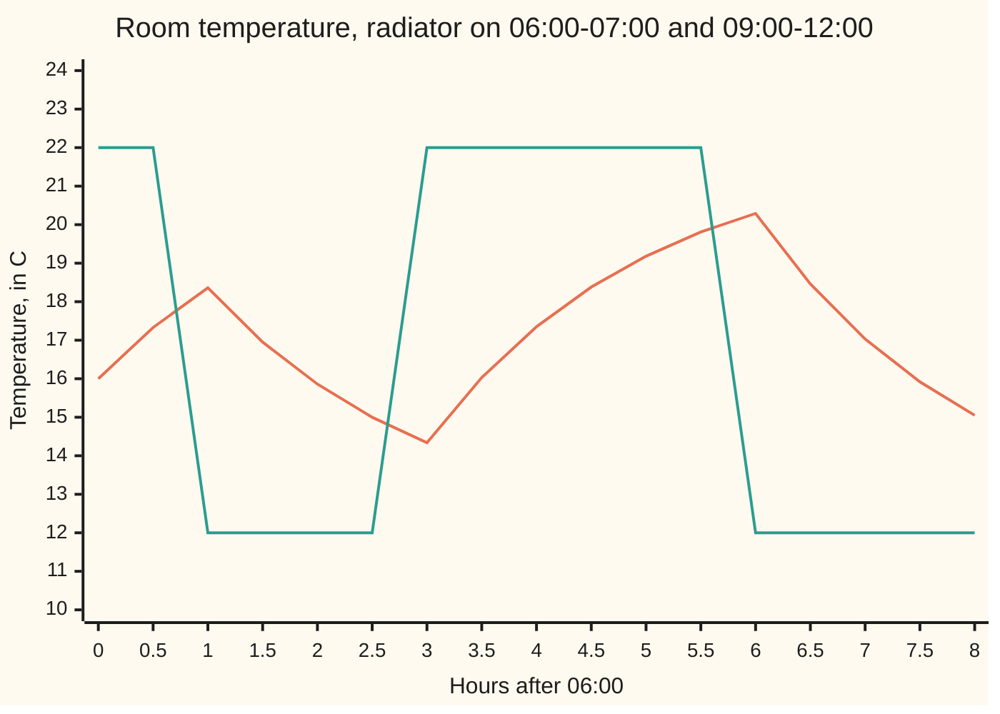

# Duhamel: add up each nudge, carried forward by the unforced flow

[Syllabus](../../../SYLLABUS.md) → [Functional analysis](../README.md) → [Unbounded Operators and Semigroups](../README.md#s05) → Duhamel

---

## General Overview

A room stands at 16 C at 06:00. With the radiator off, the walls pull it toward 12 C, the level the weather sets. The pull is 0.5 C per hour for every degree above 12 C. A timer runs the radiator from 06:00 to 07:00 and again from 09:00 to 12:00. While it runs, it adds heat at 5 C per hour: the rate it would warm the room if no heat escaped. All numbers are illustrative.

What is the temperature at noon? The forcing (the outside push, here the radiator) switches on and off, so no single formula covers the whole morning.

Duhamel's idea handles any on-off pattern in one sum. Cut the radiator's output into tiny nudges, one per moment. Each nudge then cools exactly as the room would with the radiator off. The room at noon is the 06:00 start, cooled for six hours, plus every nudge, each cooled for its own age.

The answer is 20.29 C. Of the 8.29 C above 12 C, only 0.20 C is left of the start and 0.32 C of the first hour of heating. The other 7.77 C comes from the three hours just ended. The same sum works when the room is a whole temperature profile, not one number. There the cooling rule is the heat equation (heat flows from warm spots to cool ones), and the sum is the only meaning that the forced equation has at the moments the radiator switches.

**The state of a forced linear evolution is its start carried forward by the unforced flow, plus every past nudge of forcing, each carried forward by the same flow for the time since it arrived.**

**What kind of fact this is:** a theorem, proved on this card in Why it works. For a start outside the domain, or forcing that is not smooth enough in time, the same formula becomes the definition of the solution, called the mild solution.

### The picture: a morning with the radiator on a timer



Orange: the room, from the Duhamel sum. Teal: the level the room heads for, 22 C with the radiator on and 12 C with it off. The room never reaches 22 C, because each heating block ends first.

---

## The formula

Notation first, with reminders from [Evolution as an equation](03-the-abstract-cauchy-problem-and-the-operator-exponential.md) and [Semigroups](04-strongly-continuous-semigroups.md):

- The **state** $`u(t)`$ lives in a space $`X`$ with a size $`\lVert\cdot\rVert`$. For the one-number room $`X`$ is the real line. For the temperature profile across the room, $`X = L^2(0, 4)`$: square-integrable functions on the 4 m width.
- The **generator** $`A`$ is the rule for the unforced rate of change, $`u' = Au`$, defined on its domain $`D(A)`$.
- The **semigroup** $`T(t)`$ is the unforced flow: it carries a state forward $`t`$ hours with the radiator off. It obeys $`T(0) = I`$ (the identity: no change), $`T(t + s) = T(t)T(s)`$ and the growth bound $`\lVert T(t)\rVert \le Me^{\omega t}`$.

The forced problem is $`u' = Au + f(t)`$ with $`u(0) = u_0`$. Its solution is

```math
u(t) = T(t)\,u_0 + \int_0^t T(t-s)\,f(s)\,ds .
```

**Read it aloud:** the state now is the start carried forward $`t`$ hours, plus the forcing of every earlier moment $`s`$, each carried forward the $`t - s`$ hours since it arrived.

For the one-number room, $`T(t)`$ is multiplication by $`e^{-kt}`$, and the forcing is $`q`$ while the radiator runs and 0 otherwise. A block of heating from time $`a`$ to time $`b`$ contributes, at any $`t \ge b`$,

```math
\int_a^b e^{-k(t-s)}\,q\,ds = \frac{q}{k}\left(e^{-k(t-b)} - e^{-k(t-a)}\right).
```

| Symbol | Plain meaning | In our example | Push it up and the answer… |
| --- | --- | --- | --- |
| $`X`$, $`y`$ | the space of states, with its size $`\lVert\cdot\rVert`$; $`y`$ any state in it (the folds) | one number; or $`L^2(0, 4)`$, profiles across the room | |
| $`u(t)`$ | the state at time $`t`$: temperature above 12 C | 8.290826 C at noon, so 20.29 C | |
| $`u_0`$; $`\tilde u_0, \tilde f, \tilde u`$ | the start; nearby smooth data and their solution (Step 3) | 4 C above 12 C at 06:00 | its share of the answer grows, though it fades like $`e^{-kt}`$ |
| $`A`$, $`D(A)`$ | generator: the unforced rate rule, and the states it accepts | $`-k`$; or $`\kappa\, d^2/dx^2`$ with both walls at 12 C | |
| $`T(t)`$, $`I`$ | the unforced flow over $`t`$ hours; growth bound $`\lVert T(t)\rVert \le Me^{\omega t}`$; $`I = T(0)`$, the identity | $`e^{-kt}`$; for the profile $`M = 1`$, $`\omega = -0.493480`$ per hour | |
| $`f(s)`$, $`F`$ | forcing at time $`s`$: heat added per hour; $`F(u)`$ a forcing that depends on the state (real life) | 5 C/h while on; for the profile 40 C/h in the band 0.25 to 0.75 m from the left wall | the answer rises in proportion |
| $`t`$, $`s`$, $`a`$, $`b`$, $`v(s)`$; $`h, \delta, r, \tau, \sigma`$ | now, and the moment a nudge arrives; $`t - s`$ is its age; a heating block runs from $`a`$ to $`b`$; $`v(s) = T(t-s)u(s)`$ is the proof's helper in Step 2; in the folds, $`h, \delta`$ small time steps and $`r, \tau, \sigma`$ times inside integrals | $`t = 6`$ h after 06:00; blocks 0 to 1 h and 3 to 6 h | |
| $`k`$, $`q`$ | the walls' pull per degree; the radiator's rate | 0.5 per hour; 5 C/h | bigger $`k`$: lower answer; bigger $`q`$: higher |
| $`\kappa`$ | effective diffusivity: how fast mixing spreads heat across the room | 0.8 m²/h | the profile flattens sooner |
| $`L`$, $`x`$ | the room's width; position from the left wall | 4 m; readings at 0.5, 2.0 and 3.5 m | |
| $`\lambda_n`$ | decay rate of the $`n`$-th sine mode, $`\kappa(n\pi/L)^2`$ | 0.493480 and 49.348022 per hour for $`n = 1, 10`$ | that mode forgets its past faster |
| $`N`$, $`f_N`$, $`u_N`$ | number of sine modes kept; the band's forcing while on, and the state, cut to $`N`$ modes | 10 to 10000 | the truncation error falls |

### When it holds

- **$`A`$ generates a strongly continuous semigroup.** That is the test of [Hille-Yosida](05-hille-yosida-and-generators.md). Without it there is no flow to carry the nudges. Run the heat equation backward and $`T(t)`$ does not exist as a bounded operator, so the integral has nothing to integrate.
- **The unforced flow does not change with time.** Open a window from 07:00 to 09:00 and the pull triples to 1.5 per hour. The formula with one fixed flow still says 20.29 C; the true noon reading is 19.84 C. A time-dependent flow needs a two-time propagator, which carries a state from time $`s`$ to time $`t`$.
- **The equation is linear.** Nudges add only if the flow treats a sum of states as the sum of their flows. If heat loss grew with the fourth power of the absolute temperature, as radiation does, each nudge would cool at a rate set by the others.
- **The forcing is integrable in time.** An on-off pattern is fine. Each $`f(s)`$ lies in $`X`$, and $`\int_0^t \lVert f(s)\rVert\,ds`$ is finite.
- **Smoothness decides which kind of solution you get.** Take $`u_0`$ in $`D(A)`$ and $`f`$ continuously differentiable in time. Then the formula gives a classical solution: differentiable, in $`D(A)`$, with $`u' = Au + f`$ at every moment. Otherwise it gives the mild solution, defined in Step 3.

---

## Why it works

### Step 0: linearity and a flow that does not age

Two facts make the sum possible. The equation is linear, so the responses to separate pieces of forcing add. The flow is the same at every hour, so a nudge that arrives at time $`s`$ behaves like a fresh start at time $`s`$. It is carried forward by $`T(t - s)`$, which depends only on its age.

So the forced problem splits into infinitely many unforced ones, one per moment. Each one is already solved by the semigroup. The integral adds them up.

### Step 1: the finite rehearsal, one number

For the one-number room, $`u' = -ku + f(t)`$. Multiply by $`e^{-k(t-s)}`$ and look at it as a function of $`s`$:

```math
\frac{d}{ds}\left[e^{-k(t-s)}u(s)\right] = e^{-k(t-s)}\big(u'(s) + k\,u(s)\big) = e^{-k(t-s)} f(s).
```

Integrate from $`s = 0`$ to $`s = t`$. The left side gives $`u(t) - e^{-kt}u_0`$, which is the formula.

This is the integrating factor of [Variation of parameters](../../08-Differential%20equations%20and%20dynamics/03-Oscillators%20-%20Second-Order%20Linear%20Equations/07-variation-of-parameters.md), and [Forced systems](../../08-Differential%20equations%20and%20dynamics/04-Systems%20and%20the%20Matrix%20Exponential/06-forced-systems-and-variation-of-constants.md) already derives the matrix version, $`u(t) = e^{At}u_0 + \int_0^t e^{A(t-s)}f(s)\,ds`$, with two heated rooms. Any finite truncation below is such a matrix. What is new here is the step to an operator that no matrix captures.

### Step 2: the same trick with a semigroup

Now $`A`$ may be unbounded, and $`T(t)`$ is not a power series in $`A`$. Suppose $`u`$ is a classical solution: differentiable, in $`D(A)`$ at every moment, with $`u' = Au + f`$. Fix $`t`$ and set

```math
v(s) = T(t-s)\,u(s), \qquad 0 \le s \le t .
```

The product rule for semigroups gives $`v'(s) = -T(t-s)Au(s) + T(t-s)u'(s) = T(t-s)f(s)`$. The two $`Au`$ terms cancel, as $`ku`$ did in Step 1. Integrate from 0 to $`t`$: $`v(t) - v(0) = u(t) - T(t)u_0`$. That is the formula.

So every classical solution equals the Duhamel sum. In particular there is at most one classical solution. The fold checks the product rule, which is where $`u(s) \in D(A)`$ is used.

<details>
<summary>Detailed proof: the derivative of T(t − s)u(s)</summary>

Take $`0 < s < t`$ and a small $`h`$. Split the difference quotient:

$`\displaystyle \frac{v(s+h) - v(s)}{h} = T(t-s-h)\,\frac{u(s+h) - u(s)}{h} + \frac{T(t-s-h) - T(t-s)}{h}\,u(s).`$

First term. The operators $`T(r)`$ for $`0 \le r \le t`$ have sizes at most $`Me^{\lvert\omega\rvert t}`$. The quotient converges to $`u'(s)`$, and $`T(t-s-h)`$ converges strongly to $`T(t-s)`$ (applied to each fixed vector, the results converge). So the first term converges to $`T(t-s)u'(s)`$.

Second term. Because $`u(s)`$ is in $`D(A)`$, the map $`r \mapsto T(r)u(s)`$ is differentiable with derivative $`T(r)Au(s)`$. Here $`r = t - s - h`$ moves backward as $`h`$ grows, so the term converges to $`-T(t-s)Au(s)`$.

At $`r = 0`$ that differentiability is the definition of the generator ([Semigroups](04-strongly-continuous-semigroups.md)); the semigroup law carries it to every $`r > 0`$. Write $`y = u(s)`$ and let a step $`\delta`$ shrink to 0. From the right, $`\big(T(r+\delta)y - T(r)y\big)/\delta = T(r)\big(T(\delta)y - y\big)/\delta`$, which tends to $`T(r)Ay`$. From the left, $`\big(T(r)y - T(r-\delta)y\big)/\delta = T(r-\delta)\big(T(\delta)y - y\big)/\delta`$ tends to the same limit, because the growth bound keeps $`T(r-\delta)`$ bounded and strong continuity carries $`T(r-\delta)Ay`$ to $`T(r)Ay`$.

Add them: $`v'(s) = T(t-s)\big(u'(s) - Au(s)\big) = T(t-s)f(s)`$. The map $`s \mapsto T(t-s)f(s)`$ is integrable, so the fundamental theorem of calculus applies on $`[0, t]`$.

</details>

### Step 3: when no classical solution exists, the formula becomes the definition

The right-hand side makes sense far more often than the equation does. It needs only $`u_0 \in X`$ and $`f`$ integrable in time. It needs no derivatives and no domain. So define:

> The **mild solution** of $`u' = Au + f`$, $`u(0) = u_0`$, is $`u(t) = T(t)u_0 + \int_0^t T(t-s)f(s)\,ds`$.

Three facts make this the right definition.

1. **It agrees with the classical solution when one exists**, by Step 2.
2. **It is the limit of classical solutions.** Replace $`u_0`$ and $`f`$ by nearby smooth data in $`D(A)`$. Each such problem has a classical solution. The growth bound gives $`\lVert u(t) - \tilde u(t)\rVert \le Me^{\lvert\omega\rvert t}\big(\lVert u_0 - \tilde u_0\rVert + \int_0^t \lVert f - \tilde f\rVert\big)`$, so the classical solutions converge to the mild one.
3. **It solves the equation in integrated form.** The time integral $`\int_0^t u(s)\,ds`$ lies in $`D(A)`$, and $`u(t) = u_0 + A\int_0^t u(s)\,ds + \int_0^t f(s)\,ds`$. Ball (1977) showed that the weak solutions (those that satisfy the equation only when paired with test vectors from the adjoint's domain) are exactly the mild ones.

<details>
<summary>Detailed proof: the integrated form, from one identity of the semigroup</summary>

The identity: for every $`y`$ in $`X`$ and $`\tau \ge 0`$, the integral $`\int_0^\tau T(r)y\,dr`$ lies in $`D(A)`$ and

$`\displaystyle A\int_0^\tau T(r)y\,dr = T(\tau)y - y.`$

Proof. Apply the difference quotient that defines $`A`$:

$`\displaystyle \frac{T(h) - I}{h}\int_0^\tau T(r)y\,dr = \frac1h\int_\tau^{\tau+h} T(r)y\,dr - \frac1h\int_0^h T(r)y\,dr.`$

By strong continuity the right side converges to $`T(\tau)y - y`$ as $`h \to 0`$. So the limit on the left exists, which is what membership of $`D(A)`$ means.

Now integrate the mild solution from 0 to $`t`$. The start term gives $`\int_0^t T(s)u_0\,ds`$, and $`A`$ of it is $`T(t)u_0 - u_0`$. For the forcing term, swap the order of integration:

$`\displaystyle \int_0^t\!\int_0^s T(s-r)f(r)\,dr\,ds = \int_0^t \Big(\int_0^{t-r} T(\sigma)f(r)\,d\sigma\Big)dr.`$

$`A`$ of the inner integral is $`T(t-r)f(r) - f(r)`$. Since $`A`$ is closed (its graph contains its own limits), it passes through the outer integral. Adding up, $`A\int_0^t u = u(t) - u_0 - \int_0^t f`$.

</details>

### Step 4: the profile, one sine mode at a time

Now let the room have a temperature profile $`u(x, t)`$ across its 4 m width. Mixing spreads heat like diffusion, with an effective diffusivity $`\kappa = 0.8`$ m²/h (illustrative: real rooms mix by air currents, which this lumps into one number). Both end walls stay at 12 C. The radiator heats the band 0.25 to 0.75 m from the left wall at 40 C/h, on the same timer. The room starts at 16 C inside.

The generator is $`A = \kappa\, d^2/dx^2`$ on $`D(A) = H^2(0, 4) \cap H^1_0(0, 4)`$: profiles with two square-integrable weak slopes that are zero at both walls. The sine modes $`\sin(n\pi x/L)`$ diagonalise the flow. $`T(t)`$ multiplies mode $`n`$ by $`e^{-\lambda_n t}`$, with $`\lambda_n = \kappa(n\pi/L)^2`$. So Duhamel runs mode by mode, each a copy of Step 1 with its own rate. Keep $`N`$ modes and the error at noon falls fast:

| $`N`$ | error at 0.5 m (C) | at 2.0 m (C) | at 3.5 m (C) |
| ---: | ---: | ---: | ---: |
| 10 | −0.087195297 | −0.038739089 | −0.028853342 |
| 40 | −0.001124121 | 0.000029986 | −0.000002695 |
| 160 | −0.000067677 | 0.000001152 | 0.000000108 |
| 640 | −0.000001069 | 0.000000018 | 0.000000002 |

Errors are measured against $`N = 20000`$. At the radiator, each fourfold rise in $`N`$ cuts the error at least sixteenfold. At noon the radiator band reads 20.896 C, the middle 17.015 C and the far side 13.096 C. A Crank-Nicolson stepper on 160 cells gives the same three readings. It never uses the formula: it steps the heat equation directly, averaging the rates at the start and end of each step.

### Step 5: what changes in infinite dimensions

In a matrix model every vector is in the domain and every solution is classical. Here neither holds.

The forcing is not in $`D(A)`$. The band source jumps at its edges, so it has no second slope in $`L^2`$. Truncations show it: the RMS (root-mean-square over the room) of $`Af_N`$, where $`f_N`$ is the band's forcing cut to $`N`$ modes, never settles. The RMS of $`Au_N`$ at noon does settle:

| $`N`$ | RMS of $`Af_N`$ (C/h²) | RMS of $`Au_N`$ at noon (C/h) |
| ---: | ---: | ---: |
| 10 | 179.287 | 12.834010 |
| 100 | 5084.325 | 13.945593 |
| 1000 | 162231.758 | 14.050590 |
| 10000 | 5130198.628 | 14.060970 |

The first column grows like $`N^{3/2}`$ and never settles. The second settles near 14.06 C/h. So the mild solution at noon is in the domain, even though the forcing never is. The identity in Step 3's fold puts each heating block's contribution in $`D(A)`$, and the heat flow smooths the start.

The start is not in the domain either. A uniform 4 C rise does not vanish at the walls. And at each switch the slope $`u'`$ jumps by the forcing, so $`u`$ has no derivative there. The equation $`u' = Au + f`$ fails at 07:00, 09:00 and noon. The Duhamel formula does not care. Every finite truncation hides this: a matrix has no domain, and only the trend over $`N`$ shows it.

---

## Worked numbers, by hand

The one-number room at noon, $`t = 6`$ h after 06:00, with $`k = 0.5`$ per hour, $`q = 5`$ C/h and $`q/k = 10`$ C.

| Step | Arithmetic | Value |
| --- | --- | --- |
| start, carried 6 h | $`4 \times e^{-0.5 \times 6}`$ | 0.199148 C |
| block 1, 06:00 to 07:00, ages 5 to 6 h | $`10 \times (e^{-2.5} - e^{-3})`$ | 0.322979 C |
| block 2, 09:00 to 12:00, ages 0 to 3 h | $`10 \times (1 - e^{-1.5})`$ | 7.768698 C |
| rise above 12 C | $`0.199148 + 0.322979 + 7.768698`$ | 8.290826 C |
| **temperature at noon** | $`12 + 8.290826`$ | **20.29 C** |

Recent heating dominates: the three hours just ended supply 7.768698 C of the 8.290826 C rise, because older nudges have cooled for longer.

### What breaks if you drop a piece

| Mistake | Comes out at | What went wrong |
| --- | --- | --- |
| Carry each nudge by its arrival time, $`T(s)`$, not its age, $`T(t - s)`$ | 17.87 C | the earliest heat is treated as freshest; age is what decays |
| Add the nudges with no decay | 36.00 C | the 20 C of heat poured in is counted as if no wall ever leaked |
| Drop the start term $`T(t)u_0`$ | 20.09 C | the 4 C the room began with has not quite gone |
| Window open 07:00 to 09:00, one fixed flow kept | 20.29 C; true 19.84 C | the hypothesis of a time-independent flow fails; use the propagator |

---

## How it moves

The puzzle: the room warms, cools, and warms again, yet one formula covers it. Trace the three pieces hour by hour. Each piece only ever decays after its block ends.

| Clock | Start part (C) | Block 1 (C) | Block 2 (C) | Temperature (C) |
| --- | ---: | ---: | ---: | ---: |
| 06:00 | 4.000000 | 0.000000 | 0.000000 | 16.00 |
| 07:00 | 2.426123 | 3.934693 | 0.000000 | 18.36 |
| 08:00 | 1.471518 | 2.386512 | 0.000000 | 15.86 |
| 09:00 | 0.892521 | 1.447493 | 0.000000 | 14.34 |
| 10:00 | 0.541341 | 0.877949 | 3.934693 | 17.35 |
| 11:00 | 0.328340 | 0.532503 | 6.321206 | 19.18 |
| 12:00 | 0.199148 | 0.322979 | 7.768698 | 20.29 |
| 13:00 | 0.120790 | 0.195897 | 4.711954 | 17.03 |
| 14:00 | 0.073263 | 0.118817 | 2.857944 | 15.05 |

The three pieces at noon, one force at a time:

```
start, carried 6 h          |#                                0.199148 C
block 1, 06:00-07:00        |#                                0.322979 C
block 2, 09:00-12:00        |##############################   7.768698 C
```

The sum of the three columns is the orange line in the chart above. Cutting the forcing into finer nudges converges to the same answer: slices of 0.5 h miss by 0.021033728 C, slices of 0.01 h by 0.000008429 C.

---

## Code, from first principles, and it actually runs

The scripts compute every number on the card. They take four independent roads:

- the Duhamel formula in closed form, block by block;
- a literal sum of nudges, one per time slice, each decayed by its age;
- a fourth-order Runge-Kutta (RK4) stepper that solves $`u' = -ku + f`$ directly and never sees the formula;
- for the profile, the formula mode by mode against a Crank-Nicolson stepper on 160 cells.

What the truncation hides: every truncation is a matrix, so the forcing is always "in the domain". Only the growth of $`Af_N`$ over $`N`$ shows that the true band source is not.

### Python

```python
# Duhamel's principle for a forced evolution -- the check behind the card.  Standard library only.
# A room heated by a radiator on 06:00-07:00 and 09:00-12:00 (t = 0 is 06:00, t in hours).
# Rehearsal: one number u = temperature above 12 C, u' = -k u + q on(t).
# Profile: u(x, t) across a 4 m room, u' = kappa u'' + f, walls held at 12 C.
# Roads: Duhamel in closed form, a sum of nudges, RK4 and Crank-Nicolson steppers.
import math
PI = math.pi
K, Q, U0, BLOCKS = 0.5, 5.0, 4.0, ((0.0, 1.0), (3.0, 6.0))

def close(a, b, tol):
    assert abs(a - b) <= tol, (a, b)

def block_part(rate, a, b, t, size):  # integral over [a, min(b, t)] of size e^(-rate (t - s)) ds
    if t <= a:
        return 0.0
    e = min(b, t)
    return size / rate * (math.exp(-rate * (t - e)) - math.exp(-rate * (t - a)))

def duhamel(t, rate=K, start=U0):
    return start * math.exp(-rate * t) + sum(block_part(rate, a, b, t, Q) for a, b in BLOCKS)

def on(s):
    return 1.0 if any(a <= s < b for a, b in BLOCKS) else 0.0

# Road three: RK4 on u' = -k u + q on(t) itself, 0.01 h steps; rate and forcing fixed within a step.
def rk4(rate_of, dt=0.01, steps=600, u=U0):
    for j in range(steps):
        w, a = on((j + 0.5) * dt) * Q, rate_of((j + 0.5) * dt)  # switches fall on step edges
        k1 = a * u + w
        k2 = a * (u + dt / 2 * k1) + w
        k3 = a * (u + dt / 2 * k2) + w
        k4 = a * (u + dt * k3) + w
        u += dt / 6 * (k1 + 2 * k2 + 2 * k3 + k4)
    return u

# 1. The one-number room: the start and each heating block, carried forward to time t.
print("room, t (h), clock, start part, block 1, block 2, rise (C), temperature (C)")
for t in range(9):
    p0, p1, p2 = U0 * math.exp(-K * t), block_part(K, 0, 1, t, Q), block_part(K, 3, 6, t, Q)
    close(p0 + p1 + p2, rk4(lambda s: -K, steps=100 * t), 1e-9)  # against road three, hour by hour
    print(f"room, {t}, {6 + t:02d}:00, {p0:.6f}, {p1:.6f}, {p2:.6f}, {p0 + p1 + p2:.6f}, {12 + p0 + p1 + p2:.2f}")
noon = duhamel(6.0)
# Road two: add the nudges q on(s) ds slice by slice, each decayed by its age t - s (slice middle).
print("nudges, slice width ds (h), sum of nudges at noon, error")
for ds in (0.5, 0.1, 0.01, 0.001):
    m = round(6.0 / ds)
    tot = U0 * math.exp(-K * 6.0) + sum(math.exp(-K * (6.0 - (j + .5) * ds)) * Q * on((j + .5) * ds) * ds for j in range(m))
    print(f"nudges, {ds}, {tot:.6f}, {tot - noon:.9f}")
    close(tot, noon, 0.2 * ds * ds)  # midpoint slices: error falls like ds squared
r = rk4(lambda s: -K)
close(r, noon, 1e-9)
close(noon, 4 * math.exp(-3) + 10 * (math.exp(-2.5) - math.exp(-3)) + 10 * (1 - math.exp(-1.5)), 1e-12)
print(f"room at noon, Duhamel {noon:.6f}, RK4 {r:.6f}, temperature {12 + noon:.2f} C")
print("chart, temperature every half hour, " + ", ".join(f"{12 + duhamel(j / 2):.2f}" for j in range(17)))
print("chart, target, " + ", ".join(f"{12 + 10 * on(j / 2):.0f}" for j in range(17)))

# 2. The profile: sine modes sin(n pi x / L) diagonalise the flow; mode n decays at lam_n.
L, KAP, QR, RA, RB = 4.0, 0.8, 40.0, 0.25, 0.75  # radiator band 0.25-0.75 m heats at 40 C/h
lam = lambda n: KAP * (n * PI / L) ** 2
qn = lambda n: 2 * QR / (n * PI) * (math.cos(n * PI * RA / L) - math.cos(n * PI * RB / L))
un0 = lambda n: 2 * U0 / (n * PI) * (1 - math.cos(n * PI))
def coef(n, t):
    return un0(n) * math.exp(-lam(n) * t) + sum(block_part(lam(n), a, b, t, qn(n)) for a, b in BLOCKS)
def profile(x, t, N):
    return sum(coef(n, t) * math.sin(n * PI * x / L) for n in range(1, N + 1))
print(f"flow, mode 1 decays at {lam(1):.6f} per hour, mode 10 at {lam(10):.6f} per hour")
XS = (0.5, 2.0, 3.5)
ref = [profile(x, 6.0, 20000) for x in XS]
print("modes, N, error at 0.5 m, at 2.0 m, at 3.5 m (C, against N = 20000)")
for N in (10, 40, 160, 640):
    err = [profile(x, 6.0, N) - v for x, v in zip(XS, ref)]
    print("modes, " + str(N) + ", " + ", ".join(f"{e:.9f}" for e in err))
    if N == 10:
        err10 = err[0]
assert abs(err10) > 0.05 and abs(profile(0.5, 6.0, 640) - ref[0]) < 1e-5
# Crank-Nicolson on M cells: (I - dt/2 A) u_new = (I + dt/2 A) u + dt f, solved by the Thomas sweep.
M, dt = 160, 0.01
h = L / M
u = [0.0] + [U0] * (M - 1) + [0.0]
src = [QR * (1.0 if RA < j * h < RB else 0.5 if abs(j * h - RA) < 1e-9 or abs(j * h - RB) < 1e-9 else 0.0) for j in range(M + 1)]
c = KAP * dt / (2 * h * h)
for step in range(600):
    w = on((step + 0.5) * dt)
    rhs = [u[j] + c * (u[j - 1] - 2 * u[j] + u[j + 1]) + dt * w * src[j] for j in range(1, M)]
    cp, dp = [0.0] * (M - 1), [0.0] * (M - 1)
    for i in range(M - 1):
        den = (1 + 2 * c) + (c * cp[i - 1] if i else 0.0)
        cp[i], dp[i] = -c / den, (rhs[i] + (c * dp[i - 1] if i else 0.0)) / den
    for i in range(M - 2, -1, -1):
        u[i + 1] = dp[i] - (cp[i] * u[i + 2] if i < M - 2 else 0.0)
cn = [u[round(x / h)] for x in XS]
for a, b in zip(cn, ref):
    close(a, b, 2e-3)
print("profile at noon (C), x = 0.5 m, 2.0 m, 3.5 m: modes " + ", ".join(f"{12 + v:.3f}" for v in ref)
      + "; Crank-Nicolson " + ", ".join(f"{12 + v:.3f}" for v in cn))
# The forcing is not in the domain D(A); the mild solution at noon is.  Sizes as RMS over the room.
print("domain, N, RMS of A f_N (C/h^2), RMS of A u_N at noon (C/h)")
for N in (10, 100, 1000, 10000):
    aq = math.sqrt(0.5 * sum((lam(n) * qn(n)) ** 2 for n in range(1, N + 1)))
    au = math.sqrt(0.5 * sum((lam(n) * coef(n, 6.0)) ** 2 for n in range(1, N + 1)))
    print(f"domain, {N}, {aq:.3f}, {au:.6f}")
assert aq > 1e5 and au < 30

# 3. What breaks.
wrong_age = U0 * math.exp(-K * 6) + sum(Q / K * (math.exp(-K * a) - math.exp(-K * b)) for a, b in BLOCKS)
close(wrong_age, 4 * math.exp(-3) + 10 * (1 - math.exp(-0.5)) + 10 * (math.exp(-1.5) - math.exp(-3)), 1e-12)
print(f"breaks, carry each nudge by its arrival time s, not its age: {12 + wrong_age:.2f} C, true {12 + noon:.2f} C")
print(f"breaks, add the nudges with no decay: {12 + U0 + Q * 4:.2f} C")
print(f"breaks, drop the start term: {12 + noon - U0 * math.exp(-3):.2f} C")
win = rk4(lambda s: -1.5 if 1 <= s < 3 else -K)  # window open 07:00-09:00 triples the loss rate
step_by_step = (duhamel(1.0) * math.exp(-3) * math.exp(-1.5)) + block_part(K, 3, 6, 6, Q)
close(win, step_by_step, 1e-9)
print(f"breaks, window open 07:00-09:00, one fixed flow: {12 + noon:.2f} C, true {12 + win:.2f} C")
print(f"breaks, 10 modes at the radiator: off by {err10:.3f} C")
print("ALL CHECKS PASS")
```

**Ran 2026-11-15 on macOS, Python 3.14.10, standard library only. All checks passed. Output, pasted from the run:**

```
room, t (h), clock, start part, block 1, block 2, rise (C), temperature (C)
room, 0, 06:00, 4.000000, 0.000000, 0.000000, 4.000000, 16.00
room, 1, 07:00, 2.426123, 3.934693, 0.000000, 6.360816, 18.36
room, 2, 08:00, 1.471518, 2.386512, 0.000000, 3.858030, 15.86
room, 3, 09:00, 0.892521, 1.447493, 0.000000, 2.340013, 14.34
room, 4, 10:00, 0.541341, 0.877949, 3.934693, 5.353983, 17.35
room, 5, 11:00, 0.328340, 0.532503, 6.321206, 7.182048, 19.18
room, 6, 12:00, 0.199148, 0.322979, 7.768698, 8.290826, 20.29
room, 7, 13:00, 0.120790, 0.195897, 4.711954, 5.028640, 17.03
room, 8, 14:00, 0.073263, 0.118817, 2.857944, 3.050024, 15.05
nudges, slice width ds (h), sum of nudges at noon, error
nudges, 0.5, 8.269792, -0.021033728
nudges, 0.1, 8.289983, -0.000842822
nudges, 0.01, 8.290818, -0.000008429
nudges, 0.001, 8.290826, -0.000000084
room at noon, Duhamel 8.290826, RK4 8.290826, temperature 20.29 C
chart, temperature every half hour, 16.00, 17.33, 18.36, 16.95, 15.86, 15.00, 14.34, 16.03, 17.35, 18.38, 19.18, 19.81, 20.29, 18.46, 17.03, 15.92, 15.05
chart, target, 22, 22, 12, 12, 12, 12, 22, 22, 22, 22, 22, 22, 12, 12, 12, 12, 12
flow, mode 1 decays at 0.493480 per hour, mode 10 at 49.348022 per hour
modes, N, error at 0.5 m, at 2.0 m, at 3.5 m (C, against N = 20000)
modes, 10, -0.087195297, -0.038739089, -0.028853342
modes, 40, -0.001124121, 0.000029986, -0.000002695
modes, 160, -0.000067677, 0.000001152, 0.000000108
modes, 640, -0.000001069, 0.000000018, 0.000000002
profile at noon (C), x = 0.5 m, 2.0 m, 3.5 m: modes 20.896, 17.015, 13.096; Crank-Nicolson 20.896, 17.015, 13.096
domain, N, RMS of A f_N (C/h^2), RMS of A u_N at noon (C/h)
domain, 10, 179.287, 12.834010
domain, 100, 5084.325, 13.945593
domain, 1000, 162231.758, 14.050590
domain, 10000, 5130198.628, 14.060970
breaks, carry each nudge by its arrival time s, not its age: 17.87 C, true 20.29 C
breaks, add the nudges with no decay: 36.00 C
breaks, drop the start term: 20.09 C
breaks, window open 07:00-09:00, one fixed flow: 20.29 C, true 19.84 C
breaks, 10 modes at the radiator: off by -0.087 C
ALL CHECKS PASS
```

### Rust

```rust
// Duhamel's principle for a forced evolution -- the check behind the card.  std only.
// A room heated by a radiator on 06:00-07:00 and 09:00-12:00 (t = 0 is 06:00, t in hours).
// Rehearsal: one number u = temperature above 12 C, u' = -k u + q on(t).
// Profile: u(x, t) across a 4 m room, u' = kappa u'' + f, walls held at 12 C.
// Roads: Duhamel in closed form, a sum of nudges, RK4 and Crank-Nicolson steppers.
use std::f64::consts::PI;
const K: f64 = 0.5;
const Q: f64 = 5.0;
const U0: f64 = 4.0;
const BLOCKS: [(f64, f64); 2] = [(0.0, 1.0), (3.0, 6.0)];
const L: f64 = 4.0;
const KAP: f64 = 0.8;
const QR: f64 = 40.0;
const RA: f64 = 0.25;
const RB: f64 = 0.75;

fn close(a: f64, b: f64, tol: f64) {
    assert!((a - b).abs() <= tol, "{} {}", a, b);
}
// integral over [a, min(b, t)] of size e^(-rate (t - s)) ds
fn block_part(rate: f64, a: f64, b: f64, t: f64, size: f64) -> f64 {
    if t <= a {
        return 0.0;
    }
    let e = b.min(t);
    size / rate * ((-rate * (t - e)).exp() - (-rate * (t - a)).exp())
}
fn duhamel(t: f64) -> f64 {
    U0 * (-K * t).exp() + BLOCKS.iter().map(|&(a, b)| block_part(K, a, b, t, Q)).sum::<f64>()
}
fn on(s: f64) -> f64 {
    if BLOCKS.iter().any(|&(a, b)| a <= s && s < b) { 1.0 } else { 0.0 }
}
fn rk4(rate_of: &dyn Fn(f64) -> f64, steps: usize) -> f64 {
    let (dt, mut u) = (0.01, U0);
    for j in 0..steps {
        let s = (j as f64 + 0.5) * dt; // switches fall on step edges
        let (w, a) = (on(s) * Q, rate_of(s));
        let k1 = a * u + w;
        let k2 = a * (u + dt / 2.0 * k1) + w;
        let k3 = a * (u + dt / 2.0 * k2) + w;
        let k4 = a * (u + dt * k3) + w;
        u += dt / 6.0 * (k1 + 2.0 * k2 + 2.0 * k3 + k4);
    }
    u
}
fn lam(n: usize) -> f64 { KAP * (n as f64 * PI / L).powi(2) }
fn qn(n: usize) -> f64 {
    let m = n as f64 * PI;
    2.0 * QR / m * ((m * RA / L).cos() - (m * RB / L).cos())
}
fn coef(n: usize, t: f64) -> f64 {
    let un0 = 2.0 * U0 / (n as f64 * PI) * (1.0 - (n as f64 * PI).cos());
    un0 * (-lam(n) * t).exp() + BLOCKS.iter().map(|&(a, b)| block_part(lam(n), a, b, t, qn(n))).sum::<f64>()
}
fn profile(x: f64, t: f64, nmax: usize) -> f64 {
    (1..=nmax).map(|n| coef(n, t) * (n as f64 * PI * x / L).sin()).sum()
}
fn join(v: &[f64], d: usize, add: f64) -> String {
    v.iter().map(|x| format!("{:.*}", d, x + add)).collect::<Vec<_>>().join(", ")
}

fn main() {
    // 1. The one-number room: the start and each heating block, carried forward to time t.
    println!("room, t (h), clock, start part, block 1, block 2, rise (C), temperature (C)");
    for t in 0..9 {
        let tf = t as f64;
        let (p0, p1, p2) = (U0 * (-K * tf).exp(), block_part(K, 0.0, 1.0, tf, Q), block_part(K, 3.0, 6.0, tf, Q));
        close(p0 + p1 + p2, rk4(&|_s| -K, 100 * t as usize), 1e-9); // against road three, hour by hour
        let s = p0 + p1 + p2;
        println!("room, {}, {:02}:00, {:.6}, {:.6}, {:.6}, {:.6}, {:.2}", t, 6 + t, p0, p1, p2, s, 12.0 + s);
    }
    let noon = duhamel(6.0);
    // Road two: add the nudges q on(s) ds slice by slice, each decayed by its age t - s (slice middle).
    println!("nudges, slice width ds (h), sum of nudges at noon, error");
    for (ds, lab) in [(0.5, "0.5"), (0.1, "0.1"), (0.01, "0.01"), (0.001, "0.001")] {
        let m = (6.0f64 / ds).round() as usize;
        let mut tot = U0 * (-K * 6.0f64).exp();
        for j in 0..m {
            let s = (j as f64 + 0.5) * ds;
            tot += (-K * (6.0 - s)).exp() * Q * on(s) * ds;
        }
        println!("nudges, {}, {:.6}, {:.9}", lab, tot, tot - noon);
        close(tot, noon, 0.2 * ds * ds); // midpoint slices: error falls like ds squared
    }
    // Road three: RK4 on u' = -k u + q on(t) itself, 0.01 h steps; rate and forcing fixed within a step.
    let r = rk4(&|_s| -K, 600);
    close(r, noon, 1e-9);
    close(noon, 4.0 * (-3.0f64).exp() + 10.0 * ((-2.5f64).exp() - (-3.0f64).exp()) + 10.0 * (1.0 - (-1.5f64).exp()), 1e-12);
    println!("room at noon, Duhamel {:.6}, RK4 {:.6}, temperature {:.2} C", noon, r, 12.0 + noon);
    let temps: Vec<f64> = (0..17).map(|j| duhamel(j as f64 / 2.0)).collect();
    let target: Vec<f64> = (0..17).map(|j| 10.0 * on(j as f64 / 2.0)).collect();
    println!("chart, temperature every half hour, {}", join(&temps, 2, 12.0));
    println!("chart, target, {}", join(&target, 0, 12.0));

    // 2. The profile: sine modes sin(n pi x / L) diagonalise the flow; mode n decays at lam_n.
    println!("flow, mode 1 decays at {:.6} per hour, mode 10 at {:.6} per hour", lam(1), lam(10));
    let xs = [0.5, 2.0, 3.5];
    let reference: Vec<f64> = xs.iter().map(|&x| profile(x, 6.0, 20000)).collect();
    println!("modes, N, error at 0.5 m, at 2.0 m, at 3.5 m (C, against N = 20000)");
    let mut err10 = 0.0;
    for nmax in [10, 40, 160, 640] {
        let err: Vec<f64> = xs.iter().zip(&reference).map(|(&x, &v)| profile(x, 6.0, nmax) - v).collect();
        println!("modes, {}, {}", nmax, join(&err, 9, 0.0));
        if nmax == 10 {
            err10 = err[0];
        }
    }
    assert!(err10.abs() > 0.05 && (profile(0.5, 6.0, 640) - reference[0]).abs() < 1e-5);
    // Crank-Nicolson on M cells: (I - dt/2 A) u_new = (I + dt/2 A) u + dt f, solved by the Thomas sweep.
    let (m, dt) = (160usize, 0.01);
    let h = L / m as f64;
    let mut u = vec![U0; m + 1];
    u[0] = 0.0;
    u[m] = 0.0;
    let src: Vec<f64> = (0..=m).map(|j| {
        let x = j as f64 * h;
        QR * if RA < x && x < RB { 1.0 } else if (x - RA).abs() < 1e-9 || (x - RB).abs() < 1e-9 { 0.5 } else { 0.0 }
    }).collect();
    let c = KAP * dt / (2.0 * h * h);
    for step in 0..600 {
        let w = on((step as f64 + 0.5) * dt);
        let rhs: Vec<f64> = (1..m).map(|j| u[j] + c * (u[j - 1] - 2.0 * u[j] + u[j + 1]) + dt * w * src[j]).collect();
        let (mut cp, mut dp) = (vec![0.0; m - 1], vec![0.0; m - 1]);
        for i in 0..m - 1 {
            let den = (1.0 + 2.0 * c) + if i > 0 { c * cp[i - 1] } else { 0.0 };
            cp[i] = -c / den;
            dp[i] = (rhs[i] + if i > 0 { c * dp[i - 1] } else { 0.0 }) / den;
        }
        for i in (0..m - 1).rev() {
            u[i + 1] = dp[i] - if i < m - 2 { cp[i] * u[i + 2] } else { 0.0 };
        }
    }
    let cn: Vec<f64> = xs.iter().map(|&x| u[(x / h).round() as usize]).collect();
    for (a, b) in cn.iter().zip(&reference) {
        close(*a, *b, 2e-3);
    }
    println!("profile at noon (C), x = 0.5 m, 2.0 m, 3.5 m: modes {}; Crank-Nicolson {}", join(&reference, 3, 12.0), join(&cn, 3, 12.0));
    // The forcing is not in the domain D(A); the mild solution at noon is.  Sizes as RMS over the room.
    println!("domain, N, RMS of A f_N (C/h^2), RMS of A u_N at noon (C/h)");
    let (mut aq, mut au) = (0.0, 0.0);
    for nmax in [10, 100, 1000, 10000] {
        aq = (0.5 * (1..=nmax).map(|n| (lam(n) * qn(n)).powi(2)).sum::<f64>()).sqrt();
        au = (0.5 * (1..=nmax).map(|n| (lam(n) * coef(n, 6.0)).powi(2)).sum::<f64>()).sqrt();
        println!("domain, {}, {:.3}, {:.6}", nmax, aq, au);
    }
    assert!(aq > 1e5 && au < 30.0);

    // 3. What breaks.
    let wrong_age = U0 * (-K * 6.0f64).exp() + BLOCKS.iter().map(|&(a, b)| Q / K * ((-K * a).exp() - (-K * b).exp())).sum::<f64>();
    close(wrong_age, 4.0 * (-3.0f64).exp() + 10.0 * (1.0 - (-0.5f64).exp()) + 10.0 * ((-1.5f64).exp() - (-3.0f64).exp()), 1e-12);
    println!("breaks, carry each nudge by its arrival time s, not its age: {:.2} C, true {:.2} C", 12.0 + wrong_age, 12.0 + noon);
    println!("breaks, add the nudges with no decay: {:.2} C", 12.0 + U0 + Q * 4.0);
    println!("breaks, drop the start term: {:.2} C", 12.0 + noon - U0 * (-3.0f64).exp());
    let win = rk4(&|s| if (1.0..3.0).contains(&s) { -1.5 } else { -K }, 600); // window open 07:00-09:00 triples the loss rate
    let step_by_step = duhamel(1.0) * (-3.0f64).exp() * (-1.5f64).exp() + block_part(K, 3.0, 6.0, 6.0, Q);
    close(win, step_by_step, 1e-9);
    println!("breaks, window open 07:00-09:00, one fixed flow: {:.2} C, true {:.2} C", 12.0 + noon, 12.0 + win);
    println!("breaks, 10 modes at the radiator: off by {:.3} C", err10);
    println!("ALL CHECKS PASS");
}
```

**Ran 2026-11-15 on macOS, rustc 1.98.1, no crates. All checks passed. Output, pasted from the run:**

```
room, t (h), clock, start part, block 1, block 2, rise (C), temperature (C)
room, 0, 06:00, 4.000000, 0.000000, 0.000000, 4.000000, 16.00
room, 1, 07:00, 2.426123, 3.934693, 0.000000, 6.360816, 18.36
room, 2, 08:00, 1.471518, 2.386512, 0.000000, 3.858030, 15.86
room, 3, 09:00, 0.892521, 1.447493, 0.000000, 2.340013, 14.34
room, 4, 10:00, 0.541341, 0.877949, 3.934693, 5.353983, 17.35
room, 5, 11:00, 0.328340, 0.532503, 6.321206, 7.182048, 19.18
room, 6, 12:00, 0.199148, 0.322979, 7.768698, 8.290826, 20.29
room, 7, 13:00, 0.120790, 0.195897, 4.711954, 5.028640, 17.03
room, 8, 14:00, 0.073263, 0.118817, 2.857944, 3.050024, 15.05
nudges, slice width ds (h), sum of nudges at noon, error
nudges, 0.5, 8.269792, -0.021033728
nudges, 0.1, 8.289983, -0.000842822
nudges, 0.01, 8.290818, -0.000008429
nudges, 0.001, 8.290826, -0.000000084
room at noon, Duhamel 8.290826, RK4 8.290826, temperature 20.29 C
chart, temperature every half hour, 16.00, 17.33, 18.36, 16.95, 15.86, 15.00, 14.34, 16.03, 17.35, 18.38, 19.18, 19.81, 20.29, 18.46, 17.03, 15.92, 15.05
chart, target, 22, 22, 12, 12, 12, 12, 22, 22, 22, 22, 22, 22, 12, 12, 12, 12, 12
flow, mode 1 decays at 0.493480 per hour, mode 10 at 49.348022 per hour
modes, N, error at 0.5 m, at 2.0 m, at 3.5 m (C, against N = 20000)
modes, 10, -0.087195297, -0.038739089, -0.028853342
modes, 40, -0.001124121, 0.000029986, -0.000002695
modes, 160, -0.000067677, 0.000001152, 0.000000108
modes, 640, -0.000001069, 0.000000018, 0.000000002
profile at noon (C), x = 0.5 m, 2.0 m, 3.5 m: modes 20.896, 17.015, 13.096; Crank-Nicolson 20.896, 17.015, 13.096
domain, N, RMS of A f_N (C/h^2), RMS of A u_N at noon (C/h)
domain, 10, 179.287, 12.834010
domain, 100, 5084.325, 13.945593
domain, 1000, 162231.758, 14.050590
domain, 10000, 5130198.628, 14.060970
breaks, carry each nudge by its arrival time s, not its age: 17.87 C, true 20.29 C
breaks, add the nudges with no decay: 36.00 C
breaks, drop the start term: 20.09 C
breaks, window open 07:00-09:00, one fixed flow: 20.29 C, true 19.84 C
breaks, 10 modes at the radiator: off by -0.087 C
ALL CHECKS PASS
```

### Lean

Lean proves the Duhamel formula and the integrated form for every semigroup with a growth bound, and the heating-block integral for every pull.

- Suppose $`u`$ is a classical solution of $`u' = Au + f`$, $`u(0) = u_0`$, with $`f`$ integrable in time. Then at every time $`t \ge 0`$, $`u(t) = T(t)u_0 + \int_0^t T(t-s)f(s)\,ds`$.
- Take any start $`u_0`$, any forcing $`f`$ integrable in time, and the mild solution $`u`$. Then $`A`$ accepts $`\int_0^t u(s)\,ds`$ and maps it to $`u(t) - u_0 - \int_0^t f(s)\,ds`$.
- Take a pull $`k > 0`$, a rate $`q`$ and a heating block from $`a`$ to $`b`$, with $`a \le b \le t`$. Then the block contributes $`(q/k)(e^{-k(t-b)} - e^{-k(t-a)})`$ at time $`t`$.
- The room's numbers hold exactly: $`q/k = 10`$ C, so the radiator-on level is 22 C.
- At noon the blocks' ages run 5 to 6 h and 0 to 3 h, and the exponents are 3, 2.5 and 1.5.
- Adding the nudges with no decay gives 12 + 4 + 20 = 36 C.
- An open window triples the pull to 1.5 per hour.

The decimals, the sine-mode profile, the steppers and the window's true 19.84 C are left to the Python and Rust checks.

```lean
-- Duhamel: for a strongly continuous semigroup T(t) with generator A on a Banach space, every classical solution of u' = Au + f equals T(t)u0 + ∫_0^t T(t - s) f(s) ds, the mild solution satisfies the equation in integrated form, and one heating block contributes (q/k)(e^(-k(t-b)) - e^(-k(t-a))).
import Mathlib.MeasureTheory.Integral.IntervalIntegral.FundThmCalculus
import Mathlib.Analysis.SpecialFunctions.ExpDeriv
import Mathlib.Analysis.Normed.Operator.Mul
import Mathlib.MeasureTheory.Integral.Prod
import Mathlib.Tactic.NormNum

open Filter Topology Set MeasureTheory

theorem duhamel_aux_tendsto_sub {α X : Type*} [NormedAddCommGroup X] [NormedSpace ℝ X]
    {l : Filter α} {L : α → X →L[ℝ] X} {w : α → X} {w0 : X} {C : ℝ}
    (hb : ∀ᶠ a in l, ‖L a‖ ≤ C) (hw : Tendsto w l (𝓝 w0)) :
    Tendsto (fun a => L a (w a) - L a w0) l (𝓝 0) := by
  have h0 : Tendsto (fun a => C * ‖w a - w0‖) l (𝓝 0) := by
    have : Tendsto (fun a => ‖w a - w0‖) l (𝓝 0) := by
      have := (hw.sub_const w0).norm
      simpa using this
    simpa using this.const_mul C
  refine squeeze_zero_norm' ?_ h0
  filter_upwards [hb] with a ha
  rw [← map_sub]
  calc ‖L a (w a - w0)‖ ≤ ‖L a‖ * ‖w a - w0‖ := (L a).le_opNorm _
    _ ≤ C * ‖w a - w0‖ := by gcongr

#print axioms duhamel_aux_tendsto_sub

theorem duhamel_aux_tendsto_apply {α X : Type*} [NormedAddCommGroup X] [NormedSpace ℝ X]
    {l : Filter α} {L : α → X →L[ℝ] X} {L0 : X →L[ℝ] X} {w : α → X} {w0 : X} {C : ℝ}
    (hL : Tendsto (fun a => L a w0) l (𝓝 (L0 w0)))
    (hb : ∀ᶠ a in l, ‖L a‖ ≤ C) (hw : Tendsto w l (𝓝 w0)) :
    Tendsto (fun a => L a (w a)) l (𝓝 (L0 w0)) := by
  have := (duhamel_aux_tendsto_sub hb hw).add hL
  simpa using this

#print axioms duhamel_aux_tendsto_apply

theorem duhamel_aux_bound {X : Type*} [NormedAddCommGroup X] [NormedSpace ℝ X]
    (T : ℝ → X →L[ℝ] X)
    (hTbound : ∃ M ω : ℝ, ∀ t : ℝ, 0 ≤ t → ‖T t‖ ≤ M * Real.exp (ω * t)) (t : ℝ) :
    ∃ C : ℝ, ∀ τ : ℝ, 0 ≤ τ → τ ≤ t → ‖T τ‖ ≤ C := by
  obtain ⟨M, ω, h⟩ := hTbound
  refine ⟨|M| * Real.exp (|ω| * |t|), fun τ h0 h1 => (h τ h0).trans ?_⟩
  have h2 : ω * τ ≤ |ω| * |t| := by
    calc ω * τ ≤ |ω * τ| := le_abs_self _
      _ = |ω| * |τ| := abs_mul _ _
      _ ≤ |ω| * |t| := by
        gcongr
  calc M * Real.exp (ω * τ) ≤ |M| * Real.exp (ω * τ) := by
        gcongr; exact le_abs_self M
    _ ≤ |M| * Real.exp (|ω| * |t|) := by gcongr

#print axioms duhamel_aux_bound

theorem duhamel_aux_strongCont {X : Type*} [NormedAddCommGroup X] [NormedSpace ℝ X]
    (T : ℝ → X →L[ℝ] X)
    (hTadd : ∀ s t : ℝ, 0 ≤ s → 0 ≤ t → T (s + t) = T s * T t)
    (hTcont : ∀ x : X, Tendsto (fun t : ℝ => T t x) (𝓝[≥] 0) (𝓝 x))
    (hTbound : ∃ M ω : ℝ, ∀ t : ℝ, 0 ≤ t → ‖T t‖ ≤ M * Real.exp (ω * t)) (x : X) :
    ContinuousOn (fun τ => T τ x) (Ici 0) := by
  intro τ hτ
  rw [mem_Ici] at hτ
  rw [← Icc_union_Ici_eq_Ici hτ, continuousWithinAt_union]
  constructor
  · -- from the left
    obtain ⟨C, hC⟩ := duhamel_aux_bound T hTbound τ
    have hw : Tendsto (fun σ => T (τ - σ) x) (𝓝[Icc 0 τ] τ) (𝓝 x) := by
      refine (hTcont x).comp ?_
      refine tendsto_nhdsWithin_iff.2 ⟨?_, ?_⟩
      · have : Tendsto (fun σ : ℝ => τ - σ) (𝓝 τ) (𝓝 (τ - τ)) :=
          tendsto_const_nhds.sub tendsto_id
        simpa using tendsto_nhdsWithin_of_tendsto_nhds this
      · exact eventually_nhdsWithin_of_forall fun σ hσ => mem_Ici.2 (sub_nonneg.2 hσ.2)
    have hb : ∀ᶠ σ in 𝓝[Icc 0 τ] τ, ‖T σ‖ ≤ C :=
      eventually_nhdsWithin_of_forall fun σ hσ => hC σ hσ.1 hσ.2
    have h1 := duhamel_aux_tendsto_sub hb hw
    have h2 : Tendsto (fun σ => T τ x - (T σ (T (τ - σ) x) - T σ x)) (𝓝[Icc 0 τ] τ)
        (𝓝 (T τ x)) := by
      simpa using (tendsto_const_nhds (x := T τ x)).sub h1
    refine h2.congr' ?_
    refine eventually_nhdsWithin_of_forall fun σ hσ => ?_
    have : T τ = T σ * T (τ - σ) := by
      rw [← hTadd σ (τ - σ) hσ.1 (sub_nonneg.2 hσ.2)]; congr 1; ring
    simp [this]
  · -- from the right
    have hw : Tendsto (fun σ => T (σ - τ) x) (𝓝[Ici τ] τ) (𝓝 x) := by
      refine (hTcont x).comp ?_
      refine tendsto_nhdsWithin_iff.2 ⟨?_, ?_⟩
      · have : Tendsto (fun σ : ℝ => σ - τ) (𝓝 τ) (𝓝 (τ - τ)) :=
          tendsto_id.sub tendsto_const_nhds
        simpa using tendsto_nhdsWithin_of_tendsto_nhds this
      · exact eventually_nhdsWithin_of_forall fun σ (hσ : τ ≤ σ) => mem_Ici.2 (sub_nonneg.2 hσ)
    have h2 : Tendsto (fun σ => T τ (T (σ - τ) x)) (𝓝[Ici τ] τ) (𝓝 (T τ x)) :=
      ((T τ).continuous.tendsto x).comp hw
    refine h2.congr' ?_
    refine eventually_nhdsWithin_of_forall fun σ (hσ : τ ≤ σ) => ?_
    have : T σ = T τ * T (σ - τ) := by
      rw [← hTadd τ (σ - τ) hτ (sub_nonneg.2 hσ)]; congr 1; ring
    simp [this]

#print axioms duhamel_aux_strongCont

theorem duhamel_aux_jointCont {X : Type*} [NormedAddCommGroup X] [NormedSpace ℝ X]
    (T : ℝ → X →L[ℝ] X)
    (hTadd : ∀ s t : ℝ, 0 ≤ s → 0 ≤ t → T (s + t) = T s * T t)
    (hTcont : ∀ x : X, Tendsto (fun t : ℝ => T t x) (𝓝[≥] 0) (𝓝 x))
    (hTbound : ∃ M ω : ℝ, ∀ t : ℝ, 0 ≤ t → ‖T t‖ ≤ M * Real.exp (ω * t)) :
    Continuous (fun p : ℝ × X => T (max p.1 0) p.2) := by
  rw [continuous_iff_continuousAt]
  rintro ⟨σ0, x0⟩
  obtain ⟨C, hC⟩ := duhamel_aux_bound T hTbound (max σ0 0 + 1)
  have hSC := duhamel_aux_strongCont T hTadd hTcont hTbound x0 (max σ0 0) (mem_Ici.2 (le_max_right _ _))
  have hL : Tendsto (fun p : ℝ × X => T (max p.1 0) x0) (𝓝 (σ0, x0)) (𝓝 (T (max σ0 0) x0)) := by
    refine hSC.tendsto.comp ?_
    refine tendsto_nhdsWithin_iff.2 ⟨?_, ?_⟩
    · exact ((continuous_fst.max continuous_const).tendsto (σ0, x0))
    · exact Eventually.of_forall fun p => mem_Ici.2 (le_max_right _ _)
  have hb : ∀ᶠ p : ℝ × X in 𝓝 (σ0, x0), ‖T (max p.1 0)‖ ≤ C := by
    have : ∀ᶠ p : ℝ × X in 𝓝 (σ0, x0), p.1 < σ0 + 1 :=
      (continuous_fst.tendsto (σ0, x0)).eventually (gt_mem_nhds (lt_add_one σ0))
    filter_upwards [this] with p hp
    refine hC _ (le_max_right _ _) ?_
    exact max_le (by linarith [le_max_left σ0 0]) (by linarith [le_max_right σ0 0])
  exact duhamel_aux_tendsto_apply hL hb continuous_snd.continuousAt

#print axioms duhamel_aux_jointCont

theorem duhamel_aux_aesm {X : Type*} [NormedAddCommGroup X] [NormedSpace ℝ X]
    (T : ℝ → X →L[ℝ] X)
    (hTadd : ∀ s t : ℝ, 0 ≤ s → 0 ≤ t → T (s + t) = T s * T t)
    (hTcont : ∀ x : X, Tendsto (fun t : ℝ => T t x) (𝓝[≥] 0) (𝓝 x))
    (hTbound : ∃ M ω : ℝ, ∀ t : ℝ, 0 ≤ t → ‖T t‖ ≤ M * Real.exp (ω * t))
    {α : Type*} [MeasurableSpace α] {μ : Measure α} {σ : α → ℝ} {g : α → X}
    (hσ : AEStronglyMeasurable σ μ) (hg : AEStronglyMeasurable g μ) :
    AEStronglyMeasurable (fun a => T (max (σ a) 0) (g a)) μ :=
  (duhamel_aux_jointCont T hTadd hTcont hTbound).comp_aestronglyMeasurable₂
    (g := fun s x => T (max s 0) x) hσ hg

#print axioms duhamel_aux_aesm

theorem duhamel_aux_intervalIntegrable {X : Type*} [NormedAddCommGroup X] [NormedSpace ℝ X]
    (T : ℝ → X →L[ℝ] X)
    (hTadd : ∀ s t : ℝ, 0 ≤ s → 0 ≤ t → T (s + t) = T s * T t)
    (hTcont : ∀ x : X, Tendsto (fun t : ℝ => T t x) (𝓝[≥] 0) (𝓝 x))
    (hTbound : ∃ M ω : ℝ, ∀ t : ℝ, 0 ≤ t → ‖T t‖ ≤ M * Real.exp (ω * t))
    (f : ℝ → X) (t : ℝ) (ht : 0 ≤ t) (hf : IntervalIntegrable f volume 0 t) :
    IntervalIntegrable (fun r => T (t - r) (f r)) volume 0 t := by
  obtain ⟨C, hC⟩ := duhamel_aux_bound T hTbound t
  rw [intervalIntegrable_iff_integrableOn_Ioc_of_le ht] at hf ⊢
  have hm : AEStronglyMeasurable (fun r => T (max (t - r) 0) (f r)) (volume.restrict (Ioc 0 t)) :=
    duhamel_aux_aesm T hTadd hTcont hTbound
      ((continuous_const.sub continuous_id).aestronglyMeasurable) hf.aestronglyMeasurable
  have hm' : AEStronglyMeasurable (fun r => T (t - r) (f r)) (volume.restrict (Ioc 0 t)) := by
    refine hm.congr ?_
    filter_upwards [ae_restrict_mem measurableSet_Ioc] with r hr
    rw [max_eq_left (sub_nonneg.2 hr.2)]
  refine Integrable.mono' (hf.norm.const_mul C) hm' ?_
  filter_upwards [ae_restrict_mem measurableSet_Ioc] with r hr
  calc ‖T (t - r) (f r)‖ ≤ ‖T (t - r)‖ * ‖f r‖ := (T (t - r)).le_opNorm _
    _ ≤ C * ‖f r‖ := by
        gcongr
        exact hC _ (sub_nonneg.2 hr.2) (by linarith [hr.1])

#print axioms duhamel_aux_intervalIntegrable

theorem duhamel_aux_shift {X : Type*} [NormedAddCommGroup X] [NormedSpace ℝ X] [CompleteSpace X]
    (T : ℝ → X →L[ℝ] X)
    (hTadd : ∀ s t : ℝ, 0 ≤ s → 0 ≤ t → T (s + t) = T s * T t)
    (hTcont : ∀ x : X, Tendsto (fun t : ℝ => T t x) (𝓝[≥] 0) (𝓝 x))
    (hTbound : ∃ M ω : ℝ, ∀ t : ℝ, 0 ≤ t → ‖T t‖ ≤ M * Real.exp (ω * t))
    (τ h : ℝ) (hτ : 0 ≤ τ) (hh : 0 ≤ h) (x : X) :
    T h (∫ σ in (0 : ℝ)..τ, T σ x) - ∫ σ in (0 : ℝ)..τ, T σ x =
      (∫ σ in τ..τ + h, T σ x) - ∫ σ in (0 : ℝ)..h, T σ x := by
  have hSC := duhamel_aux_strongCont T hTadd hTcont hTbound x
  have hi : ∀ a b : ℝ, 0 ≤ a → 0 ≤ b → IntervalIntegrable (fun σ => T σ x) volume a b := by
    intro a b ha hb
    refine (hSC.mono ?_).intervalIntegrable
    intro y hy
    rw [uIcc, mem_Icc] at hy
    exact mem_Ici.2 ((le_min ha hb).trans hy.1)
  have e0 : T h (∫ σ in (0 : ℝ)..τ, T σ x) = ∫ σ in h..τ + h, T σ x := by
    rw [← (T h).intervalIntegral_comp_comm (hi 0 τ le_rfl hτ)]
    have : ∫ σ in (0 : ℝ)..τ, T h (T σ x) = ∫ σ in (0 : ℝ)..τ, T (h + σ) x := by
      refine intervalIntegral.integral_congr fun σ hσ => ?_
      rw [uIcc_of_le hτ, mem_Icc] at hσ
      rw [hTadd h σ hh hσ.1, mul_apply_eq_comp]
    rw [this, intervalIntegral.integral_comp_add_left (fun σ => T σ x) h]
    simp [add_comm]
  have e1 := intervalIntegral.integral_add_adjacent_intervals (hi 0 h le_rfl hh)
    (hi h (τ + h) hh (by linarith))
  have e2 := intervalIntegral.integral_add_adjacent_intervals (hi 0 τ le_rfl hτ)
    (hi τ (τ + h) hτ (by linarith))
  rw [e0]
  rw [← e2] at e1
  have : ∫ σ in h..τ + h, T σ x =
      (∫ σ in (0 : ℝ)..τ, T σ x) + (∫ σ in τ..τ + h, T σ x) - ∫ σ in (0 : ℝ)..h, T σ x := by
    rw [← e1]; abel
  rw [this]; abel

#print axioms duhamel_aux_shift

theorem duhamel_aux_avg {X : Type*} [NormedAddCommGroup X] [NormedSpace ℝ X] [CompleteSpace X]
    (T : ℝ → X →L[ℝ] X)
    (hTadd : ∀ s t : ℝ, 0 ≤ s → 0 ≤ t → T (s + t) = T s * T t)
    (hTcont : ∀ x : X, Tendsto (fun t : ℝ => T t x) (𝓝[≥] 0) (𝓝 x))
    (hTbound : ∃ M ω : ℝ, ∀ t : ℝ, 0 ≤ t → ‖T t‖ ≤ M * Real.exp (ω * t))
    (τ : ℝ) (hτ : 0 ≤ τ) (x : X) :
    Tendsto (fun h : ℝ => h⁻¹ • ∫ σ in τ..τ + h, T σ x) (𝓝[>] 0) (𝓝 (T τ x)) := by
  have hSC := duhamel_aux_strongCont T hTadd hTcont hTbound x
  have hsub : Ioi τ ⊆ Ici 0 := fun y (hy : τ < y) => mem_Ici.2 (hτ.trans hy.le)
  have hd : HasDerivWithinAt (fun b => ∫ σ in τ..b, T σ x) (T τ x) (Ici τ) τ :=
    intervalIntegral.integral_hasDerivWithinAt_right (IntervalIntegrable.refl)
      ((hSC.mono hsub).stronglyMeasurableAtFilter_nhdsWithin measurableSet_Ioi τ)
      ((hSC τ (mem_Ici.2 hτ)).mono hsub)
  have hd' := hd.mono (Ioi_subset_Ici_self)
  rw [hasDerivWithinAt_iff_tendsto_slope' (lt_irrefl τ)] at hd'
  have hmap : Tendsto (fun h : ℝ => τ + h) (𝓝[>] 0) (𝓝[Ioi τ] τ) := by
    refine tendsto_nhdsWithin_iff.2 ⟨?_, ?_⟩
    · have : Tendsto (fun h : ℝ => τ + h) (𝓝 0) (𝓝 (τ + 0)) :=
        tendsto_const_nhds.add tendsto_id
      simpa using tendsto_nhdsWithin_of_tendsto_nhds this
    · exact eventually_nhdsWithin_of_forall fun h (hh : 0 < h) => mem_Ioi.2 (by linarith)
  refine (hd'.comp hmap).congr' (Eventually.of_forall fun h => ?_)
  simp [slope_def_module]

#print axioms duhamel_aux_avg

theorem duhamel_aux_gen {X : Type*} [NormedAddCommGroup X] [NormedSpace ℝ X] [CompleteSpace X]
    (T : ℝ → X →L[ℝ] X) (hT0 : T 0 = 1)
    (hTadd : ∀ s t : ℝ, 0 ≤ s → 0 ≤ t → T (s + t) = T s * T t)
    (hTcont : ∀ x : X, Tendsto (fun t : ℝ => T t x) (𝓝[≥] 0) (𝓝 x))
    (hTbound : ∃ M ω : ℝ, ∀ t : ℝ, 0 ≤ t → ‖T t‖ ≤ M * Real.exp (ω * t))
    (τ : ℝ) (hτ : 0 ≤ τ) (x : X) :
    Tendsto (fun h : ℝ => h⁻¹ • (T h (∫ σ in (0 : ℝ)..τ, T σ x) - ∫ σ in (0 : ℝ)..τ, T σ x))
      (𝓝[>] 0) (𝓝 (T τ x - x)) := by
  have h1 := duhamel_aux_avg T hTadd hTcont hTbound τ hτ x
  have h2 := duhamel_aux_avg T hTadd hTcont hTbound 0 le_rfl x
  simp only [zero_add, hT0, one_apply_eq_self] at h2
  refine (h1.sub h2).congr' ?_
  filter_upwards [self_mem_nhdsWithin] with h (hh : 0 < h)
  rw [duhamel_aux_shift T hTadd hTcont hTbound τ h hτ hh.le x, smul_sub]

#print axioms duhamel_aux_gen

/-- Duhamel's principle for a forced evolution. Let `X` be a Banach space and `T(t)`, `t ≥ 0`, a
strongly continuous semigroup of bounded operators on it: `T(0) = I`, `T(t + s) = T(t)T(s)`,
`T(t)x → x` as `t → 0⁺` for every state `x`, with a growth bound `‖T(t)‖ ≤ M e^(ωt)`. Let `A` with
domain `D(A)` be its generator: `D(A)` is the set of states `x` where `(T(h)x - x)/h` has a limit as
`h → 0⁺`, and `Ax` is that limit. Let the forcing `f` be integrable over every `[0, t]`. If `u` is a
classical solution of `u' = Au + f`, `u(0) = u0` (differentiable, one-sided at `0`, and in `D(A)` at
every moment), then at every time `t ≥ 0` the state is the start carried forward by the unforced flow
plus every past nudge carried forward for its age: `u(t) = T(t)u0 + ∫_0^t T(t - s) f(s) ds`. -/
theorem classical_solution_eq_duhamel_formula
    {X : Type*} [NormedAddCommGroup X] [NormedSpace ℝ X] [CompleteSpace X]
    (T : ℝ → X →L[ℝ] X) (D : Set X) (A : X → X)
    (hT0 : T 0 = 1)
    (hTadd : ∀ s t : ℝ, 0 ≤ s → 0 ≤ t → T (s + t) = T s * T t)
    (hTcont : ∀ x : X, Tendsto (fun t : ℝ => T t x) (𝓝[≥] 0) (𝓝 x))
    (hTbound : ∃ M ω : ℝ, ∀ t : ℝ, 0 ≤ t → ‖T t‖ ≤ M * Real.exp (ω * t))
    (hD : ∀ x : X, x ∈ D ↔ ∃ y : X, Tendsto (fun h : ℝ => h⁻¹ • (T h x - x)) (𝓝[>] 0) (𝓝 y))
    (hA : ∀ x ∈ D, Tendsto (fun h : ℝ => h⁻¹ • (T h x - x)) (𝓝[>] 0) (𝓝 (A x)))
    (f : ℝ → X) (hf : ∀ t : ℝ, 0 ≤ t → IntervalIntegrable f volume 0 t)
    (u0 : X) (u : ℝ → X) (hu0 : u 0 = u0)
    (huD : ∀ s : ℝ, 0 ≤ s → u s ∈ D)
    (hu : ∀ s : ℝ, 0 ≤ s → HasDerivWithinAt u (A (u s) + f s) (Ici 0) s) :
    ∀ t : ℝ, 0 ≤ t → u t = T t u0 + ∫ s in (0 : ℝ)..t, T (t - s) (f s) := by
  intro t ht
  obtain ⟨C, hC⟩ := duhamel_aux_bound T hTbound t
  have hSC := duhamel_aux_strongCont T hTadd hTcont hTbound
  set v : ℝ → X := fun s => T (t - s) (u s) with hv
  have hcont : ContinuousOn v (Icc 0 t) := by
    intro s hs
    have hL : Tendsto (fun y => T (t - y) (u s)) (𝓝[Icc 0 t] s) (𝓝 (T (t - s) (u s))) := by
      refine (hSC (u s) (t - s) (mem_Ici.2 (sub_nonneg.2 hs.2))).tendsto.comp ?_
      refine tendsto_nhdsWithin_iff.2 ⟨?_, ?_⟩
      · exact tendsto_nhdsWithin_of_tendsto_nhds
          ((continuous_const.sub continuous_id).tendsto s)
      · exact eventually_nhdsWithin_of_forall fun y hy => mem_Ici.2 (sub_nonneg.2 hy.2)
    have hb : ∀ᶠ y in 𝓝[Icc 0 t] s, ‖T (t - y)‖ ≤ C :=
      eventually_nhdsWithin_of_forall fun y hy =>
        hC _ (sub_nonneg.2 hy.2) (by linarith [hy.1])
    have hw : Tendsto u (𝓝[Icc 0 t] s) (𝓝 (u s)) :=
      ((hu s hs.1).continuousWithinAt.mono Icc_subset_Ici_self).tendsto
    exact duhamel_aux_tendsto_apply hL hb hw
  have hderiv : ∀ s ∈ Ioo 0 t, HasDerivWithinAt v (T (t - s) (f s)) (Ioi s) s := by
    intro s hs
    rw [hasDerivWithinAt_iff_tendsto_slope' (lt_irrefl s)]
    -- the slope of `u`
    have hu1 : Tendsto (fun y => (y - s)⁻¹ • (u y - u s)) (𝓝[Ioi s] s) (𝓝 (A (u s) + f s)) := by
      have h := ((hu s hs.1.le).mono (s := Ioi s)
        (fun y (hy : s < y) => mem_Ici.2 (hs.1.le.trans hy.le)))
      rw [hasDerivWithinAt_iff_tendsto_slope' (lt_irrefl s)] at h
      refine h.congr' (Eventually.of_forall fun y => ?_)
      rw [slope_def_module]
    -- the generator
    have hs0 : Tendsto (fun y => y - s) (𝓝[Ioi s] s) (𝓝[>] 0) := by
      refine tendsto_nhdsWithin_iff.2 ⟨?_, ?_⟩
      · have : Tendsto (fun y : ℝ => y - s) (𝓝 s) (𝓝 (s - s)) :=
          tendsto_id.sub tendsto_const_nhds
        simpa using tendsto_nhdsWithin_of_tendsto_nhds this
      · exact eventually_nhdsWithin_of_forall fun y (hy : s < y) => mem_Ioi.2 (sub_pos.2 hy)
    have hu2 : Tendsto (fun y => (y - s)⁻¹ • (T (y - s) (u s) - u s)) (𝓝[Ioi s] s)
        (𝓝 (A (u s))) := (hA (u s) (huD s hs.1.le)).comp hs0
    have hw := hu1.sub hu2
    rw [add_sub_cancel_left] at hw
    have hL : Tendsto (fun y => T (t - y) (f s)) (𝓝[Ioi s] s) (𝓝 (T (t - s) (f s))) := by
      refine (hSC (f s) (t - s) (mem_Ici.2 (sub_nonneg.2 hs.2.le))).tendsto.comp ?_
      refine tendsto_nhdsWithin_iff.2 ⟨?_, ?_⟩
      · exact tendsto_nhdsWithin_of_tendsto_nhds
          ((continuous_const.sub continuous_id).tendsto s)
      · have : ∀ᶠ y in 𝓝[Ioi s] s, y < t :=
          eventually_nhdsWithin_of_eventually_nhds (gt_mem_nhds hs.2)
        filter_upwards [this] with y hy
        exact mem_Ici.2 (sub_nonneg.2 hy.le)
    have hlt : ∀ᶠ y in 𝓝[Ioi s] s, y < t :=
      eventually_nhdsWithin_of_eventually_nhds (gt_mem_nhds hs.2)
    have hb : ∀ᶠ y in 𝓝[Ioi s] s, ‖T (t - y)‖ ≤ C := by
      filter_upwards [hlt, self_mem_nhdsWithin] with y hy hy'
      exact hC _ (sub_nonneg.2 hy.le) (by linarith [hs.1, mem_Ioi.1 hy'])
    refine (duhamel_aux_tendsto_apply hL hb hw).congr' ?_
    filter_upwards [hlt, self_mem_nhdsWithin] with y hy hy'
    have hsy : s < y := hy'
    have hsplit : T (t - s) = T (t - y) * T (y - s) := by
      rw [← hTadd (t - y) (y - s) (sub_nonneg.2 hy.le) (sub_nonneg.2 hsy.le)]
      congr 1; ring
    rw [slope_def_module]
    simp only [hv, hsplit, mul_apply_eq_comp, map_sub, map_smul]
    rw [smul_sub, smul_sub, smul_sub]
    abel
  have hint : IntervalIntegrable (fun s => T (t - s) (f s)) volume 0 t :=
    duhamel_aux_intervalIntegrable T hTadd hTcont hTbound f t ht (hf t ht)
  have hftc := intervalIntegral.integral_eq_sub_of_hasDeriv_right_of_le ht hcont hderiv hint
  rw [hftc]
  simp [hv, hT0, hu0]

/-- The mild solution solves the equation in integrated form. With the same semigroup `T(t)` and
generator `A` on `D(A)`, take any start `u0` in `X` (no domain needed) and any forcing `f` integrable
over every `[0, t]`, and let `u(t) = T(t)u0 + ∫_0^t T(t - s) f(s) ds` be the mild solution. Then for
every `t ≥ 0` the time integral `∫_0^t u(s) ds` lies in `D(A)`, and
`u(t) = u0 + A ∫_0^t u(s) ds + ∫_0^t f(s) ds`. -/
theorem mild_solution_integrated_form
    {X : Type*} [NormedAddCommGroup X] [NormedSpace ℝ X] [CompleteSpace X]
    (T : ℝ → X →L[ℝ] X) (D : Set X) (A : X → X)
    (hT0 : T 0 = 1)
    (hTadd : ∀ s t : ℝ, 0 ≤ s → 0 ≤ t → T (s + t) = T s * T t)
    (hTcont : ∀ x : X, Tendsto (fun t : ℝ => T t x) (𝓝[≥] 0) (𝓝 x))
    (hTbound : ∃ M ω : ℝ, ∀ t : ℝ, 0 ≤ t → ‖T t‖ ≤ M * Real.exp (ω * t))
    (hD : ∀ x : X, x ∈ D ↔ ∃ y : X, Tendsto (fun h : ℝ => h⁻¹ • (T h x - x)) (𝓝[>] 0) (𝓝 y))
    (hA : ∀ x ∈ D, Tendsto (fun h : ℝ => h⁻¹ • (T h x - x)) (𝓝[>] 0) (𝓝 (A x)))
    (f : ℝ → X) (hf : ∀ t : ℝ, 0 ≤ t → IntervalIntegrable f volume 0 t)
    (u0 : X) (t : ℝ) (ht : 0 ≤ t) :
    let u : ℝ → X := fun τ => T τ u0 + ∫ s in (0 : ℝ)..τ, T (τ - s) (f s)
    (∫ s in (0 : ℝ)..t, u s) ∈ D ∧
      u t = u0 + A (∫ s in (0 : ℝ)..t, u s) + ∫ s in (0 : ℝ)..t, f s := by
  intro u
  have hSC := duhamel_aux_strongCont T hTadd hTcont hTbound
  obtain ⟨C, hC⟩ := duhamel_aux_bound T hTbound (t + 1)
  have hC0 : 0 ≤ C := (norm_nonneg _).trans (hC 0 le_rfl (by linarith))
  set μt : Measure ℝ := volume.restrict (Ioc (0 : ℝ) t) with hμt
  have hft : Integrable f μt := (intervalIntegrable_iff_integrableOn_Ioc_of_le ht).1 (hf t ht)
  -- the kernel `K (s, r) = T (s - r) (f r)` for `r ≤ s`, and `0` otherwise
  set K : ℝ × ℝ → X :=
    Set.indicator {p : ℝ × ℝ | p.2 ≤ p.1} (fun p => T (p.1 - p.2) (f p.2)) with hK
  have hKint : Integrable K (μt.prod μt) := by
    have hm0 : AEStronglyMeasurable (fun p : ℝ × ℝ => T (max (p.1 - p.2) 0) (f p.2))
        (μt.prod μt) :=
      duhamel_aux_aesm T hTadd hTcont hTbound
        ((continuous_fst.sub continuous_snd).aestronglyMeasurable)
        hft.aestronglyMeasurable.comp_snd
    have heq : Set.indicator {p : ℝ × ℝ | p.2 ≤ p.1}
        (fun p : ℝ × ℝ => T (max (p.1 - p.2) 0) (f p.2)) = K := by
      rw [hK]
      refine Set.indicator_congr fun p hp => ?_
      rw [max_eq_left (sub_nonneg.2 hp)]
    have hm : AEStronglyMeasurable K (μt.prod μt) := by
      rw [← heq]; exact hm0.indicator (measurableSet_le measurable_snd measurable_fst)
    refine Integrable.mono' ((hft.norm.const_mul C).comp_snd μt) hm ?_
    rw [hμt, Measure.prod_restrict]
    filter_upwards [ae_restrict_mem (measurableSet_Ioc.prod measurableSet_Ioc)] with p hp
    simp only [hK, Set.indicator, mem_ofPred_eq]
    split_ifs with h
    · calc ‖T (p.1 - p.2) (f p.2)‖ ≤ ‖T (p.1 - p.2)‖ * ‖f p.2‖ := (T _).le_opNorm _
        _ ≤ C * ‖f p.2‖ := by
          gcongr
          exact hC _ (sub_nonneg.2 h) (by linarith [hp.1.2, hp.2.1])
    · simp only [norm_zero]; positivity
  have hgK : ∀ s : ℝ, 0 ≤ s → s ≤ t →
      ∫ r in (0 : ℝ)..s, T (s - r) (f r) = ∫ r, K (s, r) ∂μt := by
    intro s hs0 hst
    have : (fun r => K (s, r)) = (Iic s).indicator (fun r => T (s - r) (f r)) := by
      ext r; simp only [hK, Set.indicator, mem_ofPred_eq, mem_Iic]
    rw [this, hμt, setIntegral_indicator measurableSet_Iic, Ioc_inter_Iic, min_eq_right hst,
      intervalIntegral.integral_of_le hs0]
  have hinner : ∀ r ∈ Ioc (0 : ℝ) t,
      ∫ s, K (s, r) ∂μt = ∫ σ in (0 : ℝ)..t - r, T σ (f r) := by
    intro r hr
    have : (fun s => K (s, r)) = (Ici r).indicator (fun s => T (s - r) (f r)) := by
      ext s; simp only [hK, Set.indicator, mem_ofPred_eq, mem_Ici]
    have hset : Ioc 0 t ∩ Ici r = Icc r t := by
      ext s; simp only [mem_inter_iff, mem_Ioc, mem_Ici, mem_Icc]; constructor
      · rintro ⟨⟨_, h2⟩, h3⟩; exact ⟨h3, h2⟩
      · rintro ⟨h3, h2⟩; exact ⟨⟨by linarith [hr.1], h2⟩, h3⟩
    rw [this, hμt, setIntegral_indicator measurableSet_Ici, hset, integral_Icc_eq_integral_Ioc,
      ← intervalIntegral.integral_of_le hr.2,
      intervalIntegral.integral_comp_sub_right (fun σ => T σ (f r)) r, sub_self]
  have hTu0 : IntervalIntegrable (fun s => T s u0) volume 0 t :=
    ((hSC u0).mono (by rw [uIcc_of_le ht]; exact Icc_subset_Ici_self)).intervalIntegrable
  have hG'int : IntervalIntegrable (fun s => ∫ r in (0 : ℝ)..s, T (s - r) (f r)) volume 0 t := by
    rw [intervalIntegrable_iff_integrableOn_Ioc_of_le ht]
    refine hKint.integral_prod_left.congr ?_
    filter_upwards [ae_restrict_mem measurableSet_Ioc] with s hs
    exact (hgK s hs.1.le hs.2).symm
  have hSint : IntervalIntegrable (fun r => ∫ σ in (0 : ℝ)..t - r, T σ (f r)) volume 0 t := by
    rw [intervalIntegrable_iff_integrableOn_Ioc_of_le ht]
    refine hKint.integral_prod_right.congr ?_
    filter_upwards [ae_restrict_mem measurableSet_Ioc] with r hr
    exact hinner r hr
  have hW : ∫ s in (0 : ℝ)..t, u s = (∫ σ in (0 : ℝ)..t, T σ u0) +
      ∫ r in (0 : ℝ)..t, ∫ σ in (0 : ℝ)..t - r, T σ (f r) := by
    simp only [u]
    rw [intervalIntegral.integral_add hTu0 hG'int]
    congr 1
    rw [intervalIntegral.integral_of_le ht, intervalIntegral.integral_of_le ht]
    calc ∫ s in Ioc 0 t, ∫ r in (0 : ℝ)..s, T (s - r) (f r)
          = ∫ s, ∫ r, K (s, r) ∂μt ∂μt := by
            refine integral_congr_ae ?_
            filter_upwards [ae_restrict_mem measurableSet_Ioc] with s hs
            exact hgK s hs.1.le hs.2
      _ = ∫ r, ∫ s, K (s, r) ∂μt ∂μt := integral_integral_swap hKint
      _ = ∫ r in Ioc 0 t, ∫ σ in (0 : ℝ)..t - r, T σ (f r) := by
            refine integral_congr_ae ?_
            filter_upwards [ae_restrict_mem measurableSet_Ioc] with r hr
            exact hinner r hr
  have hlim1 := duhamel_aux_gen T hT0 hTadd hTcont hTbound t ht u0
  have hlim2 : Tendsto (fun h : ℝ => ∫ r in (0 : ℝ)..t,
      h⁻¹ • (T h (∫ σ in (0 : ℝ)..t - r, T σ (f r)) - ∫ σ in (0 : ℝ)..t - r, T σ (f r)))
      (𝓝[>] 0) (𝓝 (∫ r in (0 : ℝ)..t, (T (t - r) (f r) - f r))) := by
    refine intervalIntegral.tendsto_integral_filter_of_dominated_convergence
      (fun r => 2 * C * ‖f r‖) ?_ ?_ ?_ ?_
    · refine Eventually.of_forall fun h => ?_
      rw [uIoc_of_le ht]
      have hcl : Continuous (fun y : X => h⁻¹ • (T h y - y)) :=
        ((T h).continuous.sub continuous_id).const_smul _
      exact hcl.comp_aestronglyMeasurable
        ((intervalIntegrable_iff_integrableOn_Ioc_of_le ht).1 hSint).aestronglyMeasurable
    · filter_upwards [Ioo_mem_nhdsGT (zero_lt_one : (0 : ℝ) < 1)] with h hh
      refine Eventually.of_forall fun r hr => ?_
      rw [uIoc_of_le ht] at hr
      have hτ : 0 ≤ t - r := sub_nonneg.2 hr.2
      rw [duhamel_aux_shift T hTadd hTcont hTbound (t - r) h hτ hh.1.le (f r)]
      have hb1 : ‖∫ σ in t - r..t - r + h, T σ (f r)‖ ≤ C * ‖f r‖ * h := by
        have := intervalIntegral.norm_integral_le_of_norm_le_const (a := t - r)
          (b := t - r + h) (C := C * ‖f r‖) (f := fun σ => T σ (f r)) ?_
        · simpa [abs_of_pos hh.1] using this
        intro σ hσ
        rw [uIoc_of_le (by linarith [hh.1])] at hσ
        calc ‖T σ (f r)‖ ≤ ‖T σ‖ * ‖f r‖ := (T σ).le_opNorm _
          _ ≤ C * ‖f r‖ := by
            gcongr
            exact hC σ (by linarith [hσ.1]) (by linarith [hσ.2, hh.2, hr.1])
      have hb2 : ‖∫ σ in (0 : ℝ)..h, T σ (f r)‖ ≤ C * ‖f r‖ * h := by
        have := intervalIntegral.norm_integral_le_of_norm_le_const (a := 0)
          (b := h) (C := C * ‖f r‖) (f := fun σ => T σ (f r)) ?_
        · simpa [abs_of_pos hh.1] using this
        intro σ hσ
        rw [uIoc_of_le hh.1.le] at hσ
        calc ‖T σ (f r)‖ ≤ ‖T σ‖ * ‖f r‖ := (T σ).le_opNorm _
          _ ≤ C * ‖f r‖ := by
            gcongr
            exact hC σ (by linarith [hσ.1]) (by linarith [hσ.2, hh.2, ht])
      calc ‖h⁻¹ • ((∫ σ in t - r..t - r + h, T σ (f r)) - ∫ σ in (0 : ℝ)..h, T σ (f r))‖
          = h⁻¹ * ‖(∫ σ in t - r..t - r + h, T σ (f r)) - ∫ σ in (0 : ℝ)..h, T σ (f r)‖ := by
            rw [norm_smul, Real.norm_of_nonneg (inv_nonneg.2 hh.1.le)]
        _ ≤ h⁻¹ * (C * ‖f r‖ * h + C * ‖f r‖ * h) := by
            exact mul_le_mul_of_nonneg_left ((norm_sub_le _ _).trans (add_le_add hb1 hb2))
              (inv_nonneg.2 hh.1.le)
        _ = 2 * C * ‖f r‖ := by
            have hh0 : h ≠ 0 := hh.1.ne'
            field_simp; ring
    · exact (hf t ht).norm.const_mul (2 * C)
    · refine Eventually.of_forall fun r hr => ?_
      rw [uIoc_of_le ht] at hr
      exact duhamel_aux_gen T hT0 hTadd hTcont hTbound (t - r) (sub_nonneg.2 hr.2) (f r)
  have hTf : IntervalIntegrable (fun r => T (t - r) (f r)) volume 0 t :=
    duhamel_aux_intervalIntegrable T hTadd hTcont hTbound f t ht (hf t ht)
  rw [intervalIntegral.integral_sub hTf (hf t ht)] at hlim2
  have hval : (T t u0 - u0) + ((∫ r in (0 : ℝ)..t, T (t - r) (f r)) - ∫ r in (0 : ℝ)..t, f r) =
      u t - u0 - ∫ s in (0 : ℝ)..t, f s := by
    simp only [u]; abel
  set W := ∫ s in (0 : ℝ)..t, u s with hWdef
  have hlimW : Tendsto (fun h : ℝ => h⁻¹ • (T h W - W)) (𝓝[>] 0)
      (𝓝 (u t - u0 - ∫ s in (0 : ℝ)..t, f s)) := by
    have := hlim1.add hlim2
    rw [hval] at this
    refine this.congr' (Eventually.of_forall fun h => ?_)
    let Ph : X →L[ℝ] X := h⁻¹ • (T h - 1)
    have hPh : ∀ y, Ph y = h⁻¹ • (T h y - y) := by intro y; simp [Ph]
    have e := Ph.intervalIntegral_comp_comm hSint
    simp only [hPh] at e
    simp only
    rw [e, hW, map_add]
    simp only [smul_sub, smul_add]
    abel
  have hWD : W ∈ D := (hD W).2 ⟨_, hlimW⟩
  refine ⟨hWD, ?_⟩
  have hAW := tendsto_nhds_unique (hA W hWD) hlimW
  rw [hAW]; abel

/-- One heating block in the one-number room. With the walls' pull `k > 0` per hour, the flow is
multiplication by `e^(-kt)`; a radiator adding `q` per hour from time `a` to time `b` contributes, at
any time `t ≥ b`, `∫_a^b e^(-k(t - s)) q ds = (q/k)(e^(-k(t - b)) - e^(-k(t - a)))`. -/
theorem heating_block_duhamel_integral (k q a b t : ℝ) (hk : 0 < k) (hab : a ≤ b) (hbt : b ≤ t) :
    ∫ s in a..b, Real.exp (-k * (t - s)) * q =
      q / k * (Real.exp (-k * (t - b)) - Real.exp (-k * (t - a))) := by
  have hderiv : ∀ x ∈ uIcc a b,
      HasDerivAt (fun s => q / k * Real.exp (-k * (t - s))) (Real.exp (-k * (t - x)) * q) x := by
    intro x _
    have h1 : HasDerivAt (fun s => -k * (t - s)) k x := by
      have := ((hasDerivAt_id x).const_sub t).const_mul (-k)
      simpa using this
    have := (h1.exp).const_mul (q / k)
    convert this using 1
    field_simp
  rw [intervalIntegral.integral_eq_sub_of_hasDerivAt hderiv]
  · ring
  · exact (by fun_prop : Continuous fun s => Real.exp (-k * (t - s)) * q).intervalIntegrable _ _

-- The room: pull k = 1/2 per hour, radiator q = 5 C/h, so q/k = 10 C, and the radiator-on level 12 + 10 = 22 C.
example : (5 : ℚ) / (1 / 2) = 10 := by norm_num
example : (12 : ℚ) + 5 / (1 / 2) = 22 := by norm_num

-- At noon (t = 6 h after 06:00) block 1 (0 to 1 h) has ages 5 to 6 h, block 2 (3 to 6 h) ages 0 to 3 h.
example : (6 : ℤ) - 1 = 5 ∧ (6 : ℤ) - 0 = 6 ∧ (6 : ℤ) - 6 = 0 ∧ (6 : ℤ) - 3 = 3 := by decide

-- The exponents at noon: k times 6, 5 and 3 hours are 3, 5/2 and 3/2.
example : (1 / 2 : ℚ) * 6 = 3 ∧ (1 / 2 : ℚ) * 5 = 5 / 2 ∧ (1 / 2 : ℚ) * 3 = 3 / 2 := by norm_num

-- No decay: 4 hours of heating at 5 C/h pour in 20 C, so 12 + 4 + 20 = 36 C.
example : (5 : ℤ) * ((1 - 0) + (6 - 3)) = 20 := by decide
example : (12 : ℤ) + 4 + 5 * ((1 - 0) + (6 - 3)) = 36 := by decide

-- An open window triples the pull: 3 times 1/2 is 3/2 per hour.
example : (3 : ℚ) * (1 / 2) = 3 / 2 := by norm_num

#print axioms classical_solution_eq_duhamel_formula
#print axioms mild_solution_integrated_form
#print axioms heating_block_duhamel_integral
```

**Checked 2026-11-15 on macOS, Lean 4.36.0-rc2, Mathlib v4.36.0-rc2. Every proof is complete and uses only Lean's standard axioms. Output, pasted from the run:**

```
'duhamel_aux_tendsto_sub' depends on axioms: [propext, Classical.choice, Quot.sound]
'duhamel_aux_tendsto_apply' depends on axioms: [propext, Classical.choice, Quot.sound]
'duhamel_aux_bound' depends on axioms: [propext, Classical.choice, Quot.sound]
'duhamel_aux_strongCont' depends on axioms: [propext, Classical.choice, Quot.sound]
'duhamel_aux_jointCont' depends on axioms: [propext, Classical.choice, Quot.sound]
'duhamel_aux_aesm' depends on axioms: [propext, Classical.choice, Quot.sound]
'duhamel_aux_intervalIntegrable' depends on axioms: [propext, Classical.choice, Quot.sound]
'duhamel_aux_shift' depends on axioms: [propext, Classical.choice, Quot.sound]
'duhamel_aux_avg' depends on axioms: [propext, Classical.choice, Quot.sound]
'duhamel_aux_gen' depends on axioms: [propext, Classical.choice, Quot.sound]
'classical_solution_eq_duhamel_formula' depends on axioms: [propext, Classical.choice, Quot.sound]
'mild_solution_integrated_form' depends on axioms: [propext, Classical.choice, Quot.sound]
'heating_block_duhamel_integral' depends on axioms: [propext, Classical.choice, Quot.sound]
```

> [!TIP]
> **Try changing**
> - Guess first: add a slice width of `0.25` to the `nudges` loop. How far off is the sum? It misses by 0.005265620 C, about a quarter of the 0.021033728 C miss with 0.5 h slices: halving the slice cuts the error about fourfold.
> - Guess first: what does the room read at 13:00, an hour after the radiator stops? Call `duhamel(7.0)` instead of `duhamel(6.0)`: 5.028640 C above 12 C, so 17.03 C, as the `room` line for 13:00 shows. Block 2 alone has fallen from 7.768698 to 4.711954 C.
> - Guess first: double the band's heating to `QR = 80.0`. Does the radiator reading at noon double? It becomes 29.691 C against 20.896 C. The forcing's share of the rise doubles, but the start's share does not, so the rise falls just short of double.
> - Guess first: add `20` to the `modes` loop, between 10 and 40. Does the radiator error land between theirs? Its size does, 0.020169492 C, but its sign flips: the truncation error swings from side to side as it shrinks.

---

## The usual mistake

> [!warning]
> **Carrying each nudge by the time it arrived instead of its age.** The kernel is $`T(t - s)`$, not $`T(s)`$. With $`T(s)`$ the earliest heat counts as the freshest, and the room reads 17.87 C at noon instead of 20.29 C. Ask of every nudge: how long has it been cooling?
>
> Smaller traps:
> - **Forgetting that the walls leak.** Adding the nudges with no decay gives 36.00 C.
> - **Dropping the start.** $`T(t)u_0`$ is small by noon but not zero: leaving it out gives 20.09 C.
> - **Keeping one flow when the flow changes.** With the window open from 07:00 to 09:00, a fixed flow says 20.29 C; the true answer is 19.84 C.
> - **Expecting a classical solution.** The timer makes the forcing jump at 07:00, 09:00 and noon, so the slope $`u'`$ jumps there (by the full 5 C/h in the one-number room) and $`u' = Au + f`$ fails at those moments. The uniform 4 C start is not in $`D(A)`$ either. The band itself not lying in $`D(A)`$ is no obstacle, even though the RMS of $`Af_N`$ reaches 5130198.628 C/h² at $`N = 10000`$: switched on for good from a start in $`D(A)`$, it gives a classical solution. The mild solution is well defined in every case.

---

## Where you meet it in real life

- **Heating controls.** Building simulation tools model rooms as networks of thermal resistances and capacities. Duhamel's sum turns a heating schedule into a temperature curve without solving the equation again for each switch.
- **Drug dosing.** In a one-compartment model each dose decays at the elimination rate. The level in the blood is the sum of all past doses, each decayed by its age.
- **Heat along a metal bar.** A heater coil switched on and off along a bar is this card's profile model with different numbers. The mild solution is the bar's temperature.
- **Nonlinear equations.** Reaction-diffusion and fluid equations are often solved by treating the nonlinear term $`F(u)`$ as forcing. The solution is then a fixed point of the map $`u \mapsto T(t)u_0 + \int_0^t T(t-s)F(u(s))\,ds`$.
- **Noise-driven evolutions.** When the forcing is random noise, the integral is a stochastic convolution. Mild solutions are the standard notion of solution for such equations.

> **Say it back**
> A forced linear evolution splits into a start and a stream of nudges. Each is carried forward by the same unforced flow, the semigroup, for the time since it arrived. The room at noon is 0.20 C of start, 0.32 C of the first hour of heating and 7.77 C of the last three hours, above 12 C: 20.29 C. The proof differentiates $`T(t-s)u(s)`$ and watches the generator terms cancel. When the start is outside the domain, or the forcing jumps in time as the timer makes it, the formula itself becomes the definition: the mild solution.

---

## What this builds on

- [Hille-Yosida](05-hille-yosida-and-generators.md): which generators $`A`$ produce a semigroup $`T(t)`$ with the bound $`\lVert T(t)\rVert \le Me^{\omega t}`$, the flow this card carries the nudges with.
- [Variation of parameters](../../08-Differential%20equations%20and%20dynamics/03-Oscillators%20-%20Second-Order%20Linear%20Equations/07-variation-of-parameters.md): letting the constants of the free solution vary, the idea behind the integrating factor in Step 1.
- [Convolution](../../08-Differential%20equations%20and%20dynamics/08-Laplace%20Transforms%20for%20Initial-Value%20Problems/07-convolution-and-the-impulse-response.md): the response to any input is the impulse response blended with it; the Duhamel integral is that convolution with an operator-valued impulse response.
- [Forced systems](../../08-Differential%20equations%20and%20dynamics/04-Systems%20and%20the%20Matrix%20Exponential/06-forced-systems-and-variation-of-constants.md): the same formula with a matrix exponential, for two heated rooms; this card replaces the matrix by a semigroup.
- [Step functions](../../08-Differential%20equations%20and%20dynamics/08-Laplace%20Transforms%20for%20Initial-Value%20Problems/05-step-functions-and-delays.md): a heater switched on part way through, solved by transforms; the same problem done another way. The Duhamel sum handles any on-off pattern with no transform.

## Where this goes next

- [Splitting](07-operator-splitting-and-the-trotter-formula.md): when the flow is the sum of two simpler flows, alternate short steps of each; Duhamel's formula measures the error of doing so.
- [Duhamel's principle](../../19-Partial%20differential%20equations/03-The%20Heat%20Equation%20in%20Depth/03-duhamels-principle.md): the same idea for partial differential equations, including the wave equation, where a nudge is a velocity rather than a state.

Related cards on this shelf: [Unbounded operators](01-unbounded-operators-and-domains.md), [Self-adjoint extensions](02-self-adjoint-extensions-and-the-spectral-theorem.md), [Evolution as an equation](03-the-abstract-cauchy-problem-and-the-operator-exponential.md), [Semigroups](04-strongly-continuous-semigroups.md), [Feller semigroups](08-feller-semigroups-and-markov-processes.md) and [Two evolutions](09-the-heat-and-schrodinger-semigroups.md).

The question this card leaves open: when the forcing depends on the state itself, does the fixed-point problem built from the Duhamel sum have a solution, and for how long?

---

## Sources

Verified 2026-11-15: every link below resolves to the publisher's page.

- Pazy, Amnon. *Semigroups of Linear Operators and Applications to Partial Differential Equations*. Springer, 1983. [doi:10.1007/978-1-4612-5561-1](https://doi.org/10.1007/978-1-4612-5561-1). Chapter 4: the inhomogeneous problem, mild solutions, and when they are classical.
- Engel, Klaus-Jochen, and Rainer Nagel. *One-Parameter Semigroups for Linear Evolution Equations*. Springer, Graduate Texts in Mathematics 194, 2000. [doi:10.1007/b97696](https://doi.org/10.1007/b97696). The variation of parameters formula for semigroups and the integrated form of the equation.
- Ball, John M. "Strongly continuous semigroups, weak solutions, and the variation of constants formula." *Proceedings of the American Mathematical Society* 63 (1977): 370–373. [doi:10.1090/S0002-9939-1977-0442748-6](https://doi.org/10.1090/S0002-9939-1977-0442748-6). Proof that weak solutions and mild solutions coincide.
- Evans, Lawrence C. *Partial Differential Equations*. American Mathematical Society, Graduate Studies in Mathematics 19, second edition, 2010. [doi:10.1090/gsm/019](https://doi.org/10.1090/gsm/019). Duhamel's principle for the heat and wave equations, the PDE form of this card.
