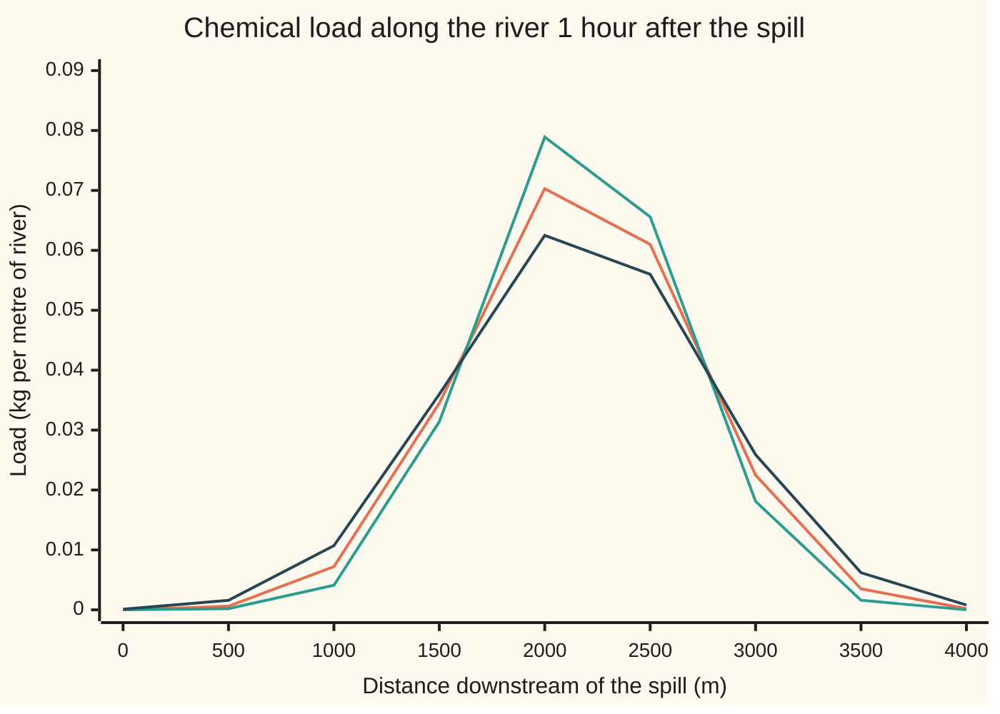
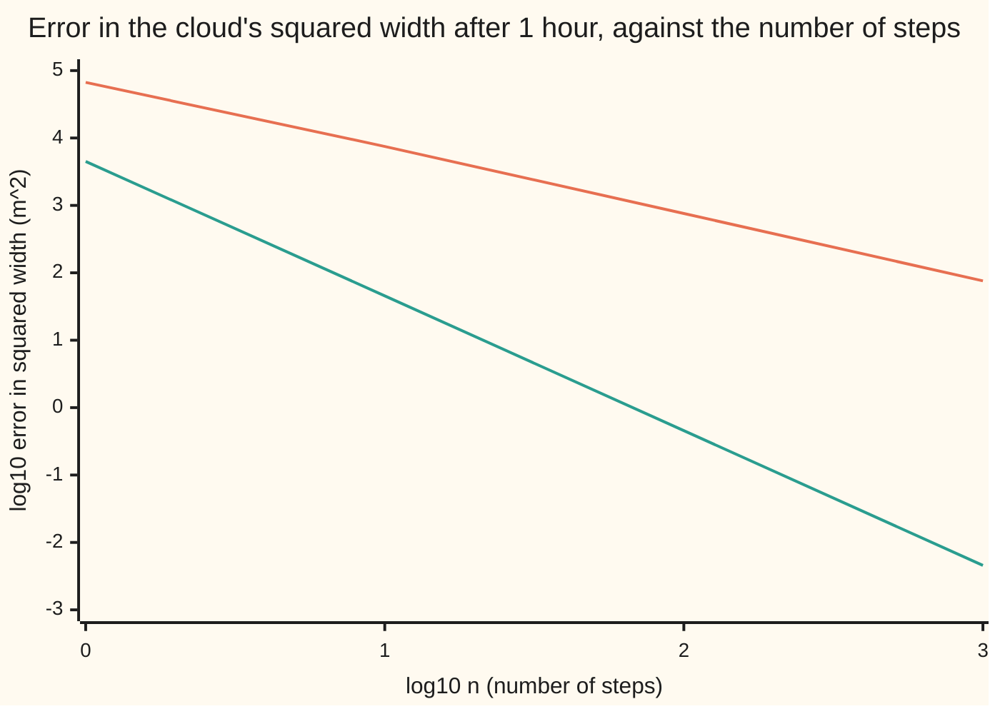

# Splitting: alternate two evolutions in tiny steps to get their combination

[Syllabus](../../../SYLLABUS.md) → [Functional analysis](../README.md) → [Unbounded Operators and Semigroups](../README.md#s05) → Splitting

---

## General Overview

A tanker spills 100 kg of a dissolved pollutant into a river (all numbers on this card are illustrative). Two things happen to the cloud at once. The current carries it downstream: that is **drift**. Eddies smear it out along the river: that is **spreading**. A water intake downstream needs to know, one hour later, where the cloud is, how wide it is and how strong its peak is.

Each motion alone is easy. Drift alone slides the cloud along with the water. Spreading alone widens it, the way heat spreads along a metal bar. Together they are harder, because they act at the same time. **Splitting** does them in turn: 10 minutes of drift, then 10 minutes of spreading, six times over.

In this river the water speeds up downstream, from 0.5 m/s at the spill, gaining 0.1 m/s per km. So the order of the two motions matters. After one hour the true cloud is 541.35 m wide, with a peak load of 0.073693 kg per metre of river. Six drift-then-spread steps give 529.78 m. Their cloud differs from the true one by a **gap** of 2.0922 kg: the load missing plus the load in excess, added up along the river, so each kilogram in the wrong place counts twice. Sixty steps give 540.19 m and a gap of 0.2090 kg. A symmetric step (half a step of drift, a full step of spreading, half a step of drift) gives 541.24 m and a gap of 0.0209 kg with only six steps.

**Splitting replaces one hard evolution by two easy ones taken in turn; each step errs only by how much the order matters, a term measured by the commutator (the difference between the two orders), so n steps err by about 1/n, and Trotter's product formula says the alternation converges to the true combined evolution whenever each part, and their sum, generates a semigroup (a family of time-t maps) that never increases size.**

**What kind of fact this is:** a theorem. For matrices whose evolutions never grow in size, the formula and its 1/n error bound are proved on this card in Why it works. For unbounded operators (rules with no largest stretching factor), such as drift and spreading themselves, it is Trotter's theorem of 1959: stated here with its sources, with the shape of the proof in a fold.

### The picture: one big step each way, against the truth



Orange: the true cloud. Green: one 1-hour step of drift, then one of spreading; too narrow and too tall. Dark blue: spreading first, then drift; too wide and too low. The truth lies between. Six or sixty shorter steps would sit almost on the orange line.

---

## The formula

Notation first. The state is the **load** $`u(x, t)`$: kilograms of chemical per metre of river at distance $`x`$ metres downstream of the spill, at time $`t`$ seconds. The water speed is $`c(x) = c_0 + \beta x`$. Each part of the motion is an operator, a rule that turns the present load into its rate of change:

- **Drift:** $`Au = -(c\,u)'`$, where the prime is the slope along the river. Load is carried with the water and none is created.
- **Spread:** $`Bu = \kappa\,u''`$, with $`\kappa`$ the spreading coefficient. This is the heat equation's rule.
- **Both:** $`u' = (A + B)u`$ in time.

Reminder: an evolution $`u' = Au`$ is solved by the semigroup $`e^{tA}`$, the map that takes the starting state to the state at time $`t`$ ([Evolution as an equation](03-the-abstract-cauchy-problem-and-the-operator-exponential.md), [Semigroups](04-strongly-continuous-semigroups.md)). Split the time $`t`$ into $`n`$ steps of length $`\Delta t = t/n`$. The **Trotter product formula** is

```math
e^{t(A+B)}u_0 \;=\; \lim_{n\to\infty} \big(e^{\Delta t\,B}\,e^{\Delta t\,A}\big)^n u_0 .
```

**Read it aloud:** drift for a short step, then spread for a short step, repeat $`n`$ times; as the steps shrink, the result tends to the state reached by drifting and spreading at once.

The **commutator** $`[A, B] = AB - BA`$ measures how much the order matters. For matrices whose evolutions never grow in size, Why it works proves the error bound

```math
\big\lVert e^{t(A+B)} - \big(e^{\Delta t\,B}\,e^{\Delta t\,A}\big)^n \big\rVert \;\le\; \frac{t^2}{2n}\,\lVert [A, B]\rVert .
```

**Read it aloud:** the split misses the truth by at most the square of the time, over twice the number of steps, times the size of the commutator.

The symmetric **Strang step** $`e^{(\Delta t/2)A}\,e^{\Delta t\,B}\,e^{(\Delta t/2)A}`$ cancels the leading error, so its error falls like $`1/n^2`$.

Sizes are measured in the $`L^1`$ norm, $`\lVert u\rVert_1 = \int \lvert u\rvert\,dx`$, in kilograms ([Lp spaces](../../10-Measure%20and%20integration/07-Sizes%20of%20Functions/01-lp-spaces.md)). The distance $`\lVert u - v\rVert_1`$ between two clouds is then their $`L^1`$ **gap** in kilograms. It counts each misplaced kilogram twice, once where it is missing and once where it turns up, so half the gap is the mass in the wrong place.

| Symbol | Plain meaning | In our example | Push it up and the answer… |
| --- | --- | --- | --- |
| $`u(x, t)`$, $`u_0`$ | load: kg of chemical per metre of river; the load at the spill | true peak 0.073693 kg/m after 1 h | — |
| $`Q`$ | mass spilled | 100 kg | every load and error scales with it |
| $`c(x) = c_0 + \beta x`$ | water speed at $`x`$ | $`c_0 = 0.5`$ m/s; $`\beta = 10^{-4}`$ per s | larger $`\beta`$: the order matters more; $`\beta = 0`$: split is exact |
| $`\kappa`$ | spreading coefficient, m²/s | 20 m²/s | wider cloud, larger split error |
| $`A`$, $`B`$, $`C`$, $`D(A)`$ | drift and spread operators; $`C`$, the closure of $`A + B`$; $`D(A)`$, the domain of $`A`$ (loads it can act on) | $`-(cu)'`$ and $`\kappa u''`$ | — |
| $`e^{tA}`$, $`e^{tB}`$, $`e^{t(A+B)}`$ | drift alone, spread alone, both at once, for time $`t`$ | — | — |
| $`t`$, $`n`$, $`\Delta t`$ | total time; number of steps; step length $`t/n`$ | 3600 s; 6; 600 s | more steps: error falls like $`1/n`$ |
| $`[A, B]`$ | commutator $`AB - BA`$: how much the order matters | $`2\beta B`$ for this river | larger error per step |
| $`\mu`$, $`w`$, $`w_0`$ | the cloud's centre and width (standard deviation); width at the spill | 2166.65 m and 541.35 m after 1 h; $`w_0 = 200`$ m | — |
| $`\lVert\cdot\rVert_1`$ | $`L^1`$ size in kg; a distance is the gap, twice the kg in the wrong place | gap 2.0922 kg for six steps | — |
| $`I`$, $`P`$, $`S`$, $`F(s)`$, $`g(r)`$, $`G_n`$ | proof notation: the identity (leave the load alone); one split step; one true step; a split step of length $`s`$; a helper inside the fold; the rate $`(n/t)(F(t/n) - I)`$ | six steps of $`P`$ leave a gap of 2.0922 kg | — |
| $`N`$, $`h`$, $`A_N`$, $`B_N`$ | grid cells over 7 km of river; cell width; the grid matrices for drift and spread | 140 cells of 50 m | the commutator's size grows without limit |

### When it holds

- **Each part generates a semigroup that does not blow up.** Trotter asks for contractions: evolutions that never increase size. Drift and spreading each move or smear the chemical without creating it, so both qualify. Running spreading backwards does not: one 600 s step multiplies the finest grid wave by 121.2253 on 100 m cells and by 2.174799e+08 on 50 m cells.
- **The sum is itself a generator.** $`A + B`$ is first defined only where both act, on $`D(A) \cap D(B)`$, the loads in both domains. That set must be dense, and the closure of $`A + B`$ on it must generate the combined semigroup. Otherwise there is no true evolution for the split to approach.
- **Convergence is for each starting load, in a stated norm.** The theorem promises $`\lVert (e^{\Delta t B}e^{\Delta t A})^n u_0 - e^{t(A+B)}u_0\rVert_1 \to 0`$ for every $`u_0`$. It promises no rate. For unbounded $`A`$ and $`B`$, such as drift and spreading, $`\lVert [A, B]\rVert`$ is infinite, so the matrix bound says nothing.
- **The step must be short compared with the time over which the parts disagree.** One 1-hour drift-then-spread step leaves a gap of 12.5200 kg.
- **If the parts commute, splitting is exact.** With $`\beta = 0`$ the river flows at one speed, $`[A, B] = 0`$, and one step gives the true cloud.

---

## Why it works

### Step 0: the order matters only at second order

Over a short step $`\Delta t`$, drift moves the cloud by an amount proportional to $`\Delta t`$, and so does spreading. Doing one before the other changes the answer only through their interaction, which is of size $`\Delta t^2`$. That interaction is half the commutator.

So each step errs by order $`\Delta t^2`$, and $`n = t/\Delta t`$ steps err by order $`n\,\Delta t^2 = t^2/n`$. The count needs two things. **Stability:** later steps do not amplify earlier errors. **Consistency:** each step agrees with the true evolution to first order.

### Step 1: commuting parts make splitting exact

If $`AB = BA`$, the exponential law holds: $`e^{\Delta t(A+B)} = e^{\Delta t B}\,e^{\Delta t A}`$, exactly, for any step. The proof is the same power-series argument as for numbers, which needs to swap $`A`$ and $`B`$ freely.

In a river of one speed, drift is a pure shift and spreading is a widening. Shift then widen gives the same cloud as widen then shift. Splitting is exact there at every $`n`$.

### Step 2: one step's error is half the commutator

Expand both sides to second order in $`\Delta t`$, keeping the order of every product:

```math
e^{\Delta t B}e^{\Delta t A} = I + \Delta t(A + B) + \tfrac{\Delta t^2}{2}\big(A^2 + 2BA + B^2\big) + \dots
```

```math
e^{\Delta t(A+B)} = I + \Delta t(A + B) + \tfrac{\Delta t^2}{2}\big(A^2 + AB + BA + B^2\big) + \dots
```

They agree to first order: the split step is consistent. The difference is $`\tfrac{\Delta t^2}{2}(BA - AB) = -\tfrac{\Delta t^2}{2}[A, B]`$.

The Strang step is symmetric: running it backwards in time gives its own inverse. Written as one exponential, a symmetric step has only odd powers of $`\Delta t`$ in its exponent. So the $`\Delta t^2`$ term of its error vanishes, and the error starts at $`\Delta t^3`$. Over $`n`$ steps that gives order $`1/n^2`$ instead of $`1/n`$.

### Step 3: adding up the steps

Write $`P = e^{\Delta t B}e^{\Delta t A}`$ for one split step and $`S = e^{\Delta t(A+B)}`$ for one true step. A telescoping sum turns $`n`$ steps into $`n`$ single-step errors:

```math
P^n - S^n = \sum_{k=0}^{n-1} P^{\,n-1-k}\,(P - S)\,S^{k} .
```

If every evolution has size at most 1, each term is at most $`\lVert P - S\rVert`$. The fold shows $`\lVert P - S\rVert \le \tfrac{\Delta t^2}{2}\lVert [A, B]\rVert`$. So $`\lVert P^n - S^n\rVert \le n \cdot \tfrac{\Delta t^2}{2}\lVert [A, B]\rVert = \tfrac{t^2}{2n}\lVert [A, B]\rVert`$, the bound in The formula.

<details>
<summary>Detailed proof: the one-step bound, by Duhamel's formula</summary>

Let $`F(s) = e^{sB}e^{sA}`$. Differentiating the product,

$`\displaystyle F'(s) = (A + B)F(s) + \big(e^{sB}A - Ae^{sB}\big)e^{sA} .`$

This is the evolution $`F' = (A+B)F`$ with a forcing term. Duhamel's formula ([Duhamel](06-duhamels-principle-for-a-forced-evolution.md)) solves it:

$`\displaystyle F(\Delta t) = e^{\Delta t(A+B)} + \int_0^{\Delta t} e^{(\Delta t - s)(A+B)}\big(e^{sB}A - Ae^{sB}\big)e^{sA}\,ds .`$

The bracket is itself a Duhamel integral. Put $`g(r) = e^{(s-r)B}A\,e^{rB}`$. Then $`g'(r) = e^{(s-r)B}[A, B]\,e^{rB}`$, so

$`\displaystyle e^{sB}A - Ae^{sB} = g(0) - g(s) = -\int_0^s e^{(s-r)B}[A, B]\,e^{rB}\,dr .`$

Every exponential has size at most 1, so the bracket has size at most $`s\lVert [A, B]\rVert`$. Integrating $`s`$ from 0 to $`\Delta t`$ gives $`\lVert F(\Delta t) - e^{\Delta t(A+B)}\rVert \le \tfrac{\Delta t^2}{2}\lVert [A, B]\rVert`$.

</details>

### Step 4: the river's commutator, and the width it gets wrong

For the river, compute both orders on a smooth load, using $`c' = \beta`$ and $`c'' = 0`$:

```math
ABu = -\kappa\,(c\,u'')' = -\kappa(\beta u'' + c\,u'''), \qquad BAu = -\kappa\,(c\,u)''' = -\kappa(c\,u''' + 3\beta u'') .
```

The $`c\,u'''`$ terms cancel, leaving $`[A, B]u = 2\beta\kappa\,u'' = 2\beta\,Bu`$. With $`\beta = 0`$ the commutator vanishes, as Step 1 promised.

The cloud stays a bell curve throughout, so two numbers describe it: its centre $`\mu`$ and its width $`w`$.

- Drift for time $`s`$ moves the centre along the water and multiplies $`w^2`$ by $`e^{2\beta s}`$, because faster water ahead stretches the cloud.
- Spreading for time $`s`$ adds $`2\kappa s`$ to $`w^2`$ and leaves the centre alone.
- Together, $`(w^2)' = 2\beta w^2 + 2\kappa`$, so $`w^2(t) = w_0^2 e^{2\beta t} + (\kappa/\beta)(e^{2\beta t} - 1)`$.

The centre is never wrong, because spreading does not move it. Only the width errs. Drift-then-spread adds each step's spreading after that step's stretching, so the new width misses one step of stretch: the cloud comes out too narrow. Spread-then-drift stretches the new width a full step: too wide. Strang stretches it half a step, which is right on average.

Drift-then-spread leaves $`w^2`$ too small by about $`\kappa\,\Delta t\,(e^{2\beta t} - 1)`$. At $`n = 1000`$, so $`\Delta t = 3.6`$ s, that formula gives 75.919191 m², and the steps give 75.910081 m². Strang leaves it too small by about $`\kappa\beta\,\Delta t^2(e^{2\beta t} - 1)/6`$: 0.004555 m² both ways.



Orange: drift-then-spread, falling one decade per decade of $`n`$, so its error is proportional to $`1/n`$. Green: Strang, falling two decades per decade, so proportional to $`1/n^2`$.

### Step 5: the finite rehearsal, and what it hides

Put the river on a grid of $`N`$ cells over 7 km, each $`h`$ metres wide, with zero load beyond both ends. Drift becomes a matrix $`A_N`$ (fluxes between neighbouring cells), spreading a matrix $`B_N`$ (second differences). The code computes their exponentials by summing the power series term by term, then runs six steps of each split.

| $`N`$ | $`h`$ (m) | $`L^1`$ gap (kg), drift-then-spread | $`L^1`$ gap (kg), Strang |
| ---: | ---: | ---: | ---: |
| 35 | 200 | 1.9367 | 0.0158 |
| 70 | 100 | 2.0207 | 0.0192 |
| 140 | 50 | 2.0768 | 0.0205 |
| 280 | 25 | 2.0887 | 0.0208 |
| exact cloud | — | 2.0922 | 0.0209 |

The split error settles on the exact cloud's value as the grid gets finer. It is set by the time step, not by the grid.

The commutator tells a different story. Every matrix is bounded, so $`\lVert [A_N, B_N]\rVert_1`$ is finite at each $`N`$. It grows without limit as the cells shrink:

| $`N`$ | $`\lVert [A_N, B_N]\rVert_1`$ (per s²) | largest column away from the ends | that column × $`h^2`$ | gap to $`2\beta B_N`$ on the cloud |
| ---: | ---: | ---: | ---: | ---: |
| 35 | 2.6000e-06 | 1.0000e-07 | 0.004000 | 0.500179 |
| 70 | 2.0900e-05 | 4.0000e-07 | 0.004000 | 0.150614 |
| 140 | 1.6760e-04 | 1.6000e-06 | 0.004000 | 0.043846 |
| 280 | 1.3424e-03 | 6.4000e-06 | 0.004000 | 0.011223 |
| 560 | 1.0746e-02 | 2.5600e-05 | 0.004000 | 0.002820 |

Away from the ends the commutator grows like $`1/h^2`$, exactly $`2\beta\kappa/h^2`$: it is a grid copy of $`2\beta\kappa\,u''`$, an unbounded operator. At the ends, where the grid forces zero load, it grows faster, like $`1/h^3`$. On the smooth cloud itself, $`[A_N, B_N]u_0`$ matches $`2\beta B_N u_0`$ ever more closely.

So the matrix bound fails in the limit. At $`N = 140`$ it allows a gap of 18100.8 kg, from a spill of 100 kg; the real gap is 2.0768 kg. Strictly, the bound also needs every step to have size at most 1, and the grid's centred drift does not meet that in the $`L^1`$ norm; that only makes the honest bound larger. What the grid hides is that $`A`$, $`B`$ and $`[A, B]`$ are unbounded. The split converges anyway, because the cloud is smooth, but proving that needs a different argument.

### Step 6: Trotter's theorem, for unbounded operators

Trotter proved in 1959 the statement that replaces the matrix bound.

> On a Banach space, let $`A`$ and $`B`$ generate contraction semigroups, and let the closure of $`A + B`$ on $`D(A) \cap D(B)`$ generate a contraction semigroup. Then for every $`u_0`$, $`(e^{(t/n)B}e^{(t/n)A})^n u_0 \to e^{t(A+B)}u_0`$ in norm, uniformly for $`t`$ in any bounded interval.

The proof keeps the two ingredients of Step 0 and drops the commutator. Stability: every split step has size at most 1. Consistency: on loads in both domains, (split step − identity)/$`\Delta t`$ tends to $`(A + B)`$. Chernoff's theorem turns these two facts into convergence for every starting load. Whether a generator passes the "never grows" test is the subject of [Hille-Yosida](05-hille-yosida-and-generators.md).

For the river, drift is a contraction on $`L^1`$: it carries load along the water and never creates any. Spreading is the heat semigroup, also a contraction. The combined drift-spread evolution is well posed, with the bell-curve formula of Step 4 as its solution for this spill. That last fact is stated here, not proved: it is a theorem about partial differential equations.

<details>
<summary>The shape of the proof: Chernoff's product formula</summary>

Let $`F(s) = e^{sB}e^{sA}`$, so $`\lVert F(s)\rVert \le 1`$ and $`F(0) = I`$. Call the generator of the combined semigroup $`C`$, the closure of $`A + B`$.

**Consistency.** For $`u`$ in $`D(A) \cap D(B)`$,

$`\displaystyle \frac{F(s)u - u}{s} = e^{sB}\,\frac{e^{sA}u - u}{s} + \frac{e^{sB}u - u}{s} \;\longrightarrow\; Au + Bu .`$

The first term converges because $`e^{sB}`$ has size at most 1 and tends to the identity on each vector.

**From one step to many.** Set $`s = t/n`$. The operator $`G_n = (n/t)(F(t/n) - I)`$ is bounded, so $`e^{tG_n}`$ is an ordinary exponential. Chernoff's lemma compares the two:

$`\displaystyle \lVert F(t/n)^n u - e^{tG_n}u\rVert \le \sqrt{n}\,\lVert F(t/n)u - u\rVert .`$

For $`u`$ in the domain, $`\lVert F(t/n)u - u\rVert`$ is of order $`1/n`$, so the right side is of order $`1/\sqrt n`$ and tends to 0.

**Limit of the exponentials.** $`G_n u \to Cu`$ on a core, a set of loads dense enough that the closure of $`C`$ on it is $`C`$ itself. The Trotter-Kato approximation theorem says that then $`e^{tG_n}u \to e^{tC}u`$ for every $`u`$. Since all the operators have size at most 1, convergence on a dense set extends to every $`u_0`$.

</details>

---

## Worked numbers, by hand

The first 10-minute drift-then-spread step, from a cloud 200 m wide centred on the spill. Here $`\Delta t = 600`$ s, so $`\beta\Delta t = 0.06`$ and $`c_0/\beta = 5000.00`$ m.

| Step | Arithmetic | Value |
| --- | --- | --- |
| starting squared width | $`200^2`$ | 40000.00 m² |
| drift: centre | $`(0 + 5000) \times e^{0.06} - 5000 = 5000 \times 1.061837 - 5000`$ | 309.18 m |
| drift: stretch the squared width | $`40000 \times e^{0.12} = 40000 \times 1.127497`$ | 45099.87 m² |
| spread: add $`2\kappa\Delta t`$ | $`2 \times 20 \times 600 = 24000.00`$; $`45099.87 + 24000.00`$ | 69099.87 m² |
| split width | $`\sqrt{69099.87}`$ | 262.87 m |
| true squared width at 600 s | $`45099.87 + (\kappa/\beta)(e^{0.12} - 1) = 45099.87 + 200000.00 \times 0.127497 = 45099.87 + 25499.37`$ | 70599.24 m² |
| true width | $`\sqrt{70599.24}`$ | 265.71 m |
| after six such steps | the same two moves, repeated | split 529.78 m, true 541.35 m |
| peak load after 1 h | $`100/\sqrt{2\pi w^2}`$ | split 0.075304, true 0.073693 kg/m |
| **gap** | **$`L^1`$ distance between the two bell curves** | **2.0922 kg** |

The intake would see a peak of 0.075304 kg/m instead of 0.073693 kg/m, and a cloud 11.577 m too narrow. Six Strang steps leave a gap of only 0.0209 kg.

### What breaks if you drop a piece

| Mistake | Comes out at | What went wrong |
| --- | --- | --- |
| One 1-hour step, drift then spread | width 475.58 m, peak 0.083885 kg/m, gap 12.5200 kg | the step is the whole time; the commutator term is not small |
| The same step, spread then drift | width 614.83 m, peak 0.064887 kg/m, gap 12.3019 kg | the error changes sign with the order; the truth, 541.35 m, lies between |
| Run spreading backwards to trace the spill to its source | the finest grid wave grows ×3.312545 per 600 s step at $`N = 35`$, ×121.2253 at $`N = 70`$, ×2.174799e+08 at $`N = 140`$ | $`-\kappa u''`$ generates no semigroup; Trotter's first hypothesis fails and the growth has no ceiling |
| Trust the matrix bound $`\tfrac{t^2}{2n}\lVert [A_N, B_N]\rVert`$ | 18100.8 kg allowed at $`N = 140`$, against 2.0768 kg real | the commutator is unbounded; the bound grows with $`N`$ while the error does not |

---

## Code, from first principles, and it actually runs

The scripts compute every number above in six parts. They take three independent roads. The bell-curve moments are stepped one move at a time and checked against closed-form sums and against the leading-error formulas. A grid of $`N`$ cells computes every exponential by its power series and measures the error as an $`L^1`$ gap in kilograms; it must settle on the exact cloud's value. The grid commutator is built column by column and checked against $`2\beta\kappa/h^2`$ and against $`2\beta B_N`$ on the cloud. What the truncation hides: every grid matrix is bounded, so only the growth of $`\lVert [A_N, B_N]\rVert_1`$ with $`N`$ shows that the true commutator is unbounded.

### Python

```python
# Operator splitting and the Trotter formula -- the check behind the card.  Standard library only.
# A 100 kg spill drifts and spreads for 1 h in a river reach whose speed rises downstream.
# Roads: step-by-step moment maps against closed-form sums and the leading-error formula;
# an N-cell grid whose exponentials are summed term by term; the commutator against 2 beta B.
import math

Q, C0, BETA, KAPPA, W0, T = 100.0, 0.5, 1e-4, 20.0, 200.0, 3600.0   # kg, m/s, 1/s, m^2/s, m, s

def close(a, b, tol):
    assert abs(a - b) <= tol * max(1.0, abs(b)), (a, b)
def drift(mu, v, dt):            # the flow x' = C0 + BETA x moves the centre and stretches the variance
    return (mu + C0 / BETA) * math.exp(BETA * dt) - C0 / BETA, v * math.exp(2 * BETA * dt)

def spread(mu, v, dt):           # spreading adds 2 kappa dt to the variance and leaves the centre
    return mu, v + 2 * KAPPA * dt

def run(n, order, t=T):          # "drift-spread": drift then spread; "spread-drift": spread then drift; "strang": half, full, half
    mu, v, dt = 0.0, W0 * W0, t / n
    for _ in range(n):
        if order == "drift-spread":
            mu, v = spread(*drift(mu, v, dt), dt)
        elif order == "spread-drift":
            mu, v = drift(*spread(mu, v, dt), dt)
        else:
            mu, v = drift(*spread(*drift(mu, v, dt / 2), dt), dt / 2)
    return mu, v

def phi(z):                      # normal CDF from the power series of erf
    s, term, k = 0.0, z / math.sqrt(2), 0
    while abs(term) > 1e-18:
        s, k = s + term / (2 * k + 1), k + 1
        term *= -z * z / 2 / k
    return 0.5 + s / math.sqrt(math.pi)

def l1_gap(va, vb):              # L1 distance of two plumes, same mass and centre: each misplaced kg counts twice
    sa, sb = math.sqrt(min(va, vb)), math.sqrt(max(va, vb))
    z = math.sqrt(2 * math.log(sb / sa) * sa * sa * sb * sb / (sb * sb - sa * sa))
    return 4 * Q * (phi(z / sa) - phi(z / sb))

load = lambda x, mu, v: Q / math.sqrt(2 * math.pi * v) * math.exp(-(x - mu) ** 2 / (2 * v))
# 1. The true flow in closed form: the centre follows the water, the variance obeys v' = 2 beta v + 2 kappa.
q = math.exp(2 * BETA * T)
mu_t, v_t = (C0 / BETA) * (math.exp(BETA * T) - 1), W0 * W0 * q + (KAPPA / BETA) * (q - 1)
print(f"true, e^(beta t) {math.exp(BETA * T):.6f}, e^(2 beta t) {q:.6f}, centre {mu_t:.2f} m, width {math.sqrt(v_t):.2f} m, peak {load(0, 0, v_t):.6f} kg/m")
(m1, v1), s600 = run(1, "drift-spread", 600.0), W0 * W0 * math.exp(1200 * BETA)
v600 = s600 + (KAPPA / BETA) * (math.exp(1200 * BETA) - 1)
print(f"first step, 600 s: c0/beta {C0 / BETA:.2f} m, kappa/beta {KAPPA / BETA:.2f} m^2, start variance {W0 * W0:.2f}, e^(beta dt) {math.exp(600 * BETA):.6f}, e^(2 beta dt) {math.exp(1200 * BETA):.6f}, centre {m1:.2f} m, stretched variance {s600:.2f}, spread adds {2 * KAPPA * 600:.2f}")
print(f"first step, 600 s: split variance {v1:.2f}, width {math.sqrt(v1):.2f}; true adds {v600 - s600:.2f}, true variance {v600:.2f}, width {math.sqrt(v600):.2f}")

# 2. Split steps: iterate the moment maps, compare with the closed-form sums.
print("split, n, step (s), scheme, width (m), peak (kg/m), width error (m), L1 gap (kg)")
for n in (1, 6, 60):
    dt = T / n
    r = math.exp(2 * BETA * dt)
    sums = {"drift-spread": 1.0, "spread-drift": r, "strang": math.exp(BETA * dt)}
    for order in ("drift-spread", "spread-drift", "strang"):
        mu, v = run(n, order)
        close(mu, mu_t, 1e-10)
        close(v, W0 * W0 * q + 2 * KAPPA * dt * sums[order] * (q - 1) / (r - 1), 1e-12)
        print(f"split, {n}, {dt:.0f}, {order}, {math.sqrt(v):.2f}, {load(0, 0, v):.6f}, "
              f"{math.sqrt(v) - math.sqrt(v_t):+.3f}, {l1_gap(v, v_t):.4f}")
for name, (mu, v) in (("true", (mu_t, v_t)), ("drift-spread n=1", run(1, "drift-spread")), ("spread-drift n=1", run(1, "spread-drift"))):
    print(f"profile, {name}, " + ", ".join(f"{load(x, mu, v):.4f}" for x in range(0, 4500, 500)))

# 3. Rates: drift-spread's variance error is about kappa dt (e^(2 beta t) - 1); Strang's falls like 1/n^2.
print("chart, log10 n, 0, 1, 2, 3")
for order in ("drift-spread", "strang"):
    e = [abs(run(n, order)[1] - v_t) for n in (1, 10, 100, 1000)]
    print(f"chart, log10 variance error {order} (m^2), " + ", ".join(f"{math.log10(x):.3f}" for x in e))
    close(math.log10(e[3] / e[2]), -1.0 if order == "drift-spread" else -2.0, 0.01)
    dt = T / 1000
    lead = KAPPA * dt * (q - 1) if order == "drift-spread" else KAPPA * BETA * dt * dt * (q - 1) / 6
    assert abs(e[3] / lead - 1) < 2e-3, (e[3], lead)
    print(f"rate, {order}, n = 1000: variance error {e[3]:.6f} m^2, leading-term formula {lead:.6f} m^2")

# 4. The finite rehearsal: N cells on [-1500, 5500] m, load held at 0 beyond the ends.
#    A_N: drift, central fluxes c (u_i + u_i+1)/2.  B_N: spread, kappa (u_i+1 - 2 u_i + u_i-1)/h^2.
def grid(N):
    h = 7000.0 / N
    cf = [C0 + BETA * (-1500 + i * h) for i in range(N + 1)]
    def A(u):
        p = [0.0] + u + [0.0]
        fl = [cf[i] * (p[i] + p[i + 1]) / 2 for i in range(N + 1)]
        return [-(fl[i + 1] - fl[i]) / h for i in range(N)]
    def B(u):
        p = [0.0] + u + [0.0]
        return [KAPPA * (p[i + 2] - 2 * p[i + 1] + p[i]) / (h * h) for i in range(N)]
    return h, A, B, [load(-1500 + (i + 0.5) * h, 0, W0 * W0) for i in range(N)]

def expv(op, size, tau, u):      # e^(tau op) u: Taylor series on m substeps with tau * size / m <= 0.5
    m = max(1, math.ceil(tau * size / 0.5))
    for _ in range(m):
        term, s, k = u, u[:], 0
        while k < 30 and max(abs(x) for x in term) > 1e-17 * max(abs(x) for x in s):
            k += 1
            term = [x * tau / m / k for x in op(term)]
            s = [a + b for a, b in zip(s, term)]
        u = s
    return u
print("grid, N, h (m), mass (kg), L1 gap (kg) at n = 6: drift-spread, strang; continuum: drift-spread, strang")
cont, errs = [l1_gap(run(6, o)[1], v_t) for o in ("drift-spread", "strang")], {}
for N in (35, 70, 140, 280):
    h, A, B, u0 = grid(N)
    sa, sb = 2 * (C0 + BETA * 5500) / h, 4 * KAPPA / h / h
    true = expv(lambda u: [a + b for a, b in zip(A(u), B(u))], sa + sb, T, u0)
    lie, st = u0, u0
    for _ in range(6):
        lie = expv(B, sb, 600.0, expv(A, sa, 600.0, lie))
        st = expv(A, sa, 300.0, expv(B, sb, 600.0, expv(A, sa, 300.0, st)))
    el, es = (h * sum(abs(a - b) for a, b in zip(w, true)) for w in (lie, st))
    close(el, cont[0], 0.05 * (70 / N) ** 2)        # the grid's own error falls like h^2
    errs[N] = el
    print(f"grid, {N}, {h:.0f}, {h * sum(true):.4f}, {el:.4f}, {es:.4f}; {cont[0]:.4f}, {cont[1]:.4f}")

# 5. The commutator [A_N, B_N] = A_N B_N - B_N A_N: near 2 beta B_N on the plume, yet its norm has no ceiling.
print("commutator, N, h (m), L1 norm (1/s^2), largest column away from the ends, times h^2, gap to 2 beta B_N on the plume")
for N in (35, 70, 140, 280, 560):
    h, A, B, u0 = grid(N)
    cols = [sum(abs(a - b) for a, b in zip(A(B(e)), B(A(e)))) for e in ([float(i == j) for i in range(N)] for j in range(N))]
    inner = max(cols[3:N - 3])
    close(inner * h * h, 2 * BETA * KAPPA, 1e-9)
    cu, pred = [a - b for a, b in zip(A(B(u0)), B(A(u0)))], [2 * BETA * x for x in B(u0)]
    gap = sum(abs(a - b) for a, b in zip(cu, pred)) / sum(abs(x) for x in pred)
    print(f"commutator, {N}, {h:.1f}, {max(cols):.4e}, {inner:.4e}, {inner * h * h:.6f}, {gap:.6f}")
    if N == 140:
        bound = T * T / 12 * max(cols) * Q
assert gap < 0.01 and bound > 100 * errs[140]
print(f"bound, N = 140, n = 6: t^2/(2n) x norm x 100 kg = {bound:.1f} kg; actual {errs[140]:.4f} kg")

# 6. What breaks.  Backward spreading is not a generator: its top grid mode grows without limit as h shrinks.
print("backward, N, growth of the top grid mode in one 600 s step, closed form")
for N in (35, 70, 140):
    h, A, B, u0 = grid(N)
    v = [math.sin(N * math.pi * (i + 1) / (N + 1)) for i in range(N)]
    w = expv(lambda u: [-x for x in B(u)], 4 * KAPPA / h / h, 600.0, v)
    g = sum(abs(x) for x in w) / sum(abs(x) for x in v)
    f = math.exp(600 * 4 * KAPPA * math.cos(math.pi / (2 * N + 2)) ** 2 / h / h)
    close(g, f, 1e-9 * f)
    print(f"backward, {N}, {g:.6e}, {f:.6e}")
print("ALL CHECKS PASS")
```

**Ran 2026-11-15 on macOS, Python 3.14.10, standard library only. All checks passed. Output, pasted from the run:**

```
true, e^(beta t) 1.433329, e^(2 beta t) 2.054433, centre 2166.65 m, width 541.35 m, peak 0.073693 kg/m
first step, 600 s: c0/beta 5000.00 m, kappa/beta 200000.00 m^2, start variance 40000.00, e^(beta dt) 1.061837, e^(2 beta dt) 1.127497, centre 309.18 m, stretched variance 45099.87, spread adds 24000.00
first step, 600 s: split variance 69099.87, width 262.87; true adds 25499.37, true variance 70599.24, width 265.71
split, n, step (s), scheme, width (m), peak (kg/m), width error (m), L1 gap (kg)
split, 1, 3600, drift-spread, 475.58, 0.083885, -65.773, 12.5200
split, 1, 3600, spread-drift, 614.83, 0.064887, +73.476, 12.3019
split, 1, 3600, strang, 537.19, 0.074264, -4.160, 0.7467
split, 6, 600, drift-spread, 529.78, 0.075304, -11.577, 2.0922
split, 6, 600, spread-drift, 553.15, 0.072122, +11.792, 2.0855
split, 6, 600, strang, 541.24, 0.073709, -0.117, 0.0209
split, 60, 60, drift-spread, 540.19, 0.073853, -1.168, 0.2090
split, 60, 60, spread-drift, 542.52, 0.073535, +1.170, 0.2089
split, 60, 60, strang, 541.35, 0.073694, -0.001, 0.0002
profile, true, 0.0000, 0.0006, 0.0072, 0.0345, 0.0703, 0.0610, 0.0225, 0.0035, 0.0002
profile, drift-spread n=1, 0.0000, 0.0002, 0.0041, 0.0314, 0.0789, 0.0656, 0.0181, 0.0016, 0.0000
profile, spread-drift n=1, 0.0001, 0.0016, 0.0107, 0.0360, 0.0625, 0.0560, 0.0259, 0.0062, 0.0008
chart, log10 n, 0, 1, 2, 3
chart, log10 variance error drift-spread (m^2), 4.825, 3.875, 2.880, 1.880
rate, drift-spread, n = 1000: variance error 75.910081 m^2, leading-term formula 75.919191 m^2
chart, log10 variance error strang (m^2), 3.652, 1.658, -0.341, -2.341
rate, strang, n = 1000: variance error 0.004555 m^2, leading-term formula 0.004555 m^2
grid, N, h (m), mass (kg), L1 gap (kg) at n = 6: drift-spread, strang; continuum: drift-spread, strang
grid, 35, 200, 99.9992, 1.9367, 0.0158; 2.0922, 0.0209
grid, 70, 100, 100.0000, 2.0207, 0.0192; 2.0922, 0.0209
grid, 140, 50, 100.0000, 2.0768, 0.0205; 2.0922, 0.0209
grid, 280, 25, 100.0000, 2.0887, 0.0208; 2.0922, 0.0209
commutator, N, h (m), L1 norm (1/s^2), largest column away from the ends, times h^2, gap to 2 beta B_N on the plume
commutator, 35, 200.0, 2.6000e-06, 1.0000e-07, 0.004000, 0.500179
commutator, 70, 100.0, 2.0900e-05, 4.0000e-07, 0.004000, 0.150614
commutator, 140, 50.0, 1.6760e-04, 1.6000e-06, 0.004000, 0.043846
commutator, 280, 25.0, 1.3424e-03, 6.4000e-06, 0.004000, 0.011223
commutator, 560, 12.5, 1.0746e-02, 2.5600e-05, 0.004000, 0.002820
bound, N = 140, n = 6: t^2/(2n) x norm x 100 kg = 18100.8 kg; actual 2.0768 kg
backward, N, growth of the top grid mode in one 600 s step, closed form
backward, 35, 3.312545e+00, 3.312545e+00
backward, 70, 1.212253e+02, 1.212253e+02
backward, 140, 2.174799e+08, 2.174799e+08
ALL CHECKS PASS
```

### Rust

```rust
// Operator splitting and the Trotter formula -- the same check as the Python, in Rust.  No crates.
// A 100 kg spill drifts and spreads for 1 h in a river reach whose speed rises downstream.
// Roads: step-by-step moment maps against closed-form sums and the leading-error formula;
// an N-cell grid whose exponentials are summed term by term; the commutator against 2 beta B.
use std::f64::consts::PI;
const Q: f64 = 100.0; const C0: f64 = 0.5; const BETA: f64 = 1e-4; // kg, m/s, 1/s
const KAPPA: f64 = 20.0; const W0: f64 = 200.0; const T: f64 = 3600.0; // m^2/s, m, s

fn close(a: f64, b: f64, tol: f64) { assert!((a - b).abs() <= tol * b.abs().max(1.0), "{} {}", a, b); }
fn drift(mu: f64, v: f64, dt: f64) -> (f64, f64) { // the flow x' = C0 + BETA x: moves the centre, stretches the variance
    ((mu + C0 / BETA) * (BETA * dt).exp() - C0 / BETA, v * (2.0 * BETA * dt).exp())
}
fn spread(mu: f64, v: f64, dt: f64) -> (f64, f64) { (mu, v + 2.0 * KAPPA * dt) } // adds 2 kappa dt to the variance

fn run(n: usize, order: &str, t: f64) -> (f64, f64) { // drift then spread, spread then drift, or Strang
    let (mut mu, mut v, dt) = (0.0, W0 * W0, t / n as f64);
    for _ in 0..n {
        (mu, v) = match order {
            "drift-spread" => { let (a, b) = drift(mu, v, dt); spread(a, b, dt) }
            "spread-drift" => { let (a, b) = spread(mu, v, dt); drift(a, b, dt) }
            _ => { let (a, b) = drift(mu, v, dt / 2.0); let (a, b) = spread(a, b, dt); drift(a, b, dt / 2.0) }
        };
    }
    (mu, v)
}
fn phi(z: f64) -> f64 { // normal CDF from the power series of erf
    let (mut s, mut term, mut k) = (0.0, z / 2f64.sqrt(), 0.0);
    while term.abs() > 1e-18 {
        (s, k) = (s + term / (2.0 * k + 1.0), k + 1.0);
        term *= -z * z / 2.0 / k;
    }
    0.5 + s / PI.sqrt()
}
fn l1_gap(va: f64, vb: f64) -> f64 { // L1 distance of two plumes, same mass and centre: each misplaced kg counts twice
    let (sa, sb) = (va.min(vb).sqrt(), va.max(vb).sqrt());
    let z = (2.0 * (sb / sa).ln() * sa * sa * sb * sb / (sb * sb - sa * sa)).sqrt();
    4.0 * Q * (phi(z / sa) - phi(z / sb))
}
fn load(x: f64, mu: f64, v: f64) -> f64 { Q / (2.0 * PI * v).sqrt() * (-(x - mu).powi(2) / (2.0 * v)).exp() }
fn sci(x: f64, d: usize) -> String { // Python-style scientific notation, e.g. 2.6000e-06
    let s = format!("{:.*e}", d, x);
    let (m, e) = s.split_once('e').map(|(m, e)| (m, e.parse::<i32>().unwrap())).unwrap();
    format!("{}e{}{:02}", m, if e < 0 { '-' } else { '+' }, e.abs())
}

// The finite rehearsal: N cells on [-1500, 5500] m, load held at 0 beyond the ends.
// A_N: drift, central fluxes c (u_i + u_i+1)/2.  B_N: spread, kappa (u_i+1 - 2 u_i + u_i-1)/h^2.
struct Grid { n: usize, h: f64, cf: Vec<f64> }
impl Grid {
    fn new(n: usize) -> Grid {
        let h = 7000.0 / n as f64;
        Grid { n, h, cf: (0..=n).map(|i| C0 + BETA * (-1500.0 + i as f64 * h)).collect() }
    }
    fn pad(&self, u: &[f64]) -> Vec<f64> { [&[0.0], u, &[0.0]].concat() }
    fn a(&self, u: &[f64]) -> Vec<f64> {
        let p = self.pad(u);
        let fl: Vec<f64> = (0..=self.n).map(|i| self.cf[i] * (p[i] + p[i + 1]) / 2.0).collect();
        (0..self.n).map(|i| -(fl[i + 1] - fl[i]) / self.h).collect()
    }
    fn b(&self, u: &[f64]) -> Vec<f64> {
        let p = self.pad(u);
        (0..self.n).map(|i| KAPPA * (p[i + 2] - 2.0 * p[i + 1] + p[i]) / (self.h * self.h)).collect()
    }
    fn u0(&self) -> Vec<f64> { (0..self.n).map(|i| load(-1500.0 + (i as f64 + 0.5) * self.h, 0.0, W0 * W0)).collect() }
}
fn expv( // e^(tau op) u: Taylor series on m substeps with tau * size / m <= 0.5
    op: &dyn Fn(&[f64]) -> Vec<f64>, size: f64, tau: f64, u: Vec<f64>) -> Vec<f64> {
    let (m, mut u) = (((tau * size / 0.5).ceil() as usize).max(1), u);
    let amax = |w: &[f64]| w.iter().fold(0.0f64, |a, x| a.max(x.abs()));
    for _ in 0..m {
        let (mut term, mut s, mut k) = (u.clone(), u.clone(), 0);
        while k < 30 && amax(&term) > 1e-17 * amax(&s) {
            k += 1;
            term = op(&term).iter().map(|x| x * tau / m as f64 / k as f64).collect();
            s = s.iter().zip(&term).map(|(a, b)| a + b).collect();
        }
        u = s;
    }
    u
}
fn l1(h: f64, u: &[f64], w: &[f64]) -> f64 { h * u.iter().zip(w).map(|(a, b)| (a - b).abs()).sum::<f64>() }

fn main() {
    // 1. The true flow in closed form: the centre follows the water, the variance obeys v' = 2 beta v + 2 kappa.
    let q = (2.0 * BETA * T).exp();
    let (mu_t, v_t) = ((C0 / BETA) * ((BETA * T).exp() - 1.0), W0 * W0 * q + (KAPPA / BETA) * (q - 1.0));
    println!("true, e^(beta t) {:.6}, e^(2 beta t) {:.6}, centre {:.2} m, width {:.2} m, peak {:.6} kg/m", (BETA * T).exp(), q, mu_t, v_t.sqrt(), load(0.0, 0.0, v_t));
    let ((m1, v1), s600) = (run(1, "drift-spread", 600.0), W0 * W0 * (1200.0 * BETA).exp());
    let v600 = s600 + (KAPPA / BETA) * ((1200.0 * BETA).exp() - 1.0);
    println!("first step, 600 s: c0/beta {:.2} m, kappa/beta {:.2} m^2, start variance {:.2}, e^(beta dt) {:.6}, e^(2 beta dt) {:.6}, centre {:.2} m, stretched variance {:.2}, spread adds {:.2}",
        C0 / BETA, KAPPA / BETA, W0 * W0, (600.0 * BETA).exp(), (1200.0 * BETA).exp(), m1, s600, 2.0 * KAPPA * 600.0);
    println!("first step, 600 s: split variance {:.2}, width {:.2}; true adds {:.2}, true variance {:.2}, width {:.2}", v1, v1.sqrt(), v600 - s600, v600, v600.sqrt());
    // 2. Split steps: iterate the moment maps, compare with the closed-form sums.
    println!("split, n, step (s), scheme, width (m), peak (kg/m), width error (m), L1 gap (kg)");
    for n in [1usize, 6, 60] {
        let (dt, r) = (T / n as f64, (2.0 * BETA * T / n as f64).exp());
        for (order, sum) in [("drift-spread", 1.0), ("spread-drift", r), ("strang", (BETA * dt).exp())] {
            let (mu, v) = run(n, order, T);
            close(mu, mu_t, 1e-10);
            close(v, W0 * W0 * q + 2.0 * KAPPA * dt * sum * (q - 1.0) / (r - 1.0), 1e-12);
            println!("split, {}, {:.0}, {}, {:.2}, {:.6}, {:+.3}, {:.4}", n, dt, order, v.sqrt(), load(0.0, 0.0, v), v.sqrt() - v_t.sqrt(), l1_gap(v, v_t));
        }
    }
    let profiles = [("true", (mu_t, v_t)), ("drift-spread n=1", run(1, "drift-spread", T)), ("spread-drift n=1", run(1, "spread-drift", T))];
    for (name, (mu, v)) in profiles {
        println!("profile, {}, {}", name, (0..9).map(|k| format!("{:.4}", load(500.0 * k as f64, mu, v))).collect::<Vec<_>>().join(", "));
    }
    // 3. Rates: drift-spread's variance error is about kappa dt (e^(2 beta t) - 1); Strang's falls like 1/n^2.
    println!("chart, log10 n, 0, 1, 2, 3");
    for order in ["drift-spread", "strang"] {
        let e: Vec<f64> = [1usize, 10, 100, 1000].iter().map(|&n| (run(n, order, T).1 - v_t).abs()).collect();
        println!("chart, log10 variance error {} (m^2), {}", order, e.iter().map(|x| format!("{:.3}", x.log10())).collect::<Vec<_>>().join(", "));
        close((e[3] / e[2]).log10(), if order == "strang" { -2.0 } else { -1.0 }, 0.01);
        let dt = T / 1000.0;
        let lead = if order == "strang" { KAPPA * BETA * dt * dt * (q - 1.0) / 6.0 } else { KAPPA * dt * (q - 1.0) };
        assert!((e[3] / lead - 1.0).abs() < 2e-3, "{} {}", e[3], lead);
        println!("rate, {}, n = 1000: variance error {:.6} m^2, leading-term formula {:.6} m^2", order, e[3], lead);
    }
    // 4. The grid: exponentials of A_N + B_N, and six split steps, measured by the L1 gap in kg.
    println!("grid, N, h (m), mass (kg), L1 gap (kg) at n = 6: drift-spread, strang; continuum: drift-spread, strang");
    let cont = [l1_gap(run(6, "drift-spread", T).1, v_t), l1_gap(run(6, "strang", T).1, v_t)];
    let mut err140 = 0.0;
    for n in [35usize, 70, 140, 280] {
        let g = Grid::new(n);
        let (sa, sb) = (2.0 * (C0 + BETA * 5500.0) / g.h, 4.0 * KAPPA / g.h / g.h);
        let (fa, fb) = (|u: &[f64]| g.a(u), |u: &[f64]| g.b(u));
        let fab = |u: &[f64]| g.a(u).iter().zip(g.b(u)).map(|(a, b)| a + b).collect::<Vec<f64>>();
        let truth = expv(&fab, sa + sb, T, g.u0());
        let (mut lie, mut st) = (g.u0(), g.u0());
        for _ in 0..6 {
            lie = expv(&fb, sb, 600.0, expv(&fa, sa, 600.0, lie));
            st = expv(&fa, sa, 300.0, expv(&fb, sb, 600.0, expv(&fa, sa, 300.0, st)));
        }
        let (el, es) = (l1(g.h, &lie, &truth), l1(g.h, &st, &truth));
        close(el, cont[0], 0.05 * (70.0 / n as f64).powi(2)); // the grid's own error falls like h^2
        if n == 140 { err140 = el; }
        println!("grid, {}, {:.0}, {:.4}, {:.4}, {:.4}; {:.4}, {:.4}", n, g.h, g.h * truth.iter().sum::<f64>(), el, es, cont[0], cont[1]);
    }
    // 5. The commutator [A_N, B_N] = A_N B_N - B_N A_N: near 2 beta B_N on the plume, yet its norm has no ceiling.
    println!("commutator, N, h (m), L1 norm (1/s^2), largest column away from the ends, times h^2, gap to 2 beta B_N on the plume");
    let (mut bound, mut gap) = (0.0, 0.0);
    for n in [35usize, 70, 140, 280, 560] {
        let g = Grid::new(n);
        let units = (0..n).map(|j| (0..n).map(|i| if i == j { 1.0 } else { 0.0 }).collect::<Vec<f64>>());
        let cols: Vec<f64> = units.map(|e| g.a(&g.b(&e)).iter().zip(g.b(&g.a(&e))).map(|(a, b)| (a - b).abs()).sum()).collect();
        let (full, inner) = (cols.iter().fold(0.0f64, |a, &x| a.max(x)), cols[3..n - 3].iter().fold(0.0f64, |a, &x| a.max(x)));
        close(inner * g.h * g.h, 2.0 * BETA * KAPPA, 1e-9);
        let u0 = g.u0();
        let cu: Vec<f64> = g.a(&g.b(&u0)).iter().zip(g.b(&g.a(&u0))).map(|(a, b)| a - b).collect();
        let pred: Vec<f64> = g.b(&u0).iter().map(|x| 2.0 * BETA * x).collect();
        gap = cu.iter().zip(&pred).map(|(a, b)| (a - b).abs()).sum::<f64>() / pred.iter().map(|x| x.abs()).sum::<f64>();
        println!("commutator, {}, {:.1}, {}, {}, {:.6}, {:.6}", n, g.h, sci(full, 4), sci(inner, 4), inner * g.h * g.h, gap);
        if n == 140 { bound = T * T / 12.0 * full * Q; }
    }
    assert!(gap < 0.01 && bound > 100.0 * err140);
    println!("bound, N = 140, n = 6: t^2/(2n) x norm x 100 kg = {:.1} kg; actual {:.4} kg", bound, err140);
    // 6. What breaks.  Backward spreading is not a generator: its top grid mode grows without limit as h shrinks.
    println!("backward, N, growth of the top grid mode in one 600 s step, closed form");
    for n in [35usize, 70, 140] {
        let g = Grid::new(n);
        let v: Vec<f64> = (0..n).map(|i| (n as f64 * PI * (i + 1) as f64 / (n + 1) as f64).sin()).collect();
        let back = |u: &[f64]| g.b(u).iter().map(|x| -x).collect::<Vec<f64>>();
        let w = expv(&back, 4.0 * KAPPA / g.h / g.h, 600.0, v.clone());
        let growth = w.iter().map(|x| x.abs()).sum::<f64>() / v.iter().map(|x| x.abs()).sum::<f64>();
        let f = (600.0 * 4.0 * KAPPA * (PI / (2 * n + 2) as f64).cos().powi(2) / g.h / g.h).exp();
        close(growth, f, 1e-9 * f);
        println!("backward, {}, {}, {}", n, sci(growth, 6), sci(f, 6));
    }
    println!("ALL CHECKS PASS");
}
```

**Ran 2026-11-15 on macOS, rustc 1.98.1, no crates. All checks passed. Output, pasted from the run:**

```
true, e^(beta t) 1.433329, e^(2 beta t) 2.054433, centre 2166.65 m, width 541.35 m, peak 0.073693 kg/m
first step, 600 s: c0/beta 5000.00 m, kappa/beta 200000.00 m^2, start variance 40000.00, e^(beta dt) 1.061837, e^(2 beta dt) 1.127497, centre 309.18 m, stretched variance 45099.87, spread adds 24000.00
first step, 600 s: split variance 69099.87, width 262.87; true adds 25499.37, true variance 70599.24, width 265.71
split, n, step (s), scheme, width (m), peak (kg/m), width error (m), L1 gap (kg)
split, 1, 3600, drift-spread, 475.58, 0.083885, -65.773, 12.5200
split, 1, 3600, spread-drift, 614.83, 0.064887, +73.476, 12.3019
split, 1, 3600, strang, 537.19, 0.074264, -4.160, 0.7467
split, 6, 600, drift-spread, 529.78, 0.075304, -11.577, 2.0922
split, 6, 600, spread-drift, 553.15, 0.072122, +11.792, 2.0855
split, 6, 600, strang, 541.24, 0.073709, -0.117, 0.0209
split, 60, 60, drift-spread, 540.19, 0.073853, -1.168, 0.2090
split, 60, 60, spread-drift, 542.52, 0.073535, +1.170, 0.2089
split, 60, 60, strang, 541.35, 0.073694, -0.001, 0.0002
profile, true, 0.0000, 0.0006, 0.0072, 0.0345, 0.0703, 0.0610, 0.0225, 0.0035, 0.0002
profile, drift-spread n=1, 0.0000, 0.0002, 0.0041, 0.0314, 0.0789, 0.0656, 0.0181, 0.0016, 0.0000
profile, spread-drift n=1, 0.0001, 0.0016, 0.0107, 0.0360, 0.0625, 0.0560, 0.0259, 0.0062, 0.0008
chart, log10 n, 0, 1, 2, 3
chart, log10 variance error drift-spread (m^2), 4.825, 3.875, 2.880, 1.880
rate, drift-spread, n = 1000: variance error 75.910081 m^2, leading-term formula 75.919191 m^2
chart, log10 variance error strang (m^2), 3.652, 1.658, -0.341, -2.341
rate, strang, n = 1000: variance error 0.004555 m^2, leading-term formula 0.004555 m^2
grid, N, h (m), mass (kg), L1 gap (kg) at n = 6: drift-spread, strang; continuum: drift-spread, strang
grid, 35, 200, 99.9992, 1.9367, 0.0158; 2.0922, 0.0209
grid, 70, 100, 100.0000, 2.0207, 0.0192; 2.0922, 0.0209
grid, 140, 50, 100.0000, 2.0768, 0.0205; 2.0922, 0.0209
grid, 280, 25, 100.0000, 2.0887, 0.0208; 2.0922, 0.0209
commutator, N, h (m), L1 norm (1/s^2), largest column away from the ends, times h^2, gap to 2 beta B_N on the plume
commutator, 35, 200.0, 2.6000e-06, 1.0000e-07, 0.004000, 0.500179
commutator, 70, 100.0, 2.0900e-05, 4.0000e-07, 0.004000, 0.150614
commutator, 140, 50.0, 1.6760e-04, 1.6000e-06, 0.004000, 0.043846
commutator, 280, 25.0, 1.3424e-03, 6.4000e-06, 0.004000, 0.011223
commutator, 560, 12.5, 1.0746e-02, 2.5600e-05, 0.004000, 0.002820
bound, N = 140, n = 6: t^2/(2n) x norm x 100 kg = 18100.8 kg; actual 2.0768 kg
backward, N, growth of the top grid mode in one 600 s step, closed form
backward, 35, 3.312545e+00, 3.312545e+00
backward, 70, 1.212253e+02, 1.212253e+02
backward, 140, 2.174799e+08, 2.174799e+08
ALL CHECKS PASS
```

### Lean

Lean proves the error bound and Trotter's formula for bounded parts, and the river's commutator on smooth loads.

- Suppose $`A`$ and $`B`$ are bounded, the evolutions of $`A`$, $`B`$ and $`A + B`$ never increase size, and $`t \ge 0`$. Then $`n`$ split steps from the load $`u_0`$ tend to $`e^{t(A+B)}u_0`$ as $`n`$ grows.
- Take the same conditions and $`n \ge 1`$ steps. Then the split misses the truth by at most $`\tfrac{t^2}{2n}\lVert [A, B]\rVert`$.
- Take a load $`u`$ with three continuous derivatives. Then the river's commutator gives $`[A, B]u = 2\beta\kappa\,u'' = 2\beta\,Bu`$.
- One hour is six steps of 600 s.
- The first step starts from $`200^2 = 40000`$ m², and spreading adds $`2 \times 20 \times 600 = 24000`$ m².
- The ratios check: $`c_0/\beta = 5000`$ m, $`\kappa/\beta = 200000`$ m², $`\beta\Delta t = 0.06`$ and $`2\beta\kappa = 0.004`$.

The cloud's widths and gaps, the grid tables and backward spreading are left to the Python and Rust checks.

```lean
-- Splitting: for bounded parts whose evolutions never grow in size, alternating short steps of each converges to the combined evolution with error at most t²/(2n) times the commutator, and the river's drift and spread have commutator 2β times the spread.
import Mathlib.Analysis.Normed.Algebra.Exponential
import Mathlib.Analysis.Normed.Operator.NormedSpace
import Mathlib.Analysis.Calculus.IteratedDeriv.Defs
import Mathlib.Analysis.Calculus.ContDiff.Defs
import Mathlib.Tactic.NormNum
import Mathlib.Analysis.SpecialFunctions.Exponential
import Mathlib.Analysis.Calculus.MeanValue
import Mathlib.Analysis.Calculus.Deriv.Pow
import Mathlib.Tactic

/-! The state space `E` is a real Banach space; a matrix acting on `ℝ^N` with any norm is a case.
The parts of the motion are bounded operators `A B : E →L[ℝ] E`, and `exp (s • A)` is Mathlib's
`NormedSpace.exp`, the evolution `e^{sA}` for time `s`. "Never grows in size" means
`‖exp (s • A)‖ ≤ 1` for every `s ≥ 0` (a contraction semigroup). One split step of length `t / n`
is `exp ((t / n) • B) * exp ((t / n) • A)`: drift `A` first, then spread `B`.
The commutator `[A, B]` is `A * B - B * A`. -/

open NormedSpace Filter Topology


section helpers
open Set
variable {𝔸 : Type*} [NormedRing 𝔸] [NormedAlgebra ℝ 𝔸] [CompleteSpace 𝔸]

theorem trotter_aux_comm (A B : 𝔸)
    (hB : ∀ s : ℝ, 0 ≤ s → ‖exp (s • B)‖ ≤ 1) (s : ℝ) (hs : 0 ≤ s) :
    ‖exp (s • B) * A - A * exp (s • B)‖ ≤ ‖A * B - B * A‖ * s := by
  set g : ℝ → 𝔸 := fun r => exp (r • B) * A * exp ((s - r) • B) with hg
  have hd : ∀ r, HasDerivAt g (exp (r • B) * (B * A - A * B) * exp ((s - r) • B)) r := by
    intro r
    have h1 := hasDerivAt_exp_smul_const B r
    have h2 : HasDerivAt (fun r : ℝ => exp ((s - r) • B)) (-(B * exp ((s - r) • B))) r := by
      have := (hasDerivAt_exp_smul_const' (𝕂 := ℝ) B (s - r)).scomp r
        ((hasDerivAt_const r s).sub (hasDerivAt_id r))
      exact this.congr_deriv (by simp)
    have := (h1.mul_const A).mul h2
    convert this using 1
    noncomm_ring
  have key := norm_image_sub_le_of_norm_deriv_right_le_segment (f := g) (a := 0) (b := s)
    (C := ‖A * B - B * A‖)
    (fun r _ => (hd r).continuousAt.continuousWithinAt)
    (fun r _ => (hd r).hasDerivWithinAt)
    (by
      intro r hr
      have hr0 : 0 ≤ r := hr.1
      have hsr : 0 ≤ s - r := by linarith [hr.2]
      calc ‖exp (r • B) * (B * A - A * B) * exp ((s - r) • B)‖
          ≤ ‖exp (r • B)‖ * ‖B * A - A * B‖ * ‖exp ((s - r) • B)‖ := by
            refine (norm_mul_le _ _).trans ?_
            gcongr
            exact norm_mul_le _ _
        _ ≤ 1 * ‖B * A - A * B‖ * 1 := by
            gcongr
            · exact hB r hr0
            · exact hB _ hsr
        _ = ‖A * B - B * A‖ := by rw [norm_sub_rev]; ring) s ⟨hs, le_rfl⟩
  simpa [g, exp_zero] using key

theorem trotter_aux_step (A B : 𝔸)
    (hA : ∀ s : ℝ, 0 ≤ s → ‖exp (s • A)‖ ≤ 1)
    (hB : ∀ s : ℝ, 0 ≤ s → ‖exp (s • B)‖ ≤ 1)
    (hAB : ∀ s : ℝ, 0 ≤ s → ‖exp (s • (A + B))‖ ≤ 1) (h : ℝ) (hh : 0 ≤ h) :
    ‖exp (h • (A + B)) - exp (h • B) * exp (h • A)‖ ≤ h ^ 2 / 2 * ‖A * B - B * A‖ := by
  set C := ‖A * B - B * A‖ with hC
  set f : ℝ → 𝔸 := fun s => exp ((h - s) • (A + B)) * (exp (s • B) * exp (s • A)) with hf
  have hd : ∀ s, HasDerivAt f (exp ((h - s) • (A + B)) *
      (exp (s • B) * A - A * exp (s • B)) * exp (s • A)) s := by
    intro s
    have h1 : HasDerivAt (fun s : ℝ => exp ((h - s) • (A + B)))
        (-(exp ((h - s) • (A + B)) * (A + B))) s := by
      have := (hasDerivAt_exp_smul_const (𝕂 := ℝ) (A + B) (h - s)).scomp s
        ((hasDerivAt_const s h).sub (hasDerivAt_id s))
      exact this.congr_deriv (by simp)
    have h2 := hasDerivAt_exp_smul_const' (𝕂 := ℝ) B s
    have h3 := hasDerivAt_exp_smul_const' (𝕂 := ℝ) A s
    have := h1.fun_mul (h2.fun_mul h3)
    convert this using 1
    noncomm_ring
  let F : ℝ → 𝔸 := fun s => f s - f 0
  have hF : ∀ s, HasDerivAt F (exp ((h - s) • (A + B)) *
      (exp (s • B) * A - A * exp (s • B)) * exp (s • A)) s := by
    intro s
    simpa [F] using (hd s).sub_const (f 0)
  have hBd : ∀ s : ℝ, HasDerivAt (fun s : ℝ => s ^ 2 / 2 * C) (s * C) s := by
    intro s
    have := ((hasDerivAt_pow 2 s).div_const 2).mul_const C
    convert this using 1
    push_cast
    ring
  have key := image_norm_le_of_norm_deriv_right_le_deriv_boundary (f := F) (a := 0) (b := h)
    (fun r _ => (hF r).continuousAt.continuousWithinAt)
    (fun r _ => (hF r).hasDerivWithinAt)
    (by simp [F]) hBd
    (by
      intro r hr
      have hr0 : 0 ≤ r := hr.1
      have hsr : 0 ≤ h - r := by linarith [hr.2]
      calc ‖exp ((h - r) • (A + B)) * (exp (r • B) * A - A * exp (r • B)) * exp (r • A)‖
          ≤ ‖exp ((h - r) • (A + B))‖ * ‖exp (r • B) * A - A * exp (r • B)‖ *
              ‖exp (r • A)‖ := by
            refine (norm_mul_le _ _).trans ?_
            gcongr
            exact norm_mul_le _ _
        _ ≤ 1 * (C * r) * 1 := by
            gcongr
            · exact hAB _ hsr
            · exact trotter_aux_comm A B hB r hr0
            · exact hA r hr0
        _ = r * C := by ring) ⟨hh, le_rfl⟩
  have e1 : f h = exp (h • B) * exp (h • A) := by simp [f]
  have e0 : f 0 = exp (h • (A + B)) := by simp [f]
  rw [norm_sub_rev]
  simpa [F, e1, e0] using key

theorem trotter_aux_exp_nsmul (n : ℕ) (x : 𝔸) : exp (n • x) = exp x ^ n := by
  induction n with
  | zero => simp [exp_zero]
  | succ n ih =>
    rw [succ_nsmul, pow_succ, ← ih]
    exact exp_add_of_commute_of_mem_ball (𝕂 := ℝ) ((Commute.refl x).smul_left n)
      ((expSeries_radius_eq_top ℝ 𝔸).symm ▸ edist_lt_top _ _)
      ((expSeries_radius_eq_top ℝ 𝔸).symm ▸ edist_lt_top _ _)

omit [NormedAlgebra ℝ 𝔸] [CompleteSpace 𝔸] in
theorem trotter_aux_pow (S T : 𝔸) (h1 : ‖(1 : 𝔸)‖ ≤ 1) (hS : ‖S‖ ≤ 1) (hT : ‖T‖ ≤ 1)
    (n : ℕ) : ‖T ^ n - S ^ n‖ ≤ n * ‖T - S‖ := by
  have hSn : ∀ m : ℕ, ‖S ^ m‖ ≤ 1 := by
    intro m
    induction m with
    | zero => simpa using h1
    | succ m ih =>
      rw [pow_succ]
      calc ‖S ^ m * S‖ ≤ ‖S ^ m‖ * ‖S‖ := norm_mul_le _ _
        _ ≤ 1 * 1 := by gcongr
        _ = 1 := by ring
  induction n with
  | zero => simp
  | succ n ih =>
    have e : T ^ (n + 1) - S ^ (n + 1) = T * (T ^ n - S ^ n) + (T - S) * S ^ n := by
      rw [pow_succ', pow_succ']
      noncomm_ring
    rw [e]
    calc ‖T * (T ^ n - S ^ n) + (T - S) * S ^ n‖
        ≤ ‖T‖ * ‖T ^ n - S ^ n‖ + ‖T - S‖ * ‖S ^ n‖ := by
          refine (norm_add_le _ _).trans ?_
          gcongr <;> exact norm_mul_le _ _
      _ ≤ 1 * (n * ‖T - S‖) + ‖T - S‖ * 1 := by
          gcongr
          exact hSn n
      _ = ((n + 1 : ℕ) : ℝ) * ‖T - S‖ := by push_cast; ring

end helpers

#print axioms trotter_aux_comm
#print axioms trotter_aux_step
#print axioms trotter_aux_exp_nsmul
#print axioms trotter_aux_pow


variable {E : Type*} [NormedAddCommGroup E] [NormedSpace ℝ E] [CompleteSpace E]

theorem trotter_aux_error (A B : E →L[ℝ] E)
    (hA : ∀ s : ℝ, 0 ≤ s → ‖exp (s • A)‖ ≤ 1)
    (hB : ∀ s : ℝ, 0 ≤ s → ‖exp (s • B)‖ ≤ 1)
    (hAB : ∀ s : ℝ, 0 ≤ s → ‖exp (s • (A + B))‖ ≤ 1)
    (t : ℝ) (ht : 0 ≤ t) (n : ℕ) (hn : 0 < n) :
    ‖exp (t • (A + B)) - (exp ((t / n) • B) * exp ((t / n) • A)) ^ n‖ ≤
      t ^ 2 / (2 * n) * ‖A * B - B * A‖ := by
  have hn' : (0 : ℝ) < n := by exact_mod_cast hn
  set h : ℝ := t / n with hh
  have h0 : 0 ≤ h := div_nonneg ht hn'.le
  have hT : exp (t • (A + B)) = exp (h • (A + B)) ^ n := by
    rw [← trotter_aux_exp_nsmul, ← Nat.cast_smul_eq_nsmul ℝ, smul_smul]
    congr 2
    rw [hh]
    field_simp
  rw [hT]
  have hS : ‖exp (h • B) * exp (h • A)‖ ≤ 1 := by
    calc ‖exp (h • B) * exp (h • A)‖ ≤ ‖exp (h • B)‖ * ‖exp (h • A)‖ := norm_mul_le _ _
      _ ≤ 1 * 1 := by gcongr; exacts [hB h h0, hA h h0]
      _ = 1 := by ring
  have hpow := trotter_aux_pow _ _ ContinuousLinearMap.norm_id_le hS (hAB h h0) n
  have hstep := trotter_aux_step A B hA hB hAB h h0
  calc ‖exp (h • (A + B)) ^ n - (exp (h • B) * exp (h • A)) ^ n‖
      ≤ n * ‖exp (h • (A + B)) - exp (h • B) * exp (h • A)‖ := hpow
    _ ≤ n * (h ^ 2 / 2 * ‖A * B - B * A‖) := by gcongr
    _ = t ^ 2 / (2 * n) * ‖A * B - B * A‖ := by
        rw [hh]
        field_simp

#print axioms trotter_aux_error

/-- Trotter's product formula: if the evolutions of `A`, of `B` and of `A + B` never increase
size, then for every starting state `u₀` and time `t ≥ 0`, `n` alternating steps of length `t / n`
(first `A`, then `B`) converge, as `n → ∞`, to the combined evolution `e^{t(A+B)} u₀`. -/
theorem trotter_product_formula (A B : E →L[ℝ] E)
    (hA : ∀ s : ℝ, 0 ≤ s → ‖exp (s • A)‖ ≤ 1)
    (hB : ∀ s : ℝ, 0 ≤ s → ‖exp (s • B)‖ ≤ 1)
    (hAB : ∀ s : ℝ, 0 ≤ s → ‖exp (s • (A + B))‖ ≤ 1)
    (t : ℝ) (ht : 0 ≤ t) (u₀ : E) :
    Tendsto (fun n : ℕ => ((exp ((t / n) • B) * exp ((t / n) • A)) ^ n) u₀)
      atTop (𝓝 (exp (t • (A + B)) u₀)) := by
  have hlim : Tendsto (fun n : ℕ => (t ^ 2 / 2 * ‖A * B - B * A‖ * ‖u₀‖) / (n : ℝ)) atTop
      (𝓝 0) := tendsto_const_div_atTop_nhds_zero_nat _
  rw [tendsto_iff_norm_sub_tendsto_zero]
  refine squeeze_zero' (Eventually.of_forall fun n => norm_nonneg _) ?_ hlim
  filter_upwards [eventually_gt_atTop 0] with n hn
  have hb := trotter_aux_error A B hA hB hAB t ht n hn
  have hn' : (0 : ℝ) < n := by exact_mod_cast hn
  calc ‖((exp ((t / n) • B) * exp ((t / n) • A)) ^ n) u₀ - (exp (t • (A + B))) u₀‖
      = ‖(exp (t • (A + B)) - (exp ((t / n) • B) * exp ((t / n) • A)) ^ n) u₀‖ := by
        rw [norm_sub_rev]; rfl
    _ ≤ ‖exp (t • (A + B)) - (exp ((t / n) • B) * exp ((t / n) • A)) ^ n‖ * ‖u₀‖ :=
        ContinuousLinearMap.le_opNorm _ _
    _ ≤ t ^ 2 / (2 * n) * ‖A * B - B * A‖ * ‖u₀‖ := by gcongr
    _ = (t ^ 2 / 2 * ‖A * B - B * A‖ * ‖u₀‖) / (n : ℝ) := by
        field_simp

/-- The splitting error bound: if the evolutions of `A`, of `B` and of `A + B` never increase
size, then `n` split steps over total time `t ≥ 0` miss the true evolution by at most the square
of the time, over twice the number of steps, times the size of the commutator `[A, B]`. -/
theorem trotter_error_le_commutator (A B : E →L[ℝ] E)
    (hA : ∀ s : ℝ, 0 ≤ s → ‖exp (s • A)‖ ≤ 1)
    (hB : ∀ s : ℝ, 0 ≤ s → ‖exp (s • B)‖ ≤ 1)
    (hAB : ∀ s : ℝ, 0 ≤ s → ‖exp (s • (A + B))‖ ≤ 1)
    (t : ℝ) (ht : 0 ≤ t) (n : ℕ) (hn : 0 < n) :
    ‖exp (t • (A + B)) - (exp ((t / n) • B) * exp ((t / n) • A)) ^ n‖ ≤
      t ^ 2 / (2 * n) * ‖A * B - B * A‖ := by
  exact trotter_aux_error A B hA hB hAB t ht n hn

/-- The river's drift: `A u = -(c u)'` with water speed `c(x) = c₀ + β x`. -/
noncomputable def riverDrift (c₀ β : ℝ) (u : ℝ → ℝ) : ℝ → ℝ :=
  fun x => -deriv (fun y => (c₀ + β * y) * u y) x

/-- The river's spreading: `B u = κ u''`. -/
noncomputable def riverSpread (κ : ℝ) (u : ℝ → ℝ) : ℝ → ℝ :=
  fun x => κ * iteratedDeriv 2 u x

/-- The river's commutator: for a load `u` with three continuous derivatives, drift with speed
`c(x) = c₀ + β x` and spreading with coefficient `κ` satisfy `[A, B] u = 2 β κ u'' = 2 β (B u)`;
with `β = 0` the parts commute. -/
theorem river_commutator_eq_two_beta_spread (c₀ β κ : ℝ) (u : ℝ → ℝ) (hu : ContDiff ℝ 3 u)
    (x : ℝ) :
    riverDrift c₀ β (riverSpread κ u) x - riverSpread κ (riverDrift c₀ β u) x =
      2 * β * riverSpread κ u x := by
  have hd0 : ∀ y, HasDerivAt u (deriv u y) y := fun y =>
    ((hu.differentiable (by norm_num)) y).hasDerivAt
  have hd1' : Differentiable ℝ (deriv u) := by
    have := hu.differentiable_iteratedDeriv 1 (by norm_num)
    simpa [iteratedDeriv_eq_iterate] using this
  have hd2' : Differentiable ℝ (deriv (deriv u)) := by
    have := hu.differentiable_iteratedDeriv 2 (by norm_num)
    simpa [iteratedDeriv_eq_iterate] using this
  have hd1 : ∀ y, HasDerivAt (deriv u) (deriv (deriv u) y) y := fun y => (hd1' y).hasDerivAt
  have hd2 : ∀ y, HasDerivAt (deriv (deriv u)) (deriv (deriv (deriv u)) y) y :=
    fun y => (hd2' y).hasDerivAt
  have hc : ∀ y : ℝ, HasDerivAt (fun y => c₀ + β * y) β y := by
    intro y
    simpa using ((hasDerivAt_id y).const_mul β).const_add c₀
  set u1 := deriv u
  set u2 := deriv u1
  set u3 := deriv u2
  have hit2 : ∀ g : ℝ → ℝ, iteratedDeriv 2 g = deriv (deriv g) := by
    intro g
    simp [iteratedDeriv_eq_iterate]
  -- the spread of `u`
  have hS : riverSpread κ u = fun y => κ * u2 y := by
    funext y
    simp [riverSpread, hit2, u2, u1]
  -- first term: drift of the spread
  have t1 : riverDrift c₀ β (riverSpread κ u) x =
      -(β * (κ * u2 x) + (c₀ + β * x) * (κ * u3 x)) := by
    rw [hS, riverDrift]
    have : HasDerivAt (fun y => (c₀ + β * y) * (κ * u2 y))
        (β * (κ * u2 x) + (c₀ + β * x) * (κ * u3 x)) x := (hc x).mul ((hd2 x).const_mul κ)
    rw [this.deriv]
  -- the drift of `u`
  have hD : riverDrift c₀ β u = fun y => -(β * u y + (c₀ + β * y) * u1 y) := by
    funext y
    have : HasDerivAt (fun y => (c₀ + β * y) * u y) (β * u y + (c₀ + β * y) * u1 y) y :=
      (hc y).mul (hd0 y)
    rw [riverDrift, this.deriv]
  have hD1 : deriv (riverDrift c₀ β u) =
      fun y => -(β * u1 y + (β * u1 y + (c₀ + β * y) * u2 y)) := by
    funext y
    rw [hD]
    have : HasDerivAt (fun y => -(β * u y + (c₀ + β * y) * u1 y))
        (-(β * u1 y + (β * u1 y + (c₀ + β * y) * u2 y))) y :=
      (((hd0 y).const_mul β).add ((hc y).mul (hd1 y))).neg
    rw [this.deriv]
  have hD2 : deriv (deriv (riverDrift c₀ β u)) x =
      -(β * u2 x + (β * u2 x + (β * u2 x + (c₀ + β * x) * u3 x))) := by
    rw [hD1]
    have : HasDerivAt (fun y => -(β * u1 y + (β * u1 y + (c₀ + β * y) * u2 y)))
        (-(β * u2 x + (β * u2 x + (β * u2 x + (c₀ + β * x) * u3 x)))) x :=
      (((hd1 x).const_mul β).add (((hd1 x).const_mul β).add ((hc x).mul (hd2 x)))).neg
    rw [this.deriv]
  have t2 : riverSpread κ (riverDrift c₀ β u) x =
      κ * -(β * u2 x + (β * u2 x + (β * u2 x + (c₀ + β * x) * u3 x))) := by
    rw [riverSpread, hit2, hD2]
  rw [t1, t2, hS]
  ring

-- Worked numbers: starting squared width 200² m², and the spread step 2κΔt in m².
example : (200 : ℕ) ^ 2 = 40000 := by norm_num
example : 2 * 20 * 600 = (24000 : ℕ) := by norm_num
-- One hour in six steps of 600 s.
example : (3600 : ℕ) / 6 = 600 := by norm_num
-- With c₀ = 1/2 m/s, β = 1/10000 per s, κ = 20 m²/s, Δt = 600 s:
-- c₀/β = 5000 m, κ/β = 200000 m², βΔt = 0.06, and 2βκ = 0.004 (the commutator column × h²).
example : (1 / 2 : ℚ) / (1 / 10000) = 5000 := by norm_num
example : (20 : ℚ) / (1 / 10000) = 200000 := by norm_num
example : (1 / 10000 : ℚ) * 600 = 3 / 50 := by norm_num
example : 2 * (1 / 10000 : ℚ) * 20 = 1 / 250 := by norm_num

#print axioms trotter_product_formula
#print axioms trotter_error_le_commutator
#print axioms river_commutator_eq_two_beta_spread
```

**Checked 2026-11-15 on macOS, Lean 4.36.0-rc2, Mathlib v4.36.0-rc2. Every proof is complete and uses only Lean's standard axioms. Output, pasted from the run:**

```
'trotter_aux_comm' depends on axioms: [propext, Classical.choice, Quot.sound]
'trotter_aux_step' depends on axioms: [propext, Classical.choice, Quot.sound]
'trotter_aux_exp_nsmul' depends on axioms: [propext, Classical.choice, Quot.sound]
'trotter_aux_pow' depends on axioms: [propext, Classical.choice, Quot.sound]
'trotter_aux_error' depends on axioms: [propext, Classical.choice, Quot.sound]
'trotter_product_formula' depends on axioms: [propext, Classical.choice, Quot.sound]
'trotter_error_le_commutator' depends on axioms: [propext, Classical.choice, Quot.sound]
'river_commutator_eq_two_beta_spread' depends on axioms: [propext, Classical.choice, Quot.sound]
```

> [!TIP]
> **Try changing**
> - Guess first: ten times as many drift-then-spread steps, $`n = 60`$ instead of 6. How large is the gap? Read the `split, 60` line: 0.2090 kg, a tenth of 2.0922.
> - Guess first: the same tenfold change for Strang. Read the `split, 60` Strang line: 0.0002 kg, about a hundredth of 0.0209.
> - Guess first: a grid twice as fine, $`N = 280`$. Does the split error shrink? Read the `grid, 280` line: 2.0887 kg, almost unchanged. The time step sets it.
> - Guess first: halve the cell width in the backward-spreading test. Read the `backward` lines: the growth per step jumps from 121.2253 to 2.174799e+08.

---

## The usual mistake

> [!warning]
> **Thinking the split is exact because each piece is solved exactly.** Both half-motions are exact here: drift moves a bell curve exactly, and spreading widens it exactly. The error comes from doing them in turn when they do not commute. One 1-hour step leaves a gap of 12.5200 kg, from a spill of 100 kg.
>
> Smaller traps:
> - **Refining the grid to cut the splitting error.** Going from 100 m to 25 m cells moves the error from 2.0207 to 2.0887 kg. Only shorter time steps, or a symmetric step, reduce it.
> - **Ignoring the order.** Drift-then-spread gives 475.58 m in one step; spread-then-drift gives 614.83 m.
> - **Reading the matrix bound as a promise.** On 50 m cells it allows 18100.8 kg; the gap is 2.0768 kg. For the unbounded drift and spreading the bound is infinite.
> - **Splitting off a piece that is not a generator.** Backward spreading grows the finest grid wave by 2.174799e+08 in one 600 s step on 50 m cells.

---

## Where you meet it in real life

- **River and groundwater pollution models.** Transport codes advance drift, dispersion and chemical decay as separate steps, each with its own solver.
- **Weather and air-quality models.** Chemistry, which is fast and local, is split from wind transport, which is slow and spatial.
- **Quantum mechanics.** The split-step Fourier method alternates the kinetic part, done exactly in frequency space, with the potential part, done exactly in position space ([Two evolutions](09-the-heat-and-schrodinger-semigroups.md)).
- **Orbits and molecules.** Leapfrog is a Strang splitting of kicks and drifts, which is why it keeps energy in a band ([Symplectic steps](../../08-Differential%20equations%20and%20dynamics/05-Numerical%20Evolution/07-symplectic-steps-for-oscillators.md)).
- **Heat on a plate.** ADI splits a two-dimensional heat step into a sweep along rows and a sweep along columns ([Two space dimensions](../../16-Numerical%20analysis/07-PDE%20Solvers/05-adi-and-multidimensional-grids.md)).

> **Say it back**
> Splitting replaces one hard evolution by two easy ones taken in turn: drift the chemical for a short step, then spread it. Each step errs by half the commutator times the step squared, so $`n`$ steps err by about $`1/n`$, and the symmetric Strang step by about $`1/n^2`$. If the two parts commute, splitting is exact. For matrices the error is at most $`t^2/(2n)`$ times the commutator's size. For unbounded operators the commutator has no size, and Trotter's theorem instead gives convergence for every starting state whenever each part and their sum generate contraction semigroups.

---

## What this builds on

- [Duhamel](06-duhamels-principle-for-a-forced-evolution.md): the formula for a forced evolution, used here twice to bound one split step's error by the commutator.
- [Euler's method](../../08-Differential%20equations%20and%20dynamics/05-Numerical%20Evolution/01-eulers-method.md): stepping an evolution in short pieces, and an error that shrinks in proportion to the step, the same $`1/n`$ seen here.
- [Symplectic steps](../../08-Differential%20equations%20and%20dynamics/05-Numerical%20Evolution/07-symplectic-steps-for-oscillators.md): leapfrog, a splitting of the motion into kick and drift; this card gives the general formula behind it.
- [Two space dimensions](../../16-Numerical%20analysis/07-PDE%20Solvers/05-adi-and-multidimensional-grids.md): ADI, which splits a heat step by direction; this card says when such splits converge.

## Where this goes next

- [Feller semigroups](08-feller-semigroups-and-markov-processes.md): the next card. A random motion read as a semigroup of expected values; adding a loss rate gives the Feynman-Kac semigroup, and when that rate varies with position, splitting is one way to compute it.
- [Two evolutions](09-the-heat-and-schrodinger-semigroups.md): the heat and Schrödinger semigroups side by side; the Schrödinger evolution is the one that split-step Fourier methods approximate.

Related cards on this shelf: [Unbounded operators](01-unbounded-operators-and-domains.md), [Self-adjoint extensions](02-self-adjoint-extensions-and-the-spectral-theorem.md), [Evolution as an equation](03-the-abstract-cauchy-problem-and-the-operator-exponential.md), [Semigroups](04-strongly-continuous-semigroups.md) and [Hille-Yosida](05-hille-yosida-and-generators.md).

The question this card leaves open: Trotter's theorem gives convergence for each starting state but no rate, so for which starting states, and in which norms, does the split error really fall like $`1/n`$?

---

## Sources

Verified 2026-11-15: every link below resolves to the publisher's page.

- Trotter, H. F. "On the product of semi-groups of operators." *Proceedings of the American Mathematical Society* 10 (1959): 545–551. [doi:10.1090/S0002-9939-1959-0108732-6](https://doi.org/10.1090/S0002-9939-1959-0108732-6). The product formula for contraction semigroups with unbounded generators.
- Chernoff, Paul R. "Note on product formulas for operator semigroups." *Journal of Functional Analysis* 2 (1968): 238–242. [doi:10.1016/0022-1236(68)90020-7](https://doi.org/10.1016/0022-1236(68)90020-7). The general product formula and the $`\sqrt n`$ lemma used in the proof sketch.
- Strang, Gilbert. "On the construction and comparison of difference schemes." *SIAM Journal on Numerical Analysis* 5 (1968): 506–517. [doi:10.1137/0705041](https://doi.org/10.1137/0705041). The symmetric half-full-half step and its second-order accuracy.
- Engel, Klaus-Jochen, and Rainer Nagel. *One-Parameter Semigroups for Linear Evolution Equations*. Springer, Graduate Texts in Mathematics 194, 2000. [doi:10.1007/b97696](https://doi.org/10.1007/b97696). Chapter III, Sections 4 and 5: the Trotter-Kato approximation theorem, Chernoff's product formula and the Trotter product formula, with full proofs.
- McLachlan, Robert I., and G. Reinout W. Quispel. "Splitting methods." *Acta Numerica* 11 (2002): 341–434. [doi:10.1017/S0962492902000053](https://doi.org/10.1017/S0962492902000053). A survey of splitting in practice: error terms from commutators, symmetric steps and higher-order compositions.
