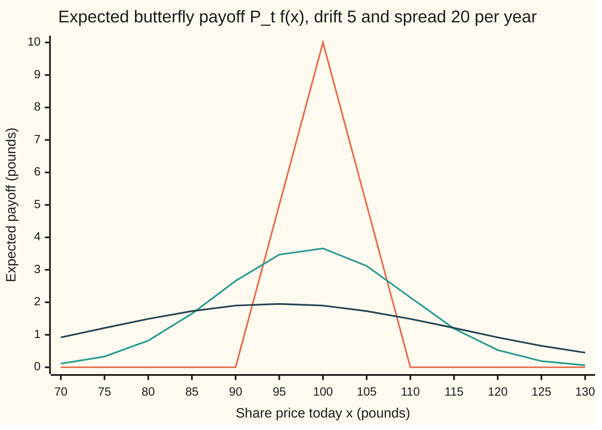
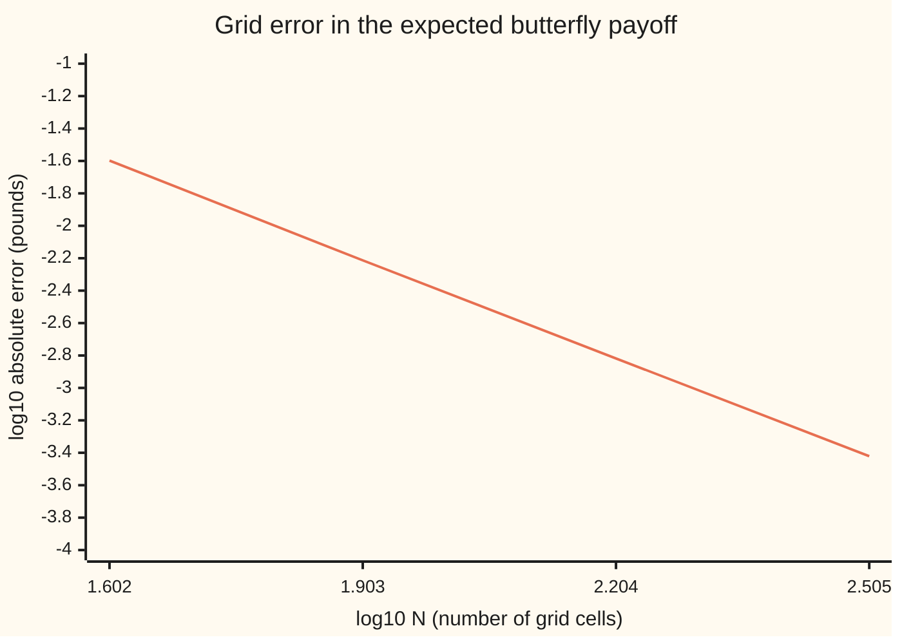

# Feller semigroups: the evolution of averages along a random path

[Syllabus](../../../SYLLABUS.md) → [Functional analysis](../README.md) → [Unbounded Operators and Semigroups](../README.md#s05) → Feller semigroups

---

## General Overview

A share trades at £100. On average its price drifts up £5 a year. On top of the drift come random swings, with a spread (standard deviation) of £20 after one year that grows with the square root of time. This is the normal model of a price, Brownian motion with drift (numbers illustrative).

A **call** with a strike of £90 pays the amount by which the price in a year exceeds £90, or nothing. A trader holds a **butterfly spread**: one call at £90, minus two calls at £100, plus one call at £110. In one year it pays £10 minus the distance of the price from £100, if the price ends within £10 of £100, and nothing otherwise. Its expected payoff is £1.896444. The trader wants more than one number: the expected payoff from every starting price, for every horizon, and for any payoff.

That is a family of averaging machines, one for each length of time $`t`$. Machine $`P_t`$ takes a payoff and returns its expected value $`t`$ years later, as a function of today's price. A payoff between £0 and £10 stays between £0 and £10 after averaging. Two six-month machines in a row equal the one-year machine. The family's rate of change at time zero is one operator (a map from payoffs to functions), the **generator**, and the drift (£5 a year) and the volatility (£20 per root-year) can be read straight off it.

On a grid of £5 price steps from £0 to £200, each machine is a 41 by 41 matrix with no negative entries and rows that add up to 1. On the whole price line the generator becomes unbounded. It acts only on a domain of smooth payoffs, and the kinked butterfly is not in it.

**A Feller semigroup is the family of maps that send a payoff to its expected value after time t; it is positive, never increases the largest payoff, stacks in time and moves continuously in the sup norm (the largest gap over all prices), so its generator carries the drift and volatility, and the expected payoff solves the backward equation that generator writes.**

**What kind of fact this is:** two definitions (Feller semigroup, generator). For the drifting price the Feller properties, the generator's formula on smooth payoffs and the backward equation are theorems proved on this card in Why it works. The general converse, which operators generate Feller semigroups (the Hille-Yosida-Ray theorem), is stated with a named source.

### The picture: averaging spreads the payoff out



Orange: the payoff itself, $`t = 0`$. Green: the expected payoff a quarter of a year ahead. Dark blue: one year ahead. Each point is the closed form, printed by both checks. The peak flattens because the spread grows, and it moves left from £100 to £95 because the drift adds £5 by the payment date.

---

## The formula

Notation first. Time $`t`$ is in years and prices are in pounds. The price is $`X_t = x + \mu t + \sigma W_t`$, started at $`x`$, where $`W_t`$ is Brownian motion, the random walk seen from far away. Here $`\mu`$ is the drift and $`\sigma`$ the volatility; on this card $`\sigma`$ is the volatility, never a spectrum $`\sigma(T)`$. $`E_x`$ is the average over all paths that start at $`x`$.

The payoffs live in $`C_0(\mathbb{R})`$: continuous functions of the price that shrink to zero far out in both directions. Their size is the **sup norm** $`\lVert f\rVert_\infty`$, the largest absolute value. The butterfly $`f(y) = \max(0,\ 10 - \lvert y - 100\rvert)`$ is in $`C_0(\mathbb{R})`$, with $`\lVert f\rVert_\infty = 10`$.

For each $`t \ge 0`$ the averaging operator is

```math
P_t f(x) = E_x\big[f(X_t)\big].
```

**Read it aloud:** P t of f at x is the average of the payoff f over every path that starts at x, read t years later.

The family $`(P_t)`$ is a **Feller semigroup** when, for every $`f`$ in $`C_0(\mathbb{R})`$ and all $`s, t \ge 0`$:

1. **Positive and sub-Markov:** if $`0 \le f \le 1`$ then $`0 \le P_t f \le 1`$.
2. **Semigroup:** $`P_0 f = f`$ and $`P_{s+t} f = P_s P_t f`$.
3. **Feller:** $`P_t f`$ is again in $`C_0(\mathbb{R})`$.
4. **Strongly continuous:** $`\lVert P_h f - f\rVert_\infty \to 0`$ as $`h \to 0`$.

Property 1 and linearity make each $`P_t`$ a contraction, $`\lVert P_t f\rVert_\infty \le \lVert f\rVert_\infty`$. So $`(P_t)`$ is a strongly continuous semigroup with $`\lVert P_t\rVert \le 1`$, in the sense of [Semigroups](04-strongly-continuous-semigroups.md). Its generator $`A`$ is the rate of change at time zero, measured in the sup norm, on the domain $`D(A)`$ of payoffs where that limit exists:

```math
Af = \lim_{h \to 0} \frac{P_h f - f}{h}, \qquad Af(x) = \mu\, f'(x) + \tfrac12 \sigma^2 f''(x) \ \text{ for the drifting price.}
```

**Read it aloud:** the generator is the starting rate of change of the average; for the drifting price it is the drift times the slope plus half the squared volatility times the curvature.

The generator is the stochastic wing's $`L`$ ([The generator](../../11-Stochastic%20processes%20and%20calculus/08-Generators%2C%20Densities%20and%20Simulation/01-infinitesimal-generator.md)), now with a domain. Two test payoffs read its coefficients back out at a price $`x`$:

```math
\mu = A\big[\,y - x\,\big](x), \qquad \sigma^2 = A\big[\,(y - x)^2\,\big](x).
```

**Read it aloud:** apply the generator to the distance from x and you get the drift; apply it to the squared distance and you get the squared volatility. (Neither test payoff vanishes far out; in practice each is cut off smoothly away from $`x`$, which changes nothing at $`x`$.)

The expected payoff $`u(t, x) = P_t f(x)`$ then solves the **backward equation**, with the payoff as its starting value:

```math
\partial_t u = A u = \mu\, \partial_x u + \tfrac12 \sigma^2\, \partial_{xx} u, \qquad u(0, x) = f(x).
```

**Read it aloud:** the expected payoff changes with the horizon at the rate the generator gives, and at horizon zero it is the payoff.

For the butterfly the generator is $`Af = 5f' + 200f''`$. Read it: the drift is £5 a year, $`\tfrac12\sigma^2 = 200`$, so $`\sigma = \sqrt{400} = 20`$ pounds per root-year.

| Symbol | Plain meaning | In our example | Push it up and the answer… |
| --- | --- | --- | --- |
| $`x`$, $`X_t`$, $`t`$ | today's price; the price at time $`t`$; time in years | £100; one year | — |
| $`\mu`$, $`\sigma`$ | drift in £ per year; volatility in £ per root-year | 5; 20 | drift: the peak of $`P_1 f`$ moves to lower $`x`$; volatility: the peak flattens |
| $`W_t`$, $`Z`$ | Brownian motion; one standard normal draw | $`X_1 = 105 + 20Z`$ from £100 | — |
| $`f`$ | the payoff, a function in $`C_0(\mathbb{R})`$ | the butterfly, at most £10 | — |
| $`P_t`$, $`E_x`$, $`I`$ | the averaging operator for horizon $`t`$; the average over paths from $`x`$; the identity | $`P_1 f(100) = 1.896444`$ | — |
| $`C_0(\mathbb{R})`$, $`\lVert f\rVert_\infty`$ | continuous payoffs that vanish far out; the largest absolute value | $`\lVert f\rVert_\infty = 10`$ | — |
| $`A`$, $`D(A)`$ | the generator; its domain, the payoffs it can act on | $`5f' + 200f''`$; contains every smooth $`f`$ with $`f'`$, $`f''`$ in $`C_0`$ | — |
| $`u(t, x)`$ | the expected payoff, $`P_t f(x)`$ | $`\partial_t u = -0.969038`$ at $`(1, 100)`$ | — |
| $`Q`$, $`\delta`$, $`N`$ | the grid's rate matrix; the grid step in £; the number of cells | $`\delta = 5`$, $`N = 40`$, up rate 8.5, down rate 7.5 | finer grid: error falls like $`\delta^2`$, rates grow like $`1/\delta^2`$ |
| $`\nu`$, $`J`$, $`\lambda`$ | the uniformization clock rate; the jump matrix $`I + Q/\nu`$; in Step 5, a positive number in the resolvent test | $`\nu = 8.5 + 7.5`$ a year at $`\delta = 5`$ | — |
| $`r`$, $`h`$, $`n`$ | killing (discount) rate; a short time; the number of resolvent steps | 0.05; 0.001; 1000 | $`r`$: $`P_1 1 = e^{-r}`$ falls |
| $`\Phi`$, $`\varphi`$, $`k`$, $`d`$ | normal area to the left; normal bell height; a call's strike; the mean end price minus the strike, in spreads | $`\Phi(0.75)`$, $`\varphi(0.75)`$, $`k = 90`$, $`d = 0.75`$ | — |

### When it holds

- **The process is Markov: its future depends on the past only through today's price.** Then averaging for $`s`$ years and then $`t`$ years equals averaging for $`s + t`$. Without it, in general $`P_{s+t} \ne P_s P_t`$, and there is no generator to read.
- **Payoffs are continuous and vanish far out.** A digital payoff of £10 above £100 has a jump. Its gap $`\lVert P_h f - f\rVert_\infty`$ stays above £5 however small $`h`$ is: 5.0315 at $`h = 0.001`$. Strong continuity fails.
- **The generator obeys the positive maximum principle.** Where a payoff in $`D(A)`$ has a maximum of at least zero, $`A`$ of it is at most zero there. This forces $`\sigma^2 \ge 0`$. Flip the sign of the curvature term and a grid zigzag grows at $`800/\delta^2`$ a year, without bound as the grid gets finer.
- **Mass can leave but not appear.** $`P_t 1 \le 1`$ allows killing, such as discounting at rate $`r`$: then $`P_1 1 = 0.951229`$. A value above 1 would create money from nothing.
- **The coefficients are tame.** Constant $`\mu`$ and $`\sigma`$ give a Feller semigroup on the whole line. Drift and volatility that vary with the price need regularity and growth bounds; otherwise $`P_t`$ can fail to keep payoffs in $`C_0(\mathbb{R})`$.

---

## Why it works

### Step 0: averaging is a positive linear map that stacks in time

An average of payoffs is linear in the payoff. It never turns a payoff that is never negative into a negative one, and it never exceeds the largest payoff. The Markov property makes the maps stack: average over the next $`s`$ years the value that averaging over $`t`$ more years gives. Those facts make $`(P_t)`$ a contraction semigroup; continuity in time comes in Step 3. Then the shelf's machinery applies: a generator, its domain, and an evolution equation.

Positivity adds what the shelf's general semigroups lack. For a process with continuous paths that loses no mass, it forces the generator into the form drift times slope plus a non-negative coefficient times curvature, so drift and volatility can be read off it.

### Step 1: the finite rehearsal, a chain on a price grid

Put the price on the grid $`0, \delta, 2\delta, \dots, 200`$, with $`N = 200/\delta`$ cells. From each price the chain jumps up one step at rate $`\tfrac12\sigma^2/\delta^2 + \tfrac12\mu/\delta`$ and down at rate $`\tfrac12\sigma^2/\delta^2 - \tfrac12\mu/\delta`$, per year. At $`\delta = 5`$ those are 8.5 and 7.5. The walls at £0 and £200 drop the rate that would leave the grid.

The generator is the rate matrix $`Q`$: the rates off the diagonal, minus their sum on the diagonal, so each row adds up to zero. Reading drift and volatility off a row is exact:

- drift: $`(8.5 - 7.5) \times 5 = 5`$ pounds a year;
- variance rate: $`(8.5 + 7.5) \times 5^2 = 400`$, so $`\sigma = 20`$.

The semigroup is the matrix exponential $`P_t = e^{tQ}`$. Every matrix is bounded and has no domain question. The truncation hides this: the largest rate grows like $`1/\delta^2`$, and only the trend over $`N`$ shows the unbounded generator.

### Step 2: why the matrix semigroup is positive and keeps rows summing to 1

Pick a clock rate $`\nu`$ at least as large as every total rate, here $`\nu = 400/\delta^2`$. Then $`J = I + Q/\nu`$ has no negative entries and rows summing to 1: it is a one-step move of a chain. Because $`Q = \nu(J - I)`$,

```math
e^{tQ} = e^{-\nu t}\, e^{\nu t J} = \sum_{k \ge 0} e^{-\nu t} \frac{(\nu t)^k}{k!}\, J^k .
```

**Read it aloud:** run a clock that ticks at rate nu; after k ticks, move by J k times; weight by the chance of k ticks.

Each term is a non-negative matrix with rows summing to 1, and the weights add to 1. So $`P_t`$ is too. This is **uniformization**, and it is the "random path" in the title: a Poisson clock plus a jump rule. The check builds the 41 by 41 matrix $`P_1`$ at $`\delta = 5`$ this way: no negative entries, every row sums to 1, and $`P_{0.5} P_{0.5} f = P_1 f`$ to 12 digits.

The same average can be taken along paths of the drifting price itself. Simulating 40,000 of them on the whole line, each in four quarterly normal steps, gives £1.904112, with standard error 0.015153.

The finite positive maximum principle is one line. If $`v_i`$ is the largest entry and $`v_i \ge 0`$, then $`(Qv)_i = \sum_{j \ne i} q_{ij}(v_j - v_i) + (\textstyle\sum_j q_{ij})\, v_i \le 0`$, because $`q_{ij} \ge 0`$ off the diagonal and the row sum is at most zero. Conversely, a negative off-diagonal rate $`q_{ij}`$ makes $`e^{tQ}`$ negative in that entry for small $`t`$.

### Step 3: the four Feller properties on the whole line

For the drifting price there is a formula: with $`Z`$ a standard normal draw,

```math
P_t f(x) = E\big[f(x + \mu t + \sigma\sqrt{t}\, Z)\big].
```

- **Positive, contraction:** an average of values between 0 and 1 lies between 0 and 1.
- **Semigroup:** the sum of two independent normal steps of variances $`\sigma^2 s`$ and $`\sigma^2 t`$ is one normal step of variance $`\sigma^2(s + t)`$.
- **Feller:** as $`x`$ runs far out, $`f(x + \dots)`$ shrinks to zero for each $`Z`$, and $`\lvert f\rvert \le \lVert f\rVert_\infty`$; dominated convergence passes the limit through the average. Continuity in $`x`$ follows the same way.
- **Strongly continuous:** a function in $`C_0(\mathbb{R})`$ is uniformly continuous, so a small random shift changes it by little everywhere at once.

The butterfly shows the rate. The gap $`\lVert P_h f - f\rVert_\infty`$ is 4.7502, 1.5963 and 0.5046 at $`h`$ = 0.1, 0.01 and 0.001. Divided by $`\sqrt h`$ it settles near 15.96, which is $`20\sqrt{2/\pi}`$: the average size of a normal step of spread 20, and so the amount the peak drops.

### Step 4: the generator, and what its domain leaves out

For a payoff with two continuous slopes, expand $`f(x + \Delta) = f(x) + f'(x)\Delta + \tfrac12 f''(x)\Delta^2 + \dots`$ with the step $`\Delta = X_h - x`$. Average it. The step has mean $`\mu h`$ and mean square $`\sigma^2 h + \mu^2 h^2`$. Divide by $`h`$ and let $`h \to 0`$:

```math
\frac{P_h f(x) - f(x)}{h} \to \mu f'(x) + \tfrac12 \sigma^2 f''(x).
```

The proof in the sup norm needs $`f'`$ and $`f''`$ in $`C_0(\mathbb{R})`$; the fold has it. The same short-time moments read the coefficients off the semigroup itself. On the grid, from £100, $`(E X_h - x)/h`$ is 5 at every $`h`$, and $`E(X_h - x)^2/h`$ is 402.5, 400.25 and 400.025 at $`h`$ = 0.1, 0.01 and 0.001. The limit is $`\sigma^2 = 400`$.

The butterfly is not in $`D(A)`$. At its peak, $`(P_h f - f)/h`$ is −47.5019, −159.6268 and −504.6423 for those three $`h`$. It grows like $`1/\sqrt h`$ and has no limit: the kink at £100 has no second slope. The semigroup still moves the butterfly; only the generator cannot act on it directly.

<details>
<summary>Detailed proof: smooth payoffs with f′ and f″ in C₀ lie in D(A)</summary>

Let $`f`$ have two continuous slopes, with $`f'`$ and $`f''`$ in $`C_0(\mathbb{R})`$. Write $`m = \mu h`$ and $`s = \sigma\sqrt h`$, so $`X_h - x = m + sZ`$.

Taylor's theorem with the remainder in integral form gives, for each $`x`$ and $`Z`$:

$`\displaystyle f(x + m + sZ) - f(x) = f'(x)(m + sZ) + \tfrac12 f''(x)(m + sZ)^2 + R,`$

$`\displaystyle \lvert R\rvert \le \tfrac12 (m + sZ)^2\, \omega\big(\lvert m + sZ\rvert\big),`$

where $`\omega(\rho)`$ is the largest change of $`f''`$ over any two points at most $`\rho`$ apart. Since $`f''`$ is uniformly continuous, $`\omega(\rho) \to 0`$ as $`\rho \to 0`$, and $`\omega \le 2\lVert f''\rVert_\infty`$.

Average over $`Z`$. The first two terms give $`f'(x)\, m + \tfrac12 f''(x)(s^2 + m^2)`$. Divide by $`h`$:

$`\displaystyle \Big\lvert \frac{P_h f(x) - f(x)}{h} - \mu f'(x) - \tfrac12\sigma^2 f''(x) \Big\rvert \le \tfrac12 \mu^2 h \lVert f''\rVert_\infty + \frac{1}{2h} E\big[(m + sZ)^2\, \omega(\lvert m + sZ\rvert)\big].`$

The right side does not depend on $`x`$. Since $`(m + sZ)^2 = h(\mu\sqrt h + \sigma Z)^2`$, the last term equals $`\tfrac12 E\big[(\mu\sqrt h + \sigma Z)^2\, \omega(\lvert m + sZ\rvert)\big]`$. For $`h \le 1`$ the quantity inside is at most $`2\lVert f''\rVert_\infty(\lvert\mu\rvert + \sigma\lvert Z\rvert)^2`$, which has a finite average, and it tends to zero for each $`Z`$. So the term tends to zero by dominated convergence. So the convergence is uniform in $`x`$: the limit holds in the sup norm, $`f`$ is in $`D(A)`$, and $`Af = \mu f' + \tfrac12\sigma^2 f''`$. That limit is a function in $`C_0(\mathbb{R})`$ because $`f'`$ and $`f''`$ are.

</details>

### Step 5: positivity fixes the generator's form

Suppose a payoff $`g`$ in $`D(A)`$ has its largest value at $`x_0`$, and that value is at least zero. Then $`P_h g(x_0) \le \max g = g(x_0)`$, because an average never exceeds the largest value. Divide $`P_h g(x_0) - g(x_0) \le 0`$ by $`h`$ and let $`h \to 0`$: $`Ag(x_0) \le 0`$. This is the **positive maximum principle**.

Apply it to a payoff equal to $`-(y - x)^2`$ near $`x`$, cut off smoothly further away. Its largest value is 0, at $`x`$. So $`A`$ of it at $`x`$, which is $`-\sigma^2`$, is at most zero: $`\sigma^2 \ge 0`$. The drift has no sign constraint, because $`\pm(y - x)`$ has no maximum at $`x`$.

The converse is the **Hille-Yosida-Ray theorem** (Ethier and Kurtz, Chapter 4, Section 2). An operator on $`C_0`$ has a closure that generates a Feller semigroup exactly when its domain is dense, it obeys the positive maximum principle, and $`\lambda - A`$ has dense range for some $`\lambda > 0`$. Courrège's theorem (Böttcher, Schilling and Wang, Chapter 2) adds that on smooth payoffs every such generator is drift plus non-negative curvature plus jumps plus killing. Reading drift and volatility means reading its first two terms.

### Step 6: the backward equation is the semigroup's own derivative

Take $`f`$ in $`D(A)`$. Then

```math
\frac{P_{t+h} f - P_t f}{h} = P_t \Big(\frac{P_h f - f}{h}\Big) \to P_t A f .
```

The limit passes through $`P_t`$ because $`P_t`$ is a contraction: it cannot enlarge the error. The same quotient also equals $`(P_h - I)/h`$ applied to $`P_t f`$, so $`P_t f`$ lies in $`D(A)`$ and the limit is $`A P_t f`$. In symbols, $`\tfrac{d}{dt} P_t f = A P_t f = P_t A f`$: with $`u = P_t f`$, that is the backward equation. The stochastic wing derives it from Ito's lemma ([Kolmogorov backward equation](../../11-Stochastic%20processes%20and%20calculus/08-Generators%2C%20Densities%20and%20Simulation/02-kolmogorov-backward-equation.md)); here it is the definition of a generator, pushed along in time.

The butterfly is not in $`D(A)`$, but $`P_t f`$ is smooth for every $`t > 0`$. At $`t = 1`$, $`x = 100`$, a finite difference in time gives $`\partial_t u = -0.969038`$, and $`5\,\partial_x u + 200\,\partial_{xx} u`$ by finite differences in price gives −0.969038.

Discounting is killing. With a bank rate $`r`$, the discounted average $`E_x[e^{-rt} f(X_t)] = e^{-rt} P_t f(x)`$ is again a Feller semigroup, now with $`P_t 1 = e^{-rt} < 1`$ and generator $`A - r`$. That is the semigroup reading of [Feynman-Kac](../../11-Stochastic%20processes%20and%20calculus/07-Changing%20Measure/06-feynman-kac-formula.md). At $`r = 0.05`$ the grid gives $`P_1 1 = 0.951229 = e^{-0.05}`$, and by the closed form the discounted butterfly is worth £1.803954.

### Step 7: the resolvent road, from Hille-Yosida

[Hille-Yosida](05-hille-yosida-and-generators.md) rebuilds a semigroup from its generator by the exponential formula $`P_t f = \lim_{n \to \infty} (I - \tfrac{t}{n} A)^{-n} f`$. For a Feller generator each factor $`(I - \tfrac{t}{n}A)^{-1}`$ is itself positive and sends the constant 1 to 1: it is the average of $`P_s`$ over a random time $`s`$ with an exponential law of mean $`t/n`$. On the grid it is a matrix with no negative entries and rows summing to 1.

On the grid at $`\delta = 1.25`$, $`n`$ steps of a tridiagonal solve give the butterfly's value at £100. Their gap to uniformization is 0.071484, 0.006891 and 0.000687 for $`n`$ = 10, 100 and 1000. Times $`n`$ it stays near 0.69: the error falls like $`1/n`$.

---

## Worked numbers, by hand

The butterfly from £100 after one year. The end price is normal with mean $`100 + 5 = 105`$ and spread 20. A call with strike $`k`$ then has expected payoff $`(105 - k)\,\Phi(d) + 20\,\varphi(d)`$ with $`d = (105 - k)/20`$.

| Step | Arithmetic | Value |
| --- | --- | --- |
| read the drift | coefficient of $`f'`$ in $`5f' + 200f''`$ | £5 a year |
| read the volatility | $`\sigma = \sqrt{2 \times 200}`$ | £20 per root-year |
| grid check of both, $`\delta = 5`$ | up rate $`400/50 + 5/10`$, down rate $`400/50 - 5/10`$ | 8.5 and 7.5; drift 5, variance rate 400 |
| call at £90 | $`d = 0.75`$: $`15\,\Phi(0.75) + 20\,\varphi(0.75)`$ | 17.623338 |
| call at £100 | $`d = 0.25`$: $`5\,\Phi(0.25) + 20\,\varphi(0.25)`$ | 10.726894 |
| call at £110 | $`d = -0.25`$: $`-5\,\Phi(-0.25) + 20\,\varphi(-0.25)`$ | 5.726894 |
| **butterfly** | **$`17.623338 - 2 \times 10.726894 + 5.726894`$** | **£1.896444** |

The trader should expect about £1.90 from a payoff worth up to £10, because the price will most likely end more than £10 from £100. Discounted at 5 percent, that is £1.803954 today.

### What breaks if you drop a piece

| Mistake | Comes out at | What went wrong |
| --- | --- | --- |
| Read the $`f''`$ coefficient 200 as $`\sigma^2`$, so $`\sigma = 14.142136`$ | £2.557436 against £1.896444 | the coefficient is half the squared volatility |
| Drop the drift term | £1.954171 | the end price is centred at £100, not £105 |
| Flip the curvature sign: $`5f' - 200f''`$ | a grid zigzag grows at 32, 128, 512, 2048 a year for $`\delta`$ = 5, 2.5, 1.25, 0.625 | fails the positive maximum principle; no bound survives refinement, so no semigroup |
| Use a digital payoff, £10 above £100 | $`\lVert P_h f - f\rVert_\infty`$ = 5.3151, 5.0997, 5.0315 at $`h`$ = 0.1, 0.01, 0.001 | not in $`C_0(\mathbb{R})`$: the jump stops strong continuity |
| Apply $`A`$ to the butterfly itself | $`(P_h f - f)/h`$ at £100: −47.5019, −159.6268, −504.6423 | the kink is outside $`D(A)`$; the rate has no limit |

---

## Code, from first principles, and it actually runs

The scripts compute every number on this card. They take four independent roads to the expected payoff. The closed form sums three normal-model calls, with a hand-written normal area. The grid chain is exponentiated by uniformization at four grid steps, and its error falls like $`\delta^2`$. The resolvent product $`(I - Q/n)^{-n}`$, Hille-Yosida's road, converges like $`1/n`$. A simulation averages 40,000 random paths of four quarterly steps, from a SplitMix64 generator with seed 20261115. What the truncation hides: every grid generator is a bounded matrix, and only the growth of its rates with $`N`$ shows the unbounded $`A`$.



The line is the grid answer minus the closed form, at $`N`$ = 40, 80, 160 and 320 cells. It falls by about 0.6 each time $`N`$ doubles, a slope of −2: the error shrinks like $`1/N^2`$.

### Python

```python
# Feller semigroups -- the check behind the card.  Standard library only.
# Share price X_t = x + mu t + sigma W_t (pounds, years); payoff f: a 90/100/110 butterfly.
# Generator A f = mu f' + (1/2) sigma^2 f''; Feller semigroup P_t f(x) = E_x[f(X_t)].
# Roads: closed form; a price grid (a Markov chain) by uniformization and by the resolvent
# product; Monte Carlo along random paths (SplitMix64, seed 20261115).
import math
MU, SIG, X0, T, WINGS = 5.0, 20.0, 100.0, 1.0, ((90.0, 1.0), (100.0, -2.0), (110.0, 1.0))
phi = lambda z: math.exp(-0.5 * z * z) / math.sqrt(2 * math.pi)
tent = lambda y: max(0.0, 10.0 - abs(y - 100.0))   # the butterfly payoff, pounds
def close(a, b, tol): assert abs(a - b) <= tol, (a, b)
def ncdf(z):                      # 1/2 + phi(z) (z + z^3/3 + z^5/(3*5) + ...)
    if abs(z) > 9: return 1.0 if z > 0 else 0.0
    term, s, n = z, z, 0
    while abs(term) > 1e-17 * abs(s) or n < 5:
        term, n = term * z * z / (2 * n + 3), n + 1
        s += term
    return 0.5 + phi(z) * s
def u(t, x, mu=MU, sig=SIG):      # P_t f(x): three normal-model calls, weights 1, -2, 1
    if t == 0: return tent(x)
    m, s = x + mu * t, sig * math.sqrt(t)
    return sum(c * ((m - k) * ncdf((m - k) / s) + s * phi((m - k) / s)) for k, c in WINGS)
close(ncdf(0.75), 0.5 * (1 + math.erf(0.75 / math.sqrt(2))), 1e-15); exact = u(T, X0)   # erf: library check only
print(f"read, generator 5 f' + 200 f'': drift {MU:.6f} pounds/yr, sigma = sqrt(2 x 200) = {math.sqrt(400):.6f}")
print("closed form, calls at 90, 100, 110 (mean 105, spread 20): " + ", ".join(f"{(105 - k) * ncdf((105 - k) / 20) + 20 * phi((105 - k) / 20):.6f}" for k, _ in WINGS))
print(f"closed form, P_1 f(100) = {exact:.6f} pounds, discounted at 5% {math.exp(-0.05) * exact:.6f}")
# 1. The finite rehearsal: a Markov chain on prices 0, dl, ..., 200, walls at both ends.
def rates(dl, mu, s2):
    n = int(round(200 / dl)) + 1
    up, dn = [s2 / (2 * dl * dl) + mu / (2 * dl)] * n, [s2 / (2 * dl * dl) - mu / (2 * dl)] * n
    up[-1], dn[0] = 0.0, 0.0
    return n, up, dn
def qmul(up, dn, v, r=0.0):       # (Q - r I) v for the tridiagonal rate matrix Q
    n = len(v)
    return [(up[i] * (v[i + 1] - v[i]) if i < n - 1 else 0.0) + (dn[i] * (v[i - 1] - v[i]) if i else 0.0) - r * v[i] for i in range(n)]
def unif(dl, f, t, r=0.0):        # e^{t(Q - rI)} f = sum over k of Poisson(lam t; k) K^k f
    n, up, dn = rates(dl, MU, SIG ** 2)
    lam = max(up[i] + dn[i] for i in range(n)) + r
    v, out, lw, k = f[:], [0.0] * n, -lam * t, 0
    while k < lam * t + 12 * math.sqrt(lam * t) + 30:
        out = [o + math.exp(lw) * a for o, a in zip(out, v)]
        v = [a + b / lam for a, b in zip(v, qmul(up, dn, v, r))]
        k += 1
        lw += math.log(lam * t) - math.log(k)
    return out
print("read, grid step, up rate, down rate, drift from the row, variance rate from the row")
for dl in (5.0, 2.5, 1.25, 0.625):
    n, up, dn = rates(dl, MU, SIG ** 2)
    a, b = (up[n // 2] - dn[n // 2]) * dl, (up[n // 2] + dn[n // 2]) * dl * dl
    close(a, MU, 1e-9); close(b, SIG ** 2, 1e-9)
    print(f"read, {dl:.3f}, {up[0]:.6f}, {dn[-1]:.6f}, {a:.6f}, {b:.6f}")
print("read, h, (E X_h - x)/h, E (X_h - x)^2 / h, on the grid from 100; closed form 400 + 25 h")
for h in (0.1, 0.01, 0.001):
    m1 = unif(1.25, [i * 1.25 - 100 for i in range(161)], h)[80] / h
    m2 = unif(1.25, [(i * 1.25 - 100) ** 2 for i in range(161)], h)[80] / h
    close(m1, MU, 1e-9); close(m2, 400 + 25 * h, 1e-8)
    print(f"read, {h}, {m1:.6f}, {m2:.6f}, {400 + 25 * h:.6f}")
print("grid, cells N, step, P_1 f(100), error, error ratio")
errs, gs = [], {}
for dl in (5.0, 2.5, 1.25, 0.625):
    n = int(round(200 / dl)) + 1
    gs[dl] = g = unif(dl, [tent(i * dl) for i in range(n)], T)[n // 2]
    errs.append(g - exact)
    print(f"grid, {n - 1}, {dl:.3f}, {g:.6f}, {g - exact:.6f}, " + (f"{errs[-2] / errs[-1]:.3f}" if len(errs) > 1 else "-"))
assert 3.5 < errs[2] / errs[3] < 4.5 and abs(errs[3]) < 0.001
print("chart, log10 N, " + ", ".join(f"{math.log10(200 / d):.3f}" for d in gs))
print("chart, log10 abs error, " + ", ".join(f"{math.log10(abs(e)):.3f}" for e in errs))
# 2. Feller properties of the 41-state matrix P_1 (step 5).
n = 41; cols = [unif(5.0, [1.0 if i == j else 0.0 for i in range(n)], T) for j in range(n)]
neg = sum(1 for c in cols for a in c if a < 0)
rowdev = max(abs(sum(cols[j][i] for j in range(n)) - 1) for i in range(n))
f5 = [tent(5.0 * i) for i in range(n)]
p1 = unif(5.0, f5, T)
semi = max(abs(a - b) for a, b in zip(unif(5.0, unif(5.0, f5, 0.5), 0.5), p1))
assert neg == 0 and rowdev < 1e-12 and max(p1) <= 10 and semi < 1e-12
print(f"feller, step 5: negative entries {neg}, rows sum to 1: {'yes' if rowdev < 1e-12 else 'no'}, P_0.5 P_0.5 f = P_1 f: {'yes' if semi < 1e-12 else 'no'}, largest P_1 f = {max(p1):.6f}")
kill = unif(5.0, [1.0] * n, T, r=0.05)
close(kill[20], math.exp(-0.05), 1e-12)
print(f"killed, rate 0.05: P_1 1 = {kill[20]:.6f}, e^-0.05 = {math.exp(-0.05):.6f}")
# 3. Hille-Yosida's road: (I - Q/n)^(-n) f, by n tridiagonal solves (step 1.25).
def resolvent_power(dl, f, t, steps):
    (n, up, dn), h, v = rates(dl, MU, SIG ** 2), t / steps, f[:]
    for _ in range(steps):
        cp, dp = [0.0] * n, [0.0] * n
        for i in range(n):
            a = -h * dn[i]
            den = 1 + h * (up[i] + dn[i]) - (a * cp[i - 1] if i else 0.0)
            cp[i], dp[i] = -h * up[i] / den, (v[i] - (a * dp[i - 1] if i else 0.0)) / den
        for i in range(n - 1, -1, -1):
            v[i] = dp[i] - (cp[i] * v[i + 1] if i < n - 1 else 0.0)
    return v
print("resolvent, n, (I - Q/n)^-n f at 100, gap to uniformization, n x gap")
for st in (10, 100, 1000):
    r = resolvent_power(1.25, [tent(i * 1.25) for i in range(161)], T, st)[80]
    print(f"resolvent, {st}, {r:.6f}, {r - gs[1.25]:.6f}, {st * (r - gs[1.25]):.4f}")
close(r, gs[1.25], 1e-3)
# 4. Averages along random paths: four quarterly steps, SplitMix64, Box-Muller.
state = 20261115
def rnd():
    global state
    state = (state + 0x9E3779B97F4A7C15) & 0xFFFFFFFFFFFFFFFF
    z = ((state ^ (state >> 30)) * 0xBF58476D1CE4E5B9) & 0xFFFFFFFFFFFFFFFF
    z = ((z ^ (z >> 27)) * 0x94D049BB133111EB) & 0xFFFFFFFFFFFFFFFF
    return ((z ^ (z >> 31)) >> 11) / 2.0 ** 53
paths, s1, s2 = 40000, 0.0, 0.0
for _ in range(paths):
    x = X0
    for _ in range(2):             # each pair of normals moves the price two quarters
        rr, b = math.sqrt(-2 * math.log(1.0 - rnd())), 2 * math.pi * rnd()
        x += 2 * MU * 0.25 + SIG * 0.5 * (rr * math.cos(b) + rr * math.sin(b))
    s1, s2 = s1 + tent(x), s2 + tent(x) ** 2
mc, se = s1 / paths, math.sqrt((s2 / paths - (s1 / paths) ** 2) / paths)
assert abs(mc - exact) < 4 * se
print(f"paths, {paths} paths of 4 quarterly steps: average payoff {mc:.6f}, standard error {se:.6f}")
# 5. Strong continuity in the sup norm: the butterfly (in C_0) against a digital (a jump).
print("continuity, h, sup |P_h f - f|, divided by sqrt h, digital gap at the jump, (P_h f - f)/h at 100")
for h in (0.1, 0.01, 0.001):
    sup = max(abs(u(h, 80 + 0.01 * i) - tent(80 + 0.01 * i)) for i in range(4001))
    dig = 10 * ncdf(MU * math.sqrt(h) / SIG)
    assert dig > 5 and sup < 16 * math.sqrt(h)
    print(f"continuity, {h}, {sup:.4f}, {sup / math.sqrt(h):.4f}, {dig:.4f}, {(u(h, X0) - 10) / h:.4f}")
close(sup / math.sqrt(h), 20 * math.sqrt(2 / math.pi), 0.02)
# 6. The backward equation du/dt = A u at t = 1, x = 100, by finite differences.
dt, dx = 1e-4, 1e-2; ut = (u(T + dt, X0) - u(T - dt, X0)) / (2 * dt)
au = MU * (u(T, X0 + dx) - u(T, X0 - dx)) / (2 * dx) + 200 * (u(T, X0 + dx) - 2 * exact + u(T, X0 - dx)) / dx ** 2
close(ut, au, 1e-5)
print(f"backward, du/dt = {ut:.6f}, A u = 5 u_x + 200 u_xx = {au:.6f}")
# 7. What breaks, and the chart.
print(f"breaks, sigma read as sqrt 200 = {math.sqrt(200):.6f}: P_1 f(100) = {u(T, X0, sig=math.sqrt(200)):.6f}")
print(f"breaks, drift dropped (the bar's heat flow): P_1 f(100) = {u(T, X0, mu=0.0):.6f}")
print("breaks, curvature sign flipped, step, zigzag growth rate per year, 800/step^2")
for dl in (5.0, 2.5, 1.25, 0.625):
    n, up, dn = rates(dl, MU, -SIG ** 2)
    gr = qmul(up, dn, [(-1.0) ** i for i in range(n)])[n // 2] / (-1.0) ** (n // 2)
    close(gr, 800 / dl ** 2, 1e-9)
    print(f"breaks, {dl:.3f}, {gr:.6f}, {800 / dl ** 2:.6f}")
xs = [70 + 5 * i for i in range(13)]
print("chart, x, " + ", ".join(str(x) for x in xs))
for t in (0.0, 0.25, 1.0):
    print(f"chart, t = {t:.2f}, " + ", ".join(f"{u(t, x):.2f}" for x in xs))
print("ALL CHECKS PASS")
```

**Ran 2026-11-15 on macOS, Python 3.14.10, standard library only. All checks passed. Output, pasted from the run:**

```
read, generator 5 f' + 200 f'': drift 5.000000 pounds/yr, sigma = sqrt(2 x 200) = 20.000000
closed form, calls at 90, 100, 110 (mean 105, spread 20): 17.623338, 10.726894, 5.726894
closed form, P_1 f(100) = 1.896444 pounds, discounted at 5% 1.803954
read, grid step, up rate, down rate, drift from the row, variance rate from the row
read, 5.000, 8.500000, 7.500000, 5.000000, 400.000000
read, 2.500, 33.000000, 31.000000, 5.000000, 400.000000
read, 1.250, 130.000000, 126.000000, 5.000000, 400.000000
read, 0.625, 516.000000, 508.000000, 5.000000, 400.000000
read, h, (E X_h - x)/h, E (X_h - x)^2 / h, on the grid from 100; closed form 400 + 25 h
read, 0.1, 5.000000, 402.500000, 402.500000
read, 0.01, 5.000000, 400.250000, 400.250000
read, 0.001, 5.000000, 400.025000, 400.025000
grid, cells N, step, P_1 f(100), error, error ratio
grid, 40, 5.000, 1.921690, 0.025246, -
grid, 80, 2.500, 1.902570, 0.006125, 4.122
grid, 160, 1.250, 1.897965, 0.001520, 4.029
grid, 320, 0.625, 1.896824, 0.000379, 4.007
chart, log10 N, 1.602, 1.903, 2.204, 2.505
chart, log10 abs error, -1.598, -2.213, -2.818, -3.421
feller, step 5: negative entries 0, rows sum to 1: yes, P_0.5 P_0.5 f = P_1 f: yes, largest P_1 f = 1.978835
killed, rate 0.05: P_1 1 = 0.951229, e^-0.05 = 0.951229
resolvent, n, (I - Q/n)^-n f at 100, gap to uniformization, n x gap
resolvent, 10, 1.969449, 0.071484, 0.7148
resolvent, 100, 1.904856, 0.006891, 0.6891
resolvent, 1000, 1.898651, 0.000687, 0.6866
paths, 40000 paths of 4 quarterly steps: average payoff 1.904112, standard error 0.015153
continuity, h, sup |P_h f - f|, divided by sqrt h, digital gap at the jump, (P_h f - f)/h at 100
continuity, 0.1, 4.7502, 15.0214, 5.3151, -47.5019
continuity, 0.01, 1.5963, 15.9627, 5.0997, -159.6268
continuity, 0.001, 0.5046, 15.9582, 5.0315, -504.6423
backward, du/dt = -0.969038, A u = 5 u_x + 200 u_xx = -0.969038
breaks, sigma read as sqrt 200 = 14.142136: P_1 f(100) = 2.557436
breaks, drift dropped (the bar's heat flow): P_1 f(100) = 1.954171
breaks, curvature sign flipped, step, zigzag growth rate per year, 800/step^2
breaks, 5.000, 32.000000, 32.000000
breaks, 2.500, 128.000000, 128.000000
breaks, 1.250, 512.000000, 512.000000
breaks, 0.625, 2048.000000, 2048.000000
chart, x, 70, 75, 80, 85, 90, 95, 100, 105, 110, 115, 120, 125, 130
chart, t = 0.00, 0.00, 0.00, 0.00, 0.00, 0.00, 5.00, 10.00, 5.00, 0.00, 0.00, 0.00, 0.00, 0.00
chart, t = 0.25, 0.11, 0.33, 0.82, 1.65, 2.66, 3.47, 3.66, 3.12, 2.15, 1.19, 0.53, 0.19, 0.06
chart, t = 1.00, 0.92, 1.21, 1.49, 1.73, 1.90, 1.95, 1.90, 1.73, 1.49, 1.21, 0.92, 0.66, 0.45
ALL CHECKS PASS
```

### Rust

```rust
// Feller semigroups -- the same check as the Python, in Rust.  No crates.
// Share price X_t = x + mu t + sigma W_t (pounds, years); payoff f: a 90/100/110 butterfly.
// Generator A f = mu f' + (1/2) sigma^2 f''; Feller semigroup P_t f(x) = E_x[f(X_t)].
// Roads: closed form; a price grid (a Markov chain) by uniformization and by the resolvent
// product; Monte Carlo along random paths (SplitMix64, seed 20261115).
const MU: f64 = 5.0; const SIG: f64 = 20.0; const X0: f64 = 100.0; const T: f64 = 1.0;
const WINGS: [(f64, f64); 3] = [(90.0, 1.0), (100.0, -2.0), (110.0, 1.0)];
fn phi(z: f64) -> f64 { (-0.5 * z * z).exp() / (2.0 * std::f64::consts::PI).sqrt() }
fn tent(y: f64) -> f64 { (10.0 - (y - 100.0).abs()).max(0.0) }
fn close(a: f64, b: f64, tol: f64) { assert!((a - b).abs() <= tol, "{} {}", a, b); }
fn ncdf(z: f64) -> f64 { // 1/2 + phi(z) (z + z^3/3 + z^5/(3*5) + ...)
    if z.abs() > 9.0 { return if z > 0.0 { 1.0 } else { 0.0 }; }
    let (mut term, mut s, mut n) = (z, z, 0.0);
    while term.abs() > 1e-17 * s.abs() || n < 5.0 {
        term = term * z * z / (2.0 * n + 3.0); n += 1.0; s += term;
    }
    0.5 + phi(z) * s
}
fn u(t: f64, x: f64, mu: f64, sig: f64) -> f64 { // P_t f(x): three normal-model calls
    if t == 0.0 { return tent(x); }
    let (m, s) = (x + mu * t, sig * t.sqrt());
    WINGS.iter().fold(0.0, |acc, &(k, c)| acc + c * ((m - k) * ncdf((m - k) / s) + s * phi((m - k) / s)))
}
fn rates(dl: f64, mu: f64, s2: f64) -> (usize, Vec<f64>, Vec<f64>) {
    let n = (200.0 / dl).round() as usize + 1;
    let mut up = vec![s2 / (2.0 * dl * dl) + mu / (2.0 * dl); n];
    let mut dn = vec![s2 / (2.0 * dl * dl) - mu / (2.0 * dl); n];
    up[n - 1] = 0.0; dn[0] = 0.0;
    (n, up, dn)
}
fn qmul(up: &[f64], dn: &[f64], v: &[f64], r: f64) -> Vec<f64> { // (Q - r I) v
    let n = v.len();
    (0..n).map(|i| (if i < n - 1 { up[i] * (v[i + 1] - v[i]) } else { 0.0 })
        + (if i > 0 { dn[i] * (v[i - 1] - v[i]) } else { 0.0 }) - r * v[i]).collect()
}
fn unif(dl: f64, f: &[f64], t: f64, r: f64) -> Vec<f64> { // sum of Poisson(lam t; k) K^k f
    let (n, up, dn) = rates(dl, MU, SIG * SIG);
    let lam = (0..n).map(|i| up[i] + dn[i]).fold(f64::MIN, f64::max) + r;
    let (mut v, mut out, mut lw, mut k) = (f.to_vec(), vec![0.0; n], -lam * t, 0.0);
    while k < lam * t + 12.0 * (lam * t).sqrt() + 30.0 {
        out = out.iter().zip(&v).map(|(o, a)| o + lw.exp() * a).collect();
        v = v.iter().zip(&qmul(&up, &dn, &v, r)).map(|(a, b)| a + b / lam).collect();
        k += 1.0; lw += (lam * t).ln() - k.ln();
    }
    out
}
fn resolvent_power(dl: f64, f: &[f64], t: f64, steps: usize) -> Vec<f64> { // (I - hQ)^-steps f
    let (n, up, dn) = rates(dl, MU, SIG * SIG);
    let (h, mut v) = (t / steps as f64, f.to_vec());
    for _ in 0..steps {
        let (mut cp, mut dp) = (vec![0.0; n], vec![0.0; n]);
        for i in 0..n {
            let a = -h * dn[i];
            let den = 1.0 + h * (up[i] + dn[i]) - (if i > 0 { a * cp[i - 1] } else { 0.0 });
            cp[i] = -h * up[i] / den; dp[i] = (v[i] - (if i > 0 { a * dp[i - 1] } else { 0.0 })) / den;
        }
        for i in (0..n).rev() { v[i] = dp[i] - (if i < n - 1 { cp[i] * v[i + 1] } else { 0.0 }); }
    }
    v
}
fn rnd(state: &mut u64) -> f64 { // SplitMix64, a uniform number in [0, 1)
    *state = state.wrapping_add(0x9E3779B97F4A7C15);
    let mut z = (*state ^ (*state >> 30)).wrapping_mul(0xBF58476D1CE4E5B9);
    z = (z ^ (z >> 27)).wrapping_mul(0x94D049BB133111EB);
    ((z ^ (z >> 31)) >> 11) as f64 / 9007199254740992.0
}
fn main() {
    let (pi, exact) = (std::f64::consts::PI, u(T, X0, MU, SIG));
    println!("read, generator 5 f' + 200 f'': drift {:.6} pounds/yr, sigma = sqrt(2 x 200) = {:.6}", MU, 400f64.sqrt());
    println!("closed form, calls at 90, 100, 110 (mean 105, spread 20): {}", WINGS.iter().map(|&(k, _)| format!("{:.6}", (105.0 - k) * ncdf((105.0 - k) / 20.0) + 20.0 * phi((105.0 - k) / 20.0))).collect::<Vec<_>>().join(", "));
    println!("closed form, P_1 f(100) = {:.6} pounds, discounted at 5% {:.6}", exact, (-0.05f64).exp() * exact);
    // 1. The finite rehearsal: a Markov chain on prices 0, dl, ..., 200, walls at both ends.
    let steps = [5.0, 2.5, 1.25, 0.625];
    println!("read, grid step, up rate, down rate, drift from the row, variance rate from the row");
    for &dl in &steps {
        let (n, up, dn) = rates(dl, MU, SIG * SIG);
        let (a, b) = ((up[n / 2] - dn[n / 2]) * dl, (up[n / 2] + dn[n / 2]) * dl * dl);
        close(a, MU, 1e-9); close(b, SIG * SIG, 1e-9);
        println!("read, {:.3}, {:.6}, {:.6}, {:.6}, {:.6}", dl, up[0], dn[n - 1], a, b);
    }
    println!("read, h, (E X_h - x)/h, E (X_h - x)^2 / h, on the grid from 100; closed form 400 + 25 h");
    for &h in &[0.1, 0.01, 0.001] {
        let g1: Vec<f64> = (0..161).map(|i| i as f64 * 1.25 - 100.0).collect();
        let g2: Vec<f64> = g1.iter().map(|y| y * y).collect();
        let (m1, m2) = (unif(1.25, &g1, h, 0.0)[80] / h, unif(1.25, &g2, h, 0.0)[80] / h);
        close(m1, MU, 1e-9); close(m2, 400.0 + 25.0 * h, 1e-8);
        println!("read, {}, {:.6}, {:.6}, {:.6}", h, m1, m2, 400.0 + 25.0 * h);
    }
    println!("grid, cells N, step, P_1 f(100), error, error ratio");
    let (mut errs, mut g125): (Vec<f64>, f64) = (vec![], 0.0);
    for &dl in &steps {
        let n = (200.0 / dl).round() as usize + 1; let f: Vec<f64> = (0..n).map(|i| tent(i as f64 * dl)).collect();
        let g = unif(dl, &f, T, 0.0)[n / 2]; if dl == 1.25 { g125 = g; }
        errs.push(g - exact);
        let ratio = if errs.len() > 1 { format!("{:.3}", errs[errs.len() - 2] / errs[errs.len() - 1]) } else { "-".to_string() };
        println!("grid, {}, {:.3}, {:.6}, {:.6}, {}", n - 1, dl, g, g - exact, ratio);
    }
    assert!(3.5 < errs[2] / errs[3] && errs[2] / errs[3] < 4.5 && errs[3].abs() < 0.001);
    println!("chart, log10 N, {}", steps.iter().map(|d| format!("{:.3}", (200.0 / d).log10())).collect::<Vec<_>>().join(", "));
    println!("chart, log10 abs error, {}", errs.iter().map(|e| format!("{:.3}", e.abs().log10())).collect::<Vec<_>>().join(", "));
    // 2. Feller properties of the 41-state matrix P_1 (step 5).
    let n = 41;
    let cols: Vec<Vec<f64>> = (0..n).map(|j| unif(5.0, &(0..n).map(|i| if i == j { 1.0 } else { 0.0 }).collect::<Vec<f64>>(), T, 0.0)).collect();
    let neg = cols.iter().flatten().filter(|&&a| a < 0.0).count();
    let rowdev = (0..n).map(|i| ((0..n).fold(0.0, |s, j| s + cols[j][i]) - 1.0).abs()).fold(0.0, f64::max);
    let f5: Vec<f64> = (0..n).map(|i| tent(5.0 * i as f64)).collect();
    let (p1, half) = (unif(5.0, &f5, T, 0.0), unif(5.0, &unif(5.0, &f5, 0.5, 0.0), 0.5, 0.0));
    let semi = half.iter().zip(&p1).map(|(a, b)| (a - b).abs()).fold(0.0, f64::max);
    let top = p1.iter().cloned().fold(f64::MIN, f64::max);
    assert!(neg == 0 && rowdev < 1e-12 && top <= 10.0 && semi < 1e-12);
    let yes = |b: bool| if b { "yes" } else { "no" };
    println!("feller, step 5: negative entries {}, rows sum to 1: {}, P_0.5 P_0.5 f = P_1 f: {}, largest P_1 f = {:.6}", neg, yes(rowdev < 1e-12), yes(semi < 1e-12), top);
    let kill = unif(5.0, &vec![1.0; n], T, 0.05); close(kill[20], (-0.05f64).exp(), 1e-12);
    println!("killed, rate 0.05: P_1 1 = {:.6}, e^-0.05 = {:.6}", kill[20], (-0.05f64).exp());
    // 3. Hille-Yosida's road: (I - Q/n)^(-n) f, by n tridiagonal solves (step 1.25).
    println!("resolvent, n, (I - Q/n)^-n f at 100, gap to uniformization, n x gap");
    let (f125, mut r): (Vec<f64>, f64) = ((0..161).map(|i| tent(i as f64 * 1.25)).collect(), 0.0);
    for &st in &[10usize, 100, 1000] {
        r = resolvent_power(1.25, &f125, T, st)[80];
        println!("resolvent, {}, {:.6}, {:.6}, {:.4}", st, r, r - g125, st as f64 * (r - g125));
    }
    close(r, g125, 1e-3);
    // 4. Averages along random paths: four quarterly steps, SplitMix64, Box-Muller.
    let mut state = 20261115u64;
    let (paths, mut s1, mut s2) = (40000, 0.0, 0.0);
    for _ in 0..paths {
        let mut x = X0;
        for _ in 0..2 { // each pair of normals moves the price two quarters
            let (rr, b) = ((-2.0 * (1.0 - rnd(&mut state)).ln()).sqrt(), 2.0 * pi * rnd(&mut state));
            x += 2.0 * MU * 0.25 + SIG * 0.5 * (rr * b.cos() + rr * b.sin());
        }
        s1 += tent(x); s2 += tent(x).powi(2);
    }
    let (mc, se) = (s1 / paths as f64, ((s2 / paths as f64 - (s1 / paths as f64).powi(2)) / paths as f64).sqrt());
    assert!((mc - exact).abs() < 4.0 * se);
    println!("paths, {} paths of 4 quarterly steps: average payoff {:.6}, standard error {:.6}", paths, mc, se);
    // 5. Strong continuity in the sup norm: the butterfly (in C_0) against a digital (a jump).
    println!("continuity, h, sup |P_h f - f|, divided by sqrt h, digital gap at the jump, (P_h f - f)/h at 100");
    let mut last = 0.0;
    for &h in &[0.1, 0.01, 0.001] {
        let sup = (0..4001).map(|i| { let x = 80.0 + 0.01 * i as f64; (u(h, x, MU, SIG) - tent(x)).abs() }).fold(0.0, f64::max);
        let dig = 10.0 * ncdf(MU * f64::sqrt(h) / SIG);
        assert!(dig > 5.0 && sup < 16.0 * h.sqrt());
        println!("continuity, {}, {:.4}, {:.4}, {:.4}, {:.4}", h, sup, sup / h.sqrt(), dig, (u(h, X0, MU, SIG) - 10.0) / h);
        last = sup / h.sqrt();
    }
    close(last, 20.0 * (2.0 / pi).sqrt(), 0.02);
    // 6. The backward equation du/dt = A u at t = 1, x = 100, by finite differences.
    let (dt, dx) = (1e-4, 1e-2); let (up_, dn_) = (u(T, X0 + dx, MU, SIG), u(T, X0 - dx, MU, SIG));
    let ut = (u(T + dt, X0, MU, SIG) - u(T - dt, X0, MU, SIG)) / (2.0 * dt);
    let au = MU * (up_ - dn_) / (2.0 * dx) + 200.0 * (up_ - 2.0 * exact + dn_) / dx.powi(2);
    close(ut, au, 1e-5);
    println!("backward, du/dt = {:.6}, A u = 5 u_x + 200 u_xx = {:.6}", ut, au);
    // 7. What breaks, and the chart.
    println!("breaks, sigma read as sqrt 200 = {:.6}: P_1 f(100) = {:.6}", 200f64.sqrt(), u(T, X0, MU, 200f64.sqrt()));
    println!("breaks, drift dropped (the bar's heat flow): P_1 f(100) = {:.6}", u(T, X0, 0.0, SIG));
    println!("breaks, curvature sign flipped, step, zigzag growth rate per year, 800/step^2");
    for &dl in &steps {
        let (n, up, dn) = rates(dl, MU, -SIG * SIG);
        let z: Vec<f64> = (0..n).map(|i| if i % 2 == 0 { 1.0 } else { -1.0 }).collect();
        let gr = qmul(&up, &dn, &z, 0.0)[n / 2] / z[n / 2];
        close(gr, 800.0 / (dl * dl), 1e-9); println!("breaks, {:.3}, {:.6}, {:.6}", dl, gr, 800.0 / (dl * dl));
    }
    let xs: Vec<f64> = (0..13).map(|i| 70.0 + 5.0 * i as f64).collect();
    println!("chart, x, {}", xs.iter().map(|x| format!("{}", x)).collect::<Vec<_>>().join(", "));
    for &t in &[0.0, 0.25, 1.0] {
        println!("chart, t = {:.2}, {}", t, xs.iter().map(|&x| format!("{:.2}", u(t, x, MU, SIG))).collect::<Vec<_>>().join(", "));
    }
    println!("ALL CHECKS PASS");
}
```

**Ran 2026-11-15 on macOS, rustc 1.98.1, no crates. All checks passed. Output, pasted from the run:**

```
read, generator 5 f' + 200 f'': drift 5.000000 pounds/yr, sigma = sqrt(2 x 200) = 20.000000
closed form, calls at 90, 100, 110 (mean 105, spread 20): 17.623338, 10.726894, 5.726894
closed form, P_1 f(100) = 1.896444 pounds, discounted at 5% 1.803954
read, grid step, up rate, down rate, drift from the row, variance rate from the row
read, 5.000, 8.500000, 7.500000, 5.000000, 400.000000
read, 2.500, 33.000000, 31.000000, 5.000000, 400.000000
read, 1.250, 130.000000, 126.000000, 5.000000, 400.000000
read, 0.625, 516.000000, 508.000000, 5.000000, 400.000000
read, h, (E X_h - x)/h, E (X_h - x)^2 / h, on the grid from 100; closed form 400 + 25 h
read, 0.1, 5.000000, 402.500000, 402.500000
read, 0.01, 5.000000, 400.250000, 400.250000
read, 0.001, 5.000000, 400.025000, 400.025000
grid, cells N, step, P_1 f(100), error, error ratio
grid, 40, 5.000, 1.921690, 0.025246, -
grid, 80, 2.500, 1.902570, 0.006125, 4.122
grid, 160, 1.250, 1.897965, 0.001520, 4.029
grid, 320, 0.625, 1.896824, 0.000379, 4.007
chart, log10 N, 1.602, 1.903, 2.204, 2.505
chart, log10 abs error, -1.598, -2.213, -2.818, -3.421
feller, step 5: negative entries 0, rows sum to 1: yes, P_0.5 P_0.5 f = P_1 f: yes, largest P_1 f = 1.978835
killed, rate 0.05: P_1 1 = 0.951229, e^-0.05 = 0.951229
resolvent, n, (I - Q/n)^-n f at 100, gap to uniformization, n x gap
resolvent, 10, 1.969449, 0.071484, 0.7148
resolvent, 100, 1.904856, 0.006891, 0.6891
resolvent, 1000, 1.898651, 0.000687, 0.6866
paths, 40000 paths of 4 quarterly steps: average payoff 1.904112, standard error 0.015153
continuity, h, sup |P_h f - f|, divided by sqrt h, digital gap at the jump, (P_h f - f)/h at 100
continuity, 0.1, 4.7502, 15.0214, 5.3151, -47.5019
continuity, 0.01, 1.5963, 15.9627, 5.0997, -159.6268
continuity, 0.001, 0.5046, 15.9582, 5.0315, -504.6423
backward, du/dt = -0.969038, A u = 5 u_x + 200 u_xx = -0.969038
breaks, sigma read as sqrt 200 = 14.142136: P_1 f(100) = 2.557436
breaks, drift dropped (the bar's heat flow): P_1 f(100) = 1.954171
breaks, curvature sign flipped, step, zigzag growth rate per year, 800/step^2
breaks, 5.000, 32.000000, 32.000000
breaks, 2.500, 128.000000, 128.000000
breaks, 1.250, 512.000000, 512.000000
breaks, 0.625, 2048.000000, 2048.000000
chart, x, 70, 75, 80, 85, 90, 95, 100, 105, 110, 115, 120, 125, 130
chart, t = 0.00, 0.00, 0.00, 0.00, 0.00, 0.00, 5.00, 10.00, 5.00, 0.00, 0.00, 0.00, 0.00, 0.00
chart, t = 0.25, 0.11, 0.33, 0.82, 1.65, 2.66, 3.47, 3.66, 3.12, 2.15, 1.19, 0.53, 0.19, 0.06
chart, t = 1.00, 0.92, 1.21, 1.49, 1.73, 1.90, 1.95, 1.90, 1.73, 1.49, 1.21, 0.92, 0.66, 0.45
ALL CHECKS PASS
```

### Lean

Lean proves the Feller properties, the generator's formula and the backward equation for the drifting price, at every drift and volatility.

- Take $`f`$ in $`C_0(\mathbb{R})`$ with $`0 \le f \le 1`$, and $`t \ge 0`$. Then $`0 \le P_t f \le 1`$.
- $`P_0 f = f`$, and $`P_{s+t} f = P_s P_t f`$ for all $`s, t \ge 0`$.
- Take $`f`$ in $`C_0(\mathbb{R})`$ and $`t \ge 0`$. Then $`P_t f`$ is again in $`C_0(\mathbb{R})`$.
- Take $`f`$ in $`C_0(\mathbb{R})`$. Then $`\lVert P_h f - f\rVert_\infty \to 0`$ as $`h`$ falls to 0.
- Take $`f`$ in $`C_0(\mathbb{R})`$ with two continuous slopes, and $`f'`$, $`f''`$ in $`C_0(\mathbb{R})`$. Then $`(P_h f - f)/h`$ converges in the sup norm as $`h`$ falls to 0. The limit is $`\mu f' + \tfrac12\sigma^2 f''`$.
- Take that $`f`$, $`t \ge 0`$ and $`u(t, x) = P_t f(x)`$. Then $`u`$ solves the backward equation, $`\partial_t u = \mu\, \partial_x u + \tfrac12 \sigma^2\, \partial_{xx} u`$.
- Reading $`5f' + 200f''`$ gives $`\sigma = 20`$. The grid's up and down rates at all four steps check exactly.
- The £5 row gives drift 5 and variance rate 400 exactly. The flipped-sign zigzag grows at 32, 128, 512 and 2048 a year.

The butterfly's £1.896444, the grid matrices, Hille-Yosida's resolvent road and the 40,000 paths are left to the Python and Rust checks.

```lean
-- Feller semigroups: the averaging maps of a drifting share price are positive, stack in time, keep payoffs in C₀ and move continuously in the sup norm, their generator is drift times slope plus half the squared volatility times curvature, and the expected payoff solves the backward equation.
import Mathlib.Probability.Distributions.Gaussian.Real
import Mathlib.Topology.ContinuousMap.ZeroAtInfty
import Mathlib.Topology.UniformSpace.UniformConvergence
import Mathlib.Analysis.Calculus.Deriv.Basic
import Mathlib.Analysis.Calculus.ContDiff.Defs
import Mathlib.Analysis.SpecialFunctions.Pow.Real
import Mathlib.Analysis.Calculus.MeanValue
import Mathlib.Analysis.Calculus.Deriv.Shift

open MeasureTheory ProbabilityTheory Filter Topology ZeroAtInfty

/-- The averaging operator of the drifting price `X_t = x + μ t + σ W_t`:
`P_t f(x) = E[f(x + μ t + σ √t Z)]`, with `Z` a standard normal draw. -/
noncomputable def fellerP (μ σ t : ℝ) (f : ℝ → ℝ) (x : ℝ) : ℝ :=
  ∫ z, f (x + μ * t + σ * Real.sqrt t * z) ∂(gaussianReal 0 1)

lemma feller_integrable_of_bdd (ν : Measure ℝ) [IsFiniteMeasure ν] (F : ℝ → ℝ)
    (hF : Continuous F) (M : ℝ) (hM : ∀ w, |F w| ≤ M) : Integrable F ν :=
  Integrable.mono' (integrable_const M) hF.aestronglyMeasurable
    (ae_of_all _ fun w => by simpa [Real.norm_eq_abs] using hM w)

lemma feller_integrable (g : ℝ → ℝ) (hg : Continuous g) (M : ℝ) (hM : ∀ y, |g y| ≤ M)
    (a b : ℝ) : Integrable (fun z => g (a + b * z)) (gaussianReal 0 1) :=
  feller_integrable_of_bdd _ _ (hg.comp (by fun_prop)) M (fun _ => hM _)

lemma feller_abs_le (g : ℝ → ℝ) (M : ℝ) (hM : ∀ y, |g y| ≤ M) (μ σ t x : ℝ) :
    |fellerP μ σ t g x| ≤ M := by
  have := norm_integral_le_of_norm_le_const (μ := gaussianReal 0 1)
    (f := fun z => g (x + μ * t + σ * Real.sqrt t * z)) (C := M)
    (ae_of_all _ (fun z => by simpa [Real.norm_eq_abs] using hM _))
  simpa [fellerP, Real.norm_eq_abs] using this

lemma feller_cont_param (g : ℝ → ℝ) (hg : Continuous g) (M : ℝ)
    (hM : ∀ y, |g y| ≤ M) (a b : ℝ → ℝ) (ha : Continuous a) (hb : Continuous b) :
    Continuous (fun p => ∫ z, g (a p + b p * z) ∂(gaussianReal 0 1)) := by
  refine continuous_of_dominated (bound := fun _ => M) (fun p => ?_)
    (fun p => ae_of_all _ (fun z => ?_)) (integrable_const M) (ae_of_all _ (fun z => ?_))
  · exact (hg.comp (by fun_prop)).aestronglyMeasurable
  · simpa [Real.norm_eq_abs] using hM _
  · exact hg.comp (by fun_prop)

lemma feller_cont_x (g : ℝ → ℝ) (hg : Continuous g) (M : ℝ) (hM : ∀ y, |g y| ≤ M)
    (μ σ t : ℝ) : Continuous (fellerP μ σ t g) :=
  feller_cont_param g hg M hM (fun x => x + μ * t) (fun _ => σ * Real.sqrt t)
    (by fun_prop) (by fun_prop)

lemma feller_cont_t (g : ℝ → ℝ) (hg : Continuous g) (M : ℝ) (hM : ∀ y, |g y| ≤ M)
    (μ σ x : ℝ) : Continuous (fun s => fellerP μ σ s g x) :=
  feller_cont_param g hg M hM (fun s => x + μ * s) (fun s => σ * Real.sqrt s)
    (by fun_prop) (by fun_prop)

noncomputable def fellerVar (σ t : ℝ) : NNReal := Real.toNNReal ((σ * Real.sqrt t) ^ 2)

lemma fellerP_eq_gauss (g : ℝ → ℝ) (hg : Continuous g) (μ σ t x : ℝ) :
    fellerP μ σ t g x = ∫ w, g (x + μ * t + w) ∂(gaussianReal 0 (fellerVar σ t)) := by
  have hmap : (gaussianReal 0 1).map (fun z => σ * Real.sqrt t * z) =
      gaussianReal 0 (fellerVar σ t) := by
    rw [gaussianReal_map_const_mul, gaussianReal_ext_iff]
    refine ⟨by simp, ?_⟩
    ext
    simp [fellerVar, Real.coe_toNNReal _ (sq_nonneg _)]
  rw [← hmap, integral_map (f := fun w => g (x + μ * t + w)) (by fun_prop)
    (hg.comp (by fun_prop)).aestronglyMeasurable]
  rfl

lemma fellerP_semigroup (g : ℝ → ℝ) (hg : Continuous g) (M : ℝ) (hM : ∀ y, |g y| ≤ M)
    (μ σ s t : ℝ) (hs : 0 ≤ s) (ht : 0 ≤ t) :
    fellerP μ σ (s + t) g = fellerP μ σ s (fellerP μ σ t g) := by
  funext x
  have hcont : Continuous (fellerP μ σ t g) := feller_cont_x g hg M hM μ σ t
  rw [fellerP_eq_gauss _ hg, fellerP_eq_gauss _ hcont]
  have hv : fellerVar σ (s + t) = fellerVar σ s + fellerVar σ t := by
    ext
    simp only [fellerVar, NNReal.coe_add, mul_pow,
      Real.sq_sqrt hs, Real.sq_sqrt ht, Real.sq_sqrt (add_nonneg hs ht)]
    rw [Real.coe_toNNReal _ (by positivity), Real.coe_toNNReal _ (by positivity),
      Real.coe_toNNReal _ (by positivity)]
    ring
  have hc := gaussianReal_conv_gaussianReal (m₁ := 0) (m₂ := 0)
    (v₁ := fellerVar σ s) (v₂ := fellerVar σ t)
  rw [zero_add] at hc
  rw [hv, ← hc, integral_conv]
  · congr 1
    funext w1
    rw [fellerP_eq_gauss _ hg]
    congr 1
    funext w2
    congr 1
    ring
  · rw [hc]
    exact feller_integrable_of_bdd _ _ (hg.comp (by fun_prop)) M (fun _ => hM _)

lemma gauss_int_z : ∫ z, z ∂(gaussianReal 0 1) = 0 := by
  simp

lemma gauss_integrable_z : Integrable (fun z : ℝ => z) (gaussianReal 0 1) :=
  (memLp_id_gaussianReal 1).integrable le_rfl

lemma gauss_integrable_z2 : Integrable (fun z : ℝ => z ^ 2) (gaussianReal 0 1) :=
  (memLp_id_gaussianReal 2).integrable_sq

lemma gauss_integrable_z4 : Integrable (fun z : ℝ => z ^ 4) (gaussianReal 0 1) := by
  have h := (memLp_id_gaussianReal' (μ := 0) (v := 1) 4 (by norm_num)).integrable_norm_pow'
    (p := 4)
  simpa [Real.norm_eq_abs, Even.pow_abs (by decide : Even 4)] using h

lemma gauss_int_z2 : ∫ z, z ^ 2 ∂(gaussianReal 0 1) = 1 := by
  have h := variance_eq_sub (μ := gaussianReal 0 1) (memLp_id_gaussianReal 2)
  simp only [variance_id_gaussianReal] at h
  have h0 : ∫ z, id z ∂(gaussianReal 0 1) = 0 := gauss_int_z
  simp only [h0] at h
  simp only [Pi.pow_apply, id, NNReal.coe_one] at h
  norm_num at h
  linarith

lemma gauss_int_lin (a b : ℝ) : ∫ z, (a + b * z) ∂(gaussianReal 0 1) = a := by
  rw [integral_add (integrable_const _) (gauss_integrable_z.const_mul b), integral_const,
    integral_const_mul, gauss_int_z]
  simp

lemma gauss_int_sq (a b : ℝ) : ∫ z, (a + b * z) ^ 2 ∂(gaussianReal 0 1) = a ^ 2 + b ^ 2 := by
  have : (fun z : ℝ => (a + b * z) ^ 2) = fun z => (a ^ 2 + (2 * a * b) * z) + b ^ 2 * z ^ 2 := by
    funext z; ring
  rw [this]
  have h1 : ∫ z, ((a ^ 2 + (2 * a * b) * z) + b ^ 2 * z ^ 2) ∂(gaussianReal 0 1) =
      ∫ z, (a ^ 2 + (2 * a * b) * z) ∂(gaussianReal 0 1) +
        ∫ z, b ^ 2 * z ^ 2 ∂(gaussianReal 0 1) :=
    integral_add ((integrable_const _).add (gauss_integrable_z.const_mul _))
      (gauss_integrable_z2.const_mul _)
  rw [h1, gauss_int_lin, integral_const_mul, gauss_int_z2, mul_one]

lemma feller_bdd_of_tendsto (g : ℝ → ℝ) (hg : Continuous g)
    (h : Tendsto g (cocompact ℝ) (𝓝 0)) : ∃ M, ∀ y, |g y| ≤ M := by
  let G : C₀(ℝ, ℝ) := ⟨⟨g, hg⟩, h⟩
  refine ⟨‖G.toBCF‖, fun y => ?_⟩
  have := G.toBCF.norm_coe_le_norm y
  rw [Real.norm_eq_abs] at this
  exact this

lemma feller_bdd (f : C₀(ℝ, ℝ)) : ∃ M, ∀ y, |f y| ≤ M :=
  feller_bdd_of_tendsto f (map_continuous f) (zero_at_infty f)

lemma feller_tendsto_zero (f : C₀(ℝ, ℝ)) (μ σ t : ℝ) :
    Tendsto (fellerP μ σ t f) (cocompact ℝ) (𝓝 0) := by
  obtain ⟨M, hM⟩ := feller_bdd f
  have : (cocompact ℝ).IsCountablyGenerated := by
    rw [cocompact_eq_atBot_atTop]; infer_instance
  have h := tendsto_integral_filter_of_dominated_convergence (μ := gaussianReal 0 1)
    (l := cocompact ℝ) (F := fun x z => (f : ℝ → ℝ) (x + μ * t + σ * Real.sqrt t * z))
    (f := fun _ => (0 : ℝ)) (fun _ => M)
    (Eventually.of_forall fun x => ((map_continuous f).comp (by fun_prop)).aestronglyMeasurable)
    (Eventually.of_forall fun x => ae_of_all _ fun z => by
      simpa [Real.norm_eq_abs] using hM _)
    (integrable_const M) (ae_of_all _ fun z => ?_)
  · simp only [integral_zero] at h
    exact h
  · have h1 : Tendsto (fun x : ℝ => x + μ * t + σ * Real.sqrt t * z) (cocompact ℝ)
        (cocompact ℝ) := by
      have := (Homeomorph.addRight (μ * t + σ * Real.sqrt t * z)).isClosedEmbedding.tendsto_cocompact
      refine this.congr (fun x => ?_)
      simp [add_assoc]
    exact (zero_at_infty f).comp h1

lemma feller_taylor2 (F F1 F2 : ℝ → ℝ) (h1 : ∀ y, HasDerivAt F (F1 y) y)
    (h2 : ∀ y, HasDerivAt F1 (F2 y) y) (x y K : ℝ)
    (hK : ∀ u, |u| ≤ |y| → |F2 (x + u) - F2 x| ≤ K) :
    |F (x + y) - F x - F1 x * y - F2 x / 2 * y ^ 2| ≤ K * y ^ 2 := by
  have hK0 : 0 ≤ K := by simpa using hK 0 (by simp)
  set s := Metric.closedBall (0 : ℝ) |y| with hs_def
  have hs : Convex ℝ s := convex_closedBall _ _
  have h0 : (0 : ℝ) ∈ s := Metric.mem_closedBall_self (abs_nonneg _)
  have hys : y ∈ s := by simp [s]
  have hmem : ∀ u ∈ s, |u| ≤ |y| := fun u hu => by simpa [s] using hu
  let G1 : ℝ → ℝ := fun u => F1 (x + u) - F1 x - F2 x * u
  have hG1 : ∀ u, HasDerivAt G1 (F2 (x + u) - F2 x) u := by
    intro u
    have ha : HasDerivAt (fun u => F1 (x + u)) (F2 (x + u)) u :=
      HasDerivAt.comp_const_add x u (h2 (x + u))
    have := (ha.sub_const (F1 x)).sub ((hasDerivAt_id' u).const_mul (F2 x))
    convert this using 1
    ring
  have bG1 : ∀ u ∈ s, |G1 u| ≤ K * |u| := by
    intro u hu
    have := Convex.norm_image_sub_le_of_norm_hasDerivWithin_le (f := G1)
      (fun v _ => (hG1 v).hasDerivWithinAt)
      (fun v hv => by simpa [Real.norm_eq_abs] using hK v (hmem v hv)) hs h0 hu
    simpa [G1, Real.norm_eq_abs] using this
  let G : ℝ → ℝ := fun u => F (x + u) - F x - F1 x * u - F2 x / 2 * u ^ 2
  have hG : ∀ u, HasDerivAt G (G1 u) u := by
    intro u
    have ha : HasDerivAt (fun u => F (x + u)) (F1 (x + u)) u :=
      HasDerivAt.comp_const_add x u (h1 (x + u))
    have := ((ha.sub_const (F x)).sub ((hasDerivAt_id' u).const_mul (F1 x))).sub
      ((hasDerivAt_pow 2 u).const_mul (F2 x / 2))
    convert this using 1
    simp only [G1]
    push_cast
    ring
  have := Convex.norm_image_sub_le_of_norm_hasDerivWithin_le (f := G) (C := K * |y|)
    (fun v _ => (hG v).hasDerivWithinAt)
    (fun v hv => by
      rw [Real.norm_eq_abs]
      exact (bG1 v hv).trans (mul_le_mul_of_nonneg_left (hmem v hv) hK0)) hs h0 hys
  simp only [G, Real.norm_eq_abs] at this
  simpa [mul_assoc, ← sq, sq_abs] using this

lemma fellerP_hasDerivAt (g g' : ℝ → ℝ) (hd : ∀ y, HasDerivAt g (g' y) y)
    (hc' : Continuous g') (M' : ℝ) (hM' : ∀ y, |g' y| ≤ M') (hc : Continuous g) (M : ℝ)
    (hM : ∀ y, |g y| ≤ M) (μ σ t x : ℝ) :
    HasDerivAt (fellerP μ σ t g) (fellerP μ σ t g' x) x := by
  have := hasDerivAt_integral_of_dominated_loc_of_deriv_le (μ := gaussianReal 0 1)
    (F := fun y z => g (y + μ * t + σ * Real.sqrt t * z))
    (F' := fun y z => g' (y + μ * t + σ * Real.sqrt t * z)) (x₀ := x)
    (bound := fun _ => M') (s := Set.univ) Filter.univ_mem
    (Eventually.of_forall fun y => (hc.comp (by fun_prop)).aestronglyMeasurable)
    (feller_integrable g hc M hM (x + μ * t) (σ * Real.sqrt t))
    ((hc'.comp (by fun_prop)).aestronglyMeasurable)
    (ae_of_all _ fun z y _ => by simpa [Real.norm_eq_abs] using hM' _) (integrable_const M')
    (ae_of_all _ fun z y _ => by
      have := HasDerivAt.comp_add_const y (μ * t + σ * Real.sqrt t * z)
        (hd (y + (μ * t + σ * Real.sqrt t * z)))
      simp only [← add_assoc] at this
      exact this)
  exact this.2

lemma feller_lin (g1 g2 g3 : ℝ → ℝ) (h1 : Continuous g1) (h2 : Continuous g2)
    (h3 : Continuous g3) (M1 M2 M3 : ℝ) (b1 : ∀ y, |g1 y| ≤ M1) (b2 : ∀ y, |g2 y| ≤ M2)
    (b3 : ∀ y, |g3 y| ≤ M3) (μ σ s x h : ℝ) :
    (fellerP μ σ s g1 x - fellerP μ σ s g2 x) / h - fellerP μ σ s g3 x =
      fellerP μ σ s (fun y => (g1 y - g2 y) / h - g3 y) x := by
  have i1 := feller_integrable g1 h1 M1 b1 (x + μ * s) (σ * Real.sqrt s)
  have i2 := feller_integrable g2 h2 M2 b2 (x + μ * s) (σ * Real.sqrt s)
  have i3 := feller_integrable g3 h3 M3 b3 (x + μ * s) (σ * Real.sqrt s)
  have e1 := integral_sub (μ := gaussianReal 0 1)
    (f := fun z => (g1 (x + μ * s + σ * Real.sqrt s * z) - g2 (x + μ * s + σ * Real.sqrt s * z)) / h)
    (g := fun z => g3 (x + μ * s + σ * Real.sqrt s * z)) ((i1.sub i2).div_const h) i3
  have e3 := integral_sub (μ := gaussianReal 0 1)
    (f := fun z => g1 (x + μ * s + σ * Real.sqrt s * z))
    (g := fun z => g2 (x + μ * s + σ * Real.sqrt s * z)) i1 i2
  simp only [fellerP]
  rw [e1, integral_div, e3]

/-- The averaging maps of the drifting price form a Feller semigroup on `C₀(ℝ)`:
a payoff between 0 and 1 stays between 0 and 1 (positive and sub-Markov);
`P_0 f = f` and `P_{s+t} f = P_s (P_t f)` (semigroup); `P_t f` is again continuous and
vanishes far out (Feller); and `P_h f → f` uniformly in the price as `h → 0`
(strongly continuous in the sup norm). -/
theorem drifting_price_semigroup_is_feller (μ σ : ℝ) :
    (∀ (f : C₀(ℝ, ℝ)) (t : ℝ), 0 ≤ t → (∀ y, 0 ≤ f y ∧ f y ≤ 1) →
        ∀ x, 0 ≤ fellerP μ σ t f x ∧ fellerP μ σ t f x ≤ 1) ∧
    (∀ f : C₀(ℝ, ℝ), fellerP μ σ 0 f = f) ∧
    (∀ (f : C₀(ℝ, ℝ)) (s t : ℝ), 0 ≤ s → 0 ≤ t →
        fellerP μ σ (s + t) f = fellerP μ σ s (fellerP μ σ t f)) ∧
    (∀ (f : C₀(ℝ, ℝ)) (t : ℝ), 0 ≤ t → ∃ g : C₀(ℝ, ℝ), ⇑g = fellerP μ σ t f) ∧
    (∀ f : C₀(ℝ, ℝ), TendstoUniformly (fun h => fellerP μ σ h f) f (𝓝[≥] 0)) := by
  refine ⟨?_, ?_, ?_, ?_, ?_⟩
  · intro f t _ hf x
    obtain ⟨M, hM⟩ := feller_bdd f
    have hi := feller_integrable f (map_continuous f) M hM (x + μ * t) (σ * Real.sqrt t)
    refine ⟨integral_nonneg fun z => (hf _).1, ?_⟩
    have := integral_mono hi (integrable_const (1 : ℝ) (μ := gaussianReal 0 1))
      (fun z => (hf _).2)
    simpa [fellerP] using this
  · intro f
    funext x
    simp [fellerP]
  · intro f s t hs ht
    obtain ⟨M, hM⟩ := feller_bdd f
    exact fellerP_semigroup f (map_continuous f) M hM μ σ s t hs ht
  · intro f t _
    obtain ⟨M, hM⟩ := feller_bdd f
    exact ⟨⟨⟨fellerP μ σ t f, feller_cont_x f (map_continuous f) M hM μ σ t⟩,
      feller_tendsto_zero f μ σ t⟩, rfl⟩
  · intro f
    rw [Metric.tendstoUniformly_iff]
    intro ε hε
    obtain ⟨M, hM⟩ := feller_bdd f
    have hM0 : 0 ≤ M := (abs_nonneg _).trans (hM 0)
    obtain ⟨δ, hδ, hδf⟩ := Metric.uniformContinuous_iff.1
      (ZeroAtInftyContinuousMap.uniformContinuous f) (ε / 2) (by positivity)
    set K := 2 * M / δ ^ 2 with hK
    have hK0 : 0 ≤ K := by positivity
    have key : ∀ x y, |f (x + y) - f x| ≤ ε / 2 + K * y ^ 2 := by
      intro x y
      by_cases hy : |y| < δ
      · have h1 := hδf (a := x + y) (b := x) (by simpa [Real.dist_eq] using hy)
        rw [Real.dist_eq] at h1
        have : 0 ≤ K * y ^ 2 := by positivity
        linarith
      · replace hy := not_lt.1 hy
        have h1 : 1 ≤ y ^ 2 / δ ^ 2 := by
          rw [le_div_iff₀ (by positivity), one_mul, ← sq_abs y]
          exact pow_le_pow_left₀ hδ.le hy 2
        have h2 : |f (x + y) - f x| ≤ 2 * M := by
          have := abs_sub (f (x + y)) (f x)
          linarith [hM (x + y), hM x]
        have h3 : K * y ^ 2 = 2 * M * (y ^ 2 / δ ^ 2) := by rw [hK]; ring
        have h4 : 2 * M * 1 ≤ 2 * M * (y ^ 2 / δ ^ 2) :=
          mul_le_mul_of_nonneg_left h1 (by positivity)
        linarith
    have hcont : Tendsto (fun h : ℝ => K * ((μ * h) ^ 2 + σ ^ 2 * h)) (𝓝 0) (𝓝 0) := by
      have : Continuous (fun h : ℝ => K * ((μ * h) ^ 2 + σ ^ 2 * h)) := by fun_prop
      simpa using this.tendsto 0
    have e1 : ∀ᶠ h in 𝓝[≥] (0 : ℝ), K * ((μ * h) ^ 2 + σ ^ 2 * h) < ε / 2 :=
      nhdsWithin_le_nhds (hcont.eventually (gt_mem_nhds (by positivity)))
    have hev : ∀ᶠ h in 𝓝[≥] (0 : ℝ), K * ((μ * h) ^ 2 + σ ^ 2 * h) < ε / 2 ∧ 0 ≤ h :=
      e1.and self_mem_nhdsWithin
    filter_upwards [hev] with h ⟨hh, h0⟩ x
    rw [Real.dist_eq]
    have hint := feller_integrable f (map_continuous f) M hM (x + μ * h) (σ * Real.sqrt h)
    have heq : fellerP μ σ h f x - f x =
        ∫ z, (f (x + (μ * h + σ * Real.sqrt h * z)) - f x) ∂(gaussianReal 0 1) := by
      rw [integral_sub _ (integrable_const _), integral_const]
      · simp only [fellerP, probReal_univ, one_smul]
        congr 2
        funext z
        congr 1
        ring
      · refine hint.congr (ae_of_all _ fun z => ?_)
        simp only
        congr 1
        ring
    have hbint : Integrable (fun z => ε / 2 + K * (μ * h + σ * Real.sqrt h * z) ^ 2)
        (gaussianReal 0 1) := by
      have : Integrable (fun z : ℝ => (μ * h + σ * Real.sqrt h * z) ^ 2) (gaussianReal 0 1) := by
        have e : (fun z : ℝ => (μ * h + σ * Real.sqrt h * z) ^ 2) =
            fun z => ((μ * h) ^ 2 + (2 * (μ * h) * (σ * Real.sqrt h)) * z) +
              (σ * Real.sqrt h) ^ 2 * z ^ 2 := by funext z; ring
        rw [e]
        exact ((integrable_const _).add (gauss_integrable_z.const_mul _)).add
          (gauss_integrable_z2.const_mul _)
      exact (integrable_const _).add (this.const_mul K)
    rw [abs_sub_comm, heq]
    calc |∫ z, (f (x + (μ * h + σ * Real.sqrt h * z)) - f x) ∂(gaussianReal 0 1)|
        ≤ ∫ z, (ε / 2 + K * (μ * h + σ * Real.sqrt h * z) ^ 2) ∂(gaussianReal 0 1) := by
          have := norm_integral_le_of_norm_le
            (f := fun z => f (x + (μ * h + σ * Real.sqrt h * z)) - f x) hbint
            (ae_of_all _ fun z => by
            simpa [Real.norm_eq_abs] using key x (μ * h + σ * Real.sqrt h * z))
          simpa [Real.norm_eq_abs] using this
      _ = ε / 2 + K * ((μ * h) ^ 2 + σ ^ 2 * h) := by
          rw [integral_add (integrable_const _) _, integral_const, integral_const_mul,
            gauss_int_sq]
          · simp only [probReal_univ, one_smul, mul_pow, Real.sq_sqrt h0]
          · exact (hbint.sub (integrable_const (ε / 2))).congr
              (ae_of_all _ fun z => by simp)
      _ < ε := by linarith

/-- Reading the generator: for a payoff in `C₀(ℝ)` with two continuous slopes and
`f'`, `f''` also in `C₀(ℝ)`, the rate `(P_h f - f)/h` converges in the sup norm to
`A f = μ f' + ½ σ² f''`, so `f` lies in the domain `D(A)`. -/
theorem drifting_price_generator (μ σ : ℝ) (f : C₀(ℝ, ℝ)) (hf : ContDiff ℝ 2 (f : ℝ → ℝ))
    (hf1 : Tendsto (deriv (f : ℝ → ℝ)) (cocompact ℝ) (𝓝 0))
    (hf2 : Tendsto (deriv (deriv (f : ℝ → ℝ))) (cocompact ℝ) (𝓝 0)) :
    TendstoUniformly (fun h x => (fellerP μ σ h f x - f x) / h)
      (fun x => μ * deriv (f : ℝ → ℝ) x + σ ^ 2 / 2 * deriv (deriv (f : ℝ → ℝ)) x)
      (𝓝[>] 0) := by
  set f1 := deriv (f : ℝ → ℝ) with hf1_def
  set f2 := deriv f1 with hf2_def
  have hd1 : ContDiff ℝ 1 f1 := by
    have := (contDiff_succ_iff_deriv (n := 1)).1 hf
    exact this.2.2
  have hD : ∀ y, HasDerivAt (f : ℝ → ℝ) (f1 y) y := fun y =>
    ((hf.differentiable (by norm_num)) y).hasDerivAt
  have hD1 : ∀ y, HasDerivAt f1 (f2 y) y := fun y =>
    ((hd1.differentiable (by norm_num)) y).hasDerivAt
  have hc2 : Continuous f2 := hd1.continuous_deriv le_rfl
  obtain ⟨M2, hM2⟩ := feller_bdd_of_tendsto f2 hc2 hf2
  have hM20 : 0 ≤ M2 := (abs_nonneg _).trans (hM2 0)
  obtain ⟨M, hM⟩ := feller_bdd f
  rw [Metric.tendstoUniformly_iff]
  intro ε hε
  set ε' := ε / (4 * (σ ^ 2 + 1)) with hε'
  have hε'0 : 0 < ε' := by positivity
  obtain ⟨δ, hδ, hδf⟩ := Metric.uniformContinuous_iff.1
    (hc2.uniformContinuous_of_tendsto_cocompact hf2) ε' hε'0
  set K := 2 * M2 / δ ^ 2 with hK
  have hK0 : 0 ≤ K := by positivity
  have Rb : ∀ x y, |f (x + y) - f x - f1 x * y - f2 x / 2 * y ^ 2| ≤
      ε' * y ^ 2 + K * y ^ 4 := by
    intro x y
    by_cases hy : |y| < δ
    · have := feller_taylor2 f f1 f2 hD hD1 x y ε' (fun u hu => by
        have := hδf (a := x + u) (b := x) (by
          rw [Real.dist_eq]; simpa using lt_of_le_of_lt hu hy)
        rw [Real.dist_eq] at this
        exact this.le)
      have : 0 ≤ K * y ^ 4 := by positivity
      linarith
    · replace hy := not_lt.1 hy
      have := feller_taylor2 f f1 f2 hD hD1 x y (2 * M2) (fun u _ => by
        have := abs_sub (f2 (x + u)) (f2 x)
        linarith [hM2 (x + u), hM2 x])
      have h1 : δ ^ 2 ≤ y ^ 2 := by
        rw [← sq_abs y]; exact pow_le_pow_left₀ hδ.le hy 2
      have h2 : 2 * M2 * y ^ 2 ≤ K * y ^ 4 := by
        rw [hK, div_mul_eq_mul_div, le_div_iff₀ (by positivity)]
        have : y ^ 4 = y ^ 2 * y ^ 2 := by ring
        rw [this]
        have := mul_le_mul_of_nonneg_left h1 (by positivity : 0 ≤ 2 * M2 * y ^ 2)
        linarith
      have : 0 ≤ ε' * y ^ 2 := by positivity
      linarith
  obtain ⟨C4, hC4⟩ : ∃ C4, ∫ z, z ^ 4 ∂(gaussianReal 0 1) = C4 := ⟨_, rfl⟩
  set Φ : ℝ → ℝ := fun h => ε' * (μ ^ 2 * h + σ ^ 2) + 8 * K * (μ ^ 4 * h ^ 3 + σ ^ 4 * h * C4)
    + M2 * μ ^ 2 * h / 2 with hΦ
  have hΦc : Continuous Φ := by fun_prop
  have hΦ0 : Φ 0 < ε := by
    simp only [hΦ]
    have : ε' * σ ^ 2 < ε := by
      rw [hε', div_mul_eq_mul_div, div_lt_iff₀ (by positivity)]
      nlinarith [sq_nonneg σ]
    simpa using this
  have e1 : ∀ᶠ h in 𝓝[>] (0 : ℝ), Φ h < ε :=
    nhdsWithin_le_nhds (hΦc.continuousAt.eventually (gt_mem_nhds hΦ0))
  filter_upwards [e1, self_mem_nhdsWithin] with h hΦh (hpos : 0 < h) x
  rw [Real.dist_eq]
  -- the shifts
  set a := μ * h
  set b := σ * Real.sqrt h
  have hb2 : b ^ 2 = σ ^ 2 * h := by simp [b, mul_pow, Real.sq_sqrt hpos.le]
  have hint := feller_integrable f (map_continuous f) M hM (x + μ * h) (σ * Real.sqrt h)
  have hlin : Integrable (fun z : ℝ => a + b * z) (gaussianReal 0 1) :=
    (integrable_const _).add (gauss_integrable_z.const_mul _)
  have hsq : Integrable (fun z : ℝ => (a + b * z) ^ 2) (gaussianReal 0 1) := by
    have e : (fun z : ℝ => (a + b * z) ^ 2) =
        fun z => (a ^ 2 + (2 * a * b) * z) + b ^ 2 * z ^ 2 := by funext z; ring
    rw [e]
    exact ((integrable_const _).add (gauss_integrable_z.const_mul _)).add
      (gauss_integrable_z2.const_mul _)
  set R : ℝ → ℝ := fun z => f (x + (a + b * z)) - f x - f1 x * (a + b * z) -
    f2 x / 2 * (a + b * z) ^ 2 with hR
  have hRint : Integrable R (gaussianReal 0 1) := by
    have h0 : Integrable (fun z => f (x + (a + b * z))) (gaussianReal 0 1) :=
      hint.congr (ae_of_all _ fun z => by simp only [a, b]; congr 1; ring)
    exact ((h0.sub (integrable_const _)).sub (hlin.const_mul _)).sub (hsq.const_mul _)
  have hRval : ∫ z, R z ∂(gaussianReal 0 1) =
      fellerP μ σ h f x - f x - f1 x * a - f2 x / 2 * (a ^ 2 + b ^ 2) := by
    have h0 : Integrable (fun z => f (x + (a + b * z))) (gaussianReal 0 1) :=
      hint.congr (ae_of_all _ fun z => by simp only [a, b]; congr 1; ring)
    have e1 := integral_sub (μ := gaussianReal 0 1)
      (f := fun z => f (x + (a + b * z)) - f x - f1 x * (a + b * z))
      (g := fun z => f2 x / 2 * (a + b * z) ^ 2)
      ((h0.sub (integrable_const _)).sub (hlin.const_mul _)) (hsq.const_mul _)
    have e2 := integral_sub (μ := gaussianReal 0 1)
      (f := fun z => f (x + (a + b * z)) - f x) (g := fun z => f1 x * (a + b * z))
      (h0.sub (integrable_const _)) (hlin.const_mul _)
    have e3 := integral_sub (μ := gaussianReal 0 1)
      (f := fun z => f (x + (a + b * z))) (g := fun _ => f x) h0 (integrable_const _)
    have e4 : ∫ z, f (x + (a + b * z)) ∂(gaussianReal 0 1) = fellerP μ σ h f x := by
      simp only [fellerP, a, b]
      congr 1
      funext z
      congr 1
      ring
    simp only [hR]
    rw [e1, e2, e3, e4, integral_const_mul, integral_const_mul, gauss_int_lin, gauss_int_sq,
      integral_const]
    simp only [probReal_univ, one_smul]
  have hRbound : |∫ z, R z ∂(gaussianReal 0 1)| ≤
      ε' * (a ^ 2 + b ^ 2) + 8 * K * (a ^ 4 + b ^ 4 * C4) := by
    have hB : Integrable (fun z : ℝ => ε' * (a + b * z) ^ 2 + 8 * K * (a ^ 4 + b ^ 4 * z ^ 4))
        (gaussianReal 0 1) :=
      (hsq.const_mul _).add (((integrable_const _).add (gauss_integrable_z4.const_mul _)).const_mul _)
    have := norm_integral_le_of_norm_le hB (ae_of_all _ fun z => by
      rw [Real.norm_eq_abs]
      refine (Rb x (a + b * z)).trans ?_
      have h4 : (a + b * z) ^ 4 ≤ 8 * (a ^ 4 + b ^ 4 * z ^ 4) := by
        have := sq_nonneg (a - b * z)
        have h2 : (a + b * z) ^ 2 ≤ 2 * (a ^ 2 + (b * z) ^ 2) := by nlinarith
        have h3 : (a ^ 2 + (b * z) ^ 2) ^ 2 ≤ 2 * (a ^ 4 + (b * z) ^ 4) := by
          nlinarith [sq_nonneg (a ^ 2 - (b * z) ^ 2)]
        have h5 : ((a + b * z) ^ 2) ^ 2 ≤ (2 * (a ^ 2 + (b * z) ^ 2)) ^ 2 :=
          pow_le_pow_left₀ (sq_nonneg _) h2 2
        have : (b * z) ^ 4 = b ^ 4 * z ^ 4 := by ring
        nlinarith
      have := mul_le_mul_of_nonneg_left h4 hK0
      linarith)
    rw [Real.norm_eq_abs] at this
    refine this.trans (le_of_eq ?_)
    have e1 := integral_add (μ := gaussianReal 0 1)
      (f := fun z => ε' * (a + b * z) ^ 2) (g := fun z => 8 * K * (a ^ 4 + b ^ 4 * z ^ 4))
      (hsq.const_mul _)
      (((integrable_const _).add (gauss_integrable_z4.const_mul _)).const_mul _)
    have e2 := integral_add (μ := gaussianReal 0 1)
      (f := fun _ => a ^ 4) (g := fun z => b ^ 4 * z ^ 4)
      (integrable_const _) (gauss_integrable_z4.const_mul _)
    rw [e1, integral_const_mul, integral_const_mul, gauss_int_sq, e2, integral_const,
      integral_const_mul, hC4]
    simp
  have hiden : (fellerP μ σ h f x - f x) / h - (μ * f1 x + σ ^ 2 / 2 * f2 x) =
      (∫ z, R z ∂(gaussianReal 0 1)) / h + f2 x * μ ^ 2 * h / 2 := by
    rw [hRval, hb2]
    simp only [a]
    field_simp
    ring
  rw [abs_sub_comm, hiden]
  calc |(∫ z, R z ∂(gaussianReal 0 1)) / h + f2 x * μ ^ 2 * h / 2|
      ≤ |∫ z, R z ∂(gaussianReal 0 1)| / h + M2 * μ ^ 2 * h / 2 := by
        refine (abs_add_le _ _).trans ?_
        rw [abs_div, abs_of_pos hpos]
        gcongr
        rw [abs_div, abs_mul, abs_mul, abs_of_pos hpos, abs_of_nonneg (sq_nonneg μ)]
        have := hM2 x
        gcongr
        norm_num
    _ ≤ (ε' * (a ^ 2 + b ^ 2) + 8 * K * (a ^ 4 + b ^ 4 * C4)) / h + M2 * μ ^ 2 * h / 2 := by
        gcongr
    _ = Φ h := by
        have hb4 : b ^ 4 = (σ ^ 2 * h) ^ 2 := by rw [← hb2]; ring
        rw [hb4, hb2]
        simp only [hΦ, a]
        field_simp
    _ < ε := hΦh

/-- The backward equation: for a payoff `f` in the generator's domain (as above), the
expected payoff `u(t, x) = P_t f(x)` starts at the payoff, `u(0, x) = f(x)`, and for every
horizon `t ≥ 0` changes at the rate the generator gives:
`∂_t u = μ ∂_x u + ½ σ² ∂_xx u`. -/
theorem drifting_price_backward_equation (μ σ : ℝ) (f : C₀(ℝ, ℝ))
    (hf : ContDiff ℝ 2 (f : ℝ → ℝ))
    (hf1 : Tendsto (deriv (f : ℝ → ℝ)) (cocompact ℝ) (𝓝 0))
    (hf2 : Tendsto (deriv (deriv (f : ℝ → ℝ))) (cocompact ℝ) (𝓝 0)) :
    (∀ x, fellerP μ σ 0 f x = f x) ∧
    ∀ t : ℝ, 0 ≤ t → ∀ x : ℝ,
      HasDerivWithinAt (fun s => fellerP μ σ s f x)
        (μ * deriv (fellerP μ σ t f) x + σ ^ 2 / 2 * deriv (deriv (fellerP μ σ t f)) x)
        (Set.Ici 0) t := by
  have TU := drifting_price_generator μ σ f hf hf1 hf2
  refine ⟨fun x => by rw [(drifting_price_semigroup_is_feller μ σ).2.1 f], fun t ht x => ?_⟩
  set f1 := deriv (f : ℝ → ℝ) with hf1_def
  set f2 := deriv f1 with hf2_def
  have hd1 : ContDiff ℝ 1 f1 := ((contDiff_succ_iff_deriv (n := 1)).1 hf).2.2
  have hD : ∀ y, HasDerivAt (f : ℝ → ℝ) (f1 y) y := fun y =>
    ((hf.differentiable (by norm_num)) y).hasDerivAt
  have hD1 : ∀ y, HasDerivAt f1 (f2 y) y := fun y =>
    ((hd1.differentiable (by norm_num)) y).hasDerivAt
  have hc1 : Continuous f1 := hd1.continuous
  have hc2 : Continuous f2 := hd1.continuous_deriv le_rfl
  obtain ⟨M, hM⟩ := feller_bdd f
  obtain ⟨M1, hM1⟩ := feller_bdd_of_tendsto f1 hc1 hf1
  obtain ⟨M2, hM2⟩ := feller_bdd_of_tendsto f2 hc2 hf2
  set A : ℝ → ℝ := fun y => μ * f1 y + σ ^ 2 / 2 * f2 y with hA
  have hAc : Continuous A := by fun_prop
  have hAb : ∀ y, |A y| ≤ |μ| * M1 + σ ^ 2 / 2 * M2 := fun y => by
    calc |μ * f1 y + σ ^ 2 / 2 * f2 y| ≤ |μ * f1 y| + |σ ^ 2 / 2 * f2 y| := abs_add_le _ _
      _ = |μ| * |f1 y| + σ ^ 2 / 2 * |f2 y| := by
          rw [abs_mul, abs_mul, abs_of_nonneg (by positivity : (0 : ℝ) ≤ σ ^ 2 / 2)]
      _ ≤ |μ| * M1 + σ ^ 2 / 2 * M2 := by
          gcongr
          · exact hM1 y
          · exact hM2 y
  have hx1 : deriv (fellerP μ σ t f) = fellerP μ σ t f1 := funext fun y =>
    (fellerP_hasDerivAt f f1 hD hc1 M1 hM1 (map_continuous f) M hM μ σ t y).deriv
  have hx2 : deriv (fellerP μ σ t f1) = fellerP μ σ t f2 := funext fun y =>
    (fellerP_hasDerivAt f1 f2 hD1 hc2 M2 hM2 hc1 M1 hM1 μ σ t y).deriv
  have hAeq : μ * deriv (fellerP μ σ t f) x + σ ^ 2 / 2 * deriv (deriv (fellerP μ σ t f)) x =
      fellerP μ σ t A x := by
    rw [hx1, hx2]
    have i1 := feller_integrable f1 hc1 M1 hM1 (x + μ * t) (σ * Real.sqrt t)
    have i2 := feller_integrable f2 hc2 M2 hM2 (x + μ * t) (σ * Real.sqrt t)
    have e := integral_add (μ := gaussianReal 0 1)
      (f := fun z => μ * f1 (x + μ * t + σ * Real.sqrt t * z))
      (g := fun z => σ ^ 2 / 2 * f2 (x + μ * t + σ * Real.sqrt t * z))
      (i1.const_mul _) (i2.const_mul _)
    simp only [fellerP, hA]
    rw [e, integral_const_mul, integral_const_mul]
  rw [hAeq]
  have hψc : Continuous (fun s => fellerP μ σ s A x) := feller_cont_t A hAc _ hAb μ σ x
  have Q : ∀ s h ε, 0 ≤ s → 0 < h → (∀ y, |A y - (fellerP μ σ h f y - f y) / h| < ε) →
      |(fellerP μ σ (s + h) f x - fellerP μ σ s f x) / h - fellerP μ σ s A x| ≤ ε := by
    intro s h ε hs hh hy
    rw [fellerP_semigroup f (map_continuous f) M hM μ σ s h hs hh.le,
      feller_lin _ _ A (feller_cont_x f (map_continuous f) M hM μ σ h) (map_continuous f) hAc
        M M _ (fun y => feller_abs_le f M hM μ σ h y) hM hAb]
    refine feller_abs_le _ ε (fun y => ?_) μ σ s x
    rw [abs_sub_comm]
    exact (hy y).le
  rw [hasDerivWithinAt_iff_tendsto_slope, Metric.tendsto_nhdsWithin_nhds]
  intro ε hε
  have TUe := Metric.tendstoUniformly_iff.1 TU (ε / 2) (half_pos hε)
  rw [eventually_nhdsWithin_iff, Metric.eventually_nhds_iff] at TUe
  obtain ⟨δ1, hδ1, H1⟩ := TUe
  obtain ⟨δ2, hδ2, H2⟩ := Metric.continuous_iff.1 hψc t (ε / 2) (half_pos hε)
  refine ⟨min δ1 δ2, lt_min hδ1 hδ2, fun y hy hyd => ?_⟩
  have hy0 : 0 ≤ y := hy.1
  have hyt : y ≠ t := hy.2
  have hd1' : |y - t| < δ1 := by
    rw [← Real.dist_eq]; exact lt_of_lt_of_le hyd (min_le_left _ _)
  have hd2' : dist y t < δ2 := lt_of_lt_of_le hyd (min_le_right _ _)
  simp only [slope_def_field]
  rw [Real.dist_eq]
  rcases lt_or_gt_of_ne hyt with hlt | hgt
  · have hk : 0 < t - y := by linarith
    have hkd : dist (t - y) 0 < δ1 := by
      rw [Real.dist_eq, sub_zero, abs_of_pos hk]
      rw [abs_of_neg (by linarith)] at hd1'
      linarith
    have hq := Q y (t - y) (ε / 2) hy0 hk (fun z => by
      have := H1 hkd hk z
      rwa [Real.dist_eq] at this)
    have e : y + (t - y) = t := by ring
    rw [e] at hq
    have hs := H2 y hd2'
    rw [Real.dist_eq] at hs
    have e2 : (fellerP μ σ y f x - fellerP μ σ t f x) / (y - t) =
        (fellerP μ σ t f x - fellerP μ σ y f x) / (t - y) := by
      rw [← neg_sub t y, div_neg, ← neg_div, neg_sub]
    rw [e2]
    calc |(fellerP μ σ t f x - fellerP μ σ y f x) / (t - y) - fellerP μ σ t A x|
        ≤ |(fellerP μ σ t f x - fellerP μ σ y f x) / (t - y) - fellerP μ σ y A x| +
          |fellerP μ σ y A x - fellerP μ σ t A x| := abs_sub_le _ _ _
      _ < ε / 2 + ε / 2 := add_lt_add_of_le_of_lt hq hs
      _ = ε := by ring
  · have hk : 0 < y - t := by linarith
    have hkd : dist (y - t) 0 < δ1 := by
      rw [Real.dist_eq, sub_zero]; exact hd1'
    have hq := Q t (y - t) (ε / 2) ht hk (fun z => by
      have := H1 hkd hk z
      rwa [Real.dist_eq] at this)
    have e : t + (y - t) = y := by ring
    rw [e] at hq
    linarith

-- Reading the generator 5 f' + 200 f'': ½ σ² = 200 gives σ² = 400 = 20², so σ = 20.
example : (2 : ℚ) * 200 = 20 ^ 2 := by norm_num

-- Grid rates σ²/(2δ²) ± μ/(2δ) with μ = 5, σ² = 400: up and down rates at δ = 5, 5/2, 5/4, 5/8.
example : (400 : ℚ) / (2 * 5 ^ 2) + 5 / (2 * 5) = 17 / 2 ∧
    (400 : ℚ) / (2 * 5 ^ 2) - 5 / (2 * 5) = 15 / 2 := by norm_num
example : (400 : ℚ) / (2 * (5 / 2) ^ 2) + 5 / (2 * (5 / 2)) = 33 ∧
    (400 : ℚ) / (2 * (5 / 2) ^ 2) - 5 / (2 * (5 / 2)) = 31 := by norm_num
example : (400 : ℚ) / (2 * (5 / 4) ^ 2) + 5 / (2 * (5 / 4)) = 130 ∧
    (400 : ℚ) / (2 * (5 / 4) ^ 2) - 5 / (2 * (5 / 4)) = 126 := by norm_num
example : (400 : ℚ) / (2 * (5 / 8) ^ 2) + 5 / (2 * (5 / 8)) = 516 ∧
    (400 : ℚ) / (2 * (5 / 8) ^ 2) - 5 / (2 * (5 / 8)) = 508 := by norm_num

-- Reading drift and variance rate off the δ = 5 row: (8.5 - 7.5) × 5 = 5 and (8.5 + 7.5) × 5² = 400.
example : ((17 : ℚ) / 2 - 15 / 2) * 5 = 5 ∧ ((17 : ℚ) / 2 + 15 / 2) * 5 ^ 2 = 400 := by norm_num

-- Flipped curvature sign: the zigzag grows at 800/δ² a year: 32, 128, 512, 2048.
example : (800 : ℚ) / 5 ^ 2 = 32 ∧ (800 : ℚ) / (5 / 2) ^ 2 = 128 ∧
    (800 : ℚ) / (5 / 4) ^ 2 = 512 ∧ (800 : ℚ) / (5 / 8) ^ 2 = 2048 := by norm_num

#print axioms drifting_price_semigroup_is_feller
#print axioms drifting_price_generator
#print axioms drifting_price_backward_equation
#print axioms feller_integrable_of_bdd
#print axioms feller_integrable
#print axioms feller_abs_le
#print axioms feller_cont_param
#print axioms feller_cont_x
#print axioms feller_cont_t
#print axioms fellerVar
#print axioms fellerP_eq_gauss
#print axioms fellerP_semigroup
#print axioms gauss_int_z
#print axioms gauss_integrable_z
#print axioms gauss_integrable_z2
#print axioms gauss_integrable_z4
#print axioms gauss_int_z2
#print axioms gauss_int_lin
#print axioms gauss_int_sq
#print axioms feller_bdd_of_tendsto
#print axioms feller_bdd
#print axioms feller_tendsto_zero
#print axioms feller_taylor2
#print axioms fellerP_hasDerivAt
#print axioms feller_lin
```

**Checked 2026-11-15 on macOS, Lean 4.36.0-rc2, Mathlib v4.36.0-rc2. Every proof is complete and uses only Lean's standard axioms. Output, pasted from the run:**

```
'drifting_price_semigroup_is_feller' depends on axioms: [propext, Classical.choice, Quot.sound]
'drifting_price_generator' depends on axioms: [propext, Classical.choice, Quot.sound]
'drifting_price_backward_equation' depends on axioms: [propext, Classical.choice, Quot.sound]
'feller_integrable_of_bdd' depends on axioms: [propext, Classical.choice, Quot.sound]
'feller_integrable' depends on axioms: [propext, Classical.choice, Quot.sound]
'feller_abs_le' depends on axioms: [propext, Classical.choice, Quot.sound]
'feller_cont_param' depends on axioms: [propext, Classical.choice, Quot.sound]
'feller_cont_x' depends on axioms: [propext, Classical.choice, Quot.sound]
'feller_cont_t' depends on axioms: [propext, Classical.choice, Quot.sound]
'fellerVar' depends on axioms: [propext, Classical.choice, Quot.sound]
'fellerP_eq_gauss' depends on axioms: [propext, Classical.choice, Quot.sound]
'fellerP_semigroup' depends on axioms: [propext, Classical.choice, Quot.sound]
'gauss_int_z' depends on axioms: [propext, Classical.choice, Quot.sound]
'gauss_integrable_z' depends on axioms: [propext, Classical.choice, Quot.sound]
'gauss_integrable_z2' depends on axioms: [propext, Classical.choice, Quot.sound]
'gauss_integrable_z4' depends on axioms: [propext, Classical.choice, Quot.sound]
'gauss_int_z2' depends on axioms: [propext, Classical.choice, Quot.sound]
'gauss_int_lin' depends on axioms: [propext, Classical.choice, Quot.sound]
'gauss_int_sq' depends on axioms: [propext, Classical.choice, Quot.sound]
'feller_bdd_of_tendsto' depends on axioms: [propext, Classical.choice, Quot.sound]
'feller_bdd' depends on axioms: [propext, Classical.choice, Quot.sound]
'feller_tendsto_zero' depends on axioms: [propext, Classical.choice, Quot.sound]
'feller_taylor2' depends on axioms: [propext, Classical.choice, Quot.sound]
'fellerP_hasDerivAt' depends on axioms: [propext, Classical.choice, Quot.sound]
'feller_lin' depends on axioms: [propext, Classical.choice, Quot.sound]
```

> [!TIP]
> **Try changing**
> - Guess first: how far is the £0.625 grid from the closed form? Read the `grid` line for 320 cells: 0.000379, four times smaller than at 160 cells.
> - Guess first: remove the drift, `mu=0.0` in the call to `u`. The butterfly is worth £1.954171: the end price is now centred on the peak. This is the shelf's metal bar, with heat spreading at diffusivity $`\tfrac12\sigma^2 = 200`$.
> - Guess first: with only 10 resolvent steps, how wrong is Hille-Yosida's road? Read the `resolvent` line: 0.071484 too high.
> - Guess first: flip the curvature sign at the finest grid, $`\delta = 0.625`$. The zigzag grows at 2048 a year, and it quadruples every time the step halves.

---

## The usual mistake

> [!warning]
> **Reading the curvature coefficient as the squared volatility.** The generator $`5f' + 200f''`$ has $`\tfrac12\sigma^2 = 200`$, so $`\sigma = 20`$. Reading $`\sigma^2 = 200`$ gives $`\sigma = 14.142136`$ and values the butterfly at £2.557436 instead of £1.896444. The half comes from the mean square of a normal step, $`\sigma^2 h`$, times the half in Taylor's second-order term.
>
> Smaller traps:
> - **Treating any family of averages as Feller.** A digital payoff jumps, so its gap $`\lVert P_h f - f\rVert_\infty`$ stays at 5.0315 for $`h = 0.001`$. The semigroup is strongly continuous only on continuous payoffs that vanish far out.
> - **Applying the generator to a kinked payoff.** At the butterfly's peak $`(P_h f - f)/h`$ is −504.6423 at $`h = 0.001`$ and keeps growing. Use the semigroup, or a smooth payoff, instead.
> - **Building a grid generator with negative rates.** A wrong sign on the curvature gives zigzags that grow at $`800/\delta^2`$: 2048 a year at $`\delta = 0.625`$. A scheme whose rates are not all non-negative is not a Markov chain, and refining it makes things worse.

---

## Where you meet it in real life

- **Option pricing grids.** A finite-difference pricer with non-negative off-diagonal rates is a Markov chain generator. That is why it never gives a negative price for a payoff that is never negative. The £5 grid here is off by 0.025246.
- **The normal model of prices.** Interest-rate options are often quoted in normal volatility, a spread in basis points per root-year, which is the $`\sigma`$ of this card. The model allows negative prices, which a share-price model with proportional moves cannot.
- **Credit rating migration.** A matrix of yearly rates of moving between ratings is a generator $`Q`$ with rows summing to zero. $`e^{tQ}`$ gives migration chances over any horizon, as in Step 2.
- **Heat along a metal bar.** With no drift, $`P_t`$ is the heat semigroup of this shelf's metal bar, with diffusivity $`\tfrac12\sigma^2`$: the same averaging over a random walk.

> **Say it back**
> A Feller semigroup sends a payoff to its expected value after time t. It is positive, never raises the largest payoff, stacks in time, and moves continuously in the sup norm on continuous payoffs that vanish far out. Its generator is the rate of change at time zero; for a drifting price it is drift times slope plus half the squared volatility times curvature, so applying it to the distance and the squared distance reads off £5 a year and £20 per root-year. The expected payoff $`u`$ solves the backward equation $`\partial_t u = Au`$, which is the semigroup's own derivative. On a grid all of this is a matrix with non-negative entries and rows summing to 1; the butterfly is worth £1.896444 from £100 after a year.

---

## What this builds on

- [Hille-Yosida](05-hille-yosida-and-generators.md): which operators generate contraction semigroups, and the exponential formula used in Step 7.
- [The generator](../../11-Stochastic%20processes%20and%20calculus/08-Generators%2C%20Densities%20and%20Simulation/01-infinitesimal-generator.md): the drift-and-curvature formula for a diffusion's generator, derived from Ito's lemma.
- [Feynman-Kac](../../11-Stochastic%20processes%20and%20calculus/07-Changing%20Measure/06-feynman-kac-formula.md): the discounted expectation solves the discounted equation; here it is the killed semigroup with generator $`A - r`$.
- [Kolmogorov backward equation](../../11-Stochastic%20processes%20and%20calculus/08-Generators%2C%20Densities%20and%20Simulation/02-kolmogorov-backward-equation.md): the backward equation for an expected payoff, derived and solved for Brownian motion; Step 6 rereads it as a semigroup's derivative.

## Where this goes next

- [Two evolutions](09-the-heat-and-schrodinger-semigroups.md): the heat semigroup, this card's drift-free case, beside the Schrödinger group, which keeps size instead of positivity.
- [Fokker-Planck](../../11-Stochastic%20processes%20and%20calculus/08-Generators%2C%20Densities%20and%20Simulation/03-fokker-planck-forward-equation.md): the same semigroup acting on probability densities instead of payoffs, through the adjoint of the generator.

Related cards on this shelf: [Unbounded operators](01-unbounded-operators-and-domains.md), [Self-adjoint extensions](02-self-adjoint-extensions-and-the-spectral-theorem.md), [Evolution as an equation](03-the-abstract-cauchy-problem-and-the-operator-exponential.md), [Semigroups](04-strongly-continuous-semigroups.md), [Duhamel](06-duhamels-principle-for-a-forced-evolution.md) and [Splitting](07-operator-splitting-and-the-trotter-formula.md).

The question this card leaves open: when drift and volatility vary with the price and the state space has edges, which conditions at the edges make the generator produce a Feller semigroup?

---

## Sources

Verified 2026-11-15: every link below resolves to the publisher's page.

- Feller, William. "The Parabolic Differential Equations and the Associated Semi-Groups of Transformations." *Annals of Mathematics* 55 (1952): 468–519. [doi:10.2307/1969644](https://doi.org/10.2307/1969644). The origin: one-dimensional diffusions as semigroups, built from their generators and boundary conditions.
- Ethier, Stewart N., and Thomas G. Kurtz. *Markov Processes: Characterization and Convergence*. Wiley, 1986. [doi:10.1002/9780470316658](https://doi.org/10.1002/9780470316658). Chapter 4, Section 2: Feller semigroups, the positive maximum principle, and the Hille-Yosida-Ray theorem stated in Step 5.
- Böttcher, Björn, René Schilling, and Jian Wang. *Lévy Matters III: Lévy-Type Processes*. Springer, Lecture Notes in Mathematics 2099, 2013. [doi:10.1007/978-3-319-02684-8](https://doi.org/10.1007/978-3-319-02684-8). Chapter 2: Feller generators and Courrège's theorem, the drift-diffusion-jump form of every Feller generator.
- Engel, Klaus-Jochen, and Rainer Nagel. *One-Parameter Semigroups for Linear Evolution Equations*. Springer, Graduate Texts in Mathematics 194, 2000. [doi:10.1007/b97696](https://doi.org/10.1007/b97696). Chapter III, Section 5: the exponential formula behind Step 7; Chapter VI, Section 1.b: positive semigroups.
- Bachelier, Louis. "Théorie de la spéculation." *Annales scientifiques de l'École normale supérieure* 17 (1900): 21–86. [doi:10.24033/asens.476](https://doi.org/10.24033/asens.476). The normal model of prices, the drifting price of this card's example.
