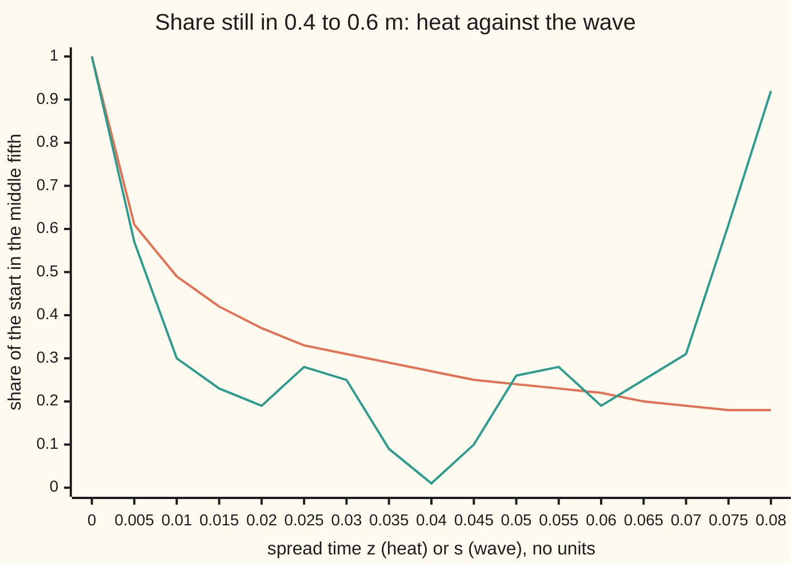

# Two evolutions: heat smooths at once, waves only rotate

[Syllabus](../../../SYLLABUS.md) → [Functional analysis](../README.md) → [Unbounded Operators and Semigroups](../README.md#s05) → Two evolutions

---

## General Overview

A metal bar 1 m long has both ends in iced water, so they stay at 0 °C. A torch has just heated its middle 20 cm, from 0.4 m to 0.6 m, to 100 °C. The rest of the bar is still at 0 °C. Call this the **struck bar**.

Take the same shape and read it as a quantum wave instead: one electron, trapped in a box, sitting in the middle fifth. Call this the **pulse**.

Both are pushed by the same operator: minus the second derivative, the "bend" of the profile. Both use the same modes (sine-shaped standing patterns). The difference is one letter, the square root of −1.

- **Heat** shrinks every mode. After 60 s the middle of the bar is at 63.87 °C, the sharp edges are gone, and the profile is smooth. It cannot be run backwards.
- **The wave** only turns every mode, like the hand of a clock. Its total size never changes and its sharp edges never smooth. At one moment it splits into two copies, a quarter and three quarters of the way along, each holding half the chance; then it comes back whole.

**Heat multiplies mode n by a shrinking real number, so it smooths at once and runs forward only; the Schrödinger equation multiplies mode n by a complex number of size 1, so it keeps every size, never smooths, and runs both ways. The generators (the rates of change at time 0) are the second derivative and i times it ($`-A`$ and $`-iA`$, with $`A = -d^2/dx^2`$), on the same domain.**

**What kind of fact this is:** theorems. Smoothing, the size bounds and both generators are proved on this card for the bar, in Why it works. Stone's theorem (every size-keeping evolution comes from a self-adjoint operator) is stated with its source, and its proof is sketched in a fold.

### The picture: what stays in the middle fifth



Orange: the share of the starting heat still in the middle fifth, from 2000 modes. It only falls. Teal: the chance of finding the pulse in the middle fifth, from 199 modes. It falls, swings, and climbs back to 0.92; the full return is at s = 0.079577, just before the last point.

---

## The formula

Notation first, in words. The bar runs from x = 0 to x = 1 m. A profile u has **size** $`\lVert u\rVert = \big(\int_0^1 \lvert u\rvert^2\,dx\big)^{1/2}`$, the $`L^2`$ norm; profiles of finite size form the Hilbert space $`L^2(0,1)`$. The inner product conjugates its first slot, as wing 07's $`v^*w`$ does.

The operator is $`Au = -u''`$, minus the second derivative, on the domain $`D(A)`$ of profiles that are zero at both ends and whose bend $`Au`$ has finite size ([Unbounded operators](01-unbounded-operators-and-domains.md)). It is self-adjoint ([Self-adjoint extensions](02-self-adjoint-extensions-and-the-spectral-theorem.md)), with modes and eigenvalues

```math
e_n(x) = \sqrt2\,\sin(n\pi x), \qquad A e_n = \lambda_n e_n, \qquad \lambda_n = n^2\pi^2 .
```

A profile is a list of mode amounts, $`u = \sum_n c_n e_n`$ with $`c_n = \langle e_n, u\rangle`$. The two evolutions act on that list:

```math
T(z)\,u = \sum_n e^{-\lambda_n z}\, c_n\, e_n, \qquad U(s)\,u = \sum_n e^{-i\lambda_n s}\, c_n\, e_n .
```

**Read it aloud:** heat after spread time z shrinks mode n by e to the minus lambda-n z; the wave after time s turns mode n by the angle lambda-n s.

Their **generators** are the rates of change at time 0:

```math
\lim_{z \to 0^+} \frac{T(z)u - u}{z} = -Au, \qquad \lim_{s \to 0} \frac{U(s)u - u}{s} = -iAu, \qquad u \in D(A).
```

**Read it aloud:** heat starts changing at rate minus A u; the wave starts changing at rate minus i A u; both limits exist exactly for profiles in A's domain.

So $`T(z) = e^{-zA}`$ and $`U(s) = e^{-isA}`$. Mind the sign: $`A`$ itself is not a generator here. It is minus the second derivative, a positive operator (every $`\lambda_n > 0`$), and heat's generator is $`-A`$, the second derivative. [Splitting](07-operator-splitting-and-the-trotter-formula.md) and [Feller semigroups](08-feller-semigroups-and-markov-processes.md) use the letter $`A`$ for the generator itself. This card introduces the notation $`e^{itA}`$, for a self-adjoint A, for such a size-keeping family; the wave is the same family with the sign of time flipped.

| Symbol | Plain meaning | In our example | Push it up and the answer… |
| --- | --- | --- | --- |
| $`x`$, $`L`$, $`\xi`$, $`\hat f`$ | position along the bar, in m; the bar's length; on the endless line (Step 7), a spatial frequency and the Fourier transform | 0 to 1; L = 1 m | — |
| $`f`$, $`u`$, $`\psi`$, $`g`$ | the start; a profile later; the wave; a smooth test profile | f = 100 °C on 0.4 < x < 0.6; g = 400x(1 − x) | — |
| $`A`$, $`D(A)`$ | minus the second derivative, in 1/m²; its domain | ends held at 0 | — |
| $`e_n`$, $`\lambda_n`$ | mode n of size 1; its eigenvalue | $`\sqrt2\sin(n\pi x)`$, $`n^2\pi^2`$ | faster decay or faster turning |
| $`c_n`$ | amount of mode n in the start | $`c_1`$ = 27.821304 | — |
| $`\kappa`$, $`t`$ | heat diffusivity, in m²/s; time, in s | $`10^{-4}`$ (illustrative, about copper's); 60 s | heat spreads further |
| $`z`$ | heat's spread time $`\kappa t/L^2`$, no units | 0.006 | more smoothing, less heat |
| $`s`$, $`\hbar`$, $`m`$ | the wave's time $`\hbar t/(2mL^2)`$, no units; Planck's constant over 2π; the particle's mass | 0.006; electron, $`\hbar/2m`$ = 5.788382e-05 m²/s | more turning, size unchanged |
| $`T(z)`$ | the heat semigroup $`e^{-zA}`$ | middle at 63.8690 °C after z = 0.006 | — |
| $`U(s)`$ | the Schrödinger group $`e^{-isA}`$ | middle-fifth chance 0.5149 after s = 0.006, with 199 modes | — |
| $`\lVert u\rVert`$, $`\lVert Au\rVert`$ | size and bend size of a profile, in °C·m^½ and °C·m^(−3/2) | $`\lVert f\rVert = \sqrt{2000}`$ = 44.721360; $`\lVert Af\rVert = \infty`$ | — |
| $`i`$, $`e`$, $`N`$, $`h`$ | square root of −1; Euler's number, the base of natural logarithms; grid points or modes kept; grid spacing 1/(N + 1) | N = 99, 399, 1599 points | truncation error falls |

### When it holds

- **A self-adjoint A.** On the bar, the self-adjoint A has a full list of modes of size 1, at right angles to each other, with real eigenvalues; the real eigenvalues are what make every multiplier $`e^{-i\lambda_n s}`$ of size 1. With no end conditions, A has the eigenvalue i ([Self-adjoint extensions](02-self-adjoint-extensions-and-the-spectral-theorem.md)), and no size-keeping $`e^{-isA}`$ exists.
- **A bounded below.** Heat needs $`\lambda_n \ge 0`$, or at least bounded below. Flip the sign of A and heat runs backward: mode 21 grows by 2.1958e+11 in 60 s.
- **Forward time for heat only.** $`T(z)`$ exists for z ≥ 0 only. $`U(s)`$ exists for every real s, forward and back.
- **The domain for the rate.** The rate $`-iAu`$ exists only for u in $`D(A)`$. For the struck bar the difference quotient $`(U(s)f - f)/s`$ grows without limit as s shrinks: 4.8351e+03, 2.1688e+04, 1.2639e+05.

---

## Why it works

### Step 0: same modes, different multipliers

Both evolutions solve "the rate of change is a fixed multiple of A". On a mode, A is just the number $`\lambda_n`$. So each mode obeys its own one-line equation, and its solution is an exponential. Heat's exponent is real and negative, so each mode shrinks. The wave's exponent is purely imaginary, so each mode turns and keeps its size. Everything else follows from those two kinds of number.

### Step 1: the heat semigroup and its generator

The heat equation for the bar, $`u_t = \kappa u_{xx}`$, is $`u_t = -\kappa A u`$ ([The heat equation](../../08-Differential%20equations%20and%20dynamics/10-The%20Classical%20PDEs/03-the-heat-equation.md)). In spread time $`z = \kappa t/L^2`$, which is $`\kappa t`$ in numbers for this 1 m bar, it reads $`u_z = -Au`$. Mode n then solves $`c_n' = -\lambda_n c_n`$, so it carries $`e^{-\lambda_n z} c_n`$.

These operators form a **semigroup** ([Semigroups](04-strongly-continuous-semigroups.md)): $`T(0) = I`$ and $`T(z_1)T(z_2) = T(z_1 + z_2)`$, because exponents add. Each multiplier is at most $`e^{-\pi^2 z}`$, so $`\lVert T(z)\rVert = e^{-\pi^2 z}`$ = 0.942502 at z = 0.006. In the shelf's notation $`\lVert T(t)\rVert \le Me^{\omega t}`$, that is M = 1 and ω = −κπ². The generator is −A, and Hille-Yosida's resolvent test holds because $`\lambda_n \ge 0`$ ([Hille-Yosida](05-hille-yosida-and-generators.md)).

### Step 2: heat smooths at once

The bend of $`T(z)f`$ has size $`\lVert A\,T(z)f\rVert^2 = \sum_n \lambda_n^2 e^{-2\lambda_n z}\lvert c_n\rvert^2`$. The function $`\lambda e^{-\lambda z}`$ peaks at $`\lambda = 1/z`$, where it equals $`1/(ez)`$. So

```math
\lVert A\,T(z)\rVert \le \frac{1}{e\,z}, \qquad \lVert A\,T(z) f\rVert \le \frac{\lVert f\rVert}{e\,z} \quad \text{for every } f .
```

**Read it aloud:** after spread time z, any profile, however rough, has a bend no larger than its size over e times z.

The struck bar has no finite bend at the start: its edges are jumps. At z = 0.006 its bend is 1663.6209, under the bound 2742.0115. The largest multiplier $`\lambda_n e^{-\lambda_n z}`$ over the actual modes is 61.2257, just under $`1/(ez)`$ = 61.3132.

The same argument works for every power: $`\lambda^k e^{-\lambda z}`$ is bounded too. So $`T(z)f`$ lies in the domain of every power of A, and it has derivatives of every order. That is "smooths at once".

The bound also holds for complex z with positive real part, since $`\lvert e^{-\lambda z}\rvert = e^{-\lambda\,\mathrm{Re}\,z}`$. A semigroup that extends this way into a wedge of complex times is called **analytic**. The heat semigroup is analytic; the wave lives on the edge of that wedge, z = is, where the bound $`1/(e\,\mathrm{Re}\,z)`$ becomes infinite.

### Step 3: the Schrödinger group keeps every size

With no potential, Schrödinger's equation ([Schrodinger's equation](../../13-Engineering%20mathematics/09-Quantum%20Mechanics%20in%20Outline/03-schrodinger-equation-and-the-particle-in-a-box.md)) is $`i\hbar\psi_t = (\hbar^2/2m)A\psi`$. In the scaled time $`s = \hbar t/(2mL^2)`$, with x measured in box lengths, it reads $`\psi_s = -iA\psi`$. Mode n carries $`e^{-i\lambda_n s}c_n`$.

Every multiplier has size exactly 1. So:

- $`\lVert U(s)\psi\rVert = \lVert\psi\rVert`$: the total chance stays 1. An operator that keeps every size and is onto is **unitary**.
- $`U(-s) = U(s)^{-1} = U(s)^*`$: the wave runs backward as easily as forward. The family is a **group**, not just a semigroup.
- $`\lVert A^k U(s)\psi\rVert = \lVert A^k\psi\rVert`$ for every power k: no smoothing, and no roughening.

The wave still moves. Its chance of being in the middle fifth drops from 1 to 0.5149 by s = 0.006, counting 199 modes; more modes still move the third decimal (see Try changing). What it cannot change is how much sits in each mode.

### Step 4: the generator, and only on the domain

For the wave, $`(U(s)u - u)/s`$ has mode amounts $`\big((e^{-i\lambda_n s} - 1)/s\big)c_n`$. Each tends to $`-i\lambda_n c_n`$ as s → 0. The whole list converges in size exactly when $`\sum \lambda_n^2\lvert c_n\rvert^2`$ is finite, which is the condition for u to be in $`D(A)`$.

The checks test both sides. The smooth profile g = 400x(1 − x) is in $`D(A)`$, with Ag = 800. Its quotient's error $`\lVert(U(s)g - g)/s + iAg\rVert`$ falls: 286.2870, 160.3385, 89.6697 at s = 1e-02, 1e-03, 1e-04. The struck bar is not in $`D(A)`$, and its quotient, summed over 20000 modes, grows: 4.8351e+03, 2.1688e+04, 1.2639e+05.

### Step 5: Stone's theorem runs the other way

Step 3 built a unitary group from a self-adjoint A. Marshall Stone proved in 1932 that nothing else is possible.

**Stone's theorem.** If $`U(s)`$, for every real s, is a unitary operator on a Hilbert space, with $`U(0) = I`$, $`U(s_1)U(s_2) = U(s_1 + s_2)`$ and $`U(s)u \to u`$ in size as s → 0, then there is exactly one self-adjoint A with $`U(s) = e^{-isA}`$.

So every size-keeping, reversible evolution is a Schrödinger equation for some self-adjoint "energy" A. That is why quantum mechanics insists that energy be self-adjoint.

<details>
<summary>Proof sketch of Stone's theorem</summary>

Define B as the rate $`\lim (U(s)u - u)/s`$, on the set of u where it exists. Smoothing by an average, $`\int_0^\varepsilon U(r)u\,dr/\varepsilon`$, puts every u near this set, so the set is dense.

Unitarity gives $`U(s)^* = U(-s)`$. Differentiating $`\langle U(s)u, U(s)v\rangle = \langle u, v\rangle`$ at s = 0 gives $`\langle Bu, v\rangle + \langle u, Bv\rangle = 0`$. So A = iB satisfies $`\langle Au, v\rangle = \langle u, Av\rangle`$: A is symmetric.

For the ±i test ([Self-adjoint extensions](02-self-adjoint-extensions-and-the-spectral-theorem.md)), the integral

$`\displaystyle R\,v = \int_0^\infty e^{-r}\,U(r)\,v\,dr`$

converges, since every $`U(r)`$ keeps size. Differentiating under the integral shows $`(I - B)Rv = v`$, so $`I - B`$ reaches every v; the same with $`U(-r)`$ handles $`I + B`$. In terms of A, both $`A + i`$ and $`A - i`$ are onto. By the ±i test, A is self-adjoint.

Finally both $`U(s)`$ and $`e^{-isA}`$ (built from A's spectral theorem) solve $`w' = -iAw`$ with the same start. The difference d has $`\frac{d}{ds}\lVert d\rVert^2 = 2\,\mathrm{Re}\,\langle d, -iAd\rangle = 0`$, since $`\langle d, Ad\rangle`$ is real. So the difference stays 0. The full proof is in Stone's paper and in Teschl's book, below.

</details>

### Step 6: the wave comes back

At $`s = 2/\pi`$ = 0.636620, every angle $`\lambda_n s = 2\pi n^2`$ is a whole number of turns. Every mode is back where it started, so $`U(2/\pi)\psi = \psi`$ for every start. This is a **revival**.

The pulse is quicker. It is symmetric about the middle, so only odd modes appear. For odd n, $`n^2 - 1`$ is a multiple of 8, so at $`s = 1/(4\pi)`$ = 0.079577 every odd mode has turned by the same angle plus whole turns. The pulse returns whole: middle-fifth chance 0.997532, the same as at the start with 199 modes. Halfway, at s = 0.039789, none of it is in the middle fifth. It sits in two copies centred at x = 0.25 and x = 0.75. Each is $`1/\sqrt2`$ as tall as the start, so each holds half the chance: height 70.64 with 2000 modes, against the exact $`100/\sqrt2`$ = 70.71.

Heat has no such return. At z = 1/(4π), mode 1 keeps only $`e^{-\pi/4}`$ = 0.455938 of its amount, and the middle fifth holds 0.1767 of the starting heat.

### Step 7: what changes on the endless line

On a line with no ends, the modes become the waves $`e^{i\xi x}`$ of every spatial frequency ξ, and the mode amounts become the Fourier transform $`\hat f(\xi)`$. The size-keeping property of that transform is [Plancherel](../03-Bounded%20Operators/04-the-fourier-transform-as-a-unitary-operator.md). The story is the same: heat multiplies $`\hat f(\xi)`$ by $`e^{-\kappa\xi^2 t}`$, a bell-curve smoothing ([The heat kernel](../../08-Differential%20equations%20and%20dynamics/10-The%20Classical%20PDEs/10-the-heat-kernel.md)), and the wave multiplies it by $`e^{-i\xi^2 s}`$, size 1. Two things change. With no ends, the frequencies are not whole numbers, so the angles never line up again and there is no revival. And frequencies near 0 barely fade, so heat loses its decay rate: on the line $`\lVert T(z)\rVert = 1`$, not $`e^{-\pi^2 z}`$.

---

## Worked numbers, by hand

The middle of the struck bar after 60 s, z = 0.006. At x = 0.5 m each odd mode is $`\pm\sqrt2`$, and here every term comes out positive.

| Step | Arithmetic | Value |
| --- | --- | --- |
| spread time | $`10^{-4} \times 60`$ | z = 0.006 |
| mode 1's factor | $`e^{-\pi^2 \times 0.006}`$ | 0.942502 |
| mode 1 at the middle | $`27.821304 \times 0.942502 \times \sqrt2`$ | 37.0830 °C |
| mode 3 | factor 0.586866, amount −24.279040, sign −1 | 20.1505 °C |
| mode 5 | factor 0.227537, amount 18.006326 | 5.7942 °C |
| modes 7 and 9 | factors 0.054932 and 0.008258 | 0.8083 and 0.0361 °C |
| five modes | sum | 63.8721 °C |
| 2000 modes | the full series | **63.8690 °C** |

The torch's 100 °C has fallen to 63.87 °C in the middle after one minute, and the grid agrees: 63.8717, 63.8691 and 63.8690 °C at 99, 399 and 1599 points. The wave at the same "time" keeps its size 44.710030, the start's own size over 2000 modes (the exact $`\sqrt{2000}`$ is 44.721360), while the heat's size has fallen to 30.128198.

### What breaks if you drop a piece

| Mistake | Comes out at | What went wrong |
| --- | --- | --- |
| Drop the i: run the pulse as heat | size 30.128198 after s = 0.006, not 44.710030 | Real multipliers shrink; only size-1 multipliers keep the total chance at 1 |
| Run heat backward 60 s | mode 21 multiplied by 2.1958e+11 | Backward heat fails Hille-Yosida's test; any speck of noise explodes |
| Expect the wave to smooth | bend cut at N = 1000 stays 8.1115e+06, as at the start | Every multiplier has size 1, so the high modes never fade |
| Apply the generator to the struck bar | quotient 4.8351e+03, 2.1688e+04, 1.2639e+05 as s shrinks | The bar is not in $`D(A)`$; the rate exists only on the domain |

---

## How it moves

The puzzle: both evolutions start from the same list of mode amounts. Why does one end smooth and the other end rough?

One story traced through time, the share of the start still in the middle fifth:

| Spread time z or s | Heat: share of starting heat | Wave: chance in the middle fifth (199 modes) |
| --- | --- | --- |
| 0 | 1.00 | 1.00 |
| 0.006 | 0.5776 | 0.5149 |
| 0.04 | 0.27 | 0.01 |
| 0.08 | 0.18 | 0.92 |

One force at a time: the mode sizes after z = s = 0.006. Heat cuts the high modes to nothing; the wave leaves every size where it was.

```
mode 1   heat ##########################   26.2216
mode 3   heat ##############               14.2485
mode 5   heat ####                         4.0971
mode 7   heat #                            0.5716
mode 9   heat                              0.0255
mode 11  heat                              0.0020
mode 13  heat                              0.0003
mode 15  heat                              0.0000

mode 1   wave ############################ 27.8213
mode 3   wave ########################     24.2790
mode 5   wave ##################           18.0063
mode 7   wave ##########                   10.4053
mode 9   wave ###                          3.0913
mode 11  wave ###                          2.5292
mode 13  wave ######                       5.6029
mode 15  wave ######                       6.0021
```

The wave's bars are the start's bars: a turn changes a mode's direction, not its size. The combined picture is the chart in the General Overview. Heat only falls. The wave's modes drift out of step and in again, so its middle-fifth chance swings and returns.

---

## Code, from first principles, and it actually runs

The code holds only the rehearsal. It takes three independent roads. The mode series uses the closed-form amounts, checked against Simpson's rule. A Crank-Nicolson grid steps both evolutions with one routine, using a real multiplier for heat and an imaginary one for the wave, with no modes at all. Invariants check both: Parseval's sum against $`\lVert f\rVert^2`$ = 2000, the wave's size kept to 1e-9, the smoothing bound, and the revival.

**What the truncation hides.** On N grid points, A becomes a symmetric matrix with every eigenvalue below $`4/h^2`$, h the spacing. So everything is bounded: backward heat exists, and the wave's bend is finite at every N. The infinite-dimensional facts show only as trends. The wave's bend goes 1.0000e+05, 8.0000e+05, 6.4000e+06 as N grows fourfold, never settling, while heat's settles at 1.6636e+03. Crank-Nicolson is the Cayley transform of the matrix: each step multiplies every grid mode by a fraction whose top and bottom, for the wave, are complex conjugates (mirror images across the real axis), so the fraction has size 1. So it keeps the wave's size and bend exactly at every N.

### Python

```python
# Two evolutions -- the check behind the card.  Standard library only.
# A 1 m bar, ends held at 0; A = -d^2/dx^2, modes e_n = sqrt2 sin(n pi x), eigenvalues lam_n = n^2 pi^2.
# Heat multiplies mode n by e^(-lam_n z), z = kappa t / L^2, L = 1 m.  The wave multiplies it by e^(-i lam_n s).
# Start: the struck bar, 100 C on 0.4 < x < 0.6 m and 0 C elsewhere; the pulse has the same shape.
import math
PI, S2, NM, Z = math.pi, math.sqrt(2.0), 2000, 0.006     # modes kept; z = s = 0.006 (60 s at kappa = 1e-4)
lam = [(n * PI) ** 2 for n in range(NM + 1)]
def coef(n):                               # <e_n, f> for the struck bar, closed form
    return 100 * S2 / (n * PI) * (math.cos(0.4 * n * PI) - math.cos(0.6 * n * PI))
c = [0.0] + [coef(n) for n in range(1, NM + 1)]
def heat(z):  return [c[n] * math.exp(-lam[n] * z) for n in range(NM + 1)]
def wave(s):  return [c[n] * complex(math.cos(lam[n] * s), -math.sin(lam[n] * s)) for n in range(NM + 1)]
def size(a, N=NM):  return math.sqrt(sum(abs(a[n]) ** 2 for n in range(1, N + 1)))
def bend(a, N=NM):  return math.sqrt(sum(lam[n] ** 2 * abs(a[n]) ** 2 for n in range(1, N + 1)))
def simpson(f, a, b, m=2000):
    h = (b - a) / m
    return (f(a) + f(b) + sum((4 if j % 2 else 2) * f(a + j * h) for j in range(1, m))) * h / 3
def gram(m, n):                            # int_0.4^0.6 e_m e_n dx, closed form
    F = lambda k, x: math.sin(k * PI * x) / (k * PI) if k else x
    return sum(sg * (F(k, 0.6) - F(k, 0.4)) for sg, k in ((1, abs(m - n)), (-1, m + n)))
def band(a, M=199):                        # share of |psi|^2 on 0.4 < x < 0.6, modes 1..M
    odd = range(1, M + 1, 2)
    num = sum((a[m].conjugate() * a[n]).real * gram(m, n) for m in odd for n in odd)
    return num / sum(abs(a[n]) ** 2 for n in odd)
print("struck bar: 100 C on 0.4 < x < 0.6 of a 1 m bar, ends held at 0 C; modes sqrt2 sin(n pi x)")
for n in (1, 3, 5):
    sim = simpson(lambda x: 100 * S2 * math.sin(n * PI * x), 0.4, 0.6)
    print(f"c_{n} = {c[n]:.6f} closed form, {sim:.6f} Simpson")
    assert abs(sim - c[n]) < 1e-9
print("Parseval: sum c_n^2 to N = 10, 100, 2000: " + ", ".join(f"{size(c, N)**2:.4f}" for N in (10, 100, 2000))
      + f"; exact 2000, size sqrt(2000) = {math.sqrt(2000):.6f}")
assert 0 < 2000 - size(c) ** 2 < 4000 / NM
def cn(N, q, s, steps=600):                # Crank-Nicolson: (I + q ds/2 A_N) u_new = (I - q ds/2 A_N) u
    h = 1.0 / (N + 1); xs = [(j + 1) * h for j in range(N)]
    u = [complex(100.0 if 0.4 + 1e-9 < x < 0.6 - 1e-9 else 50.0 if abs(abs(x - 0.5) - 0.1) < 1e-9 else 0.0) for x in xs]
    r, n0 = q * s / steps / (2 * h * h), math.sqrt(h * sum(abs(v) ** 2 for v in u))
    cp = [-r / (1 + 2 * r)]
    for j in range(1, N): cp.append(-r / (1 + 2 * r + r * cp[-1]))
    for _ in range(steps):
        d = [(1 - 2 * r) * u[j] + r * ((u[j - 1] if j else 0) + (u[j + 1] if j < N - 1 else 0)) for j in range(N)]
        dp = [d[0] / (1 + 2 * r)]
        for j in range(1, N): dp.append((d[j] + r * dp[-1]) / (1 + 2 * r + r * cp[j - 1]))
        u[N - 1] = dp[N - 1]
        for j in range(N - 2, -1, -1): u[j] = dp[j] - cp[j] * u[j + 1]
    w = [0.5 if abs(abs(x - 0.5) - 0.1) < 1e-9 else 1.0 if abs(x - 0.5) < 0.1 else 0.0 for x in xs]
    sz = math.sqrt(h * sum(abs(v) ** 2 for v in u))
    bd = math.sqrt(h * sum(abs(((u[j-1] if j else 0) - 2*u[j] + (u[j+1] if j < N-1 else 0)) / h**2) ** 2 for j in range(N)))
    return n0, sz, u[(N - 1) // 2].real, h * sum(wj * abs(v) ** 2 for wj, v in zip(w, u)) / sz ** 2, bd
print(f"finite rehearsal: Crank-Nicolson on N grid points, 600 steps to z = s = {Z}")
print("N      start size  heat: size  middle C   bend         wave: size  band share  bend")
grid = {}
for N in (99, 399, 1599):
    a0, ha, hm, _, hb = cn(N, 1.0, Z); b0, wa, _, wsh, wb = cn(N, 1j, Z)
    grid[N] = (hm, wsh, hb, wb)
    print(f"{N:<6} {a0:.6f}   {ha:.6f}   {hm:.4f}    {hb:.4e}   {wa:.6f}   {wsh:.4f}      {wb:.4e}")
    assert abs(wa - b0) < 1e-9 * b0 and ha < 0.95 * a0           # the wave keeps size exactly, heat loses it
H, W = heat(Z), wave(Z)
hmid = sum(H[n] * S2 * math.sin(n * PI * 0.5) for n in range(1, NM + 1))
hshare = lambda z: sum(c[n] ** 2 * math.exp(-lam[n] * z) for n in range(1, NM + 1)) / 2000
print(f"modes ({NM}): heat size {size(H):.6f}, middle {hmid:.4f} C, band share of heat {hshare(Z):.4f}, bend {bend(H):.4e}")
print(f"modes ({NM}): wave size {size(W):.6f}, band share (199 modes) {band(W):.4f}")
mt = [H[n] * S2 * math.sin(n * PI * 0.5) for n in (1, 3, 5, 7, 9)]
print("by hand, n = 1, 3, 5, 7, 9: e^(-lam_n z) = " + ", ".join(f"{math.exp(-lam[n] * Z):.6f}" for n in (1, 3, 5, 7, 9))
      + "; middle terms " + ", ".join(f"{v:.4f}" for v in mt) + f" C; sum {sum(mt):.4f} C")
assert abs(hmid - grid[1599][0]) < 0.01 and abs(band(W) - grid[1599][1]) < 0.01 and abs(size(W) - size(c)) < 1e-9
print("bend ||A u|| cut at N = 10, 100, 1000:")
print("  start ", ", ".join(f"{bend(c, N):.4e}" for N in (10, 100, 1000)))
print("  heat  ", ", ".join(f"{bend(H, N):.4e}" for N in (10, 100, 1000)))
print("  wave  ", ", ".join(f"{bend(W, N):.4e}" for N in (10, 100, 1000)))
assert bend(H, 1000) - bend(H, 100) < 1e-6 and bend(W, 1000) > 9 * bend(W, 100)
print("mode sizes |c_n| at z = s = 0.006:  n, start, heat, wave")
for n in (1, 3, 5, 7, 9, 11, 13, 15):
    print(f"  {n:<3} {abs(c[n]):.4f}  {abs(H[n]):.4f}  {abs(W[n]):.4f}")
best = max(lam[n] * math.exp(-lam[n] * Z) for n in range(1, NM + 1))
print(f"smoothing: max_n lam_n e^(-lam_n z) = {best:.4f} <= 1/(e z) = {1/(math.e*Z):.4f}; "
      f"||A T f|| = {bend(H):.4f} <= ||f||/(e z) = {math.sqrt(2000)/(math.e*Z):.4f}")
assert 1 / (math.e * Z) - best < 0.1 and bend(H) <= math.sqrt(2000) / (math.e * Z)   # mode 4 nearly attains 1/(e z)
print(f"contraction: ||T(z)|| = e^(-pi^2 z) = {math.exp(-PI**2*Z):.6f}; ||U(s)|| = 1 for every s, forward or back")
g = [0.0] + [1600 * S2 / (n * PI) ** 3 * (n % 2) for n in range(1, NM + 1)]   # g = 400 x(1 - x), A g = 800
print(f"Stone: g = 400x(1-x) is in D(A), ||A g|| by modes {bend(g):.4f} (exact 800)")
assert 0 < 800 - bend(g) < 0.1
eg0 = ef0 = None
for s in (1e-2, 1e-3, 1e-4):
    eg = math.sqrt(sum(abs(complex(math.cos(lam[n]*s) - 1, -math.sin(lam[n]*s)) / s + 1j * lam[n]) ** 2 * g[n] ** 2 for n in range(1, NM + 1)))
    ef = math.sqrt(sum(abs(complex(math.cos((n*PI)**2*s) - 1, -math.sin((n*PI)**2*s))) ** 2 / s ** 2 * coef(n) ** 2 for n in range(1, 20001)))
    print(f"  s = {s:.0e}: ||(U(s)g - g)/s + iAg|| = {eg:.4f};  struck bar ||(U(s)f - f)/s|| = {ef:.4e}")
    assert eg0 is None or (eg < 0.7 * eg0 and ef > 3 * ef0)
    eg0, ef0 = eg, ef
rev = max(abs(complex(math.cos(lam[n] * 2 / PI) - 1, math.sin(lam[n] * 2 / PI))) for n in range(1, NM + 1))
print(f"revival, any start: at s = 2/pi = {2/PI:.6f} every phase is back to 1 (max error below 1e-6)")
R = 1 / (4 * PI)                           # odd n only: n^2 - 1 is a multiple of 8
W2 = wave(R / 2)
p25, p75 = (abs(sum(W2[n] * S2 * math.sin(n * PI * x) for n in range(1, NM + 1))) for x in (0.25, 0.75))
print(f"revival, struck pulse: at s = 1/(4 pi) = {R:.6f} band share {band(wave(R)):.6f} = start {band(c):.6f}")
print(f"  halfway, s = {R/2:.6f}: band share {band(W2):.4f}; |psi| at 0.25 and 0.75 m = {p25:.2f}, {p75:.2f}; 100/sqrt2 = {100/S2:.2f}")
print(f"heat at z = 1/(4 pi): band share {hshare(R):.4f}; mode 1 keeps e^(-pi/4) = {math.exp(-PI/4):.6f}")
assert rev < 1e-6 and abs(band(wave(R)) - band(c)) < 1e-9 and band(W2) < 1e-3 and abs(p25 - 100 / S2) < 0.1 and abs(p75 - 100 / S2) < 0.1
hb, m = 6.62607015e-34 / (2 * PI), 9.1093837139e-31
print(f"electron: hbar/2m = {hb/(2*m):.6e} m^2/s; 1 nm box: one unit of s = {1e-18/(hb/(2*m))*1e15:.4f} fs, "
      f"so s = 0.006 is {0.006e-3/(hb/(2*m)):.4f} fs and 1/(4 pi) is {R*1e-3/(hb/(2*m)):.4f} fs")
print(f"mistake: wave without the i: size {size(H):.6f} after s = 0.006, not {size(W):.6f}")
print(f"mistake: heat run back 60 s: mode 21 multiplied by {math.exp(lam[21]*Z):.4e}")
print("chart, z or s = 0, 0.005, ..., 0.08: heat share in 0.4..0.6; wave band share")
zs = [0.005 * k for k in range(17)]
print("  heat:", ", ".join(f"{hshare(z):.2f}" for z in zs))
print("  wave:", ", ".join(f"{band(wave(z)):.2f}" for z in zs))
print("ALL CHECKS PASS")
```

**Ran 2026-11-15 on macOS, Python 3.14.10, standard library only. All checks passed. Output, pasted from the run:**

```
struck bar: 100 C on 0.4 < x < 0.6 of a 1 m bar, ends held at 0 C; modes sqrt2 sin(n pi x)
c_1 = 27.821304 closed form, 27.821304 Simpson
c_3 = -24.279040 closed form, -24.279040 Simpson
c_5 = 18.006326 closed form, 18.006326 Simpson
Parseval: sum c_n^2 to N = 10, 100, 2000: 1805.5507, 1979.7459, 1998.9868; exact 2000, size sqrt(2000) = 44.721360
finite rehearsal: Crank-Nicolson on N grid points, 600 steps to z = s = 0.006
N      start size  heat: size  middle C   bend         wave: size  band share  bend
99     44.158804   30.124731   63.8717    1.6621e+03   44.158804   0.4929      1.0000e+05
399    44.581386   30.127981   63.8691    1.6635e+03   44.581386   0.5135      8.0000e+05
1599   44.686407   30.128184   63.8690    1.6636e+03   44.686407   0.5202      6.4000e+06
modes (2000): heat size 30.128198, middle 63.8690 C, band share of heat 0.5776, bend 1.6636e+03
modes (2000): wave size 44.710030, band share (199 modes) 0.5149
by hand, n = 1, 3, 5, 7, 9: e^(-lam_n z) = 0.942502, 0.586866, 0.227537, 0.054932, 0.008258; middle terms 37.0830, 20.1505, 5.7942, 0.8083, 0.0361 C; sum 63.8721 C
bend ||A u|| cut at N = 10, 100, 1000:
  start  7.4763e+03, 2.5632e+05, 8.1115e+06
  heat   1.6636e+03, 1.6636e+03, 1.6636e+03
  wave   7.4763e+03, 2.5632e+05, 8.1115e+06
mode sizes |c_n| at z = s = 0.006:  n, start, heat, wave
  1   27.8213  26.2216  27.8213
  3   24.2790  14.2485  24.2790
  5   18.0063  4.0971  18.0063
  7   10.4053  0.5716  10.4053
  9   3.0913  0.0255  3.0913
  11  2.5292  0.0020  2.5292
  13  5.6029  0.0003  5.6029
  15  6.0021  0.0000  6.0021
smoothing: max_n lam_n e^(-lam_n z) = 61.2257 <= 1/(e z) = 61.3132; ||A T f|| = 1663.6209 <= ||f||/(e z) = 2742.0115
contraction: ||T(z)|| = e^(-pi^2 z) = 0.942502; ||U(s)|| = 1 for every s, forward or back
Stone: g = 400x(1-x) is in D(A), ||A g|| by modes 799.9189 (exact 800)
  s = 1e-02: ||(U(s)g - g)/s + iAg|| = 286.2870;  struck bar ||(U(s)f - f)/s|| = 4.8351e+03
  s = 1e-03: ||(U(s)g - g)/s + iAg|| = 160.3385;  struck bar ||(U(s)f - f)/s|| = 2.1688e+04
  s = 1e-04: ||(U(s)g - g)/s + iAg|| = 89.6697;  struck bar ||(U(s)f - f)/s|| = 1.2639e+05
revival, any start: at s = 2/pi = 0.636620 every phase is back to 1 (max error below 1e-6)
revival, struck pulse: at s = 1/(4 pi) = 0.079577 band share 0.997532 = start 0.997532
  halfway, s = 0.039789: band share 0.0000; |psi| at 0.25 and 0.75 m = 70.64, 70.64; 100/sqrt2 = 70.71
heat at z = 1/(4 pi): band share 0.1767; mode 1 keeps e^(-pi/4) = 0.455938
electron: hbar/2m = 5.788382e-05 m^2/s; 1 nm box: one unit of s = 17.2760 fs, so s = 0.006 is 0.1037 fs and 1/(4 pi) is 1.3748 fs
mistake: wave without the i: size 30.128198 after s = 0.006, not 44.710030
mistake: heat run back 60 s: mode 21 multiplied by 2.1958e+11
chart, z or s = 0, 0.005, ..., 0.08: heat share in 0.4..0.6; wave band share
  heat: 1.00, 0.61, 0.49, 0.42, 0.37, 0.33, 0.31, 0.29, 0.27, 0.25, 0.24, 0.23, 0.22, 0.20, 0.19, 0.18, 0.18
  wave: 1.00, 0.57, 0.30, 0.23, 0.19, 0.28, 0.25, 0.09, 0.01, 0.10, 0.26, 0.28, 0.19, 0.25, 0.31, 0.61, 0.92
ALL CHECKS PASS
```

### Rust

Same numbers, same labels, built with `rustc --edition 2021 -O`.

```rust
// Two evolutions -- the same check as the Python, in Rust.  No crates.
// A 1 m bar, ends held at 0; A = -d^2/dx^2, modes e_n = sqrt2 sin(n pi x), eigenvalues lam_n = n^2 pi^2.
// Heat multiplies mode n by e^(-lam_n z), z = kappa t / L^2, L = 1 m.  The wave multiplies it by e^(-i lam_n s).
// Start: the struck bar, 100 C on 0.4 < x < 0.6 m and 0 C elsewhere; the pulse has the same shape.
use std::f64::consts::{E, PI};
use std::ops::{Add, Div, Mul, Sub};

#[derive(Clone, Copy)]
struct C { re: f64, im: f64 }                // a complex number
fn cx(re: f64, im: f64) -> C { C { re, im } }
impl Add for C { type Output = C; fn add(self, o: C) -> C { cx(self.re + o.re, self.im + o.im) } }
impl Sub for C { type Output = C; fn sub(self, o: C) -> C { cx(self.re - o.re, self.im - o.im) } }
impl Mul for C { type Output = C; fn mul(self, o: C) -> C { cx(self.re * o.re - self.im * o.im, self.re * o.im + self.im * o.re) } }
impl Div for C { type Output = C; fn div(self, b: C) -> C {   // Smith's method, as Python does it
    if b.re.abs() >= b.im.abs() { let (t, d) = (b.im / b.re, b.re + b.im * (b.im / b.re));
        cx((self.re + self.im * t) / d, (self.im - self.re * t) / d) }
    else { let (t, d) = (b.re / b.im, b.re * (b.re / b.im) + b.im); cx((self.re * t + self.im) / d, (self.im * t - self.re) / d) } } }
impl C { fn sc(self, k: f64) -> C { cx(self.re * k, self.im * k) } fn ab(self) -> f64 { self.re.hypot(self.im) }
    fn dr(self, k: f64) -> C { cx(self.re / k, self.im / k) } }

fn nsum(it: impl Iterator<Item = f64>) -> f64 {   // compensated sum, as Python's sum() does it
    let (mut s, mut c) = (0.0f64, 0.0f64);
    for x in it { let t = s + x; if s.abs() >= x.abs() { c += (s - t) + x } else { c += (x - t) + s } s = t; }
    if c != 0.0 && c.is_finite() { s + c } else { s }
}
fn csum(v: &[C]) -> C { cx(nsum(v.iter().map(|z| z.re)), nsum(v.iter().map(|z| z.im))) }
fn sci(x: f64, d: usize) -> String {       // Python's {:.de}: two-digit signed exponent
    let s = format!("{:.*e}", d, x);
    let (m, e) = s.split_once('e').unwrap();
    let e: i32 = e.parse().unwrap();
    format!("{}e{}{:02}", m, if e < 0 { '-' } else { '+' }, e.abs())
}
const S2: f64 = std::f64::consts::SQRT_2;
const NM: usize = 2000;
const Z: f64 = 0.006;
fn coef(n: usize) -> f64 { let nf = n as f64; 100.0 * S2 / (nf * PI) * ((0.4 * nf * PI).cos() - (0.6 * nf * PI).cos()) }
fn lam(n: usize) -> f64 { (n as f64 * PI).powf(2.0) }
fn size(a: &[C], n: usize) -> f64 { nsum((1..=n).map(|k| a[k].ab().powf(2.0))).sqrt() }
fn bend(a: &[C], n: usize) -> f64 { nsum((1..=n).map(|k| lam(k).powf(2.0) * a[k].ab().powf(2.0))).sqrt() }
fn simpson(f: &dyn Fn(f64) -> f64, a: f64, b: f64, m: usize) -> f64 {
    let h = (b - a) / m as f64;
    (f(a) + f(b) + nsum((1..m).map(|j| (if j % 2 == 1 { 4.0 } else { 2.0 }) * f(a + j as f64 * h)))) * h / 3.0
}
fn gram(m: usize, n: usize) -> f64 {        // int_0.4^0.6 e_m e_n dx, closed form
    let f = |k: usize, x: f64| if k > 0 { (k as f64 * PI * x).sin() / (k as f64 * PI) } else { x };
    let k1 = if m > n { m - n } else { n - m };
    nsum([f(k1, 0.6) - f(k1, 0.4), -(f(m + n, 0.6) - f(m + n, 0.4))].into_iter())
}
fn band(a: &[C]) -> f64 {                  // share of |psi|^2 on 0.4 < x < 0.6, odd modes 1..199
    let num = nsum((1..200).step_by(2).flat_map(|m| (1..200).step_by(2).map(move |n| (m, n)))
        .map(|(m, n)| (a[m].re * a[n].re + a[m].im * a[n].im) * gram(m, n)));
    num / nsum((1..200).step_by(2).map(|n| a[n].ab().powf(2.0)))
}
fn cn(n: usize, q: C, s: f64) -> (f64, f64, f64, f64, f64) {   // Crank-Nicolson, 600 steps
    let h = 1.0 / (n as f64 + 1.0);
    let xs: Vec<f64> = (0..n).map(|j| (j as f64 + 1.0) * h).collect();
    let edge = |x: f64| ((x - 0.5).abs() - 0.1).abs() < 1e-9;
    let mut u: Vec<C> = xs.iter().map(|&x| cx(if 0.4 + 1e-9 < x && x < 0.6 - 1e-9 { 100.0 } else if edge(x) { 50.0 } else { 0.0 }, 0.0)).collect();
    let nrm = |u: &[C]| (h * nsum(u.iter().map(|v| v.ab().powf(2.0)))).sqrt();
    let (r, n0) = (cx(q.re * s / 600.0 / (2.0 * h * h), q.im * s / 600.0 / (2.0 * h * h)), nrm(&u));
    let (one, two) = (cx(1.0, 0.0), cx(2.0, 0.0));
    let mr = cx(-r.re, -r.im);
    let mut cp = vec![mr / (one + two * r)];
    for j in 1..n { let v = mr / (one + two * r + r * cp[j - 1]); cp.push(v); }
    let z0 = cx(0.0, 0.0);
    for _ in 0..600 {
        let d: Vec<C> = (0..n).map(|j| (one - two * r) * u[j] + r * ((if j > 0 { u[j - 1] } else { z0 }) + (if j < n - 1 { u[j + 1] } else { z0 }))).collect();
        let mut dp = vec![d[0] / (one + two * r)];
        for j in 1..n { let v = (d[j] + r * dp[j - 1]) / (one + two * r + r * cp[j - 1]); dp.push(v); }
        u[n - 1] = dp[n - 1];
        for j in (0..n - 1).rev() { u[j] = dp[j] - cp[j] * u[j + 1]; }
    }
    let w: Vec<f64> = xs.iter().map(|&x| if edge(x) { 0.5 } else if (x - 0.5).abs() < 0.1 { 1.0 } else { 0.0 }).collect();
    let sz = nrm(&u);
    let bd = (h * nsum((0..n).map(|j| (((if j > 0 { u[j - 1] } else { z0 }) - two * u[j] + (if j < n - 1 { u[j + 1] } else { z0 })).dr(h.powf(2.0))).ab().powf(2.0)))).sqrt();
    (n0, sz, u[(n - 1) / 2].re, h * nsum((0..n).map(|j| w[j] * u[j].ab().powf(2.0))) / sz.powf(2.0), bd)
}

fn main() {
    let c: Vec<C> = (0..=NM).map(|n| cx(if n > 0 { coef(n) } else { 0.0 }, 0.0)).collect();
    let heat = |z: f64| -> Vec<C> { (0..=NM).map(|n| c[n].sc((-lam(n) * z).exp())).collect() };
    let wave = |s: f64| -> Vec<C> { (0..=NM).map(|n| cx(c[n].re * (lam(n) * s).cos(), c[n].re * -(lam(n) * s).sin())).collect() };
    let hshare = |z: f64| nsum((1..=NM).map(|n| c[n].re.powf(2.0) * (-lam(n) * z).exp())) / 2000.0;
    let at = |a: &[C], x: f64| csum(&(1..=NM).map(|n| a[n].sc(S2).sc((n as f64 * PI * x).sin())).collect::<Vec<C>>());
    println!("struck bar: 100 C on 0.4 < x < 0.6 of a 1 m bar, ends held at 0 C; modes sqrt2 sin(n pi x)");
    for n in [1usize, 3, 5] {
        let sim = simpson(&|x| 100.0 * S2 * (n as f64 * PI * x).sin(), 0.4, 0.6, 2000);
        println!("c_{} = {:.6} closed form, {:.6} Simpson", n, c[n].re, sim);
        assert!((sim - c[n].re).abs() < 1e-9);
    }
    let p: Vec<String> = [10usize, 100, 2000].iter().map(|&n| format!("{:.4}", size(&c, n).powf(2.0))).collect();
    println!("Parseval: sum c_n^2 to N = 10, 100, 2000: {}; exact 2000, size sqrt(2000) = {:.6}", p.join(", "), 2000f64.sqrt());
    assert!(2000.0 - size(&c, NM).powf(2.0) > 0.0 && 2000.0 - size(&c, NM).powf(2.0) < 4000.0 / NM as f64);
    println!("finite rehearsal: Crank-Nicolson on N grid points, 600 steps to z = s = {}", Z);
    println!("N      start size  heat: size  middle C   bend         wave: size  band share  bend");
    let mut grid = (0.0, 0.0);
    for n in [99usize, 399, 1599] {
        let (a0, ha, hm, _, hb) = cn(n, cx(1.0, 0.0), Z);
        let (b0, wa, _, wsh, wb) = cn(n, cx(0.0, 1.0), Z);
        grid = (hm, wsh);
        println!("{:<6} {:.6}   {:.6}   {:.4}    {}   {:.6}   {:.4}      {}", n, a0, ha, hm, sci(hb, 4), wa, wsh, sci(wb, 4));
        assert!((wa - b0).abs() < 1e-9 * b0 && ha < 0.95 * a0);   // the wave keeps size exactly, heat loses it
    }
    let (h, w) = (heat(Z), wave(Z));
    let hmid = at(&h, 0.5).re;
    println!("modes ({}): heat size {:.6}, middle {:.4} C, band share of heat {:.4}, bend {}", NM, size(&h, NM), hmid, hshare(Z), sci(bend(&h, NM), 4));
    println!("modes ({}): wave size {:.6}, band share (199 modes) {:.4}", NM, size(&w, NM), band(&w));
    let mt: Vec<f64> = [1usize, 3, 5, 7, 9].iter().map(|&n| h[n].re * S2 * (n as f64 * PI * 0.5).sin()).collect();
    let fs: Vec<String> = [1usize, 3, 5, 7, 9].iter().map(|&n| format!("{:.6}", (-lam(n) * Z).exp())).collect();
    let ms: Vec<String> = mt.iter().map(|v| format!("{:.4}", v)).collect();
    println!("by hand, n = 1, 3, 5, 7, 9: e^(-lam_n z) = {}; middle terms {} C; sum {:.4} C", fs.join(", "), ms.join(", "), nsum(mt.iter().cloned()));
    assert!((hmid - grid.0).abs() < 0.01 && (band(&w) - grid.1).abs() < 0.01 && (size(&w, NM) - size(&c, NM)).abs() < 1e-9);
    println!("bend ||A u|| cut at N = 10, 100, 1000:");
    for (name, a) in [("start ", &c), ("heat  ", &h), ("wave  ", &w)] {
        let v: Vec<String> = [10usize, 100, 1000].iter().map(|&n| sci(bend(a, n), 4)).collect();
        println!("  {} {}", name, v.join(", "));
    }
    assert!(bend(&h, 1000) - bend(&h, 100) < 1e-6 && bend(&w, 1000) > 9.0 * bend(&w, 100));
    println!("mode sizes |c_n| at z = s = 0.006:  n, start, heat, wave");
    for n in (1..16).step_by(2) { println!("  {:<3} {:.4}  {:.4}  {:.4}", n, c[n].ab(), h[n].ab(), w[n].ab()); }
    let best = (1..=NM).map(|n| lam(n) * (-lam(n) * Z).exp()).fold(f64::MIN, f64::max);
    let fb = 2000f64.sqrt() / (E * Z);
    println!("smoothing: max_n lam_n e^(-lam_n z) = {:.4} <= 1/(e z) = {:.4}; ||A T f|| = {:.4} <= ||f||/(e z) = {:.4}", best, 1.0 / (E * Z), bend(&h, NM), fb);
    assert!(1.0 / (E * Z) - best < 0.1 && bend(&h, NM) <= fb);   // mode 4 nearly attains 1/(e z)
    println!("contraction: ||T(z)|| = e^(-pi^2 z) = {:.6}; ||U(s)|| = 1 for every s, forward or back", (-PI.powf(2.0) * Z).exp());
    let g: Vec<C> = (0..=NM).map(|n| cx(if n > 0 { 1600.0 * S2 / (n as f64 * PI).powf(3.0) * (n % 2) as f64 } else { 0.0 }, 0.0)).collect();
    println!("Stone: g = 400x(1-x) is in D(A), ||A g|| by modes {:.4} (exact 800)", bend(&g, NM));
    assert!(800.0 - bend(&g, NM) > 0.0 && 800.0 - bend(&g, NM) < 0.1);
    let (mut eg0, mut ef0) = (f64::NAN, f64::NAN);
    for s in [1e-2f64, 1e-3, 1e-4] {
        let eg = nsum((1..=NM).map(|n| cx(((lam(n) * s).cos() - 1.0) / s, -(lam(n) * s).sin() / s + lam(n)).ab().powf(2.0) * g[n].re.powf(2.0))).sqrt();
        let ef = nsum((1..=20000usize).map(|n| { let l = (n as f64 * PI).powf(2.0) * s;
            cx(l.cos() - 1.0, -l.sin()).ab().powf(2.0) / s.powf(2.0) * coef(n).powf(2.0) })).sqrt();
        println!("  s = {}: ||(U(s)g - g)/s + iAg|| = {:.4};  struck bar ||(U(s)f - f)/s|| = {}", sci(s, 0), eg, sci(ef, 4));
        assert!(eg0.is_nan() || (eg < 0.7 * eg0 && ef > 3.0 * ef0));
        eg0 = eg; ef0 = ef;
    }
    let rev = (1..=NM).map(|n| cx((lam(n) * 2.0 / PI).cos() - 1.0, (lam(n) * 2.0 / PI).sin()).ab()).fold(0.0, f64::max);
    println!("revival, any start: at s = 2/pi = {:.6} every phase is back to 1 (max error below 1e-6)", 2.0 / PI);
    let r = 1.0 / (4.0 * PI);                // odd n only: n^2 - 1 is a multiple of 8
    let w2 = wave(r / 2.0);
    let (p25, p75) = (at(&w2, 0.25).ab(), at(&w2, 0.75).ab());
    println!("revival, struck pulse: at s = 1/(4 pi) = {:.6} band share {:.6} = start {:.6}", r, band(&wave(r)), band(&c));
    println!("  halfway, s = {:.6}: band share {:.4}; |psi| at 0.25 and 0.75 m = {:.2}, {:.2}; 100/sqrt2 = {:.2}", r / 2.0, band(&w2), p25, p75, 100.0 / S2);
    println!("heat at z = 1/(4 pi): band share {:.4}; mode 1 keeps e^(-pi/4) = {:.6}", hshare(r), (-PI / 4.0).exp());
    assert!(rev < 1e-6 && (band(&wave(r)) - band(&c)).abs() < 1e-9 && band(&w2) < 1e-3 && (p25 - 100.0 / S2).abs() < 0.1 && (p75 - 100.0 / S2).abs() < 0.1);
    let (hb, m) = (6.62607015e-34 / (2.0 * PI), 9.1093837139e-31);
    let q = hb / (2.0 * m);
    println!("electron: hbar/2m = {} m^2/s; 1 nm box: one unit of s = {:.4} fs, so s = 0.006 is {:.4} fs and 1/(4 pi) is {:.4} fs",
             sci(q, 6), 1e-18 / q * 1e15, 0.006e-3 / q, r * 1e-3 / q);
    println!("mistake: wave without the i: size {:.6} after s = 0.006, not {:.6}", size(&h, NM), size(&w, NM));
    println!("mistake: heat run back 60 s: mode 21 multiplied by {}", sci((lam(21) * Z).exp(), 4));
    println!("chart, z or s = 0, 0.005, ..., 0.08: heat share in 0.4..0.6; wave band share");
    let zs: Vec<f64> = (0..17).map(|k| 0.005 * k as f64).collect();
    println!("  heat: {}", zs.iter().map(|&z| format!("{:.2}", hshare(z))).collect::<Vec<_>>().join(", "));
    println!("  wave: {}", zs.iter().map(|&z| format!("{:.2}", band(&wave(z)))).collect::<Vec<_>>().join(", "));
    println!("ALL CHECKS PASS");
}
```

**Ran 2026-11-15 on macOS, rustc 1.98.1, no crates. All checks passed. Output, pasted from the run:**

```
struck bar: 100 C on 0.4 < x < 0.6 of a 1 m bar, ends held at 0 C; modes sqrt2 sin(n pi x)
c_1 = 27.821304 closed form, 27.821304 Simpson
c_3 = -24.279040 closed form, -24.279040 Simpson
c_5 = 18.006326 closed form, 18.006326 Simpson
Parseval: sum c_n^2 to N = 10, 100, 2000: 1805.5507, 1979.7459, 1998.9868; exact 2000, size sqrt(2000) = 44.721360
finite rehearsal: Crank-Nicolson on N grid points, 600 steps to z = s = 0.006
N      start size  heat: size  middle C   bend         wave: size  band share  bend
99     44.158804   30.124731   63.8717    1.6621e+03   44.158804   0.4929      1.0000e+05
399    44.581386   30.127981   63.8691    1.6635e+03   44.581386   0.5135      8.0000e+05
1599   44.686407   30.128184   63.8690    1.6636e+03   44.686407   0.5202      6.4000e+06
modes (2000): heat size 30.128198, middle 63.8690 C, band share of heat 0.5776, bend 1.6636e+03
modes (2000): wave size 44.710030, band share (199 modes) 0.5149
by hand, n = 1, 3, 5, 7, 9: e^(-lam_n z) = 0.942502, 0.586866, 0.227537, 0.054932, 0.008258; middle terms 37.0830, 20.1505, 5.7942, 0.8083, 0.0361 C; sum 63.8721 C
bend ||A u|| cut at N = 10, 100, 1000:
  start  7.4763e+03, 2.5632e+05, 8.1115e+06
  heat   1.6636e+03, 1.6636e+03, 1.6636e+03
  wave   7.4763e+03, 2.5632e+05, 8.1115e+06
mode sizes |c_n| at z = s = 0.006:  n, start, heat, wave
  1   27.8213  26.2216  27.8213
  3   24.2790  14.2485  24.2790
  5   18.0063  4.0971  18.0063
  7   10.4053  0.5716  10.4053
  9   3.0913  0.0255  3.0913
  11  2.5292  0.0020  2.5292
  13  5.6029  0.0003  5.6029
  15  6.0021  0.0000  6.0021
smoothing: max_n lam_n e^(-lam_n z) = 61.2257 <= 1/(e z) = 61.3132; ||A T f|| = 1663.6209 <= ||f||/(e z) = 2742.0115
contraction: ||T(z)|| = e^(-pi^2 z) = 0.942502; ||U(s)|| = 1 for every s, forward or back
Stone: g = 400x(1-x) is in D(A), ||A g|| by modes 799.9189 (exact 800)
  s = 1e-02: ||(U(s)g - g)/s + iAg|| = 286.2870;  struck bar ||(U(s)f - f)/s|| = 4.8351e+03
  s = 1e-03: ||(U(s)g - g)/s + iAg|| = 160.3385;  struck bar ||(U(s)f - f)/s|| = 2.1688e+04
  s = 1e-04: ||(U(s)g - g)/s + iAg|| = 89.6697;  struck bar ||(U(s)f - f)/s|| = 1.2639e+05
revival, any start: at s = 2/pi = 0.636620 every phase is back to 1 (max error below 1e-6)
revival, struck pulse: at s = 1/(4 pi) = 0.079577 band share 0.997532 = start 0.997532
  halfway, s = 0.039789: band share 0.0000; |psi| at 0.25 and 0.75 m = 70.64, 70.64; 100/sqrt2 = 70.71
heat at z = 1/(4 pi): band share 0.1767; mode 1 keeps e^(-pi/4) = 0.455938
electron: hbar/2m = 5.788382e-05 m^2/s; 1 nm box: one unit of s = 17.2760 fs, so s = 0.006 is 0.1037 fs and 1/(4 pi) is 1.3748 fs
mistake: wave without the i: size 30.128198 after s = 0.006, not 44.710030
mistake: heat run back 60 s: mode 21 multiplied by 2.1958e+11
chart, z or s = 0, 0.005, ..., 0.08: heat share in 0.4..0.6; wave band share
  heat: 1.00, 0.61, 0.49, 0.42, 0.37, 0.33, 0.31, 0.29, 0.27, 0.25, 0.24, 0.23, 0.22, 0.20, 0.19, 0.18, 0.18
  wave: 1.00, 0.57, 0.30, 0.23, 0.19, 0.28, 0.25, 0.09, 0.01, 0.10, 0.26, 0.28, 0.19, 0.25, 0.31, 0.61, 0.92
ALL CHECKS PASS
```

The two outputs match line for line.

### Lean

Lean proves the card's theorems on lists of mode amounts, for any eigenvalues at least 0, except Stone's theorem.

- Take a spread time z above 0. Then heat never grows the size.
- Take z above 0. Then the heated profile $`T(z)f`$ is in $`D(A)`$, with bend at most the start's size over $`e\,z`$.
- Take any time s. Then the wave keeps the size exactly, and $`U(s)f`$ is in $`D(A)`$ exactly when f is.
- Take any time s. Then $`U(-s)`$ undoes $`U(s)`$, so the wave runs backward as easily as forward.
- Take f in $`D(A)`$. Then heat's quotient $`(T(z)f - f)/z`$ tends to $`-Af`$ in size as z falls to 0.
- Take f in $`D(A)`$. Then the wave's quotient $`(U(s)f - f)/s`$ tends to $`-iAf`$ in size as s tends to 0.
- Suppose either quotient tends in size to some profile. Then f is in $`D(A)`$, and that profile is $`-Af`$ or $`-iAf`$.
- On the bar, every start returns exactly at $`s = 2/\pi`$.
- Take a start on the bar with odd modes only, like the pulse. Then at $`s = 1/(4\pi)`$ every mode has turned by the same angle.
- For every odd n below 200, $`n^2 - 1`$ is a multiple of 8.
- The struck bar's size squared is exactly 2000.

The mode sums, the Crank-Nicolson grid, the chart's points and every decimal value are left to the Python and Rust checks.

```lean
-- Two evolutions: on a list of mode amounts with eigenvalues at least 0, heat shrinks and smooths while the Schrödinger group keeps every size, their generators are -A and -iA exactly on A's domain, and the wave revives.
import Mathlib.Analysis.SpecialFunctions.Exp
import Mathlib.Analysis.SpecialFunctions.Trigonometric.Basic
import Mathlib.Topology.Algebra.InfiniteSum.Real
import Mathlib.Analysis.Normed.Group.Tannery
import Mathlib.Analysis.SpecialFunctions.Trigonometric.Bounds
import Mathlib.Analysis.Calculus.Deriv.Slope
import Mathlib.Analysis.SpecialFunctions.ExpDeriv
import Mathlib.Analysis.SpecialFunctions.Sqrt

open Complex Filter Topology

/-! A profile is its list of mode amounts `c n` (Parseval: its size squared is `∑ ‖c n‖²`).
A self-adjoint `A` with a full list of modes acts on mode `n` as the real number `lam n`
(on the bar, `lam n = (n π)²`). The profile is in the domain `D(A)` when `∑ ‖lam n * c n‖²` is finite.
Heat after spread time `z` multiplies mode `n` by `e^(-lam n * z)`;
the Schrödinger group after time `s` multiplies it by `e^(-i lam n s)`. -/

lemma hs_norm_cexp_neg_I (x : ℝ) : ‖cexp (-(I * (x : ℂ)))‖ = 1 := by
  have : -(I * (x : ℂ)) = I * ((-x : ℝ) : ℂ) := by push_cast; ring
  rw [this, Complex.norm_exp_I_mul_ofReal]

#print axioms hs_norm_cexp_neg_I

lemma hs_summable_sub_sq {a b : ℕ → ℂ} (ha : Summable fun n => ‖a n‖ ^ 2)
    (hb : Summable fun n => ‖b n‖ ^ 2) : Summable fun n => ‖a n - b n‖ ^ 2 := by
  refine Summable.of_nonneg_of_le (fun n => by positivity) (fun n => ?_) ((ha.add hb).mul_left 2)
  have h1 := norm_sub_le (a n) (b n)
  have h2 := norm_nonneg (a n - b n)
  nlinarith [sq_nonneg (‖a n‖ - ‖b n‖), norm_nonneg (a n), norm_nonneg (b n)]

#print axioms hs_summable_sub_sq

lemma hs_k_le {k : ℂ} (hk : ‖k‖ ≤ 1) (c : ℂ) : ‖k * c‖ ^ 2 ≤ ‖c‖ ^ 2 := by
  rw [norm_mul]
  have := norm_nonneg c
  have := norm_nonneg k
  have : ‖k‖ * ‖c‖ ≤ ‖c‖ := by nlinarith
  exact pow_le_pow_left₀ (by positivity) this 2

#print axioms hs_k_le

lemma hs_sum_quot (k : ℕ → ℂ) (hk : ∀ n, ‖k n‖ ≤ 1) (c v : ℕ → ℂ)
    (hc : Summable fun n => ‖c n‖ ^ 2) (hv : Summable fun n => ‖v n‖ ^ 2) (t : ℝ) :
    Summable fun n => ‖(k n * c n - c n) / t - v n‖ ^ 2 := by
  apply hs_summable_sub_sq _ hv
  have h1 : Summable fun n => ‖k n * c n‖ ^ 2 :=
    Summable.of_nonneg_of_le (fun n => by positivity) (fun n => hs_k_le (hk n) (c n)) hc
  have h2 := (hs_summable_sub_sq h1 hc).div_const (‖(t : ℂ)‖ ^ 2)
  refine h2.congr (fun n => ?_)
  rw [norm_div, div_pow]

#print axioms hs_sum_quot

lemma hs_tendsto_zero {F : Filter ℝ} (q : ℝ → ℕ → ℂ) (g : ℕ → ℂ) (B : ℕ → ℝ)
    (hB : Summable fun n => B n ^ 2) (hq : ∀ n, Tendsto (fun t => q t n) F (𝓝 (g n)))
    (hqB : ∀ᶠ t in F, ∀ n, ‖q t n‖ ≤ B n) (hgB : ∀ n, ‖g n‖ ≤ B n) :
    Tendsto (fun t => ∑' n, ‖q t n - g n‖ ^ 2) F (𝓝 0) := by
  have h := tendsto_tsum_of_dominated_convergence (𝓕 := F) (f := fun t n => ‖q t n - g n‖ ^ 2)
    (g := fun _ => (0:ℝ)) (bound := fun n => 4 * B n ^ 2) (hB.mul_left 4) ?_ ?_
  · simpa using h
  · intro n
    have : Tendsto (fun t => q t n - g n) F (𝓝 0) := by
      simpa using (hq n).sub_const (g n)
    simpa using (this.norm.pow 2)
  · filter_upwards [hqB] with t ht n
    have h1 := norm_sub_le (q t n) (g n)
    have h2 := ht n
    have h3 := hgB n
    rw [Real.norm_eq_abs, abs_of_nonneg (by positivity)]
    nlinarith [norm_nonneg (q t n - g n), norm_nonneg (q t n), norm_nonneg (g n)]

#print axioms hs_tendsto_zero

lemma hs_coord {F : Filter ℝ} [F.NeBot] (q : ℝ → ℕ → ℂ) (g v : ℕ → ℂ)
    (hq : ∀ n, Tendsto (fun t => q t n) F (𝓝 (g n)))
    (hsum : ∀ᶠ t in F, Summable fun n => ‖q t n - v n‖ ^ 2)
    (hT : Tendsto (fun t => ∑' n, ‖q t n - v n‖ ^ 2) F (𝓝 0)) : v = g := by
  funext n
  have h1 : Tendsto (fun t => ‖q t n - v n‖ ^ 2) F (𝓝 0) := by
    refine tendsto_of_tendsto_of_tendsto_of_le_of_le' tendsto_const_nhds hT
      (Eventually.of_forall fun t => by positivity) ?_
    filter_upwards [hsum] with t ht
    exact ht.le_tsum n (fun j _ => by positivity)
  have h2 : Tendsto (fun t => ‖q t n - v n‖) F (𝓝 0) := by
    have := h1.sqrt
    simpa [Real.sqrt_sq (norm_nonneg _)] using this
  have h3 : Tendsto (fun t => q t n) F (𝓝 (v n)) := tendsto_iff_norm_sub_tendsto_zero.2 h2
  exact tendsto_nhds_unique h3 (hq n)

#print axioms hs_coord

lemma hs_slope (a c : ℂ) :
    Tendsto (fun t : ℝ => (cexp ((t : ℂ) * a) * c - c) / t) (𝓝[≠] 0) (𝓝 (a * c)) := by
  have h1 : HasDerivAt (fun t : ℝ => (t : ℂ) * a) (1 * a) 0 :=
    (hasDerivAt_id (0:ℝ)).ofReal_comp.mul_const _
  have h2 := ((h1.cexp).mul_const c).tendsto_slope_zero
  convert h2 using 2 with t
  · simp [div_eq_inv_mul]
  · simp

#print axioms hs_slope

lemma hs_heat_coord (l : ℝ) (c : ℂ) :
    Tendsto (fun z : ℝ => ((Real.exp (-l * z) : ℂ) * c - c) / z) (𝓝[≠] 0)
      (𝓝 (-((l : ℂ) * c))) := by
  have h := hs_slope (-(l : ℂ)) c
  convert h using 2 with t
  · push_cast; ring_nf
  · ring

#print axioms hs_heat_coord

lemma hs_wave_coord (l : ℝ) (c : ℂ) :
    Tendsto (fun s : ℝ => (cexp (-(I * (l * s : ℝ))) * c - c) / s) (𝓝[≠] 0)
      (𝓝 (-(I * ((l : ℂ) * c)))) := by
  have h := hs_slope (-(I * (l : ℂ))) c
  convert h using 2 with t
  · push_cast; ring_nf
  · ring

#print axioms hs_wave_coord

lemma hs_heat_bound (l : ℝ) (hl : 0 ≤ l) (c : ℂ) {z : ℝ} (hz : 0 < z) :
    ‖((Real.exp (-l * z) : ℂ) * c - c) / z‖ ≤ l * ‖c‖ := by
  have e : ((Real.exp (-l * z) : ℂ) * c - c) / z
      = (((Real.exp (-l * z) - 1) / z : ℝ) : ℂ) * c := by
    push_cast; ring
  rw [e, norm_mul, Complex.norm_real, Real.norm_eq_abs]
  gcongr
  have h1 := Real.add_one_le_exp (-l * z)
  have h2 : Real.exp (-l * z) ≤ 1 := Real.exp_le_one_iff.2 (by nlinarith)
  rw [abs_le]; constructor
  · rw [le_div_iff₀ hz]; nlinarith
  · rw [div_le_iff₀ hz]; nlinarith

#print axioms hs_heat_bound

lemma hs_wave_bound (l : ℝ) (hl : 0 ≤ l) (c : ℂ) {s : ℝ} (hs : s ≠ 0) :
    ‖(cexp (-(I * (l * s : ℝ))) * c - c) / s‖ ≤ l * ‖c‖ := by
  have e1 : I * ((-(l * s) : ℝ) : ℂ) = -(I * ((l * s : ℝ) : ℂ)) := by push_cast; ring
  have e : (cexp (-(I * (l * s : ℝ))) * c - c) / s
      = (cexp (I * ((-(l * s) : ℝ) : ℂ)) - 1) * c / s := by
    rw [e1]; ring
  rw [e, norm_div, norm_mul, Complex.norm_real, Real.norm_eq_abs]
  have h1 := Real.norm_exp_I_mul_ofReal_sub_one_le (x := -(l * s))
  rw [Real.norm_eq_abs, abs_neg, abs_mul, abs_of_nonneg hl] at h1
  have hs' : 0 < |s| := abs_pos.2 hs
  rw [div_le_iff₀ hs']
  calc ‖cexp (I * ((-(l * s) : ℝ) : ℂ)) - 1‖ * ‖c‖ ≤ (l * |s|) * ‖c‖ := by gcongr
    _ = l * ‖c‖ * |s| := by ring

#print axioms hs_wave_bound

/-- Heat smooths at once, the wave only rotates. For eigenvalues `lam n ≥ 0`, a profile of finite
size and a spread time `z > 0`: heat never grows the size; after heat the profile is in `A`'s domain
with bend at most its size over `e z`; the wave keeps the size exactly, keeps the profile in `A`'s
domain exactly when it started there (no smoothing), and runs backward as easily as forward. -/
theorem heat_smooths_schrodinger_keeps_size (lam : ℕ → ℝ) (hlam : ∀ n, 0 ≤ lam n)
    (c : ℕ → ℂ) (hc : Summable fun n => ‖c n‖ ^ 2) (z : ℝ) (hz : 0 < z) (s : ℝ) :
    -- heat contracts: ‖T(z) c‖ ≤ ‖c‖
    ((Summable fun n => ‖(Real.exp (-lam n * z) : ℂ) * c n‖ ^ 2) ∧
      ∑' n, ‖(Real.exp (-lam n * z) : ℂ) * c n‖ ^ 2 ≤ ∑' n, ‖c n‖ ^ 2) ∧
    -- heat smooths: T(z) c ∈ D(A) and ‖A T(z) c‖ ≤ ‖c‖ / (e z)
    ((Summable fun n => ‖(lam n : ℂ) * ((Real.exp (-lam n * z) : ℂ) * c n)‖ ^ 2) ∧
      ∑' n, ‖(lam n : ℂ) * ((Real.exp (-lam n * z) : ℂ) * c n)‖ ^ 2
        ≤ (∑' n, ‖c n‖ ^ 2) / (Real.exp 1 * z) ^ 2) ∧
    -- the wave keeps the size: ‖U(s) c‖ = ‖c‖
    (∑' n, ‖cexp (-(I * (lam n * s : ℝ))) * c n‖ ^ 2 = ∑' n, ‖c n‖ ^ 2) ∧
    -- the wave neither smooths nor roughens: U(s) c ∈ D(A) ↔ c ∈ D(A)
    ((Summable fun n => ‖(lam n : ℂ) * (cexp (-(I * (lam n * s : ℝ))) * c n)‖ ^ 2) ↔
      Summable fun n => ‖(lam n : ℂ) * c n‖ ^ 2) ∧
    -- the wave runs both ways: U(-s) U(s) = I
    (∀ n, cexp (-(I * (lam n * (-s) : ℝ))) * (cexp (-(I * (lam n * s : ℝ))) * c n) = c n) := by
  have hk : ∀ n, ‖((Real.exp (-lam n * z) : ℝ) : ℂ)‖ ≤ 1 := fun n => by
    rw [Complex.norm_real, Real.norm_eq_abs, abs_of_pos (Real.exp_pos _)]
    exact Real.exp_le_one_iff.2 (by nlinarith [hlam n])
  have hU : ∀ n, ‖cexp (-(I * (lam n * s : ℝ)))‖ = 1 := fun n => hs_norm_cexp_neg_I _
  have hS1 : Summable fun n => ‖(Real.exp (-lam n * z) : ℂ) * c n‖ ^ 2 :=
    Summable.of_nonneg_of_le (fun n => by positivity) (fun n => hs_k_le (hk n) (c n)) hc
  have hE : ∀ n, ‖(lam n : ℂ) * ((Real.exp (-lam n * z) : ℂ) * c n)‖ ^ 2
      ≤ ‖c n‖ ^ 2 / (Real.exp 1 * z) ^ 2 := by
    intro n
    have ha : ‖(lam n : ℂ) * ((Real.exp (-lam n * z) : ℂ) * c n)‖
        = (lam n * Real.exp (-lam n * z)) * ‖c n‖ := by
      rw [norm_mul, norm_mul, Complex.norm_real, Complex.norm_real, Real.norm_eq_abs,
        Real.norm_eq_abs, abs_of_nonneg (hlam n), abs_of_pos (Real.exp_pos _)]
      ring
    have h1 := Real.mul_exp_neg_le_exp_neg_one (lam n * z)
    have h2 : Real.exp (-1) * Real.exp 1 = 1 := by rw [← Real.exp_add]; simp
    have hA : 0 ≤ lam n * Real.exp (-lam n * z) := mul_nonneg (hlam n) (Real.exp_pos _).le
    have hB : (lam n * Real.exp (-lam n * z)) * (Real.exp 1 * z) ≤ 1 := by
      have : -(lam n * z) = -lam n * z := by ring
      rw [this] at h1
      calc (lam n * Real.exp (-lam n * z)) * (Real.exp 1 * z)
          = (lam n * z * Real.exp (-lam n * z)) * Real.exp 1 := by ring
        _ ≤ Real.exp (-1) * Real.exp 1 := by gcongr
        _ = 1 := h2
    rw [ha, le_div_iff₀ (by positivity)]
    have hB2 : ((lam n * Real.exp (-lam n * z)) * (Real.exp 1 * z)) ^ 2 ≤ 1 :=
      pow_le_one₀ (by positivity) hB
    calc (lam n * Real.exp (-lam n * z) * ‖c n‖) ^ 2 * (Real.exp 1 * z) ^ 2
        = ((lam n * Real.exp (-lam n * z)) * (Real.exp 1 * z)) ^ 2 * ‖c n‖ ^ 2 := by ring
      _ ≤ 1 * ‖c n‖ ^ 2 := by gcongr
      _ = ‖c n‖ ^ 2 := one_mul _
  have hS2 : Summable fun n => ‖(lam n : ℂ) * ((Real.exp (-lam n * z) : ℂ) * c n)‖ ^ 2 :=
    Summable.of_nonneg_of_le (fun n => by positivity) hE (hc.div_const _)
  refine ⟨⟨hS1, hS1.tsum_le_tsum (fun n => hs_k_le (hk n) (c n)) hc⟩, ⟨hS2, ?_⟩, ?_, ?_, ?_⟩
  · rw [← tsum_div_const]
    exact hS2.tsum_le_tsum hE (hc.div_const _)
  · congr 1
    funext n
    rw [norm_mul, hU n, one_mul]
  · have : (fun n => ‖(lam n : ℂ) * (cexp (-(I * (lam n * s : ℝ))) * c n)‖ ^ 2)
        = fun n => ‖(lam n : ℂ) * c n‖ ^ 2 := by
      funext n
      simp only [norm_mul, hU, one_mul]
    rw [this]
  · intro n
    rw [← mul_assoc, ← Complex.exp_add]
    have : -(I * ((lam n * -s : ℝ) : ℂ)) + -(I * ((lam n * s : ℝ) : ℂ)) = 0 := by
      push_cast; ring
    rw [this, Complex.exp_zero, one_mul]

/-- The generators are `-A` for heat and `-iA` for the wave, and each rate exists exactly for
profiles in `A`'s domain: if the profile is in `D(A)`, the difference quotients converge in size
to `-A c` and `-i A c`; if a quotient converges in size to any profile `v`, then the start was in
`D(A)` and `v` is that rate. -/
theorem generators_exactly_on_domain (lam : ℕ → ℝ) (hlam : ∀ n, 0 ≤ lam n)
    (c : ℕ → ℂ) (hc : Summable fun n => ‖c n‖ ^ 2) :
    -- heat: (T(z) c - c) / z → -A c as z → 0⁺, exactly on D(A)
    ((Summable fun n => ‖(lam n : ℂ) * c n‖ ^ 2) →
      Tendsto (fun z : ℝ => ∑' n,
          ‖((Real.exp (-lam n * z) : ℂ) * c n - c n) / z - (-((lam n : ℂ) * c n))‖ ^ 2)
        (𝓝[>] 0) (𝓝 0)) ∧
    (∀ v : ℕ → ℂ, (Summable fun n => ‖v n‖ ^ 2) →
      Tendsto (fun z : ℝ => ∑' n, ‖((Real.exp (-lam n * z) : ℂ) * c n - c n) / z - v n‖ ^ 2)
        (𝓝[>] 0) (𝓝 0) →
      (Summable fun n => ‖(lam n : ℂ) * c n‖ ^ 2) ∧ v = fun n => -((lam n : ℂ) * c n)) ∧
    -- wave: (U(s) c - c) / s → -i A c as s → 0, exactly on D(A)
    ((Summable fun n => ‖(lam n : ℂ) * c n‖ ^ 2) →
      Tendsto (fun s : ℝ => ∑' n,
          ‖(cexp (-(I * (lam n * s : ℝ))) * c n - c n) / s - (-(I * ((lam n : ℂ) * c n)))‖ ^ 2)
        (𝓝[≠] 0) (𝓝 0)) ∧
    (∀ v : ℕ → ℂ, (Summable fun n => ‖v n‖ ^ 2) →
      Tendsto (fun s : ℝ => ∑' n, ‖(cexp (-(I * (lam n * s : ℝ))) * c n - c n) / s - v n‖ ^ 2)
        (𝓝[≠] 0) (𝓝 0) →
      (Summable fun n => ‖(lam n : ℂ) * c n‖ ^ 2) ∧ v = fun n => -(I * ((lam n : ℂ) * c n))) := by
  have hheatq : ∀ n, Tendsto (fun z : ℝ => ((Real.exp (-lam n * z) : ℂ) * c n - c n) / z)
      (𝓝[>] 0) (𝓝 (-((lam n : ℂ) * c n))) := fun n =>
    (hs_heat_coord (lam n) (c n)).mono_left
      (nhdsWithin_mono _ (fun x hx => (show (0:ℝ) < x from hx).ne'))
  have hwaveq : ∀ n, Tendsto (fun s : ℝ => (cexp (-(I * (lam n * s : ℝ))) * c n - c n) / s)
      (𝓝[≠] 0) (𝓝 (-(I * ((lam n : ℂ) * c n)))) := fun n => hs_wave_coord (lam n) (c n)
  have hnormA : ∀ n, ‖(lam n : ℂ) * c n‖ = lam n * ‖c n‖ := fun n => by
    rw [norm_mul, Complex.norm_real, Real.norm_eq_abs, abs_of_nonneg (hlam n)]
  have hk : ∀ z : ℝ, 0 < z → ∀ n, ‖((Real.exp (-lam n * z) : ℝ) : ℂ)‖ ≤ 1 := fun z hz n => by
    rw [Complex.norm_real, Real.norm_eq_abs, abs_of_pos (Real.exp_pos _)]
    exact Real.exp_le_one_iff.2 (by nlinarith [hlam n])
  refine ⟨fun hA => ?_, fun v hv hT => ?_, fun hA => ?_, fun v hv hT => ?_⟩
  · refine hs_tendsto_zero (fun z n => ((Real.exp (-lam n * z) : ℂ) * c n - c n) / z)
      (fun n => -((lam n : ℂ) * c n)) (fun n => lam n * ‖c n‖) ?_ hheatq ?_ ?_
    · exact hA.congr (fun n => by rw [hnormA])
    · filter_upwards [self_mem_nhdsWithin] with z hz n
      exact hs_heat_bound _ (hlam n) _ hz
    · intro n
      rw [norm_neg, hnormA]
  · have hv' := hs_coord (F := 𝓝[>] (0:ℝ))
      (fun z n => ((Real.exp (-lam n * z) : ℂ) * c n - c n) / z)
      (fun n => -((lam n : ℂ) * c n)) v hheatq ?_ hT
    · refine ⟨?_, hv'⟩
      have : Summable fun n => ‖v n‖ ^ 2 := hv
      rw [hv'] at this
      simpa only [norm_neg] using this
    · filter_upwards [self_mem_nhdsWithin] with z hz
      exact hs_sum_quot (fun n => (Real.exp (-lam n * z) : ℂ)) (hk z hz) c v hc hv z
  · refine hs_tendsto_zero (fun s n => (cexp (-(I * (lam n * s : ℝ))) * c n - c n) / s)
      (fun n => -(I * ((lam n : ℂ) * c n))) (fun n => lam n * ‖c n‖) ?_ hwaveq ?_ ?_
    · exact hA.congr (fun n => by rw [hnormA])
    · filter_upwards [self_mem_nhdsWithin] with s hs n
      exact hs_wave_bound _ (hlam n) _ hs
    · intro n
      rw [norm_neg, norm_mul, Complex.norm_I, one_mul, hnormA]
  · have hv' := hs_coord (F := 𝓝[≠] (0:ℝ))
      (fun s n => (cexp (-(I * (lam n * s : ℝ))) * c n - c n) / s)
      (fun n => -(I * ((lam n : ℂ) * c n))) v hwaveq ?_ hT
    · refine ⟨?_, hv'⟩
      have : Summable fun n => ‖v n‖ ^ 2 := hv
      rw [hv'] at this
      exact this.congr (fun n => by rw [norm_neg, norm_mul, Complex.norm_I, one_mul])
    · refine Eventually.of_forall (fun s => ?_)
      exact hs_sum_quot (fun n => cexp (-(I * (lam n * s : ℝ))))
        (fun n => (hs_norm_cexp_neg_I _).le) c v hc hv s

/-- Revival on the bar, where mode `n` has eigenvalue `(n π)²`: at `s = 2/π` every start returns
exactly, and at `s = 1/(4π)` a start made of odd modes only (like the symmetric pulse) returns
whole, every mode turned by the same angle `π/4`. -/
theorem schrodinger_revival_on_the_bar (c : ℕ → ℂ) :
    (∀ n : ℕ, cexp (-(I * ((((n : ℝ) * Real.pi) ^ 2 * (2 / Real.pi) : ℝ) : ℂ))) * c n = c n) ∧
    ((∀ n : ℕ, Even n → c n = 0) →
      ∀ n : ℕ, cexp (-(I * ((((n : ℝ) * Real.pi) ^ 2 * (1 / (4 * Real.pi)) : ℝ) : ℂ))) * c n
        = cexp (-(I * ((Real.pi / 4 : ℝ) : ℂ))) * c n) := by
  constructor
  · intro n
    have e : ((((n : ℝ) * Real.pi) ^ 2 * (2 / Real.pi) : ℝ) : ℂ) = (n : ℂ) ^ 2 * (2 * Real.pi) := by
      have hp : (Real.pi : ℂ) ≠ 0 := Complex.ofReal_ne_zero.2 Real.pi_ne_zero
      push_cast
      field_simp
    have : cexp (-(I * ((((n : ℝ) * Real.pi) ^ 2 * (2 / Real.pi) : ℝ) : ℂ))) = 1 := by
      rw [e, ← Complex.exp_int_mul_two_pi_mul_I (-(n : ℤ) ^ 2)]
      congr 1
      push_cast
      ring
    rw [this, one_mul]
  · intro hev n
    rcases Nat.even_or_odd n with he | ho
    · rw [hev n he, mul_zero, mul_zero]
    · obtain ⟨k, rfl⟩ := ho
      obtain ⟨j, hj⟩ := Nat.even_mul_succ_self k
      have hsq : (((2 * k + 1 : ℕ) : ℝ)) ^ 2 = 8 * j + 1 := by
        have : (k : ℝ) * (k + 1) = j + j := by exact_mod_cast hj
        push_cast
        nlinarith [this]
      congr 1
      have e : ((((2 * k + 1 : ℕ) : ℝ) * Real.pi) ^ 2 * (1 / (4 * Real.pi)) : ℝ)
          = Real.pi / 4 + j * (2 * Real.pi) := by
        have hp : Real.pi ≠ 0 := Real.pi_ne_zero
        rw [mul_pow, hsq]
        field_simp
        ring
      rw [e]
      rw [show -(I * (((Real.pi / 4 + j * (2 * Real.pi) : ℝ)) : ℂ))
          = -(I * ((Real.pi / 4 : ℝ) : ℂ)) + ((-(j : ℤ) : ℤ) : ℂ) * (2 * Real.pi * I) by
        push_cast; ring]
      rw [Complex.exp_add, Complex.exp_int_mul_two_pi_mul_I, mul_one]

-- Step 6: for odd n, n² - 1 is a multiple of 8 (checked for every odd n below 200).
set_option maxRecDepth 20000 in
example : ∀ n < 200, n % 2 = 1 → (n ^ 2 - 1) % 8 = 0 := by decide

-- The struck bar's size squared: 100 °C squared over a band 0.2 m wide is 2000.
example : (100 : ℚ) ^ 2 * (6 / 10 - 4 / 10) = 2000 := by norm_num

#print axioms heat_smooths_schrodinger_keeps_size
#print axioms generators_exactly_on_domain
#print axioms schrodinger_revival_on_the_bar
```

**Checked 2026-11-15 on macOS, Lean 4.36.0-rc2, Mathlib v4.36.0-rc2. Every proof is complete and uses only Lean's standard axioms. Output, pasted from the run:**

```
'hs_norm_cexp_neg_I' depends on axioms: [propext, Classical.choice, Quot.sound]
'hs_summable_sub_sq' depends on axioms: [propext, Classical.choice, Quot.sound]
'hs_k_le' depends on axioms: [propext, Classical.choice, Quot.sound]
'hs_sum_quot' depends on axioms: [propext, Classical.choice, Quot.sound]
'hs_tendsto_zero' depends on axioms: [propext, Classical.choice, Quot.sound]
'hs_coord' depends on axioms: [propext, Classical.choice, Quot.sound]
'hs_slope' depends on axioms: [propext, Classical.choice, Quot.sound]
'hs_heat_coord' depends on axioms: [propext, Classical.choice, Quot.sound]
'hs_wave_coord' depends on axioms: [propext, Classical.choice, Quot.sound]
'hs_heat_bound' depends on axioms: [propext, Classical.choice, Quot.sound]
'hs_wave_bound' depends on axioms: [propext, Classical.choice, Quot.sound]
'heat_smooths_schrodinger_keeps_size' depends on axioms: [propext, Classical.choice, Quot.sound]
'generators_exactly_on_domain' depends on axioms: [propext, Classical.choice, Quot.sound]
'schrodinger_revival_on_the_bar' depends on axioms: [propext, Classical.choice, Quot.sound]
```

> [!TIP]
> **Try changing**
> - Guess first: set `Z = 0.012`, two minutes of heat. The middle falls to 48.1395 °C and the wave's size stays 44.710030. Then the grid assert stops the run: the grid's middle-fifth chance is 0.3019 against 0.3138 from the modes, because a grid turns its high modes at the wrong speed and the error grows with time.
> - Guess first: in `cn`, change the wave's multiplier `1j` to `1.0`. The wave becomes heat, and the first grid assert stops the run, because the size is no longer kept.
> - Guess first: in `g`, drop the factor `(n % 2)` so even modes join in. g is then not the profile 400x(1 − x), and the assert on $`\lVert Ag\rVert`$ = 800 stops the run.
> - Guess first: in `band`, change `M=199` to `M=399`. The revival's middle-fifth chance moves from 0.997532 to 0.998752 and the s = 0.006 chance from 0.5149 to 0.5137; the chart's two-decimal points do not move, and every assert passes.

---

## The usual mistake

> [!warning]
> **Treating the Schrödinger equation as "heat with an i", and expecting it to smooth or settle.** The i turns every shrinking factor into a turning one of size 1. Nothing fades: the struck pulse keeps its size 44.710030 and its bend 8.1115e+06 at N = 1000. Its sharp edges are still there at every time; they only move.
>
> - **Dropping the i.** The pulse is then computed as heat. Its size falls to 30.128198 instead of staying at 44.710030, so the total chance is no longer 1.
> - **Trusting a grid about domains.** On 99 points the wave's bend is 1.0000e+05, a finite number. Only the growth to 6.4000e+06 at 1599 points shows that the true bend is infinite.
> - **Using the general revival time.** Any start returns at s = 2/π = 0.636620. The symmetric pulse returns much sooner, at 1/(4π) = 0.079577, because it holds odd modes only.
> - **Running heat backward.** Mode 21 grows by 2.1958e+11 in 60 s; on a grid the same factor is finite but grows without limit as N grows.

---

## Where you meet it in real life

- **Heat treatment and welding.** A torch or weld leaves a sharp hot band. Within seconds conduction rounds every edge, exactly the smoothing of Step 2; engineers rely on it when they model cooling.
- **Image blurring.** A Gaussian blur is the heat semigroup applied to an image. Blurring at two scales in a row equals one larger blur, the semigroup law. Undoing a blur is backward heat, which is why sharpening amplifies noise.
- **Quantum dots and lasers.** An electron in a 1 nm box has $`\hbar/2m`$ = 5.788382e-05 m²/s, so one unit of s is 17.2760 fs. The pulse spreads in s = 0.006, which is 0.1037 fs, and revives at 1.3748 fs. Revivals of this kind are measured in atoms and molecules.
- **Optics.** Light behind a fine grating obeys a Schrödinger-type equation along its direction of travel. The grating's image reappears at a fixed distance, the Talbot effect, which is the optical form of the revival in Step 6.
- **Quantum computing.** Every gate is a unitary operator, so a computation can in principle be run backward. Stone's theorem guarantees each continuous gate family comes from a self-adjoint energy.

> **Say it back**
> Heat and the Schrödinger equation share one operator, minus the second derivative, and one list of modes. Heat multiplies mode n by $`e^{-\lambda_n z}`$, so high modes vanish at once, the profile becomes smooth, and the evolution runs forward only. The wave multiplies mode n by $`e^{-i\lambda_n s}`$, of size 1, so every size and every bend is kept, and the evolution runs both ways. The generators are −A and −iA, both defined exactly on A's domain. Stone's theorem says every size-keeping evolution has this form, for one self-adjoint A.

---

## What this builds on

- [Hille-Yosida](05-hille-yosida-and-generators.md): which generators give a well-behaved evolution; −A passes its test because A ≥ 0, and backward heat fails it.
- [Plancherel](../03-Bounded%20Operators/04-the-fourier-transform-as-a-unitary-operator.md): the Fourier transform keeps size, so the endless-line version of both evolutions is a multiplier on $`\hat f(\xi)`$.
- [The heat kernel](../../08-Differential%20equations%20and%20dynamics/10-The%20Classical%20PDEs/10-the-heat-kernel.md): on an endless line, heat is convolution with a bell curve; this card adds the operator view.
- [The heat equation](../../08-Differential%20equations%20and%20dynamics/10-The%20Classical%20PDEs/03-the-heat-equation.md): the bar's equation and its mode-by-mode decay $`e^{-\kappa n^2\pi^2 t}`$.
- [Schrodinger's equation](../../13-Engineering%20mathematics/09-Quantum%20Mechanics%20in%20Outline/03-schrodinger-equation-and-the-particle-in-a-box.md): the box, its modes and its energy levels; this card adds the unitary group and Stone's theorem.

## Where this goes next

- [Schrodinger and Klein-Gordon](../../19-Partial%20differential%20equations/05-Waves/07-schrodinger-and-klein-gordon-in-outline.md): the wave equation of relativity, where a second time derivative changes the dispersion and the conserved quantity.
- [Friedrichs extension](10-friedrichs-extension-and-energy-forms.md): start from the energy, and a lower-bounded operator gets one natural self-adjoint version.
- [Kato-Rellich](11-kato-rellich-and-perturbed-eigenvalues.md): a small enough addition keeps an operator self-adjoint, and eigenvalues move smoothly.
- [Bochner spaces and the weak heat equation](../../19-Partial%20differential%20equations/06-Weak%20Solutions%20and%20Free%20Boundaries/10-bochner-spaces-and-weak-solutions-of-the-heat-equation.md): a solution as a path through a space of functions.
- [Strichartz estimates](../../20-Harmonic%20analysis/07-Multipliers%20and%20Estimates%20for%20PDE/06-strichartz-estimates-and-nonlinear-schrodinger.md): dispersion averaged over time, and when a nonlinear Schrödinger wave exists, scatters or blows up.

Related cards on this shelf: [Unbounded operators](01-unbounded-operators-and-domains.md), [Self-adjoint extensions](02-self-adjoint-extensions-and-the-spectral-theorem.md), [Evolution as an equation](03-the-abstract-cauchy-problem-and-the-operator-exponential.md), [Semigroups](04-strongly-continuous-semigroups.md), [Duhamel](06-duhamels-principle-for-a-forced-evolution.md) for either evolution with a source term, [Splitting](07-operator-splitting-and-the-trotter-formula.md) for adding a potential by alternating $`e^{-isA}`$ with a multiplication, and [Feller semigroups](08-feller-semigroups-and-markov-processes.md) for the heat semigroup read as the average over random paths.

The card leaves one question open: when the operator is not self-adjoint, such as heat with a drift, which evolutions still smooth, and which still keep size?

---

## Sources

Verified 2026-11-15: every link below resolves to the publisher's page.

- Stone, M. H. "On one-parameter unitary groups in Hilbert space." *Annals of Mathematics* 33 (1932), 643–648. [DOI 10.2307/1968538](https://doi.org/10.2307/1968538). The theorem of Step 5.
- Pazy, A. *Semigroups of Linear Operators and Applications to Partial Differential Equations*. Springer, Applied Mathematical Sciences 44, 1983. [DOI 10.1007/978-1-4612-5561-1](https://doi.org/10.1007/978-1-4612-5561-1). Semigroups, generators, and analytic semigroups with the smoothing bound.
- Teschl, Gerald. *Mathematical Methods in Quantum Mechanics*, 2nd ed. AMS, Graduate Studies in Mathematics 157, 2014. [DOI 10.1090/gsm/157](https://doi.org/10.1090/gsm/157). Stone's theorem with full proof, and the free Schrödinger equation; the author also posts the text free on his home page.
- Robinett, R. W. "Quantum wave packet revivals." *Physics Reports* 392 (2004), 1–119. [DOI 10.1016/j.physrep.2003.11.002](https://doi.org/10.1016/j.physrep.2003.11.002). Revivals in the box, fractional revivals, and experiments.
