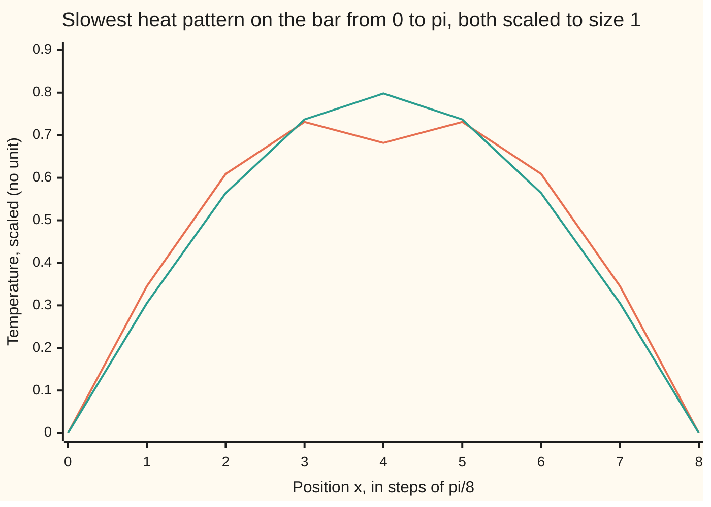
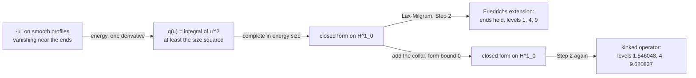

# Friedrichs extension: start from the energy, and a lower-bounded operator gets one natural self-adjoint version

[Syllabus](../../../SYLLABUS.md) → [Functional analysis](../README.md) → [Unbounded Operators and Semigroups](../README.md#s05) → Friedrichs extension

---

## General Overview

Heat spreads along a metal bar whose two ends sit in ice. Measure length so the bar runs from 0 to π, and time so the diffusivity (how fast heat spreads) is 1. A temperature pattern shaped like $`\sin x`$ fades like $`e^{-t}`$, so its half-life is 0.693147 time units. That rate, 1, is the bar's lowest **eigenvalue**: the slowest decay any pattern can have.

Now clamp a small water-cooled collar round the middle, at $`x = \pi/2`$. It pulls out heat in proportion to the temperature right there. The slowest pattern now fades faster: its rate rises from 1 to 1.546048 and its half-life falls to 0.448335. The collar is a **spike**: it acts at one point only.

Two questions sit under those numbers.

- Minus the second derivative, $`-u''`$, has many legal versions on the bar, one for each choice of end conditions ([Self-adjoint extensions](02-self-adjoint-extensions-and-the-spectral-theorem.md)). Which one is "the" bar?
- The collar's effect, "multiply by a spike at one point", is no operator on square-integrable profiles at all. How can it change a rate?

One idea answers both. Do not start from the operator. Start from the **energy**: the number $`\int u'^2\,dx`$, which measures how bent a profile is. Energy needs one derivative, not two, and it makes sense for the spike too: the collar adds $`u(\pi/2)^2`$. An energy that never drops below a fixed multiple of the size squared, once completed, determines one self-adjoint operator (its own mirror image, domain included). Starting from $`-u''`$ on smooth profiles that vanish near the ends, which is only symmetric (its own mirror image on those profiles, but they are too few), this route lands on the ice-cold ends automatically, and it absorbs the spike without fuss.

**An energy form that is bounded below and closed defines exactly one self-adjoint operator; starting from a lower-bounded symmetric operator's own energy, this gives the Friedrichs extension, and any extra energy that is small compared with it, even a spike at one point, gives a new self-adjoint operator (the KLMN theorem).**

**What kind of fact this is:** three theorems. The representation theorem and the Friedrichs extension are proved on this card in Why it works, from [Lax-Milgram](../02-Hilbert%20Spaces/07-lax-milgram-theorem.md). The KLMN theorem is proved in outline in a fold. The bar's numbers are checked by code on grids, which are truncations; the code checks instances, and only the proofs cover the infinite case.

### The picture: the slowest pattern, with and without the collar



Orange: the slowest pattern with the collar, rate 1.546048. It has a corner at the middle, where the collar pulls the temperature down. Teal: $`\sin x`$, rate 1, the slowest pattern without the collar. Both are exact curves, printed at 9 points by both checks.

---

## The formula

Notation first, in words. A **profile** $`u`$ is a real temperature pattern on $`(0, \pi)`$ with finite squared size; such profiles form $`L^2(0,\pi)`$. The inner product is $`\langle u, v\rangle = \int_0^\pi u\,v\,dx`$ and the size is $`\lVert u\rVert = \langle u, u\rangle^{1/2}`$. Scalars are real on this card.

A **quadratic form** (here called an energy form) is a rule $`q(u, v)`$ that takes two profiles from a subspace $`D(q)`$, the **form domain**, and returns a number. It is linear in each slot and symmetric: $`q(u, v) = q(v, u)`$. Write $`q(u)`$ for $`q(u, u)`$. The form is:

- **bounded below** by $`m`$ when $`q(u) \ge m\lVert u\rVert^2`$ for every $`u`$ in $`D(q)`$;
- **closed** when $`D(q)`$ is complete under the **energy size** $`\lVert u\rVert_q = \big(q(u) + (1 - m)\lVert u\rVert^2\big)^{1/2}`$: a sequence that settles in energy size has a limit inside $`D(q)`$.

The bar's starting operator is $`S u = -u''`$ on $`D(S) = C_c^\infty(0,\pi)`$, the smooth profiles that vanish near both ends. Integrating by parts once gives its energy:

```math
q(u, v) = \langle u, S v\rangle = \int_0^\pi u'\,v'\,dx, \qquad q(u) = \int_0^\pi u'^2\,dx \ \ge\ \int_0^\pi u^2\,dx
```

**Read it aloud:** the energy of a profile is the integral of its slope squared, and it is never less than the integral of the profile squared.

The inequality is the Poincaré inequality for profiles that are zero at both ends. [Sobolev and Poincare](../04-Distributions%20and%20Sobolev%20Spaces/09-sobolev-embedding-and-poincare-inequality.md) proves $`\lVert u\rVert \le C_P\lVert u'\rVert`$ for such profiles, with $`C_P = L/\pi`$ on length $`L`$, here $`\pi/\pi = 1`$, and equality for $`\sin x`$. Squaring gives $`q(u) \ge \lVert u\rVert^2/C_P^2`$, so $`m = 1/C_P^2 = 1`$.

**The representation theorem.** A closed form, bounded below by $`m`$, with a dense form domain, defines exactly one self-adjoint operator $`A`$ with the same lower bound:

```math
q(u, v) = \langle u, A v\rangle \ \text{ for every } u \in D(q),\ v \in D(A), \qquad D(A) = \{v \in D(q) : u \mapsto q(u, v) \text{ is bounded in } \lVert\cdot\rVert\}
```

**Read it aloud:** the operator is whatever reproduces the energy pairing, and it acts on exactly those profiles whose energy pairing is bounded in plain size.

**Friedrichs extension.** Close the energy of $`S`$; call the closure $`\bar q`$. The operator that $`\bar q`$ defines is the **Friedrichs extension** $`A_F`$. It extends $`S`$, it is self-adjoint, and its lower bound is still $`m`$. On the bar, $`D(\bar q) = H^1_0(0,\pi)`$ and $`A_F`$ is $`-u''`$ with both ends held at 0, eigenvalues $`n^2`$: 1, 4, 9, …

**KLMN.** Let $`p`$ be a symmetric form on $`D(\bar q)`$ with a **form bound** $`a < 1`$:

```math
\lvert p(u)\rvert \le a\,\bar q(u) + b\,\lVert u\rVert^2 \quad\Longrightarrow\quad \bar q + p \text{ is closed and bounded below on } D(\bar q), \text{ so it defines one self-adjoint operator}
```

**Read it aloud:** if the extra energy is at most a fraction a, less than one, of the old energy plus a constant times the size squared, the total energy still defines exactly one self-adjoint operator.

For the collar, $`p(u) = \alpha\,u(\pi/2)^2`$ with strength $`\alpha = 1`$. Step 5 shows that every $`a > 0`$ works, so its form bound is 0.

| Symbol | Plain meaning | In our example | Push it up and the answer… |
| --- | --- | --- | --- |
| $`x`$, $`t`$ | position on the bar; time, in units where the diffusivity is 1 | $`x`$ from 0 to π; collar at $`\pi/2`$ | — |
| $`u`$, $`v`$, $`\langle u, v\rangle`$, $`\lVert u\rVert`$ | profiles; their inner product; their size | $`\lVert\sin\rVert^2 = 1.570796`$ | — |
| $`S`$, $`D(S)`$ | the starting operator $`-u''`$ on smooth profiles vanishing near the ends | $`C_c^\infty(0,\pi)`$ | — |
| $`q`$, $`D(q)`$ | the energy form and its form domain | $`q(\sin) = 1.570796`$ | larger form domain, lower eigenvalues |
| $`\bar q`$, $`H^1_0`$ | the closure of the energy; profiles with square-integrable weak slope, zero at both ends | $`D(\bar q) = H^1_0(0,\pi)`$ | — |
| $`m`$, $`C_P`$, $`\lVert u\rVert_q`$, $`\langle u, v\rangle_q`$ | lower bound of the energy; the Poincaré constant; the energy size and its inner product | $`m = 1/C_P^2 = 1`$ | — |
| $`A`$, $`A_F`$, $`R`$ | the operator a form defines; the Friedrichs extension; the solving map $`R = (A + 1 - m)^{-1}`$, which is $`-R(m - 1, A)`$ in the resolvent notation $`R(\lambda, T) = (\lambda I - T)^{-1}`$ | $`-u''`$, ends held, eigenvalues $`n^2`$ = 1, 4, 9 | — |
| $`\alpha`$, $`p`$, $`\delta_{\pi/2}`$ | collar strength; its energy $`\alpha\,u(\pi/2)^2`$; the spike at the middle | $`\alpha = 1`$ | lowest rate rises toward 4 |
| $`a`$, $`b`$ | form bound: the fraction of old energy, and the constant | any $`a > 0`$, with $`b = 1/(4a)`$ | — |
| $`\lambda_1`$, $`k`$ | lowest eigenvalue, the slowest decay rate; $`\lambda = k^2`$ | 1.546048; $`k = 1.243401927`$ | faster cooling |
| $`N`$, $`h`$ | grid points inside the bar; their spacing $`\pi/(N+1)`$ | 9, 99, 999 | grid error falls like $`h^2`$ |
| $`\varepsilon`$, $`w`$ | width of a ramp at the ends; half-width of a bump at the middle | 0.1 to 0.001 | — |

### When it holds

- **Bounded below.** The Friedrichs route needs $`\langle u, S u\rangle \ge m\lVert u\rVert^2`$ for one fixed $`m`$. The bar's operator with the sign flipped, $`u \mapsto +u''`$, has energy $`-\int u'^2`$, which falls without a floor as profiles wiggle faster, and the construction has nothing to complete.
- **Closed, or closable.** The energy must have a closure that stays inside $`L^2`$. The energy of a symmetric operator always does (Step 3). A form like $`u(\pi/2)^2`$ alone, with no slope term, does not: profiles can shrink to zero in size while keeping $`u(\pi/2) = 1`$.
- **A form bound below 1 for KLMN.** A point couple (a point term that reads the slope at the middle, not the value), energy $`u'(\pi/2)^2`$, fails it completely: on narrow bumps its ratio to the old energy plus the size squared grows like $`1/w`$, reaching 999.9999 at $`w = 0.001`$.
- **Same form domain.** KLMN keeps the form domain $`H^1_0`$. Changing the domain, for instance to all of $`H^1`$, changes the operator, even with the same formula for the energy (What breaks, row 1).

---

## Why it works

### Step 0: energy needs one derivative, an operator needs two

A symmetric matrix $`K`$ is fully described by its energy $`u \cdot K u`$; nothing is lost going from one to the other. In finite dimensions there is no domain question at all.

On the bar, $`-u''`$ needs two derivatives, and the end conditions hide in its domain. The energy $`\int u'^2`$ needs one. Fewer derivatives means more profiles allowed, so the energy's natural home, $`H^1_0`$, is a complete space where [Lax-Milgram](../02-Hilbert%20Spaces/07-lax-milgram-theorem.md) can work. The operator is then read back from the energy. This is the same move as [Weak solutions](../04-Distributions%20and%20Sobolev%20Spaces/08-weak-solutions-of-differential-equations.md), turned into a theorem about operators.

### Step 1: the finite rehearsal

Put $`N`$ points inside the bar, spacing $`h = \pi/(N+1)`$, ends held at 0. The energy becomes $`\sum (u_{i+1} - u_i)^2/h`$ and the squared size $`h\sum u_i^2`$. Measured against that size, the energy's matrix is the tridiagonal matrix with $`2/h^2`$ on the diagonal and $`-1/h^2`$ beside it. Its eigenvalues are $`4/h^2 \sin^2(nh/2)`$, and they close on $`n^2`$:

- N = 9: 0.991802, 3.870125, 8.353217.
- N = 99: 0.999918, 3.998684, 8.993340.
- N = 999: 0.999999, 3.999987, 8.999933.

What this hides: the grid matrix already has "ends held" built in by the choice of matrix. A matrix has no domain to choose. The infinite bar does, and Steps 3 and 4 show the energy makes the choice.

### Step 2: the representation theorem, by Lax-Milgram

Take a closed form $`q`$, bounded below by $`m`$. The energy inner product $`\langle u, v\rangle_q = q(u, v) + (1 - m)\langle u, v\rangle`$ makes $`D(q)`$ a Hilbert space, and $`\lVert u\rVert_q \ge \lVert u\rVert`$. On the bar $`m = 1`$, so $`\langle u, v\rangle_q`$ is the energy pairing itself.

For any profile $`f`$, the load $`v \mapsto \langle v, f\rangle`$ is bounded on that space. Lax-Milgram (here the Riesz representation, since the form is the inner product) gives exactly one $`u = Rf`$ with $`\langle v, u\rangle_q = \langle v, f\rangle`$ for every $`v`$. The map $`R`$ is bounded, symmetric, positive and one-to-one on $`L^2`$. Its inverse is self-adjoint, so $`A = R^{-1} - (1 - m)`$ is self-adjoint and reproduces $`q`$.

<details>
<summary>Detailed proof: why the inverse of R is self-adjoint, and why A is unique</summary>

R is symmetric: $`\langle g, Rf\rangle = \langle Rg, Rf\rangle_q = \langle Rg, f\rangle`$, using the defining identity twice. It is bounded: putting $`v = Rf`$ gives $`\lVert Rf\rVert^2 \le \lVert Rf\rVert_q^2 = \langle Rf, f\rangle \le \lVert Rf\rVert\,\lVert f\rVert`$, so $`\lVert Rf\rVert \le \lVert f\rVert`$.

R is one-to-one: if $`Rf = 0`$ then $`\langle v, f\rangle = 0`$ for every $`v`$ in the dense form domain, so $`f = 0`$. A bounded self-adjoint operator that is one-to-one has dense range, and its inverse, defined on that range, is self-adjoint: the graph of $`R^{-1}`$ is the graph of $`R`$ with the two slots swapped, and swapping slots commutes with taking adjoints.

Uniqueness: if two self-adjoint operators both reproduce $`q`$, then for each the identity $`\langle v, (A + 1 - m)u\rangle = \langle v, u\rangle_q`$ forces $`(A + 1 - m)^{-1} = R`$. So they are equal, domains included.

The lower bound: for $`v`$ in $`D(A)`$, $`\langle v, A v\rangle = q(v) \ge m\lVert v\rVert^2`$.

</details>

### Step 3: the energy of a lower-bounded symmetric operator can be closed

Start from $`S`$ with $`\langle u, S u\rangle \ge m\lVert u\rVert^2`$. Its energy $`q(u, v) = \langle u, S v\rangle`$ lives on $`D(S)`$. Complete $`D(S)`$ in the energy size. The danger is that a sequence settles in energy size but shrinks to zero in plain size while its energy stays positive: then the completion would hold a "ghost" with energy and no profile.

The symmetric operator rules that out. If $`u_n \to 0`$ in plain size and settles in energy size, then $`\lVert u_n\rVert_q^2 = \langle u_n - u_k, u_n\rangle_q + \langle (S + 1 - m) u_k, u_n\rangle`$. The first term is small once $`n`$ and $`k`$ are large. The second tends to 0 as $`n`$ grows, for fixed $`k`$. So the energy tends to 0 too: no ghost. The closure $`\bar q`$ is a closed form, and Step 2 turns it into $`A_F`$.

$`A_F`$ extends $`S`$: for $`v`$ in $`D(S)`$, $`\bar q(u, v) = \langle u, S v\rangle`$ is bounded in $`\lVert u\rVert`$, so $`v`$ is in $`D(A_F)`$ with $`A_F v = S v`$.

### Step 4: on the bar the energy picks the held ends

For $`S = -u''`$ on $`C_c^\infty(0,\pi)`$, the energy size is $`\big(\int u'^2\big)^{1/2}`$, and the completion of $`C_c^\infty`$ in it is $`H^1_0(0,\pi)`$, the profiles that are zero at both ends ([Weak derivatives](../04-Distributions%20and%20Sobolev%20Spaces/07-weak-derivatives-and-sobolev-spaces.md)). The ends are forced to 0 because energy is expensive near them.

Ramps show it. Take a profile that rises from 0 to the constant 1 within $`\varepsilon`$ of each end. In plain size it closes on the constant 1, which is the insulated bar's slowest pattern. But its energy is $`2/\varepsilon`$ and grows without bound:

| ε | Plain distance to 1 | Energy |
| --- | --- | --- |
| 0.1 | 0.258199 | 20.0 |
| 0.01 | 0.081650 | 200.0 |
| 0.001 | 0.025819 | 2000.0 |

No other sequence does better: every profile in $`H^1_0`$ is zero at both ends, and the constant 1 is not. So the constant 1 is not in the energy closure, and the insulated version is never reached. The domain of $`A_F`$ is the profiles in $`H^1_0`$ whose energy pairing is bounded in plain size: those with $`u''`$ in $`L^2`$. That is the held-ends operator, eigenvalues $`n^2`$.

Among the self-adjoint extensions of $`S`$ that are bounded below, $`A_F`$ has the smallest form domain, so by the min-max principle (eigenvalues are minima of energy over profiles in the form domain) its eigenvalues are the highest. The insulated bar, whose energy has the same formula on all of $`H^1`$, drops to 0. [Self-adjoint extensions](02-self-adjoint-extensions-and-the-spectral-theorem.md) counts all the choices; the energy route picks one without counting.

### Step 5: the collar is a form, not an operator

The collar's energy is $`u(\pi/2)^2`$. As an operator it would be "multiply by a spike": $`u \mapsto \alpha\,u(\pi/2)\,\delta_{\pi/2}`$, where $`\delta_{\pi/2}`$ is the delta at the middle, a spike that reads a profile's value there ([The delta](../04-Distributions%20and%20Sobolev%20Spaces/02-the-dirac-delta-and-derivatives-of-jumps.md)). The delta is no square-integrable function.

The grid shows it. On a grid the collar adds $`\alpha/h`$ to the middle diagonal entry. Applied to $`\sin x`$, its output has size $`\alpha/\sqrt h`$: 1.784124 at N = 9, 5.641896 at N = 99, 17.841241 at N = 999. That trend never closes. Its energy on the same profile is 1.000000 at every N.

The energy is small compared with the bar's own. For $`u`$ in $`H^1_0`$, $`u(\pi/2)^2 = 2\int_0^{\pi/2} u\,u'\,dx = -2\int_{\pi/2}^{\pi} u\,u'\,dx`$, so

```math
u(\pi/2)^2 \le \lVert u\rVert\,\lVert u'\rVert \le a\,\lVert u'\rVert^2 + \frac{1}{4a}\,\lVert u\rVert^2 \quad \text{for every } a > 0
```

**Read it aloud:** the value squared at the middle is at most the size times the slope's size, and so at most any small fraction of the energy plus a constant times the size squared.

The second step is $`2st \le 2as^2 + t^2/(2a)`$, halved. Checked on three profiles: $`\sin x`$ gives 1 against 1.570796; tents of half-width 0.1 and 0.001 give 1 against 1.154701 each. Since $`a`$ can be as small as wanted, the form bound is 0, and KLMN applies.

### Step 6: KLMN, and what the new operator is

<details>
<summary>Detailed proof: KLMN</summary>

Shift so that $`\bar q \ge 0`$ (on the bar it already is). Suppose $`\lvert p(u)\rvert \le a\,\bar q(u) + b\lVert u\rVert^2`$ with $`a < 1`$. Then

$`\displaystyle (1 - a)\,\bar q(u) - b\lVert u\rVert^2 \ \le\ \bar q(u) + p(u)\ \le\ (1 + a)\,\bar q(u) + b\lVert u\rVert^2.`$

The left side shows the new form is bounded below by $`-b`$. Both sides together show that the new energy size and the old one are each at most a constant times the other. So a sequence settles in one exactly when it settles in the other, and the new form is closed on the same domain $`D(\bar q)`$. Step 2 then gives exactly one self-adjoint operator.

</details>

The new operator acts as $`-u''`$ away from the middle. To read its domain, pair it with $`v`$ in $`H^1_0`$ and integrate by parts on each half. The two end terms at $`\pi/2`$ must cancel the collar's energy, which gives the **kink rule**:

```math
u'(\pi/2^+) - u'(\pi/2^-) = \alpha\,u(\pi/2)
```

**Read it aloud:** the slope jumps at the middle by the collar's strength times the temperature there.

The orange curve in the picture shows the kink. A smooth profile such as $`\sin x`$ breaks the kink rule, so it is not in the new operator's domain. It is still in the form domain, which is all a trial profile needs.

### Step 7: the slowest rate, three ways

**Road 1, exact.** A pattern symmetric about the middle is $`\sin(kx)`$ on the left half and its mirror on the right. The kink rule turns into

```math
2k\cos(k\pi/2) + \alpha\sin(k\pi/2) = 0
```

**Read it aloud:** the slope jump of the mirrored sine wave must equal the collar's strength times its value at the middle.

With $`\alpha = 1`$, bisection on $`1 < k < 2`$ gives $`k = 1.243401927`$, so $`\lambda_1 = k^2 = 1.546048`$. Patterns that are zero at the middle, such as $`\sin 2x`$, never feel the collar: the second level stays at 4. The third, symmetric again, moves from 9 to 9.620837.

**Road 2, grids.** Add $`\alpha/h`$ to the middle diagonal entry and find eigenvalues by bisection. The lowest is 1.538283, 1.545970 and 1.546048 at N = 9, 99, 999. Its error falls a hundredfold for each tenfold N, like $`h^2`$.

**Road 3, a bracket.** The total energy is at least the bar's energy, which is at least $`\lVert u\rVert^2`$, so $`\lambda_1 \ge 1`$. The min-max principle says $`\lambda_1`$ is at most the energy of any trial profile in the form domain divided by its squared size. With $`\sin x`$:

```math
\lambda_1 \le \frac{\int_0^\pi \cos^2 x\,dx + \alpha\sin^2(\pi/2)}{\int_0^\pi \sin^2 x\,dx} = \frac{\pi/2 + 1}{\pi/2} = 1 + \frac{2}{\pi} = 1.636620
```

**Read it aloud:** the slowest rate is at most the trial profile's total energy over its squared size, which is one plus two over pi.

The exact 1.546048 sits inside $`[1, 1.636620]`$.



---

## Worked numbers, by hand

| Step | Arithmetic | Value |
| --- | --- | --- |
| energy of $`\sin x`$ | $`\int_0^\pi \cos^2 x\,dx = \pi/2`$ | 1.570796 |
| squared size of $`\sin x`$ | $`\int_0^\pi \sin^2 x\,dx = \pi/2`$ | 1.570796 |
| floor | Poincaré on length π: $`C_P = 1`$ | 1 |
| collar energy on $`\sin x`$ | $`\alpha \sin^2(\pi/2) = 1 \times 1`$ | 1 |
| upper bound | $`(1.570796 + 1)/1.570796`$ | 1.636620 |
| exact root | $`2k\cos(k\pi/2) + \sin(k\pi/2) = 0`$, bisection | $`k = 1.243401927`$ |
| slowest rate | $`k^2`$ | **1.546048** |
| half-life | $`\ln 2/1.546048`$, against $`\ln 2/1 = 0.693147`$ | 0.448335 |

The collar makes the bar's slowest heat pattern fade with half-life 0.448335 instead of 0.693147 time units.

### What breaks if you drop a piece

| Mistake | Comes out at | What went wrong |
| --- | --- | --- |
| Close the energy on all of $`H^1`$, not $`H^1_0`$ | lowest level 0.000000 (next 0.999918), grid N = 100 | That is the insulated bar: a different extension, and the floor 1 is lost |
| Treat the collar as an operator on $`L^2`$ | output size 1.784124, 5.641896, 17.841241 at N = 9, 99, 999 | The delta is no profile; only its energy is finite |
| Use a point couple $`u'(\pi/2)^2`$ as the extra energy | ratio to old energy plus size squared 9.9899, 99.9990, 999.9999 at $`w`$ = 0.1, 0.01, 0.001 | No form bound below 1, so KLMN fails |
| Forget to divide the trial energy by $`\lVert\sin\rVert^2`$ | 2.570796 | An energy is not a rate until divided by the squared size |

---

## Code, from first principles, and it actually runs

The code holds the finite rehearsal and three independent roads to the slowest rate: the exact kink equation solved by bisection, grid matrices at N = 9, 99 and 999 with eigenvalues found by a Sturm count, and the Rayleigh bracket $`1 \le \lambda_1 \le 1 + 2/\pi`$ from Simpson's rule. It also prints the ramps of Step 4, the insulated grid, the form-bound checks, the collar's growing output and the point couple's failure. Nothing imported holds an eigenvalue solver or an integrator. A Lean file proves Step 5's form bound and the facts behind Roads 1 and 3.

### Python

```python
# Friedrichs extension and energy forms -- the check behind the card.  Standard
# library only.  The bar runs from 0 to pi with both ends held at 0.  The energy
# is q(u) = integral of u'^2.  A spike of strength ALPHA sits at the middle, pi/2,
# and adds ALPHA * u(pi/2)^2 to the energy.  Every grid matrix is a truncation.
import math
PI, ALPHA = math.pi, 1.0

def count_below(d, off, x):                # Sturm count: eigenvalues of the tridiagonal matrix below x
    q, k = 1.0, 0
    for i in range(len(d)):
        q = d[i] - x - (off * off / q if i else 0.0)
        if q == 0.0:
            q = 1e-300
        k += q < 0
    return k

def kth_eig(d, off, k):                    # k-th smallest eigenvalue (k = 0, 1, ...) by bisection
    lo, hi = -1.0, 4.0 * max(d) + 1.0
    for _ in range(100):
        mid = 0.5 * (lo + hi)
        lo, hi = (lo, mid) if count_below(d, off, mid) > k else (mid, hi)
    return 0.5 * (lo + hi)

def simpson(f, a, b, m=2000):              # Simpson's rule, m even
    h = (b - a) / m
    s = f(a) + f(b) + sum((4 if j % 2 else 2) * f(a + j * h) for j in range(1, m))
    return s * h / 3

def root(g, lo, hi):                       # bisection for a sign change of g on (lo, hi)
    for _ in range(200):
        mid = 0.5 * (lo + hi)
        lo, hi = (mid, hi) if g(lo) * g(mid) > 0 else (lo, mid)
    return 0.5 * (lo + hi)

def kink(k, a):                            # even mode: -u'' = k^2 u, slope jumps by a * u(pi/2)
    return 2 * k * math.cos(k * PI / 2) + a * math.sin(k * PI / 2)

k1, k3 = root(lambda k: kink(k, ALPHA), 1.0, 2.0), root(lambda k: kink(k, ALPHA), 3.0, 4.0)
exact = [k1 * k1, 4.0, k3 * k3]            # the odd mode sin 2x is 0 at pi/2, so 4 stays
print("road 1, exact: an even mode needs 2k cos(k pi/2) + alpha sin(k pi/2) = 0")
print(f"  alpha = {ALPHA:.0f}: k = {k1:.9f}, lowest = k^2 = {exact[0]:.9f}; levels {exact[0]:.6f}, "
      f"{exact[1]:.6f}, {exact[2]:.6f}")
print("road 2, grid: N inside points, h = pi/(N+1), spike adds alpha/h to the middle diagonal")
print("N     no spike: lam1    lam2        lam3        spike: lam1   lam2        lam3")
errs = []
for N in (9, 99, 999):
    h, m = PI / (N + 1), (N - 1) // 2      # point m sits at x = pi/2
    d = [2.0 / h**2] * N
    ds = d[:]
    ds[m] += ALPHA / h
    plain = [kth_eig(d, -1.0 / h**2, j) for j in range(3)]
    spike = [kth_eig(ds, -1.0 / h**2, j) for j in range(3)]
    print(f"{N:<5} {plain[0]:.6f}    {plain[1]:.6f}    {plain[2]:.6f}    {spike[0]:.6f}      "
          f"{spike[1]:.6f}    {spike[2]:.6f}")
    for j in range(3):                     # grid closed form 4/h^2 sin^2(n h/2) for the plain bar
        assert abs(plain[j] - 4 / h**2 * math.sin((j + 1) * h / 2)**2) < 1e-8 * plain[j]
    errs.append(abs(spike[0] - exact[0]))
print(f"spike lowest, grid error: N=9 {errs[0]:.3e}, N=99 {errs[1]:.3e}, N=999 {errs[2]:.3e}")
assert errs[2] < 1e-5 and errs[2] < errs[1] < errs[0]          # grid closes on the exact root
sq = simpson(lambda x: math.cos(x)**2, 0, PI)                  # q(sin) = integral of cos^2
nn = simpson(lambda x: math.sin(x)**2, 0, PI)                  # ||sin||^2
ray = (sq + ALPHA * math.sin(PI / 2)**2) / nn
print("road 3, Rayleigh bracket with the trial function sin x (in the form domain H^1_0):")
print(f"  q(sin) = {sq:.6f}, ||sin||^2 = {nn:.6f}, spike energy = {math.sin(PI / 2)**2:.6f}")
print(f"  1 <= lowest = {exact[0]:.6f} <= (q + spike)/||sin||^2 = {ray:.6f} = 1 + 2/pi = {1 + 2 / PI:.6f}")
assert 1.0 <= exact[0] <= ray and abs(ray - (1 + 2 / PI)) < 1e-9
print("why the energy route picks held ends: ramps from 0 up to the constant 1 within eps of each end")
print("eps      L2 distance to 1   energy q    (closed forms sqrt(2 eps/3), 2/eps)")
for eps in (0.1, 0.01, 0.001):
    M = 200000                             # midpoint sums over (0, pi)
    ramp = lambda x: min(1.0, x / eps, (PI - x) / eps)
    dist = math.sqrt(sum((1 - ramp((i + 0.5) * PI / M))**2 for i in range(M)) * PI / M)
    en = 0.0                               # energy: (rise over run)^2 times run, each straight piece cut in 1000
    for a, b in ((0.0, eps), (eps, PI - eps), (PI - eps, PI)):
        xs = [a + (b - a) * j / 1000 for j in range(1001)]
        en += sum((ramp(xs[j + 1]) - ramp(xs[j]))**2 / (xs[j + 1] - xs[j]) for j in range(1000))
    print(f"{eps:<8} {dist:.6f}           {en:.1f}")
    assert abs(dist - math.sqrt(2 * eps / 3)) < 1e-4
    assert abs(en - 2 / eps) < 1e-6 * en
NN = 100                                   # insulated ends: N cells, mirror at each end
hn = PI / NN
dn = [1.0 / hn**2] + [2.0 / hn**2] * (NN - 2) + [1.0 / hn**2]
n0, n1 = kth_eig(dn, -1.0 / hn**2, 0), kth_eig(dn, -1.0 / hn**2, 1)
print(f"insulated ends (form on all of H^1), N=100: lowest {abs(n0):.6f}, next {n1:.6f}")
assert abs(n0) < 1e-6 and abs(n1 - 1.0) < 1e-3
print("form bound: u(pi/2)^2 <= ||u|| ||u'|| <= a ||u'||^2 + ||u||^2/(4a) for every a > 0")
for name, w in (("sin x", PI / 2), ("tent, half-width 0.1", 0.1), ("tent, half-width 0.001", 0.001)):
    u = (lambda t: math.cos(t)) if name == "sin x" else (lambda t: 1 - t / w)   # t = distance from pi/2
    du = (lambda t: math.sin(t)) if name == "sin x" else (lambda t: 1 / w)
    nrm, slope = math.sqrt(2 * simpson(lambda t: u(t)**2, 0, w)), math.sqrt(2 * simpson(lambda t: du(t)**2, 0, w))
    print(f"  {name:<24} u(pi/2)^2 = {u(0)**2:.6f} <= ||u|| ||u'|| = {nrm * slope:.6f}")
    assert u(0)**2 <= nrm * slope
print("the spike is not an operator on L2: its output on sin x has grid size alpha/sqrt(h)")
for N in (9, 99, 999):
    h, m = PI / (N + 1), (N - 1) // 2
    u = [math.sin((i + 1) * h) for i in range(N)]
    vu = math.sqrt(h * (ALPHA / h * u[m])**2)
    print(f"  N={N:<4} size {vu:.6f}, closed form sqrt((N+1)/pi) = {math.sqrt((N + 1) / PI):.6f}; "
          f"its energy alpha u(pi/2)^2 = {ALPHA * u[m]**2:.6f}")
    assert abs(vu - math.sqrt((N + 1) / PI)) < 1e-9 * vu
print("a point couple u'(pi/2)^2 is not form-bounded: bump of half-width w, ratio pi^2/(pi^2 w + w^3)")
for w in (0.1, 0.01, 0.001):
    qb = simpson(lambda x: (PI * math.cos(PI * x / w))**2, -w, w)
    nb = simpson(lambda x: (w * math.sin(PI * x / w))**2, -w, w)
    print(f"  w={w:<6} q = {qb:.6f}, ||u||^2 = {nb:.3e}, u'(pi/2)^2/(q + ||u||^2) = {PI**2 / (qb + nb):.4f}")
    assert abs(PI**2 / (qb + nb) - PI**2 / (PI**2 * w + w**3)) < 1e-6 / w
nrm2 = simpson(lambda x: math.sin(k1 * x)**2, 0, PI / 2) * 2   # ground state is even about pi/2
assert abs(nrm2 - (PI / 2 - math.sin(k1 * PI) / (2 * k1))) < 1e-9
chart = lambda x: math.sin(k1 * min(x, PI - x)) / math.sqrt(nrm2)
print("chart, x = j pi/8, j = 0..8, both of unit L2 size")
print("  with spike: " + ", ".join(f"{chart(j * PI / 8):.3f}" for j in range(9)))
print("  sin x:      " + ", ".join(f"{math.sin(j * PI / 8) / math.sqrt(PI / 2):.3f}" for j in range(9)))
print(f"slowest heat pattern, half-life ln 2/lowest: no spike {math.log(2):.6f}, spike {math.log(2) / exact[0]:.6f}")
print(f"mistake, energy not divided by ||sin||^2: {sq + ALPHA:.6f}, which is no level of the bar")
print("ALL CHECKS PASS")
```

**Ran 2026-11-24 on macOS, Python 3.14.10, standard library only. All checks passed. Output, pasted from the run:**

```
road 1, exact: an even mode needs 2k cos(k pi/2) + alpha sin(k pi/2) = 0
  alpha = 1: k = 1.243401927, lowest = k^2 = 1.546048353; levels 1.546048, 4.000000, 9.620837
road 2, grid: N inside points, h = pi/(N+1), spike adds alpha/h to the middle diagonal
N     no spike: lam1    lam2        lam3        spike: lam1   lam2        lam3
9     0.991802    3.870125    8.353217    1.538283      3.870125    8.974366
99    0.999918    3.998684    8.993340    1.545970      3.998684    9.614178
999   0.999999    3.999987    8.999933    1.546048      3.999987    9.620771
spike lowest, grid error: N=9 7.766e-03, N=99 7.820e-05, N=999 7.821e-07
road 3, Rayleigh bracket with the trial function sin x (in the form domain H^1_0):
  q(sin) = 1.570796, ||sin||^2 = 1.570796, spike energy = 1.000000
  1 <= lowest = 1.546048 <= (q + spike)/||sin||^2 = 1.636620 = 1 + 2/pi = 1.636620
why the energy route picks held ends: ramps from 0 up to the constant 1 within eps of each end
eps      L2 distance to 1   energy q    (closed forms sqrt(2 eps/3), 2/eps)
0.1      0.258199           20.0
0.01     0.081650           200.0
0.001    0.025819           2000.0
insulated ends (form on all of H^1), N=100: lowest 0.000000, next 0.999918
form bound: u(pi/2)^2 <= ||u|| ||u'|| <= a ||u'||^2 + ||u||^2/(4a) for every a > 0
  sin x                    u(pi/2)^2 = 1.000000 <= ||u|| ||u'|| = 1.570796
  tent, half-width 0.1     u(pi/2)^2 = 1.000000 <= ||u|| ||u'|| = 1.154701
  tent, half-width 0.001   u(pi/2)^2 = 1.000000 <= ||u|| ||u'|| = 1.154701
the spike is not an operator on L2: its output on sin x has grid size alpha/sqrt(h)
  N=9    size 1.784124, closed form sqrt((N+1)/pi) = 1.784124; its energy alpha u(pi/2)^2 = 1.000000
  N=99   size 5.641896, closed form sqrt((N+1)/pi) = 5.641896; its energy alpha u(pi/2)^2 = 1.000000
  N=999  size 17.841241, closed form sqrt((N+1)/pi) = 17.841241; its energy alpha u(pi/2)^2 = 1.000000
a point couple u'(pi/2)^2 is not form-bounded: bump of half-width w, ratio pi^2/(pi^2 w + w^3)
  w=0.1    q = 0.986960, ||u||^2 = 1.000e-03, u'(pi/2)^2/(q + ||u||^2) = 9.9899
  w=0.01   q = 0.098696, ||u||^2 = 1.000e-06, u'(pi/2)^2/(q + ||u||^2) = 99.9990
  w=0.001  q = 0.009870, ||u||^2 = 1.000e-09, u'(pi/2)^2/(q + ||u||^2) = 999.9999
chart, x = j pi/8, j = 0..8, both of unit L2 size
  with spike: 0.000, 0.345, 0.609, 0.731, 0.682, 0.731, 0.609, 0.345, 0.000
  sin x:      0.000, 0.305, 0.564, 0.737, 0.798, 0.737, 0.564, 0.305, 0.000
slowest heat pattern, half-life ln 2/lowest: no spike 0.693147, spike 0.448335
mistake, energy not divided by ||sin||^2: 2.570796, which is no level of the bar
ALL CHECKS PASS
```

### Rust

Same numbers, same labels, built with `rustc --edition 2021 -O`.

```rust
// Friedrichs extension and energy forms -- the same check as the Python, in Rust.
// No crates.  The bar runs from 0 to pi with both ends held at 0.  The energy is
// q(u) = integral of u'^2.  A spike of strength ALPHA sits at the middle, pi/2,
// and adds ALPHA * u(pi/2)^2 to the energy.  Every grid matrix is a truncation.
use std::f64::consts::PI;
const ALPHA: f64 = 1.0;

fn count_below(d: &[f64], off: f64, x: f64) -> usize {  // Sturm count below x
    let (mut q, mut k) = (1.0f64, 0usize);
    for i in 0..d.len() {
        q = d[i] - x - if i > 0 { off * off / q } else { 0.0 };
        if q == 0.0 { q = 1e-300 }
        if q < 0.0 { k += 1 }
    }
    k
}

fn kth_eig(d: &[f64], off: f64, k: usize) -> f64 {    // k-th smallest eigenvalue by bisection
    let mx = d.iter().cloned().fold(f64::MIN, f64::max);
    let (mut lo, mut hi) = (-1.0, 4.0 * mx + 1.0);
    for _ in 0..100 {
        let mid = 0.5 * (lo + hi);
        if count_below(d, off, mid) > k { hi = mid } else { lo = mid }
    }
    0.5 * (lo + hi)
}

fn simpson(f: &dyn Fn(f64) -> f64, a: f64, b: f64) -> f64 {  // Simpson's rule, 2000 panels
    let m = 2000;
    let h = (b - a) / m as f64;
    let mut s = f(a) + f(b);
    for j in 1..m { s += if j % 2 == 1 { 4.0 } else { 2.0 } * f(a + j as f64 * h) }
    s * h / 3.0
}

fn root(g: &dyn Fn(f64) -> f64, mut lo: f64, mut hi: f64) -> f64 {  // bisection on a sign change
    for _ in 0..200 {
        let mid = 0.5 * (lo + hi);
        if g(lo) * g(mid) > 0.0 { lo = mid } else { hi = mid }
    }
    0.5 * (lo + hi)
}

fn kink(k: f64, a: f64) -> f64 {   // even mode: -u'' = k^2 u, slope jumps by a * u(pi/2)
    2.0 * k * (k * PI / 2.0).cos() + a * (k * PI / 2.0).sin()
}

fn sci(x: f64, p: usize) -> String {  // Python-style scientific notation, e.g. 7.766e-03
    let s = format!("{:.*e}", p, x);
    let (m, e) = s.split_once('e').unwrap();
    let ev: i32 = e.parse().unwrap();
    format!("{}e{}{:02}", m, if ev < 0 { '-' } else { '+' }, ev.abs())
}

fn join(v: &[f64]) -> String { v.iter().map(|x| format!("{:.3}", x)).collect::<Vec<_>>().join(", ") }

fn main() {
    let k1 = root(&|k| kink(k, ALPHA), 1.0, 2.0);
    let k3 = root(&|k| kink(k, ALPHA), 3.0, 4.0);
    let exact = [k1 * k1, 4.0, k3 * k3];   // the odd mode sin 2x is 0 at pi/2, so 4 stays
    println!("road 1, exact: an even mode needs 2k cos(k pi/2) + alpha sin(k pi/2) = 0");
    println!("  alpha = {:.0}: k = {:.9}, lowest = k^2 = {:.9}; levels {:.6}, {:.6}, {:.6}",
             ALPHA, k1, exact[0], exact[0], exact[1], exact[2]);
    println!("road 2, grid: N inside points, h = pi/(N+1), spike adds alpha/h to the middle diagonal");
    println!("N     no spike: lam1    lam2        lam3        spike: lam1   lam2        lam3");
    let mut errs = Vec::new();
    for &n in &[9usize, 99, 999] {
        let (h, m) = (PI / (n + 1) as f64, (n - 1) / 2);   // point m sits at x = pi/2
        let d = vec![2.0 / (h * h); n];
        let mut ds = d.clone();
        ds[m] += ALPHA / h;
        let plain: Vec<f64> = (0..3).map(|j| kth_eig(&d, -1.0 / (h * h), j)).collect();
        let spike: Vec<f64> = (0..3).map(|j| kth_eig(&ds, -1.0 / (h * h), j)).collect();
        println!("{:<5} {:.6}    {:.6}    {:.6}    {:.6}      {:.6}    {:.6}",
                 n, plain[0], plain[1], plain[2], spike[0], spike[1], spike[2]);
        for j in 0..3 {                    // grid closed form 4/h^2 sin^2(n h/2) for the plain bar
            let cf = 4.0 / (h * h) * ((j + 1) as f64 * h / 2.0).sin().powi(2);
            assert!((plain[j] - cf).abs() < 1e-8 * plain[j]);
        }
        errs.push((spike[0] - exact[0]).abs());
    }
    println!("spike lowest, grid error: N=9 {}, N=99 {}, N=999 {}", sci(errs[0], 3), sci(errs[1], 3), sci(errs[2], 3));
    assert!(errs[2] < 1e-5 && errs[2] < errs[1] && errs[1] < errs[0]);
    let sq = simpson(&|x: f64| x.cos().powi(2), 0.0, PI);
    let nn = simpson(&|x: f64| x.sin().powi(2), 0.0, PI);
    let ray = (sq + ALPHA * (PI / 2.0).sin().powi(2)) / nn;
    println!("road 3, Rayleigh bracket with the trial function sin x (in the form domain H^1_0):");
    println!("  q(sin) = {:.6}, ||sin||^2 = {:.6}, spike energy = {:.6}", sq, nn, (PI / 2.0).sin().powi(2));
    println!("  1 <= lowest = {:.6} <= (q + spike)/||sin||^2 = {:.6} = 1 + 2/pi = {:.6}", exact[0], ray, 1.0 + 2.0 / PI);
    assert!(1.0 <= exact[0] && exact[0] <= ray && (ray - (1.0 + 2.0 / PI)).abs() < 1e-9);
    println!("why the energy route picks held ends: ramps from 0 up to the constant 1 within eps of each end");
    println!("eps      L2 distance to 1   energy q    (closed forms sqrt(2 eps/3), 2/eps)");
    for &eps in &[0.1f64, 0.01, 0.001] {
        let mm = 200000;                   // midpoint sums over (0, pi)
        let ramp = |x: f64| 1.0f64.min(x / eps).min((PI - x) / eps);
        let s: f64 = (0..mm).map(|i| (1.0 - ramp((i as f64 + 0.5) * PI / mm as f64)).powi(2)).sum();
        let dist = (s * PI / mm as f64).sqrt();
        let mut en = 0.0f64;               // energy: (rise over run)^2 times run, each straight piece cut in 1000
        for &(a, b) in &[(0.0f64, eps), (eps, PI - eps), (PI - eps, PI)] {
            let xs: Vec<f64> = (0..=1000).map(|j| a + (b - a) * j as f64 / 1000.0).collect();
            en += (0..1000).map(|j| (ramp(xs[j + 1]) - ramp(xs[j])).powi(2) / (xs[j + 1] - xs[j])).sum::<f64>();
        }
        println!("{:<8} {:.6}           {:.1}", eps, dist, en);
        assert!((dist - (2.0 * eps / 3.0).sqrt()).abs() < 1e-4);
        assert!((en - 2.0 / eps).abs() < 1e-6 * en);
    }
    let nnc = 100;                          // insulated ends: N cells, mirror at each end
    let hn = PI / nnc as f64;
    let mut dn = vec![2.0 / (hn * hn); nnc];
    dn[0] = 1.0 / (hn * hn);
    dn[nnc - 1] = 1.0 / (hn * hn);
    let (n0, n1) = (kth_eig(&dn, -1.0 / (hn * hn), 0), kth_eig(&dn, -1.0 / (hn * hn), 1));
    println!("insulated ends (form on all of H^1), N=100: lowest {:.6}, next {:.6}", n0.abs(), n1);
    assert!(n0.abs() < 1e-6 && (n1 - 1.0).abs() < 1e-3);
    println!("form bound: u(pi/2)^2 <= ||u|| ||u'|| <= a ||u'||^2 + ||u||^2/(4a) for every a > 0");
    for &(name, w) in &[("sin x", PI / 2.0), ("tent, half-width 0.1", 0.1), ("tent, half-width 0.001", 0.001)] {
        let sinx = name == "sin x";        // t = distance from pi/2
        let u = move |t: f64| if sinx { t.cos() } else { 1.0 - t / w };
        let du = move |t: f64| if sinx { t.sin() } else { 1.0 / w };
        let nrm = (2.0 * simpson(&|t| u(t).powi(2), 0.0, w)).sqrt();
        let slope = (2.0 * simpson(&|t| du(t).powi(2), 0.0, w)).sqrt();
        println!("  {:<24} u(pi/2)^2 = {:.6} <= ||u|| ||u'|| = {:.6}", name, u(0.0).powi(2), nrm * slope);
        assert!(u(0.0).powi(2) <= nrm * slope);
    }
    println!("the spike is not an operator on L2: its output on sin x has grid size alpha/sqrt(h)");
    for &n in &[9usize, 99, 999] {
        let (h, m) = (PI / (n + 1) as f64, (n - 1) / 2);
        let u: Vec<f64> = (0..n).map(|i| ((i + 1) as f64 * h).sin()).collect();
        let vu = (h * (ALPHA / h * u[m]).powi(2)).sqrt();
        println!("  N={:<4} size {:.6}, closed form sqrt((N+1)/pi) = {:.6}; its energy alpha u(pi/2)^2 = {:.6}",
                 n, vu, ((n + 1) as f64 / PI).sqrt(), ALPHA * u[m].powi(2));
        assert!((vu - ((n + 1) as f64 / PI).sqrt()).abs() < 1e-9 * vu);
    }
    println!("a point couple u'(pi/2)^2 is not form-bounded: bump of half-width w, ratio pi^2/(pi^2 w + w^3)");
    for &w in &[0.1f64, 0.01, 0.001] {
        let qb = simpson(&|x: f64| (PI * (PI * x / w).cos()).powi(2), -w, w);
        let nb = simpson(&|x: f64| (w * (PI * x / w).sin()).powi(2), -w, w);
        println!("  w={:<6} q = {:.6}, ||u||^2 = {}, u'(pi/2)^2/(q + ||u||^2) = {:.4}", w, qb, sci(nb, 3), PI * PI / (qb + nb));
        assert!((PI * PI / (qb + nb) - PI * PI / (PI * PI * w + w * w * w)).abs() < 1e-6 / w);
    }
    let nrm2 = simpson(&|x: f64| (k1 * x).sin().powi(2), 0.0, PI / 2.0) * 2.0;  // even about pi/2
    assert!((nrm2 - (PI / 2.0 - (k1 * PI).sin() / (2.0 * k1))).abs() < 1e-9);
    let chart: Vec<f64> = (0..9).map(|j| (k1 * (j as f64 * PI / 8.0).min(PI - j as f64 * PI / 8.0)).sin() / nrm2.sqrt()).collect();
    let plain: Vec<f64> = (0..9).map(|j| (j as f64 * PI / 8.0).sin() / (PI / 2.0).sqrt()).collect();
    println!("chart, x = j pi/8, j = 0..8, both of unit L2 size");
    println!("  with spike: {}", join(&chart));
    println!("  sin x:      {}", join(&plain));
    println!("slowest heat pattern, half-life ln 2/lowest: no spike {:.6}, spike {:.6}", 2f64.ln(), 2f64.ln() / exact[0]);
    println!("mistake, energy not divided by ||sin||^2: {:.6}, which is no level of the bar", sq + ALPHA);
    println!("ALL CHECKS PASS");
}
```

**Ran 2026-11-24 on macOS, rustc 1.98.1, no crates. All checks passed. Output, pasted from the run:**

```
road 1, exact: an even mode needs 2k cos(k pi/2) + alpha sin(k pi/2) = 0
  alpha = 1: k = 1.243401927, lowest = k^2 = 1.546048353; levels 1.546048, 4.000000, 9.620837
road 2, grid: N inside points, h = pi/(N+1), spike adds alpha/h to the middle diagonal
N     no spike: lam1    lam2        lam3        spike: lam1   lam2        lam3
9     0.991802    3.870125    8.353217    1.538283      3.870125    8.974366
99    0.999918    3.998684    8.993340    1.545970      3.998684    9.614178
999   0.999999    3.999987    8.999933    1.546048      3.999987    9.620771
spike lowest, grid error: N=9 7.766e-03, N=99 7.820e-05, N=999 7.821e-07
road 3, Rayleigh bracket with the trial function sin x (in the form domain H^1_0):
  q(sin) = 1.570796, ||sin||^2 = 1.570796, spike energy = 1.000000
  1 <= lowest = 1.546048 <= (q + spike)/||sin||^2 = 1.636620 = 1 + 2/pi = 1.636620
why the energy route picks held ends: ramps from 0 up to the constant 1 within eps of each end
eps      L2 distance to 1   energy q    (closed forms sqrt(2 eps/3), 2/eps)
0.1      0.258199           20.0
0.01     0.081650           200.0
0.001    0.025819           2000.0
insulated ends (form on all of H^1), N=100: lowest 0.000000, next 0.999918
form bound: u(pi/2)^2 <= ||u|| ||u'|| <= a ||u'||^2 + ||u||^2/(4a) for every a > 0
  sin x                    u(pi/2)^2 = 1.000000 <= ||u|| ||u'|| = 1.570796
  tent, half-width 0.1     u(pi/2)^2 = 1.000000 <= ||u|| ||u'|| = 1.154701
  tent, half-width 0.001   u(pi/2)^2 = 1.000000 <= ||u|| ||u'|| = 1.154701
the spike is not an operator on L2: its output on sin x has grid size alpha/sqrt(h)
  N=9    size 1.784124, closed form sqrt((N+1)/pi) = 1.784124; its energy alpha u(pi/2)^2 = 1.000000
  N=99   size 5.641896, closed form sqrt((N+1)/pi) = 5.641896; its energy alpha u(pi/2)^2 = 1.000000
  N=999  size 17.841241, closed form sqrt((N+1)/pi) = 17.841241; its energy alpha u(pi/2)^2 = 1.000000
a point couple u'(pi/2)^2 is not form-bounded: bump of half-width w, ratio pi^2/(pi^2 w + w^3)
  w=0.1    q = 0.986960, ||u||^2 = 1.000e-03, u'(pi/2)^2/(q + ||u||^2) = 9.9899
  w=0.01   q = 0.098696, ||u||^2 = 1.000e-06, u'(pi/2)^2/(q + ||u||^2) = 99.9990
  w=0.001  q = 0.009870, ||u||^2 = 1.000e-09, u'(pi/2)^2/(q + ||u||^2) = 999.9999
chart, x = j pi/8, j = 0..8, both of unit L2 size
  with spike: 0.000, 0.345, 0.609, 0.731, 0.682, 0.731, 0.609, 0.345, 0.000
  sin x:      0.000, 0.305, 0.564, 0.737, 0.798, 0.737, 0.564, 0.305, 0.000
slowest heat pattern, half-life ln 2/lowest: no spike 0.693147, spike 0.448335
mistake, energy not divided by ||sin||^2: 2.570796, which is no level of the bar
ALL CHECKS PASS
```

The two outputs match line for line.

### Lean

Lean proves four facts for profiles with a continuous slope and both ends held at 0, a dense part of $`H^1_0`$.

- Take a profile u with a continuous slope $`u'`$ and both ends held at 0. Then $`u(\pi/2)^2 \le \lVert u\rVert\,\lVert u'\rVert`$.
- Take the same profile and any $`a > 0`$. Then $`u(\pi/2)^2 \le a\lVert u'\rVert^2 + \lVert u\rVert^2/(4a)`$. So the collar's form bound is 0.
- Take the same profile. Then its energy is at least its squared size: $`q(u) \ge \lVert u\rVert^2`$, the floor $`m = 1`$.
- Take the trial profile $`\sin x`$ and a collar of any strength $`\alpha`$. Then its total energy over its squared size is exactly $`1 + 2\alpha/\pi`$.

The exact rate 1.546048, the grids and the ramps are left to the Python and Rust checks.

```lean
-- Friedrichs extension: on the bar from 0 to pi with both ends held at 0, the middle spike's energy u(pi/2)^2 has form bound 0, the bar's energy is never below the size squared, and the trial profile sin x gives the bracket value 1 + 2 alpha / pi.
import Mathlib.Analysis.SpecialFunctions.Integrals.Basic
import Mathlib.MeasureTheory.Integral.IntervalIntegral.IntegrationByParts
import Mathlib.Analysis.SpecialFunctions.Sqrt

open Real intervalIntegral


theorem spike_energy_bound_each_a (u u' : ℝ → ℝ) (hd : ∀ x, HasDerivAt u (u' x) x)
    (hc : Continuous u') (h0 : u 0 = 0) (hπ : u π = 0) (a : ℝ) (ha : 0 < a) :
    u (π / 2) ^ 2 ≤ a * (∫ x in (0)..π, u' x ^ 2) + 1 / (4 * a) * (∫ x in (0)..π, u x ^ 2) := by
  have hu : Continuous u := continuous_iff_continuousAt.2 fun x => (hd x).continuousAt
  set g : ℝ → ℝ := fun x => 2 * a * u' x ^ 2 + 1 / (2 * a) * u x ^ 2 with hg
  have hgc : Continuous g := by fun_prop
  have hsq : ∀ x, HasDerivAt (fun y => u y ^ 2) (2 * u x * u' x) x := by
    intro x
    convert (hd x).pow 2 using 1
    push_cast; ring
  have hpt1 : ∀ x, 2 * u x * u' x ≤ g x := by
    intro x
    have h1 : 0 ≤ (2 * a * u' x - u x) ^ 2 / (2 * a) := by positivity
    have h2 : (2 * a * u' x - u x) ^ 2 / (2 * a) = g x - 2 * u x * u' x := by
      simp only [hg]; field_simp; ring
    linarith
  have hpt2 : ∀ x, -(2 * u x * u' x) ≤ g x := by
    intro x
    have h1 : 0 ≤ (2 * a * u' x + u x) ^ 2 / (2 * a) := by positivity
    have h2 : (2 * a * u' x + u x) ^ 2 / (2 * a) = g x + 2 * u x * u' x := by
      simp only [hg]; field_simp; ring
    linarith
  have hint : ∀ c d, IntervalIntegrable (fun x => 2 * u x * u' x) MeasureTheory.volume c d :=
    fun c d => (by fun_prop : Continuous fun x => 2 * u x * u' x).intervalIntegrable c d
  have I1 : ∫ x in (0)..(π / 2), 2 * u x * u' x = u (π / 2) ^ 2 := by
    rw [integral_eq_sub_of_hasDerivAt (fun x _ => hsq x) (hint _ _), h0]; ring
  have I2 : ∫ x in (π / 2)..π, 2 * u x * u' x = - u (π / 2) ^ 2 := by
    rw [integral_eq_sub_of_hasDerivAt (fun x _ => hsq x) (hint _ _), hπ]; ring
  have J1 : u (π / 2) ^ 2 ≤ ∫ x in (0)..(π / 2), g x := by
    rw [← I1]
    exact integral_mono_on (by positivity) (hint _ _) (hgc.intervalIntegrable _ _)
      (fun x _ => hpt1 x)
  have J2 : u (π / 2) ^ 2 ≤ ∫ x in (π / 2)..π, g x := by
    have e : u (π / 2) ^ 2 = ∫ x in (π / 2)..π, -(2 * u x * u' x) := by
      rw [intervalIntegral.integral_neg, I2]; ring
    rw [e]
    exact integral_mono_on (by linarith [pi_pos]) (hint _ _).neg (hgc.intervalIntegrable _ _)
      (fun x _ => hpt2 x)
  have hsplit : (∫ x in (0)..(π / 2), g x) + (∫ x in (π / 2)..π, g x) = ∫ x in (0)..π, g x :=
    integral_add_adjacent_intervals (hgc.intervalIntegrable _ _) (hgc.intervalIntegrable _ _)
  have hgint : ∫ x in (0)..π, g x
      = 2 * a * (∫ x in (0)..π, u' x ^ 2) + 1 / (2 * a) * ∫ x in (0)..π, u x ^ 2 := by
    simp only [hg]
    rw [intervalIntegral.integral_add, intervalIntegral.integral_const_mul,
      intervalIntegral.integral_const_mul]
    · exact (by fun_prop : Continuous fun x => 2 * a * u' x ^ 2).intervalIntegrable _ _
    · exact (by fun_prop : Continuous fun x => 1 / (2 * a) * u x ^ 2).intervalIntegrable _ _
  have e2 : 1 / (2 * a) = 2 * (1 / (4 * a)) := by field_simp; ring
  rw [e2] at hgint
  nlinarith

lemma le_sqrt_mul_sqrt_of_forall {A B c : ℝ} (hA : 0 ≤ A) (hB : 0 ≤ B)
    (h : ∀ a : ℝ, 0 < a → c ≤ a * B + 1 / (4 * a) * A) : c ≤ √A * √B := by
  rcases (Real.sqrt_nonneg A).eq_or_lt with hs | hs
  · have hA0 : A = 0 := (Real.sqrt_eq_zero hA).1 hs.symm
    rw [← hs, zero_mul]
    refine le_of_not_gt fun hc => ?_
    have h1 := h (c / (2 * (B + 1))) (by positivity)
    rw [hA0, mul_zero, add_zero] at h1
    have h2 : c / (2 * (B + 1)) * B < c := by
      rw [div_mul_eq_mul_div, div_lt_iff₀ (by positivity)]; nlinarith
    linarith
  rcases (Real.sqrt_nonneg B).eq_or_lt with hr | hr
  · have hB0 : B = 0 := (Real.sqrt_eq_zero hB).1 hr.symm
    rw [← hr, mul_zero]
    refine le_of_not_gt fun hc => ?_
    have h1 := h ((A + 1) / c) (by positivity)
    rw [hB0, mul_zero, zero_add] at h1
    have h2 : 1 / (4 * ((A + 1) / c)) * A < c := by
      rw [show 1 / (4 * ((A + 1) / c)) * A = c * A / (4 * (A + 1)) by field_simp]
      rw [div_lt_iff₀ (by positivity)]; nlinarith
    linarith
  · have h1 := h (√A / (2 * √B)) (by positivity)
    have hA2 : √A ^ 2 = A := sq_sqrt hA
    have hB2 : √B ^ 2 = B := sq_sqrt hB
    generalize √A = s at *
    generalize √B = r at *
    subst hA2 hB2
    have e : s / (2 * r) * r ^ 2 + 1 / (4 * (s / (2 * r))) * s ^ 2 = s * r := by
      field_simp; ring
    linarith

#print axioms spike_energy_bound_each_a
#print axioms le_sqrt_mul_sqrt_of_forall

theorem bar_energy_scaled_floor (u u' : ℝ → ℝ) (hd : ∀ x, HasDerivAt u (u' x) x)
    (hc : Continuous u') (h0 : u 0 = 0) (hπ : u π = 0) (l : ℝ) (hl0 : 0 < l) (hl1 : l < 1) :
    l ^ 2 * (∫ x in (0)..π, u x ^ 2) ≤ ∫ x in (0)..π, u' x ^ 2 := by
  have hu : Continuous u := continuous_iff_continuousAt.2 fun x => (hd x).continuousAt
  set θ : ℝ → ℝ := fun x => l * x + (1 - l) * π / 2 with hθ
  have hsin : ∀ x ∈ Set.uIcc 0 π, 0 < sin (θ x) := by
    intro x hx
    rw [Set.uIcc_of_le pi_pos.le] at hx
    obtain ⟨hx0, hx1⟩ := hx
    apply sin_pos_of_pos_of_lt_pi
    · simp only [hθ]; nlinarith [pi_pos]
    · simp only [hθ]; nlinarith [pi_pos]
  set w : ℝ → ℝ := fun x => l * cos (θ x) / sin (θ x) with hw
  set F' : ℝ → ℝ := fun x =>
    -(l ^ 2) / sin (θ x) ^ 2 * u x ^ 2 + w x * (2 * u x * u' x) with hF'
  have hθd : ∀ x, HasDerivAt θ l x := by
    intro x
    have := ((hasDerivAt_id x).const_mul l).add_const ((1 - l) * π / 2)
    simpa [hθ] using this
  have hF : ∀ x ∈ Set.uIcc 0 π, HasDerivAt (fun y => w y * u y ^ 2) (F' x) x := by
    intro x hx
    have hs := (hsin x hx).ne'
    have hcos : HasDerivAt (fun y => cos (θ y)) (-sin (θ x) * l) x := (hθd x).cos
    have hsn : HasDerivAt (fun y => sin (θ y)) (cos (θ x) * l) x := (hθd x).sin
    have hwd : HasDerivAt w (-(l ^ 2) / sin (θ x) ^ 2) x := by
      have := (hcos.const_mul l).div hsn hs
      convert this using 1
      field_simp
      nlinarith [sin_sq_add_cos_sq (θ x)]
    have hsq : HasDerivAt (fun y => u y ^ 2) (2 * u x * u' x) x := by
      convert (hd x).pow 2 using 1
      push_cast; ring
    exact hwd.mul hsq
  have hF'c : ContinuousOn F' (Set.uIcc 0 π) := by
    have hsc : ContinuousOn (fun x => sin (θ x)) (Set.uIcc 0 π) := by fun_prop
    have hcc : ContinuousOn (fun x => cos (θ x)) (Set.uIcc 0 π) := by fun_prop
    apply ContinuousOn.add
    · apply ContinuousOn.mul
      · exact continuousOn_const.div (hsc.pow 2) (fun x hx => by positivity [hsin x hx])
      · exact (hu.pow 2).continuousOn
    · apply ContinuousOn.mul
      · exact (hcc.const_smul l).div hsc (fun x hx => (hsin x hx).ne')
      · exact (by fun_prop : Continuous fun x => 2 * u x * u' x).continuousOn
  have hFint : ∫ x in (0)..π, F' x = 0 := by
    rw [integral_eq_sub_of_hasDerivAt hF (hF'c.intervalIntegrable)]
    simp [h0, hπ]
  have hpt : ∀ x ∈ Set.Icc 0 π, F' x ≤ u' x ^ 2 - l ^ 2 * u x ^ 2 := by
    intro x hx
    have hx' : x ∈ Set.uIcc 0 π := by rw [Set.uIcc_of_le pi_pos.le]; exact hx
    have hs := hsin x hx'
    have key : u' x ^ 2 - l ^ 2 * u x ^ 2 - F' x = (u' x - w x * u x) ^ 2 := by
      simp only [hF', hw]
      field_simp
      linear_combination (-(l ^ 2 * u x ^ 2)) * sin_sq_add_cos_sq (θ x)
    nlinarith [sq_nonneg (u' x - w x * u x)]
  have hmono := integral_mono_on (μ := MeasureTheory.volume) pi_pos.le hF'c.intervalIntegrable
    ((by fun_prop : Continuous fun x => u' x ^ 2 - l ^ 2 * u x ^ 2).intervalIntegrable 0 π) hpt
  rw [hFint, intervalIntegral.integral_sub, intervalIntegral.integral_const_mul] at hmono
  · linarith
  · exact (by fun_prop : Continuous fun x => u' x ^ 2).intervalIntegrable _ _
  · exact (by fun_prop : Continuous fun x => l ^ 2 * u x ^ 2).intervalIntegrable _ _

#print axioms bar_energy_scaled_floor

/-- Step 5, the spike is form-bounded with bound 0. Take a profile u on the bar from 0 to pi
with a continuous slope u' and both ends held at 0 (the smooth core of the form domain H^1_0).
Its squared value at the middle is at most its size times its slope's size,
u(pi/2)^2 <= ||u|| ||u'||, and so, for every a > 0, at most
a * (integral of u'^2) + (1 / (4a)) * (integral of u^2). -/
theorem spike_energy_form_bound_zero (u u' : ℝ → ℝ) (hd : ∀ x, HasDerivAt u (u' x) x)
    (hc : Continuous u') (h0 : u 0 = 0) (hπ : u π = 0) :
    u (π / 2) ^ 2 ≤ √(∫ x in (0)..π, u x ^ 2) * √(∫ x in (0)..π, u' x ^ 2) ∧
    ∀ a : ℝ, 0 < a →
      u (π / 2) ^ 2 ≤ a * (∫ x in (0)..π, u' x ^ 2) + 1 / (4 * a) * (∫ x in (0)..π, u x ^ 2) := by
  have hb := spike_energy_bound_each_a u u' hd hc h0 hπ
  refine ⟨le_sqrt_mul_sqrt_of_forall ?_ ?_ hb, hb⟩
  · exact intervalIntegral.integral_nonneg pi_pos.le fun x _ => sq_nonneg _
  · exact intervalIntegral.integral_nonneg pi_pos.le fun x _ => sq_nonneg _

/-- The floor of the bar's energy (Poincare on length pi, C_P = 1, so m = 1): for a profile with
a continuous slope and both ends held at 0, the energy q(u) = integral of u'^2 is never less than
the integral of u^2. -/
theorem bar_energy_at_least_size_squared (u u' : ℝ → ℝ) (hd : ∀ x, HasDerivAt u (u' x) x)
    (hc : Continuous u') (h0 : u 0 = 0) (hπ : u π = 0) :
    ∫ x in (0)..π, u x ^ 2 ≤ ∫ x in (0)..π, u' x ^ 2 := by
  set A := ∫ x in (0)..π, u x ^ 2
  set B := ∫ x in (0)..π, u' x ^ 2
  have hB : 0 ≤ B := intervalIntegral.integral_nonneg pi_pos.le fun x _ => sq_nonneg _
  refine le_of_not_gt fun hlt => ?_
  have hA : 0 < A := lt_of_le_of_lt hB hlt
  have hl0 : 0 < (A + B) / (2 * A) := by positivity
  have hl1 : (A + B) / (2 * A) < 1 := by rw [div_lt_one (by positivity)]; linarith
  have h := bar_energy_scaled_floor u u' hd hc h0 hπ _ hl0 hl1
  have e : ((A + B) / (2 * A)) ^ 2 * A = (A + B) ^ 2 / (4 * A) := by field_simp; ring
  rw [e, div_le_iff₀ (by positivity)] at h
  nlinarith [sq_pos_of_pos (sub_pos.2 hlt)]

/-- Road 3, the Rayleigh bracket with the trial profile sin x: its energy (the integral of
cos^2, the slope of sin squared) plus the spike's energy alpha * sin(pi/2)^2, divided by its
squared size (the integral of sin^2), equals 1 + 2 alpha / pi; at strength alpha = 1 this is
1 + 2/pi. -/
theorem sin_trial_rayleigh_quotient (α : ℝ) :
    ((∫ x in (0)..π, cos x ^ 2) + α * sin (π / 2) ^ 2) / (∫ x in (0)..π, sin x ^ 2)
      = 1 + 2 * α / π := by
  rw [integral_cos_sq, integral_sin_sq]
  simp only [sin_pi, cos_pi, sin_zero, cos_zero, sin_pi_div_two]
  field_simp
  ring

-- The held-ends bar's levels n^2 for n = 1, 2, 3 are 1, 4, 9.
example : (List.range 3).map (fun n => (n + 1) ^ 2) = [1, 4, 9] := by decide

-- Step 4's ramp energies 2/eps at eps = 0.1, 0.01, 0.001 are 20, 200, 2000.
example : (2 : ℚ) / (1 / 10) = 20 ∧ (2 : ℚ) / (1 / 100) = 200 ∧ (2 : ℚ) / (1 / 1000) = 2000 := by
  norm_num

#print axioms spike_energy_form_bound_zero
#print axioms bar_energy_at_least_size_squared
#print axioms sin_trial_rayleigh_quotient
```

**Checked 2026-11-24 on macOS, Lean 4.36.0-rc2, Mathlib v4.36.0-rc2. Every proof is complete and uses only Lean's standard axioms. Output, pasted from the run:**

```
'spike_energy_bound_each_a' depends on axioms: [propext, Classical.choice, Quot.sound]
'le_sqrt_mul_sqrt_of_forall' depends on axioms: [propext, Classical.choice, Quot.sound]
'bar_energy_scaled_floor' depends on axioms: [propext, Classical.choice, Quot.sound]
'spike_energy_form_bound_zero' depends on axioms: [propext, Classical.choice, Quot.sound]
'bar_energy_at_least_size_squared' depends on axioms: [propext, Classical.choice, Quot.sound]
'sin_trial_rayleigh_quotient' depends on axioms: [propext, Classical.choice, Quot.sound]
```

> [!TIP]
> **Try changing**
> Guess first, then run it. The asserts are pinned to $`\alpha = 1`$, so expect one to stop the program after the new numbers print.
> - **A strong collar.** Set `ALPHA` to `10.0`. Guess: the slowest rate rises, but can it pass 4? It reaches 3.175664, and the Rayleigh bound 7.366198 still holds; the assert pinned to $`1 + 2/\pi`$ stops the run.
> - **A collar that nearly freezes the middle.** Set `ALPHA` to `100.0`. Guess the limit. The rate is 3.900105, creeping toward 4: the middle is almost held at 0, so the bar acts like two bars of length π/2. The grid needs a finer N to keep up, and the grid assert stops the run.
> - **A heater instead of a cooler.** Set `ALPHA` to `-1.0`. Step 5 with $`a = 1/2`$ promises a floor of 0. The grid gives 0.250000. Road 1 still searches $`1 < k < 2`$, where the new root no longer lies, so the roads disagree and an assert stops the run.

---

## The usual mistake

> [!warning]
> **Thinking the energy formula alone fixes the operator.** The same formula $`\int u'^2`$ on $`H^1_0`$ gives the held-ends bar, levels 1, 4, 9; on all of $`H^1`$ it gives the insulated bar, levels 0, 1, 4. The form domain carries the end conditions. Friedrichs's choice is the closure of the starting domain, and nothing larger.
>
> - **Trying to add the collar as an operator.** Its output on $`\sin x`$ has grid size 17.841241 at N = 999 and keeps growing; a perturbation theorem for operators, such as [Kato-Rellich](11-kato-rellich-and-perturbed-eigenvalues.md), has nothing to work with.
> - **Testing only profiles in the operator domain.** $`\sin x`$ has no kink, so it is outside the new operator's domain, yet it is a valid trial profile: min-max needs only the form domain. It gives the bound 1.636620.
> - **Dropping the size in the Rayleigh quotient.** The raw energy 2.570796 is no level of the bar.
> - **Assuming any point term is harmless.** The point couple $`u'(\pi/2)^2`$ has ratio 999.9999 to the energy plus size squared on a bump of half-width 0.001: it is not small, and KLMN does not apply.

---

## Where you meet it in real life

- **Heat and diffusion with point sinks.** A cooling collar, a thin heat sink or an absorbing point in a diffusion model is a spike in the energy. The slowest decay rate, 1.546048 for the bar here, is computed from the form.
- **Quantum mechanics.** A particle on a line with a delta potential, used for thin barriers and impurities, is defined exactly this way: the Hamiltonian is the operator of a form with a point term. The same method defines the hydrogen atom's energy operator, whose $`1/r`$ potential is form-small.
- **Finite elements.** Engineering solvers never build $`-u''`$; they assemble the energy as a stiffness matrix on hat functions ([Lax-Milgram](../02-Hilbert%20Spaces/07-lax-milgram-theorem.md)). A point spring or point mass is one more entry. The Friedrichs extension is the operator those matrices converge to.
- **Vibrating strings and beams.** The lowest frequency of a string with a point mass or spring attached follows from a Rayleigh bracket like Road 3, with $`1 + 2/\pi`$ as the first estimate.

> **Say it back**
> Start from the energy, not the operator: energy needs one derivative, and its natural home is a complete space. A closed energy that never drops below a fixed floor defines exactly one self-adjoint operator, by Lax-Milgram. Closing the energy of a lower-bounded symmetric operator gives the Friedrichs extension; on the bar it forces the ends to 0, with levels 1, 4, 9. A spike at the middle is no operator, but its energy is at most any fraction of the bar's energy plus a constant times the size squared, so KLMN gives a new self-adjoint operator with a kink at the middle. Its slowest rate is 1.546048, inside the bracket from 1 to 1 + 2/π = 1.636620.

---

## What this builds on

- [Self-adjoint extensions](02-self-adjoint-extensions-and-the-spectral-theorem.md): the held and insulated bars as two legal extensions, chosen there by counting deficiency indices.
- [Unbounded operators](01-unbounded-operators-and-domains.md): domains, closures and adjoints, the vocabulary every step here uses.
- [Lax-Milgram](../02-Hilbert%20Spaces/07-lax-milgram-theorem.md): exactly one solution for a bounded, coercive energy, the engine of the representation theorem.
- [Weak solutions](../04-Distributions%20and%20Sobolev%20Spaces/08-weak-solutions-of-differential-equations.md): moving one derivative onto the test profile, which is what an energy form does.
- [Sobolev and Poincare](../04-Distributions%20and%20Sobolev%20Spaces/09-sobolev-embedding-and-poincare-inequality.md): the floor $`q(u) \ge \lVert u\rVert^2`$ with $`C_P = 1`$, and point values controlled by the slope in one dimension.
- [The delta](../04-Distributions%20and%20Sobolev%20Spaces/02-the-dirac-delta-and-derivatives-of-jumps.md): the spike that reads a value at a point and is no function.
- [Semigroups](04-strongly-continuous-semigroups.md) and [Two evolutions](09-the-heat-and-schrodinger-semigroups.md): a self-adjoint operator bounded below drives a heat flow, which turns the kinked bar's slowest rate into the half-life 0.448335.

## Where this goes next

- [Kato-Rellich](11-kato-rellich-and-perturbed-eigenvalues.md), the next card: perturbations that are small as operators, not only as forms, keep the operator domain itself, and move eigenvalues by a controlled amount.
- Schrödinger operators with singular potentials, in the PDE and Lie-group wings, use the same form method in three dimensions.
- [Weyl's law](../../19-Partial%20differential%20equations/06-Weak%20Solutions%20and%20Free%20Boundaries/13-weyls-law.md): a drum's area can be heard in how fast its notes pile up.

The form method needs a floor; what self-adjoint versions exist, and which is physical, when the energy has no lower bound at all is the question this card leaves open.

---

## Sources

Verified 2026-11-24: every link below resolves to the publisher's page.

- Friedrichs, K. O. "Spektraltheorie halbbeschränkter Operatoren und Anwendung auf die Spektralzerlegung von Differentialoperatoren." *Mathematische Annalen* 109 (1934). [DOI](https://doi.org/10.1007/BF01449150). The original construction of the extension from a lower-bounded operator's energy.
- Kato, Tosio. *Perturbation Theory for Linear Operators*, Classics in Mathematics reprint of the 2nd ed. Springer, 1995. [DOI](https://doi.org/10.1007/978-3-642-66282-9). Chapter VI: closed forms, the representation theorem, the Friedrichs extension and stability under form-small perturbations.
- Reed, Michael, and Barry Simon. *Methods of Modern Mathematical Physics I: Functional Analysis*, chapter VIII, "Unbounded Operators." Academic Press, 1972. [DOI](https://doi.org/10.1016/b978-0-12-585001-8.50014-3). Quadratic forms and the operators they define, in section VIII.6.
- Schmüdgen, Konrad. *Unbounded Self-adjoint Operators on Hilbert Space*, chapter 10, "Semibounded Forms and Self-adjoint Operators." Springer, 2012. [DOI](https://doi.org/10.1007/978-94-007-4753-1_10). A modern proof of the representation theorem, the Friedrichs extension and the KLMN theorem.
