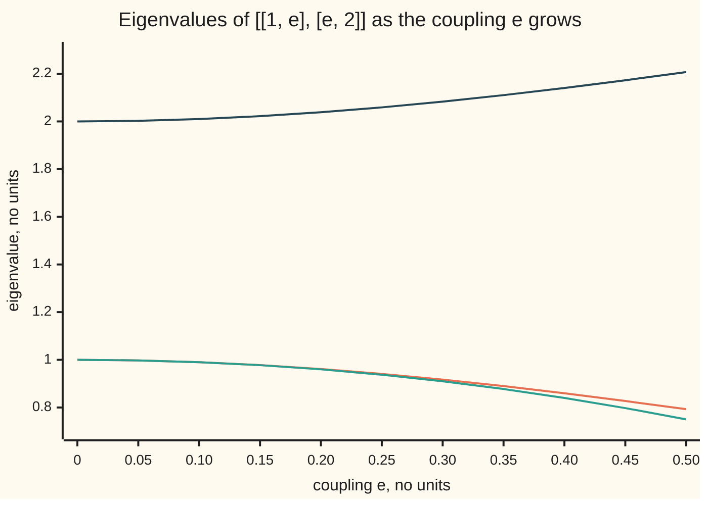

# Kato-Rellich: a small enough addition keeps an operator self-adjoint, and eigenvalues move smoothly

[Syllabus](../../../SYLLABUS.md) → [Functional analysis](../README.md) → [Unbounded Operators and Semigroups](../README.md#s05) → Kato-Rellich

---

## General Overview

Start with two energy levels, 1 and 2, in a made-up unit. Couple them weakly: put 0.1 in the two off-diagonal places of `[[1, 0], [0, 2]]`, giving `[[1, 0.1], [0.1, 2]]`.

The lower level is no longer 1. It is 0.990098. A one-line rule, "one minus the coupling squared", predicts 0.990000. Nothing else can go wrong: the new matrix is still symmetric, so its levels are still real.

Now take the real thing those two numbers stand for: the electron in a hydrogen atom. Its energy operator has two parts. The kinetic part is minus the **Laplacian**: $`\Delta`$, the sum of the three second derivatives. The pull of the proton is $`-1/r`$, where r is the distance from the proton.

Here the danger is real. The pull is infinite at the proton. The kinetic part is an **unbounded** operator (one that can multiply a function's size by any factor) that acts only on a restricted set of wave functions, its **domain** ([Unbounded operators](01-unbounded-operators-and-domains.md)). An infinite addition could change which wave functions are allowed, and with it whether the energies are real.

The Kato-Rellich theorem says when it cannot. Suppose the addition is symmetric (it gives every wave function a real average, as an energy should) and at most a fraction below 1 of the main operator, plus a fixed constant. Then the sum is self-adjoint (its own mirror image, domain included) on exactly the same domain.

The proton's pull passes this test with room to spare. So hydrogen's energy operator is self-adjoint. Its ground state $`e^{-r/2}`$ has energy $`-1/4`$ in these units, where one length unit is half the Bohr radius (hydrogen's natural size) and one energy unit is four times 13.6 eV. So it is hydrogen's binding energy of about 13.6 eV ([Hydrogen in outline](../../13-Engineering%20mathematics/09-Quantum%20Mechanics%20in%20Outline/07-the-hydrogen-atom-in-outline.md)).

Once that is settled, a small extra change moves an isolated level smoothly. The first-order and second-order formulas track it, exactly as in the 2 × 2 matrix.

**A symmetric addition V that obeys $`\lVert Vu\rVert \le a\lVert Au\rVert + b\lVert u\rVert`$ with a < 1 leaves a self-adjoint operator A self-adjoint on the same domain; the hydrogen pull obeys this for every a > 0; and an isolated eigenvalue then moves smoothly with the size of a further change, at first order by the change averaged over its eigenvector.**

**What kind of fact this is:** theorems, proved on this card in Why it works: Kato-Rellich, the bound on the hydrogen pull, and the survival of an isolated eigenvalue. The first- and second-order formulas are derived in a fold. That the full series in powers of the change converges near zero is stated, with its source (Kato's book, chapter II, for matrices). The code checks instances only.

### The picture: two levels pushed apart by the coupling



Orange: the exact lower eigenvalue. Teal: the second-order guess $`1 - e^2`$. Dark: the exact upper eigenvalue. The two levels repel each other, and the guess hugs the truth while e is small. N = 2 here: this is the finite rehearsal.

---

## The formula

Notation first, in words. All wave functions live in $`L^2(\mathbb{R}^3)`$, the complex functions on space with finite **size** $`\lVert u\rVert = \big(\int \lvert u\rvert^2\,dx\big)^{1/2}`$. The inner product conjugates its first slot, as wing 07's $`v^*w`$ does. A is the operator we already understand and V is the addition. $`\lVert u\rVert_\infty`$ is the largest absolute value of u.

**Relative bound.** V is **A-bounded** with relative bound a when V acts on everything A acts on, $`D(V) \supseteq D(A)`$, and

```math
\lVert Vu\rVert \le a\,\lVert Au\rVert + b\,\lVert u\rVert \qquad \text{for every } u \in D(A).
```

**Read it aloud:** the addition's output is at most a times the main operator's output plus b times the input.

**Kato-Rellich theorem.** If A is self-adjoint, V is **symmetric** ($`\langle u, Vw\rangle = \langle Vu, w\rangle`$ for u, w in its domain), and V is A-bounded with a < 1, then A + V is self-adjoint on $`D(A)`$.

**The hydrogen pull.** For $`A = -\Delta`$ on $`D(A) = H^2(\mathbb{R}^3)`$, any radius $`r_0 > 0`$ and any frequency scale β > 0 (a free number the proof tunes),

```math
\Big\lVert \frac{u}{r} \Big\rVert \le \sqrt{\frac{r_0}{2\beta}}\;\lVert \Delta u\rVert + \Big(\beta^{3/2}\sqrt{\tfrac{r_0}{2}} + \frac{1}{r_0}\Big)\lVert u\rVert .
```

**Read it aloud:** the pull's output is at most a small multiple of the Laplacian's output, as small as we like by taking $`r_0`$ small, plus a larger multiple of the input.

**A moving eigenvalue.** Let λ be a simple isolated eigenvalue of A (one eigenvector direction only, and a gap round it free of other spectrum), with eigenvector φ of size 1. When A has only eigenvalues, as a matrix does, let the other eigenvalues $`\lambda_m`$ have eigenvectors $`\phi_m`$. Then for small ε

```math
\lambda(\varepsilon) = \lambda + \varepsilon\,\langle \phi, V\phi\rangle + \varepsilon^2 \sum_{m} \frac{\lvert\langle \phi_m, V\phi\rangle\rvert^2}{\lambda - \lambda_m} + O(\varepsilon^3), \qquad P(\varepsilon) = \frac{1}{2\pi i}\oint_\Gamma R(z, A + \varepsilon V)\,dz .
```

**Read it aloud:** the new eigenvalue is the old one, plus the change averaged over the old eigenvector, plus each squared coupling divided by its gap. The projection onto the moving eigenvector is the resolvent integrated round a circle.

The sum is the matrix form of $`\lambda^{(2)} = \langle V\phi, (\lambda - A)^{-1}(I - P)V\phi\rangle`$, where $`P = P(0)`$ projects onto φ and $`(\lambda - A)^{-1}`$ acts on what is left perpendicular to φ. That general form holds for any simple isolated eigenvalue. When A also has continuous spectrum, as hydrogen does, it includes an integral over that continuum, and the sum over eigenvalues alone falls short.

| Symbol | Plain meaning | In our example | Push it up and the answer… |
| --- | --- | --- | --- |
| $`A`$, $`\Delta`$ | the operator we know; the Laplacian, sum of the three second derivatives | `diag(1, 2)`; $`-\Delta`$ for hydrogen | — |
| $`V`$ | the addition, symmetric | `[[0, 1], [1, 0]]`; the pull $`-1/r`$ | — |
| $`\varepsilon`$, $`e`$, $`M`$, $`Z`$ | size of a further change; the coupling in the matrix (a plain number, not the base of $`e^{-r/2}`$); the matrix A + eV; the nuclear charge 1 + ε | e = 0.1; Z = 1.1 | levels move further; past 0.5 the series fails |
| $`u`$, $`\lVert u\rVert`$, $`\lVert u\rVert_\infty`$, $`s`$ | a wave function; its size; its largest absolute value; how tightly a test function $`u = e^{-sr}`$ is squeezed | s = 0.5: size 5.013257, largest value 1; s from 0.5 to 32 | larger s: the pull's share of the bound shrinks |
| $`D(A)`$, $`H^2(\mathbb{R}^3)`$ | domain; the Sobolev space of u with u and $`\Delta u`$ of finite size | all of $`\mathbb{C}^2`$; $`H^2`$ for hydrogen | — |
| $`a`$, $`b`$ | relative bound; the constant that pays for it | 0.5 and 3; or 0.1 and 50.1 | a ≥ 1 and the theorem says nothing |
| $`\mu`$ | a real shift used in the proof | 12 | larger μ, smaller $`a + b/\mu`$ |
| $`r`$, $`r_0`$ | distance from the proton; the radius where the pull is split | $`r_0`$ = 1 | smaller $`r_0`$, smaller a, larger b |
| $`\beta`$, $`\xi`$, $`\hat u`$ | a free frequency scale; spatial frequency; Fourier transform | β = 2 | — |
| $`\psi`$; $`\lambda`$, $`\phi`$; $`\lambda_m`$, $`\phi_m`$; $`\lambda(\varepsilon)`$; $`\lambda^{(1)}`$, $`\lambda^{(2)}`$, $`\phi^{(1)}`$ | hydrogen's ground state; the isolated eigenvalue and its eigenvector; the other eigenvalues and eigenvectors; the moving eigenvalue; its first- and second-order coefficients, and the first-order change of eigenvector | $`e^{-r/2}`$; 1 and (1, 0), or $`-1/4`$; 2 and (0, 1); 0.990098; 0 and −1 | larger gap $`\lambda - \lambda_m`$, smaller $`\lambda^{(2)}`$ |
| $`R(z, T)`$, $`P`$, $`\Gamma`$, $`z`$ | resolvent $`(zI - T)^{-1}`$; Riesz projection; a circle; a point on it | Γ: centre 1, radius 0.5 | — |
| $`N`$, $`h`$, $`K`$ | grid points along r; their spacing; the last power kept in the series, $`(4e^2)^K`$ | 100 to 800; 40/(N + 1); K = 20 | error falls like $`h^2`$; past e = 0.5, more terms make it worse |

### When it holds

- **a strictly below 1.** On [Self-adjoint extensions](02-self-adjoint-extensions-and-the-spectral-theorem.md)'s bar, take V = −A. Then $`\lVert Vu\rVert = \lVert Au\rVert`$, so a = 1, and A + V is 0 on $`D(A)`$. Its closure is 0 on every profile, a bigger domain: A + V is not self-adjoint on $`D(A)`$.
- **V symmetric.** Add i times a bounded operator and the eigenvalues leave the real line. Kato-Rellich needs $`\langle u, Vu\rangle`$ real.
- **V defined on D(A), and weaker than A on squeezed functions.** The pull $`1/r^2`$ fails both. It scales exactly like the Laplacian: squeeze a function and both outputs grow at the same rate, so no b buys a smaller a. Worse, for u in $`H^2`$ with $`u(0) \ne 0`$, the size of $`u/r^2`$ near the proton contains $`\int_0^1 r^{-4}\,4\pi r^2\,dr`$, which diverges: V does not act on all of D(A), so Kato-Rellich does not apply.
- **An isolated eigenvalue.** The circle Γ must fit in a gap. Hydrogen's levels $`-1/(4n^2)`$ crowd towards 0, so the guaranteed range of ε shrinks for high levels.
- **ε small enough.** For the matrix the series in e converges only for $`\lvert e\rvert < 0.5`$. At e = 0.6 the series cut at K = 20, through $`e^{40}`$, is 2.069343 against the true 0.718975.

---

## Why it works

### Step 0: only the top end matters

Trouble for an unbounded operator lives in its sharply squeezed, fast-wiggling functions. There A is huge. If V is at most a fraction a < 1 of A there, A + V still looks like A at the top.

The rest of V is bounded by b, and a bounded addition never changes a domain. One trick makes this exact: shift by a large imaginary number iμ, so that the bounded part b is divided by μ, and invert the sum with a Neumann series.

### Step 1: what the matrix rehearsal hides

In $`\mathbb{C}^2`$ every matrix is bounded, its domain is everything, and any symmetric addition gives a symmetric, hence self-adjoint, sum. There a = 0 and $`b = \lVert V\rVert`$. So the first half of the theorem only has content in infinite dimensions. The second half, eigenvalues moving smoothly, is already visible at N = 2, and the chart shows it.

### Step 2: the shifted resolvent swallows V

For a self-adjoint A and real μ > 0, the cross terms cancel exactly as in the ±i test of [Self-adjoint extensions](02-self-adjoint-extensions-and-the-spectral-theorem.md):

```math
\lVert (A + i\mu)u\rVert^2 = \lVert Au\rVert^2 + \mu^2\lVert u\rVert^2 .
```

Write $`w = (A + i\mu)u`$. Then $`\lVert Au\rVert \le \lVert w\rVert`$ and $`\lVert u\rVert \le \lVert w\rVert/\mu`$, so the relative bound gives

```math
\lVert V(A + i\mu)^{-1}w\rVert \le \Big(a + \frac{b}{\mu}\Big)\lVert w\rVert .
```

For hydrogen with a = 0.5 and b = 3, the shift μ = 12 gives a + b/μ = 0.750000. Any a < 1 leaves room for such a μ.

### Step 3: Neumann series, then the ±i test

Factor the shifted sum:

```math
A + V + i\mu = \big(I + V(A + i\mu)^{-1}\big)(A + i\mu) .
```

The right factor maps $`D(A)`$ onto all of $`L^2`$, because A is self-adjoint. The left factor is the identity plus an operator of size at most 0.75. The [Neumann series](../03-Bounded%20Operators/06-neumann-series-and-inverting-close-to-the-identity.md) inverts it. So $`A + V + i\mu`$ reaches every function, and the same holds with $`-i\mu`$.

A + V is symmetric on $`D(A)`$, since both pieces are. Divide by μ: the operator $`(A + V)/\mu`$ is symmetric and $`(A+V)/\mu \pm i`$ reaches everything. That is the ±i test: a symmetric operator T is self-adjoint when T + i and T − i both reach every function. So $`(A + V)/\mu`$ is self-adjoint, and so is A + V, on $`D(A)`$.

<details>
<summary>Detailed proof: why reaching everything forces the domain</summary>

Let T = A + V on $`D(A)`$. Suppose $`v \in D(T^*)`$. Because $`T + i\mu`$ reaches everything, pick $`u \in D(A)`$ with $`(T + i\mu)u = (T^* + i\mu)v`$. Since $`T^*`$ extends T,

$`\displaystyle (T^* + i\mu)(v - u) = 0 .`$

Now take any f. Because $`T - i\mu`$ reaches everything, $`f = (T - i\mu)g`$ for some g in $`D(A)`$, and

$`\displaystyle \langle f, v - u\rangle = \langle (T - i\mu)g, v - u\rangle = \langle g, (T^* + i\mu)(v - u)\rangle = 0 .`$

So v − u is perpendicular to every f, hence zero, and v = u lies in $`D(A)`$. Thus $`D(T^*) = D(T)`$, and T is self-adjoint.

</details>

### Step 4: the hydrogen pull is Laplacian-bounded

Two facts, then a split.

**Fact 1: an $`H^2`$ function in three dimensions is bounded.** This is the three-dimensional cousin of [Sobolev and Poincare](../04-Distributions%20and%20Sobolev%20Spaces/09-sobolev-embedding-and-poincare-inequality.md). There one derivative stopped a spike in one dimension. Here two derivatives stop a spike in three. Precisely,

```math
\lVert u\rVert_\infty \le \frac{1}{\sqrt{8\pi\beta}}\Big(\lVert \Delta u\rVert + \beta^2\lVert u\rVert\Big) .
```

**Fact 2: the pull near the proton has finite size.** Take the function equal to 1/r inside radius $`r_0`$ and 0 outside. Its squared size is $`\int_0^{r_0} 4\pi r^2 \cdot r^{-2}\,dr = 4\pi r_0`$. Outside $`r_0`$ the pull is at most $`1/r_0`$.

**The split.** Near the proton, size of (1/r) times largest value of u; far away, $`1/r_0`$ times the size of u:

```math
\Big\lVert \frac{u}{r}\Big\rVert \le \sqrt{4\pi r_0}\,\lVert u\rVert_\infty + \frac{1}{r_0}\lVert u\rVert .
```

Put Fact 1 in, and the formula of the card falls out. The trade-off, from the code:

- $`r_0`$ = 1 and β = 2 give a = 0.5 and b = 3.
- $`r_0`$ = 0.02 and β = 1 give a = 0.1 and b = 50.1.
- $`r_0`$ = 0.0002 and β = 1 give a = 0.01 and b = 5000.01.

Every a > 0 is reachable. The price is a larger b, which Step 2 pays with a larger μ.

<details>
<summary>Detailed proof: the bound on the largest value</summary>

Use wing 07's transform, $`\hat u(\xi) = \int u(x)e^{-i\xi\cdot x}\,dx`$, in three dimensions. The inverse gives $`\lvert u(x)\rvert \le (2\pi)^{-3}\int \lvert\hat u\rvert\,d\xi`$, and Plancherel says $`\lVert \hat u\rVert^2 = (2\pi)^3\lVert u\rVert^2`$ ([Plancherel](../03-Bounded%20Operators/04-the-fourier-transform-as-a-unitary-operator.md)). The Laplacian becomes multiplication by $`-\lvert\xi\rvert^2`$. Multiply and divide by $`\lvert\xi\rvert^2 + \beta^2`$ and use Cauchy-Schwarz:

$`\displaystyle \int \lvert\hat u\rvert\,d\xi \le \Big(\int \frac{d\xi}{(\lvert\xi\rvert^2 + \beta^2)^2}\Big)^{1/2}\,\big\lVert (\lvert\xi\rvert^2 + \beta^2)\hat u\big\rVert .`$

The first integral, in spherical shells, is $`4\pi\int_0^\infty \rho^2(\rho^2 + \beta^2)^{-2}\,d\rho = 4\pi \cdot \pi/(4\beta) = \pi^2/\beta`$. The second factor is $`(2\pi)^{3/2}\lVert(-\Delta + \beta^2)u\rVert \le (2\pi)^{3/2}(\lVert\Delta u\rVert + \beta^2\lVert u\rVert)`$. Multiply:

$`\displaystyle \lVert u\rVert_\infty \le (2\pi)^{-3}\cdot\frac{\pi}{\sqrt\beta}\cdot(2\pi)^{3/2}\big(\lVert\Delta u\rVert + \beta^2\lVert u\rVert\big) = \frac{\lVert\Delta u\rVert + \beta^2\lVert u\rVert}{\sqrt{8\pi\beta}} .`$

Then $`\sqrt{4\pi r_0}/\sqrt{8\pi\beta} = \sqrt{r_0/(2\beta)}`$, which is a, and $`\beta^2\sqrt{r_0/(2\beta)} + 1/r_0`$ is b.

</details>

The code tests the bound on $`u = e^{-sr}`$, squeezed tighter as s grows. The pull's share, $`\lVert u/r\rVert / \lVert\Delta u\rVert`$, falls from 1.264911 at s = 0.5 to 0.019764 at s = 32. Squeezing makes the Laplacian win, which is exactly why the relative bound can be made as small as we like. The table's last column checks Fact 1 with β = 2: its right side never drops below the largest value, 1; the smallest is 1.144123 at s = 2.

### Step 5: the ground state, by hand

For a function of r alone, $`\Delta\psi = \psi'' + 2\psi'/r`$. With $`\psi = e^{-r/2}`$: $`\psi' = -\psi/2`$ and $`\psi'' = \psi/4`$, so

```math
-\Delta\psi - \frac{\psi}{r} = -\frac{\psi}{4} + \frac{\psi}{r} - \frac{\psi}{r} = -\frac14\,\psi .
```

The 1/r terms cancel exactly. That is why this ψ is an eigenvector. As a cross-check, the energy split by shells: kinetic $`\lVert\nabla\psi\rVert^2 = 2\pi`$, pull $`\langle\psi, \psi/r\rangle = 4\pi`$, size $`\lVert\psi\rVert^2 = 8\pi`$, and $`(2\pi - 4\pi)/8\pi = -1/4`$.

### Step 6: an isolated eigenvalue cannot split or vanish

Draw a circle Γ round the eigenvalue, inside the gap to the rest of the spectrum. On Γ the resolvent of A is bounded: for the matrix, Γ has centre 1 and radius 0.5, and $`\lVert R(z, A)\rVert = 2`$ on it. Factor as in Step 3:

```math
z - A - \varepsilon V = \big(I - \varepsilon V R(z, A)\big)(z - A) .
```

The left factor inverts by the Neumann series once $`\lvert\varepsilon\rvert\,\lVert V\rVert \cdot 2 < 1`$, so for $`\lvert\varepsilon\rvert < 0.5`$. Then $`R(z, A + \varepsilon V)`$ exists all round Γ: no eigenvalue crosses the circle.

The Riesz projection $`P(\varepsilon)`$ ([Holomorphic functional calculus](../03-Bounded%20Operators/14-holomorphic-functional-calculus-and-riesz-projections.md)) depends continuously on ε. A projection's rank is a whole number, and two projections closer than 1 have the same rank, so the rank stays 1. Exactly one eigenvalue sits inside Γ for every $`\lvert\varepsilon\rvert < 0.5`$.

The code computes $`P(0.1)`$ by summing the resolvent at 64 points on Γ. Its trace (the sum of its diagonal entries, which for a projection counts the eigenvalues inside Γ) is 1.000000. The trace of $`MP`$ is 0.990098, the exact eigenvalue.

For hydrogen the same argument runs with the relative bound in place of $`\lVert V\rVert`$: $`\lVert \varepsilon V R(z, A)\rVert \le \lvert\varepsilon\rvert\,(a\lVert AR(z,A)\rVert + b\lVert R(z,A)\rVert)`$, still finite on Γ.

For the matrix the guaranteed range 0.5 is sharp. The exact eigenvalues $`(3 \mp \sqrt{1 + 4e^2})/2`$ meet at the complex couplings $`e = \pm i/2`$. So the power series in e cannot converge beyond 0.5.

### Step 7: first and second order (Rayleigh-Schrödinger)

Expand $`\lambda(\varepsilon)`$ and its eigenvector in powers of ε, put both into $`(A + \varepsilon V)\phi(\varepsilon) = \lambda(\varepsilon)\phi(\varepsilon)`$, and match powers. [Perturbation theory](../../13-Engineering%20mathematics/09-Quantum%20Mechanics%20in%20Outline/10-time-independent-perturbation-theory.md) does this in full; the fold gives the short version.

- **Matrix:** with φ = (1, 0) and $`\phi_2`$ = (0, 1), $`\langle \phi, V\phi\rangle = 0`$ and $`\lvert\langle \phi_2, V\phi\rangle\rvert^2/(1 - 2) = -1`$, so $`\lambda \approx 1 - e^2`$: 0.990000 at e = 0.1, against 0.990098. The third-order term happens to vanish here, so the error, 0.000098, is about $`e^4`$.
- **Hydrogen with charge Z = 1 + ε:** the change is $`-\varepsilon/r`$. First order is $`-\varepsilon\langle\psi, \psi/r\rangle/\lVert\psi\rVert^2 = -\varepsilon \cdot 4\pi/8\pi = -\varepsilon/2`$. At ε = 0.1 that gives −0.300000, against the exact $`-(1.1)^2/4 = -0.302500`$.

<details>
<summary>Detailed derivation: the first two orders</summary>

Write $`\lambda(\varepsilon) = \lambda + \varepsilon\lambda^{(1)} + \varepsilon^2\lambda^{(2)} + \dots`$ and $`\phi(\varepsilon) = \phi + \varepsilon\phi^{(1)} + \dots`$, with $`\phi^{(1)}`$ perpendicular to φ. The ε-terms of $`(A + \varepsilon V)\phi(\varepsilon) = \lambda(\varepsilon)\phi(\varepsilon)`$ give

$`\displaystyle (A - \lambda)\phi^{(1)} = (\lambda^{(1)} - V)\phi .`$

Take the inner product with φ. The left side vanishes, because $`\langle \phi, (A - \lambda)\phi^{(1)}\rangle = \langle (A - \lambda)\phi, \phi^{(1)}\rangle = 0`$. So $`\lambda^{(1)} = \langle \phi, V\phi\rangle`$. Take it with $`\phi_m`$ instead: $`(\lambda_m - \lambda)\langle \phi_m, \phi^{(1)}\rangle = -\langle \phi_m, V\phi\rangle`$. The ε²-terms, paired with φ, give $`\lambda^{(2)} = \langle \phi, V\phi^{(1)}\rangle`$, and putting in $`\phi^{(1)}`$:

$`\displaystyle \lambda^{(2)} = \sum_{m} \frac{\lvert\langle \phi_m, V\phi\rangle\rvert^2}{\lambda - \lambda_m} .`$

That last step expands $`\phi^{(1)}`$ in the eigenvectors $`\phi_m`$, so it needs A to have only eigenvalues. In general the first equation gives $`\phi^{(1)} = (\lambda - A)^{-1}(I - P)V\phi`$, so $`\lambda^{(2)} = \langle V\phi, (\lambda - A)^{-1}(I - P)V\phi\rangle`$. The gap $`\lambda - \lambda_m`$ in the denominator is why the eigenvalue must be isolated. Simplicity is why φ is fixed: with two eigenvectors for λ, first order must first choose the right mix of them.

</details>

### Step 8: what changes as N grows

The code also solves hydrogen on a grid. It keeps the radial function $`u = r\psi`$ at N points out to r = 40. That gives a tridiagonal matrix, whose lowest eigenvalue it finds by bisection on a sign count.

The error falls from 0.002404 at N = 100 to 0.000039 at N = 800. Each doubling divides it by 3.90, 3.97, then 3.99: the $`h^2`$ rate of the three-point second difference. The second level comes out at −0.062491, against −1/16.

What the truncation hides: the grid matrix has N eigenvalues and no domain question, so Kato-Rellich is empty for it. The true operator has infinitely many levels $`-1/(4n^2)`$ crowding towards 0, then a continuous spectrum from 0 upwards, which the box at r = 40 chops into a ladder. Only the proof in Steps 2 to 4 covers the infinite case.

---

## Worked numbers, by hand

The matrix, e = 0.1:

| Step | Arithmetic | Value |
| --- | --- | --- |
| characteristic equation | $`(1 - \lambda)(2 - \lambda) - 0.01 = 0`$ | $`\lambda^2 - 3\lambda + 1.99 = 0`$ |
| lower root | $`(3 - \sqrt{1.04})/2`$ | 0.990098 |
| first order | $`1 + 0.1 \times 0`$ | 1.000000 |
| second order | $`1 + 0.01 \times 1/(1 - 2)`$ | 0.990000 |
| error | $`0.990098 - 0.990000`$ | **0.000098** |

Hydrogen, $`\psi = e^{-r/2}`$:

| Step | Arithmetic | Value |
| --- | --- | --- |
| size squared | $`4\pi\int_0^\infty r^2 e^{-r}\,dr = 4\pi \times 2`$ | $`8\pi`$ |
| kinetic | $`4\pi\int_0^\infty r^2 \cdot \tfrac14 e^{-r}\,dr`$ | $`2\pi`$ |
| pull | $`4\pi\int_0^\infty r\,e^{-r}\,dr`$ | $`4\pi`$ |
| energy | $`(2\pi - 4\pi)/8\pi`$ | **−0.250000** |
| relative bound, ψ itself | $`0.5 \times 2.802496 + 3 \times 5.013257`$ | 16.441017 ≥ 3.544908 |
| Z = 1.1, first order | $`-0.25 - 0.1 \times 4\pi/8\pi`$ | −0.300000 (exact −0.302500) |

The second-order guess is off by under a ten-thousandth, and hydrogen's energy is −1/4, the 13.6 eV binding energy.

### What breaks if you drop a piece

| Mistake | Comes out at | What went wrong |
| --- | --- | --- |
| Stop at first order in the matrix | 1.000000 (right: 0.990098) | the diagonal of V is 0, so all the movement is second order |
| Gap the wrong way round, $`\lambda_m - \lambda`$ | 1.010000 | the lower level is pushed down by the level above, not up |
| Coupling past the radius, e = 0.6, cut at K = 20 | 2.069343 (right: 0.718975) | the series converges only for e below 0.5; the hypothesis "small enough" fails |
| Hydrogen at Z = 2 by first order only | −0.750000 (right: −1.000000) | the dropped $`-\varepsilon^2/4`$ is the whole gap: here the series stops at second order, so first order alone misses it |

---

## Code, from first principles, and it actually runs

The code takes three roads to the matrix eigenvalue: the quadratic formula, the second-order formula, and the Riesz projection summed round a circle. It sums the power series at e = 0.4 and e = 0.6 to show convergence and divergence. For hydrogen it checks:

- the eigen-equation, by difference quotients;
- the energy, by Simpson's rule on shells;
- the relative bound on squeezed test functions, against closed forms;
- the ground level, by a grid at four sizes N.

A Lean file proves Step 2's estimate, the 2 × 2 facts and hydrogen's ground state.

### Python

```python
# Kato-Rellich and perturbed eigenvalues: a 2 x 2 rehearsal, then hydrogen, -Laplacian - 1/r on R^3.
# Standard library only. No eigen-solver is imported: roots, bisection, contour sums and Simpson are written out.
from math import sqrt, exp, pi, cos, sin

def simpson(f, a, b, n=4000):
    h = (b - a) / n
    s = f(a) + f(b)
    for i in range(1, n):
        s += (4 if i % 2 else 2) * f(a + i * h)
    return s * h / 3

# ---- Part 1: M(e) = A + eV with A = diag(1, 2), V = [[0, 1], [1, 0]] ----
def exact_low(e):  return (3 - sqrt(1 + 4 * e * e)) / 2      # road 1: the quadratic formula
def exact_high(e): return (3 + sqrt(1 + 4 * e * e)) / 2
V = [[0.0, 1.0], [1.0, 0.0]]
def rs2(e):        return 1 + e * V[0][0] + e * e * V[1][0] * V[1][0] / (1 - 2)  # road 2: Rayleigh-Schroedinger

def riesz(e, K=64, c=1.0, rho=0.5):                          # road 3: P = (1/2 pi i) closed integral of (z - M)^-1 dz
    P, rmax = [[0j, 0j], [0j, 0j]], 0.0
    for k in range(K):
        w = complex(cos(2 * pi * k / K), sin(2 * pi * k / K))
        z = c + rho * w
        rmax = max(rmax, 1 / abs(z - 1), 1 / abs(z - 2))      # |R(z, A)| for A = diag(1, 2)
        a, b, d = z - 1, -e, z - 2                            # z - M = [[a, b], [b, d]]
        det = a * d - b * b
        inv = [[d / det, -b / det], [-b / det, a / det]]
        for i in range(2):
            for j in range(2):
                P[i][j] += inv[i][j] * rho * w / K
    trP = (P[0][0] + P[1][1]).real
    trMP = (1 * P[0][0] + e * P[1][0] + e * P[0][1] + 2 * P[1][1]).real
    return trP, trMP, rmax

e = 0.1
trP, lam3, rmax = riesz(e)
print("== 2 x 2: M = [[1, e], [e, 2]], e = 0.1 ==")
print(f"exact lower eigenvalue        {exact_low(e):.6f}")
print(f"second order 1 - e^2          {rs2(e):.6f}")
print(f"Riesz contour: trace P        {trP:.6f}")
print(f"Riesz contour: trace MP       {lam3:.6f}")
print(f"max |R(z, A)| on the circle   {rmax:.6f}")
print(f"error of 1 - e^2              {exact_low(e) - rs2(e):.6f}")
print(f"first order only, 1 + e V11   {1 + e * V[0][0]:.6f}")
print(f"wrong sign, divide by 2 - 1   {1 + e * e * V[1][0] * V[1][0] / (2 - 1):.6f}")
print(f"guaranteed range |e| < 1/(max|R| |V|) = {1 / (rmax * 1.0):.6f}")
assert abs(lam3 - exact_low(e)) < 1e-12 and abs(trP - 1) < 1e-12
assert abs(rmax - 1 / 0.5) < 1e-12                            # on the circle, |z - 1| = radius 0.5
assert abs(exact_low(e) - rs2(e)) < 2 * e ** 4
print("chart e, lower, 1 - e^2, upper")
for i in range(11):
    x = i * 0.05
    print(f"chart {x:.2f} {exact_low(x):.6f} {rs2(x):.6f} {exact_high(x):.6f}")

def series(e, K):                                            # (3 - sum_k binom(1/2, k) (4e^2)^k) / 2
    c, s, x, xk = 1.0, 0.0, 4 * e * e, 1.0
    for k in range(K + 1):
        s += c * xk
        c, xk = c * (0.5 - k) / (k + 1), xk * x
    return (3 - s) / 2
print("power series in e, terms k = 0..K, up to e^(2K)")
for ee in (0.4, 0.6):
    print(f"e = {ee:.1f}: K=5 {series(ee, 5):.6f}  K=10 {series(ee, 10):.6f}  K=20 {series(ee, 20):.6f}  exact {exact_low(ee):.6f}")
assert abs(series(0.4, 20) - exact_low(0.4)) < 1e-2 and abs(series(0.6, 20) - exact_low(0.6)) > 1

# ---- Part 2: hydrogen, psi = e^(-r/2); radial integrals carry the 4 pi r^2 shell area ----
nrm = simpson(lambda r: 4 * pi * r * r * exp(-r), 0, 60)
kin = simpson(lambda r: 4 * pi * r * r * 0.25 * exp(-r), 0, 60)   # |grad psi|^2 = psi'^2 = e^(-r)/4
pot = simpson(lambda r: 4 * pi * r * exp(-r), 0, 60)               # <psi, psi/r>
print("== hydrogen ground state psi = e^(-r/2) ==")
print(f"|psi|^2/pi {nrm/pi:.6f}  kinetic/pi {kin/pi:.6f}  <psi,psi/r>/pi {pot/pi:.6f}")
print(f"Rayleigh quotient (kin - pot)/|psi|^2  {(kin - pot) / nrm:.6f}")
assert abs((kin - pot) / nrm + 0.25) < 1e-9
psi = lambda r: exp(-r / 2)
res, hd = 0.0, 1e-3
for r in (0.5, 1.0, 2.0, 5.0):
    d2 = (psi(r + hd) - 2 * psi(r) + psi(r - hd)) / (hd * hd)
    d1 = (psi(r + hd) - psi(r - hd)) / (2 * hd)
    res = max(res, abs(-d2 - 2 * d1 / r - psi(r) / r + psi(r) / 4))
print(f"max |H psi + psi/4| at r = 0.5, 1, 2, 5 (difference quotients)  {res:.6f}")
assert res < 1e-6

print("== relative bound on u = e^(-s r): |u/r| <= 0.5 |Lap u| + 3 |u| ==")
print("s       |u/r|      |Lap u|    |u|        bound      |u/r|/|Lap u|  Sobolev, beta = 2, on max|u| = 1")
for s in (0.5, 2.0, 8.0, 32.0):
    L = 40 / s
    ur = sqrt(simpson(lambda r: 4 * pi * exp(-2 * s * r), 0, L))
    lu = sqrt(simpson(lambda r: 4 * pi * exp(-2 * s * r) * (s * s * r - 2 * s) * (s * s * r - 2 * s), 0, L))
    un = sqrt(simpson(lambda r: 4 * pi * r * r * exp(-2 * s * r), 0, L))
    for got, want in ((ur, sqrt(2 * pi / s)), (lu, sqrt(5 * pi * s)), (un, sqrt(pi / (s * s * s)))):
        assert abs(got / want - 1) < 1e-7
    bound, sob = 0.5 * lu + 3 * un, (lu + 4 * un) / sqrt(16 * pi)
    assert ur <= bound and 1 <= sob
    print(f"{s:<7.1f} {ur:<10.6f} {lu:<10.6f} {un:<10.6f} {bound:<10.6f} {ur / lu:<14.6f} {sob:.6f}")
print("trade-off a = sqrt(r0/(2 beta)), b = beta^1.5 sqrt(r0/2) + 1/r0")
for r0, beta in ((1.0, 2.0), (0.02, 1.0), (0.0002, 1.0)):
    print(f"r0 = {r0:.4f}, beta = {beta:.1f}: a = {sqrt(r0 / (2 * beta)):.6f}, b = {beta * sqrt(beta) * sqrt(r0 / 2) + 1 / r0:.6f}")
print(f"mu = 12: a + b/mu = {0.5 + 3 / 12:.6f}")

def lowest(Z, N, k=1, Rmax=40.0):                            # road 2: radial grid, u = r psi, bisection by Sturm count
    h = Rmax / (N + 1)
    def count(x):
        q, c = 1.0, 0
        for i in range(1, N + 1):
            q = 2 / (h * h) - Z / (i * h) - x - (1 / ((h * h) * (h * h)) / q if i > 1 else 0)
            if q == 0: q = 1e-300
            if q < 0: c += 1
        return c
    lo, hi = -2.0, 1.0
    for _ in range(60):
        mid = (lo + hi) / 2
        if count(mid) >= k: hi = mid
        else: lo = mid
    return (lo + hi) / 2
print("== grid truncation, box of radius 40, N points ==")
prev = None
for N in (100, 200, 400, 800):
    E = lowest(1.0, N)
    print(f"N = {N:<4} lowest {E:.6f}  error {E + 0.25:.6f}" + (f"  error ratio {(prev + 0.25) / (E + 0.25):.2f}" if prev else ""))
    prev = E
E2 = lowest(1.0, 800, 2)
print(f"N = 800 second level {E2:.6f} (exact -1/16 = -0.062500)")
assert abs(prev + 0.25) < 1e-3 and abs(E2 + 0.0625) < 1e-3

print("== charge Z = 1 + eps: first order -1/4 - eps <psi,psi/r>/|psi|^2, exact -(1+eps)^2/4 ==")
for eps in (0.1, 1.0):
    first, grid = -0.25 - eps * pot / nrm, lowest(1 + eps, 800)
    print(f"eps = {eps:.1f}: first order {first:.6f}  exact {-(1 + eps) * (1 + eps) / 4:.6f}  grid N = 800 {grid:.6f}")
    assert abs(grid + (1 + eps) ** 2 / 4) < 2e-3 * (1 + eps) ** 4
assert abs(pot / nrm - 0.5) < 1e-9
print("ALL CHECKS PASS")
```

**Ran 2026-11-24 on macOS, Python 3.14.10, standard library only. All checks passed. Output, pasted from the run:**

```
== 2 x 2: M = [[1, e], [e, 2]], e = 0.1 ==
exact lower eigenvalue        0.990098
second order 1 - e^2          0.990000
Riesz contour: trace P        1.000000
Riesz contour: trace MP       0.990098
max |R(z, A)| on the circle   2.000000
error of 1 - e^2              0.000098
first order only, 1 + e V11   1.000000
wrong sign, divide by 2 - 1   1.010000
guaranteed range |e| < 1/(max|R| |V|) = 0.500000
chart e, lower, 1 - e^2, upper
chart 0.00 1.000000 1.000000 2.000000
chart 0.05 0.997506 0.997500 2.002494
chart 0.10 0.990098 0.990000 2.009902
chart 0.15 0.977985 0.977500 2.022015
chart 0.20 0.961484 0.960000 2.038516
chart 0.25 0.940983 0.937500 2.059017
chart 0.30 0.916905 0.910000 2.083095
chart 0.35 0.889672 0.877500 2.110328
chart 0.40 0.859688 0.840000 2.140312
chart 0.45 0.827319 0.797500 2.172681
chart 0.50 0.792893 0.750000 2.207107
power series in e, terms k = 0..K, up to e^(2K)
e = 0.4: K=5 0.859217  K=10 0.859707  K=20 0.859688  exact 0.859688
e = 0.6: K=5 0.675616  K=10 0.817158  K=20 2.069343  exact 0.718975
== hydrogen ground state psi = e^(-r/2) ==
|psi|^2/pi 8.000000  kinetic/pi 2.000000  <psi,psi/r>/pi 4.000000
Rayleigh quotient (kin - pot)/|psi|^2  -0.250000
max |H psi + psi/4| at r = 0.5, 1, 2, 5 (difference quotients)  0.000000
== relative bound on u = e^(-s r): |u/r| <= 0.5 |Lap u| + 3 |u| ==
s       |u/r|      |Lap u|    |u|        bound      |u/r|/|Lap u|  Sobolev, beta = 2, on max|u| = 1
0.5     3.544908   2.802496   5.013257   16.441017  1.264911       3.223712
2.0     1.772454   5.604991   0.626657   4.682467   0.316228       1.144123
8.0     0.886227   11.209982  0.078332   5.839988   0.079057       1.625333
32.0    0.443113   22.419965  0.009792   11.239357  0.019764       3.167802
trade-off a = sqrt(r0/(2 beta)), b = beta^1.5 sqrt(r0/2) + 1/r0
r0 = 1.0000, beta = 2.0: a = 0.500000, b = 3.000000
r0 = 0.0200, beta = 1.0: a = 0.100000, b = 50.100000
r0 = 0.0002, beta = 1.0: a = 0.010000, b = 5000.010000
mu = 12: a + b/mu = 0.750000
== grid truncation, box of radius 40, N points ==
N = 100  lowest -0.247596  error 0.002404
N = 200  lowest -0.249384  error 0.000616  error ratio 3.90
N = 400  lowest -0.249845  error 0.000155  error ratio 3.97
N = 800  lowest -0.249961  error 0.000039  error ratio 3.99
N = 800 second level -0.062491 (exact -1/16 = -0.062500)
== charge Z = 1 + eps: first order -1/4 - eps <psi,psi/r>/|psi|^2, exact -(1+eps)^2/4 ==
eps = 0.1: first order -0.300000  exact -0.302500  grid N = 800 -0.302443
eps = 1.0: first order -0.750000  exact -1.000000  grid N = 800 -0.999377
ALL CHECKS PASS
```

### Rust

```rust
// Kato-Rellich and perturbed eigenvalues: a 2 x 2 rehearsal, then hydrogen, -Laplacian - 1/r on R^3.
// std only. No eigen-solver: roots, bisection, contour sums and Simpson are written out.
use std::f64::consts::PI;

#[derive(Clone, Copy)]
struct C { re: f64, im: f64 }
impl C {
    fn add(self, o: C) -> C { C { re: self.re + o.re, im: self.im + o.im } }
    fn sub(self, o: C) -> C { C { re: self.re - o.re, im: self.im - o.im } }
    fn mul(self, o: C) -> C { C { re: self.re * o.re - self.im * o.im, im: self.re * o.im + self.im * o.re } }
    fn div(self, o: C) -> C {
        let d = o.re * o.re + o.im * o.im;
        C { re: (self.re * o.re + self.im * o.im) / d, im: (self.im * o.re - self.re * o.im) / d }
    }
    fn r(x: f64) -> C { C { re: x, im: 0.0 } }
}

fn simpson(f: &dyn Fn(f64) -> f64, a: f64, b: f64, n: usize) -> f64 {
    let h = (b - a) / n as f64;
    let mut s = f(a) + f(b);
    for i in 1..n { s += (if i % 2 == 1 { 4.0 } else { 2.0 }) * f(a + i as f64 * h); }
    s * h / 3.0
}

const V: [[f64; 2]; 2] = [[0.0, 1.0], [1.0, 0.0]];
fn exact_low(e: f64) -> f64 { (3.0 - (1.0 + 4.0 * e * e).sqrt()) / 2.0 } // road 1: the quadratic formula
fn exact_high(e: f64) -> f64 { (3.0 + (1.0 + 4.0 * e * e).sqrt()) / 2.0 }
fn rs2(e: f64) -> f64 { 1.0 + e * V[0][0] + e * e * V[1][0] * V[1][0] / (1.0 - 2.0) } // road 2: Rayleigh-Schroedinger

fn riesz(e: f64, k: usize, c: f64, rho: f64) -> (f64, f64, f64) { // road 3: P = (1/2 pi i) closed integral of (z - M)^-1 dz
    let (mut p, mut rmax) = ([[C::r(0.0); 2]; 2], 0.0f64);
    for j in 0..k {
        let t = 2.0 * PI * j as f64 / k as f64;
        let w = C { re: t.cos(), im: t.sin() };
        let z = C::r(c).add(C::r(rho).mul(w));
        for q in [z.sub(C::r(1.0)), z.sub(C::r(2.0))] { rmax = rmax.max(1.0 / (q.re * q.re + q.im * q.im).sqrt()); } // |R(z, A)|
        let (a, b, d) = (z.sub(C::r(1.0)), C::r(-e), z.sub(C::r(2.0)));
        let det = a.mul(d).sub(b.mul(b));
        let zero = C::r(0.0);
        let inv = [[d.div(det), zero.sub(b).div(det)], [zero.sub(b).div(det), a.div(det)]];
        let f = C::r(rho).mul(w).div(C::r(k as f64));
        for i in 0..2 { for l in 0..2 { p[i][l] = p[i][l].add(inv[i][l].mul(f)); } }
    }
    let tr_p = p[0][0].add(p[1][1]).re;
    let tr_mp = 1.0 * p[0][0].re + e * p[1][0].re + e * p[0][1].re + 2.0 * p[1][1].re;
    (tr_p, tr_mp, rmax)
}

fn series(e: f64, kk: usize) -> f64 { // (3 - sum_k binom(1/2, k) (4e^2)^k) / 2
    let (mut c, mut s, x, mut xk) = (1.0, 0.0, 4.0 * e * e, 1.0);
    for k in 0..=kk {
        s += c * xk;
        c = c * (0.5 - k as f64) / (k as f64 + 1.0);
        xk = xk * x;
    }
    (3.0 - s) / 2.0
}

fn lowest(z: f64, n: usize, k: usize, rmax: f64) -> f64 { // road 2: radial grid, u = r psi, bisection by Sturm count
    let h = rmax / (n as f64 + 1.0);
    let count = |x: f64| -> usize {
        let (mut q, mut c) = (1.0f64, 0usize);
        for i in 1..=n {
            q = 2.0 / (h * h) - z / (i as f64 * h) - x - (if i > 1 { 1.0 / ((h * h) * (h * h)) / q } else { 0.0 });
            if q == 0.0 { q = 1e-300; }
            if q < 0.0 { c += 1; }
        }
        c
    };
    let (mut lo, mut hi) = (-2.0f64, 1.0f64);
    for _ in 0..60 {
        let mid = (lo + hi) / 2.0;
        if count(mid) >= k { hi = mid; } else { lo = mid; }
    }
    (lo + hi) / 2.0
}

fn main() {
    let e = 0.1;
    let (tr_p, lam3, rmax) = riesz(e, 64, 1.0, 0.5);
    println!("== 2 x 2: M = [[1, e], [e, 2]], e = 0.1 ==");
    println!("exact lower eigenvalue        {:.6}", exact_low(e));
    println!("second order 1 - e^2          {:.6}", rs2(e));
    println!("Riesz contour: trace P        {:.6}", tr_p);
    println!("Riesz contour: trace MP       {:.6}", lam3);
    println!("max |R(z, A)| on the circle   {:.6}", rmax);
    println!("error of 1 - e^2              {:.6}", exact_low(e) - rs2(e));
    println!("first order only, 1 + e V11   {:.6}", 1.0 + e * V[0][0]);
    println!("wrong sign, divide by 2 - 1   {:.6}", 1.0 + e * e * V[1][0] * V[1][0] / (2.0 - 1.0));
    println!("guaranteed range |e| < 1/(max|R| |V|) = {:.6}", 1.0 / (rmax * 1.0));
    assert!((lam3 - exact_low(e)).abs() < 1e-12 && (tr_p - 1.0).abs() < 1e-12);
    assert!((rmax - 1.0 / 0.5).abs() < 1e-12); // on the circle, |z - 1| = radius 0.5
    assert!((exact_low(e) - rs2(e)).abs() < 2.0 * e.powi(4));
    println!("chart e, lower, 1 - e^2, upper");
    for i in 0..11 {
        let x = i as f64 * 0.05;
        println!("chart {:.2} {:.6} {:.6} {:.6}", x, exact_low(x), rs2(x), exact_high(x));
    }
    println!("power series in e, terms k = 0..K, up to e^(2K)");
    for ee in [0.4, 0.6] {
        println!("e = {:.1}: K=5 {:.6}  K=10 {:.6}  K=20 {:.6}  exact {:.6}", ee, series(ee, 5), series(ee, 10), series(ee, 20), exact_low(ee));
    }
    assert!((series(0.4, 20) - exact_low(0.4)).abs() < 1e-2 && (series(0.6, 20) - exact_low(0.6)).abs() > 1.0);

    let nrm = simpson(&|r: f64| 4.0 * PI * r * r * (-r).exp(), 0.0, 60.0, 4000);
    let kin = simpson(&|r: f64| 4.0 * PI * r * r * 0.25 * (-r).exp(), 0.0, 60.0, 4000); // psi'^2 = e^(-r)/4
    let pot = simpson(&|r: f64| 4.0 * PI * r * (-r).exp(), 0.0, 60.0, 4000); // <psi, psi/r>
    println!("== hydrogen ground state psi = e^(-r/2) ==");
    println!("|psi|^2/pi {:.6}  kinetic/pi {:.6}  <psi,psi/r>/pi {:.6}", nrm / PI, kin / PI, pot / PI);
    println!("Rayleigh quotient (kin - pot)/|psi|^2  {:.6}", (kin - pot) / nrm);
    assert!(((kin - pot) / nrm + 0.25).abs() < 1e-9);
    let psi = |r: f64| (-r / 2.0).exp();
    let (mut res, hd) = (0.0f64, 1e-3);
    for r in [0.5, 1.0, 2.0, 5.0] {
        let d2 = (psi(r + hd) - 2.0 * psi(r) + psi(r - hd)) / (hd * hd);
        let d1 = (psi(r + hd) - psi(r - hd)) / (2.0 * hd);
        res = res.max((-d2 - 2.0 * d1 / r - psi(r) / r + psi(r) / 4.0).abs());
    }
    println!("max |H psi + psi/4| at r = 0.5, 1, 2, 5 (difference quotients)  {:.6}", res);
    assert!(res < 1e-6);

    println!("== relative bound on u = e^(-s r): |u/r| <= 0.5 |Lap u| + 3 |u| ==");
    println!("s       |u/r|      |Lap u|    |u|        bound      |u/r|/|Lap u|  Sobolev, beta = 2, on max|u| = 1");
    for s in [0.5f64, 2.0, 8.0, 32.0] {
        let l = 40.0 / s;
        let ur = simpson(&|r: f64| 4.0 * PI * (-2.0 * s * r).exp(), 0.0, l, 4000).sqrt();
        let lu = simpson(&|r: f64| 4.0 * PI * (-2.0 * s * r).exp() * (s * s * r - 2.0 * s) * (s * s * r - 2.0 * s), 0.0, l, 4000).sqrt();
        let un = simpson(&|r: f64| 4.0 * PI * r * r * (-2.0 * s * r).exp(), 0.0, l, 4000).sqrt();
        for (got, want) in [(ur, (2.0 * PI / s).sqrt()), (lu, (5.0 * PI * s).sqrt()), (un, (PI / (s * s * s)).sqrt())] {
            assert!((got / want - 1.0).abs() < 1e-7);
        }
        let (bound, sob) = (0.5 * lu + 3.0 * un, (lu + 4.0 * un) / (16.0 * PI).sqrt());
        assert!(ur <= bound && 1.0 <= sob);
        println!("{:<7.1} {:<10.6} {:<10.6} {:<10.6} {:<10.6} {:<14.6} {:.6}", s, ur, lu, un, bound, ur / lu, sob);
    }
    println!("trade-off a = sqrt(r0/(2 beta)), b = beta^1.5 sqrt(r0/2) + 1/r0");
    for (r0, beta) in [(1.0f64, 2.0f64), (0.02, 1.0), (0.0002, 1.0)] {
        println!("r0 = {:.4}, beta = {:.1}: a = {:.6}, b = {:.6}", r0, beta, (r0 / (2.0 * beta)).sqrt(), beta * beta.sqrt() * (r0 / 2.0).sqrt() + 1.0 / r0);
    }
    println!("mu = 12: a + b/mu = {:.6}", 0.5 + 3.0 / 12.0);

    println!("== grid truncation, box of radius 40, N points ==");
    let mut prev: Option<f64> = None;
    for n in [100usize, 200, 400, 800] {
        let en = lowest(1.0, n, 1, 40.0);
        let tail = match prev { Some(p) => format!("  error ratio {:.2}", (p + 0.25) / (en + 0.25)), None => String::new() };
        println!("N = {:<4} lowest {:.6}  error {:.6}{}", n, en, en + 0.25, tail);
        prev = Some(en);
    }
    let e2 = lowest(1.0, 800, 2, 40.0);
    println!("N = 800 second level {:.6} (exact -1/16 = -0.062500)", e2);
    assert!((prev.unwrap() + 0.25).abs() < 1e-3 && (e2 + 0.0625).abs() < 1e-3);

    println!("== charge Z = 1 + eps: first order -1/4 - eps <psi,psi/r>/|psi|^2, exact -(1+eps)^2/4 ==");
    for eps in [0.1f64, 1.0] {
        let (first, grid) = (-0.25 - eps * pot / nrm, lowest(1.0 + eps, 800, 1, 40.0));
        println!("eps = {:.1}: first order {:.6}  exact {:.6}  grid N = 800 {:.6}", eps, first, -(1.0 + eps) * (1.0 + eps) / 4.0, grid);
        assert!((grid + (1.0 + eps).powi(2) / 4.0).abs() < 2e-3 * (1.0 + eps).powi(4));
    }
    assert!((pot / nrm - 0.5).abs() < 1e-9);
    println!("ALL CHECKS PASS");
}
```

**Ran 2026-11-24 on macOS, rustc 1.98.1, no crates. All checks passed. Output, pasted from the run:**

```
== 2 x 2: M = [[1, e], [e, 2]], e = 0.1 ==
exact lower eigenvalue        0.990098
second order 1 - e^2          0.990000
Riesz contour: trace P        1.000000
Riesz contour: trace MP       0.990098
max |R(z, A)| on the circle   2.000000
error of 1 - e^2              0.000098
first order only, 1 + e V11   1.000000
wrong sign, divide by 2 - 1   1.010000
guaranteed range |e| < 1/(max|R| |V|) = 0.500000
chart e, lower, 1 - e^2, upper
chart 0.00 1.000000 1.000000 2.000000
chart 0.05 0.997506 0.997500 2.002494
chart 0.10 0.990098 0.990000 2.009902
chart 0.15 0.977985 0.977500 2.022015
chart 0.20 0.961484 0.960000 2.038516
chart 0.25 0.940983 0.937500 2.059017
chart 0.30 0.916905 0.910000 2.083095
chart 0.35 0.889672 0.877500 2.110328
chart 0.40 0.859688 0.840000 2.140312
chart 0.45 0.827319 0.797500 2.172681
chart 0.50 0.792893 0.750000 2.207107
power series in e, terms k = 0..K, up to e^(2K)
e = 0.4: K=5 0.859217  K=10 0.859707  K=20 0.859688  exact 0.859688
e = 0.6: K=5 0.675616  K=10 0.817158  K=20 2.069343  exact 0.718975
== hydrogen ground state psi = e^(-r/2) ==
|psi|^2/pi 8.000000  kinetic/pi 2.000000  <psi,psi/r>/pi 4.000000
Rayleigh quotient (kin - pot)/|psi|^2  -0.250000
max |H psi + psi/4| at r = 0.5, 1, 2, 5 (difference quotients)  0.000000
== relative bound on u = e^(-s r): |u/r| <= 0.5 |Lap u| + 3 |u| ==
s       |u/r|      |Lap u|    |u|        bound      |u/r|/|Lap u|  Sobolev, beta = 2, on max|u| = 1
0.5     3.544908   2.802496   5.013257   16.441017  1.264911       3.223712
2.0     1.772454   5.604991   0.626657   4.682467   0.316228       1.144123
8.0     0.886227   11.209982  0.078332   5.839988   0.079057       1.625333
32.0    0.443113   22.419965  0.009792   11.239357  0.019764       3.167802
trade-off a = sqrt(r0/(2 beta)), b = beta^1.5 sqrt(r0/2) + 1/r0
r0 = 1.0000, beta = 2.0: a = 0.500000, b = 3.000000
r0 = 0.0200, beta = 1.0: a = 0.100000, b = 50.100000
r0 = 0.0002, beta = 1.0: a = 0.010000, b = 5000.010000
mu = 12: a + b/mu = 0.750000
== grid truncation, box of radius 40, N points ==
N = 100  lowest -0.247596  error 0.002404
N = 200  lowest -0.249384  error 0.000616  error ratio 3.90
N = 400  lowest -0.249845  error 0.000155  error ratio 3.97
N = 800  lowest -0.249961  error 0.000039  error ratio 3.99
N = 800 second level -0.062491 (exact -1/16 = -0.062500)
== charge Z = 1 + eps: first order -1/4 - eps <psi,psi/r>/|psi|^2, exact -(1+eps)^2/4 ==
eps = 0.1: first order -0.300000  exact -0.302500  grid N = 800 -0.302443
eps = 1.0: first order -0.750000  exact -1.000000  grid N = 800 -0.999377
ALL CHECKS PASS
```

### Lean

Lean proves Kato-Rellich in full, the 2 × 2 rehearsal for every e, and hydrogen's ground-state equation away from the proton.

- Suppose A is self-adjoint and V is symmetric and A-bounded with relative bound a < 1. Then A + V is self-adjoint, and its domain is exactly $`D(A)`$.
- Take the lower eigenvalue $`(3 - \sqrt{1 + 4e^2})/2`$ of `[[1, e], [e, 2]]`, for any real e. Then it is an eigenvalue, and no eigenvalue of the matrix lies below it.
- Take the same lower eigenvalue, for any real e. Then it lies between $`1 - e^2`$ and $`1 - e^2 + e^4`$, so the second-order error is at most $`e^4`$.
- Take $`\psi = e^{-r/2}`$ at any point of $`\mathbb{R}^3`$ other than the proton. Then $`-\Delta\psi - \psi/r = -\psi/4`$ there.
- Take a = 0.5, b = 3 and μ = 12, as in Step 2. Then a + b/μ = 0.75.
- Take the shell values $`2\pi`$, $`4\pi`$ and $`8\pi`$ from Step 5. Then the energy $`(2\pi - 4\pi)/8\pi`$ is −0.25.
- Take Z = 1.1 or Z = 2. Then first order gives −0.3 or −0.75, against the exact −0.3025 or −1.

The hydrogen pull's bound, the Riesz projection, the series and the grids are left to the proofs above and the Python and Rust checks.

```lean
-- Kato-Rellich: a symmetric addition bounded by a fraction a < 1 of a self-adjoint operator plus a constant leaves it self-adjoint on the same domain, the lower eigenvalue of [[1, e], [e, 2]] is within e^4 above 1 - e^2, and e^(-r/2) solves the hydrogen equation with energy -1/4.
import Mathlib.Analysis.InnerProductSpace.LinearPMap
import Mathlib.Analysis.InnerProductSpace.Laplacian
import Mathlib.Analysis.InnerProductSpace.PiL2
import Mathlib.Analysis.SpecialFunctions.Sqrt
import Mathlib.Analysis.SpecialFunctions.Exp
import Mathlib.LinearAlgebra.Eigenspace.Basic
import Mathlib.LinearAlgebra.Matrix.ToLin
import Mathlib.Topology.MetricSpace.Contracting
import Mathlib.Analysis.InnerProductSpace.Calculus
import Mathlib.Analysis.SpecialFunctions.ExpDeriv
import Mathlib.Analysis.Calculus.Deriv.Inv

open Laplacian

section ProofHelpers

open scoped InnerProductSpace ComplexConjugate Topology
open LinearPMap InnerProductSpace

lemma kr_sa_mem {E : Type*} [NormedAddCommGroup E] [InnerProductSpace ℂ E] [CompleteSpace E]
    {A : E →ₗ.[ℂ] E} (hA : IsSelfAdjoint A) {y z : E}
    (h : ∀ x : A.domain, ⟪z, (x : E)⟫_ℂ = ⟪y, A x⟫_ℂ) :
    ∃ hy : y ∈ A.domain, A ⟨y, hy⟩ = z := by
  have hd := hA.dense_domain
  have hy : y ∈ A†.domain := mem_adjoint_domain_of_exists y ⟨z, h⟩
  have he : A† ⟨y, hy⟩ = z := adjoint_apply_eq hd ⟨y, hy⟩ h
  have key : ∀ T : E →ₗ.[ℂ] E, T = A → ∀ (h : y ∈ T.domain), T ⟨y, h⟩ = z →
      ∃ h' : y ∈ A.domain, A ⟨y, h'⟩ = z := by
    rintro T rfl h e; exact ⟨h, e⟩
  exact key _ (isSelfAdjoint_def.mp hA) hy he

lemma kr_symm {E : Type*} [NormedAddCommGroup E] [InnerProductSpace ℂ E] [CompleteSpace E]
    {A : E →ₗ.[ℂ] E} (hA : IsSelfAdjoint A) : A.IsFormalAdjoint A := by
  have h := adjoint_isFormalAdjoint (T := A) hA.dense_domain
  have key : ∀ T, T = A → T.IsFormalAdjoint A → A.IsFormalAdjoint A := by
    rintro T rfl h; exact h
  exact key _ (isSelfAdjoint_def.mp hA) h

lemma kr_norm_sq {E : Type*} [NormedAddCommGroup E] [InnerProductSpace ℂ E] [CompleteSpace E]
    {A : E →ₗ.[ℂ] E} (hA : IsSelfAdjoint A) (ν : ℝ) (p : A.domain) :
    ‖A p + ((ν : ℂ) * Complex.I) • (p : E)‖ ^ 2 = ‖A p‖ ^ 2 + ν ^ 2 * ‖(p : E)‖ ^ 2 := by
  have hs : ⟪A p, (p : E)⟫_ℂ = ⟪(p : E), A p⟫_ℂ := kr_symm hA p p
  have him : (⟪A p, (p : E)⟫_ℂ).im = 0 := by
    have h2 : conj ⟪A p, (p : E)⟫_ℂ = ⟪A p, (p : E)⟫_ℂ := by
      rw [inner_conj_symm, hs]
    exact Complex.conj_eq_iff_im.mp h2
  rw [@norm_add_sq ℂ, inner_smul_right, norm_smul]
  simp [him, mul_pow]

lemma kr_lb {E : Type*} [NormedAddCommGroup E] [InnerProductSpace ℂ E] [CompleteSpace E]
    {A : E →ₗ.[ℂ] E} (hA : IsSelfAdjoint A) (ν : ℝ) (p : A.domain) :
    |ν| * ‖(p : E)‖ ≤ ‖A p + ((ν : ℂ) * Complex.I) • (p : E)‖ ∧
    ‖A p‖ ≤ ‖A p + ((ν : ℂ) * Complex.I) • (p : E)‖ := by
  have h := kr_norm_sq hA ν p
  have h1 : 0 ≤ |ν| * ‖(p : E)‖ := by positivity
  have h2 : 0 ≤ ‖A p + ((ν : ℂ) * Complex.I) • (p : E)‖ := norm_nonneg _
  have h3 : (|ν| * ‖(p : E)‖) ^ 2 = ν ^ 2 * ‖(p : E)‖ ^ 2 := by rw [mul_pow, sq_abs]
  constructor
  · nlinarith [sq_nonneg (‖A p‖), norm_nonneg (A p)]
  · nlinarith [sq_nonneg (‖A p‖), norm_nonneg (A p), sq_nonneg (ν * ‖(p : E)‖)]

lemma kr_surj {E : Type*} [NormedAddCommGroup E] [InnerProductSpace ℂ E] [CompleteSpace E]
    {A : E →ₗ.[ℂ] E} (hA : IsSelfAdjoint A) {ν : ℝ} (hν : ν ≠ 0) (f : E) :
    ∃ p : A.domain, A p + ((ν : ℂ) * Complex.I) • (p : E) = f := by
  have hν' : 0 < |ν| := abs_pos.mpr hν
  let L : A.graph →L[ℂ] E :=
    (ContinuousLinearMap.snd ℂ E E + ((ν : ℂ) * Complex.I) • ContinuousLinearMap.fst ℂ E E).comp
      A.graph.subtypeL
  have hL : ∀ q : A.graph, L q = (q : E × E).2 + ((ν : ℂ) * Complex.I) • (q : E × E).1 :=
    fun q => rfl
  have hq : ∀ q : A.graph, ∃ y : A.domain, (y : E) = (q : E × E).1 ∧ A y = (q : E × E).2 :=
    fun q => (mem_graph_iff A).mp q.2
  have : CompleteSpace A.graph := hA.isClosed.completeSpace_coe
  have hanti : AntilipschitzWith (Real.toNNReal (1 + 1 / |ν|)) L := by
    apply AntilipschitzWith.of_le_mul_dist
    intro q₁ q₂
    rw [dist_eq_norm, dist_eq_norm, ← _root_.map_sub]
    obtain ⟨y, hy1, hy2⟩ := hq (q₁ - q₂)
    have hlb := kr_lb hA ν y
    rw [hy1, hy2, ← hL] at hlb
    rw [Real.coe_toNNReal _ (by positivity)]
    have hn : ‖q₁ - q₂‖ ≤ ‖((q₁ - q₂ : A.graph) : E × E).1‖ + ‖((q₁ - q₂ : A.graph) : E × E).2‖ := by
      show ‖((q₁ - q₂ : A.graph) : E × E)‖ ≤ _
      rw [Prod.norm_def]
      exact max_le_add_of_nonneg (norm_nonneg _) (norm_nonneg _)
    have h1 : ‖((q₁ - q₂ : A.graph) : E × E).1‖ ≤ 1 / |ν| * ‖L (q₁ - q₂)‖ := by
      rw [one_div, ← div_eq_inv_mul, le_div_iff₀ hν']
      linarith [hlb.1]
    linarith [hlb.2]
  have hcl : IsClosed (Set.range L) := hanti.isClosed_range L.uniformContinuous
  set S : Submodule ℂ E := LinearMap.range (L : A.graph →ₗ[ℂ] E) with hSdef
  have hSc : IsClosed (S : Set E) := by
    rw [hSdef, LinearMap.coe_range]; simpa using hcl
  have : CompleteSpace S := hSc.completeSpace_coe
  have hbot : Sᗮ = ⊥ := by
    rw [Submodule.eq_bot_iff]
    intro w hw
    rw [Submodule.mem_orthogonal] at hw
    have h0 : ∀ x : A.domain, ⟪A x + ((ν : ℂ) * Complex.I) • (x : E), w⟫_ℂ = 0 := fun x =>
      hw _ ⟨⟨((x : E), A x), mem_graph A x⟩, rfl⟩
    have h1 : ∀ x : A.domain, ⟪((ν : ℂ) * Complex.I) • w, (x : E)⟫_ℂ = ⟪w, A x⟫_ℂ := by
      intro x
      have h' := inner_eq_zero_symm.mp (h0 x)
      rw [inner_add_right, inner_smul_right] at h'
      rw [inner_smul_left]
      simp only [map_mul, Complex.conj_ofReal, Complex.conj_I]
      linear_combination -h'
    obtain ⟨hw', hAw⟩ := kr_sa_mem hA h1
    have hlb := (kr_lb hA (-ν) ⟨w, hw'⟩).1
    rw [hAw] at hlb
    have hz : ((ν : ℂ) * Complex.I) • w + (((-ν : ℝ) : ℂ) * Complex.I) • (w : E) = 0 := by
      rw [← add_smul]; simp
    simp only [hz, norm_zero, abs_neg] at hlb
    have : ‖w‖ ≤ 0 := by nlinarith [norm_nonneg w]
    exact norm_le_zero_iff.mp this
  have hS_top : S = ⊤ := Submodule.orthogonal_eq_bot_iff.mp hbot
  have hfS : f ∈ S := by rw [hS_top]; trivial
  obtain ⟨q, hqf⟩ := LinearMap.mem_range.mp hfS
  obtain ⟨y, hy1, hy2⟩ := hq q
  exact ⟨y, by rw [hy1, hy2, ← hL]; exact hqf⟩

lemma kr_surjT {E : Type*} [NormedAddCommGroup E] [InnerProductSpace ℂ E] [CompleteSpace E]
    {A V : E →ₗ.[ℂ] E} (hA : IsSelfAdjoint A)
    (hdom : A.domain ≤ V.domain) {a b : ℝ} (ha : a < 1)
    (hbound : ∀ u : A.domain, ‖V ⟨(u : E), hdom u.2⟩‖ ≤ a * ‖A u‖ + b * ‖(u : E)‖)
    {ν : ℝ} (hν : 2 * (max b 0 + 1) / (1 - max a 0) ≤ |ν|) (f : E) :
    ∃ x : A.domain, A x + V ⟨(x : E), hdom x.2⟩ + ((ν : ℂ) * Complex.I) • (x : E) = f := by
  set a' := max a 0 with ha'def
  set b' := max b 0 with hb'def
  have ha' : a' < 1 := max_lt ha (by norm_num)
  have ha0 : 0 ≤ a' := le_max_right _ _
  have hb0 : 0 ≤ b' := le_max_right _ _
  have haa : a ≤ a' := le_max_left _ _
  have hbb : b ≤ b' := le_max_left _ _
  have hpos : 0 < 2 * (b' + 1) / (1 - a') := by apply div_pos <;> linarith
  have hν' : 0 < |ν| := lt_of_lt_of_le hpos hν
  have hν0 : ν ≠ 0 := abs_pos.mp hν'
  have hb' : b' ≤ (1 - a') / 2 * |ν| := by
    rw [div_le_iff₀ (by linarith)] at hν
    nlinarith
  choose R hR using kr_surj hA hν0
  let K : E → E := fun g => V ⟨(R g : E), hdom (R g).2⟩
  have hK : ∀ g h, ‖K g - K h‖ ≤ ((1 + a') / 2) * ‖g - h‖ := by
    intro g h
    have hp : A (R g - R h) + ((ν : ℂ) * Complex.I) • ((R g - R h : A.domain) : E) = g - h := by
      calc A (R g - R h) + ((ν : ℂ) * Complex.I) • ((R g - R h : A.domain) : E)
          = (A (R g) + ((ν : ℂ) * Complex.I) • (R g : E))
            - (A (R h) + ((ν : ℂ) * Complex.I) • (R h : E)) := by
            rw [LinearPMap.map_sub, Submodule.coe_sub, smul_sub]; abel
        _ = g - h := by rw [hR g, hR h]
    have hlb := kr_lb hA ν (R g - R h)
    rw [hp] at hlb
    have hKs : K g - K h = V ⟨((R g - R h : A.domain) : E), hdom (R g - R h).2⟩ := by
      rw [← LinearPMap.map_sub]; rfl
    rw [hKs]
    have hbd := hbound (R g - R h)
    have n1 := norm_nonneg (A (R g - R h))
    have n2 := norm_nonneg ((R g - R h : A.domain) : E)
    have n3 := norm_nonneg (g - h)
    have e1 : a * ‖A (R g - R h)‖ ≤ a' * ‖g - h‖ :=
      (mul_le_mul_of_nonneg_right haa n1).trans (mul_le_mul_of_nonneg_left hlb.2 ha0)
    have e2 : b * ‖((R g - R h : A.domain) : E)‖ ≤ (1 - a') / 2 * ‖g - h‖ := by
      have s1 := mul_le_mul_of_nonneg_right hbb n2
      have s2 := mul_le_mul_of_nonneg_right hb' n2
      have s3 := mul_le_mul_of_nonneg_left hlb.1 (show 0 ≤ (1 - a') / 2 by linarith)
      nlinarith
    linarith
  have hq1 : (1 + a') / 2 < 1 := by linarith
  have hq0 : 0 ≤ (1 + a') / 2 := by linarith
  have hcon : ContractingWith (Real.toNNReal ((1 + a') / 2)) (fun g => f - K g) := by
    refine ⟨Real.toNNReal_lt_one.mpr hq1, ?_⟩
    apply LipschitzWith.of_dist_le_mul
    intro g h
    rw [Real.coe_toNNReal _ hq0, dist_eq_norm, dist_eq_norm]
    rw [show f - K g - (f - K h) = -(K g - K h) by abel, norm_neg]
    exact hK g h
  set g := ContractingWith.fixedPoint _ hcon
  have hfix : f - K g = g := hcon.fixedPoint_isFixedPt
  have hgf : g + K g = f := eq_sub_iff_add_eq.mp hfix.symm
  refine ⟨R g, ?_⟩
  calc A (R g) + V ⟨(R g : E), hdom (R g).2⟩ + ((ν : ℂ) * Complex.I) • (R g : E)
      = (A (R g) + ((ν : ℂ) * Complex.I) • (R g : E)) + K g := by
        simp only [K]; abel
    _ = g + K g := by rw [hR g]
    _ = f := hgf

theorem kato_rellich_aux {E : Type*} [NormedAddCommGroup E] [InnerProductSpace ℂ E] [CompleteSpace E]
    (A V : E →ₗ.[ℂ] E) (hA : IsSelfAdjoint A) (hV : V.IsFormalAdjoint V)
    (hdom : A.domain ≤ V.domain) {a b : ℝ} (ha : a < 1)
    (hbound : ∀ u : A.domain, ‖V ⟨(u : E), hdom u.2⟩‖ ≤ a * ‖A u‖ + b * ‖(u : E)‖) :
    IsSelfAdjoint (A + V) ∧ (A + V).domain = A.domain := by
  have hTdom : (A + V).domain = A.domain := by
    rw [LinearPMap.add_domain]; exact inf_eq_left.mpr hdom
  have hmem : ∀ x : A.domain, (x : E) ∈ (A + V).domain := fun x => ⟨x.2, hdom x.2⟩
  have happ : ∀ x : A.domain, (A + V) ⟨x, hmem x⟩ = A x + V ⟨x, hdom x.2⟩ := fun x => rfl
  have hTdense : Dense ((A + V).domain : Set E) := by rw [hTdom]; exact hA.dense_domain
  have hsymA := kr_symm hA
  have hTsymm : (A + V).IsFormalAdjoint (A + V) := by
    intro x y
    rw [LinearPMap.add_apply, LinearPMap.add_apply, inner_add_left, inner_add_right]
    exact congrArg₂ (· + ·) (hsymA ⟨x, x.2.1⟩ ⟨y, y.2.1⟩) (hV ⟨x, x.2.2⟩ ⟨y, y.2.2⟩)
  have hle : A + V ≤ (A + V)† := hTsymm.le_adjoint hTdense
  have hadj := adjoint_isFormalAdjoint hTdense
  set ν0 := 2 * (max b 0 + 1) / (1 - max a 0) with hν0
  have hdom2 : (A + V)†.domain ≤ (A + V).domain := by
    intro y hy
    set w := (A + V)† ⟨y, hy⟩ with hw
    obtain ⟨x, hx⟩ := kr_surjT hA hdom ha hbound (ν := ν0) (le_abs_self _)
      (w + ((ν0 : ℂ) * Complex.I) • y)
    obtain ⟨z, hz⟩ := kr_surjT hA hdom ha hbound (ν := -ν0) (by rw [abs_neg]; exact le_abs_self _)
      (y - x)
    have k1 : ⟪w, (z : E)⟫_ℂ = ⟪y, (A + V) ⟨z, hmem z⟩⟫_ℂ := hadj ⟨y, hy⟩ ⟨z, hmem z⟩
    have k2 : ⟪(A + V) ⟨x, hmem x⟩, (z : E)⟫_ℂ = ⟪(x : E), (A + V) ⟨z, hmem z⟩⟫_ℂ :=
      hTsymm ⟨x, hmem x⟩ ⟨z, hmem z⟩
    rw [happ] at k1 k2
    rw [happ] at k2
    have hTx : A x + V ⟨x, hdom x.2⟩ = w + ((ν0 : ℂ) * Complex.I) • y
        - ((ν0 : ℂ) * Complex.I) • (x : E) := eq_sub_of_add_eq hx
    rw [hTx, inner_sub_left, inner_add_left, inner_smul_left, inner_smul_left] at k2
    have hyx : ⟪y - x, y - (x : E)⟫_ℂ = 0 := by
      calc ⟪y - x, y - (x : E)⟫_ℂ
          = ⟪y - x, A z + V ⟨z, hdom z.2⟩ + (((-ν0 : ℝ) : ℂ) * Complex.I) • (z : E)⟫_ℂ := by
            rw [hz]
        _ = 0 := by
          rw [inner_add_right, inner_sub_left, inner_sub_left, ← k1, ← k2, inner_smul_right,
            inner_smul_right]
          simp only [map_mul, Complex.conj_ofReal, Complex.conj_I, Complex.ofReal_neg]
          ring
    have hyx' : y = x := sub_eq_zero.mp (inner_self_eq_zero.mp hyx)
    rw [hTdom, hyx']
    exact x.2
  have hdomeq : (A + V).domain = (A + V)†.domain := le_antisymm hle.1 hdom2
  exact ⟨isSelfAdjoint_def.mpr (LinearPMap.eq_of_le_of_domain_eq hle hdomeq).symm, hTdom⟩

lemma two_level_eig_iff (e μ : ℝ) (v : Fin 2 → ℝ) :
    Matrix.toLin' !![1, e; e, 2] v = μ • v ↔ v 0 + e * v 1 = μ * v 0 ∧ e * v 0 + 2 * v 1 = μ * v 1 := by
  rw [Matrix.toLin'_apply, funext_iff]
  simp [Fin.forall_fin_two, Matrix.mulVec, dotProduct, Fin.sum_univ_two]

theorem two_level_second_order_aux (e : ℝ) :
    Module.End.HasEigenvalue (Matrix.toLin' !![1, e; e, 2]) ((3 - Real.sqrt (1 + 4 * e ^ 2)) / 2)
    ∧ (∀ μ : ℝ, Module.End.HasEigenvalue (Matrix.toLin' !![1, e; e, 2]) μ →
        (3 - Real.sqrt (1 + 4 * e ^ 2)) / 2 ≤ μ)
    ∧ 0 ≤ (3 - Real.sqrt (1 + 4 * e ^ 2)) / 2 - (1 - e ^ 2)
    ∧ (3 - Real.sqrt (1 + 4 * e ^ 2)) / 2 - (1 - e ^ 2) ≤ e ^ 4 := by
  set s := Real.sqrt (1 + 4 * e ^ 2) with hs
  have hs0 : 0 ≤ s := Real.sqrt_nonneg _
  have hs2 : s ^ 2 = 1 + 4 * e ^ 2 := Real.sq_sqrt (by positivity)
  refine ⟨?_, ?_, ?_, ?_⟩
  · apply Module.End.hasEigenvalue_of_hasEigenvector (x := ![(1 + s) / 2, -e])
    refine ⟨?_, ?_⟩
    · rw [Module.End.mem_eigenspace_iff, two_level_eig_iff]
      simp
      constructor <;> nlinarith
    · intro h
      have := congrFun h 0
      simp at this
      linarith
  · intro μ hμ
    obtain ⟨v, hv⟩ := hμ.exists_hasEigenvector
    have hv1 := (two_level_eig_iff e μ v).mp (Module.End.mem_eigenspace_iff.mp hv.1)
    have hchar : (1 - μ) * (2 - μ) - e ^ 2 = 0 := by
      by_contra hne
      apply hv.2
      funext i
      fin_cases i
      · simp
        apply (mul_left_cancel₀ hne)
        linear_combination (2 - μ) * hv1.1 - e * hv1.2
      · simp
        apply (mul_left_cancel₀ hne)
        linear_combination (1 - μ) * hv1.2 - e * hv1.1
    nlinarith [sq_nonneg (2 * μ - 3 + s)]
  · nlinarith [sq_nonneg e, sq_nonneg (1 + 2 * e ^ 2 - s)]
  · rcases le_or_gt (e ^ 2) 2 with h | h
    · have hL : (1 + 2 * e ^ 2 - 2 * (e ^ 2) ^ 2) ^ 2 ≤ s ^ 2 := by
        nlinarith [mul_nonneg (pow_nonneg (sq_nonneg e) 3) (sub_nonneg.mpr h)]
      have hL' : 1 + 2 * e ^ 2 - 2 * (e ^ 2) ^ 2 ≤ s := by
        nlinarith [sq_nonneg (1 + 2 * e ^ 2 - 2 * (e ^ 2) ^ 2 + s)]
      nlinarith
    · nlinarith [sq_nonneg e]

lemma hyd_norm {F : Type*} [NormedAddCommGroup F] [InnerProductSpace ℝ F] {y : F} (hy : y ≠ 0) :
    HasFDerivAt (fun z : F => ‖z‖) (‖y‖⁻¹ • innerSL ℝ y) y := by
  have h0 : ‖y‖ ^ 2 ≠ 0 := pow_ne_zero 2 (norm_ne_zero_iff.mpr hy)
  have h := (hasStrictFDerivAt_norm_sq y).hasFDerivAt.sqrt h0
  have hf : (fun z : F => √(‖z‖ ^ 2)) = fun z => ‖z‖ :=
    funext fun z => Real.sqrt_sq (norm_nonneg z)
  rw [hf, Real.sqrt_sq (norm_nonneg y)] at h
  convert h using 1
  ext w
  have : ‖y‖ ≠ 0 := norm_ne_zero_iff.mpr hy
  simp
  field_simp

lemma hyd_phi {F : Type*} [NormedAddCommGroup F] [InnerProductSpace ℝ F] {y : F} (hy : y ≠ 0) :
    HasFDerivAt (fun z : F => Real.exp (-‖z‖ / 2))
      ((-(1 / 2) * Real.exp (-‖y‖ / 2) * ‖y‖⁻¹) • innerSL ℝ y) y := by
  have h := ((((hasDerivAt_id ‖y‖).neg).div_const 2).exp).comp_hasFDerivAt y (hyd_norm hy)
  refine h.congr_fderiv ?_
  ext w
  simp only [_root_.smul_apply, smul_eq_mul, Pi.neg_apply, id]
  ring

lemma hyd_c {F : Type*} [NormedAddCommGroup F] [InnerProductSpace ℝ F] {y : F} (hy : y ≠ 0) :
    HasFDerivAt (fun z : F => -(1 / 2) * Real.exp (-‖z‖ / 2) * ‖z‖⁻¹)
      ((Real.exp (-‖y‖ / 2) * (1 / 4 * ‖y‖⁻¹ ^ 2 + 1 / 2 * ‖y‖⁻¹ ^ 3)) • innerSL ℝ y) y := by
  have hn : ‖y‖ ≠ 0 := norm_ne_zero_iff.mpr hy
  have h := ((hyd_phi hy).const_mul (-(1 / 2) : ℝ)).mul
    ((hasDerivAt_inv hn).comp_hasFDerivAt y (hyd_norm hy))
  refine h.congr_fderiv ?_
  ext w
  simp only [_root_.smul_apply, _root_.add_apply, smul_eq_mul,
    Function.comp]
  field_simp
  ring

theorem hydrogen_ground_state_aux (x : EuclideanSpace ℝ (Fin 3)) (hx : x ≠ 0) :
    -(Δ (fun y : EuclideanSpace ℝ (Fin 3) => Real.exp (-‖y‖ / 2))) x
      - Real.exp (-‖x‖ / 2) / ‖x‖ = -(1 / 4) * Real.exp (-‖x‖ / 2) := by
  have hG : (fderiv ℝ (fun y : EuclideanSpace ℝ (Fin 3) => Real.exp (-‖y‖ / 2))) =ᶠ[𝓝 x]
      fun y => (-(1 / 2) * Real.exp (-‖y‖ / 2) * ‖y‖⁻¹) • innerSL ℝ y := by
    filter_upwards [isOpen_ne.mem_nhds hx] with y hy
    exact (hyd_phi hy).fderiv
  have hGd0 := (hyd_c hx).smul (innerSL ℝ (E := EuclideanSpace ℝ (Fin 3))).hasFDerivAt
  have hGd : HasFDerivAt (fun y : EuclideanSpace ℝ (Fin 3) =>
      (-(1 / 2) * Real.exp (-‖y‖ / 2) * ‖y‖⁻¹) • innerSL ℝ y) _ x := hGd0
  rw [laplacian_eq_iteratedFDeriv_orthonormalBasis _ (EuclideanSpace.basisFun (Fin 3) ℝ)]
  simp only [iteratedFDeriv_two_apply, hG.fderiv_eq, hGd.fderiv]
  simp [Fin.sum_univ_three, innerSL_apply_apply, EuclideanSpace.inner_single_right]
  repeat erw [innerSL_apply_apply]
  simp [EuclideanSpace.inner_single_right]
  have hr : x.ofLp 0 * x.ofLp 0 + x.ofLp 1 * x.ofLp 1 + x.ofLp 2 * x.ofLp 2 = ‖x‖ ^ 2 := by
    rw [EuclideanSpace.norm_sq_eq]
    simp [Fin.sum_univ_three, Real.norm_eq_abs, sq]
  have hn : ‖x‖ ≠ 0 := norm_ne_zero_iff.mpr hx
  linear_combination (norm := skip)
    (-(Real.exp (-‖x‖ / 2) * (4⁻¹ * (‖x‖ ^ 2)⁻¹ + 2⁻¹ * (‖x‖ ^ 3)⁻¹))) * hr
  field_simp
  ring

end ProofHelpers

#print axioms kr_sa_mem
#print axioms kr_symm
#print axioms kr_norm_sq
#print axioms kr_lb
#print axioms kr_surj
#print axioms kr_surjT
#print axioms kato_rellich_aux
#print axioms two_level_eig_iff
#print axioms two_level_second_order_aux
#print axioms hyd_norm
#print axioms hyd_phi
#print axioms hyd_c
#print axioms hydrogen_ground_state_aux

/-- Kato-Rellich. Let `A` be a self-adjoint operator on a complex Hilbert space `E`, with domain
`D(A)`. Let `V` be symmetric (`⟨Vu, w⟩ = ⟨u, Vw⟩` on its domain), defined on all of `D(A)`, and
`A`-bounded with relative bound `a < 1`: `‖Vu‖ ≤ a‖Au‖ + b‖u‖` for every `u` in `D(A)`.
Then `A + V` is self-adjoint, and its domain is exactly `D(A)`. -/
theorem kato_rellich {E : Type*} [NormedAddCommGroup E] [InnerProductSpace ℂ E] [CompleteSpace E]
    (A V : E →ₗ.[ℂ] E) (hA : IsSelfAdjoint A) (hV : V.IsFormalAdjoint V)
    (hdom : A.domain ≤ V.domain) {a b : ℝ} (ha : a < 1)
    (hbound : ∀ u : A.domain, ‖V ⟨(u : E), hdom u.2⟩‖ ≤ a * ‖A u‖ + b * ‖(u : E)‖) :
    IsSelfAdjoint (A + V) ∧ (A + V).domain = A.domain := by
  exact kato_rellich_aux A V hA hV hdom ha hbound

/-- The 2 × 2 rehearsal: `(3 − √(1 + 4e²))/2` is an eigenvalue of `[[1, e], [e, 2]]`, it is the
lowest one, and it lies between `1 − e²` and `1 − e² + e⁴`, so the second-order guess `1 − e²` is off
by at most `e⁴`. -/
theorem two_level_second_order (e : ℝ) :
    Module.End.HasEigenvalue (Matrix.toLin' !![1, e; e, 2]) ((3 - Real.sqrt (1 + 4 * e ^ 2)) / 2)
    ∧ (∀ μ : ℝ, Module.End.HasEigenvalue (Matrix.toLin' !![1, e; e, 2]) μ →
        (3 - Real.sqrt (1 + 4 * e ^ 2)) / 2 ≤ μ)
    ∧ 0 ≤ (3 - Real.sqrt (1 + 4 * e ^ 2)) / 2 - (1 - e ^ 2)
    ∧ (3 - Real.sqrt (1 + 4 * e ^ 2)) / 2 - (1 - e ^ 2) ≤ e ^ 4 := by
  exact two_level_second_order_aux e

/-- Hydrogen's ground state: on `ℝ³` away from the proton, `ψ = e^(−r/2)` with `r = ‖x‖` solves
`−Δψ − ψ/r = −ψ/4`, so its energy is `−1/4`. -/
theorem hydrogen_ground_state (x : EuclideanSpace ℝ (Fin 3)) (hx : x ≠ 0) :
    -(Δ (fun y : EuclideanSpace ℝ (Fin 3) => Real.exp (-‖y‖ / 2))) x
      - Real.exp (-‖x‖ / 2) / ‖x‖ = -(1 / 4) * Real.exp (-‖x‖ / 2) := by
  exact hydrogen_ground_state_aux x hx

-- Step 2's numbers: a = 1/2, b = 3, μ = 12 give a + b/μ = 3/4.
example : (1 / 2 : ℚ) + 3 / 12 = 3 / 4 := by norm_num
-- The matrix at e = 1/10: characteristic equation λ² − 3λ + 199/100, second-order guess 99/100.
example : (1 : ℚ) * 2 - (1 / 10) ^ 2 = 199 / 100 := by norm_num
example : (1 : ℚ) - (1 / 10) ^ 2 = 99 / 100 := by norm_num
-- Hydrogen's energy from the shells: (2π − 4π)/(8π) = (2 − 4)/8 = −1/4.
example : ((2 : ℚ) - 4) / 8 = -1 / 4 := by norm_num
-- Charge Z = 1 + ε: first order −1/4 − ε/2 against exact −(1 + ε)²/4, at ε = 1/10 and ε = 1.
example : -(1 / 4 : ℚ) - (1 / 10) * (4 / 8) = -3 / 10 := by norm_num
example : -((11 / 10 : ℚ) ^ 2) / 4 = -121 / 400 := by norm_num
example : -(1 / 4 : ℚ) - 1 * (4 / 8) = -3 / 4 := by norm_num
example : -((2 : ℚ) ^ 2) / 4 = -1 := by norm_num

#print axioms kato_rellich
#print axioms two_level_second_order
#print axioms hydrogen_ground_state
```

**Checked 2026-11-24 on macOS, Lean 4.36.0-rc2, Mathlib v4.36.0-rc2. Every proof is complete and uses only Lean's standard axioms. Output, pasted from the run:**

```
'kr_sa_mem' depends on axioms: [propext, Classical.choice, Quot.sound]
'kr_symm' depends on axioms: [propext, Classical.choice, Quot.sound]
'kr_norm_sq' depends on axioms: [propext, Classical.choice, Quot.sound]
'kr_lb' depends on axioms: [propext, Classical.choice, Quot.sound]
'kr_surj' depends on axioms: [propext, Classical.choice, Quot.sound]
'kr_surjT' depends on axioms: [propext, Classical.choice, Quot.sound]
'kato_rellich_aux' depends on axioms: [propext, Classical.choice, Quot.sound]
'two_level_eig_iff' depends on axioms: [propext, Classical.choice, Quot.sound]
'two_level_second_order_aux' depends on axioms: [propext, Classical.choice, Quot.sound]
'hyd_norm' depends on axioms: [propext, Classical.choice, Quot.sound]
'hyd_phi' depends on axioms: [propext, Classical.choice, Quot.sound]
'hyd_c' depends on axioms: [propext, Classical.choice, Quot.sound]
'hydrogen_ground_state_aux' depends on axioms: [propext, Classical.choice, Quot.sound]
'kato_rellich' depends on axioms: [propext, Classical.choice, Quot.sound]
'two_level_second_order' depends on axioms: [propext, Classical.choice, Quot.sound]
'hydrogen_ground_state' depends on axioms: [propext, Classical.choice, Quot.sound]
```

> [!TIP]
> **Try changing**
> - Guess first: in `riesz`, move the circle's centre from 1.0 to 2.0. Which trace of MP comes out? The upper eigenvalue, 2.009902, because now the circle encloses the other level. Expect an assert to stop the run after the number prints.
> - Guess first: in the relative-bound table add s = 128. Does the pull's share keep falling? Yes: it is $`\sqrt{0.4}/s`$, a quarter of the 0.019764 at s = 32.
> - Guess first: run `lowest(1.0, 1600)`. The error should drop by a factor of about 4 again, below the 0.000039 at N = 800.
> - Guess first: print `series(0.5, K)` for K = 20 and 200. At the edge of the radius it creeps towards 0.792893 very slowly.

---

## The usual mistake

> [!warning]
> **Treating "the formula is symmetric" as "the operator is self-adjoint".** For unbounded operators, self-adjoint is a fact about the domain. Adding an unbounded V can shrink or wreck the domain. Kato-Rellich is the check that it does not: a < 1 on the same domain. With V = −A on the bar, a = 1 and the sum is not self-adjoint on $`D(A)`$.
>
> Smaller traps:
> - **Stopping at first order when $`\langle \phi, V\phi\rangle = 0`$.** The matrix then reads 1.000000, not 0.990098.
> - **Flipping the gap.** Dividing by $`\lambda_m - \lambda`$ gives 1.010000: the level moves the wrong way.
> - **Using the series beyond its radius.** At e = 0.6 the series cut at K = 20 is 2.069343 against 0.718975; adding terms makes it worse.
> - **Trusting a grid as the operator.** The N = 800 matrix has 800 eigenvalues and no continuous spectrum; its lowest one, −0.249961, is an approximation with error 0.000039.

---

## Where you meet it in real life

- **Every atom and molecule.** The energy operator of electrons and nuclei is a sum of Laplacians and 1/r pulls. Kato's 1951 paper used this theorem to prove it self-adjoint, so quantum dynamics for real matter is well defined.
- **Chemistry software.** Corrections for a weak field or a small change in a molecule are computed by the first- and second-order formulas of Step 7.
- **Spectral lines, and a warning.** A weak electric field shifts hydrogen's ground level by the second-order term (the Stark effect), in its general form: the sum over hydrogen's levels alone comes out too small, and the integral over its continuous spectrum supplies the rest. Strictly, the field's pull grows without bound far from the atom, so it is not a small addition: the level becomes a long-lived resonance, not an eigenvalue, and the series is only an approximation, not a convergent sum.
- **Engineering eigenvalues.** A small change of mass or stiffness moves a structure's natural frequency by the change averaged over the mode shape: the same first-order rule, for matrices.

> **Say it back**
> Add to an unbounded self-adjoint operator something symmetric and at most a fraction a < 1 of it, plus a constant. The sum stays self-adjoint on the same domain. The proof shifts by iμ, inverts with a Neumann series, and applies the ±i test. Hydrogen's pull −1/r passes with any a > 0, because $`H^2`$ functions in three dimensions are bounded. Its ground state $`e^{-r/2}`$ has energy −1/4. An isolated eigenvalue then moves smoothly: at first order by the change averaged over its eigenvector, at second order by squared couplings over gaps.

---

## What this builds on

- [Friedrichs extension](10-friedrichs-extension-and-energy-forms.md): another way to get a self-adjoint operator, from an energy form; Kato-Rellich works on operators instead of forms.
- [Self-adjoint extensions](02-self-adjoint-extensions-and-the-spectral-theorem.md): the ±i test that Step 3 ends with.
- [Holomorphic functional calculus](../03-Bounded%20Operators/14-holomorphic-functional-calculus-and-riesz-projections.md): the Riesz projection, the circle integral of the resolvent used in Step 6.
- [Sobolev and Poincare](../04-Distributions%20and%20Sobolev%20Spaces/09-sobolev-embedding-and-poincare-inequality.md): slope energy stops spikes; Step 4 is the three-dimensional, two-derivative version.
- [Two evolutions](09-the-heat-and-schrodinger-semigroups.md): a self-adjoint energy operator generates the size-keeping Schrödinger evolution, which this card now supplies for hydrogen.
- [Neumann series](../03-Bounded%20Operators/06-neumann-series-and-inverting-close-to-the-identity.md): inverting the identity plus something small, used twice.
- [Hydrogen in outline](../../13-Engineering%20mathematics/09-Quantum%20Mechanics%20in%20Outline/07-the-hydrogen-atom-in-outline.md) and [Perturbation theory](../../13-Engineering%20mathematics/09-Quantum%20Mechanics%20in%20Outline/10-time-independent-perturbation-theory.md): the physics this card puts on solid ground.

## Where this goes next

- The quantum cards of wing 23 (planned) use self-adjoint energy operators of this kind as their starting point.

The question this card leaves open: when an addition is too strong for Kato-Rellich, as $`1/r^2`$ is, which self-adjoint operator, if any, does the physics pick?

---

## Sources

Verified 2026-11-24: every link below resolves to the publisher's page.

- Rellich, Franz. "Störungstheorie der Spektralzerlegung." *Mathematische Annalen* 113 (1937), 600–619. [DOI 10.1007/BF01571652](https://doi.org/10.1007/BF01571652). The first paper in the series that founded analytic perturbation of eigenvalues.
- Kato, Tosio. "Fundamental properties of Hamiltonian operators of Schrödinger type." *Transactions of the American Mathematical Society* 70 (1951), 195–211. [DOI 10.1090/S0002-9947-1951-0041010-X](https://doi.org/10.1090/S0002-9947-1951-0041010-X). The theorem applied to atoms: their energy operators are self-adjoint.
- Kato, Tosio. *Perturbation Theory for Linear Operators*. Springer, Classics in Mathematics, 1995. [DOI 10.1007/978-3-642-66282-9](https://doi.org/10.1007/978-3-642-66282-9). Chapter II: perturbation of eigenvalues in finite dimensions, with convergence of the series.
- Teschl, Gerald. *Mathematical Methods in Quantum Mechanics*, 2nd ed. AMS, Graduate Studies in Mathematics 157, 2014. [DOI 10.1090/gsm/157](https://doi.org/10.1090/gsm/157). Section 6.1 proves Kato-Rellich; sections 10.1 and 10.2 apply it to hydrogen.
