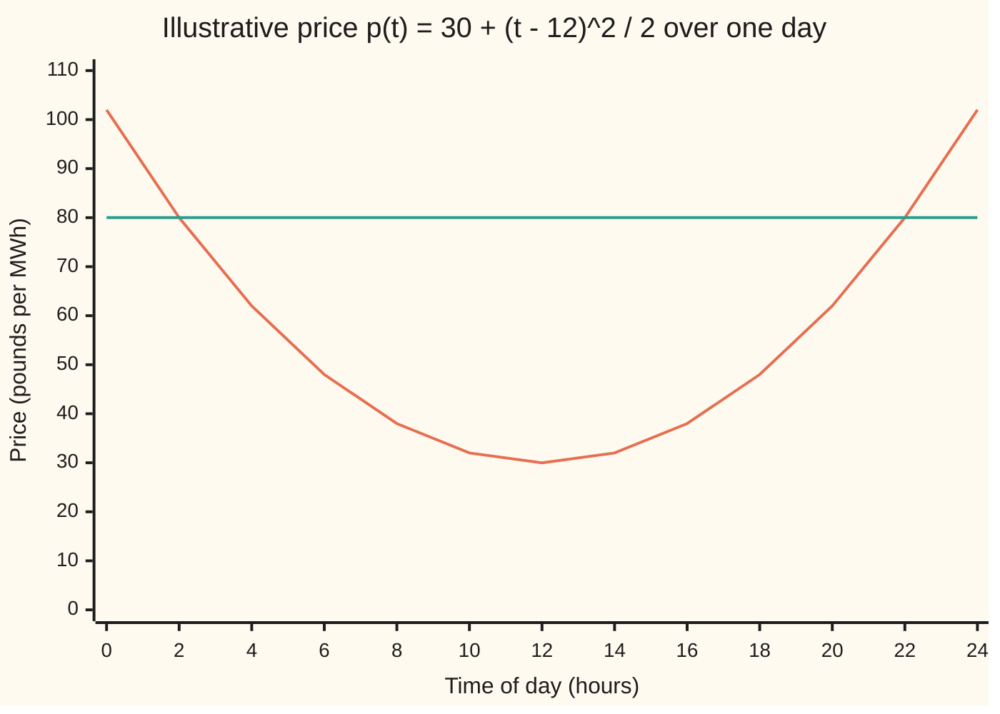

# Banach algebras: a complete space you can also multiply in

[Syllabus](../../../SYLLABUS.md) → [Functional analysis](../README.md) → [Banach Algebras and Fixed Points](../README.md#s06) → Banach algebras

---

## General Overview

Take one sunny spring day on a power grid with a lot of solar panels. The wholesale price of electricity follows a smooth curve over the 24 hours. It is cheapest at noon, at £30 per megawatt-hour (MWh), and dearest at midnight, at £102/MWh. The curve is illustrative: a real day is bumpier.

Price curves like this one can be added, scaled and multiplied hour by hour. A curve can also be sized by its largest absolute value. So the set of all continuous curves on the day is a space you can multiply in, and the sizes behave well under limits. That structure is called a **Banach algebra**.

This card asks two questions about it, using only the algebra:

- **Which price levels does the day reach?** A level of £80/MWh is reached exactly when "price minus 80" has no reciprocal curve, because the reciprocal would have to divide by zero at the moment the price equals 80. That set of levels is the **spectrum**. Here it is every level from 30 to 102.
- **Can the algebra rebuild the clock?** Forget that the curves are functions of time. Keep only adding, multiplying and sizing. The measurements that respect multiplication turn out to be exactly "read the price at time t". So the algebra still knows its 24 hours, and every element becomes a function on those measurements again. That rebuilding is the **Gelfand transform**.

**In a Banach algebra a number is in an element's spectrum exactly when that element minus the number cannot be divided by; in a commuting algebra the spectrum is the set of values the element takes under the multiplicative measurements, and the Gelfand transform turns each element into a function on those measurements.**

**What kind of fact this is:** definitions, then theorems. Why it works proves the inverse series, the spectrum of a curve, the link between characters and spectrum, and the clock-time characters of $`C[a, b]`$. Gelfand-Mazur is proved in outline in a fold. The spectral radius formula is stated, with a source and a sketch on [Spectrum](../03-Bounded%20Operators/07-spectrum-and-resolvent.md). Weak-star compactness is cited from [Weak convergence](../02-Hilbert%20Spaces/09-weak-convergence-and-banach-alaoglu.md).

### The picture: the day's price, and one level it crosses



The curve is the price, read every 2 hours. The flat line is the level £80/MWh. It meets the curve at 2:00 and 22:00, so 80 is in the spectrum. A level of 20 or 110 never meets it, so those levels are not.

---

## The formula

Notation first, in words.

- An **algebra** $`A`$ is a vector space with a multiplication that is associative and distributes over addition. It has a **unit** $`1`$: multiplying by it changes nothing. It is **commutative** when $`xy = yx`$ always.
- A **Banach algebra** is an algebra with a norm $`\lVert x\rVert`$ (a size, as in [Normed and Banach spaces](../01-Normed%20and%20Banach%20Spaces/01-normed-spaces-and-banach-spaces.md)) that is complete, so a sequence whose terms settle down has a limit inside. The norm must also respect products and the unit:

```math
\lVert xy\rVert \le \lVert x\rVert\,\lVert y\rVert, \qquad \lVert 1\rVert = 1 .
```

- An element $`x`$ is **invertible** when some $`y`$ in $`A`$ has $`xy = yx = 1`$.
- The **spectrum** $`\sigma(x)`$ (read "sigma of x") is the set of complex numbers $`\lambda`$ (read "lambda") that make $`x - \lambda 1`$ not invertible. The **spectral radius** $`r(x)`$ is the largest $`\lvert\lambda\rvert`$ in it. [Spectrum](../03-Bounded%20Operators/07-spectrum-and-resolvent.md) owns these words for operators; here they live in any Banach algebra.
- A **character** $`\chi`$ (read "chi") is a linear map from $`A`$ to the complex numbers that respects products and the unit. The set of all characters is written $`\Delta`$ (read "delta"), the **character space**.

```math
\chi(xy) = \chi(x)\,\chi(y), \qquad \chi(1) = 1, \qquad \hat{x}(\chi) = \chi(x)
```

The last formula defines the **Gelfand transform**: the element $`x`$ becomes the function $`\hat{x}`$ (read "x hat") on $`\Delta`$, whose value at a character is that character's reading of $`x`$. In a commutative Banach algebra, the main result is:

```math
\sigma(x) = \{\, \chi(x) : \chi \in \Delta \,\}, \qquad \sup_{\chi \in \Delta} \lvert\hat{x}(\chi)\rvert = r(x) = \lim_{n\to\infty} \lVert x^n\rVert^{1/n} \le \lVert x\rVert .
```

**Read it aloud:** the numbers $`\lambda`$ for which $`x - \lambda 1`$ has no inverse are exactly the values the characters give $`x`$; the largest of them in size is the long-run growth rate of the powers of $`x`$, never more than the size of $`x`$.

On the price day, the algebra is $`C[0, 24]`$: continuous complex-valued curves on the interval from 0 to 24 hours, sized by $`\lVert f\rVert = \max_t \lvert f(t)\rvert`$ ([Function spaces C and Lp](../01-Normed%20and%20Banach%20Spaces/03-function-spaces-c-and-lp.md)). The price is $`p(t) = 30 + (t - 12)^2/2`$. Its characters are the readings $`\chi_t(f) = f(t)`$, one per time $`t`$, so $`\hat{p}`$ is the price curve itself and $`\sigma(p)`$ is its range, $`[30, 102]`$.

| Symbol | Plain meaning | In our example | Push it up and the answer… |
| --- | --- | --- | --- |
| $`A`$, $`1`$ | a Banach algebra; its unit | $`C[0, 24]`$, the day's curves; the constant curve 1 | — |
| $`x`$, $`y`$, $`f`$, $`g`$; $`x_i`$, $`w_i`$ | elements of $`A`$; entry $`i`$ of a list, and the weight a character gives it | price curves; $`g = p - \lambda`$; $`x_3 = 30`$, the noon price | — |
| $`\lVert x\rVert`$ | the size of an element | the curve's largest absolute value: 102 for $`p`$ | the spectrum may reach further out |
| $`\lambda`$, $`d`$ | a trial level, a complex number; its distance to the nearest price | 20, 31, 80 or 110 £/MWh; 10 for $`\lambda = 20`$ | a larger $`d`$ gives a smaller inverse, size $`1/d`$ |
| $`\sigma(x)`$ | the spectrum: levels $`\lambda`$ where $`x - \lambda 1`$ has no inverse | $`[30, 102]`$ | — |
| $`r(x)`$ | the spectral radius, the largest $`\lvert\lambda\rvert`$ in $`\sigma(x)`$ | 102 | — |
| $`\chi`$, $`\chi_t`$, $`M`$ | a character; the reading at time $`t`$; a maximal ideal | $`\chi_5(p) = 54.5`$; curves zero at 2:00 | — |
| $`\Delta`$ | the character space | one character per time in $`[0, 24]`$ | — |
| $`\hat{x}`$ | the Gelfand transform of $`x`$ | $`\hat{p}(\chi_t) = p(t)`$ | — |
| $`p(t)`$, $`t`$, $`N`$ | the price at time $`t`$ hours; the number of grid points the code uses | £30/MWh at noon, £102/MWh at midnight; $`N`$ = 25, 241, 2401 | a larger $`N`$ shrinks the grid's gaps like $`1/N`$ |
| $`c`$, $`q`$, $`k`$, $`\varphi`$, $`h`$ | proof helpers: the series' scale, contraction size and term count; a bounded functional and its reading of the inverse (fold) | $`c = 1/82`$, $`q = 0.878049`$, $`k`$ = 214 terms for $`\lambda = 20`$ | $`q`$ near 1 needs many more terms |
| $`I`$, $`J`$, $`Z`$, $`T`$, $`R`$ | 2×2 examples: identity, hour swap, nilpotent (squares to zero), shear, rotation | `[[0, 1], [1, 0]]` for $`J`$ | — |

### When it holds

- **Complete.** The inverse series in Step 1 needs its partial sums to have a limit. Drop completeness, for example with polynomials only, and $`1/(p - 20)`$ is not a polynomial: $`p - 20`$ has no inverse inside, though 20 is no price the day reaches.
- **The norm respects products.** Step 1 bounds $`\lVert x^k\rVert`$ by $`\lVert x\rVert^k`$. Without that bound the series can diverge and the spectrum need not stay inside the disc of radius $`\lVert x\rVert`$.
- **Complex scalars.** Over the real numbers, the rotation $`R`$ = `[[0, -1], [1, 0]]` has $`R - \lambda 1`$ invertible for every real $`\lambda`$: its determinant $`\lambda^2 + 1`$ is at least 1. Its real spectrum is empty, and the real 2×2 matrices of that shape have no real character.
- **Commutative, for characters and the transform.** The 2×2 matrices have no character at all. Every character must send the nilpotent $`Z`$ = `[[0, 1], [0, 0]]` (its square is zero) to 0, since $`\chi(Z)^2 = \chi(Z^2) = 0`$. Then $`Z Z^{T}`$ and $`Z^{T} Z`$ (with $`Z^{T}`$ the transpose) both read 0, yet they add up to the unit, which reads 1.
- **A compact space under $`C`$.** On the whole real line, bounded continuous curves have characters that read no point, such as limits "at infinity". The interval $`[0, 24]`$ is closed and bounded, so it is compact ([Compactness three ways](../../17-Topology/01-Metric%20Spaces/06-compactness-in-metric-spaces.md)), and Step 5 uses that.

---

## Why it works

### Step 0: algebra can only see division

The algebra never reads a time. It can add, multiply and size. So "the price reaches 80" must be said in those terms, and it can be. If $`p(t_0) = 80`$, then every product $`(p - 80)g`$ is zero at $`t_0`$, so none of them is the constant 1. If the price never equals 80, then $`1/(p - 80)`$ is a continuous curve. Reaching a level and failing to divide are the same event.

The second idea runs the other way. A reading at a time respects products: $`(fg)(t) = f(t)g(t)`$. If those readings are the only maps that do, then the algebra can find its own clock.

### Step 1: near 1, everything can be divided by

If $`\lVert 1 - y\rVert = q < 1`$, then $`y`$ has an inverse:

```math
y^{-1} = \sum_{k=0}^{\infty} (1 - y)^k, \qquad \lVert y^{-1}\rVert \le \frac{1}{1 - q}.
```

The terms have sizes at most $`q^k`$, a geometric series, so the partial sums settle down and completeness gives a limit. Multiplying the sum by $`y = 1 - (1 - y)`$ telescopes to 1. This is the Neumann series ([Neumann series](../03-Bounded%20Operators/06-neumann-series-and-inverting-close-to-the-identity.md)): the [Banach's fixed point theorem](../../17-Topology/01-Metric%20Spaces/08-banach-fixed-point-in-metric-spaces.md) card's contraction idea, written as an inverse.

Two facts follow:

- **The spectrum sits in the disc $`\lvert\lambda\rvert \le \lVert x\rVert`$.** If $`\lvert\lambda\rvert > \lVert x\rVert`$, write $`x - \lambda 1 = -\lambda(1 - x/\lambda)`$ and use the series.
- **The spectrum is closed.** Invertible elements form an open set: a small enough nudge of an invertible element stays invertible, by the same series.

On the price day, to divide by $`g = p - \lambda`$, scale it first by $`c = \pm 1/\lVert g\rVert`$, so that $`cg`$ lies near 1. For $`\lambda = 20`$, $`g`$ runs from 10 to 82. With $`c = 1/82`$, the size of $`1 - cg`$ is $`1 - 10/82 = 0.878049`$, below 1. The series converges in 214 terms, and the inverse has size $`0.1 = 1/10`$: one over the distance from 20 to the nearest price. For $`\lambda = 110`$, $`g`$ runs from $`-80`$ to $`-8`$. With $`c = -1/80`$ the size is 0.9, and the inverse has size $`0.125 = 1/8`$ after 265 terms.

For $`\lambda = 80`$, $`g`$ runs from $`-50`$ to 22. The better of the two scalings, $`c = -1/50`$, gives size 1.44, so the series test fails. No scalar can make the size less than 1, because $`p - 80`$ takes both signs. Failure of a test proves nothing alone. Step 2 proves 80 is in the spectrum.

### Step 2: the spectrum of a curve is its range

Take $`f`$ in $`C[0, 24]`$ and a number $`\lambda`$.

- **If $`f(t_0) = \lambda`$ for some time $`t_0`$,** then $`(f - \lambda)g`$ is zero at $`t_0`$ for every $`g`$. So it is never the constant 1, and $`\lambda`$ is in $`\sigma(f)`$.
- **If $`f`$ never equals $`\lambda`$,** then $`\lvert f - \lambda\rvert`$ is continuous and positive on a compact interval, so it has a positive minimum $`d`$. Then $`1/(f - \lambda)`$ is continuous, and its size is $`1/d`$.

So $`\sigma(p) = [30, 102]`$, the price range. The price equals 80 at $`t = 12 \pm \sqrt{100}`$: 2:00 and 22:00, which the code finds by bisection. The resolvent sizes 0.1 and 0.125 above are the $`1/d`$ of this step.

### Step 3: the spectrum is never empty

With complex scalars, every element of a Banach algebra has a nonempty spectrum. This is what lets characters exist at all.

The **Gelfand-Mazur theorem** follows at once. If every nonzero element of $`A`$ is invertible, take any $`x`$ and some $`\lambda`$ in $`\sigma(x)`$. Then $`x - \lambda 1`$ is not invertible, so it is zero, and $`x = \lambda 1`$. The algebra is just the complex numbers.

<details>
<summary>Outline proof: an empty spectrum would give a bounded entire function</summary>

Suppose $`\sigma(x)`$ is empty. Then the inverse $`(x - \lambda 1)^{-1}`$ exists for every complex $`\lambda`$. Pick any bounded linear functional $`\varphi`$ on $`A`$, a continuous linear map to the complex numbers ([Hahn-Banach](../01-Normed%20and%20Banach%20Spaces/06-hahn-banach-theorem.md)). Set $`h(\lambda) = \varphi((x - \lambda 1)^{-1})`$.

The series of Step 1, applied near each point, shows $`h`$ has a complex derivative everywhere. For $`\lvert\lambda\rvert > 2\lVert x\rVert`$ the same series gives:

$`\displaystyle \lVert (x - \lambda 1)^{-1}\rVert \le \frac{1}{\lvert\lambda\rvert - \lVert x\rVert} \le \frac{2}{\lvert\lambda\rvert} .`$

So $`h`$ tends to 0 far out. It is continuous on the closed disc inside, so it is bounded everywhere. [Liouville's theorem](../../07-Complex%20analysis/03-Contour%20Integrals%20and%20Cauchy%27s%20Theorem/07-liouville-and-the-fundamental-theorem-of-algebra.md) makes it constant, so it is 0. Since every $`\varphi`$ reads 0, Hahn-Banach makes the inverse itself 0, which cannot be an inverse. So the spectrum is not empty.

</details>

The **spectral radius formula** $`r(x) = \lim \lVert x^n\rVert^{1/n}`$ is proved the same way, from the power series of the resolvent; Bonsall and Duncan give the details (Sources). It can sit far below the norm. For $`T`$ = `[[1, 1], [0, 1]]`, the size of $`T^n`$, sized by the largest row sum, is $`n + 1`$. The $`n`$-th roots are 2.000000, 1.270982 and 1.047233 at $`n`$ = 1, 10 and 100, falling toward the spectral radius 1.

### Step 4: characters are maximal ideals

An **ideal** of a commutative ring is a subset closed under subtraction that absorbs products ([Ideals and quotient rings](../../03-Algebra/09-Rings%20and%20Fields/04-ideals-and-quotient-rings.md)). It is **maximal** when no proper ideal is larger.

- **A character gives a maximal ideal.** The kernel of $`\chi`$ (all it sends to 0) is an ideal. It misses only one dimension, so nothing fits between it and $`A`$.
- **A maximal ideal gives a character.** A maximal ideal $`M`$ contains no invertible element, so it stays away from the open ball of Step 1 around 1. Its closure is then a proper ideal too, so $`M`$ is closed. The quotient $`A/M`$ is a Banach algebra in which every nonzero class is invertible. By Gelfand-Mazur it is the complex numbers, and "send $`x`$ to its class" is a character.
- **Every reading is a spectrum value.** The element $`x - \chi(x)1`$ lies in the kernel of $`\chi`$, so it is not invertible. Hence $`\chi(x)`$ is in $`\sigma(x)`$, and $`\lvert\chi(x)\rvert \le \lVert x\rVert`$: every character has size at most 1, with no assumption of continuity.
- **Every spectrum value is a reading.** If $`\lambda`$ is in $`\sigma(x)`$, the multiples of $`x - \lambda 1`$ form a proper ideal. It sits inside a maximal ideal (Zorn's lemma, a form of the axiom of choice, supplies one in general). That ideal's character reads $`\lambda`$ at $`x`$.

The last two points prove $`\sigma(x) = \{\chi(x)\}`$, the first formula of the card.

### Step 5: the characters of $`C[0, 24]`$ are the clock times

Each reading $`\chi_t`$ is a character. The work is to show there are no others. Take a maximal ideal $`M`$ and suppose it is not "all curves zero at $`t`$" for any $`t`$.

Then for every time $`t`$ some $`f_t`$ in $`M`$ has $`f_t(t) \ne 0`$, and so is nonzero on an open interval around $`t`$. Compactness picks finitely many of those intervals that cover the day. The sum of $`\lvert f_{t_i}\rvert^2 = f_{t_i}\overline{f_{t_i}}`$ lies in $`M`$, since $`M`$ absorbs products, and it is positive everywhere. So it is invertible, and $`M`$ would be the whole algebra. That contradiction leaves only the readings.

The code runs the argument on two pairs of real curves:

- $`p - 80`$ and $`t - 12`$: the sum of squares $`(p - 80)^2 + (t - 12)^2`$ has minimum 99, at $`t = 12 \pm \sqrt{98}`$. It is invertible, so the ideal the pair generates holds 1. No time zeroes both curves.
- $`p - 80`$ and $`t - 2`$: the sum of squares reaches 0 at $`t = 2`$. Both curves vanish at 2:00, and they sit in the maximal ideal of $`\chi_2`$.

### Step 6: the Gelfand transform

Send each $`x`$ to $`\hat{x}`$, the function $`\chi \mapsto \chi(x)`$ on $`\Delta`$. It is an algebra map: $`\widehat{xy} = \hat{x}\hat{y}`$, because each character respects products. By Step 4, the values of $`\hat{x}`$ fill $`\sigma(x)`$, and its largest absolute value is $`r(x)`$.

$`\Delta`$ needs a topology for "continuous function on $`\Delta`$" to mean anything. Use the **weak-star topology**: characters are close when they give close readings on every element. Every character has size at most 1, so $`\Delta`$ sits in the unit ball of the dual space. That ball is weak-star compact by the Banach-Alaoglu theorem, proved on [Weak convergence](../02-Hilbert%20Spaces/09-weak-convergence-and-banach-alaoglu.md); its general case rests on Tychonoff's theorem ([Compactness with no distances, and Tychonoff](../../17-Topology/02-Topological%20Spaces/06-compactness-and-tychonoff.md)). $`\Delta`$ is a closed part of that ball, so it is compact, and each $`\hat{x}`$ is continuous on it.

For $`C[0, 24]`$ the transform hands back the price curve: $`\hat{p}(\chi_t) = p(t)`$, and $`\Delta`$ is the day itself. For a commutative C-star algebra, an algebra with a mirror $`x \mapsto x^*`$ satisfying $`\lVert x^*x\rVert = \lVert x\rVert^2`$, the commutative Gelfand-Naimark theorem says this always happens: the transform matches the algebra with all continuous functions on $`\Delta`$, sizes included ([C-star algebras](03-c-star-algebras-in-outline.md)).

### Step 7: a commuting algebra that does not look like functions

Take two hours of prices, a list $`(u, v)`$. Let $`J`$ = `[[0, 1], [1, 0]]` swap them. The matrices $`aI + bJ`$ commute with each other, so they form a commutative algebra. Its spectrum can be found by algebra alone. $`J^2 = I`$, so any character has $`\chi(J)^2 = 1`$, and $`\chi(J)`$ is 1 or $`-1`$. There are two characters, and the transform is

```math
\widehat{aI + bJ} = (a + b,\; a - b).
```

The first value is how the element treats two equal hours; the second, how it treats an up-and-down pair. The light blur $`0.8I + 0.2J`$ mixes in a fifth of the neighbouring hour. Its transform is (1.0, 0.6), with no zero, so it is invertible: inverting each value gives $`(1, 1/0.6)`$, which is $`\tfrac43 I - \tfrac13 J`$, and the code multiplies back to the identity. The full average $`0.5I + 0.5J`$ has transform (1.0, 0.0). The zero means it cannot be undone: its determinant is 0. Filters on a whole time line are the same story with the circle of frequencies as $`\Delta`$ ([Wiener's lemma](02-wieners-lemma-and-invertible-filters.md)).

### What the truncation hides

The code holds a curve on a grid of $`N`$ points, and a grid is the algebra $`\mathbb{C}^N`$ with $`N`$ characters. Its spectrum is a finite set of values, with gaps: the largest gap is 11.5 at $`N = 25`$, 1.195 at 241 and 0.11995 at 2401, falling like $`1/N`$. Only the proof of Step 2 shows that the true spectrum is the whole interval.

---

## Worked numbers, by hand

**The rehearsal.** Read the price at 0:00, 6:00, 12:00 and 18:00: the list (102, 48, 30, 48). Lists of four numbers, multiplied place by place, form the algebra $`\mathbb{C}^4`$.

| Step | Arithmetic | Value |
| --- | --- | --- |
| a character is a weighted sum $`w_1x_1 + \dots + w_4x_4`$ | respecting products on single-entry lists: $`w_i w_j = w_i`$ if $`i = j`$, else 0 | each $`w_i`$ is 0 or 1, at most one is 1 |
| it reads the unit list as 1 | $`w_1 + w_2 + w_3 + w_4 = 1`$ | exactly one $`w_i`$ is 1 |
| the characters | read one place | **4**, one per hour |
| their readings of the list | 102, 48, 30, 48 | spectrum **{30, 48, 102}** |

**The day.** Now the whole curve $`p(t) = 30 + (t - 12)^2/2`$ in $`C[0, 24]`$.

| Step | Arithmetic | Value |
| --- | --- | --- |
| smallest price | at $`t = 12`$: $`30 + 0`$ | 30 |
| largest price | at $`t = 0`$ or 24: $`30 + 144/2`$ | 102 |
| spectrum of $`p`$ | the range, Step 2 | **[30, 102]** |
| is 80 in it? | $`(t - 12)^2 = 100`$, so $`t = 2`$ or 22 | yes |
| size of $`(p - 20)^{-1}`$ | nearest price is 30, so $`1/10`$ | 0.1 |
| size of $`(p - 110)^{-1}`$ | nearest price is 102, so $`1/8`$ | 0.125 |
| reading at 5:00 | $`\chi_5(p) = 30 + 49/2`$ | 54.5, inside [30, 102] |

The day reaches every level from £30 to £102/MWh and no other, and the algebra finds that out without ever reading the clock.

### What breaks if you drop a piece

| Mistake | Comes out at | What went wrong |
| --- | --- | --- |
| The daily average price taken as a character | average of $`p^2`$ is 3376.8; the average squared is $`54^2 = 2916`$; gap 460.8 | The average is linear but does not respect products. The gap is the price's variance over the day |
| The hourly grid trusted for $`\lambda = 31`$ | the hourly grid inverts $`p - 31`$ with size 2.0 | The price is 31 at $`t`$ = 10.585786 and 13.414214, between grid hours. Finer grids give 50.0, 168.1, 3311.3: a trend that never closes |
| Real scalars | rotation: $`\det(R - \lambda) \ge 1.0000`$ for every real $`\lambda`$ | The real spectrum is empty, so there are no real characters and Gelfand-Mazur fails |
| The transform trusted to keep everything | in the commuting algebra of $`aI + bZ`$: $`\lVert Z\rVert = 1`$, but every character sends $`Z`$ to 0 | A nilpotent element ($`Z^2 = 0`$) is invisible to the transform. The transform's kernel, called the radical, is every element of spectral radius 0 |
| The norm read as the spectral radius | $`\lVert T\rVert = 2`$, while $`r(T) = 1`$ | The roots $`\lVert T^n\rVert^{1/n}`$ fall slowly: 1.047233 at $`n = 100`$ |

The code prints every row.

---

## Code, from first principles, and it actually runs

The code holds each curve on a grid. It reaches the spectrum by three roads: the exact range, the grid's values at three sizes, and inverses built by the Neumann series alone, checked against one over the distance. It finds the characters by brute force: 1,296 candidate weightings of the four-hour list, of which exactly the four point readings pass. It then runs the ideal test of Step 5, inverts the blur through its transform, and prints the five failures. Nothing imported holds an answer.

### Python

```python
# Banach algebras and the Gelfand transform -- the check behind the card.  Nothing
# is imported.  The algebra is C[0, 24]: continuous price curves over one day,
# sized by their largest absolute value.  The curve is p(t) = 30 + (t - 12)^2 / 2
# in pounds per MWh (illustrative).  Every computation is a grid of N points.
def p(t): return 30 + (t - 12) ** 2 / 2
def grid(n): return [24 * k / (n - 1) for k in range(n)]
def sup(f): return max(abs(v) for v in f)
print("chart, p at 0,2,..,24 h: " + " ".join(f"{p(t):g}" for t in range(0, 25, 2)))
print("spectrum of p, exact: [30, 102]")
for n in (25, 241, 2401):                       # road 2: the grid's values
    vals = sorted(set(round(p(t), 9) for t in grid(n)))
    gap = max(b - a for a, b in zip(vals, vals[1:]))
    print(f"grid N={n:>5}: min {vals[0]:.4f}, max {vals[-1]:.4f}, "
          f"{len(vals)} values, largest gap {gap:.5f}")
    assert vals[0] == 30 and vals[-1] == 102 and gap < 12 * 24 / (n - 1)
def neumann(lam, n=2401):                       # road 3: invert p - lam by algebra
    g = [p(t) - lam for t in grid(n)]
    best = min((sup([1 - c * v for v in g]), c) for c in (1 / sup(g), -1 / sup(g)))
    q, c = best
    if q >= 1: return q, None, 0
    inv, term, k = [c] * n, [c] * n, 0          # c * sum of (1 - c g)^k
    while sup(term) > 1e-14 and k < 5000:
        term = [a * (1 - c * v) for a, v in zip(term, g)]
        inv = [a + b for a, b in zip(inv, term)]; k += 1
    assert sup([a * v - 1 for a, v in zip(inv, g)]) < 1e-12   # g times inverse is 1
    return q, inv, k
for lam, dist in ((20, 10), (110, 8)):
    q, inv, k = neumann(lam)
    print(f"lambda={lam}: |1 - c g| = {q:.6f} < 1, {k} terms, "
          f"|inverse| = {sup(inv):.6f}, 1/{dist} = {1 / dist:.6f}")
    assert abs(sup(inv) - 1 / dist) < 1e-9
q, inv, k = neumann(80)
def root(f, a, b):                              # bisection, written out
    for _ in range(60):
        m = (a + b) / 2
        a, b = (m, b) if f(a) * f(m) > 0 else (a, m)
    return (a + b) / 2
r1, r2 = root(lambda t: p(t) - 80, 0, 12), root(lambda t: p(t) - 80, 12, 24)
print(f"lambda=80: best |1 - c g| = {q:.6f}, no series; p = 80 at t = {r1:.6f} and {r2:.6f}")
assert inv is None and abs(r1 - 2) < 1e-9 and abs(r2 - 22) < 1e-9
s = 2 ** 0.5
print(f"lambda=31: true crossings t = {12 - s:.6f} and {12 + s:.6f}; min |p - 31| on the grid:")
mins = [min(abs(p(t) - 31) for t in grid(n)) for n in (25, 241, 2401, 24001)]
print("  N = 25, 241, 2401, 24001: " + ", ".join(f"{m:.6f}" for m in mins))
print("  so the grid's inverse has size " + ", ".join(f"{1 / m:.1f}" for m in mins))
assert mins[0] == 0.5 and mins[-1] < 1e-3 and abs(root(lambda t: p(t) - 31, 0, 12) - (12 - s)) < 1e-9
# The rehearsal: C^4, prices at 0, 6, 12 and 18 h, multiplied place by place.
x4 = [p(t) for t in (0, 6, 12, 18)]
w_set = (-1, -0.5, 0, 0.5, 1, 2)
cands = [(a, b, c, d) for a in w_set for b in w_set for c in w_set for d in w_set]
def is_char(w):                                 # chi(1) = 1, chi(e_i e_j) = chi(e_i) chi(e_j)
    return sum(w) == 1 and all((w[i] if i == j else 0) == w[i] * w[j]
                               for i in range(4) for j in range(4))
chars = sorted((w for w in cands if is_char(w)), reverse=True)
cv = [sum(a * b for a, b in zip(w, x4)) for w in chars]
print(f"C^4 rehearsal: {len(cands)} candidate weightings, {len(chars)} characters, "
      f"values on the price list {', '.join(f'{v:g}' for v in cv)}")
assert len(chars) == 4 and chars == [tuple(int(i == k) for i in range(4)) for k in range(4)]
spec4 = sorted(set(lam for lam in range(0, 201) if any(v - lam == 0 for v in x4)))
print(f"C^4 spectrum of the list (lambda with a zero coordinate): {', '.join(map(str, spec4))}")
def simpson(f, n=2400):                         # the day's average, by Simpson's rule
    h = 24 / n
    s2 = f(0) + f(24) + sum((4 if k % 2 else 2) * f(k * h) for k in range(1, n))
    return s2 * h / 3 / 24
m1, m2 = simpson(p), simpson(lambda t: p(t) ** 2)
print(f"daily average: mean p = {m1:.4f}, mean p^2 = {m2:.4f}, (mean p)^2 = {m1 * m1:.4f}, "
      f"gap {m2 - m1 * m1:.4f}")
assert abs(m1 - 54) < 1e-9 and abs(m2 - 3376.8) < 1e-6
print(f"evaluation at 5 h: p(5) = {p(5):.1f}, inside [30, 102]")
g1 = min((p(t) - 80) ** 2 + (t - 12) ** 2 for t in grid(240001))
g2 = min(((p(t) - 80) ** 2 + (t - 2) ** 2, t) for t in grid(2401))
print(f"ideal of p-80 and t-12: min of the sum of squares {g1:.4f} > 0, so it holds 1")
print(f"ideal of p-80 and t-2: min of the sum of squares {g2[0]:.4f} at t = {g2[1]:.4f}")
assert abs(g1 - 99) < 1e-6 and g2[0] == 0 and g2[1] == 2
# A commuting algebra that is not functions: a I + b J, J swapping two hours.
def mul(x, y): return [[sum(x[i][k] * y[k][j] for k in range(2)) for j in range(2)] for i in range(2)]
I2, J = [[1, 0], [0, 1]], [[0, 1], [1, 0]]
def ab(a, b): return [[a, b], [b, a]]
def chi(x, s): return x[0][0] + s * x[0][1]     # a candidate character: a I + b X -> a + s b
svals = [k / 100 for k in range(-300, 301)]     # keep s only if chi(J J) = chi(J)^2 on the product
jvals = [s for s in svals if abs(chi(mul(J, J), s) - chi(J, s) ** 2) < 1e-9]
print(f"J^2 = I: {str(mul(J, J) == I2).lower()}; characters send J to {jvals[0]:g} and {jvals[1]:g}")
hat = lambda a, b: (a + b, a - b)               # the Gelfand transform
B = (0.8, 0.2); bh = hat(*B); ih = (1 / bh[0], 1 / bh[1])
inv = ((ih[0] + ih[1]) / 2, (ih[0] - ih[1]) / 2)
res = mul(ab(*B), ab(*inv))
print(f"blur 0.8I+0.2J: transform ({bh[0]:.1f}, {bh[1]:.1f}); inverse "
      f"{inv[0]:.6f} I {inv[1]:+.6f} J; product {res[0][0]:.6f} {res[0][1]:.6f}")
assert abs(res[0][0] - 1) < 1e-12 and abs(res[0][1]) < 1e-12 and jvals == [-1, 1]
ah, M = hat(0.5, 0.5), ab(0.5, 0.5)
detM = M[0][0] * M[1][1] - M[0][1] * M[1][0]
print(f"average 0.5I+0.5J: transform ({ah[0]:.1f}, {ah[1]:.1f}), determinant {detM:.2f}")
def norm(x): return max(abs(r[0]) + abs(r[1]) for r in x)   # largest row sum
T, Z = [[1, 1], [0, 1]], [[0, 1], [0, 0]]
pw, out = I2, []
for n in range(1, 101):
    pw = mul(pw, T)
    if n in (1, 10, 100): out.append(f"{norm(pw) ** (1 / n):.6f}")
    assert norm(pw) == n + 1                    # |T^n| = n + 1, by the binomial rule
nvals = [s for s in svals if abs(chi(mul(Z, Z), s) - chi(Z, s) ** 2) < 1e-9]   # chi(Z Z) = chi(Z)^2
print(f"|Z| = {norm(Z)}, |Z^2| = {norm(mul(Z, Z))}, every character sends Z to {nvals[0]:g}")
print(f"|T^n|^(1/n) for T = I + Z, n = 1, 10, 100: {', '.join(out)}; spectral radius 1")
R = [[0, -1], [1, 0]]                           # rotation; det(R - lambda) from its entries
dets = min((R[0][0] - l) * (R[1][1] - l) - R[0][1] * R[1][0] for l in [k / 100 for k in range(-1000, 1001)])
print(f"rotation over the reals: min det(R - lambda) = {dets:.4f}, real spectrum empty")
assert norm(mul(Z, Z)) == 0 and nvals == [0] and ah[1] == 0 and detM == 0 and dets == 1
print("ALL CHECKS PASS")
```

**Ran 2026-11-15 on macOS, Python 3.14.10, standard library only. All checks passed. Output, pasted from the run:**

```
chart, p at 0,2,..,24 h: 102 80 62 48 38 32 30 32 38 48 62 80 102
spectrum of p, exact: [30, 102]
grid N=   25: min 30.0000, max 102.0000, 13 values, largest gap 11.50000
grid N=  241: min 30.0000, max 102.0000, 121 values, largest gap 1.19500
grid N= 2401: min 30.0000, max 102.0000, 1201 values, largest gap 0.11995
lambda=20: |1 - c g| = 0.878049 < 1, 214 terms, |inverse| = 0.100000, 1/10 = 0.100000
lambda=110: |1 - c g| = 0.900000 < 1, 265 terms, |inverse| = 0.125000, 1/8 = 0.125000
lambda=80: best |1 - c g| = 1.440000, no series; p = 80 at t = 2.000000 and 22.000000
lambda=31: true crossings t = 10.585786 and 13.414214; min |p - 31| on the grid:
  N = 25, 241, 2401, 24001: 0.500000, 0.020000, 0.005950, 0.000302
  so the grid's inverse has size 2.0, 50.0, 168.1, 3311.3
C^4 rehearsal: 1296 candidate weightings, 4 characters, values on the price list 102, 48, 30, 48
C^4 spectrum of the list (lambda with a zero coordinate): 30, 48, 102
daily average: mean p = 54.0000, mean p^2 = 3376.8000, (mean p)^2 = 2916.0000, gap 460.8000
evaluation at 5 h: p(5) = 54.5, inside [30, 102]
ideal of p-80 and t-12: min of the sum of squares 99.0000 > 0, so it holds 1
ideal of p-80 and t-2: min of the sum of squares 0.0000 at t = 2.0000
J^2 = I: true; characters send J to -1 and 1
blur 0.8I+0.2J: transform (1.0, 0.6); inverse 1.333333 I -0.333333 J; product 1.000000 0.000000
average 0.5I+0.5J: transform (1.0, 0.0), determinant 0.00
|Z| = 1, |Z^2| = 0, every character sends Z to 0
|T^n|^(1/n) for T = I + Z, n = 1, 10, 100: 2.000000, 1.270982, 1.047233; spectral radius 1
rotation over the reals: min det(R - lambda) = 1.0000, real spectrum empty
ALL CHECKS PASS
```

### Rust

Same numbers, same labels, built with `rustc --edition 2021 -O`.

```rust
// Banach algebras and the Gelfand transform -- the same check as the Python, in
// Rust.  No crates.  The algebra is C[0, 24]: continuous price curves over one
// day, sized by their largest absolute value.  The curve is p(t) = 30 + (t-12)^2/2
// in pounds per MWh (illustrative).  Every computation is a grid of N points.
fn p(t: f64) -> f64 { 30.0 + (t - 12.0) * (t - 12.0) / 2.0 }
fn grid(n: usize) -> Vec<f64> { (0..n).map(|k| 24.0 * k as f64 / (n - 1) as f64).collect() }
fn sup(f: &[f64]) -> f64 { f.iter().fold(0.0, |m, v| if v.abs() > m { v.abs() } else { m }) }
fn neumann(lam: f64, n: usize) -> (f64, Option<Vec<f64>>, usize) {   // road 3: algebra
    let g: Vec<f64> = grid(n).iter().map(|&t| p(t) - lam).collect();
    let mut best = (f64::INFINITY, 0.0);
    for c in [1.0 / sup(&g), -1.0 / sup(&g)] {
        let q = sup(&g.iter().map(|v| 1.0 - c * v).collect::<Vec<f64>>());
        if q < best.0 { best = (q, c); }
    }
    let (q, c) = best;
    if q >= 1.0 { return (q, None, 0); }
    let (mut inv, mut term, mut k) = (vec![c; n], vec![c; n], 0);  // c * sum of (1 - c g)^k
    while sup(&term) > 1e-14 && k < 5000 {
        for i in 0..n { term[i] *= 1.0 - c * g[i]; inv[i] += term[i]; }
        k += 1;
    }
    assert!(sup(&(0..n).map(|i| inv[i] * g[i] - 1.0).collect::<Vec<f64>>()) < 1e-12);
    (q, Some(inv), k)
}
fn root(f: &dyn Fn(f64) -> f64, mut a: f64, mut b: f64) -> f64 {     // bisection
    for _ in 0..60 {
        let m = (a + b) / 2.0;
        if f(a) * f(m) > 0.0 { a = m; } else { b = m; }
    }
    (a + b) / 2.0
}
type M2 = [[f64; 2]; 2];
fn mul(x: M2, y: M2) -> M2 {
    let mut r = [[0.0; 2]; 2];
    for i in 0..2 { for j in 0..2 { for k in 0..2 { r[i][j] += x[i][k] * y[k][j]; } } }
    r
}
fn norm(x: M2) -> f64 { (x[0][0].abs() + x[0][1].abs()).max(x[1][0].abs() + x[1][1].abs()) }
fn ab(a: f64, b: f64) -> M2 { [[a, b], [b, a]] }
fn hat(a: f64, b: f64) -> (f64, f64) { (a + b, a - b) }               // the Gelfand transform
fn chi(x: M2, s: f64) -> f64 { x[0][0] + s * x[0][1] }               // a candidate character: a I + b X -> a + s b
fn join(v: &[String]) -> String { v.join(", ") }
fn main() {
    let ch: Vec<String> = (0..13).map(|k| format!("{}", p(2.0 * k as f64))).collect();
    println!("chart, p at 0,2,..,24 h: {}", ch.join(" "));
    println!("spectrum of p, exact: [30, 102]");
    for n in [25usize, 241, 2401] {                                    // road 2: the grid
        let mut vals: Vec<f64> = grid(n).iter().map(|&t| (p(t) * 1e9).round() / 1e9).collect();
        vals.sort_by(|a, b| a.partial_cmp(b).unwrap());
        vals.dedup();
        let gap = vals.windows(2).map(|w| w[1] - w[0]).fold(0.0, f64::max);
        println!("grid N={:>5}: min {:.4}, max {:.4}, {} values, largest gap {:.5}",
                 n, vals[0], vals[vals.len() - 1], vals.len(), gap);
        assert!(vals[0] == 30.0 && vals[vals.len() - 1] == 102.0 && gap < 12.0 * 24.0 / (n - 1) as f64);
    }
    for (lam, dist) in [(20.0, 10.0), (110.0, 8.0)] {
        let (q, inv, k) = neumann(lam, 2401);
        let si = sup(&inv.unwrap());
        println!("lambda={}: |1 - c g| = {:.6} < 1, {} terms, |inverse| = {:.6}, 1/{} = {:.6}",
                 lam, q, k, si, dist, 1.0 / dist);
        assert!((si - 1.0 / dist).abs() < 1e-9);
    }
    let (q, inv, _) = neumann(80.0, 2401);
    let (r1, r2) = (root(&|t| p(t) - 80.0, 0.0, 12.0), root(&|t| p(t) - 80.0, 12.0, 24.0));
    println!("lambda=80: best |1 - c g| = {:.6}, no series; p = 80 at t = {:.6} and {:.6}", q, r1, r2);
    assert!(inv.is_none() && (r1 - 2.0).abs() < 1e-9 && (r2 - 22.0).abs() < 1e-9);
    let s = 2f64.sqrt();
    println!("lambda=31: true crossings t = {:.6} and {:.6}; min |p - 31| on the grid:", 12.0 - s, 12.0 + s);
    let mins: Vec<f64> = [25usize, 241, 2401, 24001].iter()
        .map(|&n| grid(n).iter().map(|&t| (p(t) - 31.0).abs()).fold(f64::INFINITY, f64::min)).collect();
    println!("  N = 25, 241, 2401, 24001: {}", join(&mins.iter().map(|m| format!("{:.6}", m)).collect::<Vec<_>>()));
    println!("  so the grid's inverse has size {}", join(&mins.iter().map(|m| format!("{:.1}", 1.0 / m)).collect::<Vec<_>>()));
    assert!(mins[0] == 0.5 && mins[3] < 1e-3 && (root(&|t| p(t) - 31.0, 0.0, 12.0) - (12.0 - s)).abs() < 1e-9);
    // The rehearsal: C^4, prices at 0, 6, 12 and 18 h, multiplied place by place.
    let x4 = [p(0.0), p(6.0), p(12.0), p(18.0)];
    let ws = [-1.0, -0.5, 0.0, 0.5, 1.0, 2.0];
    let mut chars: Vec<[f64; 4]> = Vec::new();
    let mut ncand = 0;
    for a in ws { for b in ws { for c in ws { for d in ws {
        let w = [a, b, c, d];
        ncand += 1;
        let ok = w.iter().sum::<f64>() == 1.0 && (0..4).all(|i| (0..4).all(|j|
            (if i == j { w[i] } else { 0.0 }) == w[i] * w[j]));   // chi(e_i e_j) = chi(e_i) chi(e_j)
        if ok { chars.push(w); }
    } } } }
    chars.sort_by(|x, y| y.partial_cmp(x).unwrap());
    let cv: Vec<String> = chars.iter().map(|w| format!("{}", (0..4).map(|i| w[i] * x4[i]).sum::<f64>())).collect();
    println!("C^4 rehearsal: {} candidate weightings, {} characters, values on the price list {}",
             ncand, chars.len(), join(&cv));
    assert!(chars.len() == 4 && (0..4).all(|k| (0..4).all(|i| chars[k][i] == if i == k { 1.0 } else { 0.0 })));
    let spec4: Vec<String> = (0..201).filter(|&l| x4.iter().any(|&v| v - l as f64 == 0.0)).map(|l| l.to_string()).collect();
    println!("C^4 spectrum of the list (lambda with a zero coordinate): {}", join(&spec4));
    let simpson = |f: &dyn Fn(f64) -> f64| {                           // the day's average
        let (n, h) = (2400, 24.0 / 2400.0);
        let mut s2 = f(0.0) + f(24.0);
        for k in 1..n { s2 += (if k % 2 == 1 { 4.0 } else { 2.0 }) * f(k as f64 * h); }
        s2 * h / 3.0 / 24.0
    };
    let (m1, m2) = (simpson(&p), simpson(&|t| p(t) * p(t)));
    println!("daily average: mean p = {:.4}, mean p^2 = {:.4}, (mean p)^2 = {:.4}, gap {:.4}", m1, m2, m1 * m1, m2 - m1 * m1);
    assert!((m1 - 54.0).abs() < 1e-9 && (m2 - 3376.8).abs() < 1e-6);
    println!("evaluation at 5 h: p(5) = {:.1}, inside [30, 102]", p(5.0));
    let g1 = grid(240001).iter().map(|&t| (p(t) - 80.0).powi(2) + (t - 12.0).powi(2)).fold(f64::INFINITY, f64::min);
    let mut g2 = (f64::INFINITY, 0.0);
    for t in grid(2401) { let v = (p(t) - 80.0).powi(2) + (t - 2.0).powi(2); if v < g2.0 { g2 = (v, t); } }
    println!("ideal of p-80 and t-12: min of the sum of squares {:.4} > 0, so it holds 1", g1);
    println!("ideal of p-80 and t-2: min of the sum of squares {:.4} at t = {:.4}", g2.0, g2.1);
    assert!((g1 - 99.0).abs() < 1e-6 && g2.0 == 0.0 && g2.1 == 2.0);
    // A commuting algebra that is not functions: a I + b J, J swapping two hours.
    let (i2, j): (M2, M2) = ([[1.0, 0.0], [0.0, 1.0]], [[0.0, 1.0], [1.0, 0.0]]);
    let svals: Vec<f64> = (-300..=300).map(|k| k as f64 / 100.0).collect();   // keep s only if chi(J J) = chi(J)^2
    let jvals: Vec<f64> = svals.iter().cloned().filter(|&s| (chi(mul(j, j), s) - chi(j, s).powi(2)).abs() < 1e-9).collect();
    println!("J^2 = I: {}; characters send J to {} and {}", mul(j, j) == i2, jvals[0], jvals[1]);
    let bh = hat(0.8, 0.2);
    let ih = (1.0 / bh.0, 1.0 / bh.1);
    let inv = ((ih.0 + ih.1) / 2.0, (ih.0 - ih.1) / 2.0);
    let res = mul(ab(0.8, 0.2), ab(inv.0, inv.1));
    println!("blur 0.8I+0.2J: transform ({:.1}, {:.1}); inverse {:.6} I {:+.6} J; product {:.6} {:.6}",
             bh.0, bh.1, inv.0, inv.1, res[0][0], res[0][1]);
    assert!((res[0][0] - 1.0).abs() < 1e-12 && res[0][1].abs() < 1e-12 && jvals == vec![-1.0, 1.0]);
    let (ah, m) = (hat(0.5, 0.5), ab(0.5, 0.5));
    let det_m = m[0][0] * m[1][1] - m[0][1] * m[1][0];
    println!("average 0.5I+0.5J: transform ({:.1}, {:.1}), determinant {:.2}", ah.0, ah.1, det_m);
    let (t, nn): (M2, M2) = ([[1.0, 1.0], [0.0, 1.0]], [[0.0, 1.0], [0.0, 0.0]]);
    let (mut pw, mut out) = (i2, Vec::new());
    for n in 1..=100 {
        pw = mul(pw, t);
        if [1, 10, 100].contains(&n) { out.push(format!("{:.6}", norm(pw).powf(1.0 / n as f64))); }
        assert!(norm(pw) == (n + 1) as f64);                           // |T^n| = n + 1
    }
    let nvals: Vec<f64> = svals.iter().cloned().filter(|&s| (chi(mul(nn, nn), s) - chi(nn, s).powi(2)).abs() < 1e-9).collect();
    println!("|Z| = {}, |Z^2| = {}, every character sends Z to {}", norm(nn), norm(mul(nn, nn)), nvals[0]);
    println!("|T^n|^(1/n) for T = I + Z, n = 1, 10, 100: {}; spectral radius 1", join(&out));
    let rot: M2 = [[0.0, -1.0], [1.0, 0.0]];                           // rotation; det(R - lambda) from its entries
    let dets = (-1000..=1000).map(|k| { let l = k as f64 / 100.0; (rot[0][0] - l) * (rot[1][1] - l) - rot[0][1] * rot[1][0] })
        .fold(f64::INFINITY, f64::min);
    println!("rotation over the reals: min det(R - lambda) = {:.4}, real spectrum empty", dets);
    assert!(norm(mul(nn, nn)) == 0.0 && nvals == vec![0.0] && ah.1 == 0.0 && det_m == 0.0 && dets == 1.0);
    println!("ALL CHECKS PASS");
}
```

**Ran 2026-11-15 on macOS, rustc 1.98.1, no crates. All checks passed. Output, pasted from the run:**

```
chart, p at 0,2,..,24 h: 102 80 62 48 38 32 30 32 38 48 62 80 102
spectrum of p, exact: [30, 102]
grid N=   25: min 30.0000, max 102.0000, 13 values, largest gap 11.50000
grid N=  241: min 30.0000, max 102.0000, 121 values, largest gap 1.19500
grid N= 2401: min 30.0000, max 102.0000, 1201 values, largest gap 0.11995
lambda=20: |1 - c g| = 0.878049 < 1, 214 terms, |inverse| = 0.100000, 1/10 = 0.100000
lambda=110: |1 - c g| = 0.900000 < 1, 265 terms, |inverse| = 0.125000, 1/8 = 0.125000
lambda=80: best |1 - c g| = 1.440000, no series; p = 80 at t = 2.000000 and 22.000000
lambda=31: true crossings t = 10.585786 and 13.414214; min |p - 31| on the grid:
  N = 25, 241, 2401, 24001: 0.500000, 0.020000, 0.005950, 0.000302
  so the grid's inverse has size 2.0, 50.0, 168.1, 3311.3
C^4 rehearsal: 1296 candidate weightings, 4 characters, values on the price list 102, 48, 30, 48
C^4 spectrum of the list (lambda with a zero coordinate): 30, 48, 102
daily average: mean p = 54.0000, mean p^2 = 3376.8000, (mean p)^2 = 2916.0000, gap 460.8000
evaluation at 5 h: p(5) = 54.5, inside [30, 102]
ideal of p-80 and t-12: min of the sum of squares 99.0000 > 0, so it holds 1
ideal of p-80 and t-2: min of the sum of squares 0.0000 at t = 2.0000
J^2 = I: true; characters send J to -1 and 1
blur 0.8I+0.2J: transform (1.0, 0.6); inverse 1.333333 I -0.333333 J; product 1.000000 0.000000
average 0.5I+0.5J: transform (1.0, 0.0), determinant 0.00
|Z| = 1, |Z^2| = 0, every character sends Z to 0
|T^n|^(1/n) for T = I + Z, n = 1, 10, 100: 2.000000, 1.270982, 1.047233; spectral radius 1
rotation over the reals: min det(R - lambda) = 1.0000, real spectrum empty
ALL CHECKS PASS
```

The two outputs match line for line.

### Lean

Lean proves the three main results for every commutative complex Banach algebra and for $`C[a, b]`$, and checks the worked numbers exactly.

- Take a commutative complex Banach algebra and an element $`x`$. Then $`\sigma(x)`$ is exactly the set of readings $`\chi(x)`$ over all characters $`\chi`$.
- The characters here need not be assumed continuous.
- Take the same $`x`$. Then the largest $`\lvert\hat{x}(\chi)\rvert`$ is $`r(x)`$, which equals $`\lim \lVert x^n\rVert^{1/n}`$ and is at most $`\lVert x\rVert`$.
- Take a character $`\chi`$ of $`C[a, b]`$. Then $`\chi = \chi_t`$, the reading at one time $`t`$, and that time is unique.
- Take the price $`p(t) = 30 + (t - 12)^2/2`$. Then its readings at 0:00, 6:00, 12:00 and 18:00 are 102, 48, 30 and 48.
- Take the same price. Then $`p = 80`$ at 2:00 and 22:00, $`p = 102`$ at 24:00, and $`p(5) = 54.5`$.
- One over the distances from 20 to 30 and from 110 to 102 is 1/10 and 1/8.
- Take the swap $`J`$ and the nilpotent $`Z`$. Then $`J^2 = I`$ and $`Z^2 = 0`$.
- Take the light blur $`0.8I + 0.2J`$. Then its inverse is $`\tfrac43 I - \tfrac13 J`$.
- Take the full average $`0.5I + 0.5J`$. Then its transform is (1, 0) and its determinant is 0.
- Take the averages 3376.8 of $`p^2`$ and 54 of $`p`$. Then the gap $`3376.8 - 54^2`$ is 460.8.
- Take the shear $`T`$. Then $`T^{10}`$ = `[[1, 10], [0, 1]]`, so its largest row sum is 11.

The grids, the Neumann series, the daily averages, the character search and the ideal test are left to the Python and Rust checks.

```lean
-- Banach algebras: in a commutative complex Banach algebra the spectrum of an element is the set of values its characters give it, the largest of them in size is lim ‖xⁿ‖^(1/n) ≤ ‖x‖, and the characters of C[a, b] are the readings at single times.
import Mathlib.Analysis.CStarAlgebra.GelfandDuality
import Mathlib.Analysis.Normed.Algebra.GelfandFormula
import Mathlib.Data.Matrix.Mul
import Mathlib.Tactic.NormNum

open Filter Topology
open scoped NNReal ENNReal

/-- In a commutative Banach algebra over the complex numbers, a number `λ` is in the spectrum of
`x` (so `x - λ 1` has no inverse) exactly when some character `χ`, a linear map to `ℂ` that
respects products and the unit, reads `χ x = λ`. No continuity is assumed of the characters. -/
theorem spectrum_eq_character_values {A : Type*} [NormedCommRing A] [NormedAlgebra ℂ A]
    [CompleteSpace A] (x : A) :
    spectrum ℂ x = {z : ℂ | ∃ χ : A →ₐ[ℂ] ℂ, χ x = z} := by
  refine Set.ext fun z => ?_
  rw [WeakDual.CharacterSpace.mem_spectrum_iff_exists]
  constructor
  · rintro ⟨f, hf⟩
    exact ⟨WeakDual.CharacterSpace.equivAlgHom f, hf⟩
  · rintro ⟨χ, hχ⟩
    exact ⟨WeakDual.CharacterSpace.equivAlgHom.symm χ, hχ⟩

/-- In a commutative complex Banach algebra, the largest size of the Gelfand transform
`x̂(χ) = χ x` over all characters is the spectral radius `r(x)`; that radius is the limit of
`‖xⁿ‖^(1/n)`, and it is never more than `‖x‖`. -/
theorem gelfand_transform_sup_eq_spectral_radius {A : Type*} [NormedCommRing A]
    [NormedAlgebra ℂ A] [CompleteSpace A] (x : A) :
    (⨆ χ : A →ₐ[ℂ] ℂ, (‖χ x‖₊ : ℝ≥0∞)) = spectralRadius ℂ x ∧
      Tendsto (fun n : ℕ => ENNReal.ofReal (‖x ^ n‖ ^ (1 / n : ℝ))) atTop
        (𝓝 (spectralRadius ℂ x)) ∧
      spectralRadius ℂ x ≤ ‖x‖₊ := by
  refine ⟨?_, spectrum.pow_norm_pow_one_div_tendsto_nhds_spectralRadius x,
    spectralRadius_le_nnnorm x⟩
  rw [spectralRadius_eq_of_unital]
  apply le_antisymm
  · refine iSup_le fun χ => ?_
    exact le_iSup₂ (f := fun k (_ : k ∈ spectrum ℂ x) => (‖k‖₊ : ℝ≥0∞)) (χ x)
      (AlgHom.apply_mem_spectrum χ x)
  · refine iSup₂_le fun k hk => ?_
    rw [WeakDual.CharacterSpace.mem_spectrum_iff_exists] at hk
    obtain ⟨f, rfl⟩ := hk
    exact le_iSup (fun χ : A →ₐ[ℂ] ℂ => (‖χ x‖₊ : ℝ≥0∞))
      (WeakDual.CharacterSpace.equivAlgHom f)

/-- The characters of `C[a, b]`, the continuous complex curves on a closed bounded interval, are
exactly the clock times: each character reads the curve at one single time `t`, and that time is
unique. -/
theorem characters_of_C_interval_are_point_readings (a b : ℝ)
    (χ : C(Set.Icc a b, ℂ) →ₐ[ℂ] ℂ) :
    ∃! t : Set.Icc a b, ∀ f : C(Set.Icc a b, ℂ), χ f = f t := by
  obtain ⟨t, ht⟩ := (WeakDual.CharacterSpace.continuousMapEval_bijective (Set.Icc a b) ℂ).2
    (WeakDual.CharacterSpace.equivAlgHom.symm χ)
  refine ⟨t, fun f => ?_, fun s hs => ?_⟩
  · have := congrArg (fun φ : WeakDual.characterSpace ℂ C(Set.Icc a b, ℂ) => φ f) ht
    simpa using this.symm
  · apply (WeakDual.CharacterSpace.continuousMapEval_bijective (Set.Icc a b) ℂ).1
    rw [ht]
    ext f
    simp [hs f]

/-! Worked numbers from the card, checked exactly. -/

/-- The illustrative price curve, in pounds per MWh, `p(t) = 30 + (t - 12)² / 2`. -/
def price (t : ℚ) : ℚ := 30 + (t - 12) ^ 2 / 2

-- The rehearsal list: prices at 0:00, 6:00, 12:00 and 18:00 are 102, 48, 30, 48.
example : (price 0, price 6, price 12, price 18) = (102, 48, 30, 48) := by
  norm_num [price]

-- Smallest price 30 at noon, largest 102 at midnight (both ends of the day).
example : price 12 = 30 ∧ price 0 = 102 ∧ price 24 = 102 := by norm_num [price]

-- The level 80 is reached at 2:00 and at 22:00, so 80 is in the spectrum.
example : price 2 = 80 ∧ price 22 = 80 := by norm_num [price]

-- The reading at 5:00 is 54.5 = 109/2, inside [30, 102].
example : price 5 = 109 / 2 ∧ 30 ≤ price 5 ∧ price 5 ≤ 102 := by norm_num [price]

-- The nearest prices to 20 and 110 are 30 and 102, so the inverses have sizes 1/10 and 1/8.
example : (1 : ℚ) / (30 - 20) = 1 / 10 ∧ (1 : ℚ) / (110 - 102) = 1 / 8 := by norm_num

-- The swap J squares to the identity, and the nilpotent Z squares to zero.
example : !![(0 : ℚ), 1; 1, 0] * !![0, 1; 1, 0] = 1 := by
  ext i j; fin_cases i <;> fin_cases j <;> norm_num [Matrix.mul_apply, Fin.sum_univ_two]

example : !![(0 : ℚ), 1; 0, 0] * !![0, 1; 0, 0] = 0 := by
  ext i j; fin_cases i <;> fin_cases j <;> norm_num [Matrix.mul_apply, Fin.sum_univ_two]

-- The light blur 0.8 I + 0.2 J has inverse (4/3) I - (1/3) J.
example : !![(4 : ℚ) / 5, 1 / 5; 1 / 5, 4 / 5] * !![4 / 3, -1 / 3; -1 / 3, 4 / 3] = 1 := by
  ext i j; fin_cases i <;> fin_cases j <;> norm_num [Matrix.mul_apply, Fin.sum_univ_two]

-- The full average 0.5 I + 0.5 J has transform (1, 0) and determinant 0.
example : (1 : ℚ) / 2 + 1 / 2 = 1 ∧ (1 : ℚ) / 2 - 1 / 2 = 0 ∧
    Matrix.det !![(1 : ℚ) / 2, 1 / 2; 1 / 2, 1 / 2] = 0 := by
  norm_num [Matrix.det_fin_two_of]

-- The daily average is not a character: mean of p² is 3376.8 = 16884/5, (mean p)² = 54² = 2916.
example : (16884 : ℚ) / 5 - 54 ^ 2 = 2304 / 5 ∧ (54 : ℚ) ^ 2 = 2916 := by norm_num

-- The shear T = I + Z has T¹⁰ = [[1, 10], [0, 1]], so its largest row sum is 11 = 10 + 1.
example : !![(1 : ℤ), 1; 0, 1] ^ 10 = !![1, 10; 0, 1] := by decide

#print axioms spectrum_eq_character_values
#print axioms gelfand_transform_sup_eq_spectral_radius
#print axioms characters_of_C_interval_are_point_readings
```

**Checked 2026-11-15 on macOS, Lean 4.36.0-rc2, Mathlib v4.36.0-rc2. Every proof is complete and uses only Lean's standard axioms. Output, pasted from the run:**

```
'spectrum_eq_character_values' depends on axioms: [propext, Classical.choice, Quot.sound]
'gelfand_transform_sup_eq_spectral_radius' depends on axioms: [propext, Classical.choice, Quot.sound]
'characters_of_C_interval_are_point_readings' depends on axioms: [propext, Classical.choice, Quot.sound]
```

> [!TIP]
> **Try changing**
> - Guess first: if the noon price drops from 30 to 25, what is the spectrum? Change `30 +` to `25 +` in `p`. The range becomes [25, 97], and the first assert stops the run, since it is pinned to 30 and 102.
> - Guess first: does the series still invert $`p - \lambda`$ just below the cheapest price? Set the first trial level to 29.9 and its distance to 0.1. The size $`\lVert 1 - cg\rVert`$ rises to 0.998613, so the series needs about 20,000 terms. It hits the 5,000-term cap, and the residual assert stops the run. Close to the spectrum, division gets expensive.
> - Guess first: how many characters does the four-hour list have if the weights must add to 1 but need not respect products? Remove the product test in `is_char`, keeping only `sum(w) == 1`. Then 128 weightings pass, and the count assert stops the run.
> - Guess first: is the full average $`0.5I + 0.5J`$ invertible? Replace 0.8 and 0.2 by 0.5 and 0.5 in the blur. The transform's second value is 0, the inverse divides by zero, and Python stops with a division error.

---

## The usual mistake

> [!warning]
> **Treating any sensible linear measurement as a character.** The daily average of the price is linear, has size 1 and reads the unit as 1. It still fails the product rule: the average of $`p^2`$ is 3376.8, while the average of $`p`$, squared, is 2916. Only readings at single times respect products.
>
> - **Trusting a grid's spectrum.** The hourly grid says $`p - 31`$ is invertible, with an inverse of size 2.0. The true curve crosses 31 between grid hours.
> - **Reading the norm as the spectral radius.** For $`T`$ = `[[1, 1], [0, 1]]` the norm is 2 and the spectral radius is 1. Only the limit of $`\lVert T^n\rVert^{1/n}`$ gives 1.
> - **Expecting the transform to see everything.** In the algebra of $`aI + bZ`$, the nilpotent $`Z`$ has size 1, but every character reads 0. The transform is one-to-one only when 0 is the only element of spectral radius 0.
> - **Working over the real numbers.** The rotation's real spectrum is empty. Gelfand theory needs complex scalars.

---

## Where you meet it in real life

- **Signal processing.** A filter that mixes neighbouring samples is an element of a commutative Banach algebra. Its Gelfand transform is its frequency response, and it can be undone exactly when that response has no zero ([Wiener's lemma](02-wieners-lemma-and-invertible-filters.md)).
- **Quantum mechanics.** A set of measurements that can be made together forms a commutative C-star algebra. Its characters are the joint outcomes, and the spectrum of each observable is the set of values a measurement can return ([C-star algebras](03-c-star-algebras-in-outline.md)).
- **Stability of linear systems.** The eigenvalues of $`e^{A}`$ are $`e`$ raised to the eigenvalues of a square matrix $`A`$. The Gelfand transform proves it: each character of the algebra built from $`A`$ sends $`e^{A}`$ to $`e^{\chi(A)}`$. Engineers use this to tell from $`A`$ alone whether a system settles or blows up.

> **Say it back**
> A Banach algebra is a complete normed space with a multiplication, where the size of a product is at most the product of the sizes. A number is in an element's spectrum when that element minus the number cannot be divided by. For a price curve on a day, that is exactly the set of prices the day reaches, here £30 to £102/MWh. The measurements that respect products, the characters, are exactly the readings at single times, so the algebra rebuilds its own clock. The Gelfand transform turns each element of any commutative Banach algebra into a function on its characters, whose values make up its spectrum.

---

## What this builds on

- [Bounded operators](../03-Bounded%20Operators/01-bounded-operators-and-the-operator-norm.md): the operator norm, the model for the size of a product.
- [Spectrum](../03-Bounded%20Operators/07-spectrum-and-resolvent.md): the spectrum and resolvent of a single operator, which this card moves into any Banach algebra.
- [Rings](../../03-Algebra/09-Rings%20and%20Fields/01-rings.md): adding and multiplying without always dividing, the setting of every algebra here.
- [Ideals and quotient rings](../../03-Algebra/09-Rings%20and%20Fields/04-ideals-and-quotient-rings.md): ideals, maximal ideals and kernels of ring maps, which Step 4 matches with characters.
- [Function spaces C and Lp](../01-Normed%20and%20Banach%20Spaces/03-function-spaces-c-and-lp.md): the space $`C[a, b]`$ and its sup norm.

## Where this goes next

- [Wiener's lemma](02-wieners-lemma-and-invertible-filters.md): the Gelfand transform on filters, with the circle of frequencies as the character space, decides when a filter can be inverted.
- [C-star algebras](03-c-star-algebras-in-outline.md): add a mirror $`x \mapsto x^*`$ with $`\lVert x^*x\rVert = \lVert x\rVert^2`$, and every commutative example is exactly continuous functions on its characters.

Left open: what replaces the character space when the algebra does not commute, as with matrices or quantum observables that cannot be measured together?

---

## Sources

Verified 2026-11-15: every link below resolves to the publisher's page, and every DOI was checked against Crossref.

- Kaniuth, Eberhard. *A Course in Commutative Banach Algebras*. Springer, Graduate Texts in Mathematics 246, 2009. [doi:10.1007/978-0-387-72476-8](https://doi.org/10.1007/978-0-387-72476-8). Characters, maximal ideals, Gelfand-Mazur and the Gelfand transform, in the order this card follows.
- Bonsall, F. F., and J. Duncan. *Complete Normed Algebras*. Springer, 1973. [doi:10.1007/978-3-642-65669-9](https://doi.org/10.1007/978-3-642-65669-9). The spectral radius formula and the Neumann series in full generality.
- Conway, John B. *A Course in Functional Analysis*, 2nd ed. Springer, Graduate Texts in Mathematics 96. [doi:10.1007/978-1-4757-4383-8](https://doi.org/10.1007/978-1-4757-4383-8). Banach algebras and the commutative Gelfand-Naimark theorem, with the weak-star topology on characters.
- Douglas, Ronald G. *Banach Algebra Techniques in Operator Theory*, 2nd ed. Springer, Graduate Texts in Mathematics 179, 1998. [doi:10.1007/978-1-4612-1656-8](https://doi.org/10.1007/978-1-4612-1656-8). The maximal ideals of continuous functions on a compact space, by the sum-of-squares argument of Step 5.
