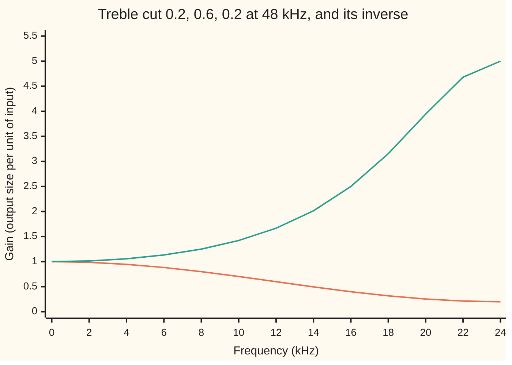
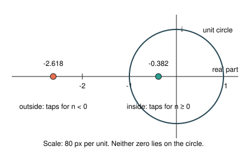
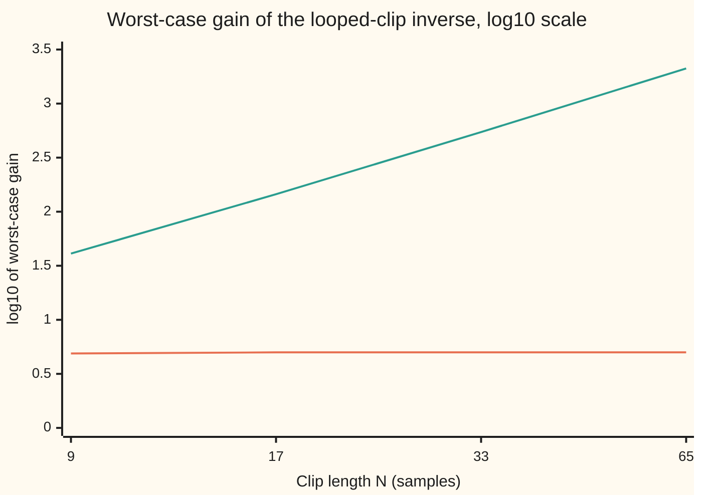

# Wiener's lemma: a filter that never vanishes has a well-behaved inverse

[Syllabus](../../../SYLLABUS.md) → [Functional analysis](../README.md) → [Banach Algebras and Fixed Points](../README.md#s06) → Wiener's lemma

---

## General Overview

A podcast was recorded at 48,000 samples a second through a cheap interface. The interface smooths every sample with its two neighbours: 0.2 of the sample before, 0.6 of the sample itself, 0.2 of the sample after. That is a **three-tap filter**: three fixed weights, the **taps**, slid along the recording (illustrative numbers).

It dulls the treble. The share of a pure tone that survives is the filter's **gain** at that frequency. A 1 kHz tone keeps 99.7% of its size, a 10 kHz tone 70.4%, and the top frequency, 24 kHz, only 20%.

The editor wants the treble back: a second filter that undoes the first. The danger is an undoing filter that amplifies some signal without limit, turning tiny rounding errors into roaring noise.

The undoing filter does need infinitely many taps here: 2.236068, −0.854102, 0.326238, and so on, each about 0.38 times the one before, spreading both ways from the centre. But the sizes of all the taps add up to exactly 5. So its **worst-case gain** is 5: an input whose samples are all at most 1 in size never gives an output sample bigger than 5, and keeping 17 taps leaves an error below one part in a thousand.

Wiener's lemma says this is no accident of three taps.

**If a filter's taps have finite total size and its gain never reaches zero at any frequency, then its inverse filter exists, and its taps have finite total size too: the inverse is stable.**

**What kind of fact this is:** a theorem. The three-tap case is proved in full in Why it works, Step 1; the general case is proved in Step 2 by Newman's short argument, with the details in a fold. The Gelfand reading in Step 3 rests on a theorem proved on [Banach algebras](01-banach-algebras-and-the-gelfand-transform.md).

### The picture: what the filter does, and what undoing it costs



Orange: the treble cut's gain, falling from 1 to 0.2 at 24 kHz. Green: the inverse's gain, one over the orange line, rising to 5. The orange line never touches 0, so the green line stays finite.

---

## The formula

A **filter** acts on a recording by **convolution** (the operation of [Convolution](../../07-Complex%20analysis/08-Transforms%20in%20Outline/04-convolution-theorem.md), written $`*`$): each output sample is a weighted sum of nearby input samples, with the taps as weights. The **click** $`\delta`$ is the list with 1 at sample 0 and 0 everywhere else; a filter's taps are its output when the input is a click.

The **gain** of a filter $`h`$ at frequency $`\theta`$ (in radians per sample) is

```math
\hat h(\theta) = \sum_{n=-\infty}^{\infty} h_n\, e^{-in\theta}, \qquad \theta = \frac{2\pi f}{48000}.
```

This is the z-transform's $`H(z)`$ at $`z = e^{i\theta}`$, on the circle of radius 1 ([The z-transform](../../13-Engineering%20mathematics/02-Linear%20Systems%20and%20Transforms/08-z-transform-and-discrete-time-systems.md)). This card writes $`\mathbb{T}`$ for that circle: the points $`e^{i\theta}`$, one per frequency, with $`\theta`$ and $`\theta + 2\pi`$ the same point. For the treble cut, $`\hat h(\theta) = 0.6 + 0.4\cos\theta`$, real because the taps are symmetric.

The space $`\ell^1(\mathbb{Z})`$ holds the two-sided lists $`(\dots, h_{-1}, h_0, h_1, \dots)`$ with finite **total size** $`\lVert h\rVert_1 = \sum_n \lvert h_n\rvert`$ ([Sequence spaces](../01-Normed%20and%20Banach%20Spaces/02-sequence-spaces-lp-and-c0.md) builds the one-sided version). With convolution as its product it is a Banach algebra: $`\lVert h * g\rVert_1 \le \lVert h\rVert_1 \lVert g\rVert_1`$, and $`\delta`$ is its unit ([Banach algebras](01-banach-algebras-and-the-gelfand-transform.md)).

**Wiener's lemma.**

```math
h \in \ell^1(\mathbb{Z}) \ \text{ and } \ \hat h(\theta) \neq 0 \ \text{ for every } \theta \quad \Longrightarrow \quad \text{there is } g \in \ell^1(\mathbb{Z}) \ \text{ with } \ h * g = \delta, \ \ \hat g = 1/\hat h .
```

**Read it aloud:** if a filter's taps have finite total size and its gain is never zero on the circle, then some filter whose taps also have finite total size undoes it, and its gain is one over the original gain.

For a symmetric three-tap filter with middle tap $`h_0`$ and side taps $`h_1`$, where $`h_0 > 2h_1 > 0`$, the inverse is explicit:

```math
g_n = C\, r^{\lvert n\rvert}, \qquad r = \frac{-h_0 + \sqrt{h_0^2 - 4h_1^2}}{2h_1}, \qquad C = \frac{1}{h_1\,(r - 1/r)} .
```

For the treble cut: $`r = -0.381966`$, $`C = \sqrt5 = 2.236068`$, so $`g_n = 2.236068 \times (-0.381966)^{\lvert n\rvert}`$, and $`\lVert g\rVert_1 = 5`$.

**Read it aloud:** the inverse's taps start at 2.236068 and shrink by the factor 0.381966 with every step away from the centre, flipping sign each time.

| Symbol | Plain meaning | In our example | Push it up and the answer… |
| --- | --- | --- | --- |
| $`h`$, $`h_n`$, $`n`$ | the filter; its tap at sample $`n`$; the sample number | $`h_{-1}, h_0, h_1`$ = 0.2, 0.6, 0.2 | larger side taps: deeper treble cut |
| $`\theta`$, $`f`$ | frequency in radians per sample; in hertz (Hz) | 24 kHz is $`\theta = \pi`$ | — |
| $`\hat h(\theta)`$, $`H(z)`$ | the filter's gain at frequency $`\theta`$; the same as a z-transform | 1 at 0 Hz, 0.2 at 24 kHz | — |
| $`\mathbb{T}`$, $`z`$, $`i`$ | the unit circle, all frequencies at once; a point on it; the square root of −1 | $`z = e^{i\theta}`$ | — |
| $`\ell^1(\mathbb{Z})`$, $`\lVert h\rVert_1`$ | two-sided lists with finite total size; that total size | $`\lVert h\rVert_1 = 1`$ | — |
| $`\delta`$, $`\delta_1`$, $`*`$ | the click (1 at sample 0); the click one sample later; convolution | $`h * g = \delta`$ | — |
| $`g`$, $`g_n`$ | the inverse filter; its tap at sample $`n`$ | $`g_0`$ = 2.236068, $`\lVert g\rVert_1`$ = 5 | — |
| $`r`$, $`C`$ | the zero of $`h_1 z^2 + h_0 z + h_1`$ inside the circle; the inverse's centre tap | −0.381966; 2.236068 | $`\lvert r\rvert`$ toward 1: taps fade slowly, more are needed |
| $`N`$ | samples in a looped clip (Step 4) | 9, 17, 33, 65 | the finite inverse's gain approaches 5 |
| $`K`$ | inverse taps kept on each side, $`2K+1`$ in all | 8: 17 taps | error falls by 0.381966 per step |
| $`\chi`$, $`\zeta`$ | a character: a linear map to the complex numbers that respects products (Step 3); its value at $`\delta_1`$ | $`\chi(h) = \hat h(\theta)`$, $`\zeta = e^{-i\theta}`$ | — |
| $`p`$, $`M`$, $`m`$, $`k`$, $`D`$, $`u`$, $`A_k`$, $`w`$ | proof helpers (Step 2): a finite filter near $`h`$ and its last tap; the least gain size; a power; the largest slope of $`\hat p`$; a smooth function; a bound; a ratio | — | — |

### When it holds

- **The taps have finite total size.** Without it the sum defining the gain need not converge, and the gain need not be continuous, so "never zero" no longer controls the inverse.
- **The gain is never zero, at any frequency.** The blur 0.25, 0.5, 0.25 has gain 0 at 24 kHz. Its looped-clip inverses exist for every odd clip length, but their worst-case gain is $`(N^2+1)/2`$: 2113 at $`N = 65`$, and still growing.
- **The inverse may use future samples.** Wiener's $`g`$ is two-sided. The treble cut's zero outside the circle, −2.618034, forces taps at negative $`n`$. Run the inverse as a recursion from the left and a rounding error grows 2.618034 times per sample.
- **One channel.** For matrix-valued taps (stereo crosstalk, say) the test becomes "the gain matrix is invertible at every frequency" (Gröchenig, in Sources).

---

## Why it works

### Step 0: convolution becomes multiplication, so undoing becomes dividing

Filtering multiplies the gain at each frequency: $`\widehat{h * g} = \hat h\, \hat g`$ (the convolution theorem, on [Convolution](../../07-Complex%20analysis/08-Transforms%20in%20Outline/04-convolution-theorem.md)). The click has gain 1 everywhere. So $`h * g = \delta`$ means $`\hat g = 1/\hat h`$ at every frequency.

If $`\hat h`$ vanishes somewhere, $`1/\hat h`$ blows up there and nothing can work. If it never vanishes, $`1/\hat h`$ is a perfectly good continuous function on the circle. The real question is whether its Fourier coefficients ([Fourier series](../../07-Complex%20analysis/08-Transforms%20in%20Outline/01-fourier-series-in-complex-form.md)) have a finite total size. A continuous function's coefficients need not. Wiener's lemma says these ones always do.

### Step 1: three taps, by hand

Write the gain as a polynomial. With $`z = e^{i\theta}`$,

```math
\hat h = 0.2z^{-1} + 0.6 + 0.2z = \frac{0.2\,(z - r)(z - 1/r)}{z}, \qquad r = \frac{-3 + \sqrt5}{2} = -0.381966 .
```

The zeros are $`r`$, inside the circle, and $`1/r = -2.618034`$, outside. Neither is on the circle, which is the same as saying $`\hat h`$ never vanishes there.

**Guess and check.** Try $`g_n = C r^{\lvert n\rvert}`$. For $`n \ge 1`$,

```math
(h * g)_n = 0.2\,g_{n-1} + 0.6\,g_n + 0.2\,g_{n+1} = C\, r^{\,n-1}\,(0.2 + 0.6r + 0.2r^2) = 0,
```

because $`r`$ solves $`0.2 + 0.6r + 0.2r^2 = 0`$. Negative $`n`$ is the mirror image. At $`n = 0`$ the sum is $`C(0.6 + 0.4r)`$, and $`C = \sqrt5`$ makes it 1.

**Total size.** The taps form two geometric series, one each way:

```math
\lVert g\rVert_1 = C\Big(1 + 2\sum_{n\ge1}\lvert r\rvert^n\Big) = C\,\frac{1 + \lvert r\rvert}{1 - \lvert r\rvert} = 2.236068 \times 2.236068 = 5 .
```

The series converges because $`\lvert r\rvert < 1`$. If a zero sat on the circle, $`\lvert r\rvert = 1`$ and the series would diverge. That is the three-tap Wiener's lemma.

The total size 5 equals the largest inverse gain, $`1/0.2`$ at 24 kHz. The signs alternate, so at $`\theta = \pi`$, where $`e^{-in\pi} = (-1)^n`$, every term adds with the same sign. For any filter, the worst-case gain on bounded signals is exactly the total size of its taps.

<p align="center"></p>

Drawn to scale, 80 units to 1. The zero inside the circle builds the taps at $`n \ge 0`$; the zero outside builds the taps at $`n < 0`$, which use samples from the future. Neither is on the circle, so both geometric series converge.

### Step 2: any filter with finite total size

For three taps the inverse could be written down. For a filter with infinitely many taps there are no roots to find. Newman's argument (1975) needs only three facts:

1. **Cut the filter.** Keep enough taps that the leftover has total size at most a third of $`m`$, the smallest value of $`\lvert\hat h\rvert`$. Call the finite filter $`p`$. Since $`\lvert \hat h - \hat p\rvert \le \lVert h - p\rVert_1`$, the gain $`\hat p`$ stays at least $`2m/3`$ in size.
2. **A smooth gain has summable taps.** The finite $`p`$ has a smooth gain. So $`1/\hat p`$ and its powers are smooth, and a smooth function's Fourier coefficients have finite total size, bounded by its size plus the size of its slope.
3. **Expand around the finite filter.** Write $`1/\hat h = 1/(\hat p - (\hat p - \hat h))`$ as a geometric series in $`(\hat p - \hat h)/\hat p`$. Each term's total size shrinks like $`2^{-k}`$ times a slowly growing factor, because $`\lVert h - p\rVert_1`$ is small and a convolution's total size is at most the product of the two total sizes.

The series of tap lists converges in $`\ell^1(\mathbb{Z})`$, which is complete: a series of lists whose total sizes add up to a finite number has a limit list in the space. Its limit $`g`$ has gain $`1/\hat h`$.

<details>
<summary>Detailed proof: Newman's argument, with the constants</summary>

Let $`m = \min_\theta \lvert \hat h(\theta)\rvert > 0`$. The minimum exists because $`\hat h`$ is continuous on the closed circle: the sum defining it converges uniformly, since its terms are bounded by $`\lvert h_n\rvert`$.

**The cut.** Choose $`M`$ with $`\sum_{\lvert n\rvert > M} \lvert h_n\rvert \le m/3`$, and let $`p`$ keep the taps $`\lvert n\rvert \le M`$. Then for every $`\theta`$,

$`\displaystyle \lvert \hat p(\theta)\rvert \ \ge\ \lvert\hat h(\theta)\rvert - \lVert h - p\rVert_1 \ \ge\ \tfrac{2m}{3}.`$

**Smooth functions have summable coefficients.** Let $`u`$ be a smooth function on the circle with coefficients $`u_n`$. Its slope $`u'`$ has coefficients $`in\,u_n`$. By Cauchy-Schwarz ([Inner products](../02-Hilbert%20Spaces/01-inner-products-and-hilbert-spaces.md)) and then Parseval ([Fourier series](../../07-Complex%20analysis/08-Transforms%20in%20Outline/01-fourier-series-in-complex-form.md)),

$`\displaystyle \sum_n \lvert u_n\rvert \ \le\ \lvert u_0\rvert + \Big(\sum_{n\neq0}\frac{1}{n^2}\Big)^{1/2}\Big(\sum_{n} n^2\lvert u_n\rvert^2\Big)^{1/2} \ \le\ \max\lvert u\rvert + \frac{\pi}{\sqrt3}\,\max\lvert u'\rvert .`$

Here $`\sum_{n\ne0} 1/n^2 = \pi^2/3`$, and $`\sum n^2\lvert u_n\rvert^2`$ is the average of $`\lvert u'\rvert^2`$, at most $`(\max\lvert u'\rvert)^2`$.

**The powers of 1/p.** Let $`D = \max\lvert\hat p\,'\rvert \le \sum_n \lvert n\rvert\lvert p_n\rvert`$, finite since $`p`$ has finitely many taps. Take $`u = \hat p^{-(k+1)}`$. Then $`\lvert u\rvert \le (3/2m)^{k+1}`$ and $`\lvert u'\rvert = (k+1)\lvert\hat p\,'\rvert\,\lvert\hat p\rvert^{-(k+2)} \le (k+1)D\,(3/2m)^{k+2}`$. So the taps of $`u`$ have total size at most

$`\displaystyle A_k = \Big(\frac{3}{2m}\Big)^{k+1}\Big(1 + \frac{\pi}{\sqrt3}\,(k+1)\,D\,\frac{3}{2m}\Big).`$

**The series.** The difference $`h - p`$ has total size at most $`m/3`$, so its $`k`$-fold convolution power has total size at most $`(m/3)^k`$. The $`k`$-th term $`(\hat p - \hat h)^k\, \hat p^{-(k+1)}`$ is the gain of a list of total size at most

$`\displaystyle \Big(\frac{m}{3}\Big)^k A_k = \frac{3}{2m}\,2^{-k}\Big(1 + \frac{\pi}{\sqrt3}\,(k+1)\,D\,\frac{3}{2m}\Big).`$

These bounds add to a finite number, so the lists add up in $`\ell^1(\mathbb{Z})`$; it is complete, so the sum is some $`g`$. Convergence in total size gives uniform convergence of the gains. At each $`\theta`$, with $`w = (\hat p - \hat h)/\hat p`$ of size at most $`(m/3)/(2m/3) = 1/2`$, the gains add to $`\hat p^{-1}(1 + w + w^2 + \dots) = 1/(\hat p(1 - w)) = 1/\hat h`$. Two lists in $`\ell^1(\mathbb{Z})`$ with the same gain are equal (their Fourier coefficients agree), so $`h * g = \delta`$.

</details>

### Step 3: the Gelfand reading

[Banach algebras](01-banach-algebras-and-the-gelfand-transform.md) proves the general rule: in a commutative Banach algebra with a unit, an element is invertible exactly when no character sends it to 0. A **character** $`\chi`$ is a linear map to the complex numbers that respects products: $`\chi(h * g) = \chi(h)\chi(g)`$.

For $`\ell^1(\mathbb{Z})`$ the characters are exactly the gains at single frequencies. A character is fixed by $`\zeta = \chi(\delta_1)`$, where $`\delta_1`$ is the click delayed by one sample. A character never sends a list of total size 1 to a number bigger than 1 in size (a fact from that card), so $`\lvert \zeta\rvert \le 1`$, and also $`\lvert 1/\zeta\rvert = \lvert\chi(\delta_{-1})\rvert \le 1`$. So $`\lvert \zeta\rvert = 1`$: $`\zeta = e^{-i\theta}`$ for one point of $`\mathbb{T}`$, and $`\chi(h) = \hat h(\theta)`$.

So "no character sends $`h`$ to 0" reads "$`\hat h`$ never vanishes on $`\mathbb{T}`$". Gelfand's theory of 1941 turned Wiener's long 1932 proof into this short argument.

### Step 4: the finite rehearsal, and what it cannot see

Loop a clip of $`N`$ samples, so the last sample's neighbour is the first. The filter becomes an $`N \times N`$ matrix with 0.6 on the diagonal and 0.2 beside it, wrapping round the corners: a **circulant** matrix. Its eigenvalues are, by [The discrete Fourier transform](../../07-Complex%20analysis/08-Transforms%20in%20Outline/02-discrete-fourier-transform.md), the gains at the $`N`$ grid frequencies $`2\pi k/N`$. It is invertible exactly when none of those gains is 0.

The code inverts these matrices by plain elimination. For the treble cut, the inverse's centre tap misses $`C`$ by $`2C\lvert r\rvert^N/\lvert1 - r^N\rvert`$: $`7.74 \times 10^{-4}`$ at $`N = 9`$, $`3.51 \times 10^{-7}`$ at $`N = 17`$. The worst-case gain climbs to 5 and stays there.

For the blur 0.25, 0.5, 0.25, every odd $`N`$ gives an invertible matrix, because the grid misses 24 kHz. But the worst-case gain is $`(N^2+1)/2`$, with no bound as $`N`$ grows. Even $`N`$ puts a grid point on 24 kHz, and the matrix is singular.



Orange: the treble cut, settling at log10 5 = 0.6990. Green: the blur, rising by about 0.6 (a factor near 4) each time $`N`$ doubles. Every matrix on the green line is invertible; only the trend shows that the infinite filter is not.

---

## Worked numbers, by hand

| Step | Arithmetic | Value |
| --- | --- | --- |
| gain at 0 Hz | 0.6 + 0.4 | 1 |
| gain at 24 kHz | 0.6 − 0.4 | 0.2: smallest, never 0 |
| zeros | $`z^2 + 3z + 1 = 0`$ | −0.381966 and −2.618034 |
| centre tap | $`C = 1/(0.2 \times (r - 1/r)) = 1/(0.2 \times \sqrt5)`$ | 2.236068 |
| next taps | $`C r`$, $`C r^2`$, $`C r^3`$ | −0.854102, 0.326238, −0.124612 |
| check sample 0 | 0.6 × 2.236068 + 2 × 0.2 × (−0.854102) | 1.341641 − 0.341641 = 1 |
| check sample 1 | 0.2 × 2.236068 + 0.6 × (−0.854102) + 0.2 × 0.326238 | 0.447214 − 0.512461 + 0.065248 = 0 |
| total size | $`C (1 + \lvert r\rvert)/(1 - \lvert r\rvert)`$ = 2.236068 × 2.236068 | 5 |
| plain sum | $`1/\hat h(0)`$ | 1 |
| error after cutting to $`2K+1`$ taps | $`2 \times 0.2 \times C (1 + \lvert r\rvert) \times \lvert r\rvert^K`$ = 1.236068 × $`\lvert r\rvert^K`$ | — |
| $`K = 8`$ | 1.236068 × 0.000453 | **0.000560, below 0.001: 17 taps** |

A 17-tap inverse undoes the treble cut to better than −60 dB (one part in a thousand) at every frequency, and boosts nothing by more than 5 times, 13.98 dB, the boost needed at 24 kHz.

### What breaks if you drop a piece

| Mistake | Comes out at | What went wrong |
| --- | --- | --- |
| Undo the filter one sample at a time, from the left | a 10⁻⁶ rounding error becomes 1.771 × 10⁻² after 10 samples and 2.679 × 10² after 20, growing 2.618034 times per sample | the zero outside the circle needs future samples; a causal recursion runs its geometric series backwards |
| Invert a filter whose gain reaches 0 (the blur 0.25, 0.5, 0.25) | looped-clip worst-case gain 41, 145, 545, 2113 at $`N`$ = 9, 17, 33, 65; singular at $`N = 8`$ | 24 kHz is silenced, so $`1/\hat h`$ is infinite there; no $`\ell^1`$ inverse |
| Keep only 5 inverse taps | error 0.180340, only −14.88 dB | the taps fade by 0.381966 per step; 17 are needed for −60 dB |
| Trust a gain zero inside the audio band to be harmless (taps 0.3, 0.4, 0.3) | gain 0 at 17575 Hz | any zero on the circle, not just at 24 kHz, rules out a stable inverse |

---

## Code, from first principles, and it actually runs

The code holds only finite rehearsals: 121 inverse taps, clips of up to 65 samples, a frequency grid every 100 Hz. It takes three independent roads to the inverse:

1. the closed form $`C r^{\lvert n\rvert}`$ from the zeros;
2. Gaussian elimination, written out, on each looped-clip matrix, whose centre tap must match the closed form wrapped round the loop;
3. the convolution $`h * g`$, which must give the click, with the cut-off error from direct convolution matched to its closed form and bounding the gain error on the frequency grid.

The blur's failure shows as a trend over $`N`$, checked against the lower bound $`1/\sin^2(\pi/2N)`$.

### Python

```python
# Wiener's lemma: invert a three-tap audio filter and check that the inverse's
# taps are absolutely summable. Standard library only. Three roads to the
# inverse: a closed form from the filter's zeros, Gaussian elimination on the
# looped-clip (circulant) matrix, and the convolution h * g = delta as a check.
import math

FS = 48000.0                         # samples per second (illustrative)
H = (0.2, 0.6, 0.2)                  # taps at samples -1, 0, +1: the treble cut
BLUR = (0.25, 0.5, 0.25)             # a stronger blur that silences 24 kHz

def gain(h, f):                      # response at f Hz; real, as the taps are symmetric
    return h[1] + 2 * h[0] * math.cos(2 * math.pi * f / FS)

def zero_inside(h):                  # root r of b z^2 + a z + b with |r| < 1
    a, b = h[1], h[0]
    return (-a + math.sqrt(a * a - 4 * b * b)) / (2 * b)

def inverse_tap(h, n):               # closed form g_n = C r^|n|, C = 1 / (b (r - 1/r))
    r = zero_inside(h)
    return r ** abs(n) / (h[0] * (r - 1 / r))

def convolve(h, g):                  # g as {n: g_n}; returns h * g as {n: value}
    out = {}
    for n, c in g.items():
        for k in (-1, 0, 1):
            out[n + k] = out.get(n + k, 0.0) + h[k + 1] * c
    return out

def circulant_inverse(h, N):         # solve A x = e_0 for the looped clip of N samples
    A = [[0.0] * N + [1.0 if i == 0 else 0.0] for i in range(N)]
    for i in range(N):
        for k in (-1, 0, 1):
            A[i][(i - k) % N] += h[k + 1]
    for c in range(N):               # Gaussian elimination, partial pivoting
        p = max(range(c, N), key=lambda i: abs(A[i][c]))
        if abs(A[p][c]) < 1e-9:
            return None              # a zero pivot: the matrix is singular
        A[c], A[p] = A[p], A[c]
        for i in range(c + 1, N):
            m = A[i][c] / A[c][c]
            for j in range(c, N + 1):
                A[i][j] -= m * A[c][j]
    x = [0.0] * N
    for i in range(N - 1, -1, -1):
        x[i] = (A[i][N] - sum(A[i][j] * x[j] for j in range(i + 1, N))) / A[i][i]
    return x

r = zero_inside(H)
print("1. the treble cut, taps 0.2 0.6 0.2 at 48 kHz")
for f in (0, 1000, 10000, 24000):
    print(f"   {f:5d} Hz: gain {gain(H, f):.6f}  inverse gain {1 / gain(H, f):.6f}")
print(f"   zeros of 0.2 z^2 + 0.6 z + 0.2: {r:.6f} inside, {1 / r:.6f} outside the circle")
assert abs(r - (-3 + math.sqrt(5)) / 2) < 1e-12 and abs(H[0] / r ** 2 + H[1] / r + H[2]) < 1e-12

print("2. closed-form inverse g_n = C r^|n|")
g = {n: inverse_tap(H, n) for n in range(-60, 61)}
print("   g_0..g_6 " + " ".join(f"{g[n]:.6f}" for n in range(7)))
s, s1 = sum(g.values()), sum(abs(c) for c in g.values())
print(f"   C = {g[0]:.6f} (sqrt 5 = {math.sqrt(5):.6f}); sum g {s:.6f}; sum |g| {s1:.6f}")
assert abs(g[0] - math.sqrt(5)) < 1e-12
print(f"   by hand: 0.6 g_0 {H[1] * g[0]:.6f}, 0.4 g_1 {2 * H[0] * g[1]:.6f}; 0.2 g_0, 0.6 g_1, 0.2 g_2: "
      f"{H[0] * g[0]:.6f} {H[1] * g[1]:.6f} {H[2] * g[2]:.6f}")
q = (1 + abs(r)) / (1 - abs(r))
print(f"   (1+|r|)/(1-|r|) {q:.6f}; C (1+|r|)/(1-|r|) {g[0] * q:.6f}; boost at 24 kHz {20 * math.log10(1 / gain(H, 24000)):.2f} dB")
assert abs(g[0] * q - s1) < 1e-9
assert abs(s - 1 / gain(H, 0)) < 1e-9 and abs(s1 - 1 / gain(H, FS / 2)) < 1e-9
hg = convolve(H, g)
res = max(abs(hg[n] - (1.0 if n == 0 else 0.0)) for n in range(-59, 60))
print(f"   (h * g)[0], [1], [2]: {abs(hg[0]):.6f} {abs(hg[1]):.6f} {abs(hg[2]):.6f}; largest residual {res:.1e}")
assert res < 1e-12

print("3. looped clip of N samples: circulant matrix, inverted by elimination")
print("   N   g_0       |g_0 - C|  2C|r|^N/|1-r^N|  worst gain: treble cut  blur     (N^2+1)/2")
chart = []
for N in (9, 17, 33, 65):
    x, xb = circulant_inverse(H, N), circulant_inverse(BLUR, N)
    period = g[0] * sum(r ** abs(m * N) for m in range(-6, 7))     # the clip wraps: g_0 + g_N + g_-N + ...
    w, wb = sum(abs(v) for v in x), sum(abs(v) for v in xb)
    print(f"   {N:<3d} {x[0]:.6f}  {abs(x[0] - g[0]):.2e}   {abs(2 * g[0] * r ** N / (1 - r ** N)):.2e}         "
          f"{w:.6f}  {wb:8.2f}  {(N * N + 1) / 2:8.2f}")
    assert abs(x[0] - period) < 1e-12                              # elimination = wrapped closed form
    lo = min(gain(BLUR, FS * k / N) for k in range(N))             # sup |g-hat| <= sum |g|
    assert w <= 5 + 1e-9 and wb >= 1 / lo - 1e-6 and abs(wb - (N * N + 1) / 2) < 1e-6 * N * N
    chart.append((N, w, wb))
print(f"   blur, N = 8: {'singular (zero pivot)' if circulant_inverse(BLUR, 8) is None else 'invertible'}")
assert circulant_inverse(BLUR, 8) is None

print("4. keep taps -K..K: l1 residual of h * g_K - delta, and the closed form 2bC(1+|r|)|r|^K")
for K in (2, 4, 6, 8, 10):
    gk = {n: g[n] for n in range(-K, K + 1)}
    e = convolve(H, gk)
    l1 = sum(abs(v - (1.0 if n == 0 else 0.0)) for n, v in e.items())
    worst = max(abs(1 - gain(H, f) * sum(c * math.cos(2 * math.pi * f * n / FS) for n, c in gk.items()))
                for f in range(0, 24001, 100))
    cf = 2 * H[0] * g[0] * (1 + abs(r)) * abs(r) ** K
    print(f"   K = {K:2d}, {2 * K + 1:2d} taps: residual {l1:.6f}  closed form {cf:.6f}  worst gain error {worst:.6f}")
    assert abs(l1 - cf) < 1e-12 and worst <= l1 + 1e-12
print(f"   2bC(1+|r|) {2 * H[0] * g[0] * (1 + abs(r)):.6f}; |r|^8 {abs(r) ** 8:.6f}; 5 taps leave {20 * math.log10(2 * H[0] * g[0] * (1 + abs(r)) * abs(r) ** 2):.2f} dB")
K60 = next(K for K in range(1, 99) if 2 * H[0] * g[0] * (1 + abs(r)) * abs(r) ** K <= 1e-3)
print(f"   -60 dB (residual <= 0.001) first at K = {K60}: {2 * K60 + 1} taps")

print("5. undoing the filter one sample at a time, from the left (a causal recursion)")
e = [0.0, 1e-6]                      # a rounding error of one millionth at sample 0
for n in range(40):
    e.append(-(H[1] * e[-1] + H[0] * e[-2]) / H[2])
print(f"   error after 5, 10, 20 samples: {abs(e[6]):.3e} {abs(e[11]):.3e} {abs(e[21]):.3e}; growth per sample {abs(e[41] / e[40]):.6f}")
assert abs(abs(e[41] / e[40]) - 1 / abs(r)) < 1e-9

print("6. try changing")
K96 = next(K for K in range(1, 99) if 2 * H[0] * g[0] * (1 + abs(r)) * abs(r) ** K <= 10 ** (-96 / 20))
print(f"   16-bit audio, -96 dB: K = {K96}, {2 * K96 + 1} taps")
for h in ((0.1, 0.8, 0.1), (0.3, 0.4, 0.3)):
    if h[1] > 2 * h[0]:
        rr = zero_inside(h); K = next(K for K in range(1, 99) if 2 * h[0] * inverse_tap(h, 0) * (1 + abs(rr)) * abs(rr) ** K <= 1e-3)
        print(f"   taps {h}: r {rr:.6f}, sum |g| {1 / (h[1] - 2 * h[0]):.6f}, -60 dB at {2 * K + 1} taps")
    else:
        print(f"   taps {h}: gain 0 at {FS * math.acos(-h[1] / (2 * h[0])) / (2 * math.pi):.0f} Hz: no inverse in l1")
print("chart, kHz 0..24 step 2: gain " + " ".join(f"{gain(H, 1000 * k):.4f}" for k in range(0, 25, 2)))
print("chart, kHz 0..24 step 2: inverse gain " + " ".join(f"{1 / gain(H, 1000 * k):.4f}" for k in range(0, 25, 2)))
print("chart, log10 worst-case gain at N = 9 17 33 65: treble cut " + " ".join(f"{math.log10(w):.4f}" for _, w, _ in chart)
      + "; blur " + " ".join(f"{math.log10(wb):.4f}" for _, _, wb in chart))
print(f"figure, z-plane: centre (300, 130), 80 px per unit, unit circle r 80; zeros at x = {300 + 80 * r:.2f} and {300 + 80 / r:.2f}")
print("ALL CHECKS PASS")
```

**Ran 2026-11-15 on macOS, Python 3.14.10, standard library only. All checks passed. Output, pasted from the run:**

```
1. the treble cut, taps 0.2 0.6 0.2 at 48 kHz
       0 Hz: gain 1.000000  inverse gain 1.000000
    1000 Hz: gain 0.996578  inverse gain 1.003434
   10000 Hz: gain 0.703528  inverse gain 1.421408
   24000 Hz: gain 0.200000  inverse gain 5.000000
   zeros of 0.2 z^2 + 0.6 z + 0.2: -0.381966 inside, -2.618034 outside the circle
2. closed-form inverse g_n = C r^|n|
   g_0..g_6 2.236068 -0.854102 0.326238 -0.124612 0.047597 -0.018181 0.006944
   C = 2.236068 (sqrt 5 = 2.236068); sum g 1.000000; sum |g| 5.000000
   by hand: 0.6 g_0 1.341641, 0.4 g_1 -0.341641; 0.2 g_0, 0.6 g_1, 0.2 g_2: 0.447214 -0.512461 0.065248
   (1+|r|)/(1-|r|) 2.236068; C (1+|r|)/(1-|r|) 5.000000; boost at 24 kHz 13.98 dB
   (h * g)[0], [1], [2]: 1.000000 0.000000 0.000000; largest residual 5.6e-17
3. looped clip of N samples: circulant matrix, inverted by elimination
   N   g_0       |g_0 - C|  2C|r|^N/|1-r^N|  worst gain: treble cut  blur     (N^2+1)/2
   9   2.235294  7.74e-04   7.74e-04         4.882353     41.00     41.00
   17  2.236068  3.51e-07   3.51e-07         4.997495    145.00    145.00
   33  2.236068  7.24e-14   7.20e-14         4.999999    545.00    545.00
   65  2.236068  0.00e+00   3.03e-27         5.000000   2113.00   2113.00
   blur, N = 8: singular (zero pivot)
4. keep taps -K..K: l1 residual of h * g_K - delta, and the closed form 2bC(1+|r|)|r|^K
   K =  2,  5 taps: residual 0.180340  closed form 0.180340  worst gain error 0.180340
   K =  4,  9 taps: residual 0.026311  closed form 0.026311  worst gain error 0.026311
   K =  6, 13 taps: residual 0.003839  closed form 0.003839  worst gain error 0.003839
   K =  8, 17 taps: residual 0.000560  closed form 0.000560  worst gain error 0.000560
   K = 10, 21 taps: residual 0.000082  closed form 0.000082  worst gain error 0.000082
   2bC(1+|r|) 1.236068; |r|^8 0.000453; 5 taps leave -14.88 dB
   -60 dB (residual <= 0.001) first at K = 8: 17 taps
5. undoing the filter one sample at a time, from the left (a causal recursion)
   error after 5, 10, 20 samples: 1.440e-04 1.771e-02 2.679e+02; growth per sample 2.618034
6. try changing
   16-bit audio, -96 dB: K = 12, 25 taps
   taps (0.1, 0.8, 0.1): r -0.127017, sum |g| 1.666667, -60 dB at 7 taps
   taps (0.3, 0.4, 0.3): gain 0 at 17575 Hz: no inverse in l1
chart, kHz 0..24 step 2: gain 1.0000 0.9864 0.9464 0.8828 0.8000 0.7035 0.6000 0.4965 0.4000 0.3172 0.2536 0.2136 0.2000
chart, kHz 0..24 step 2: inverse gain 1.0000 1.0138 1.0566 1.1327 1.2500 1.4214 1.6667 2.0142 2.5000 3.1530 3.9434 4.6810 5.0000
chart, log10 worst-case gain at N = 9 17 33 65: treble cut 0.6886 0.6988 0.6990 0.6990; blur 1.6128 2.1614 2.7364 3.3249
figure, z-plane: centre (300, 130), 80 px per unit, unit circle r 80; zeros at x = 269.44 and 90.56
ALL CHECKS PASS
```

### Rust

```rust
// Wiener's lemma: invert a three-tap audio filter and check that the inverse's
// taps are absolutely summable. std only. Three roads to the inverse: a closed
// form from the filter's zeros, Gaussian elimination on the looped-clip
// (circulant) matrix, and the convolution h * g = delta as a check.
use std::f64::consts::PI;

const FS: f64 = 48000.0; // samples per second (illustrative)
const H: [f64; 3] = [0.2, 0.6, 0.2]; // taps at samples -1, 0, +1: the treble cut
const BLUR: [f64; 3] = [0.25, 0.5, 0.25]; // a stronger blur that silences 24 kHz

fn gain(h: &[f64; 3], f: f64) -> f64 { h[1] + 2.0 * h[0] * (2.0 * PI * f / FS).cos() }

fn zero_inside(h: &[f64; 3]) -> f64 {
    let (a, b) = (h[1], h[0]);
    (-a + (a * a - 4.0 * b * b).sqrt()) / (2.0 * b)
}

fn inverse_tap(h: &[f64; 3], n: i64) -> f64 {
    let r = zero_inside(h);
    r.powf(n.abs() as f64) / (h[0] * (r - 1.0 / r))
}

// g holds taps lo..lo+len-1; returns h * g on lo-1..lo+len
fn convolve(h: &[f64; 3], g: &[f64]) -> Vec<f64> {
    let mut out = vec![0.0; g.len() + 2];
    for (i, c) in g.iter().enumerate() {
        for k in 0..3 { out[i + k] += h[k] * c; }
    }
    out
}

fn circulant_inverse(h: &[f64; 3], n: usize) -> Option<Vec<f64>> {
    let mut a = vec![vec![0.0; n + 1]; n];
    a[0][n] = 1.0;
    for i in 0..n {
        for k in -1i64..=1 {
            let j = ((i as i64 - k).rem_euclid(n as i64)) as usize;
            a[i][j] += h[(k + 1) as usize];
        }
    }
    for c in 0..n {
        let mut p = c;
        for i in c..n { if a[i][c].abs() > a[p][c].abs() { p = i; } }
        if a[p][c].abs() < 1e-9 { return None; }
        a.swap(c, p);
        let pivot = a[c].clone();
        for i in c + 1..n {
            let m = a[i][c] / pivot[c];
            for j in c..=n { a[i][j] -= m * pivot[j]; }
        }
    }
    let mut x = vec![0.0; n];
    for i in (0..n).rev() {
        let mut s = 0.0;
        for j in i + 1..n { s += a[i][j] * x[j]; }
        x[i] = (a[i][n] - s) / a[i][i];
    }
    Some(x)
}

fn sci(x: f64, d: usize) -> String { // Python-style exponent: e-04, e+02
    let s = format!("{:.*e}", d, x);
    let (m, e) = s.split_once('e').unwrap();
    let ev: i32 = e.parse().unwrap();
    format!("{}e{}{:02}", m, if ev < 0 { '-' } else { '+' }, ev.abs())
}

fn delta(n: i64) -> f64 { if n == 0 { 1.0 } else { 0.0 } }

fn main() {
    let r = zero_inside(&H);
    println!("1. the treble cut, taps 0.2 0.6 0.2 at 48 kHz");
    for f in [0, 1000, 10000, 24000] {
        println!("   {:5} Hz: gain {:.6}  inverse gain {:.6}", f, gain(&H, f as f64), 1.0 / gain(&H, f as f64));
    }
    println!("   zeros of 0.2 z^2 + 0.6 z + 0.2: {:.6} inside, {:.6} outside the circle", r, 1.0 / r);
    assert!((r - (-3.0 + 5f64.sqrt()) / 2.0).abs() < 1e-12 && (H[0] / (r * r) + H[1] / r + H[2]).abs() < 1e-12);

    println!("2. closed-form inverse g_n = C r^|n|");
    let g: Vec<f64> = (-60..=60).map(|n| inverse_tap(&H, n)).collect(); // g[n + 60]
    let gs: Vec<String> = (0..7).map(|n| format!("{:.6}", g[n + 60])).collect();
    println!("   g_0..g_6 {}", gs.join(" "));
    let s: f64 = g.iter().sum();
    let s1: f64 = g.iter().map(|c| c.abs()).sum();
    println!("   C = {:.6} (sqrt 5 = {:.6}); sum g {:.6}; sum |g| {:.6}", g[60], 5f64.sqrt(), s, s1);
    assert!((g[60] - 5f64.sqrt()).abs() < 1e-12);
    println!("   by hand: 0.6 g_0 {:.6}, 0.4 g_1 {:.6}; 0.2 g_0, 0.6 g_1, 0.2 g_2: {:.6} {:.6} {:.6}",
        H[1] * g[60], 2.0 * H[0] * g[61], H[0] * g[60], H[1] * g[61], H[2] * g[62]);
    let q = (1.0 + r.abs()) / (1.0 - r.abs());
    println!("   (1+|r|)/(1-|r|) {:.6}; C (1+|r|)/(1-|r|) {:.6}; boost at 24 kHz {:.2} dB", q, g[60] * q, 20.0 * (1.0 / gain(&H, 24000.0)).log10());
    assert!((g[60] * q - s1).abs() < 1e-9);
    assert!((s - 1.0 / gain(&H, 0.0)).abs() < 1e-9 && (s1 - 1.0 / gain(&H, FS / 2.0)).abs() < 1e-9);
    let hg = convolve(&H, &g); // index n + 61
    let res = (-59..60i64).map(|n| (hg[(n + 61) as usize] - delta(n)).abs()).fold(0.0, f64::max);
    println!("   (h * g)[0], [1], [2]: {:.6} {:.6} {:.6}; largest residual {}", hg[61].abs(), hg[62].abs(), hg[63].abs(), sci(res, 1));
    assert!(res < 1e-12);

    println!("3. looped clip of N samples: circulant matrix, inverted by elimination");
    println!("   N   g_0       |g_0 - C|  2C|r|^N/|1-r^N|  worst gain: treble cut  blur     (N^2+1)/2");
    let mut chart = vec![];
    for n in [9usize, 17, 33, 65] {
        let x = circulant_inverse(&H, n).unwrap();
        let xb = circulant_inverse(&BLUR, n).unwrap();
        let period = g[60] * (-6..=6i64).map(|m| r.powf((m * n as i64).abs() as f64)).sum::<f64>();
        let w: f64 = x.iter().map(|v| v.abs()).sum();
        let wb: f64 = xb.iter().map(|v| v.abs()).sum();
        let nf = n as f64;
        println!("   {:<3} {:.6}  {}   {}         {:.6}  {:8.2}  {:8.2}", n, x[0], sci((x[0] - g[60]).abs(), 2),
            sci((2.0 * g[60] * r.powf(nf) / (1.0 - r.powf(nf))).abs(), 2), w, wb, (nf * nf + 1.0) / 2.0);
        assert!((x[0] - period).abs() < 1e-12);
        let lo = (0..n).map(|k| gain(&BLUR, FS * k as f64 / nf)).fold(f64::INFINITY, f64::min);
        assert!(w <= 5.0 + 1e-9 && wb >= 1.0 / lo - 1e-6 && (wb - (nf * nf + 1.0) / 2.0).abs() < 1e-6 * nf * nf);
        chart.push((w, wb));
    }
    let b8 = circulant_inverse(&BLUR, 8);
    println!("   blur, N = 8: {}", if b8.is_none() { "singular (zero pivot)" } else { "invertible" });
    assert!(b8.is_none());

    println!("4. keep taps -K..K: l1 residual of h * g_K - delta, and the closed form 2bC(1+|r|)|r|^K");
    let resid = |k: i64| 2.0 * H[0] * g[60] * (1.0 + r.abs()) * r.abs().powf(k as f64);
    for k in [2i64, 4, 6, 8, 10] {
        let gk = &g[(60 - k) as usize..=(60 + k) as usize];
        let e = convolve(&H, gk); // index n + k + 1
        let l1: f64 = (0..e.len()).map(|i| (e[i] - delta(i as i64 - k - 1)).abs()).sum();
        let mut worst: f64 = 0.0;
        for f in (0..=24000).step_by(100) {
            let mut sg = 0.0;
            for (i, c) in gk.iter().enumerate() { sg += c * (2.0 * PI * f as f64 * (i as i64 - k) as f64 / FS).cos(); }
            worst = worst.max((1.0 - gain(&H, f as f64) * sg).abs());
        }
        let cf = resid(k);
        println!("   K = {:2}, {:2} taps: residual {:.6}  closed form {:.6}  worst gain error {:.6}", k, 2 * k + 1, l1, cf, worst);
        assert!((l1 - cf).abs() < 1e-12 && worst <= l1 + 1e-12);
    }
    println!("   2bC(1+|r|) {:.6}; |r|^8 {:.6}; 5 taps leave {:.2} dB", 2.0 * H[0] * g[60] * (1.0 + r.abs()), r.abs().powf(8.0), 20.0 * resid(2).log10());
    let k60 = (1..99).find(|&k| resid(k) <= 1e-3).unwrap();
    println!("   -60 dB (residual <= 0.001) first at K = {}: {} taps", k60, 2 * k60 + 1);

    println!("5. undoing the filter one sample at a time, from the left (a causal recursion)");
    let mut e = vec![0.0, 1e-6];
    for _ in 0..40 { let m = e.len(); e.push(-(H[1] * e[m - 1] + H[0] * e[m - 2]) / H[2]); }
    println!("   error after 5, 10, 20 samples: {} {} {}; growth per sample {:.6}", sci(e[6].abs(), 3), sci(e[11].abs(), 3),
        sci(e[21].abs(), 3), (e[41] / e[40]).abs());
    assert!(((e[41] / e[40]).abs() - 1.0 / r.abs()).abs() < 1e-9);

    println!("6. try changing");
    let k96 = (1..99).find(|&k| resid(k) <= 10f64.powf(-96.0 / 20.0)).unwrap();
    println!("   16-bit audio, -96 dB: K = {}, {} taps", k96, 2 * k96 + 1);
    for h in [[0.1, 0.8, 0.1], [0.3, 0.4, 0.3]] {
        if h[1] > 2.0 * h[0] {
            let rr = zero_inside(&h);
            let k = (1..99).find(|&k| 2.0 * h[0] * inverse_tap(&h, 0) * (1.0 + rr.abs()) * rr.abs().powf(k as f64) <= 1e-3).unwrap();
            println!("   taps ({}, {}, {}): r {:.6}, sum |g| {:.6}, -60 dB at {} taps", h[0], h[1], h[2], rr, 1.0 / (h[1] - 2.0 * h[0]), 2 * k + 1);
        } else {
            println!("   taps ({}, {}, {}): gain 0 at {:.0} Hz: no inverse in l1", h[0], h[1], h[2], FS * (-h[1] / (2.0 * h[0])).acos() / (2.0 * PI));
        }
    }
    let g1: Vec<String> = (0..25).step_by(2).map(|k| format!("{:.4}", gain(&H, 1000.0 * k as f64))).collect();
    let g2: Vec<String> = (0..25).step_by(2).map(|k| format!("{:.4}", 1.0 / gain(&H, 1000.0 * k as f64))).collect();
    println!("chart, kHz 0..24 step 2: gain {}", g1.join(" "));
    println!("chart, kHz 0..24 step 2: inverse gain {}", g2.join(" "));
    let c1: Vec<String> = chart.iter().map(|(w, _)| format!("{:.4}", w.log10())).collect();
    let c2: Vec<String> = chart.iter().map(|(_, wb)| format!("{:.4}", wb.log10())).collect();
    println!("chart, log10 worst-case gain at N = 9 17 33 65: treble cut {}; blur {}", c1.join(" "), c2.join(" "));
    println!("figure, z-plane: centre (300, 130), 80 px per unit, unit circle r 80; zeros at x = {:.2} and {:.2}", 300.0 + 80.0 * r, 300.0 + 80.0 / r);
    println!("ALL CHECKS PASS");
}
```

**Ran 2026-11-15 on macOS, rustc 1.98.1, no crates. All checks passed. Output, pasted from the run:**

```
1. the treble cut, taps 0.2 0.6 0.2 at 48 kHz
       0 Hz: gain 1.000000  inverse gain 1.000000
    1000 Hz: gain 0.996578  inverse gain 1.003434
   10000 Hz: gain 0.703528  inverse gain 1.421408
   24000 Hz: gain 0.200000  inverse gain 5.000000
   zeros of 0.2 z^2 + 0.6 z + 0.2: -0.381966 inside, -2.618034 outside the circle
2. closed-form inverse g_n = C r^|n|
   g_0..g_6 2.236068 -0.854102 0.326238 -0.124612 0.047597 -0.018181 0.006944
   C = 2.236068 (sqrt 5 = 2.236068); sum g 1.000000; sum |g| 5.000000
   by hand: 0.6 g_0 1.341641, 0.4 g_1 -0.341641; 0.2 g_0, 0.6 g_1, 0.2 g_2: 0.447214 -0.512461 0.065248
   (1+|r|)/(1-|r|) 2.236068; C (1+|r|)/(1-|r|) 5.000000; boost at 24 kHz 13.98 dB
   (h * g)[0], [1], [2]: 1.000000 0.000000 0.000000; largest residual 5.6e-17
3. looped clip of N samples: circulant matrix, inverted by elimination
   N   g_0       |g_0 - C|  2C|r|^N/|1-r^N|  worst gain: treble cut  blur     (N^2+1)/2
   9   2.235294  7.74e-04   7.74e-04         4.882353     41.00     41.00
   17  2.236068  3.51e-07   3.51e-07         4.997495    145.00    145.00
   33  2.236068  7.24e-14   7.20e-14         4.999999    545.00    545.00
   65  2.236068  0.00e+00   3.03e-27         5.000000   2113.00   2113.00
   blur, N = 8: singular (zero pivot)
4. keep taps -K..K: l1 residual of h * g_K - delta, and the closed form 2bC(1+|r|)|r|^K
   K =  2,  5 taps: residual 0.180340  closed form 0.180340  worst gain error 0.180340
   K =  4,  9 taps: residual 0.026311  closed form 0.026311  worst gain error 0.026311
   K =  6, 13 taps: residual 0.003839  closed form 0.003839  worst gain error 0.003839
   K =  8, 17 taps: residual 0.000560  closed form 0.000560  worst gain error 0.000560
   K = 10, 21 taps: residual 0.000082  closed form 0.000082  worst gain error 0.000082
   2bC(1+|r|) 1.236068; |r|^8 0.000453; 5 taps leave -14.88 dB
   -60 dB (residual <= 0.001) first at K = 8: 17 taps
5. undoing the filter one sample at a time, from the left (a causal recursion)
   error after 5, 10, 20 samples: 1.440e-04 1.771e-02 2.679e+02; growth per sample 2.618034
6. try changing
   16-bit audio, -96 dB: K = 12, 25 taps
   taps (0.1, 0.8, 0.1): r -0.127017, sum |g| 1.666667, -60 dB at 7 taps
   taps (0.3, 0.4, 0.3): gain 0 at 17575 Hz: no inverse in l1
chart, kHz 0..24 step 2: gain 1.0000 0.9864 0.9464 0.8828 0.8000 0.7035 0.6000 0.4965 0.4000 0.3172 0.2536 0.2136 0.2000
chart, kHz 0..24 step 2: inverse gain 1.0000 1.0138 1.0566 1.1327 1.2500 1.4214 1.6667 2.0142 2.5000 3.1530 3.9434 4.6810 5.0000
chart, log10 worst-case gain at N = 9 17 33 65: treble cut 0.6886 0.6988 0.6990 0.6990; blur 1.6128 2.1614 2.7364 3.3249
figure, z-plane: centre (300, 130), 80 px per unit, unit circle r 80; zeros at x = 269.44 and 90.56
ALL CHECKS PASS
```

### Lean

Lean proves Wiener's lemma for every filter, the three-tap inverse for every allowed choice of taps, and the card's hand-checked numbers.

- Suppose a filter $`h`$ has taps of finite total size, and its gain is never zero at any frequency. Then some filter $`g`$ with finite total size gives $`h * g = \delta`$. Its gain is one over the gain of $`h`$.
- Take a symmetric three-tap filter with middle tap $`h_0`$, side taps $`h_1`$, and $`h_0 > 2h_1 > 0`$. Then the taps $`g_n = C r^{\lvert n\rvert}`$ undo it, and $`\lvert r\rvert < 1`$.
- Take the same filter. Then the inverse's total size is $`C(1 + \lvert r\rvert)/(1 - \lvert r\rvert) = 1/(h_0 - 2h_1)`$.
- Suppose $`h`$ and $`g`$ both have finite total size, and $`h * g = \delta`$. Then the gain of $`h`$ is never zero at any frequency.
- So a gain that touches zero, like the blur's at 24 kHz, leaves no stable inverse.
- The treble cut's gain is 1 at 0 Hz and 0.2 at 24 kHz. Its inverse has total size 5 and plain sum 1.
- The number $`r = (-3 + \sqrt5)/2`$ solves $`z^2 + 3z + 1 = 0`$, and $`C = \sqrt5`$ passes the check at sample 0.
- The formula $`(N^2+1)/2`$ gives 41, 145, 545 and 2113 at $`N`$ = 9, 17, 33 and 65.
- The blur's gain at 24 kHz is 0. The taps 0.3, 0.4, 0.3 have gain 0 where $`\cos\theta = -2/3`$.

The gain curves, the looped-clip eliminations, the cut-off errors and the causal recursion are left to the Python and Rust checks.

```lean
-- Wiener's lemma: a filter whose taps have finite total size and whose gain is never zero on the circle has an inverse filter whose taps also have finite total size.
import Mathlib.Analysis.Normed.Lp.lpSpace
import Mathlib.Analysis.SpecialFunctions.Exp
import Mathlib.Analysis.SpecialFunctions.Pow.Real
import Mathlib.Analysis.SpecialFunctions.Sqrt
import Mathlib.Analysis.CStarAlgebra.GelfandDuality

open Complex

lemma norm_exp_neg_int_mul_real_mul_I (n : ℤ) (θ : ℝ) :
    ‖exp (-((n : ℂ) * (θ : ℂ) * I))‖ = 1 := by
  rw [Complex.norm_exp]; simp

lemma summable_norm_of_memℓp_one {h : ℤ → ℂ} (hh : Memℓp h 1) : Summable fun n => ‖h n‖ := by
  have := hh.summable (by norm_num)
  simpa using this

lemma fourier_conv (h g : ℤ → ℂ) (hh : Summable fun n => ‖h n‖) (hg : Summable fun n => ‖g n‖)
    (θ : ℝ) :
    (∑' n : ℤ, h n * exp (-((n : ℂ) * (θ : ℂ) * I))) *
        (∑' n : ℤ, g n * exp (-((n : ℂ) * (θ : ℂ) * I))) =
      ∑' n : ℤ, (∑' k : ℤ, h k * g (n - k)) * exp (-((n : ℂ) * (θ : ℂ) * I)) := by
  have hn : ∀ n : ℤ, ‖exp (-((n : ℂ) * (θ : ℂ) * I))‖ = 1 :=
    fun n => norm_exp_neg_int_mul_real_mul_I n θ
  have hh' : Summable fun n : ℤ => ‖h n * exp (-((n : ℂ) * (θ : ℂ) * I))‖ := by
    simpa [hn] using hh
  have hg' : Summable fun n : ℤ => ‖g n * exp (-((n : ℂ) * (θ : ℂ) * I))‖ := by
    simpa [hn] using hg
  rw [tsum_mul_tsum_of_summable_norm hh' hg']
  let σ : ℤ × ℤ ≃ ℤ × ℤ :=
    { toFun := fun p => (p.2, p.1 - p.2)
      invFun := fun q => (q.1 + q.2, q.1)
      left_inv := fun p => by simp
      right_inv := fun q => by simp }
  have hsum := summable_mul_of_summable_norm hh' hg'
  have hsum' := (σ.summable_iff).mpr hsum
  have hk : ∀ n k : ℤ, h k * exp (-((k : ℂ) * (θ : ℂ) * I)) *
      (g (n - k) * exp (-(((n - k : ℤ) : ℂ) * (θ : ℂ) * I))) =
      h k * g (n - k) * exp (-((n : ℂ) * (θ : ℂ) * I)) := by
    intro n k
    have : exp (-((k : ℂ) * (θ : ℂ) * I)) * exp (-(((n - k : ℤ) : ℂ) * (θ : ℂ) * I)) =
        exp (-((n : ℂ) * (θ : ℂ) * I)) := by
      rw [← Complex.exp_add]
      congr 1; push_cast; ring
    linear_combination (h k * g (n - k)) * this
  calc _ = ∑' c : ℤ × ℤ, ((fun x : ℤ × ℤ => h x.1 * exp (-((x.1 : ℂ) * (θ : ℂ) * I)) *
        (g x.2 * exp (-((x.2 : ℂ) * (θ : ℂ) * I)))) ∘ σ) c := (σ.tsum_eq _).symm
    _ = ∑' n : ℤ, ∑' k : ℤ, ((fun x : ℤ × ℤ => h x.1 * exp (-((x.1 : ℂ) * (θ : ℂ) * I)) *
        (g x.2 * exp (-((x.2 : ℂ) * (θ : ℂ) * I)))) ∘ σ) (n, k) := hsum'.tsum_prod
    _ = _ := by
      congr 1
      ext n
      simp only [Function.comp_apply, σ, Equiv.coe_fn_mk, hk]
      rw [tsum_mul_right]

lemma fourier_mul_eq_one (h g : ℤ → ℂ) (hh : Summable fun n => ‖h n‖)
    (hg : Summable fun n => ‖g n‖)
    (hinv : ∀ n : ℤ, ∑' k : ℤ, h k * g (n - k) = if n = 0 then 1 else 0) (θ : ℝ) :
    (∑' n : ℤ, h n * exp (-((n : ℂ) * (θ : ℂ) * I))) *
        (∑' n : ℤ, g n * exp (-((n : ℂ) * (θ : ℂ) * I))) = 1 := by
  rw [fourier_conv h g hh hg θ]
  simp_rw [hinv]
  rw [tsum_eq_single 0 (fun n hn => by simp [hn])]
  simp

lemma memℓp_shift (x : lp (fun _ : ℤ => ℂ) 1) (k : ℤ) : Memℓp (fun n : ℤ => x (n - k)) 1 := by
  have hx := summable_norm_of_memℓp_one (lp.memℓp x)
  rw [memℓp_gen_iff (by norm_num)]
  simp only [ENNReal.toReal_one, Real.rpow_one]
  exact (Equiv.subRight k).summable_iff.mpr hx

lemma norm_shift (x : lp (fun _ : ℤ => ℂ) 1) (k : ℤ) :
    ‖(⟨fun n => x (n - k), memℓp_shift x k⟩ : lp (fun _ : ℤ => ℂ) 1)‖ = ‖x‖ := by
  rw [lp.norm_eq_tsum_rpow (by norm_num), lp.norm_eq_tsum_rpow (by norm_num)]
  simp only [ENNReal.toReal_one, Real.rpow_one, div_one]
  exact (Equiv.subRight k).tsum_eq (fun n => ‖x n‖)

/-- Delay by `k` samples, as a bounded operator on `ℓ¹(ℤ)`. -/
noncomputable def shiftL (k : ℤ) : lp (fun _ : ℤ => ℂ) 1 →L[ℂ] lp (fun _ : ℤ => ℂ) 1 :=
  LinearMap.mkContinuous
    { toFun := fun x => ⟨fun n => x (n - k), memℓp_shift x k⟩
      map_add' := fun x y => lp.ext (funext fun n => rfl)
      map_smul' := fun c x => lp.ext (funext fun n => rfl) }
    1 (fun x => by simp only [LinearMap.coe_mk, AddHom.coe_mk]; rw [norm_shift, one_mul])

lemma shiftL_apply (k : ℤ) (x : lp (fun _ : ℤ => ℂ) 1) (n : ℤ) : shiftL k x n = x (n - k) := rfl

lemma shiftL_norm_le (k : ℤ) : ‖shiftL k‖ ≤ 1 :=
  LinearMap.mkContinuous_norm_le _ zero_le_one _

lemma shiftL_add (j k : ℤ) : shiftL (j + k) = shiftL j * shiftL k := by
  refine ContinuousLinearMap.ext fun x => lp.ext (funext fun n => ?_)
  show x (n - (j + k)) = x (n - j - k)
  rw [sub_sub]

lemma shiftL_zero : shiftL 0 = 1 := by
  refine ContinuousLinearMap.ext fun x => lp.ext (funext fun n => ?_)
  rw [shiftL_apply, sub_zero]; rfl

instance isMulCommutative_adjoin_shiftL :
    IsMulCommutative (Algebra.adjoin ℂ (Set.range shiftL)) :=
  Algebra.isMulCommutative_adjoin ℂ (by
    rintro _ ⟨j, rfl⟩ _ ⟨k, rfl⟩ _
    show shiftL j * shiftL k = shiftL k * shiftL j
    rw [← shiftL_add, ← shiftL_add, add_comm])

/-- The closed algebra of operators generated by the delays: a commutative Banach algebra. -/
noncomputable def shiftAlg : Subalgebra ℂ (lp (fun _ : ℤ => ℂ) 1 →L[ℂ] lp (fun _ : ℤ => ℂ) 1) :=
  (Algebra.adjoin ℂ (Set.range shiftL)).topologicalClosure

instance : IsMulCommutative shiftAlg := by unfold shiftAlg; infer_instance

noncomputable instance : NormedCommRing shiftAlg :=
  { (inferInstance : NormedRing shiftAlg) with mul_comm := fun a b => Std.Commutative.comm a b }

instance : CompleteSpace shiftAlg :=
  (Subalgebra.isClosed_topologicalClosure _).completeSpace_coe

lemma norm_smul_shiftAlg_le (c : ℂ) (b : shiftAlg) : ‖c • b‖ ≤ ‖c‖ * ‖b‖ := by
  show ‖((c • b : shiftAlg) : lp (fun _ : ℤ => ℂ) 1 →L[ℂ] lp (fun _ : ℤ => ℂ) 1)‖ ≤ _
  rw [Subalgebra.coe_smul]
  exact norm_smul_le _ _

lemma shiftL_mem (k : ℤ) : shiftL k ∈ shiftAlg :=
  Subalgebra.le_topologicalClosure _ (Algebra.subset_adjoin ⟨k, rfl⟩)

/-- Wiener's lemma. If a filter `h` on the two-sided samples `ℤ` has taps of finite total size
(`h ∈ ℓ¹(ℤ)`) and its gain `ĥ(θ) = ∑ₙ hₙ e^{-inθ}` is never zero at any frequency `θ`, then there is
a filter `g`, also with taps of finite total size, that undoes it: `h * g` is the click `δ`
(1 at sample 0, 0 elsewhere), and the gain of `g` is one over the gain of `h`. -/
theorem wieners_lemma (h : ℤ → ℂ) (hh : Memℓp h 1)
    (hne : ∀ θ : ℝ, ∑' n : ℤ, h n * exp (-((n : ℂ) * (θ : ℂ) * I)) ≠ 0) :
    ∃ g : ℤ → ℂ, Memℓp g 1 ∧
      (∀ n : ℤ, ∑' k : ℤ, h k * g (n - k) = if n = 0 then 1 else 0) ∧
      ∀ θ : ℝ, ∑' n : ℤ, g n * exp (-((n : ℂ) * (θ : ℂ) * I)) =
        (∑' n : ℤ, h n * exp (-((n : ℂ) * (θ : ℂ) * I)))⁻¹ := by
  have hsum := summable_norm_of_memℓp_one hh
  let Tb : ℤ → shiftAlg := fun k => ⟨shiftL k, shiftL_mem k⟩
  have hTb_norm : ∀ k, ‖Tb k‖ ≤ 1 := fun k => shiftL_norm_le k
  have hTb_add : ∀ j k, Tb (j + k) = Tb j * Tb k := fun j k => Subtype.ext (shiftL_add j k)
  have hTb_zero : Tb 0 = 1 := Subtype.ext shiftL_zero
  have hs : Summable fun k => h k • Tb k := Summable.of_norm_bounded hsum (fun k => by
    exact (norm_smul_shiftAlg_le _ _).trans (mul_le_of_le_one_right (norm_nonneg _) (hTb_norm k)))
  obtain ⟨HB, hHB⟩ := hs
  -- how `HB` acts on a signal
  have hact : ∀ (x : lp (fun _ : ℤ => ℂ) 1) (n : ℤ),
      ((HB : lp (fun _ : ℤ => ℂ) 1 →L[ℂ] lp (fun _ : ℤ => ℂ) 1) x) n = ∑' k, h k * x (n - k) := by
    intro x n
    let ev : shiftAlg →+ ℂ := AddMonoidHom.mk'
      (fun b => ((b : lp (fun _ : ℤ => ℂ) 1 →L[ℂ] lp (fun _ : ℤ => ℂ) 1) x) n)
      (fun a b => by simp)
    have hev : Continuous ev :=
      (lp.lipschitzWith_one_eval 1 n).continuous.comp
        ((ContinuousLinearMap.apply ℂ _ x).continuous.comp continuous_subtype_val)
    have := (hHB.map ev hev).tsum_eq
    show ev HB = _
    rw [← this]
    congr 1
  -- no character kills `HB`
  have hunit : IsUnit HB := by
    by_contra hnu
    obtain ⟨φ, hφ⟩ := WeakDual.CharacterSpace.exists_apply_eq_zero hnu
    have hφle : ∀ b : shiftAlg, ‖φ b‖ ≤ ‖b‖ := by
      intro b
      have h1 := WeakDual.CharacterSpace.norm_le_norm_one φ
      have h2 : ‖(1 : shiftAlg)‖ ≤ 1 := ContinuousLinearMap.norm_id_le
      have h3 := (WeakDual.toStrongDual (φ : WeakDual ℂ shiftAlg)).le_opNorm b
      calc ‖φ b‖ = ‖WeakDual.toStrongDual (φ : WeakDual ℂ shiftAlg) b‖ := rfl
        _ ≤ _ := h3
        _ ≤ 1 * ‖b‖ := by gcongr; exact h1.trans h2
        _ = ‖b‖ := one_mul _
    set z := φ (Tb 1) with hz
    have hzinv : z * φ (Tb (-1)) = 1 := by
      rw [hz, ← map_mul, ← hTb_add]; simp [hTb_zero]
    have hz0 : z ≠ 0 := left_ne_zero_of_mul_eq_one hzinv
    have hzinv' : φ (Tb (-1)) = z⁻¹ := eq_inv_of_mul_eq_one_right hzinv
    have hpow : ∀ k : ℤ, φ (Tb k) = z ^ k := by
      intro k
      induction k using Int.induction_on with
      | zero => simp [hTb_zero]
      | succ i ih => rw [hTb_add, map_mul, ih, ← hz, zpow_add_one₀ hz0]
      | pred i ih =>
        rw [sub_eq_add_neg, hTb_add, map_mul, ih, hzinv', zpow_add₀ hz0, zpow_neg_one]
    have hz1 : ‖z‖ = 1 := by
      have a1 : ‖z‖ ≤ 1 := (hφle _).trans (hTb_norm 1)
      have a2 : ‖φ (Tb (-1))‖ ≤ 1 := (hφle _).trans (hTb_norm (-1))
      have a3 : ‖z‖ * ‖φ (Tb (-1))‖ = 1 := by rw [← norm_mul, hzinv, norm_one]
      nlinarith [norm_nonneg z, norm_nonneg (φ (Tb (-1)))]
    have hzexp : exp (↑(arg z) * I) = z := by
      have := norm_mul_exp_arg_mul_I z
      rw [hz1] at this
      simpa using this
    have hφH : φ HB = ∑' k : ℤ, h k * exp (-((k : ℂ) * ((-arg z : ℝ) : ℂ) * I)) := by
      rw [← (hHB.map φ (map_continuous φ)).tsum_eq]
      congr 1
      ext k
      simp only [Function.comp_apply, map_smul, smul_eq_mul, hpow]
      congr 1
      have hzk : z ^ k = exp (k * (arg z * I)) := by rw [Complex.exp_int_mul, hzexp]
      rw [hzk]
      congr 1; push_cast; ring
    exact hne (-arg z) (hφH ▸ hφ)
  obtain ⟨u, hu⟩ := hunit
  let δ : lp (fun _ : ℤ => ℂ) 1 := lp.single 1 0 (1 : ℂ)
  let g : ℤ → ℂ := ((↑(u⁻¹ : shiftAlgˣ) : shiftAlg) :
    lp (fun _ : ℤ => ℂ) 1 →L[ℂ] lp (fun _ : ℤ => ℂ) 1) δ
  have hg : Memℓp g 1 := lp.memℓp _
  have hinv : ∀ n : ℤ, ∑' k : ℤ, h k * g (n - k) = if n = 0 then 1 else 0 := by
    intro n
    rw [← hact]
    have hmul : (HB : lp (fun _ : ℤ => ℂ) 1 →L[ℂ] lp (fun _ : ℤ => ℂ) 1) *
        ((↑(u⁻¹ : shiftAlgˣ) : shiftAlg) : lp (fun _ : ℤ => ℂ) 1 →L[ℂ] lp (fun _ : ℤ => ℂ) 1) = 1 := by
      rw [← Subalgebra.coe_mul, ← hu, Units.mul_inv, Subalgebra.coe_one]
    have := congrArg (fun T : lp (fun _ : ℤ => ℂ) 1 →L[ℂ] lp (fun _ : ℤ => ℂ) 1 => (T δ) n) hmul
    exact this.trans (by simp [δ, Pi.single_apply])
  refine ⟨g, hg, hinv, fun θ => ?_⟩
  exact eq_inv_of_mul_eq_one_right
    (fourier_mul_eq_one h g hsum (summable_norm_of_memℓp_one hg) hinv θ)

/-- The three-tap case, by hand. For the symmetric filter with side taps `h₁` and middle tap `h₀`,
where `h₀ > 2h₁ > 0`, the taps `gₙ = C r^|n|` with `r = (-h₀ + √(h₀² - 4h₁²)) / (2h₁)` and
`C = 1 / (h₁ (r - 1/r))` undo the filter (`h₁ g_{n-1} + h₀ gₙ + h₁ g_{n+1}` is the click),
`|r| < 1`, and the total size of the taps is `C (1 + |r|) / (1 - |r|)`, which equals
`1 / (h₀ - 2h₁)`, the largest inverse gain. -/
theorem three_tap_inverse (h₀ h₁ : ℝ) (h₁pos : 0 < h₁) (hlt : 2 * h₁ < h₀) :
    let r := (-h₀ + Real.sqrt (h₀ ^ 2 - 4 * h₁ ^ 2)) / (2 * h₁)
    let C := 1 / (h₁ * (r - 1 / r))
    let g : ℤ → ℝ := fun n => C * r ^ n.natAbs
    (∀ n : ℤ, h₁ * g (n - 1) + h₀ * g n + h₁ * g (n + 1) = if n = 0 then 1 else 0) ∧
      |r| < 1 ∧
      Summable (fun n : ℤ => |g n|) ∧
      ∑' n : ℤ, |g n| = C * (1 + |r|) / (1 - |r|) ∧
      C * (1 + |r|) / (1 - |r|) = 1 / (h₀ - 2 * h₁) := by
  intro r C g
  have hr : r = (-h₀ + Real.sqrt (h₀ ^ 2 - 4 * h₁ ^ 2)) / (2 * h₁) := rfl
  have hCdef : C = 1 / (h₁ * (r - 1 / r)) := rfl
  have hgdef : g = fun n => C * r ^ n.natAbs := rfl
  clear_value r C g
  have hD : 0 < h₀ ^ 2 - 4 * h₁ ^ 2 := by nlinarith
  have hs2 : Real.sqrt (h₀ ^ 2 - 4 * h₁ ^ 2) ^ 2 = h₀ ^ 2 - 4 * h₁ ^ 2 := Real.sq_sqrt hD.le
  have hspos : 0 < Real.sqrt (h₀ ^ 2 - 4 * h₁ ^ 2) := Real.sqrt_pos.mpr hD
  generalize Real.sqrt (h₀ ^ 2 - 4 * h₁ ^ 2) = s at hr hs2 hspos
  have hslt : s < h₀ := by nlinarith
  have hsgt : h₀ - 2 * h₁ < s := by nlinarith
  have h2h : 0 < 2 * h₁ := by linarith
  have hrneg : r < 0 := by rw [hr]; apply div_neg_of_neg_of_pos <;> linarith
  have hrgt : -1 < r := by rw [hr, lt_div_iff₀ h2h]; linarith
  have hrne : r ≠ 0 := hrneg.ne
  have hquad : h₁ * r ^ 2 + h₀ * r + h₁ = 0 := by
    rw [hr]; field_simp; nlinarith [hs2]
  have hden : h₁ * (r - 1 / r) = s := by
    have h1 : h₁ * (r - 1 / r) = 2 * h₁ * r + h₀ := by
      field_simp; linear_combination (-1 : ℝ) * hquad
    rw [h1, hr]; field_simp; ring
  have hC : C = 1 / s := by rw [hCdef, hden]
  have hCpos : 0 < C := by rw [hC]; positivity
  have habs : |r| = -r := abs_of_neg hrneg
  have hr1 : |r| < 1 := by rw [habs]; linarith
  have hr0 : 0 ≤ |r| := abs_nonneg r
  -- the convolution identity
  have conv : ∀ n : ℤ, h₁ * g (n - 1) + h₀ * g n + h₁ * g (n + 1) = if n = 0 then 1 else 0 := by
    intro n
    simp only [hgdef]
    rcases lt_trichotomy n 0 with hn | hn | hn
    · simp only [hn.ne, ↓reduceIte]
      obtain ⟨m, rfl⟩ : ∃ m : ℕ, n = -((m : ℤ) + 1) := ⟨(-n - 1).toNat, by omega⟩
      have e1 : (-((m : ℤ) + 1) - 1).natAbs = m + 2 := by omega
      have e2 : (-((m : ℤ) + 1)).natAbs = m + 1 := by omega
      have e3 : (-((m : ℤ) + 1) + 1).natAbs = m := by omega
      rw [e1, e2, e3]
      linear_combination (C * r ^ m) * hquad
    · subst hn
      norm_num
      rw [hC]
      have : h₁ * r + h₀ * 1 + h₁ * r = s := by rw [hr]; field_simp; ring
      field_simp
      linear_combination this
    · simp only [hn.ne', ↓reduceIte]
      obtain ⟨m, rfl⟩ : ∃ m : ℕ, n = (m : ℤ) + 1 := ⟨(n - 1).toNat, by omega⟩
      have e1 : ((m : ℤ) + 1 - 1).natAbs = m := by omega
      have e2 : ((m : ℤ) + 1).natAbs = m + 1 := by omega
      have e3 : ((m : ℤ) + 1 + 1).natAbs = m + 2 := by omega
      rw [e1, e2, e3]
      linear_combination (C * r ^ m) * hquad
  -- the sum of the sizes
  have hgabs : ∀ n : ℤ, |g n| = C * |r| ^ n.natAbs := by
    intro n; rw [hgdef, abs_mul, abs_pow, abs_of_pos hCpos]
  have hgeom := hasSum_geometric_of_lt_one hr0 hr1
  have hpos : HasSum (fun m : ℕ => |g m|) (C * (1 - |r|)⁻¹) := by
    simp only [hgabs, Int.natAbs_natCast]
    exact hgeom.mul_left C
  have hneg : HasSum (fun m : ℕ => |g (-((m : ℤ) + 1))|) (C * |r| * (1 - |r|)⁻¹) := by
    have e : ∀ m : ℕ, (-((m : ℤ) + 1)).natAbs = m + 1 := fun m => by omega
    simp only [hgabs, e, pow_succ]
    convert hgeom.mul_left (C * |r|) using 1
    ext m; ring
  have hall : HasSum (fun n : ℤ => |g n|) (C * (1 - |r|)⁻¹ + C * |r| * (1 - |r|)⁻¹) :=
    HasSum.of_nat_of_neg_add_one (f := fun n : ℤ => |g n|) hpos hneg
  have h1r : 0 < 1 - |r| := by linarith
  refine ⟨conv, hr1, hall.summable, ?_, ?_⟩
  · rw [hall.tsum_eq]; field_simp
  · rw [hC, habs]
    have hne : h₀ - 2 * h₁ ≠ 0 := by linarith
    have h1r' : 1 - -r ≠ 0 := by linarith
    rw [div_eq_div_iff (by positivity) hne]
    field_simp
    rw [hr]
    field_simp
    linear_combination (-1 : ℝ) * hs2

/-- What breaks: a gain that reaches zero leaves no stable inverse. If `h` and `g` both have taps
of finite total size and `h * g` is the click, then the gain of `h` is never zero. -/
theorem no_stable_inverse_if_gain_vanishes (h g : ℤ → ℂ) (hh : Memℓp h 1) (hg : Memℓp g 1)
    (hinv : ∀ n : ℤ, ∑' k : ℤ, h k * g (n - k) = if n = 0 then 1 else 0) :
    ∀ θ : ℝ, ∑' n : ℤ, h n * exp (-((n : ℂ) * (θ : ℂ) * I)) ≠ 0 := by
  intro θ
  exact left_ne_zero_of_mul_eq_one
    (fourier_mul_eq_one h g (summable_norm_of_memℓp_one hh) (summable_norm_of_memℓp_one hg) hinv θ)

-- The treble cut 0.2, 0.6, 0.2: gain 1 at 0 Hz and 0.2 at 24 kHz (θ = π, where cos θ = -1).
example : (3 : ℚ) / 5 + 2 * (1 / 5) * 1 = 1 := by norm_num
example : (3 : ℚ) / 5 + 2 * (1 / 5) * (-1) = 1 / 5 := by norm_num

-- The inverse's total size 5 is one over the smallest gain, and its plain sum is one over the gain at 0 Hz.
example : (1 : ℚ) / ((3 / 5) - 2 * (1 / 5)) = 5 := by norm_num
example : (1 : ℚ) / ((3 / 5) + 2 * (1 / 5)) = 1 := by norm_num

-- r = (-3 + √5)/2 is a zero of z² + 3z + 1, and the centre tap C = √5 passes the check at sample 0:
-- 0.6 C + 2 × 0.2 × C r = 1.
example : ((-3 + Real.sqrt 5) / 2) ^ 2 + 3 * ((-3 + Real.sqrt 5) / 2) + 1 = 0 := by
  have h5 : Real.sqrt 5 ^ 2 = 5 := Real.sq_sqrt (by norm_num)
  linear_combination (1 / 4 : ℝ) * h5
example : 3 / 5 * Real.sqrt 5 + 2 * (1 / 5) * Real.sqrt 5 * ((-3 + Real.sqrt 5) / 2) = 1 := by
  have h5 : Real.sqrt 5 ^ 2 = 5 := Real.sq_sqrt (by norm_num)
  linear_combination (1 / 5 : ℝ) * h5

-- The blur 0.25, 0.5, 0.25: its looped-clip worst-case gains (N² + 1)/2 at N = 9, 17, 33, 65.
example : [9, 17, 33, 65].map (fun N : ℕ => (N ^ 2 + 1) / 2) = [41, 145, 545, 2113] := by decide
-- The blur's gain at 24 kHz is 0, and taps 0.3, 0.4, 0.3 have gain 0 where cos θ = -2/3.
example : (1 : ℚ) / 2 + 2 * (1 / 4) * (-1) = 0 := by norm_num
example : (2 : ℚ) / 5 + 2 * (3 / 10) * (-2 / 3) = 0 := by norm_num

#print axioms norm_exp_neg_int_mul_real_mul_I
#print axioms summable_norm_of_memℓp_one
#print axioms fourier_conv
#print axioms fourier_mul_eq_one
#print axioms memℓp_shift
#print axioms norm_shift
#print axioms shiftL_apply
#print axioms shiftL_norm_le
#print axioms shiftL_add
#print axioms shiftL_zero
#print axioms norm_smul_shiftAlg_le
#print axioms shiftL_mem
#print axioms wieners_lemma
#print axioms three_tap_inverse
#print axioms no_stable_inverse_if_gain_vanishes
```

**Checked 2026-11-15 on macOS, Lean 4.36.0-rc2, Mathlib v4.36.0-rc2. Every proof is complete and uses only Lean's standard axioms. Output, pasted from the run:**

```
'norm_exp_neg_int_mul_real_mul_I' depends on axioms: [propext, Classical.choice, Quot.sound]
'summable_norm_of_memℓp_one' depends on axioms: [propext, Classical.choice, Quot.sound]
'fourier_conv' depends on axioms: [propext, Classical.choice, Quot.sound]
'fourier_mul_eq_one' depends on axioms: [propext, Classical.choice, Quot.sound]
'memℓp_shift' depends on axioms: [propext, Classical.choice, Quot.sound]
'norm_shift' depends on axioms: [propext, Classical.choice, Quot.sound]
'shiftL_apply' depends on axioms: [propext, Classical.choice, Quot.sound]
'shiftL_norm_le' depends on axioms: [propext, Classical.choice, Quot.sound]
'shiftL_add' depends on axioms: [propext, Classical.choice, Quot.sound]
'shiftL_zero' depends on axioms: [propext, Classical.choice, Quot.sound]
'norm_smul_shiftAlg_le' depends on axioms: [propext, Classical.choice, Quot.sound]
'shiftL_mem' depends on axioms: [propext, Classical.choice, Quot.sound]
'wieners_lemma' depends on axioms: [propext, Classical.choice, Quot.sound]
'three_tap_inverse' depends on axioms: [propext, Classical.choice, Quot.sound]
'no_stable_inverse_if_gain_vanishes' depends on axioms: [propext, Classical.choice, Quot.sound]
```

> [!TIP]
> **Try changing**
> - Guess first: how many taps does 16-bit audio need, where the noise floor is −96 dB? Add 11 and 12 to the `for K in` list of section 4. $`K = 11`$ leaves 0.000031 and $`K = 12`$ leaves 0.000012. Only the second is below −96 dB, so 25 taps, as the `K96` line of section 6 also finds.
> - Guess first: does a milder cut, taps 0.15, 0.7, 0.15, need more or fewer than 17 taps? Add `(0.15, 0.7, 0.15)` to the `for h in` list of section 6. The zero moves to −0.225148, the total size drops to 2.5, and 11 taps reach −60 dB.
> - Guess first: is the filter 0.3, 0.4, 0.3 invertible? Its gain $`0.4 + 0.6\cos\theta`$ is 0 at 17575 Hz, so no filter with finite total size undoes it. Set `BLUR = (0.3, 0.4, 0.3)`. The 9-sample loop still inverts, with worst-case gain 15.20, and then the assert pinned to the old blur's $`(N^2+1)/2`$ stops the run.
> - Guess first: is the blur's looped clip invertible at $`N = 10`$, or at 11? Change the three 8s in the last two lines of section 3 to 10, then to 11. At 10, elimination meets a zero pivot, because an even clip puts a grid point on 24 kHz. At 11 the clip inverts, and the assert stops the run.

---

## The usual mistake

> [!warning]
> **Undoing a filter by running its equation backwards, one sample at a time.** It looks natural: each output sample is 0.2, 0.6, 0.2 times three inputs, so solve for the newest input. But that recursion uses only past samples, and the treble cut's inverse needs future ones too. A rounding error of 10⁻⁶ grows to 2.679 × 10² after 20 samples. The stable inverse exists; it is two-sided.
>
> Smaller traps:
> - **Testing the wrong circle.** The z-transform's test, every pole inside the unit circle, is for causal filters. Wiener's test is that no zero of the gain lies *on* the circle. The treble cut's inverse fails the first, with a pole at −2.618034, and passes the second: its two-sided taps have total size 5.
> - **Trusting a finite inverse.** Every odd-length looped clip of the blur inverts, yet the worst-case gains run 41, 145, 545, 2113 and keep going.
> - **Too few taps.** The inverse never ends. Five taps leave an error of 0.180340, −14.88 dB.
> - **Mixing up the two Wieners.** The "Wiener filter" of noise reduction is a different idea from the same mathematician. It deliberately avoids dividing by small gains, which this card's exact inverse does not.

---

## Where you meet it in real life

- **Audio restoration and loudspeaker correction.** Software undoes a known coloration offline, where the whole file is on disk, so a two-sided inverse is fine.
- **Data links.** A zero-forcing equaliser undoes the smearing of symbols in a cable or radio channel. It is stable only if the channel's gain never vanishes in the band.
- **Image deblurring and seismic deconvolution.** Dividing by the blur's gain recovers the sharp signal if the gain has no zeros; otherwise a noise-aware division is used instead.
- **Time-series models.** In econometrics a moving-average model's shocks can be recovered from the data only if its gain never vanishes on the circle; recovery from the past alone also needs its zeros on one side.

> **Say it back**
> A filter multiplies each frequency by its gain, so undoing it divides by that gain. Wiener's lemma says that if the taps have finite total size and the gain is never zero on the circle, the undoing filter's taps also have finite total size, so it is stable. For the treble cut 0.2, 0.6, 0.2 the inverse taps are 2.236068 times powers of −0.381966, with total size 5, and 17 of them reach −60 dB. The inverse is two-sided, so running it from the left explodes. A gain that touches zero, like the blur's at 24 kHz, leaves no stable inverse, even though every finite looped version inverts.

---

## What this builds on

- [Banach algebras](01-banach-algebras-and-the-gelfand-transform.md): a complete space you can multiply in, and the Gelfand rule, "invertible exactly when no character gives 0", that Step 3 applies to $`\ell^1(\mathbb{Z})`$.
- [Fourier series](../../07-Complex%20analysis/08-Transforms%20in%20Outline/01-fourier-series-in-complex-form.md): a function on the circle as a sum of $`e^{in\theta}`$, with Parseval's identity, used in Newman's bound.
- [Infinite series](../../06-Calculus%20and%20analysis/06-Series/01-series-convergence.md): the geometric series behind the three-tap inverse, and absolute convergence behind "finite total size".
- [The z-transform](../../13-Engineering%20mathematics/02-Linear%20Systems%20and%20Transforms/08-z-transform-and-discrete-time-systems.md): the gain as $`H(z)`$ on the unit circle, and the causal test with every pole inside it, which this card widens to two-sided inverses.
- [Sequence spaces](../01-Normed%20and%20Banach%20Spaces/02-sequence-spaces-lp-and-c0.md): $`\ell^1`$ and its total-size norm, and its completeness, which Step 2 needs.

## Where this goes next

- [C-star algebras](03-c-star-algebras-in-outline.md): adds a mirror operation (for a filter: reverse the taps and take complex conjugates) and asks when sizes match exactly; there the Gelfand picture becomes a perfect copy of a function space.
- [States](04-states-representations-and-the-gns-construction.md): turns an averaging rule on such an algebra into a space it acts on.
- [Factors in outline](09-von-neumann-algebras-and-factors-in-outline.md): von Neumann algebras with a trivial centre, sorted by the sizes their projections can take.

The question this card leaves open: a two-sided inverse may use future samples, so which filters have an inverse that is both stable and causal, using only the past?

---

## Sources

Verified 2026-11-15: every link below resolves to the publisher's page.

- Wiener, Norbert. "Tauberian theorems." *Annals of Mathematics* 33 (1932), 1–100. [doi:10.2307/1968102](https://doi.org/10.2307/1968102). The original lemma: the reciprocal of a non-vanishing function with absolutely convergent Fourier series has one too.
- Newman, D. J. "A simple proof of Wiener's 1/f theorem." *Proceedings of the American Mathematical Society* 48 (1975), 264–265. [doi:10.1090/S0002-9939-1975-0365002-8](https://doi.org/10.1090/S0002-9939-1975-0365002-8). The elementary argument of Step 2.
- Gröchenig, Karlheinz. "Wiener's lemma: theme and variations. An introduction to spectral invariance and its applications." In *Four Short Courses on Harmonic Analysis*, Birkhäuser, 2010. [doi:10.1007/978-0-8176-4891-6_5](https://doi.org/10.1007/978-0-8176-4891-6_5). Matrix-valued and operator versions, and their use in signal processing.
- Katznelson, Yitzhak. *An Introduction to Harmonic Analysis*, 3rd ed. Cambridge University Press, 2004. [doi:10.1017/CBO9781139165372](https://doi.org/10.1017/CBO9781139165372). The Wiener algebra of absolutely convergent Fourier series and its Banach-algebra proof.
- Kaniuth, Eberhard. *A Course in Commutative Banach Algebras*. Springer, 2009. [doi:10.1007/978-0-387-72476-8](https://doi.org/10.1007/978-0-387-72476-8). The characters of $`\ell^1(\mathbb{Z})`$ and Gelfand's proof of Wiener's theorem.
