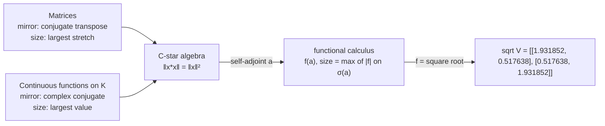
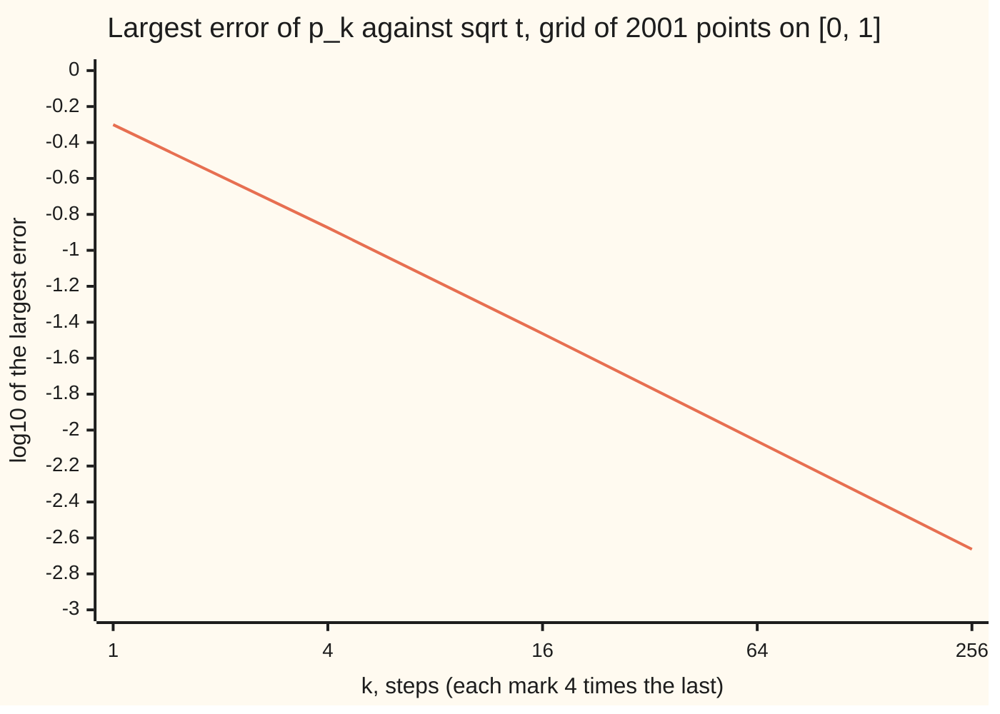

# C-star algebras: an algebra with a mirror operation whose sizes match exactly

[Syllabus](../../../SYLLABUS.md) → [Functional analysis](../README.md) → [Banach Algebras and Fixed Points](../README.md#s06) → C-star algebras

---

## General Overview

A risk engine simulates two shares. Each daily return has a standard deviation of 2%, and their correlation is 0.5 (illustrative). Their covariance matrix V, in %², is `[[4, 2], [2, 4]]`. The engine turns two independent standard normal draws into correlated returns by multiplying them by a matrix R with R R* = V. Here R* is R flipped across its diagonal and conjugated.

The natural R is the square root of V: the symmetric matrix that squares to V. Entry-by-entry roots fail: `[[2, 1.414214], [1.414214, 2]]` squares to `[[6, 5.656854], [5.656854, 6]]`. The right move applies the square root to V's eigenvalues, 2 and 6, and keeps the eigenvectors. The answer, `[[1.931852, 0.517638], [0.517638, 1.931852]]`, squares to V.

Putting a matrix into an ordinary function this way is the **continuous functional calculus**. A **C-star algebra** is the setting where it always works, with exact control of size. It has two model examples:

- **Matrices.** The mirror is the conjugate transpose $`A^*`$. The size is the operator norm: the largest stretch of a unit vector.
- **Continuous functions on a closed bounded set.** The mirror is complex conjugation. The size is the largest absolute value.

Both obey one rule: the size of "mirror times element" is the size squared.

**A C-star algebra is a complete normed algebra with a mirror operation, $`x \mapsto x^*`$, satisfying $`\|x^* x\| = \|x\|^2`$; that one rule makes a self-adjoint element's size equal its spectral radius, so any continuous function can be applied to it, with size equal to the function's largest value on the spectrum.**

**What kind of fact this is:** a definition, plus theorems. The identity in both models and the continuous functional calculus are proved in Why it works, citing that a self-adjoint spectrum is real and using Gelfand's formula from [Banach algebras](01-banach-algebras-and-the-gelfand-transform.md) and the Weierstrass theorem. The Gelfand–Naimark theorems are stated, with sources. This outline leaves out their proofs, von Neumann algebras, factors and K-theory.

### The picture: two models, one calculus



Schematic. Step 6 states why these two models are the only ones.

---

## The formula

Notation first, in words. An **algebra** is a ring that is also a vector space ([Rings](../../03-Algebra/09-Rings%20and%20Fields/01-rings.md)). A **Banach algebra** is an algebra with a complete norm satisfying $`\|xy\| \le \|x\|\,\|y\|`$ ([Banach algebras](01-banach-algebras-and-the-gelfand-transform.md)). A **mirror** (also called an involution) is a map $`x \mapsto x^*`$, read "x-star", with four rules:

```math
(x + y)^* = x^* + y^*, \qquad (c\,x)^* = \bar c\, x^*, \qquad (x y)^* = y^* x^*, \qquad x^{**} = x .
```

Here $`c`$ is a complex number and $`\bar c`$ its conjugate. A **C-star algebra** is a Banach algebra with a mirror that satisfies the C-star identity:

```math
\|x^* x\| = \|x\|^2 .
```

**Read it aloud:** the size of x-star times x is exactly the size of x, squared.

An element is **self-adjoint** when $`a^* = a`$, like a Hermitian matrix or a real-valued function. Its **spectrum** $`\sigma(a)`$ is the set of complex numbers $`\lambda`$ for which $`a - \lambda 1`$ has no inverse in the algebra; for a matrix it is the set of eigenvalues. The **spectral radius** $`r(a)`$ is the largest $`\lvert\lambda\rvert`$ over the spectrum. The continuous functional calculus says: for self-adjoint $`a`$ and any continuous $`f`$ on $`\sigma(a)`$,

```math
f(a) = \lim_{k \to \infty} p_k(a), \qquad \|f(a)\| = \max_{\lambda \in \sigma(a)} \lvert f(\lambda)\rvert ,
```

where $`p_k`$ are polynomials approaching $`f`$ uniformly on $`\sigma(a)`$. For a Hermitian matrix with eigenvalues $`\lambda_j`$ and eigen-projections $`P_j`$ this is $`f(a) = \sum_j f(\lambda_j) P_j`$.

**Read it aloud:** put the element into polynomials that approach f, and the results converge; the limit's size is f's largest absolute value on the spectrum.

| Symbol | Plain meaning | In our example | Push it up and the answer… |
| --- | --- | --- | --- |
| $`x`$, $`y`$, $`x^*`$ | elements of the algebra, and the mirror of x | the shear B, and its transpose $`B^*`$ | — |
| $`c`$, $`\bar c`$ | a complex number, and its conjugate | — | — |
| $`\Vert x\Vert`$ | the norm: largest stretch, or largest value | $`\Vert B\Vert`$ = 2.414214 | $`\Vert x^* x\Vert`$ grows as its square |
| $`a`$, $`V`$ | a self-adjoint element; the covariance of two daily returns, in %² | V = `[[4, 2], [2, 4]]` | larger risk, larger root |
| $`\sigma(a)`$, $`\lambda`$, $`\mu`$, $`r(a)`$, $`n`$ | the spectrum, points of the plane, the largest $`\lvert\lambda\rvert`$, a power in Gelfand's formula | σ(V) = {2, 6}, r(V) = 6 | f is read at more points |
| $`f`$, $`f(a)`$, $`t`$ | a continuous function, the element it makes, its variable | f(t) = √t, giving √V | — |
| $`p_k`$, $`k`$, $`e_k`$, $`q`$ | approximating polynomials, their step count, the error $`\sqrt t - p_k`$; $`q(t) = t^2 - 7t + 11`$ | q(2) = 1, q(6) = 5 | more steps, smaller error |
| $`P_j`$ | the projection onto the direction of eigenvalue $`\lambda_j`$ | onto (1, 1) and (1, −1) | — |
| $`A`$, $`B`$, $`I`$ | any matrix; a shear, not self-adjoint; the identity matrix, the unit 1 | B = `[[1, 2], [0, 1]]` | — |
| $`C(K)`$, $`K`$, $`g`$ | continuous complex functions on a closed bounded set K; one of them | K = [0, 1], or {2, 6} | — |
| $`L`$ | the Cholesky factor: lower triangular with L L* = V | `[[2, 0], [1, 1.732051]]` | — |
| $`N`$, $`s`$, $`j`$ | grid size, and grid point s = j/N, in the function model | N = 2000, t = s² | finer grid near 0 |

### When it holds

- **The identity, not just a mirror.** Summable sequences on the integers, $`\ell^1`$, have the mirror $`x^*(n) = \overline{x(-n)}`$. For $`x`$ = 1, 1, −1 at 0, 1, 2, the size is 3 but $`\|x^* x\|`$ is 5, not 9. Size and spectral radius part ways, and the size formula is lost.
- **A normal element**, one with $`a^* a = a a^*`$; self-adjoint is the case used here. The shear B has spectrum {1}, so a root read from the spectrum alone is I, and I² misses B by 2 in the corner.
- **A continuous f on the spectrum.** A matrix's spectrum is finite, so every function qualifies. On an infinite spectrum a jump needs the larger calculus of [Bounded and symmetric](../03-Bounded%20Operators/10-spectral-theorem-for-bounded-self-adjoint-operators.md).
- **A spectrum at or above 0, for a positive root.** V's spectrum {2, 6} qualifies.

---

## Why it works

### Step 0: the idea, size is fixed by the spectrum

In a general Banach algebra the size is at least the spectral radius, often much more. The C-star identity forces the two to agree for self-adjoint elements. Then a polynomial in a has size equal to its largest value on the spectrum, so limits of polynomials are under exact control. Any continuous function is such a limit.

### Step 1: the identity holds in both models

**Functions.** For g in C(K), mirror times g is $`\bar g g = \lvert g\rvert^2`$ at every point, and the largest value of $`\lvert g\rvert^2`$ is the square of the largest value of $`\lvert g\rvert`$.

**Matrices.** Write ‖A‖ for the largest stretch, the largest $`\|Ax\|`$ over unit vectors x, and use the conjugating dot product of [Complex vectors and matrices](../../07-Complex%20analysis/01-Complex%20Numbers%20and%20the%20Plane/07-complex-vectors-and-matrices.md). For a unit vector x,

```math
\|Ax\|^2 = x^* A^* A x \le \|A^* A\| \le \|A^*\|\, \|A\| .
```

The first step is Cauchy–Schwarz; the second is the product rule for norms.

Taking the largest over x gives $`\|A\|^2 \le \|A^* A\| \le \|A^*\|\,\|A\|`$. So $`\|A\| \le \|A^*\|`$, and the same with A and A* swapped gives equality. Then every inequality in the chain is an equality.

On the shear B, a search over unit vectors gives ‖B‖ = 2.414214, which is $`1 + \sqrt 2`$. The same search on $`B^* B`$ gives 5.828427, and 2.414214² = 5.828427.

### Step 2: for a self-adjoint element, size equals spectral radius

If $`a^* = a`$, the identity reads $`\|a^2\| = \|a^* a\| = \|a\|^2`$. Since $`a^2`$ is self-adjoint too, repeating gives $`\|a^n\| = \|a\|^n`$ for n = 2, 4, 8, … Gelfand's formula, $`r(a) = \lim_n \|a^n\|^{1/n}`$ ([Banach algebras](01-banach-algebras-and-the-gelfand-transform.md)), read along n = 2, 4, 8, …, gives

```math
r(a) = \|a\| \qquad \text{for every self-adjoint } a .
```

For V, the search gives ‖V‖ = 6.000000, the largest eigenvalue. The shear B is not self-adjoint: r(B) = 1, yet ‖B‖ = 2.414214, and Gelfand's formula creeps down only slowly, to $`\|B^{64}\|^{1/64}`$ = 1.078762.

### Step 3: a polynomial's size is its largest value on the spectrum

For a polynomial p, the **spectral mapping rule** says $`\sigma(p(a)) = p(\sigma(a))`$: factor $`p(t) - \mu`$ into linear pieces $`t - \lambda`$, and $`p(a) - \mu 1`$ fails to have an inverse exactly when one piece $`a - \lambda 1`$ does. The spectrum of a self-adjoint element is real (a standard fact, proved in the sources). If p has real coefficients, $`p(a)`$ is self-adjoint, so Step 2 gives $`\|p(a)\| = \max \lvert p\rvert`$ on $`\sigma(a)`$. For complex coefficients, apply this to $`\bar p p = \lvert p\rvert^2`$, which has real coefficients, and use the identity: $`\|p(a)\|^2 = \|p(a)^* p(a)\|`$.

On V, the polynomial $`q(t) = t^2 - 7t + 11`$ has q(2) = 1 and q(6) = 5. A search over unit vectors gives $`\|q(V)\|`$ = 5.000000.

### Step 4: limits of polynomials define f(a)

The spectrum of a self-adjoint element is a closed bounded set of real numbers. By the Weierstrass theorem ([Weierstrass and the minimax fit](../../16-Numerical%20analysis/04-Interpolation%20and%20Approximation/08-weierstrass-and-best-approximation.md)), polynomials $`p_k`$ approach any continuous f uniformly on it. By Step 3,

```math
\|p_k(a) - p_m(a)\| = \max_{\sigma(a)} \lvert p_k - p_m\rvert ,
```

so the $`p_k(a)`$ form a Cauchy sequence. Completeness gives a limit, $`f(a)`$; the same equation shows it does not depend on the sequence chosen, and the size formula passes to the limit.

The map $`f \mapsto f(a)`$ respects sums, products and the mirror, and keeps sizes exactly. So the smallest C-star algebra containing a and 1 is a copy of $`C(\sigma(a))`$: the function model sits inside every C-star algebra. A further fact, **spectral permanence**, says $`\sigma(a)`$ is the same in any C-star algebra containing a.

### Step 5: the square root of V, three roads

A matrix has a finite spectrum, so three roads reach $`\sqrt V`$.

1. **Eigenvalues.** V sends (1, 1) to 6 times itself and (1, −1) to 2 times itself. With $`P_6`$ and $`P_2`$ the projections onto those directions, $`\sqrt V = \sqrt 6\, P_6 + \sqrt 2\, P_2`$.
2. **One polynomial.** Only f's values at 2 and 6 matter. The straight line through (2, √2) and (6, √6) gives $`\sqrt V = \sqrt 2\, I + \tfrac{\sqrt 6 - \sqrt 2}{4}(V - 2I)`$.
3. **Polynomials only, no eigenvalues.** On [0, 1] the iteration $`p_0 = 0`$, $`p_{k+1}(t) = p_k(t) + \tfrac12\big(t - p_k(t)^2\big)`$ rises to $`\sqrt t`$, with error at most 2/k. Apply it to V/6, whose spectrum {1/3, 1} lies in [0, 1], then multiply by √6.

All three give `[[1.931852, 0.517638], [0.517638, 1.931852]]`. Its square is V, and its size is √6 = 2.449490, the largest value of √ on {2, 6}.

<details>
<summary>Why the iteration rises to the square root</summary>

Fix t in [0, 1] and write $`e_k = \sqrt t - p_k`$. Then $`t - p_k^2 = e_k(\sqrt t + p_k)`$, so

$`\displaystyle e_{k+1} = e_k\Big(1 - \tfrac12(\sqrt t + p_k)\Big).`$

If $`0 \le p_k \le \sqrt t`$, the bracket lies between $`1 - \sqrt t`$ and 1, so $`0 \le e_{k+1} \le e_k`$: the iterates rise and never overshoot. A rising sequence bounded by $`\sqrt t`$ settles at a fixed point, and the only one in $`[0, \sqrt t]`$ is $`\sqrt t`$. Rising continuous functions with a continuous limit on [0, 1] converge uniformly (Dini's theorem); the code checks the bound 2/k. Since every $`p_k`$ is a polynomial, $`\sqrt a`$ lies in the closed algebra generated by a: it commutes with everything that commutes with a.

At t = 1/3 the bracket soon drops below one half, so the error shrinks geometrically. Near t = 0 the bracket is near 1, and the error falls only like 1/k.

</details>

### Step 6: what changes in infinite dimensions

Take multiplication by t on square-integrable functions on [0, 1]. It is self-adjoint, with spectrum the whole interval [0, 1] and no eigenvectors. Road 1 has no eigenvalues to use, and road 2 fails, since no polynomial equals √ on an infinite set. Road 3 still works, and gives multiplication by √t.

The code holds only a truncation: the diagonal matrix of grid values $`t = s^2`$, with $`s = j/N`$ and N = 2000. It has 2001 eigenvalues; the true operator has none. The trend survives: the largest error falls like 1/k (k × error is 0.5565 at k = 256), because the spectrum reaches 0.

Two theorems, proved in the sources, say the two models are all there is.

- **Commutative Gelfand–Naimark.** Every commutative C-star algebra with a unit is a copy of C(K) for one compact Hausdorff space K, its space of characters ([Banach algebras](01-banach-algebras-and-the-gelfand-transform.md)). Hausdorff means any two points sit in separate open sets ([Hausdorff and its ladder](../../17-Topology/02-Topological%20Spaces/05-separation-axioms-and-hausdorff.md)); in a metric setting K is a compact set, such as a closed bounded interval.
- **General Gelfand–Naimark.** Every C-star algebra is a closed, mirror-closed algebra of bounded operators on some Hilbert space. The proof builds that space from a positive functional: [States](04-states-representations-and-the-gns-construction.md).

An element is **positive** when it equals $`y^* y`$ for some element y. Equivalently, it is self-adjoint with spectrum at or above 0, and its positive square root is unique. V is positive: it equals $`L L^*`$.

---

## Worked numbers, by hand

| Step | Arithmetic | Value |
| --- | --- | --- |
| eigenvalues of V | 4 ± √(0² + 2²) | 2 and 6 |
| size of V | largest stretch = r(V) | 6 |
| roots of the eigenvalues | √2, √6 | 1.414214, 2.449490 |
| diagonal of √V | (√6 + √2)/2 | 1.931852 |
| off-diagonal of √V | (√6 − √2)/2 | 0.517638 |
| check the square | 1.931852² + 0.517638², and 2 × 1.931852 × 0.517638 | 4 and 2 |
| size of √V | largest of √ on {2, 6} | **√6 = 2.449490** |

So a one-standard-deviation draw on the first independent factor moves share one by 1.931852% and share two by 0.517638%.

### What breaks if you drop a piece

| Mistake | Comes out at | What went wrong |
| --- | --- | --- |
| Square roots entry by entry | squares to `[[6, 5.656854], [5.656854, 6]]` | The calculus acts on the spectrum, not on entries |
| The Cholesky factor as the square root | L² = `[[4, 0], [3.732051, 3]]` | L L* = V, but L is no function of V |
| Spectrum-only calculus on the shear B | I, and I² − B has largest entry 2 | B is not normal: its size is 2.414214, its spectral radius 1 |
| A mirror on $`\ell^1`$ without the identity | $`\Vert x^* x\Vert`$ = 5, not 3² = 9 | The C-star size of x would be the spectral radius, 2.236068 |

The code prints all four.

### The square-root iteration on the full interval



One line, N = 2000. Each fourfold increase in k lowers log10 of the error by about 0.6, so the error falls like 1/k. On V/6's spectrum {1/3, 1} the same iteration's error at t = 1/3 is 2.581e-03 after 8 steps and 2.642e-06 after 16.

---

## Code, from first principles, and it actually runs

Every norm is found by searching unit vectors, never from eigenvalues, so Step 1's identity is tested, not assumed. √V comes by three independent roads: eigen-projections, one straight-line polynomial, and the polynomial iteration. The code also runs the iteration on the grid, checks every error against the fold's error recursion, traces Gelfand's formula on the shear, and computes the $`\ell^1`$ counterexample in integers.

### Python

```python
# C-star algebras in outline -- the check behind the card.  Standard library
# only.  The matrix model: a 2 x 2 covariance matrix V of two daily returns,
# in %^2 (illustrative), and its square root by the functional calculus, three
# roads.  The function model: multiplication by t on [0, 1], cut to a grid.
# Every norm is found by a search over unit vectors, never by eigenvalues.
import math

def mul(P, Q): return [[P[i][0] * Q[0][j] + P[i][1] * Q[1][j] for j in range(2)] for i in range(2)]
def add(P, Q, c=1.0): return [[P[i][j] + c * Q[i][j] for j in range(2)] for i in range(2)]
def scale(c, P): return [[c * P[i][j] for j in range(2)] for i in range(2)]
def tr(P): return [[P[j][i] for j in range(2)] for i in range(2)]
def gap(P, Q): return max(abs(P[i][j] - Q[i][j]) for i in range(2) for j in range(2))
def stretch2(M, t):                      # |M (cos t, sin t)|^2
    x, y = math.cos(t), math.sin(t)
    a, b = M[0][0] * x + M[0][1] * y, M[1][0] * x + M[1][1] * y
    return a * a + b * b
def norm(M):                             # road A: the largest stretch of a unit vector
    G, j = 2000, 0
    for i in range(1, G):
        if stretch2(M, math.pi * i / G) > stretch2(M, math.pi * j / G): j = i
    lo, hi = math.pi * (j - 1) / G, math.pi * (j + 1) / G
    for _ in range(200):                 # a ternary search refines the best angle
        m1, m2 = lo + (hi - lo) / 3, hi - (hi - lo) / 3
        if stretch2(M, m1) < stretch2(M, m2): lo = m1
        else: hi = m2
    return math.sqrt(stretch2(M, (lo + hi) / 2))
def eig_sym(M):                          # road B: closed form for 2 x 2 symmetric
    m, h = (M[0][0] + M[1][1]) / 2, (M[0][0] - M[1][1]) / 2
    d = math.sqrt(h * h + M[0][1] * M[0][1])
    return m - d, m + d
def mat(P): return "[[%.6f, %.6f], [%.6f, %.6f]]" % (P[0][0], P[0][1], P[1][0], P[1][1])
def root2k(x, k):                        # x to the power 1/2^k, by k square roots
    for _ in range(k): x = math.sqrt(x)
    return x
I = [[1.0, 0.0], [0.0, 1.0]]
V = [[4.0, 2.0], [2.0, 4.0]]
B = [[1.0, 2.0], [0.0, 1.0]]

print("1. the C-star identity |x* x| = |x|^2 in the matrix model")
l1, l2 = eig_sym(V)
print(f"V = {mat(V)}; eigenvalues {l1:.6f} and {l2:.6f}; |V| by search {norm(V):.6f}")
assert abs(norm(V) - l2) < 1e-9 and abs(l1 - 2) < 1e-12 and abs(l2 - 6) < 1e-12
nB, nBB, nBt = norm(B), norm(mul(tr(B), B)), norm(tr(B))
print(f"shear B = {mat(B)}: |B| = {nB:.6f}, |B*| = {nBt:.6f}, closed form 1 + sqrt 2 = {1 + math.sqrt(2):.6f}")
print(f"|B* B| = {nBB:.6f}; |B|^2 = {nB * nB:.6f}; largest eigenvalue of B* B = {eig_sym(mul(tr(B), B))[1]:.6f}")
assert abs(nBB - nB * nB) < 1e-8 and abs(nB - (1 + math.sqrt(2))) < 1e-9 and abs(nBt - nB) < 1e-9

print("2. the square root of V by the functional calculus, three roads")
r = 1 / math.sqrt(2)
P6 = [[r * r, r * r], [r * r, r * r]]    # projection on the eigenvalue 6, direction (1, 1)
P2 = [[r * r, -r * r], [-r * r, r * r]]  # projection on the eigenvalue 2, direction (1, -1)
assert gap(mul(V, P6), scale(6, P6)) < 1e-12 and gap(mul(V, P2), scale(2, P2)) < 1e-12
R1 = add(scale(math.sqrt(6), P6), scale(math.sqrt(2), P2))
R2 = add(scale(math.sqrt(2), I), add(V, I, -2.0), (math.sqrt(6) - math.sqrt(2)) / 4)
print(f"road 1, sqrt on each eigenvalue: {mat(R1)}")
print(f"road 2, the line through (2, sqrt 2) and (6, sqrt 6): {mat(R2)}")
W, X = scale(1 / 6, V), [[0.0, 0.0], [0.0, 0.0]]
for k in range(1, 41):                   # road 3: p <- p + (t - p^2)/2, polynomials only
    X = add(X, add(W, mul(X, X), -1.0), 0.5)
    if k in (5, 10, 20): print(f"road 3, step k = {k:2d}: largest entry error {gap(scale(math.sqrt(6), X), R1):.3e}")
R3 = scale(math.sqrt(6), X)
print(f"road 3, after 40 steps: {mat(R3)}")
print(f"(sqrt V)^2 = {mat(mul(R1, R1))}; |sqrt V| = {norm(R1):.6f}; sqrt 6 = {math.sqrt(6):.6f}")
assert gap(R1, R2) < 1e-12 and gap(R1, R3) < 1e-12 and gap(mul(R1, R1), V) < 1e-12
assert abs(norm(R1) - math.sqrt(6)) < 1e-9
Q = add(add(mul(V, V), V, -7.0), I, 11.0)            # q(t) = t^2 - 7t + 11
print(f"q(t) = t^2 - 7t + 11: q(2) = {2 * 2 - 7 * 2 + 11}, q(6) = {6 * 6 - 7 * 6 + 11}, |q(V)| by search = {norm(Q):.6f}")
assert abs(norm(Q) - 5) < 1e-9

print("3. the function model: multiplication by t on [0, 1], cut to a grid of N + 1 = 2001 points")
N = 2000                                 # grid t = s^2 with s = j/N, fine near 0
for k in (1, 4, 16, 64, 256):
    err = err2 = 0.0
    for j in range(N + 1):
        s = j / N
        t, p, e = s * s, 0.0, s              # e: the fold's error recursion, e <- e (1 - s + e/2)
        for _ in range(k): p, e = p + (t - p * p) / 2, e * (1 - s + e / 2)
        err, err2 = max(err, s - p), max(err2, e)
    print(f"chart,k={k},sup error on [0,1] {err:.6f},log10 error {math.log10(err):.3f},k x error {k * err:.4f}")
    assert 0 < err <= 2 / k and abs(err - err2) < 1e-12
t, p, e = 1 / 3, 0.0, math.sqrt(1 / 3)
for k in range(1, 17):
    p, e = p + (t - p * p) / 2, e * (1 - math.sqrt(t) + e / 2)
    if k in (1, 4, 8, 16): print(f"spectrum of V/6 is {{1/3, 1}}: error at t = 1/3 after k = {k:2d} steps {math.sqrt(t) - p:.3e}")
    assert abs(math.sqrt(t) - p - e) < 1e-12

print("4. what breaks")
L = [[2.0, 0.0], [1.0, math.sqrt(3)]]
print(f"Cholesky L = {mat(L)}: L L* = {mat(mul(L, tr(L)))}, but L^2 = {mat(mul(L, L))}")
E = [[math.sqrt(V[i][j]) for j in range(2)] for i in range(2)]
print(f"entry-by-entry roots {mat(E)} square to {mat(mul(E, E))}")
assert gap(mul(L, tr(L)), V) < 1e-12 and gap(mul(L, L), V) > 1 and gap(mul(E, E), V) > 1
print(f"B has spectrum {{1}}, so a root read off the spectrum alone is I; I^2 - B has largest entry {gap(I, B):.0f}")
Bn = B
for k in range(7):
    print(f"Gelfand: |B^{2 ** k}|^(1/{2 ** k}) = {root2k(norm(Bn), k):.6f}")
    Bn = mul(Bn, Bn)
x = {0: 1, 1: 1, 2: -1}                  # l^1 on the integers, mirror x*(n) = conj x(-n)
xx = {}
for a, ca in x.items():
    for b, cb in x.items(): xx[b - a] = xx.get(b - a, 0) + ca * cb
xhat = 0.0                               # |1 + z - z^2| on the unit circle
for j in range(100000):
    th = 2 * math.pi * j / 100000
    re, im = 1 + math.cos(th) - math.cos(2 * th), math.sin(th) - math.sin(2 * th)
    xhat = max(xhat, math.sqrt(re * re + im * im))
n1, n2 = sum(abs(c) for c in x.values()), sum(abs(c) for c in xx.values())
print(f"l^1: x = d0 + d1 - d2: |x|_1 = {n1}, |x* x|_1 = {n2}, |x|_1^2 = {n1 * n1}; sup |x^| on the circle = {xhat:.6f}")
assert n2 == 5 and n1 * n1 == 9 and abs(xhat - math.sqrt(5)) < 1e-9
print("ALL CHECKS PASS")
```

**Ran 2026-11-15 on macOS, Python 3.14.10, standard library only. All checks passed. Output, pasted from the run:**

```
1. the C-star identity |x* x| = |x|^2 in the matrix model
V = [[4.000000, 2.000000], [2.000000, 4.000000]]; eigenvalues 2.000000 and 6.000000; |V| by search 6.000000
shear B = [[1.000000, 2.000000], [0.000000, 1.000000]]: |B| = 2.414214, |B*| = 2.414214, closed form 1 + sqrt 2 = 2.414214
|B* B| = 5.828427; |B|^2 = 5.828427; largest eigenvalue of B* B = 5.828427
2. the square root of V by the functional calculus, three roads
road 1, sqrt on each eigenvalue: [[1.931852, 0.517638], [0.517638, 1.931852]]
road 2, the line through (2, sqrt 2) and (6, sqrt 6): [[1.931852, 0.517638], [0.517638, 1.931852]]
road 3, step k =  5: largest entry error 3.938e-02
road 3, step k = 10: largest entry error 5.670e-04
road 3, step k = 20: largest entry error 1.032e-07
road 3, after 40 steps: [[1.931852, 0.517638], [0.517638, 1.931852]]
(sqrt V)^2 = [[4.000000, 2.000000], [2.000000, 4.000000]]; |sqrt V| = 2.449490; sqrt 6 = 2.449490
q(t) = t^2 - 7t + 11: q(2) = 1, q(6) = 5, |q(V)| by search = 5.000000
3. the function model: multiplication by t on [0, 1], cut to a grid of N + 1 = 2001 points
chart,k=1,sup error on [0,1] 0.500000,log10 error -0.301,k x error 0.5000
chart,k=4,sup error on [0,1] 0.133565,log10 error -0.874,k x error 0.5343
chart,k=16,sup error on [0,1] 0.034408,log10 error -1.463,k x error 0.5505
chart,k=64,sup error on [0,1] 0.008676,log10 error -2.062,k x error 0.5553
chart,k=256,sup error on [0,1] 0.002174,log10 error -2.663,k x error 0.5565
spectrum of V/6 is {1/3, 1}: error at t = 1/3 after k =  1 steps 4.107e-01
spectrum of V/6 is {1/3, 1}: error at t = 1/3 after k =  4 steps 7.025e-02
spectrum of V/6 is {1/3, 1}: error at t = 1/3 after k =  8 steps 2.581e-03
spectrum of V/6 is {1/3, 1}: error at t = 1/3 after k = 16 steps 2.642e-06
4. what breaks
Cholesky L = [[2.000000, 0.000000], [1.000000, 1.732051]]: L L* = [[4.000000, 2.000000], [2.000000, 4.000000]], but L^2 = [[4.000000, 0.000000], [3.732051, 3.000000]]
entry-by-entry roots [[2.000000, 1.414214], [1.414214, 2.000000]] square to [[6.000000, 5.656854], [5.656854, 6.000000]]
B has spectrum {1}, so a root read off the spectrum alone is I; I^2 - B has largest entry 2
Gelfand: |B^1|^(1/1) = 2.414214
Gelfand: |B^2|^(1/2) = 2.058171
Gelfand: |B^4|^(1/4) = 1.688226
Gelfand: |B^8|^(1/8) = 1.414900
Gelfand: |B^16|^(1/16) = 1.241934
Gelfand: |B^32|^(1/32) = 1.138797
Gelfand: |B^64|^(1/64) = 1.078762
l^1: x = d0 + d1 - d2: |x|_1 = 3, |x* x|_1 = 5, |x|_1^2 = 9; sup |x^| on the circle = 2.236068
ALL CHECKS PASS
```

### Rust

Same numbers, same labels, built with `rustc --edition 2021 -O`.

```rust
// C-star algebras in outline -- the same check as the Python, in Rust.  No
// crates.  The matrix model: a 2 x 2 covariance matrix V of two daily returns,
// in %^2 (illustrative), and its square root by the functional calculus, three
// roads.  The function model: multiplication by t on [0, 1], cut to a grid.
// Every norm is found by a search over unit vectors, never by eigenvalues.
use std::collections::BTreeMap;
use std::f64::consts::PI;
type M = [[f64; 2]; 2];

fn mul(p: &M, q: &M) -> M {
    let mut r = [[0.0; 2]; 2];
    for i in 0..2 { for j in 0..2 { r[i][j] = p[i][0] * q[0][j] + p[i][1] * q[1][j]; } }
    r
}
fn add(p: &M, q: &M, c: f64) -> M {
    let mut r = [[0.0; 2]; 2];
    for i in 0..2 { for j in 0..2 { r[i][j] = p[i][j] + c * q[i][j]; } }
    r
}
fn scale(c: f64, p: &M) -> M { add(&[[0.0; 2]; 2], p, c) }
fn tr(p: &M) -> M { [[p[0][0], p[1][0]], [p[0][1], p[1][1]]] }
fn gap(p: &M, q: &M) -> f64 {
    let mut g: f64 = 0.0;
    for i in 0..2 { for j in 0..2 { g = g.max((p[i][j] - q[i][j]).abs()); } }
    g
}
fn stretch2(m: &M, t: f64) -> f64 {                // |M (cos t, sin t)|^2
    let (x, y) = (t.cos(), t.sin());
    let (a, b) = (m[0][0] * x + m[0][1] * y, m[1][0] * x + m[1][1] * y);
    a * a + b * b
}
fn norm(m: &M) -> f64 {                            // road A: the largest stretch of a unit vector
    let g = 2000;
    let mut j = 0;
    for i in 1..g {
        if stretch2(m, PI * i as f64 / g as f64) > stretch2(m, PI * j as f64 / g as f64) { j = i; }
    }
    let (mut lo, mut hi) = (PI * (j as f64 - 1.0) / g as f64, PI * (j as f64 + 1.0) / g as f64);
    for _ in 0..200 {                              // a ternary search refines the best angle
        let (m1, m2) = (lo + (hi - lo) / 3.0, hi - (hi - lo) / 3.0);
        if stretch2(m, m1) < stretch2(m, m2) { lo = m1; } else { hi = m2; }
    }
    stretch2(m, (lo + hi) / 2.0).sqrt()
}
fn eig_sym(m: &M) -> (f64, f64) {                  // road B: closed form for 2 x 2 symmetric
    let (c, h) = ((m[0][0] + m[1][1]) / 2.0, (m[0][0] - m[1][1]) / 2.0);
    let d = (h * h + m[0][1] * m[0][1]).sqrt();
    (c - d, c + d)
}
fn mat(p: &M) -> String {
    format!("[[{:.6}, {:.6}], [{:.6}, {:.6}]]", p[0][0], p[0][1], p[1][0], p[1][1])
}
fn sci(x: f64, d: usize) -> String {               // Python's {:.3e}: two-digit exponent
    let s = format!("{:.*e}", d, x);
    let (m, e) = s.split_once('e').unwrap();
    let e: i32 = e.parse().unwrap();
    format!("{}e{}{:02}", m, if e < 0 { '-' } else { '+' }, e.abs())
}
fn root2k(mut x: f64, k: u32) -> f64 { for _ in 0..k { x = x.sqrt(); } x }

fn main() {
    let id: M = [[1.0, 0.0], [0.0, 1.0]];
    let v: M = [[4.0, 2.0], [2.0, 4.0]];
    let b: M = [[1.0, 2.0], [0.0, 1.0]];

    println!("1. the C-star identity |x* x| = |x|^2 in the matrix model");
    let (l1, l2) = eig_sym(&v);
    println!("V = {}; eigenvalues {:.6} and {:.6}; |V| by search {:.6}", mat(&v), l1, l2, norm(&v));
    assert!((norm(&v) - l2).abs() < 1e-9 && (l1 - 2.0).abs() < 1e-12 && (l2 - 6.0).abs() < 1e-12);
    let (nb, nbb, nbt) = (norm(&b), norm(&mul(&tr(&b), &b)), norm(&tr(&b)));
    println!("shear B = {}: |B| = {:.6}, |B*| = {:.6}, closed form 1 + sqrt 2 = {:.6}", mat(&b), nb, nbt, 1.0 + 2f64.sqrt());
    println!("|B* B| = {:.6}; |B|^2 = {:.6}; largest eigenvalue of B* B = {:.6}", nbb, nb * nb, eig_sym(&mul(&tr(&b), &b)).1);
    assert!((nbb - nb * nb).abs() < 1e-8 && (nb - (1.0 + 2f64.sqrt())).abs() < 1e-9 && (nbt - nb).abs() < 1e-9);

    println!("2. the square root of V by the functional calculus, three roads");
    let r = 1.0 / 2f64.sqrt();
    let p6: M = [[r * r, r * r], [r * r, r * r]];      // projection on the eigenvalue 6, direction (1, 1)
    let p2: M = [[r * r, -r * r], [-r * r, r * r]];    // projection on the eigenvalue 2, direction (1, -1)
    assert!(gap(&mul(&v, &p6), &scale(6.0, &p6)) < 1e-12 && gap(&mul(&v, &p2), &scale(2.0, &p2)) < 1e-12);
    let r1 = add(&scale(6f64.sqrt(), &p6), &scale(2f64.sqrt(), &p2), 1.0);
    let r2 = add(&scale(2f64.sqrt(), &id), &add(&v, &id, -2.0), (6f64.sqrt() - 2f64.sqrt()) / 4.0);
    println!("road 1, sqrt on each eigenvalue: {}", mat(&r1));
    println!("road 2, the line through (2, sqrt 2) and (6, sqrt 6): {}", mat(&r2));
    let w = scale(1.0 / 6.0, &v);
    let mut x: M = [[0.0; 2]; 2];
    for k in 1..=40 {                              // road 3: p <- p + (t - p^2)/2, polynomials only
        x = add(&x, &add(&w, &mul(&x, &x), -1.0), 0.5);
        if k == 5 || k == 10 || k == 20 {
            println!("road 3, step k = {:2}: largest entry error {}", k, sci(gap(&scale(6f64.sqrt(), &x), &r1), 3));
        }
    }
    let r3 = scale(6f64.sqrt(), &x);
    println!("road 3, after 40 steps: {}", mat(&r3));
    println!("(sqrt V)^2 = {}; |sqrt V| = {:.6}; sqrt 6 = {:.6}", mat(&mul(&r1, &r1)), norm(&r1), 6f64.sqrt());
    assert!(gap(&r1, &r2) < 1e-12 && gap(&r1, &r3) < 1e-12 && gap(&mul(&r1, &r1), &v) < 1e-12);
    assert!((norm(&r1) - 6f64.sqrt()).abs() < 1e-9);
    let q = add(&add(&mul(&v, &v), &v, -7.0), &id, 11.0);   // q(t) = t^2 - 7t + 11
    println!("q(t) = t^2 - 7t + 11: q(2) = {}, q(6) = {}, |q(V)| by search = {:.6}", 2 * 2 - 7 * 2 + 11, 6 * 6 - 7 * 6 + 11, norm(&q));
    assert!((norm(&q) - 5.0).abs() < 1e-9);

    println!("3. the function model: multiplication by t on [0, 1], cut to a grid of N + 1 = 2001 points");
    let n = 2000;                                  // grid t = s^2 with s = j/N, fine near 0
    for k in [1, 4, 16, 64, 256] {
        let (mut err, mut err2): (f64, f64) = (0.0, 0.0);
        for j in 0..=n {
            let s = j as f64 / n as f64;
            let (t, mut p, mut e) = (s * s, 0.0, s);   // e: the fold's error recursion, e <- e (1 - s + e/2)
            for _ in 0..k { p = p + (t - p * p) / 2.0; e = e * (1.0 - s + e / 2.0); }
            err = err.max(s - p); err2 = err2.max(e);
        }
        println!("chart,k={},sup error on [0,1] {:.6},log10 error {:.3},k x error {:.4}", k, err, err.log10(), k as f64 * err);
        assert!(0.0 < err && err <= 2.0 / k as f64 && (err - err2).abs() < 1e-12);
    }
    let (t, mut p, mut e) = (1.0 / 3.0, 0.0f64, (1.0f64 / 3.0).sqrt());
    for k in 1..=16 {
        p = p + (t - p * p) / 2.0; e = e * (1.0 - t.sqrt() + e / 2.0);
        if [1, 4, 8, 16].contains(&k) {
            println!("spectrum of V/6 is {{1/3, 1}}: error at t = 1/3 after k = {:2} steps {}", k, sci(t.sqrt() - p, 3));
        }
        assert!((t.sqrt() - p - e).abs() < 1e-12);
    }

    println!("4. what breaks");
    let l: M = [[2.0, 0.0], [1.0, 3f64.sqrt()]];
    println!("Cholesky L = {}: L L* = {}, but L^2 = {}", mat(&l), mat(&mul(&l, &tr(&l))), mat(&mul(&l, &l)));
    let e: M = [[v[0][0].sqrt(), v[0][1].sqrt()], [v[1][0].sqrt(), v[1][1].sqrt()]];
    println!("entry-by-entry roots {} square to {}", mat(&e), mat(&mul(&e, &e)));
    assert!(gap(&mul(&l, &tr(&l)), &v) < 1e-12 && gap(&mul(&l, &l), &v) > 1.0 && gap(&mul(&e, &e), &v) > 1.0);
    println!("B has spectrum {{1}}, so a root read off the spectrum alone is I; I^2 - B has largest entry {:.0}", gap(&id, &b));
    let mut bn = b;
    for k in 0..7u32 {
        println!("Gelfand: |B^{}|^(1/{}) = {:.6}", 1u32 << k, 1u32 << k, root2k(norm(&bn), k));
        bn = mul(&bn, &bn);
    }
    let xs: [(i64, i64); 3] = [(0, 1), (1, 1), (2, -1)];   // l^1 on the integers, mirror x*(n) = conj x(-n)
    let mut xx: BTreeMap<i64, i64> = BTreeMap::new();
    for &(a, ca) in &xs { for &(bb, cb) in &xs { *xx.entry(bb - a).or_insert(0) += ca * cb; } }
    let mut xhat: f64 = 0.0;                       // |1 + z - z^2| on the unit circle
    for j in 0..100000 {
        let th = 2.0 * PI * j as f64 / 100000.0;
        let (re, im) = (1.0 + th.cos() - (2.0 * th).cos(), th.sin() - (2.0 * th).sin());
        xhat = xhat.max((re * re + im * im).sqrt());
    }
    let n1: i64 = xs.iter().map(|&(_, c)| c.abs()).sum();
    let n2: i64 = xx.values().map(|c| c.abs()).sum();
    println!("l^1: x = d0 + d1 - d2: |x|_1 = {}, |x* x|_1 = {}, |x|_1^2 = {}; sup |x^| on the circle = {:.6}", n1, n2, n1 * n1, xhat);
    assert!(n2 == 5 && n1 * n1 == 9 && (xhat - 5f64.sqrt()).abs() < 1e-9);
    println!("ALL CHECKS PASS");
}
```

**Ran 2026-11-15 on macOS, rustc 1.98.1, no crates. All checks passed. Output, pasted from the run:**

```
1. the C-star identity |x* x| = |x|^2 in the matrix model
V = [[4.000000, 2.000000], [2.000000, 4.000000]]; eigenvalues 2.000000 and 6.000000; |V| by search 6.000000
shear B = [[1.000000, 2.000000], [0.000000, 1.000000]]: |B| = 2.414214, |B*| = 2.414214, closed form 1 + sqrt 2 = 2.414214
|B* B| = 5.828427; |B|^2 = 5.828427; largest eigenvalue of B* B = 5.828427
2. the square root of V by the functional calculus, three roads
road 1, sqrt on each eigenvalue: [[1.931852, 0.517638], [0.517638, 1.931852]]
road 2, the line through (2, sqrt 2) and (6, sqrt 6): [[1.931852, 0.517638], [0.517638, 1.931852]]
road 3, step k =  5: largest entry error 3.938e-02
road 3, step k = 10: largest entry error 5.670e-04
road 3, step k = 20: largest entry error 1.032e-07
road 3, after 40 steps: [[1.931852, 0.517638], [0.517638, 1.931852]]
(sqrt V)^2 = [[4.000000, 2.000000], [2.000000, 4.000000]]; |sqrt V| = 2.449490; sqrt 6 = 2.449490
q(t) = t^2 - 7t + 11: q(2) = 1, q(6) = 5, |q(V)| by search = 5.000000
3. the function model: multiplication by t on [0, 1], cut to a grid of N + 1 = 2001 points
chart,k=1,sup error on [0,1] 0.500000,log10 error -0.301,k x error 0.5000
chart,k=4,sup error on [0,1] 0.133565,log10 error -0.874,k x error 0.5343
chart,k=16,sup error on [0,1] 0.034408,log10 error -1.463,k x error 0.5505
chart,k=64,sup error on [0,1] 0.008676,log10 error -2.062,k x error 0.5553
chart,k=256,sup error on [0,1] 0.002174,log10 error -2.663,k x error 0.5565
spectrum of V/6 is {1/3, 1}: error at t = 1/3 after k =  1 steps 4.107e-01
spectrum of V/6 is {1/3, 1}: error at t = 1/3 after k =  4 steps 7.025e-02
spectrum of V/6 is {1/3, 1}: error at t = 1/3 after k =  8 steps 2.581e-03
spectrum of V/6 is {1/3, 1}: error at t = 1/3 after k = 16 steps 2.642e-06
4. what breaks
Cholesky L = [[2.000000, 0.000000], [1.000000, 1.732051]]: L L* = [[4.000000, 2.000000], [2.000000, 4.000000]], but L^2 = [[4.000000, 0.000000], [3.732051, 3.000000]]
entry-by-entry roots [[2.000000, 1.414214], [1.414214, 2.000000]] square to [[6.000000, 5.656854], [5.656854, 6.000000]]
B has spectrum {1}, so a root read off the spectrum alone is I; I^2 - B has largest entry 2
Gelfand: |B^1|^(1/1) = 2.414214
Gelfand: |B^2|^(1/2) = 2.058171
Gelfand: |B^4|^(1/4) = 1.688226
Gelfand: |B^8|^(1/8) = 1.414900
Gelfand: |B^16|^(1/16) = 1.241934
Gelfand: |B^32|^(1/32) = 1.138797
Gelfand: |B^64|^(1/64) = 1.078762
l^1: x = d0 + d1 - d2: |x|_1 = 3, |x* x|_1 = 5, |x|_1^2 = 9; sup |x^| on the circle = 2.236068
ALL CHECKS PASS
```

The two outputs match line for line.

### Lean

Lean proves the three main facts for every C-star algebra, and checks the worked numbers exactly.

- Take a self-adjoint $`a`$ in a C-star algebra. Then $`r(a) = \|a\|`$.
- Take also a continuous $`f`$ on $`\sigma(a)`$, and suppose $`1 \ne 0`$. Then $`\|f(a)\|`$ is the largest $`\lvert f(\lambda)\rvert`$ over $`\sigma(a)`$.
- Take polynomials $`p_k`$ approaching $`f`$ uniformly on $`\sigma(a)`$. Then $`p_k(a)`$ converges to $`f(a)`$ in norm, whichever $`p_k`$ are chosen.
- V sends (1, 1) to 6 times itself and (1, −1) to 2 times itself.
- Take $`q(t) = t^2 - 7t + 11`$. Then q(2) = 1 and q(6) = 5.
- Take the matrix with diagonal $`(\sqrt 6 + \sqrt 2)/2`$ and off-diagonal $`(\sqrt 6 - \sqrt 2)/2`$. Then its square is exactly V.
- Take the entry-by-entry roots of V. Then their square has $`4\sqrt 2`$ off the diagonal, not 2.
- Take the Cholesky factor L = `[[2, 0], [1, √3]]`. Then L L* = V.
- Take the shear B. Then B* B = `[[1, 2], [2, 5]]`, and $`(1 + \sqrt 2)^2 = 3 + 2\sqrt 2`$.
- Take x = 1, 1, −1 at 0, 1, 2 in $`\ell^1`$. Then $`\|x\|_1 = 3`$, but $`\|x^* x\|_1 = 5`$, not 9.

The norm searches, the identity in the matrix model, the iteration, the grid and Gelfand's formula on B are left to the Python and Rust checks.

```lean
-- C-star algebras: in a C-star algebra a self-adjoint element's size equals its spectral radius, and any continuous function applied to it has size equal to the function's largest value on the spectrum.
import Mathlib.Analysis.CStarAlgebra.ContinuousFunctionalCalculus.Basic
import Mathlib.Analysis.CStarAlgebra.Spectrum
import Mathlib.Analysis.SpecialFunctions.Pow.Real
import Mathlib.LinearAlgebra.Matrix.Notation
import Mathlib.Analysis.CStarAlgebra.ContinuousFunctionalCalculus.Isometric
import Mathlib.Analysis.CStarAlgebra.ContinuousFunctionalCalculus.Continuity
import Mathlib.Analysis.CStarAlgebra.ContinuousFunctionalCalculus.Instances

open Filter Topology Matrix

/-- The continuous functional calculus keeps sizes exactly.  In a C-star algebra
(a complete normed algebra over the complex numbers with a mirror `x ↦ x*` obeying
`‖x* x‖ = ‖x‖²`, and a unit `1 ≠ 0`), for a self-adjoint element `a` and a function
`f` that is continuous on the spectrum of `a`, the size of `f(a)` is the largest
value of `|f|` on the spectrum of `a`. -/
theorem norm_cfc_eq_max_on_spectrum {A : Type*} [CStarAlgebra A] [Nontrivial A]
    (a : A) (ha : IsSelfAdjoint a) (f : ℂ → ℂ) (hf : ContinuousOn f (spectrum ℂ a)) :
    IsGreatest ((fun x ↦ ‖f x‖) '' spectrum ℂ a) ‖cfc f a‖ := by
  exact IsGreatest.norm_cfc f a hf ha.isStarNormal

/-- The C-star identity forces size to equal spectral radius: in a C-star algebra,
a self-adjoint element `a` has spectral radius `r(a)` equal to its norm `‖a‖`. -/
theorem spectralRadius_eq_norm_of_isSelfAdjoint {A : Type*} [CStarAlgebra A]
    (a : A) (ha : IsSelfAdjoint a) :
    spectralRadius ℂ a = (‖a‖₊ : ENNReal) := by
  exact ha.spectralRadius_eq_nnnorm

/-- `f(a)` is the limit of polynomials in `a`: in a C-star algebra, if `a` is
self-adjoint, `f` is continuous on the spectrum of `a`, and polynomials `p k`
approach `f` uniformly on the spectrum, then `p k (a)` converges in norm to `f(a)`.
So the limit does not depend on which approximating polynomials are chosen. -/
theorem tendsto_aeval_cfc_of_tendstoUniformlyOn {A : Type*} [CStarAlgebra A]
    (a : A) (ha : IsSelfAdjoint a) (f : ℂ → ℂ) (hf : ContinuousOn f (spectrum ℂ a))
    (p : ℕ → Polynomial ℂ)
    (hp : TendstoUniformlyOn (fun k x ↦ (p k).eval x) f atTop (spectrum ℂ a)) :
    Tendsto (fun k ↦ Polynomial.aeval a (p k)) atTop (𝓝 (cfc f a)) := by
  have h := tendsto_cfc_fun (a := a) hp
    (Eventually.of_forall fun k ↦ (p k).continuous.continuousOn)
  refine h.congr fun k ↦ ?_
  exact cfc_polynomial (p k) a ha.isStarNormal

/-! Worked examples from the card, checked exactly. -/

-- V = [[4, 2], [2, 4]] sends (1, 1) to 6 times itself and (1, -1) to 2 times itself.
example : !![(4 : ℤ), 2; 2, 4] *ᵥ ![1, 1] = (6 : ℤ) • ![1, 1] := by decide
example : !![(4 : ℤ), 2; 2, 4] *ᵥ ![1, -1] = (2 : ℤ) • ![1, -1] := by decide

-- q(t) = t² - 7t + 11 has q(2) = 1 and q(6) = 5, so ‖q(V)‖ = 5.
example : ((2 : ℤ) ^ 2 - 7 * 2 + 11, (6 : ℤ) ^ 2 - 7 * 6 + 11) = (1, 5) := by decide

-- The square root of V by the functional calculus squares back to V.
example :
    !![(Real.sqrt 6 + Real.sqrt 2) / 2, (Real.sqrt 6 - Real.sqrt 2) / 2;
       (Real.sqrt 6 - Real.sqrt 2) / 2, (Real.sqrt 6 + Real.sqrt 2) / 2] *
    !![(Real.sqrt 6 + Real.sqrt 2) / 2, (Real.sqrt 6 - Real.sqrt 2) / 2;
       (Real.sqrt 6 - Real.sqrt 2) / 2, (Real.sqrt 6 + Real.sqrt 2) / 2] =
    !![(4 : ℝ), 2; 2, 4] := by
  have h6 : Real.sqrt 6 ^ 2 = 6 := Real.sq_sqrt (by norm_num)
  have h2 : Real.sqrt 2 ^ 2 = 2 := Real.sq_sqrt (by norm_num)
  ext i j; fin_cases i <;> fin_cases j <;>
    simp [Matrix.mul_apply, Fin.sum_univ_two] <;> ring_nf <;> rw [h6, h2] <;> norm_num

-- Entry-by-entry roots fail: [[2, √2], [√2, 2]] squares to [[6, 4√2], [4√2, 6]], not V.
example :
    !![(2 : ℝ), Real.sqrt 2; Real.sqrt 2, 2] * !![(2 : ℝ), Real.sqrt 2; Real.sqrt 2, 2] =
    !![(6 : ℝ), 4 * Real.sqrt 2; 4 * Real.sqrt 2, 6] := by
  have h2 : Real.sqrt 2 * Real.sqrt 2 = 2 := Real.mul_self_sqrt (by norm_num)
  ext i j; fin_cases i <;> fin_cases j <;>
    simp [Matrix.mul_apply, Fin.sum_univ_two, h2] <;> ring

-- The Cholesky factor fails as a root: L = [[2, 0], [1, √3]] gives L L* = V.
example :
    !![(2 : ℝ), 0; 1, Real.sqrt 3] * !![(2 : ℝ), 1; 0, Real.sqrt 3] = !![(4 : ℝ), 2; 2, 4] := by
  have h3 : Real.sqrt 3 * Real.sqrt 3 = 3 := Real.mul_self_sqrt (by norm_num)
  ext i j; fin_cases i <;> fin_cases j <;>
    simp [Matrix.mul_apply, Fin.sum_univ_two, h3] <;> norm_num

-- The shear B = [[1, 2], [0, 1]]: B* B = [[1, 2], [2, 5]], and ‖B‖² = (1 + √2)² = 3 + 2√2.
example : !![(1 : ℤ), 0; 2, 1] * !![1, 2; 0, 1] = !![1, 2; 2, 5] := by decide
example : (1 + Real.sqrt 2) ^ 2 = 3 + 2 * Real.sqrt 2 := by
  have h2 : Real.sqrt 2 ^ 2 = 2 := Real.sq_sqrt (by norm_num)
  ring_nf; rw [h2]; ring

-- The ℓ¹ counterexample: x = 1, 1, -1 at 0, 1, 2.  Then x* x is the sequence
-- -1, 0, 3, 0, -1 at -2, ..., 2, so ‖x‖₁ = 3 but ‖x* x‖₁ = 5, not 3² = 9.
example :
    let x : List ℤ := [1, 1, -1]
    let xsx : List ℤ := (List.range 5).map fun k =>
      ((List.range 3).map fun n =>
        x.getD n 0 * x.getD (n + k - 2) 0 * (if n + k < 2 then 0 else 1)).sum
    xsx = [-1, 0, 3, 0, -1] ∧ (x.map Int.natAbs).sum = 3 ∧
      (xsx.map Int.natAbs).sum = 5 ∧ 3 ^ 2 ≠ 5 := by
  decide

#print axioms norm_cfc_eq_max_on_spectrum
#print axioms spectralRadius_eq_norm_of_isSelfAdjoint
#print axioms tendsto_aeval_cfc_of_tendstoUniformlyOn
```

**Checked 2026-11-15 on macOS, Lean 4.36.0-rc2, Mathlib v4.36.0-rc2. Every proof is complete and uses only Lean's standard axioms. Output, pasted from the run:**

```
'norm_cfc_eq_max_on_spectrum' depends on axioms: [propext, Classical.choice, Quot.sound]
'spectralRadius_eq_norm_of_isSelfAdjoint' depends on axioms: [propext, Classical.choice, Quot.sound]
'tendsto_aeval_cfc_of_tendstoUniformlyOn' depends on axioms: [propext, Classical.choice, Quot.sound]
```

> [!TIP]
> **Try changing**
> Guess first, then run it. Some changes stop the program at an assert.
> - **Fewer polynomial steps.** Change `range(1, 41)` to `range(1, 21)`. Road 3 stops at error 1.032e-07, and the three-road assert fails.
> - **A norm without the identity.** Make `norm` return the largest absolute entry. It reports ‖V‖ = 4, not 6, and the first assert fails.
> - **A coarse grid.** Set `N = 20`. At k = 256 the error shows as 0.000000: the 21 points stay away from 0 and hide the true 1/k rate.

---

## The usual mistake

> [!warning]
> **Applying the function to the entries.** A matrix function acts on the spectrum and keeps the eigenvectors. Entry-by-entry roots of V square to `[[6, 5.656854], [5.656854, 6]]`, so simulated returns would carry variance 6, not 4.
>
> - **Calling any factor "the" square root.** The Cholesky factor gives L L* = V, fine for drawing returns, but L² = `[[4, 0], [3.732051, 3]]`. Only the positive root is a function of V.
> - **Using the calculus on a non-normal element.** B's spectrum is {1}, but B is not I; its size is 2.414214.
> - **Trusting a mirror without the identity.** On $`\ell^1`$ the example x has size 3 but $`\|x^* x\|`$ = 5.
> - **Reading the truncation as the operator.** The grid matrix has 2001 eigenvalues; multiplication by t has none.

---

## Where you meet it in real life

- **Risk engines.** Correlated scenarios use a square root of the covariance matrix; the positive root treats both shares alike, while Cholesky depends on their order ([Multivariate normal](../../09-Probability%20and%20statistics/05-Transformations%20and%20Joint%20Laws/06-multivariate-normal.md)).
- **Quantum mechanics.** Observables are self-adjoint operators, and time evolution is a complex exponential applied to the energy operator by this calculus, extended to unbounded operators.
- **Matrix software.** Matrix square roots, logarithms and exponentials are computed this way; Higham's book below collects the methods.

> **Say it back**
> A C-star algebra is a complete normed algebra with a mirror, where mirror times element has exactly the size squared. Matrices and continuous functions are the two models, and by Gelfand–Naimark the only ones. The identity makes a self-adjoint element's size equal its spectral radius, so a polynomial's size is its largest value on the spectrum. Limits of polynomials then apply any continuous function, such as the square root of the covariance matrix V. In infinite dimensions eigenvalues can vanish, but the polynomial limit still works.

---

## What this builds on

- [Banach algebras](01-banach-algebras-and-the-gelfand-transform.md): complete normed algebras, the spectrum, Gelfand's spectral radius formula and the Gelfand transform.
- [Adjoints](../03-Bounded%20Operators/03-adjoints-self-adjoint-and-unitary-operators.md): the adjoint of an operator on a Hilbert space, the infinite version of the conjugate transpose.
- [Rings](../../03-Algebra/09-Rings%20and%20Fields/01-rings.md): adding and multiplying without always dividing, the algebra underneath.
- [Complex vectors and matrices](../../07-Complex%20analysis/01-Complex%20Numbers%20and%20the%20Plane/07-complex-vectors-and-matrices.md): the conjugate transpose, Hermitian matrices and the conjugating dot product used in Step 1.

On this shelf, [Wiener's lemma](02-wieners-lemma-and-invertible-filters.md) works in $`\ell^1`$, the algebra that fails the identity here.

## Where this goes next

- [States](04-states-representations-and-the-gns-construction.md): positive functionals on a C-star algebra, and the GNS construction that turns any C-star algebra into operators on a Hilbert space.

Later on the shelf, [Schauder](05-schauder-fixed-point-theorem.md), [Krein-Milman](06-krein-milman-and-extreme-points.md), [The slope transform](07-legendre-fenchel-and-subgradients.md) and [Minimax](08-minimax-theorem-and-convex-duality.md) turn to fixed points and convexity.

What happens to functions that jump, such as the projection onto "all of the spectrum above one half", is the question this card leaves open.

---

## Sources

Verified 2026-11-15: every link below resolves to the publisher's page.

- Davidson, Kenneth R. *C\*-Algebras by Example*. American Mathematical Society, Fields Institute Monographs 6 (1996). [doi:10.1090/fim/006](https://doi.org/10.1090/fim/006). Chapter I proves the continuous functional calculus and both Gelfand–Naimark theorems.
- Murphy, Gerard J. *C\*-Algebras and Operator Theory*. Academic Press (1990). [doi:10.1016/C2009-0-22289-6](https://doi.org/10.1016/C2009-0-22289-6). Chapters 2 and 3: positive elements, spectral permanence, the GNS construction.
- Conway, John B. *A Course in Functional Analysis*, 2nd edition. Springer, Graduate Texts in Mathematics 96 (2007). [doi:10.1007/978-1-4757-4383-8](https://doi.org/10.1007/978-1-4757-4383-8). Chapter VIII: C-star algebras and the functional calculus for normal elements.
- Higham, Nicholas J. *Functions of Matrices: Theory and Computation*. SIAM (2008). [doi:10.1137/1.9780898717778](https://doi.org/10.1137/1.9780898717778). Matrix square roots and the algorithms that compute them.
