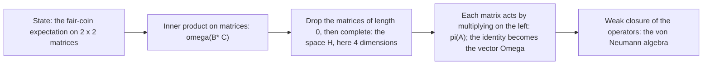
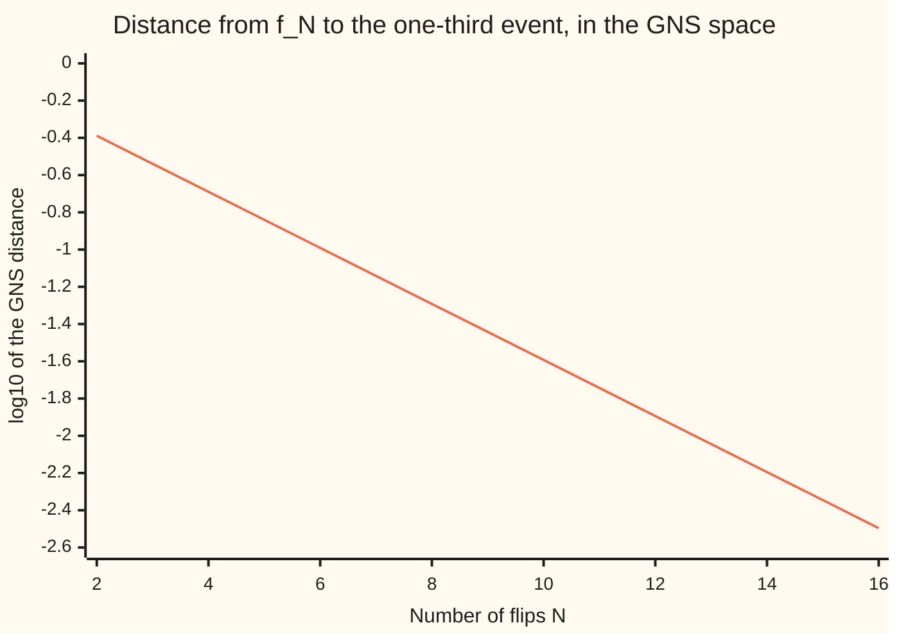

# States: an expectation on an algebra, and the space it builds

[Syllabus](../../../SYLLABUS.md) → [Functional analysis](../README.md) → [Banach Algebras and Fixed Points](../README.md#s06) → States

---

## General Overview

Flip a fair coin. A bet pays £10 on heads and costs £6 on tails. Its expected payout is £2, with a standard deviation of £8. That is ordinary [Expectation](../../09-Probability%20and%20statistics/02-Random%20Variables/02-expectation.md): each payout times its chance, added up.

Write the bet as the 2 × 2 matrix `[[10, 0], [0, -6]]`, heads payout and tails payout on the diagonal. The expectation becomes a rule on matrices: half the top-left entry plus half the bottom-right entry. That rule works on every 2 × 2 matrix, including ones with entries off the diagonal. Those extra matrices are what a quantum coin, such as a photon's polarisation, adds to a classical one.

A rule like this is called a **state**. This card shows that every state builds its own Hilbert space (a complete space with an inner product), with one special vector that gives back every expectation as "vector, times operator, times vector". That is the form used in [States as vectors](../../13-Engineering%20mathematics/09-Quantum%20Mechanics%20in%20Outline/02-state-vectors-operators-and-measurement.md). For the fair coin the space has four dimensions, not two, and the special vector is an entangled pair: two linked two-state systems whose readings always agree. The construction is called **GNS**, after Gelfand, Naimark and Segal.

**A state is an expectation on an algebra: linear, never negative on squares, worth 1 on the identity; used as an inner product on the algebra itself, it builds a Hilbert space, on which each member A acts by multiplying on the left as the operator π(A), and a vector Ω in which every expectation is ⟨Ω, π(A)Ω⟩; adding every limit of those operators in which each overlap ⟨u, π(A)v⟩ settles (the weak closure) gives the von Neumann algebra the state generates.**

**What kind of fact this is:** a theorem. The GNS construction is proved on this card in Why it works. Von Neumann's double commutant theorem is checked here in finite dimensions and stated for infinite dimensions with a named source (von Neumann, 1930).

### The picture: from an expectation to a space



Schematic. Each box is one step of Why it works.

---

## The formula

Scalars are complex, as on the [C-star algebras](03-c-star-algebras-in-outline.md) card. $`A^*`$ is the conjugate transpose (flip across the diagonal, conjugate each entry). The inner product conjugates its first slot, like $`v^*w`$; texts differ on this. On this shelf $`\omega`$ is always a state, and a prime marks a **commutant**: $`\mathcal S'`$ is every operator that commutes with each member of the set $`\mathcal S`$.

```math
\omega(\lambda A + B) = \lambda\,\omega(A) + \omega(B), \qquad \omega(A^*A) \ge 0, \qquad \omega(1) = 1
```

```math
\langle [B], [C]\rangle = \omega(B^*C), \qquad \pi_\omega(A)\,[B] = [AB], \qquad \Omega = [1], \qquad \omega(A) = \langle \Omega,\ \pi_\omega(A)\,\Omega\rangle
```

```math
\mathcal M = \pi_\omega(\mathcal A)'' = \text{the weak closure of } \pi_\omega(\mathcal A)
```

**Read it aloud:** a state is linear, never negative on a square and worth 1 on the identity; it measures the overlap of two members of the algebra, each member becomes a vector, the algebra acts by multiplying on the left, and the identity's vector gives back every expectation; the double commutant is the weak closure.

For the fair coin, $`\omega(A) = \tfrac12 a_{11} + \tfrac12 a_{22}`$, and the bet gives $`\langle\Omega, \pi_\omega(X)\Omega\rangle = 2`$, the £2.

| Symbol | Plain meaning | In our example | Push it up and the answer… |
| --- | --- | --- | --- |
| $`\mathcal A`$, $`A`$, $`B`$, $`C`$, $`Y`$, $`Z`$ | the algebra; its members; two test matrices | 2 × 2 complex matrices; $`Y`$ = `[[1, 2], [i, 3]]`, $`Z`$ = `[[0, i], [2, -1]]` | — |
| $`X`$, $`S`$ | the bet; the swap matrix (the 45° polariser) | `[[10, 0], [0, -6]]`; `[[0, 1], [1, 0]]` | — |
| $`a_{ij}`$, $`E_{ij}`$, $`1`$, $`\lambda`$, $`t`$ | an entry; the matrix with one 1 at row $`i`$, column $`j`$; the identity; complex numbers, with $`i = \sqrt{-1}`$ | $`E_{11}`$ = `[[1, 0], [0, 0]]` | — |
| $`p`$ | the coin's chance of heads | 0.5, 0.75, 1 | weight moves to $`a_{11}`$ |
| $`\omega`$, $`\varphi`$ | the state $`p\,a_{11} + (1-p)\,a_{22}`$; a positive rule used in one proof | $`\omega(X) = 2`$ | — |
| $`\rho`$, $`\mathrm{tr}`$ | density matrix, $`\omega(A) = \mathrm{tr}(\rho A)`$; tr sums the diagonal | `[[0.5, 0], [0, 0.5]]` | — |
| $`\mathcal N_\omega`$, $`[B]`$ | members of length 0; $`B`$ as a vector | $`\{0\}`$ at $`p = 0.5`$ | — |
| $`H_\omega`$, $`\Omega`$, $`\lVert\cdot\rVert`$ | the GNS space; the identity's vector; a length, or a matrix's largest stretch | 4 dimensions; (0.707107, 0, 0, 0.707107) | — |
| $`\pi_\omega(A)`$, $`T`$, $`u`$, $`v`$, $`g`$ | "multiply on the left by $`A`$"; any operator; vectors, all on $`H_\omega`$ | $`A \otimes 1`$ | — |
| $`e_{kl}`$, $`\otimes`$, $`\psi`$, $`e_1`$ | unit basis vectors; the Kronecker product; a unit vector in $`\mathbb C^2`$ (pairs of complex numbers); (1, 0) | $`e_{kl} = \sqrt2\,[E_{kl}]`$ | — |
| $`\mathcal M`$, $`\mathcal S'`$, $`\mathcal M''`$ | the von Neumann algebra; a commutant; a double commutant | 4 dimensions each at $`p = 0.5`$ | — |
| $`N`$, $`f`$, $`f_N`$, $`\mathbb E`$, $`L^2`$, $`L^\infty`$ | flips; "the flips, as a binary fraction, fall below 1/3"; that test on $`N`$ flips; expectation; finite mean-square payoffs; bounded payoffs | $`\omega(f_{16}) = 0.333344`$ | $`f_N`$ nears $`f`$ in $`H_\omega`$ only |

### When it holds

- **The rule is positive.** Without it the overlap gives negative lengths: $`1.5\,a_{11} - 0.5\,a_{22}`$ is worth 1.000000 on the identity but gives $`E_{22}`$ the squared length −0.500000.
- **Members of length 0 are set aside.** At $`p = 1`$, $`E_{12}`$ has length 0 but is not zero. Treating two members as one vector when their difference has length 0 (a quotient) makes the overlap a true inner product.
- **The algebra acts on the left.** Multiplying on the right sends a length-0 member to one of squared length 1.000000.
- **The algebra has a star, an identity and a C-star norm.** The norm makes each $`\pi_\omega(A)`$ bounded. Without $`\omega(1) = 1`$, $`\Omega`$ has squared length $`\omega(1)`$ instead of 1.

---

## Why it works

### Step 0: an expectation already measures lengths

In probability, $`\mathbb E[\bar B C]`$ behaves like an inner product of two payoffs $`B`$ and $`C`$ (the bar is the complex conjugate). $`\mathbb E[\lvert B\rvert^2]`$ is a squared length: 68 for the bet. [L2 as a Hilbert space](../../10-Measure%20and%20integration/07-Sizes%20of%20Functions/06-l2-as-a-hilbert-space.md) builds the space $`L^2`$ of payoffs this way.

GNS copies that move for any algebra. Members become vectors, the state becomes the inner product, and multiplying by a member becomes an operator. Nothing outside the algebra and the state is used.

### Step 1: what positivity gives for free

For the coin, the diagonal of $`A^*A`$ holds the squared lengths of the two columns of $`A`$, so

```math
\omega(A^*A) = p\,(\lvert a_{11}\rvert^2 + \lvert a_{21}\rvert^2) + (1 - p)\,(\lvert a_{12}\rvert^2 + \lvert a_{22}\rvert^2) \ge 0 .
```

For the test matrix $`Y`$ at $`p = 0.5`$: $`\tfrac12(1 + 1) + \tfrac12(4 + 9) = 7.500000`$.

Positivity alone gives two facts, proved in the fold:

- **stars become conjugates:** $`\omega(A^*) = \overline{\omega(A)}`$;
- **Cauchy-Schwarz:** $`\lvert\omega(B^*C)\rvert^2 \le \omega(B^*B)\,\omega(C^*C)`$. For the test matrices $`B = Y`$ and $`C = Z`$: $`2.250000 \le 7.500000 \times 3.000000 = 22.500000`$.

Every state on 2 × 2 matrices is $`\mathrm{tr}(\rho A)`$, with $`\rho_{ij} = \omega(E_{ji})`$. The fair coin has $`\rho`$ = `[[0.5, 0], [0, 0.5]]`, of rank 2. A vector state $`\psi^*A\psi`$ has $`\rho = \psi\psi^*`$, of rank 1. So no vector in $`\mathbb C^2`$ gives the fair coin, and a bigger space is needed.

<details>
<summary>Detailed proof: conjugate symmetry and Cauchy-Schwarz from positivity</summary>

For a complex number $`t`$, positivity applied to $`B + tC`$ gives

$`\displaystyle 0 \le \omega(B^*B) + t\,\omega(B^*C) + \bar t\,\omega(C^*B) + \lvert t\rvert^2\,\omega(C^*C).`$

The middle terms must add to a real number for every $`t`$. Taking $`t = 1`$ and $`t = i`$ gives $`\omega(C^*B) = \overline{\omega(B^*C)}`$; with $`B = 1`$, $`\omega(C^*) = \overline{\omega(C)}`$.

If $`\omega(C^*C) = 0`$, the expression stays non-negative for every $`t`$ only if $`\omega(B^*C) = 0`$. Otherwise put $`t = -\omega(C^*B)/\omega(C^*C)`$. The inequality becomes $`\lvert\omega(B^*C)\rvert^2 \le \omega(B^*B)\,\omega(C^*C)`$.

</details>

### Step 2: the overlap, and the members of length 0

Put $`\langle B, C\rangle = \omega(B^*C)`$ on the algebra itself. It fails only one rule of an inner product: a non-zero member may have length 0. Collect those in $`\mathcal N_\omega = \{B : \omega(B^*B) = 0\}`$.

By Cauchy-Schwarz, a member of length 0 has overlap 0 with everything, so $`\mathcal N_\omega`$ is a subspace. It is also a **left ideal**: if $`B`$ has length 0, so has $`AB`$, because

```math
\omega\bigl((AB)^*(AB)\bigr) \le \lVert A\rVert^2\,\omega(B^*B).
```

For the coin, $`\langle E_{ij}, E_{kl}\rangle = \omega(E_{ji}E_{kl})`$. The product is zero unless $`i = k`$, and then it is $`E_{jl}`$. So the Gram matrix (the table of overlaps) is diagonal, with entries $`p,\ 1 - p,\ p,\ 1 - p`$.

- **Fair coin:** every entry is 0.5, and $`\mathcal N_\omega = \{0\}`$.
- **Two-headed coin, $`p = 1`$:** $`E_{12}`$ and $`E_{22}`$ have length 0; $`\mathcal N_\omega`$ is the matrices whose first column is zero.

<details>
<summary>Detailed proof: the members of length 0 form a left ideal</summary>

Fix $`B`$. The rule $`\varphi(C) = \omega(B^*CB)`$ is linear and positive. For positive $`C`$, the member $`\lVert C\rVert 1 - C`$ is positive too (square roots of positive members, from the C-star card), so $`\varphi(C) \le \lVert C\rVert\,\varphi(1)`$. Take $`C = A^*A`$, with $`\lVert A^*A\rVert = \lVert A\rVert^2`$:

$`\displaystyle \omega\bigl((AB)^*(AB)\bigr) = \varphi(A^*A) \le \lVert A\rVert^2\,\omega(B^*B).`$

</details>

### Step 3: the space, the operators, and the expectation recovered

Treat two members as the same vector when their difference has length 0, and write $`[B]`$ for the vector of $`B`$. Now $`\langle[B], [C]\rangle = \omega(B^*C)`$ is a true inner product. In infinite dimensions, also add the limits of Cauchy sequences (sequences whose terms get arbitrarily close). The result is $`H_\omega`$.

Let $`\pi_\omega(A)[B] = [AB]`$. This is a **representation**: a map into operators on a Hilbert space that keeps sums, products and stars.

1. **Well defined:** if $`B - B'`$ has length 0, so has $`A(B - B')`$, by Step 2.
2. **Keeps products:** $`\pi_\omega(AA')[B] = [AA'B] = \pi_\omega(A)\pi_\omega(A')[B]`$.
3. **Keeps stars:** $`\langle[C], \pi_\omega(A)[B]\rangle = \omega(C^*AB) = \langle\pi_\omega(A^*)[C], [B]\rangle`$.
4. **Bounded:** Step 2 gives $`\lVert\pi_\omega(A)\rVert \le \lVert A\rVert`$, so each operator extends to the completed space.

With $`\Omega = [1]`$,

```math
\langle\Omega, \pi_\omega(A)\,\Omega\rangle = \omega(1^*\,A\,1) = \omega(A).
```

Every state is a vector state, in its own space. The vectors $`\pi_\omega(A)\Omega = [A]`$ form a dense set, so $`\Omega`$ is **cyclic**. The triple is unique up to relabelling: another cyclic triple with the same expectations matches it by $`\pi(A)\Omega \mapsto \pi_\omega(A)\Omega`$, which keeps every inner product, since both sides equal $`\omega(B^*C)`$.

### Step 4: the fair coin builds an entangled pair

At $`p = 0.5`$ the Gram matrix is 0.5 times the identity, so the vectors $`e_{kl} = \sqrt2\,[E_{kl}]`$ are perpendicular unit vectors and $`H_\omega`$ has 4 dimensions. In this basis:

- $`\pi_\omega(A)\,e_{kl} = \sum_i a_{ik}\,e_{il}`$: $`A`$ acts on the first index only, so $`\pi_\omega(A) = A \otimes 1`$;
- $`\Omega = (e_{11} + e_{22})/\sqrt2 = (0.707107, 0, 0, 0.707107)`$.

Read the two indices as two two-state systems. $`\Omega`$ is "both 1 or both 2, equally likely": an entangled Bell state. The algebra touches only the first system, which on its own looks like a fair coin. Quantum information calls this a **purification**. The checks also build $`\pi_\omega(A)`$ from overlaps alone and confirm it equals $`A \otimes 1`$.

| Coin | $`p`$ | dimension of $`H_\omega`$ | of $`\pi_\omega(\mathcal A)`$ | of the commutant | of the double commutant |
| --- | ---: | ---: | ---: | ---: | ---: |
| fair | 0.50 | 4 | 4 | 4 | 4 |
| biased | 0.75 | 4 | 4 | 4 | 4 |
| two-headed | 1.00 | 2 | 4 | 1 | 4 |

At $`p = 1`$, $`\Omega = e_1`$ and $`\pi_\omega(A) = A`$: the state was the vector state $`e_1^*Ae_1`$ all along.

### Step 5: the commutant and the double commutant

For the fair coin, $`\pi_\omega(\mathcal A) = \{A \otimes 1\}`$ and its commutant is $`\{1 \otimes B\}`$, the operators on the hidden second system. The checks find it by solving the 64 equations $`T\pi_\omega(E_{ij}) = \pi_\omega(E_{ij})T`$ for the 16 entries of $`T`$: 4 dimensions. The double commutant has 4 dimensions and contains $`\pi_\omega(\mathcal A)`$, which has 4, so the two are equal.

At $`p = 1`$ the commutant is only the multiples of the identity. Such a representation is **irreducible**: no smaller subspace is left alone by every operator. Irreducible GNS representations come exactly from **pure** states, those that are not averages of two others (stated, with sources below). The fair coin averages "always heads" and "always tails", so its commutant is larger.

**Von Neumann's double commutant theorem:** for a star-algebra of operators that contains the identity, the double commutant equals the closure in the **weak operator topology**, where $`T_n \to T`$ means $`\langle u, T_n v\rangle \to \langle u, Tv\rangle`$ for all vectors $`u`$, $`v`$. In finite dimensions every subspace is closed, so the algebra is its own double commutant, as the table shows.

### Step 6: infinitely many flips, where the weak closure grows

Flip the fair coin forever. The payoffs that depend on finitely many flips, completed in the sup norm (the largest absolute payoff), form a C-star algebra. The fair-coin state averages over all sequences. Its GNS space is $`L^2`$ of the sequences, as in Step 0.

Read the flips as a binary fraction $`0.X_1X_2X_3\ldots`$, heads 0 and tails 1. Let $`f = 1`$ when it is below 1/3, else 0: a fair coin simulating a one-in-three chance. No fixed number of flips always decides $`f`$. Let $`f_N`$ test the first $`N`$ digits only. Counting all $`2^N`$ sequences:

| $`N`$ | $`\omega(f_N)`$ | GNS distance from $`f_N`$ to $`f`$ | sup distance |
| ---: | ---: | ---: | ---: |
| 2 | 0.500000 | 0.408248 | 1 |
| 4 | 0.375000 | 0.204124 | 1 |
| 8 | 0.335938 | 0.051031 | 1 |
| 12 | 0.333496 | 0.012758 | 1 |
| 16 | 0.333344 | 0.003189 | 1 |

For even $`N`$, $`\omega(f_N) = (2^N + 2)/(3 \cdot 2^N)`$ and the GNS distance is $`\sqrt{2/(3 \cdot 2^N)}`$. The sup distance stays 1: the last $`N`$-digit pattern below 1/3, followed by tails forever, has $`f_N = 1`$ and $`f = 0`$.



The line falls by a fixed step, a halving of the distance, every two flips, from N = 2 to 16. The sup distance would be a flat line at 0, since log10 of 1 is 0.

For any vector $`g`$, $`\lVert(f_N - f)g\rVert^2`$ is the mean square of $`g`$ over a set of chance $`2/(3 \cdot 2^N)`$, which tends to 0. So $`\pi_\omega(f_N)`$ converges to multiplication by $`f`$ in the weak operator topology, never in norm. So $`f`$ is in $`\mathcal M = \pi_\omega(\mathcal A)''`$ but not in $`\pi_\omega(\mathcal A)`$. Here $`\mathcal M`$ is $`L^\infty`$, all bounded measurable payoffs (stated, with sources below).

What the truncation hides: at each finite $`N`$ the algebra is finite-dimensional and already weakly closed. Only the trend over $`N`$ shows the closure growing. With full $`2^N \times 2^N`$ matrices and the normalised trace $`2^{-N}\,\mathrm{tr}`$ (the fair coin on each of the $`N`$ two-state systems) in place of payoffs, the same construction gives the hyperfinite II₁ factor; factors are cited here, not taught.

---

## Worked numbers, by hand

The fair coin, $`p = 0.5`$, and the bet $`X`$ = `[[10, 0], [0, -6]]`, through the GNS space.

| Step | Arithmetic | Value |
| --- | --- | --- |
| expected payout | $`\omega(X) = 0.5 \times 10 + 0.5 \times (-6)`$ | 2.000000 |
| mean square | $`\omega(X^*X) = 0.5 \times 100 + 0.5 \times 36`$ | 68.000000 |
| standard deviation | $`\sqrt{68 - 2^2}`$ | 8.000000 |
| overlaps of the matrix units | $`\langle E_{ij}, E_{kl}\rangle = \omega(E_{ji}E_{kl})`$: 0.5 when $`(i, j) = (k, l)`$, else 0 | Gram matrix $`\tfrac12 \cdot 1`$, 4 dimensions |
| the vector $`\Omega`$ | $`[E_{11}] + [E_{22}] = (e_{11} + e_{22})/\sqrt2`$ | (0.707107, 0, 0, 0.707107) |
| $`\pi_\omega(X)\Omega`$ | $`X`$ scales $`e_{11}`$ by 10 and $`e_{22}`$ by −6 | (7.071068, 0, 0, −4.242641) |
| $`\langle\Omega, \pi_\omega(X)\Omega\rangle`$ | $`0.707107 \times 7.071068 + 0.707107 \times (-4.242641)`$ | **2.000000** |

The vector $`\Omega`$ in a 4-dimensional space gives back the £2 expectation exactly. The same vector gives the swap $`S`$ the value 0: $`\pi_\omega(S)\Omega = (0, 0.707107, 0.707107, 0)`$ is perpendicular to $`\Omega`$, matching $`\omega(S) = 0`$.

### What breaks if you drop a piece

| Mistake | Comes out at | What went wrong |
| --- | --- | --- |
| Use the rule $`1.5\,a_{11} - 0.5\,a_{22}`$ | $`\omega(1) = 1.000000`$, but $`\omega(E_{22}^*E_{22}) = -0.500000`$ | not positive: a negative squared length |
| Keep every matrix as a vector at $`p = 1`$ | $`\omega(E_{12}^*E_{12}) = 0.000000`$ for a non-zero $`E_{12}`$ | no quotient by $`\mathcal N_\omega`$, so no inner product |
| Multiply on the right at $`p = 1`$ | $`[E_{12}]`$ is zero, but $`[E_{12}E_{21}]`$ has squared length 1.000000 | $`\mathcal N_\omega`$ is a left ideal only |
| Look for the fair coin as one vector in $`\mathbb C^2`$ | $`e_1^*E_{11}e_1 = 1.000000`$, but $`\omega(E_{11}) = 0.500000`$ | an average of states needs a bigger space |
| Close in the sup norm | sup distance 1 at every $`N`$; GNS distance 0.003189 at $`N = 16`$ | the norm closure misses $`f`$ |

---

## Code, from first principles, and it actually runs

The scripts compute every number on the card: the state, the GNS space for three coins, the failures, and the infinite run of flips. They take four independent roads. The Gram matrix built from the state meets its closed form. The operators built from overlaps alone meet the Bell-pair formula $`A \otimes 1`$ and give back $`\omega(A)`$. Commutants found by Gaussian elimination meet the known dimensions. Counts over all $`2^N`$ flip sequences meet exact integer closed forms, and a search over every $`N`$-flip prefix finds the sup distance, which the named witness attains. What the truncation hides: every algebra in the code is finite-dimensional and already weakly closed.

### Python

```python
# States and the GNS construction -- the check behind the card.  Standard library only.
# Algebra: 2 x 2 complex matrices.  State of a coin with heads chance p: omega(A) = p a11 + (1-p) a22.
# Roads: the Gram matrix built from omega against its closed form; pi(A) built from omega alone
# against the Bell-pair formula A (x) I; commutants by Gaussian elimination against known answers;
# the one-third event by counting all 2^N flip sequences against exact integer closed forms.
import math

def mul(A, B): return [[sum(A[i][t] * B[t][j] for t in range(len(B))) for j in range(len(B[0]))] for i in range(len(A))]
def star(A): return [[A[j][i].conjugate() for j in range(len(A))] for i in range(len(A[0]))]
def kron(A, B): return [[A[i // 2][k // 2] * B[i % 2][k % 2] for k in range(4)] for i in range(4)]
def omega(A, p): return p * A[0][0] + (1 - p) * A[1][1]
def unit(i, j): return [[1 + 0j if (r, c) == (i, j) else 0j for c in range(2)] for r in range(2)]
def close(a, b, tol=1e-12): assert abs(a - b) < tol, (a, b)
def same(A, B): [close(x, y) for ra, rb in zip(A, B) for x, y in zip(ra, rb)]
def re(z): close(z.imag, 0); return f"{z.real:.6f}"

def rank_null(rows, tol=1e-9):  # Gaussian elimination: rank, and a basis of the null space
    rows, piv, r = [row[:] for row in rows], [], 0
    for c in range(len(rows[0])):
        b = max(range(r, len(rows)), key=lambda i: abs(rows[i][c]))
        if abs(rows[b][c]) < tol: continue
        rows[r], rows[b] = rows[b], rows[r]
        rows[r] = [x / rows[r][c] for x in rows[r]]
        for i in range(len(rows)):
            f = rows[i][c]
            if i != r and abs(f) > 0: rows[i] = [x - f * y for x, y in zip(rows[i], rows[r])]
        piv.append(c); r += 1
        if r == len(rows): break
    null = []
    for fc in [c for c in range(len(rows[0])) if c not in piv]:
        v = [0j] * len(rows[0]); v[fc] = 1
        for i, c in enumerate(piv): v[c] = -rows[i][fc]
        null.append(v)
    return len(piv), null

def commutant(gens, d):  # every d x d matrix T with T G = G T for each G in gens
    rows = []
    for G in gens:
        for i in range(d):
            for j in range(d):
                row = [0j] * (d * d)
                for t in range(d): row[i * d + t] += G[t][j]; row[t * d + j] -= G[i][t]
                rows.append(row)
    return [[v[a * d:(a + 1) * d] for a in range(d)] for v in rank_null(rows)[1]]

# 1. The fair coin's expectation, first on payoffs (diagonal), then on every 2 x 2 matrix.
X, S = [[10 + 0j, 0j], [0j, -6 + 0j]], [[0j, 1 + 0j], [1 + 0j, 0j]]
Y, Z = [[1 + 0j, 2 + 0j], [1j, 3 + 0j]], [[0j, 1j], [2 + 0j, -1 + 0j]]  # two test matrices
I2 = [[1 + 0j, 0j], [0j, 1 + 0j]]
EX, EX2 = omega(X, 0.5), omega(mul(star(X), X), 0.5)
close(EX, 0.5 * 10 + 0.5 * -6); close(EX2, 0.5 * 100 + 0.5 * 36)
print(f"coin, E[X] = {re(EX)}, E[X^2] = {re(EX2)}, standard deviation = {math.sqrt(EX2.real - EX.real ** 2):.6f}")
print(f"state, omega(I) = {re(omega(I2, .5))}, omega(S) = {re(omega(S, .5))}, omega(Y) = {re(omega(Y, .5))}")
for M in (Y, Z):  # positivity, against the closed form p(|a11|^2 + |a21|^2) + (1-p)(|a12|^2 + |a22|^2)
    close(omega(mul(star(M), M), .5), .5 * sum(abs(M[i][j]) ** 2 for i in range(2) for j in range(2)))
yy, zz, yz = omega(mul(star(Y), Y), .5), omega(mul(star(Z), Z), .5), omega(mul(star(Y), Z), .5)
assert abs(yz) ** 2 <= yy.real * zz.real
print(f"positive, omega(Y*Y) = {re(yy)}, omega(Z*Z) = {re(zz)}, |omega(Y*Z)|^2 = {abs(yz) ** 2:.6f} <= {yy.real * zz.real:.6f}")
rho = [[omega(unit(j, i), .5) for j in range(2)] for i in range(2)]  # density matrix rho_ij = omega(E_ji)
for M in (X, S, Y, Z): close(sum(mul(rho, M)[i][i] for i in range(2)), omega(M, .5))
assert rank_null(rho)[0] == 2  # rank 2, so no single vector psi (rho = psi psi*, rank 1) gives the fair coin
print(f"density, rho = [[{re(rho[0][0])}, {re(rho[0][1])}], [{re(rho[1][0])}, {re(rho[1][1])}]], omega(M) = trace(rho M) on 4 tests")

# 2. GNS: vectors are matrices, <C, D> = omega(C* D); pi(M) acts by left multiplication.
E = [unit(i, j) for i in range(2) for j in range(2)]  # order E11, E12, E21, E22
def gns(p):
    G = [[omega(mul(star(C), D), p) for D in E] for C in E]
    same(G, [[(k == l) * [p, 1 - p][k % 2] for l in range(4)] for k in range(4)])  # closed form
    dim = rank_null(G)[0]
    basis = [[[x / math.sqrt(G[k][k].real) for x in row] for row in E[k]] for k in range(4) if abs(G[k][k]) > 1e-12]
    pi = lambda M: [[omega(mul(star(u), mul(M, v)), p) for v in basis] for u in basis]
    Om = [omega(star(u), p) for u in basis]  # coordinates of the vector [I]
    return dim, basis, pi, Om
for p in (0.5, 0.75, 1.0):
    dim, basis, pi, Om = gns(p)
    for M in (X, S, Y, Z):
        PM = pi(M)
        close(sum(Om[u].conjugate() * PM[u][v] * Om[v] for u in range(dim) for v in range(dim)), omega(M, p))
        same(pi(mul(M, Y)), mul(PM, pi(Y))); same(pi(star(M)), star(PM))
    gens = [pi(Ek) for Ek in E]
    dimA = rank_null([[x for row in P for x in row] for P in gens])[0]
    C1 = commutant(gens, dim); C2 = commutant(C1, dim)
    for P in gens:
        for T in C1: same(mul(P, T), mul(T, P))
    print(f"gns, p = {p:.2f}, dim H = {dim}, dim pi(A) = {dimA}, dim commutant = {len(C1)}, dim double commutant = {len(C2)}")
    assert (dim, len(C1), len(C2)) == {0.5: (4, 4, 4), 0.75: (4, 4, 4), 1.0: (2, 1, 4)}[p] and dimA == len(C2)
dim, basis, pi, Om = gns(0.5)  # the Bell-pair road: pi(M) = M (x) I and Omega = (e11 + e22)/sqrt 2
for M in (X, S, Y, Z): same(pi(M), kron(M, I2))
same([Om], [[1 / math.sqrt(2), 0, 0, 1 / math.sqrt(2)]])
for T in (kron(I2, S), kron(I2, Y)):
    for Ek in E: same(mul(pi(Ek), T), mul(T, pi(Ek)))
PX, PS = pi(X), pi(S)
SOm = [sum(PS[u][v] * Om[v] for v in range(4)) for u in range(4)]
XOmv = [sum(PX[u][v] * Om[v] for v in range(4)) for u in range(4)]
XOm = sum(Om[u].conjugate() * XOmv[u] for u in range(4))
print(f"bell, pi(X) Omega = ({', '.join(re(z) for z in XOmv)}), <Omega, pi(X) Omega> = {re(XOm)}")
print(f"bell, pi(S) Omega = ({', '.join(re(z) for z in SOm)}), <Omega, pi(S) Omega> = {re(sum(Om[u].conjugate() * SOm[u] for u in range(4)))}")
print(f"bell, Omega = ({', '.join(re(z) for z in Om)}), pi(M) = M (x) I on 4 tests, I (x) S and I (x) Y commute with pi")

# 3. What breaks.
bad = lambda M: 1.5 * M[0][0] - 0.5 * M[1][1]
print(f"breaks, 1.5 a11 - 0.5 a22: omega(I) = {re(bad(I2))}, omega(E22* E22) = {re(bad(mul(star(E[3]), E[3])))}")
n12, bad_r = omega(mul(star(E[1]), E[1]), 1.0), mul(E[1], E[2])
print(f"breaks, p = 1, right action: |E12|^2 = {re(n12)} but |E12 E21|^2 = {re(omega(mul(star(bad_r), bad_r), 1.0))}")
e1 = [1 + 0j, 0j]; v11 = sum(e1[i].conjugate() * E[0][i][j] * e1[j] for i in range(2) for j in range(2))
print(f"breaks, one vector in C^2 for the fair coin: e1* E11 e1 = {re(v11)}, omega(E11) = {re(omega(E[0], .5))}")

# 4. Infinitely many flips: f = 1 if 0.X1X2X3... (binary) < 1/3, f_N reads only the first N flips.
chart = []
for N in range(2, 17, 2):
    count = sum(1 for m in range(2 ** N) if 3 * m < 2 ** N)
    assert 3 * count == 2 ** N + 2  # closed form: omega(f_N) = (2^N + 2) / (3 2^N)
    d2 = (3 * count - 2 ** N) / (3 * 2 ** N)  # f <= f_N, so |f_N - f|^2 = f_N - f, mean 2 / (3 2^N)
    below = lambda k: int(3 * k < 2 ** N)  # f at k / 2^N, and f_N on the prefix k
    sup = max(abs(below(m) - below(m + 1)) for m in range(2 ** N))  # prefix m covers m / 2^N up to (m + 1) / 2^N
    w = count - 1  # witness: first N digits spell w, then tails forever: f_N = 1, f = 0
    assert sup == 1 and below(w) == 1 and below(w + 1) == 0
    dist = math.sqrt(d2)
    close(dist, math.sqrt(2 / 3) * 2 ** (-N / 2))
    chart.append(f"{math.log10(dist):.3f}")
    print(f"flips, N = {N}, omega(f_N) = {count / 2 ** N:.6f}, GNS distance = {dist:.6f}, sup distance = {sup}")
print(f"chart, log10 GNS distance, N = 2..16 step 2, {', '.join(chart)}")
print("ALL CHECKS PASS")
```

**Ran 2026-11-15 on macOS, Python 3.14.10, standard library only. All checks passed. Output, pasted from the run:**

```
coin, E[X] = 2.000000, E[X^2] = 68.000000, standard deviation = 8.000000
state, omega(I) = 1.000000, omega(S) = 0.000000, omega(Y) = 2.000000
positive, omega(Y*Y) = 7.500000, omega(Z*Z) = 3.000000, |omega(Y*Z)|^2 = 2.250000 <= 22.500000
density, rho = [[0.500000, 0.000000], [0.000000, 0.500000]], omega(M) = trace(rho M) on 4 tests
gns, p = 0.50, dim H = 4, dim pi(A) = 4, dim commutant = 4, dim double commutant = 4
gns, p = 0.75, dim H = 4, dim pi(A) = 4, dim commutant = 4, dim double commutant = 4
gns, p = 1.00, dim H = 2, dim pi(A) = 4, dim commutant = 1, dim double commutant = 4
bell, pi(X) Omega = (7.071068, 0.000000, 0.000000, -4.242641), <Omega, pi(X) Omega> = 2.000000
bell, pi(S) Omega = (0.000000, 0.707107, 0.707107, 0.000000), <Omega, pi(S) Omega> = 0.000000
bell, Omega = (0.707107, 0.000000, 0.000000, 0.707107), pi(M) = M (x) I on 4 tests, I (x) S and I (x) Y commute with pi
breaks, 1.5 a11 - 0.5 a22: omega(I) = 1.000000, omega(E22* E22) = -0.500000
breaks, p = 1, right action: |E12|^2 = 0.000000 but |E12 E21|^2 = 1.000000
breaks, one vector in C^2 for the fair coin: e1* E11 e1 = 1.000000, omega(E11) = 0.500000
flips, N = 2, omega(f_N) = 0.500000, GNS distance = 0.408248, sup distance = 1
flips, N = 4, omega(f_N) = 0.375000, GNS distance = 0.204124, sup distance = 1
flips, N = 6, omega(f_N) = 0.343750, GNS distance = 0.102062, sup distance = 1
flips, N = 8, omega(f_N) = 0.335938, GNS distance = 0.051031, sup distance = 1
flips, N = 10, omega(f_N) = 0.333984, GNS distance = 0.025516, sup distance = 1
flips, N = 12, omega(f_N) = 0.333496, GNS distance = 0.012758, sup distance = 1
flips, N = 14, omega(f_N) = 0.333374, GNS distance = 0.006379, sup distance = 1
flips, N = 16, omega(f_N) = 0.333344, GNS distance = 0.003189, sup distance = 1
chart, log10 GNS distance, N = 2..16 step 2, -0.389, -0.690, -0.991, -1.292, -1.593, -1.894, -2.195, -2.496
ALL CHECKS PASS
```

### Rust

```rust
// States and the GNS construction -- the same check as the Python, in Rust.  No crates.
// Algebra: 2 x 2 complex matrices.  State of a coin with heads chance p: omega(A) = p a11 + (1-p) a22.
// Roads: the Gram matrix built from omega against its closed form; pi(A) built from omega alone
// against the Bell-pair formula A (x) I; commutants by Gaussian elimination against known answers;
// the one-third event by counting all 2^N flip sequences against exact integer closed forms.
use std::ops::{Add, Div, Mul, Sub};
#[derive(Clone, Copy, Debug)]
struct C { re: f64, im: f64 }
impl Add for C { type Output = C; fn add(self, o: C) -> C { C { re: self.re + o.re, im: self.im + o.im } } }
impl Sub for C { type Output = C; fn sub(self, o: C) -> C { C { re: self.re - o.re, im: self.im - o.im } } }
impl Mul for C { type Output = C; fn mul(self, o: C) -> C { C { re: self.re * o.re - self.im * o.im, im: self.re * o.im + self.im * o.re } } }
impl Div for C { type Output = C; fn div(self, o: C) -> C { let d = o.re * o.re + o.im * o.im;
    C { re: (self.re * o.re + self.im * o.im) / d, im: (self.im * o.re - self.re * o.im) / d } } }
impl C { fn conj(self) -> C { C { re: self.re, im: -self.im } } fn abs(self) -> f64 { self.re.hypot(self.im) } }
fn r(x: f64) -> C { C { re: x, im: 0.0 } }
type M = Vec<Vec<C>>;
fn mul(a: &M, b: &M) -> M { (0..a.len()).map(|i| (0..b[0].len()).map(|j| (0..b.len()).fold(r(0.0), |s, t| s + a[i][t] * b[t][j])).collect()).collect() }
fn star(a: &M) -> M { (0..a[0].len()).map(|i| (0..a.len()).map(|j| a[j][i].conj()).collect()).collect() }
fn kron(a: &M, b: &M) -> M { (0..4).map(|i| (0..4).map(|k| a[i / 2][k / 2] * b[i % 2][k % 2]).collect()).collect() }
fn omega(a: &M, p: f64) -> C { r(p) * a[0][0] + r(1.0 - p) * a[1][1] }
fn unit(i: usize, j: usize) -> M { (0..2).map(|a| (0..2).map(|b| r(if (a, b) == (i, j) { 1.0 } else { 0.0 })).collect()).collect() }
fn close(a: C, b: C) { assert!((a - b).abs() < 1e-12, "{:?} {:?}", a, b); }
fn same(a: &M, b: &M) { for (ra, rb) in a.iter().zip(b) { for (x, y) in ra.iter().zip(rb) { close(*x, *y); } } }
fn re(z: C) -> String { close(r(z.im), r(0.0)); format!("{:.6}", z.re) }
fn rank_null(rows0: &M) -> (usize, M) { // Gaussian elimination: rank, and a basis of the null space
    let (mut rows, mut piv, mut rr, n) = (rows0.clone(), vec![], 0, rows0[0].len());
    for c in 0..n {
        let b = (rr..rows.len()).fold(rr, |b, i| if rows[i][c].abs() > rows[b][c].abs() { i } else { b });
        if rows[b][c].abs() < 1e-9 { continue; }
        rows.swap(rr, b);
        let pv = rows[rr][c];
        rows[rr] = rows[rr].iter().map(|x| *x / pv).collect();
        for i in 0..rows.len() {
            let f = rows[i][c];
            if i != rr && f.abs() > 0.0 { let top = rows[rr].clone(); rows[i] = rows[i].iter().zip(&top).map(|(x, y)| *x - f * *y).collect(); }
        }
        piv.push(c); rr += 1;
        if rr == rows.len() { break; }
    }
    let mut null = vec![];
    for fc in (0..n).filter(|c| !piv.contains(c)) {
        let mut v = vec![r(0.0); n]; v[fc] = r(1.0);
        for (i, &c) in piv.iter().enumerate() { v[c] = r(0.0) - rows[i][fc]; }
        null.push(v);
    }
    (piv.len(), null)
}
fn commutant(gens: &[M], d: usize) -> Vec<M> { // every d x d matrix T with T G = G T for each G in gens
    let mut rows = vec![];
    for g in gens { for i in 0..d { for j in 0..d {
        let mut row = vec![r(0.0); d * d];
        for t in 0..d { row[i * d + t] = row[i * d + t] + g[t][j]; row[t * d + j] = row[t * d + j] - g[i][t]; }
        rows.push(row);
    } } }
    rank_null(&rows).1.iter().map(|v| (0..d).map(|a| v[a * d..(a + 1) * d].to_vec()).collect()).collect()
}
fn gns(p: f64, e: &[M]) -> (usize, Vec<M>, Vec<C>) {
    let g: M = e.iter().map(|c| e.iter().map(|d| omega(&mul(&star(c), d), p)).collect()).collect();
    let closed: M = (0..4).map(|k| (0..4).map(|l| r(if k == l { [p, 1.0 - p][k % 2] } else { 0.0 })).collect()).collect();
    same(&g, &closed);
    let dim = rank_null(&g).0;
    let basis: Vec<M> = (0..4).filter(|&k| g[k][k].abs() > 1e-12)
        .map(|k| e[k].iter().map(|row| row.iter().map(|x| *x / r(g[k][k].re.sqrt())).collect()).collect()).collect();
    let om: Vec<C> = basis.iter().map(|u| omega(&star(u), p)).collect(); // coordinates of the vector [I]
    (dim, basis, om)
}
fn pi(m: &M, basis: &[M], p: f64) -> M { basis.iter().map(|u| basis.iter().map(|v| omega(&mul(&star(u), &mul(m, v)), p)).collect()).collect() }
fn sandwich(om: &[C], pm: &M) -> C { let d = om.len(); (0..d).fold(r(0.0), |s, u| (0..d).fold(s, |s, v| s + om[u].conj() * pm[u][v] * om[v])) }
fn join(v: &[C]) -> String { v.iter().map(|z| re(*z)).collect::<Vec<_>>().join(", ") }

fn main() {
    // 1. The fair coin's expectation, first on payoffs (diagonal), then on every 2 x 2 matrix.
    let i1 = C { re: 0.0, im: 1.0 };
    let x: M = vec![vec![r(10.0), r(0.0)], vec![r(0.0), r(-6.0)]];
    let s: M = vec![vec![r(0.0), r(1.0)], vec![r(1.0), r(0.0)]];
    let y: M = vec![vec![r(1.0), r(2.0)], vec![i1, r(3.0)]]; // two test matrices
    let z: M = vec![vec![r(0.0), i1], vec![r(2.0), r(-1.0)]];
    let i2: M = vec![vec![r(1.0), r(0.0)], vec![r(0.0), r(1.0)]];
    let (ex, ex2) = (omega(&x, 0.5), omega(&mul(&star(&x), &x), 0.5));
    close(ex, r(0.5 * 10.0 + 0.5 * -6.0)); close(ex2, r(0.5 * 100.0 + 0.5 * 36.0));
    println!("coin, E[X] = {}, E[X^2] = {}, standard deviation = {:.6}", re(ex), re(ex2), (ex2.re - ex.re * ex.re).sqrt());
    println!("state, omega(I) = {}, omega(S) = {}, omega(Y) = {}", re(omega(&i2, 0.5)), re(omega(&s, 0.5)), re(omega(&y, 0.5)));
    for m in [&y, &z] { // positivity, against the closed form p(|a11|^2 + |a21|^2) + (1-p)(|a12|^2 + |a22|^2)
        close(omega(&mul(&star(m), m), 0.5), r(0.5 * m.iter().flatten().map(|c| c.abs().powi(2)).sum::<f64>()));
    }
    let (yy, zz, yz) = (omega(&mul(&star(&y), &y), 0.5), omega(&mul(&star(&z), &z), 0.5), omega(&mul(&star(&y), &z), 0.5));
    assert!(yz.abs().powi(2) <= yy.re * zz.re);
    println!("positive, omega(Y*Y) = {}, omega(Z*Z) = {}, |omega(Y*Z)|^2 = {:.6} <= {:.6}", re(yy), re(zz), yz.abs().powi(2), yy.re * zz.re);
    let rho: M = (0..2).map(|i| (0..2).map(|j| omega(&unit(j, i), 0.5)).collect()).collect(); // rho_ij = omega(E_ji)
    for m in [&x, &s, &y, &z] { let rm = mul(&rho, m); close(rm[0][0] + rm[1][1], omega(m, 0.5)); }
    assert!(rank_null(&rho).0 == 2); // rank 2, so no single vector psi (rho = psi psi*, rank 1) gives the fair coin
    println!("density, rho = [[{}, {}], [{}, {}]], omega(M) = trace(rho M) on 4 tests", re(rho[0][0]), re(rho[0][1]), re(rho[1][0]), re(rho[1][1]));

    // 2. GNS: vectors are matrices, <C, D> = omega(C* D); pi(M) acts by left multiplication.
    let e: Vec<M> = vec![unit(0, 0), unit(0, 1), unit(1, 0), unit(1, 1)]; // order E11, E12, E21, E22
    for (p, want) in [(0.5, (4, 4, 4)), (0.75, (4, 4, 4)), (1.0, (2, 1, 4))] {
        let (dim, basis, om) = gns(p, &e);
        for m in [&x, &s, &y, &z] {
            let pm = pi(m, &basis, p);
            close(sandwich(&om, &pm), omega(m, p));
            same(&pi(&mul(m, &y), &basis, p), &mul(&pm, &pi(&y, &basis, p))); same(&pi(&star(m), &basis, p), &star(&pm));
        }
        let gens: Vec<M> = e.iter().map(|ek| pi(ek, &basis, p)).collect();
        let dim_a = rank_null(&gens.iter().map(|g| g.iter().flatten().cloned().collect()).collect()).0;
        let c1 = commutant(&gens, dim); let c2 = commutant(&c1, dim);
        for g in &gens { for t in &c1 { same(&mul(g, t), &mul(t, g)); } }
        println!("gns, p = {:.2}, dim H = {}, dim pi(A) = {}, dim commutant = {}, dim double commutant = {}", p, dim, dim_a, c1.len(), c2.len());
        assert!((dim, c1.len(), c2.len()) == want && dim_a == c2.len());
    }
    let (_, basis, om) = gns(0.5, &e); // the Bell-pair road: pi(M) = M (x) I and Omega = (e11 + e22)/sqrt 2
    for m in [&x, &s, &y, &z] { same(&pi(m, &basis, 0.5), &kron(m, &i2)); }
    let h = r(1.0 / 2f64.sqrt());
    same(&vec![om.clone()], &vec![vec![h, r(0.0), r(0.0), h]]);
    for t in [kron(&i2, &s), kron(&i2, &y)] { for ek in &e { let pk = pi(ek, &basis, 0.5); same(&mul(&pk, &t), &mul(&t, &pk)); } }
    let (px, ps) = (pi(&x, &basis, 0.5), pi(&s, &basis, 0.5));
    let som: Vec<C> = (0..4).map(|u| (0..4).fold(r(0.0), |acc, v| acc + ps[u][v] * om[v])).collect();
    let sdot = (0..4).fold(r(0.0), |acc, u| acc + om[u].conj() * som[u]);
    let xom: Vec<C> = (0..4).map(|u| (0..4).fold(r(0.0), |acc, v| acc + px[u][v] * om[v])).collect();
    println!("bell, pi(X) Omega = ({}), <Omega, pi(X) Omega> = {}", join(&xom), re((0..4).fold(r(0.0), |acc, u| acc + om[u].conj() * xom[u])));
    println!("bell, pi(S) Omega = ({}), <Omega, pi(S) Omega> = {}", join(&som), re(sdot));
    println!("bell, Omega = ({}), pi(M) = M (x) I on 4 tests, I (x) S and I (x) Y commute with pi", join(&om));

    // 3. What breaks.
    let bad = |m: &M| r(1.5) * m[0][0] - r(0.5) * m[1][1];
    println!("breaks, 1.5 a11 - 0.5 a22: omega(I) = {}, omega(E22* E22) = {}", re(bad(&i2)), re(bad(&mul(&star(&e[3]), &e[3]))));
    let (n12, bad_r) = (omega(&mul(&star(&e[1]), &e[1]), 1.0), mul(&e[1], &e[2]));
    println!("breaks, p = 1, right action: |E12|^2 = {} but |E12 E21|^2 = {}", re(n12), re(omega(&mul(&star(&bad_r), &bad_r), 1.0)));
    let e1 = [r(1.0), r(0.0)];
    let v11 = (0..2).fold(r(0.0), |s, i| (0..2).fold(s, |s, j| s + e1[i].conj() * e[0][i][j] * e1[j]));
    println!("breaks, one vector in C^2 for the fair coin: e1* E11 e1 = {}, omega(E11) = {}", re(v11), re(omega(&e[0], 0.5)));

    // 4. Infinitely many flips: f = 1 if 0.X1X2X3... (binary) < 1/3, f_N reads only the first N flips.
    let mut chart = vec![];
    for n in (2..17).step_by(2) {
        let two: u64 = 1 << n;
        let count = (0..two).filter(|m| 3 * m < two).count() as u64;
        assert!(3 * count == two + 2); // closed form: omega(f_N) = (2^N + 2) / (3 2^N)
        let d2 = (3 * count - two) as f64 / (3 * two) as f64; // f <= f_N, so |f_N - f|^2 = f_N - f
        let below = |k: u64| (3 * k < two) as i64; // f at k / 2^N, and f_N on the prefix k
        let sup = (0..two).map(|m| (below(m) - below(m + 1)).abs()).max().unwrap(); // prefix m runs from m to m + 1, over 2^N
        let w = count - 1; // witness: first N digits spell w, then tails forever: f_N = 1, f = 0
        assert!(sup == 1 && below(w) == 1 && below(w + 1) == 0);
        let dist = d2.sqrt();
        close(r(dist), r((2.0f64 / 3.0).sqrt() * 2f64.powf(-(n as f64) / 2.0)));
        chart.push(format!("{:.3}", dist.log10()));
        println!("flips, N = {}, omega(f_N) = {:.6}, GNS distance = {:.6}, sup distance = {}", n, count as f64 / two as f64, dist, sup);
    }
    println!("chart, log10 GNS distance, N = 2..16 step 2, {}", chart.join(", "));
    println!("ALL CHECKS PASS");
}
```

**Ran 2026-11-15 on macOS, rustc 1.98.1, no crates. All checks passed. Output, pasted from the run:**

```
coin, E[X] = 2.000000, E[X^2] = 68.000000, standard deviation = 8.000000
state, omega(I) = 1.000000, omega(S) = 0.000000, omega(Y) = 2.000000
positive, omega(Y*Y) = 7.500000, omega(Z*Z) = 3.000000, |omega(Y*Z)|^2 = 2.250000 <= 22.500000
density, rho = [[0.500000, 0.000000], [0.000000, 0.500000]], omega(M) = trace(rho M) on 4 tests
gns, p = 0.50, dim H = 4, dim pi(A) = 4, dim commutant = 4, dim double commutant = 4
gns, p = 0.75, dim H = 4, dim pi(A) = 4, dim commutant = 4, dim double commutant = 4
gns, p = 1.00, dim H = 2, dim pi(A) = 4, dim commutant = 1, dim double commutant = 4
bell, pi(X) Omega = (7.071068, 0.000000, 0.000000, -4.242641), <Omega, pi(X) Omega> = 2.000000
bell, pi(S) Omega = (0.000000, 0.707107, 0.707107, 0.000000), <Omega, pi(S) Omega> = 0.000000
bell, Omega = (0.707107, 0.000000, 0.000000, 0.707107), pi(M) = M (x) I on 4 tests, I (x) S and I (x) Y commute with pi
breaks, 1.5 a11 - 0.5 a22: omega(I) = 1.000000, omega(E22* E22) = -0.500000
breaks, p = 1, right action: |E12|^2 = 0.000000 but |E12 E21|^2 = 1.000000
breaks, one vector in C^2 for the fair coin: e1* E11 e1 = 1.000000, omega(E11) = 0.500000
flips, N = 2, omega(f_N) = 0.500000, GNS distance = 0.408248, sup distance = 1
flips, N = 4, omega(f_N) = 0.375000, GNS distance = 0.204124, sup distance = 1
flips, N = 6, omega(f_N) = 0.343750, GNS distance = 0.102062, sup distance = 1
flips, N = 8, omega(f_N) = 0.335938, GNS distance = 0.051031, sup distance = 1
flips, N = 10, omega(f_N) = 0.333984, GNS distance = 0.025516, sup distance = 1
flips, N = 12, omega(f_N) = 0.333496, GNS distance = 0.012758, sup distance = 1
flips, N = 14, omega(f_N) = 0.333374, GNS distance = 0.006379, sup distance = 1
flips, N = 16, omega(f_N) = 0.333344, GNS distance = 0.003189, sup distance = 1
chart, log10 GNS distance, N = 2..16 step 2, -0.389, -0.690, -0.991, -1.292, -1.593, -1.894, -2.195, -2.496
ALL CHECKS PASS
```

### Lean

Lean proves the GNS construction and its positivity facts for every C-star algebra with identity, and checks the worked numbers exactly.

- Take a state $`\omega`$ on a C-star algebra with identity. Then the vectors $`[B]`$ are dense in a Hilbert space, with $`\langle[B], [C]\rangle = \omega(B^*C)`$.
- Take the same state. Then $`\pi_\omega(A)[B] = [AB]`$ gives a representation that keeps sums, products, stars and the identity.
- Take the same state and $`\Omega = [1]`$. Then $`\Omega`$ is a unit vector, and $`\omega(A) = \langle\Omega, \pi_\omega(A)\,\Omega\rangle`$ for every member $`A`$.
- Take a linear rule $`\omega`$ that is never negative on squares. Then $`\omega(A^*) = \overline{\omega(A)}`$ and $`\lvert\omega(B^*C)\rvert^2 \le \omega(B^*B)\,\omega(C^*C)`$.
- Take the same rule. Then $`\omega\bigl((AB)^*(AB)\bigr) \le \lVert A\rVert^2\,\omega(B^*B)`$, so a member of length 0 keeps length 0 when multiplied on the left.
- Take a coin with chance of heads $`p`$ strictly between 0 and 1. Then no vector $`\psi`$ in $`\mathbb C^2`$ has $`\psi^*A\psi = \omega(A)`$ for every 2 × 2 matrix $`A`$.
- Take the fair coin. Then $`\omega(1) = 1`$, $`\omega(S) = 0`$, and the bet $`X`$ has expected payout £2, mean square 68 and standard deviation 8.
- Take the fair coin and the test matrices $`Y`$ and $`Z`$. Then $`\omega(Y^*Y) = 15/2`$, $`\omega(Z^*Z) = 3`$ and $`\omega(Y^*Z) = -3/2`$.
- Take the fair coin, with $`\Omega = (e_{11} + e_{22})/\sqrt2`$ and $`\pi_\omega(A) = A \otimes 1`$. Then $`\langle\Omega, \pi_\omega(X)\Omega\rangle = 2`$ and $`\langle\Omega, \pi_\omega(S)\Omega\rangle = 0`$.
- Take the rule $`1.5\,a_{11} - 0.5\,a_{22}`$. Then it is worth 1 on the identity but gives $`E_{22}`$ the squared length −1/2.
- Take the two-headed coin, $`p = 1`$. Then $`E_{12}`$ has length 0, but $`E_{12}E_{21}`$ has squared length 1.
- Take the fair coin and the vector $`e_1`$. Then $`e_1^*E_{11}e_1 = 1`$, but $`\omega(E_{11}) = 1/2`$.
- Take $`N`$ = 2, 4 or 8 flips. Then exactly $`(2^N + 2)/3`$ of the $`2^N`$ patterns fall below 1/3.

The commutant dimensions, the GNS distances and the counts beyond 8 flips are left to the Python and Rust checks.

```lean
-- States: every state on a unital C-star algebra builds, by the GNS construction, a Hilbert space with a representation by left multiplication and a unit vector Ω that gives back every expectation as ⟨Ω, π(A)Ω⟩.
import Mathlib.Analysis.CStarAlgebra.Classes
import Mathlib.Analysis.CStarAlgebra.GelfandNaimarkSegal
import Mathlib.Analysis.InnerProductSpace.Basic
import Mathlib.Algebra.Star.StarAlgHom
import Mathlib.LinearAlgebra.Matrix.Kronecker
import Mathlib.LinearAlgebra.Matrix.Notation
import Mathlib.Tactic.NormNum
import Mathlib.Tactic.FinCases

open scoped ComplexOrder InnerProductSpace Kronecker
open Matrix

universe u

/-- Helper: a functional that is never negative on squares is never negative on any
nonnegative member, for any star order on the algebra. -/
theorem gns_helper_nonneg {A : Type u} [CStarAlgebra A] [PartialOrder A] [StarOrderedRing A]
    (ω : A →ₗ[ℂ] ℂ) (hpos : ∀ a : A, 0 ≤ ω (star a * a)) (x : A) (hx : 0 ≤ x) : 0 ≤ ω x := by
  rw [StarOrderedRing.nonneg_iff] at hx
  induction hx using AddSubmonoid.closure_induction with
  | mem y hy => obtain ⟨s, rfl⟩ := hy; exact hpos s
  | zero => simp
  | add y z _ _ hy hz => rw [map_add]; exact add_nonneg hy hz

#print axioms gns_helper_nonneg

/-- **The GNS construction.** Let `A` be a C-star algebra with identity, and let `ω` be a state
on it: linear, never negative on squares (`0 ≤ ω(A*A)`), and worth 1 on the identity. Then there
is a Hilbert space `H`, a map `B ↦ [B]` from the algebra into `H` whose vectors are dense, and a
representation `π` (a map into bounded operators on `H` that keeps sums, products, scalars, stars
and the identity) such that the overlap of two members is the state, `⟨[B], [C]⟩ = ω(B*C)`;
each member acts by multiplying on the left, `π(A)[B] = [AB]`; and the identity's vector
`Ω = [1]` is a unit vector giving back every expectation, `ω(A) = ⟨Ω, π(A)Ω⟩`. -/
theorem gns_construction {A : Type u} [CStarAlgebra A]
    (ω : A →ₗ[ℂ] ℂ) (hpos : ∀ a : A, 0 ≤ ω (star a * a)) (hone : ω 1 = 1) :
    ∃ (H : Type u) (_ : NormedAddCommGroup H) (_ : InnerProductSpace ℂ H) (_ : CompleteSpace H)
      (π : A →⋆ₐ[ℂ] (H →L[ℂ] H)) (vec : A →ₗ[ℂ] H),
      DenseRange vec ∧
      (∀ b c : A, ⟪vec b, vec c⟫_ℂ = ω (star b * c)) ∧
      (∀ a b : A, π a (vec b) = vec (a * b)) ∧
      ‖vec 1‖ = 1 ∧
      ∀ a : A, ω a = ⟪vec 1, π a (vec 1)⟫_ℂ := by
  let _ : PartialOrder A := CStarAlgebra.spectralOrder A
  have : StarOrderedRing A := CStarAlgebra.spectralOrderedRing A
  let f : A →ₚ[ℂ] ℂ := PositiveLinearMap.mk₀ ω (gns_helper_nonneg ω hpos)
  have hf : ∀ x, f x = ω x := fun _ => rfl
  let vec : A →ₗ[ℂ] f.GNS :=
    ((UniformSpace.Completion.toComplL : f.PreGNS →L[ℂ] f.GNS) : f.PreGNS →ₗ[ℂ] f.GNS) ∘ₗ
      f.toPreGNS.toLinearMap
  have hvec : ∀ b, vec b = ((f.toPreGNS b : f.PreGNS) : f.GNS) := fun _ => rfl
  have hinner : ∀ b c : A, ⟪vec b, vec c⟫_ℂ = ω (star b * c) := by
    intro b c
    rw [hvec, hvec, UniformSpace.Completion.inner_coe, PositiveLinearMap.preGNS_inner_def]
    rfl
  have hpi : ∀ a b : A, f.gnsStarAlgHom a (vec b) = vec (a * b) := by
    intro a b
    rw [hvec, hvec]
    simp [PositiveLinearMap.gnsStarAlgHom_apply]
  refine ⟨f.GNS, inferInstance, inferInstance, inferInstance, f.gnsStarAlgHom, vec, ?_, hinner,
    hpi, ?_, ?_⟩
  · exact UniformSpace.Completion.denseRange_coe.comp f.toPreGNS.surjective.denseRange
      (UniformSpace.Completion.continuous_coe _)
  · have h1 : ‖vec 1‖ ^ 2 = 1 := by
      rw [@norm_sq_eq_re_inner ℂ, hinner, star_one, one_mul, hone, RCLike.one_re]
    nlinarith [norm_nonneg (vec 1)]
  · intro a
    rw [hpi, mul_one, hinner, star_one, one_mul]

/-- **What positivity gives for free.** For a rule `ω` on a C-star algebra with identity that is
linear and never negative on squares: stars become conjugates, `ω(A*) = conj ω(A)`; the
Cauchy-Schwarz inequality `|ω(B*C)|² ≤ ω(B*B) ω(C*C)` holds; and a member of length 0 stays of
length 0 after multiplying on the left, because `ω((AB)*(AB)) ≤ ‖A‖² ω(B*B)`. -/
theorem positive_functional_conj_cauchy_schwarz_left_ideal {A : Type u} [CStarAlgebra A]
    (ω : A →ₗ[ℂ] ℂ) (hpos : ∀ a : A, 0 ≤ ω (star a * a)) :
    (∀ a : A, ω (star a) = star (ω a)) ∧
    (∀ b c : A, ((‖ω (star b * c)‖ ^ 2 : ℝ) : ℂ) ≤ ω (star b * b) * ω (star c * c)) ∧
    (∀ a b : A, ω (star (a * b) * (a * b)) ≤ ((‖a‖ ^ 2 : ℝ) : ℂ) * ω (star b * b)) := by
  let _ : PartialOrder A := CStarAlgebra.spectralOrder A
  have : StarOrderedRing A := CStarAlgebra.spectralOrderedRing A
  let f : A →ₚ[ℂ] ℂ := PositiveLinearMap.mk₀ ω (gns_helper_nonneg ω hpos)
  have hf : ∀ x, f x = ω x := fun _ => rfl
  refine ⟨fun a => ?_, fun b c => ?_, fun a b => ?_⟩
  · rw [← hf, ← hf, map_star]
  · have h := PositiveLinearMap.norm_map_star_mul_sq_le f b c
    simp only [hf] at h
    rw [Complex.eq_coe_norm_of_nonneg (hpos b), Complex.eq_coe_norm_of_nonneg (hpos c),
      ← Complex.ofReal_mul, Complex.real_le_real]
    exact h
  · have hle : star (a * b) * (a * b) ≤ (‖a‖ ^ 2 : ℝ) • (star b * b) := by
      have := CStarAlgebra.star_left_conjugate_le_norm_smul b (star a * a)
      rw [CStarRing.norm_star_mul_self, ← sq] at this
      simpa [star_mul, mul_assoc] using this
    have := OrderHomClass.mono f hle
    rw [← Complex.coe_smul, map_smul, smul_eq_mul] at this
    exact this

/-- **No vector in ℂ² gives a coin that can land either way.** For a coin with chance of heads
`p` strictly between 0 and 1 (the fair coin is `p = 1/2`), the state
`ω(A) = p a₁₁ + (1 − p) a₂₂` on 2 × 2 complex matrices is not a vector state: no vector `ψ` in
ℂ² has `ψ* A ψ = ω(A)` for every matrix `A`. So the GNS construction needs a bigger space. -/
theorem coin_state_not_vector_state (p : ℝ) (hp0 : 0 < p) (hp1 : p < 1) :
    ¬ ∃ ψ : Fin 2 → ℂ, ∀ M : Matrix (Fin 2) (Fin 2) ℂ,
      star ψ ⬝ᵥ (M *ᵥ ψ) = (p : ℂ) * M 0 0 + (1 - (p : ℂ)) * M 1 1 := by
  rintro ⟨ψ, hψ⟩
  have h01 := hψ !![0, 1; 0, 0]
  have h00 := hψ !![1, 0; 0, 0]
  have h11 := hψ !![0, 0; 0, 1]
  simp [dotProduct, Matrix.mulVec, Fin.sum_univ_two] at h01 h00 h11
  rcases h01 with h | h
  · rw [h] at h00
    simp at h00
    exact absurd h00.symm (by exact_mod_cast hp0.ne')
  · rw [h] at h11
    simp at h11
    have : (1 : ℂ) - p ≠ 0 := by
      rw [sub_ne_zero]; exact_mod_cast hp1.ne'
    exact this h11.symm

/-! ### The card's worked numbers, exactly -/

/-- The coin state with chance of heads `p`, on 2 × 2 matrices: `p a₁₁ + (1 − p) a₂₂`. -/
abbrev coin {R : Type*} [Ring R] (p : R) (M : Matrix (Fin 2) (Fin 2) R) : R :=
  p * M 0 0 + (1 - p) * M 1 1

-- The bet X = [[10, 0], [0, −6]] on the fair coin: expected payout £2, mean square 68,
-- standard deviation 8, since 68 − 2² = 8².
example : coin (1/2 : ℚ) !![10, 0; 0, -6] = 2 ∧
    coin (1/2 : ℚ) ((!![10, 0; 0, -6])ᵀ * !![10, 0; 0, -6]) = 68 ∧ (68 : ℚ) - 2 ^ 2 = 8 ^ 2 := by
  refine ⟨?_, ?_, ?_⟩ <;> norm_num [coin, Matrix.mul_apply, Fin.sum_univ_two]

-- The fair coin on the identity and on the swap S: ω(1) = 1, ω(S) = 0.
example : coin (1/2 : ℚ) 1 = 1 ∧ coin (1/2 : ℚ) !![0, 1; 1, 0] = 0 := by
  constructor <;> norm_num [coin]

-- Test matrices Y = [[1, 2], [i, 3]], Z = [[0, i], [2, −1]] on the fair coin:
-- ω(Y*Y) = 15/2, ω(Z*Z) = 3, ω(Y*Z) = −3/2, and |−3/2|² = 9/4 ≤ 15/2 × 3 = 45/2.
example : coin (1/2 : ℂ) ((!![1, 2; Complex.I, 3])ᴴ * !![1, 2; Complex.I, 3]) = 15/2 ∧
    coin (1/2 : ℂ) ((!![0, Complex.I; 2, -1])ᴴ * !![0, Complex.I; 2, -1]) = 3 ∧
    coin (1/2 : ℂ) ((!![1, 2; Complex.I, 3])ᴴ * !![0, Complex.I; 2, -1]) = -3/2 ∧
    ((-3/2 : ℚ)) ^ 2 ≤ 15/2 * 3 := by
  refine ⟨?_, ?_, ?_, by norm_num⟩ <;>
    simp [coin, Matrix.mul_apply, Fin.sum_univ_two, Matrix.conjTranspose_apply] <;>
    apply Complex.ext <;> simp <;> norm_num

-- What breaks: the rule 1.5 a₁₁ − 0.5 a₂₂ is worth 1 on the identity but gives E₂₂*E₂₂ = E₂₂
-- the squared length −1/2.
example : (3/2 : ℚ) * (1 : Matrix (Fin 2) (Fin 2) ℚ) 0 0 - 1/2 * (1 : Matrix (Fin 2) (Fin 2) ℚ) 1 1 = 1 ∧
    (3/2 : ℚ) * ((!![0, 0; 0, 1])ᵀ * !![0, 0; 0, 1] : Matrix (Fin 2) (Fin 2) ℚ) 0 0
      - 1/2 * ((!![0, 0; 0, 1])ᵀ * !![0, 0; 0, 1] : Matrix (Fin 2) (Fin 2) ℚ) 1 1 = -1/2 := by
  constructor <;> simp [Matrix.mul_apply, Fin.sum_univ_two] <;> norm_num

-- The two-headed coin, p = 1: E₁₂ has length 0, but multiplying on the right by E₂₁ gives
-- E₁₂E₂₁ = E₁₁, of squared length 1.
example : coin (1 : ℚ) ((!![0, 1; 0, 0])ᵀ * !![0, 1; 0, 0]) = 0 ∧
    coin (1 : ℚ) ((!![0, 1; 0, 0] * !![0, 0; 1, 0])ᵀ * (!![0, 1; 0, 0] * !![0, 0; 1, 0])) = 1 := by
  constructor <;> simp [coin, Matrix.mul_apply, Fin.sum_univ_two]

-- One vector in ℚ² for the fair coin fails: e₁* E₁₁ e₁ = 1, but ω(E₁₁) = 1/2.
example : (![1, 0] : Fin 2 → ℚ) ⬝ᵥ (!![1, 0; 0, 0] *ᵥ ![1, 0]) = 1 ∧
    coin (1/2 : ℚ) !![1, 0; 0, 0] = 1/2 := by
  constructor <;> simp [coin, dotProduct, Matrix.mulVec, Fin.sum_univ_two]

-- The Bell pair: with v = e₁₁ + e₂₂ = √2 Ω and π(A) = A ⊗ 1, the expectation
-- ⟨Ω, π(X)Ω⟩ = ½ v·(X ⊗ 1)v is the £2, and the swap gives ½ v·(S ⊗ 1)v = 0.
example : (1/2 : ℚ) * ((fun ij : Fin 2 × Fin 2 => if ij.1 = ij.2 then (1 : ℚ) else 0) ⬝ᵥ
      ((!![10, 0; 0, -6] ⊗ₖ (1 : Matrix (Fin 2) (Fin 2) ℚ)) *ᵥ
        (fun ij : Fin 2 × Fin 2 => if ij.1 = ij.2 then (1 : ℚ) else 0))) = 2 ∧
    (1/2 : ℚ) * ((fun ij : Fin 2 × Fin 2 => if ij.1 = ij.2 then (1 : ℚ) else 0) ⬝ᵥ
      ((!![0, 1; 1, 0] ⊗ₖ (1 : Matrix (Fin 2) (Fin 2) ℚ)) *ᵥ
        (fun ij : Fin 2 × Fin 2 => if ij.1 = ij.2 then (1 : ℚ) else 0))) = 0 := by
  constructor <;>
    simp [dotProduct, Matrix.mulVec, Fintype.sum_prod_type, Fin.sum_univ_two,
      Matrix.kroneckerMap_apply, Matrix.one_apply] <;> norm_num

-- The one-third event: among the 2^N patterns of N flips, those below 1/3 number
-- (2^N + 2)/3, for N = 2, 4 and 8.
example : 3 * ((List.range (2 ^ 2)).countP (fun m => 3 * m < 2 ^ 2)) = 2 ^ 2 + 2 ∧
    3 * ((List.range (2 ^ 4)).countP (fun m => 3 * m < 2 ^ 4)) = 2 ^ 4 + 2 ∧
    3 * ((List.range (2 ^ 8)).countP (fun m => 3 * m < 2 ^ 8)) = 2 ^ 8 + 2 := by
  decide +kernel

#print axioms gns_construction
#print axioms positive_functional_conj_cauchy_schwarz_left_ideal
#print axioms coin_state_not_vector_state
```

**Checked 2026-11-15 on macOS, Lean 4.36.0-rc2, Mathlib v4.36.0-rc2. Every proof is complete and uses only Lean's standard axioms. Output, pasted from the run:**

```
'gns_helper_nonneg' depends on axioms: [propext, Classical.choice, Quot.sound]
'gns_construction' depends on axioms: [propext, Classical.choice, Quot.sound]
'positive_functional_conj_cauchy_schwarz_left_ideal' depends on axioms: [propext, Classical.choice, Quot.sound]
'coin_state_not_vector_state' depends on axioms: [propext, Classical.choice, Quot.sound]
```

> [!TIP]
> **Try changing**
> - Guess first: does a coin with $`p = 0.9`$ shrink the space? Change 0.75 to 0.9 in the `for p in` tuple and in the dictionary on the assert line below it. The new `gns` line still shows 4 dimensions and a commutant of 4.
> - Guess first: is a two-tailed coin, $`p = 0`$, pure like the two-headed one? Change 1.0 to 0.0 in the same tuple and dictionary. The new `gns` line gives 2 dimensions and a commutant of 1: irreducible, so the state is pure.
> - Guess first: is the rule $`0.5\,a_{11} + 0.5\,a_{22}`$ positive where $`1.5\,a_{11} - 0.5\,a_{22}`$ failed? Change `bad` to `0.5 * M[0][0] + 0.5 * M[1][1]`. The `breaks` line, whose label still names the old rule, now gives $`E_{22}`$ the squared length 0.500000.
> - Guess first: how close does the one-third event get at $`N = 20`$? Change `range(2, 17, 2)` to `range(2, 21, 2)`. The `flips` line gives GNS distance 0.000797, and the computed sup distance is still 1.

---

## The usual mistake

> [!warning]
> **Looking for the state's vector in the space the matrices already act on.** No unit vector in $`\mathbb C^2`$ gives the fair coin: the try $`e_1`$ gives $`E_{11}`$ the value 1.000000 instead of 0.500000. GNS builds a new space, here with 4 dimensions, whose vector is an entangled pair.
>
> Smaller traps:
> - **Multiplying on the right.** At $`p = 1`$ it sends the zero vector $`[E_{12}]`$ to squared length 1.000000.
> - **Forgetting the quotient.** At $`p = 1`$, $`E_{12}`$ has length 0.000000 but is not zero.
> - **Checking positivity on the diagonal alone.** A state must be positive on every $`A^*A`$; $`1.5\,a_{11} - 0.5\,a_{22}`$ fails at $`E_{22}`$ with −0.500000.
> - **Treating the norm closure as the weak closure.** At $`N = 16`$ the one-third event is 0.003189 away in the GNS space and 1 away in the sup norm.

---

## Where you meet it in real life

- **Entanglement-based quantum key distribution.** One photon of an entangled pair, seen alone, is a fair quantum coin. Step 4 runs that backwards: the fair coin's GNS vector is the pair.
- **Quantum field theory.** The Wightman reconstruction theorem builds the particles' Hilbert space from vacuum expectation values, by this construction.
- **Infinite systems in statistical mechanics.** A thermal state of an infinite chain of spins has no density matrix, but GNS still gives it a Hilbert space. Different phases give representations that no relabelling can match.
- **Probability.** For a commutative algebra of payoffs, GNS returns $`L^2`$: random variables as vectors, $`\mathbb E[\bar B C]`$ as the inner product. Least squares lives there.
- **Large random matrices.** The average normalised trace is a state; free probability studies matrices through it.

> **Say it back**
> A state is an expectation on an algebra: linear, never negative on squares, worth 1 on the identity. Used as an inner product on the algebra itself, with members of length 0 set aside, it builds a Hilbert space where each member acts by multiplying on the left. The identity becomes a vector Ω, and every expectation is ⟨Ω, π(A)Ω⟩. The fair coin on 2 × 2 matrices needs 4 dimensions, and Ω is an entangled pair. The double commutant is the weak closure, the von Neumann algebra, which grows past the algebra once the flips never stop.

---

## What this builds on

- [C-star algebras](03-c-star-algebras-in-outline.md): the star, the norm with $`\lVert A^*A\rVert = \lVert A\rVert^2`$, and positive members, which make every $`\pi_\omega(A)`$ bounded.
- [Expectation](../../09-Probability%20and%20statistics/02-Random%20Variables/02-expectation.md): the weighted sum of payoffs that a state generalises, here the £2 bet.
- [Expectation as an integral](../../10-Measure%20and%20integration/04-The%20Lebesgue%20Integral/06-expectation-as-an-integral.md): expectation as one integral over infinitely many outcomes, used for the endless flips in Step 6.
- [L2 as a Hilbert space](../../10-Measure%20and%20integration/07-Sizes%20of%20Functions/06-l2-as-a-hilbert-space.md): the space $`L^2`$ of payoffs with its inner product, which GNS rebuilds for a commutative algebra.
- [States as vectors](../../13-Engineering%20mathematics/09-Quantum%20Mechanics%20in%20Outline/02-state-vectors-operators-and-measurement.md): expectations as $`\psi^*A\psi`$ for a two-state system; this card shows every state takes that form in its own space.

## Where this goes next

- [Krein-Milman](06-krein-milman-and-extreme-points.md): the states form a convex set, and the pure states are its corners; the fair coin is the midpoint of "always heads" and "always tails".
- [Bounded and symmetric](../03-Bounded%20Operators/10-spectral-theorem-for-bounded-self-adjoint-operators.md): the spectral theorem, where a state on the algebra of one self-adjoint operator becomes a probability measure on its spectrum.

Related cards on this shelf: [Banach algebras](01-banach-algebras-and-the-gelfand-transform.md), [Wiener's lemma](02-wieners-lemma-and-invertible-filters.md), [Schauder](05-schauder-fixed-point-theorem.md), [The slope transform](07-legendre-fenchel-and-subgradients.md) and [Minimax](08-minimax-theorem-and-convex-duality.md).

The question this card leaves open: a von Neumann algebra can be built from many states, so which of its properties belong to the algebra and which to the state that built it?

---

## Sources

Verified 2026-11-15: every link below resolves to the publisher's page.

- Segal, I. E. "Irreducible representations of operator algebras." *Bulletin of the American Mathematical Society* 53 (1947): 73–88. [doi:10.1090/S0002-9904-1947-08742-5](https://doi.org/10.1090/S0002-9904-1947-08742-5). The construction from a state in its general form, and the link between pure states and irreducible representations.
- von Neumann, J. "Zur Algebra der Funktionaloperationen und Theorie der normalen Operatoren." *Mathematische Annalen* 102 (1930): 370–427. [doi:10.1007/BF01782352](https://doi.org/10.1007/BF01782352). The double commutant theorem: weak closure equals double commutant.
- Murphy, Gerard J. *C\*-Algebras and Operator Theory*. Academic Press, 1990. [Publisher page](https://shop.elsevier.com/books/c-algebras-and-operator-theory/murphy/978-0-08-092496-0). Chapters 3 and 4: positive functionals, states, the GNS construction and von Neumann algebras, at the level of this card.
- Kadison, Richard V., and John R. Ringrose. *Fundamentals of the Theory of Operator Algebras, Volume I*. American Mathematical Society, Graduate Studies in Mathematics 15, 1997. [doi:10.1090/gsm/015](https://doi.org/10.1090/gsm/015). Chapter 4: states, GNS, pure states and irreducibility; Chapter 5: the double commutant theorem and multiplication algebras such as $`L^\infty`$.
- Bratteli, Ola, and Derek W. Robinson. *Operator Algebras and Quantum Statistical Mechanics 1*. Springer, 1987. [doi:10.1007/978-3-662-02520-8](https://doi.org/10.1007/978-3-662-02520-8). Section 2.3: the GNS construction as physicists use it, with states of infinite systems.
