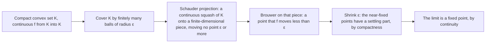
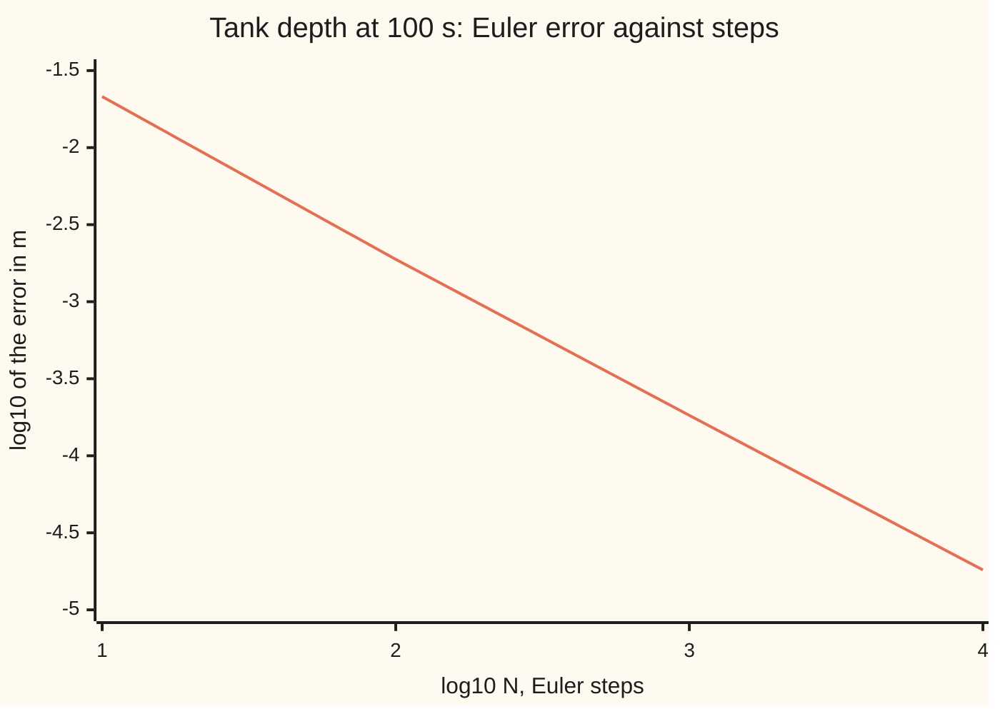

# Schauder: a continuous map of a compact convex set must leave a point unmoved

[Syllabus](../../../SYLLABUS.md) → [Functional analysis](../README.md) → [Banach Algebras and Fixed Points](../README.md#s06) → Schauder

---

## General Overview

Two traders, Ann and Ben, meet at a village market with three goods: sacks of grain, bolts of cloth and barrels of fuel (illustrative numbers). Ann owns 8 grain, 1 cloth and 2 fuel. Ben owns 2 grain, 9 cloth and 4 fuel. A price list gives one price per good, in pounds, scaled so that one unit of each good costs £100 in total. All such lists form a closed triangle, the **price triangle**. (Economists keep the name budget set for something else: the bundles of goods one trader can afford at given prices.)

At a given price list each trader sells what they own and spends the money in fixed shares. A good is **short** when the traders want more of it than they own between them. The **market clears** when no good is short or left over. The clearing prices here are grain £34.635417, cloth £23.697917 and fuel £41.666667.

An auctioneer can search for them with a **price map**: raise each short good's price by $`s`$ pounds per unit short, then rescale so the basket again costs £100. A price list the map leaves where it was is a list where nothing is short. So clearing prices are exactly the **fixed points** of the price map: the points it leaves unmoved.

The map is not a shrinking map. With $`s`$ = 20 it pushes one list near the clearing prices 6.329874 times farther away, so Banach's shrinking-map theorem cannot help. Repeated from equal prices, it also never settles: in rounds 1001 to 2000 every move is at least £114.576569.

A fixed point exists anyway. The price triangle is compact: every endless list of points in it has a part that settles. It is also convex: it holds the straight segment between any two of its points. Brouwer's theorem then gives a fixed point.

Schauder's theorem carries this to infinite dimensions, where the unknown is a whole curve, such as the water depth in a filling tank over 100 seconds. There compactness is no longer free, and a family of curves gets it from a shared speed limit.

**A continuous map that sends a compact convex set of a complete normed space into itself leaves some point unmoved: cut the set down to a finite-dimensional piece within any small distance, let Brouwer find a fixed point there, and let compactness collect those near-fixed points into a true one.**

**What kind of fact this is:** a theorem, proved on this card in Why it works from Brouwer's theorem in n dimensions, which is taken as given ([Brouwer and Borsuk-Ulam](../../17-Topology/04-Homotopy/08-brouwer-and-borsuk-ulam.md) proves it in the plane and states it for the disc in n dimensions; Step 1 carries it to any compact convex set). The code checks instances and truncations; only the proof covers the infinite case.

### The picture: the proof as a chain



The fourth box is where finite dimensions do the work. The fifth box is the one that fails without compactness.

---

## The formula

Notation first, in words.

- A **Banach space** $`X`$ is a vector space with a size $`\|x\|`$ for each member, complete in that size: every list whose terms bunch up has a limit in $`X`$ ([Banach's fixed point theorem](../../17-Topology/01-Metric%20Spaces/08-banach-fixed-point-in-metric-spaces.md) uses the same idea of complete).
- A set $`K`$ is **convex** when it contains the segment $`(1-t)x + ty`$, for $`0 \le t \le 1`$, between any two of its points $`x`$ and $`y`$.
- A set is **compact** when every endless list in it has a sublist converging, in the norm, to a point of the set ([Compactness three ways](../../17-Topology/01-Metric%20Spaces/06-compactness-in-metric-spaces.md)).
- A map $`f`$ is **continuous** when nearby inputs give nearby outputs, in the norm.

Schauder's theorem:

```math
K \subset X \ \text{nonempty, compact, convex}, \quad f : K \to K \ \text{continuous} \quad \Longrightarrow \quad f(x^*) = x^* \ \text{for some } x^* \in K
```

**Read it aloud:** a continuous map of a nonempty compact convex set into itself has a fixed point. For the market, $`K`$ is the price triangle and $`x^*`$ is the clearing price list.

In function spaces the set itself is rarely compact, so the working form moves compactness onto the map's image. A set has **compact closure** when every endless list in it has a sublist converging in $`X`$, the limit allowed outside the set.

```math
C \subset X \ \text{nonempty, closed, convex}, \quad f : C \to C \ \text{continuous}, \quad f(C) \ \text{has compact closure} \quad \Longrightarrow \quad f(x^*) = x^* \ \text{for some } x^* \in C
```

**Read it aloud:** if a continuous map of a closed convex set into itself crowds its outputs into a compact region, it still has a fixed point.

The tool that cuts to finite dimensions is the **Schauder projection**. Pick points $`y_1, \ldots, y_n`$ of $`K`$ so that every point of $`K`$ lies within $`\varepsilon`$ of one of them: an $`\varepsilon`$-net, which exists because $`K`$ is compact. Then

```math
P_\varepsilon(x) = \frac{\sum_{i=1}^{n} \mu_i(x)\, y_i}{\sum_{i=1}^{n} \mu_i(x)}, \qquad \mu_i(x) = \max\big(0,\ \varepsilon - \|x - y_i\|\big)
```

**Read it aloud:** average the net points, giving each one a weight that is positive only when it lies within epsilon of $`x`$ and grows the closer it is.

The market's price map, with $`z_i(p)`$ the units of good $`i`$ wanted minus the units owned, and $`z_i^+ = \max(0, z_i)`$ the shortage:

```math
f(p)_i = 100 \cdot \frac{p_i + s\, z_i^+(p)}{100 + s \sum_j z_j^+(p)}
```

**Read it aloud:** add $`s`$ pounds per unit short to each price, then scale the list so the basket costs £100 again.

| Symbol | Plain meaning | In our example | Push it up and the answer… |
| --- | --- | --- | --- |
| $`X`$, $`\Vert x\Vert`$, $`\ell^2`$, $`C[0,\tau]`$ | a Banach space and the size of a member; endless lists with a finite sum of squares; continuous curves on the window from 0 to $`\tau`$ | price lists; depth curves, sized by the largest value $`\Vert h\Vert_\infty`$ | — |
| $`K`$, $`C`$ | a compact convex set; a closed convex set | the price triangle; the box of depth curves from 0 to 1 m | — |
| $`f`$, $`x^*`$ | a continuous map of the set into itself; its fixed point | the price map; the clearing prices | — |
| $`p`$, $`p_i`$ | a price list and its price for good $`i`$, in £ | clearing at (34.635417, 23.697917, 41.666667) | — |
| $`z_i(p)`$, $`z_i^+`$, $`S`$ | units of good $`i`$ wanted minus owned; the shortage part; the sum of shortages | 0 for every good at the clearing prices | — |
| $`s`$ | the price response, £ per unit short | 1 settles; 20 wanders | iteration stops settling; the fixed point stays put |
| $`\varepsilon`$, $`y_i`$, $`n`$, $`m`$ | net radius; net points within $`\varepsilon`$ of every point; how many net points; the step count in $`\varepsilon = 1/m`$ | — | smaller $`\varepsilon`$, more net points |
| $`P_\varepsilon`$, $`\mu_i`$, $`g_\varepsilon`$, $`x_\varepsilon`$ | Schauder projection; its weights; $`f`$ then the squash; Brouwer's fixed point of $`g_\varepsilon`$, moved less than $`\varepsilon`$ by $`f`$ | — | — |
| $`h(t)`$, $`t`$, $`r`$, $`u`$, $`T`$ | water depth at time $`t`$, in m; time, in s; an earlier time inside the integral; $`\sqrt{h}`$; the integral map | depth 0.487610 m at 100 s | — |
| $`q`$, $`k`$, $`\tau`$, $`\delta`$ | inflow, in m/s; outflow constant, in m^0.5/s; time window, in s; a start gap between two curves, in m | 0.01, 0.01, 100 | larger $`\tau`$: the box is no longer mapped into itself |
| $`g`$, $`c`$ | Kakutani's map of the $`\ell^2`$ ball; the entry of its cut fixed point | $`c = 1/\sqrt{N+1}`$ | — |
| $`N`$ | numbers kept in a truncation: steps or entries | 10 to 10000 | smaller errors, never a full answer |

### When it holds

- **Compact.** In the closed unit ball of $`\ell^2`$, which is closed, bounded and convex but not compact, Kakutani's map moves every point. Its truncations have fixed points that the full map moves by only 0.031607 at N = 1000, yet those points never settle.
- **Continuous.** Take one buyer who wants 10 barrels of fuel below £50 and none at £50 or above, with 5 for sale. Let the rule move the fuel price, anywhere from £0 to £100, by £2 for each barrel short or left over; the new price stays in that range. Demand jumps at £50, so the map jumps there. Every fuel price then moves by at least £10.000000, and no price clears.
- **Convex.** On a ring-shaped set, a quarter turn about the centre is continuous and moves every point. The hole is what breaks it.
- **Into itself.** The tank's integral map sends the box of depths from 0 to 1 m into itself only while $`q\tau`$ = 1.000000 m stays within 1 m. A longer window lets curves leave the box, and the proof has nothing to stand on.
- **Existence, not uniqueness.** Shut the inflow, and the tank drains by $`h' = -k\sqrt{h}`$. Run time backwards from the moment it is empty: $`h' = k\sqrt{h}`$, $`h(0) = 0`$. Both $`h = 0`$ and $`h = (kt/2)^2`$ solve this, 0.250000 m apart at 100 s. Schauder promises one fixed point and says nothing about how many.

---

## Why it works

### Step 0: the idea

Brouwer already gives fixed points in finitely many dimensions. A compact set is nearly finite-dimensional: for any small $`\varepsilon`$, finitely many points come within $`\varepsilon`$ of all of it. So squash the set onto a finite-dimensional piece, find a fixed point there, and accept an error below $`\varepsilon`$. Then let $`\varepsilon`$ shrink. Compactness makes the near-fixed points settle, and continuity makes the limit exact.

### Step 1: the finite rehearsal, Brouwer on the market

Brouwer's theorem, from [Brouwer and Borsuk-Ulam](../../17-Topology/04-Homotopy/08-brouwer-and-borsuk-ulam.md), is taken as given for the closed disc in $`n`$ dimensions. It carries over to any compact convex set $`K`$ in $`n`$-dimensional space. Put $`K`$ inside a large ball, a stretched copy of the disc, and send each point of the ball to its nearest point of $`K`$; because $`K`$ is closed and convex, that point is unique and moves continuously. Applying $`f`$ after this squash maps the ball into $`K`$, which lies inside the ball, so Brouwer gives a fixed point. That point lies in $`K`$, where the squash leaves it alone, so $`f`$ fixes it. The price triangle is a closed triangle in the plane of lists summing to 100, so the price map has a fixed point.

That fixed point clears the market. The reason is **Walras' law**: each trader spends exactly the value of what they own, so the value of all shortages equals the value of all surpluses, $`\sum_i p_i z_i(p) = 0`$. At a fixed point every price is proportional to its own shortage, and Walras' law then forces every shortage to be zero.

<details>
<summary>Detailed proof: a fixed point of the price map clears the market</summary>

Write $`S = \sum_j z_j^+`$. At a fixed point, $`p_i (100 + sS) = 100 p_i + 100 s z_i^+`$, so

$`\displaystyle p_i S = 100\, z_i^+ \quad \text{for every good } i.`$

Multiply by $`z_i`$ and add over the goods. Since $`z_i z_i^+ = (z_i^+)^2`$,

$`\displaystyle S \sum_i p_i z_i = 100 \sum_i (z_i^+)^2.`$

Demand is capped at 100 units, so that it stays finite when a price is 0. Capped spending is never more than wealth, so $`\sum_i p_i z_i \le 0`$. The left side is then at most 0 and the right side at least 0, so both are 0: no good is short. A good priced at £0 would hit the cap, 100 units, far above the 10, 10 and 6 units owned, and be short; so every price is positive and no cap binds. Walras' law then holds exactly. With every $`z_i \le 0`$, every $`p_i > 0`$ and $`\sum_i p_i z_i = 0`$, every $`z_i`$ is 0.

</details>

Brouwer gives no route to the point. With $`s`$ = 20, the map stretches one small nudge away from the clearing prices by 6.329874, so it is no contraction. A stretched nudge alone does not rule out converging, since a map can stretch one direction and pull in along another. Repeating the map settles the question: from equal prices, after 2000 rounds it is still 40.442115 from clearing. A search of the price triangle on a £0.25 grid finds the least-moved point at (34.75, 23.75, 41.50), within one grid step of the clearing prices.

### Step 2: the Schauder projection squashes a compact set onto a finite piece

Let $`K`$ be compact and convex in a Banach space $`X`$. Fix $`\varepsilon > 0`$ and an $`\varepsilon`$-net $`y_1, \ldots, y_n`$ in $`K`$. The Schauder projection $`P_\varepsilon`$ has three properties.

1. **It is continuous.** Each weight $`\mu_i`$ is continuous, and their sum is positive everywhere on $`K`$ because some $`y_i`$ lies within $`\varepsilon`$ of each point.
2. **It lands in $`K_\varepsilon`$**, the set of averages of $`y_1, \ldots, y_n`$ with weights that are at least 0 and add to 1, called their convex hull. Convexity puts $`K_\varepsilon`$ inside $`K`$. And $`K_\varepsilon`$ sits in the span of $`n`$ vectors, a space of at most $`n`$ dimensions.
3. **It moves no point by $`\varepsilon`$ or more.** $`P_\varepsilon(x) - x`$ is an average of the vectors $`y_i - x`$ over the $`y_i`$ with positive weight, and each of those has size below $`\varepsilon`$.

### Step 3: Brouwer gives near-fixed points

Set $`g_\varepsilon = P_\varepsilon \circ f`$: first apply $`f`$, then squash. It is continuous and sends $`K_\varepsilon`$ into $`K_\varepsilon`$. $`K_\varepsilon`$ is compact and convex in finitely many dimensions, so Brouwer gives a point $`x_\varepsilon`$ with $`g_\varepsilon(x_\varepsilon) = x_\varepsilon`$. By property 3,

```math
\|f(x_\varepsilon) - x_\varepsilon\| = \|f(x_\varepsilon) - P_\varepsilon(f(x_\varepsilon))\| < \varepsilon
```

**Read it aloud:** the point Brouwer finds is moved by $`f`$ less than epsilon.

### Step 4: compactness turns near-fixed points into a fixed point

Take $`\varepsilon = 1, 1/2, 1/3, \ldots`$. The near-fixed points $`x_1, x_2, \ldots`$ lie in the compact set $`K`$, so some sublist converges to a point $`x^*`$ of $`K`$. Along it, $`f(x_m)`$ converges to $`f(x^*)`$ by continuity, and $`f(x_m)`$ stays within $`1/m`$ of $`x_m`$. So $`f(x^*) = x^*`$.

This is the step that fails without compactness. Kakutani's map on the closed unit ball of $`\ell^2`$, the endless lists $`x = (x_1, x_2, \ldots)`$ with a finite sum of squares, is

```math
g(x) = \big(\sqrt{1 - \|x\|^2},\ x_1,\ x_2,\ \ldots\big)
```

It is continuous and lands on the unit sphere: its size squared is $`1 - \|x\|^2 + \|x\|^2 = 1`$. A fixed point would have size 1, so first entry 0. Each entry would equal the one before it, so every entry would be 0, which contradicts size 1. No fixed point exists.

Cut to $`N`$ entries, the map is a continuous map of an $`N`$-dimensional ball, and Brouwer applies. Its fixed point has every entry equal to $`c = 1/\sqrt{N+1}`$. The full map moves that point by exactly $`c`$, since the shift pushes one more $`c`$ into entry $`N+1`$:

| N, entries kept | c, the full map's move | size of the point | gap to the point for 10N |
| ---: | ---: | ---: | ---: |
| 10 | 0.301511 | 0.953463 | 1.139807 |
| 100 | 0.099504 | 0.995037 | 1.166232 |
| 1000 | 0.031607 | 0.999500 | 1.169099 |

The moves fall toward 0, as in Step 3. The points do not settle: each stays more than 1 from the next. That is the closed unit ball of $`\ell^2`$ failing to be compact.

### Step 5: compact closure is enough, and Arzela-Ascoli supplies it

For the working form, let $`C`$ be closed and convex and let $`f(C)`$ have compact closure. Take the $`\varepsilon`$-net from $`f(C)`$, which lies in $`C`$. Its convex hull lies in $`C`$ by convexity, and Steps 2 and 3 run unchanged. In Step 4, the values $`f(x_m)`$ lie in the compact closure, so a sublist converges to some $`x^*`$; the $`x_m`$ follow, within $`1/m`$. $`C`$ is closed, so $`x^*`$ is in $`C`$, and continuity gives $`f(x^*) = x^*`$.

Now the infinite-dimensional example. A tank 1 m deep fills from empty at $`q`$ = 0.01 m/s and drains through a hole in its floor. Torricelli's law makes the outflow proportional to the square root of the depth, so

```math
h'(t) = q - k\sqrt{h(t)}, \quad h(0) = 0, \qquad (Th)(t) = \int_0^t \big(q - k\sqrt{h(r)}\big)\, dr
```

**Read it aloud:** the depth rises at the inflow rate minus a drain that grows like the square root of the depth; a solution is a depth curve that the integral map $`T`$ returns unchanged.

Here $`k`$ = 0.01 m^0.5/s, so the depth tends to $`(q/k)^2`$ = 1.000000 m (illustrative numbers). The space is $`C[0, \tau]`$, the continuous curves on the window from 0 to $`\tau`$ = 100 s, sized by the largest absolute value, $`\|h\|_\infty`$.

1. **A closed convex box.** $`C`$ is every curve with $`0 \le h(t) \le 1`$ m. An average of two such curves is another.
2. **Into itself.** For $`h`$ in the box, the integrand lies between $`q - k \cdot 1 = 0`$ and $`q`$. So $`Th`$ starts at 0, never falls and rises at most $`q\tau`$ = 1.000000 m.
3. **Continuous.** Square roots satisfy $`|\sqrt{a} - \sqrt{b}| \le \sqrt{|a - b|}`$, so for two curves $`h_1`$ and $`h_2`$ in the box, $`\|Th_1 - Th_2\|_\infty \le k\tau\sqrt{\|h_1 - h_2\|_\infty}`$.
4. **Compact closure.** Every curve $`Th`$ lies between 0 and 1 m and rises no faster than 0.01 m/s. A bounded family with one shared speed limit has compact closure in $`C[0,\tau]`$, by [Arzela-Ascoli](../../17-Topology/01-Metric%20Spaces/09-arzela-ascoli.md).

The box itself is not compact: it holds curves that wiggle as fast as they like. The map's outputs are, because of the speed limit. Schauder then gives a depth curve $`h = Th`$.

No contraction is available. A start gap of $`\delta`$ metres between the curves $`h = \delta`$ and $`h = 0`$ becomes $`k\tau\sqrt{\delta}`$ after the map: a ratio of 10.0, 100.0 and 1000.0 for $`\delta`$ = 0.01, 0.0001 and 0.000001 m. No window $`\tau`$ fixes that, since the ratio $`k\tau/\sqrt{\delta}`$ grows without bound as $`\delta`$ shrinks. So [Picard iteration](../../08-Differential%20equations%20and%20dynamics/02-Existence%2C%20Uniqueness%20and%20Sensitivity/01-picard-iteration.md)'s convergence proof does not apply, and Schauder replaces it.

### Step 6: the depth curve, computed two ways

Writing $`u = \sqrt{h}`$ separates the equation. The time to reach depth $`u^2`$ is

```math
t(u) = \frac{2}{k}\Big(-u - \frac{q}{k}\ln\big(1 - \tfrac{k u}{q}\big)\Big)
```

**Read it aloud:** the time to reach a given depth is a closed formula in its square root, which halving inverts.

Inverting it gives depths 0.176716 m at 25 s, 0.303841 m at 50 s and 0.487610 m at 100 s. Euler polygons, the straight-line steps behind Peano's existence proof, close in on the 100 s value as the step count $`N`$ grows:

| N, steps | depth at 100 s (m) | error (m) | log10 N | log10 error |
| ---: | ---: | ---: | ---: | ---: |
| 10 | 0.509030 | 0.021421 | 1 | −1.669 |
| 100 | 0.489493 | 0.001884 | 2 | −2.725 |
| 1000 | 0.487792 | 0.000183 | 3 | −3.738 |
| 10000 | 0.487628 | 0.000018 | 4 | −4.741 |



The line is the Euler error at N = 10, 100, 1000 and 10000. Each tenfold rise in N cuts it about tenfold. What the truncation hides: a polygon of N steps is a list of N numbers, and only the compactness argument shows the polygons have a limit that solves the equation.

---

## Worked numbers, by hand

The market, from the traders' shares. Ann spends 20% on grain, 50% on cloth and 30% on fuel; Ben spends 60%, 10% and 30%. Between them they own 10 grain, 10 cloth and 6 fuel.

| Step | Arithmetic | Value |
| --- | --- | --- |
| fuel clears | 6 p3 = 0.3 × (10 p1 + 10 p2 + 6 p3), with p1 + p2 = 100 − p3: 7.2 p3 = 300 | p3 = 41.666667 |
| cloth clears | 10 p2 = 0.5 × Ann's wealth + 0.1 × Ben's: 8.6 p2 = 4.2 p1 + 1.4 p3 | — |
| substitute p1 = 100 − p2 − p3 | 12.8 p2 = 4.2 × 58.333333 + 1.4 × 41.666667 = 303.333333 | p2 = 23.697917 |
| grain, from the £100 basket | 100 − 23.697917 − 41.666667 | p1 = 34.635417 |
| Ann's wealth | 8 × 34.635417 + 23.697917 + 2 × 41.666667 | 384.114583 |
| Ben's wealth | 2 × 34.635417 + 9 × 23.697917 + 4 × 41.666667 | 449.218750 |
| grain wanted | (0.2 × 384.114583 + 0.6 × 449.218750) / 34.635417 | 10, all that is owned |
| price map at these prices | no shortage, so nothing is added | moves them 0.000000 |
| **clearing prices** | grain, cloth, fuel | **£34.635417, £23.697917, £41.666667** |

The grain line is the check: the traders want exactly the 10 sacks they own, so the price list is the fixed point Brouwer promised.

### What breaks if you drop a piece

| Mistake | Comes out at | What went wrong |
| --- | --- | --- |
| Drop compactness: Kakutani's map on the $`\ell^2`$ ball | truncated fixed points moved 0.301511, 0.099504, 0.031607 by the full map, yet more than 1 apart | the near-fixed points of Step 3 exist but never settle, so Step 4 fails |
| Drop continuity: fuel demand jumps at £50 | every fuel price moves at least £10.000000 | the map jumps over the clearing price |
| Expect Banach's shrinking: price response $`s`$ = 20 | a nudge is stretched 6.329874; after 2000 rounds still 40.442115 from clearing | the map stretches some nudges near its fixed point, and repeating it never settles; Schauder never needed shrinking |
| Expect one answer: the tank run backwards from empty, $`h' = k\sqrt{h}`$ | $`h = 0`$ and $`h = (kt/2)^2`$ both solve, 0.250000 m apart at 100 s | Schauder gives existence only; an empty tank does not say when it emptied |

The code prints all four.

---

## Code, from first principles, and it actually runs

The code holds the finite rehearsal and truncations only. It takes two independent roads to each answer:

- clearing prices from the hand algebra, against a search of the price triangle on a £0.25 grid for the least-moved point;
- the tank's depth from the closed formula inverted by halving, against Euler polygons at N = 10 to 10000;
- Kakutani's cut fixed points by halving on $`c = \sqrt{1 - Nc^2}`$, against the closed form $`1/\sqrt{N+1}`$, with the full map applied to measure its move;
- the backwards tank's second solution, checked by applying the integral map with the trapezoid rule.

What the truncation hides: every cut map lives in finitely many dimensions, where Brouwer always gives a fixed point. Failure in infinite dimensions shows only as a trend in N that never closes.

### Python

```python
# Schauder -- the check behind the card.  Standard library only.
# Part 1 is the finite rehearsal: a three-good market, where Brouwer applies.
# Parts 2-4 cut infinite-dimensional maps to N numbers, at several N.  Floats
# are added in explicit loops, so Python and Rust add in the same order.
import math

ALPHA = ((0.2, 0.5, 0.3), (0.6, 0.1, 0.3))  # spending shares: Ann, Ben
OWN = ((8.0, 1.0, 2.0), (2.0, 9.0, 4.0))    # units owned: grain, cloth, fuel
CAP = 100.0                                 # demand cap, so z stays finite at p_i = 0

def excess(p):                              # z_i(p): units wanted minus units owned
    z = [0.0, 0.0, 0.0]
    for a, w in zip(ALPHA, OWN):
        wealth = p[0] * w[0] + p[1] * w[1] + p[2] * w[2]
        for i in range(3):
            z[i] += min(a[i] * wealth / p[i], CAP) if p[i] > 0 else CAP
            z[i] -= w[i]
    return z

def price_map(p, s):                        # raise short goods by s per unit, rescale to 100
    up = [max(0.0, zi) for zi in excess(p)]
    total = 100.0 + s * (up[0] + up[1] + up[2])
    return [100.0 * (p[i] + s * up[i]) / total for i in range(3)]

def dist(u, v):                             # l2 distance, squares added left to right
    t = 0.0
    for a, b in zip(u, v):
        t += (a - b) * (a - b)
    return math.sqrt(t)

# 1a. Road one: clearing prices by hand.  Fuel: 7.2 p3 = 300.
#     Cloth: 8.6 p2 = 4.2 p1 + 1.4 p3 with p1 = 100 - p2 - p3.
p3 = 300 / 7.2
p2 = (4.2 * (100 - p3) + 1.4 * p3) / 12.8
star = [100 - p2 - p3, p2, p3]
z = excess(star)
print(f"clearing prices (GBP): grain {star[0]:.6f}, cloth {star[1]:.6f}, fuel {star[2]:.6f}")
print(f"wealth there: Ann {star[0] * 8 + star[1] + star[2] * 2:.6f}, Ben {star[0] * 2 + star[1] * 9 + star[2] * 4:.6f}; "
      f"largest excess demand {max(abs(zi) for zi in z):.6f}")
assert max(abs(zi) for zi in z) < 1e-9
for s in (1.0, 20.0):
    move = dist(price_map(star, s), star)
    print(f"s = {s:4.1f}: the price map moves the clearing prices by {move:.6f}")
    assert move < 1e-9

# 1b. Road two: search the price triangle on a 0.25 GBP grid for the point the map moves least.
best, where = 1e9, None
for a in range(401):
    for b in range(401 - a):
        p = [a * 0.25, b * 0.25, 100.0 - a * 0.25 - b * 0.25]
        d = dist(price_map(p, 20.0), p)
        if d < best:
            best, where = d, p
print(f"grid search, s = 20: least move {best:.6f} at ({where[0]:.2f}, {where[1]:.2f}, {where[2]:.2f})")
assert dist(where, star) < 0.25

# 1c. Repeating the map: settles at s = 1, never settles at s = 20.
for s in (1.0, 20.0):
    p, smallest = [100 / 3, 100 / 3, 100 / 3], 1e9
    for n in range(1, 2001):
        new = price_map(p, s)
        if n > 1000:
            smallest = min(smallest, dist(new, p))
        p = new
    print(f"s = {s:4.1f}: after 2000 rounds, distance to clearing {dist(p, star):.6f}; "
          f"smallest move in rounds 1001-2000 {smallest:.6f}")
assert smallest > 1.0
for d in (0.1, 0.01):
    nudged = [star[0] + d, star[1] - d, star[2]]
    ratio = dist(price_map(nudged, 20.0), star) / dist(nudged, star)
    print(f"s = 20, nudge {d:.2f}: the map stretches the gap to the fixed point by {ratio:.6f}")
    assert ratio > 1.0

# 1d. A buyer who wants 10 units of fuel below 50 GBP and none at or above it; 5 for sale.
moves = [2 * ((10 if k * 0.01 < 50 else 0) - 5) for k in range(10001)]  # fuel prices 0 to 100 GBP
print(f"jumping demand, fuel prices 0-100 GBP moved by 2 GBP per unit short: least move {min(map(abs, moves)):.6f} GBP")
assert min(map(abs, moves)) == 2 * min(10 - 5, 5 - 0) and all(0 <= k * 0.01 + m <= 100 for k, m in enumerate(moves))

# 2. The tank: h' = q - k sqrt(h), h(0) = 0.  q = 0.01 m/s, k = 0.01 m^0.5/s, window 100 s.
Q, K, TAU = 0.01, 0.01, 100.0

def time_to(u):                             # closed form: seconds to reach depth u^2
    return (2 / K) * (-u - (Q / K) * math.log(1 - K * u / Q))

def depth(t):                               # road one: invert the closed form by halving
    lo, hi = 0.0, Q / K
    for _ in range(100):
        mid = (lo + hi) / 2
        lo, hi = (mid, hi) if time_to(mid) < t else (lo, mid)
    return lo * lo

print(f"tank closed form: depth at 25 s {depth(25):.6f} m, 50 s {depth(50):.6f} m, "
      f"100 s {depth(100):.6f} m; level it tends to {(Q / K) * (Q / K):.6f} m")
print(f"self-map test: inflow alone over the window, q * tau = {Q * TAU:.6f} m, cap 1 m")
for d in (1e-2, 1e-4, 1e-6):                # T(d) - T(0) = -k sqrt(d) t, largest at t = tau
    print(f"start gap {d:.6f} m: gap after the integral map {K * math.sqrt(d) * TAU:.6f} m, "
          f"ratio {K * math.sqrt(d) * TAU / d:.1f}")
errs = []
for n in (10, 100, 1000, 10000):           # road two: Euler polygons, the Peano construction
    h, dt = 0.0, TAU / n
    for _ in range(n):
        h += dt * (Q - K * math.sqrt(h))
    errs.append(abs(h - depth(TAU)))
    print(f"N = {n:5d} steps: depth at 100 s {h:.6f} m, error {errs[-1]:.6f} m, "
          f"log10 N {math.log10(n):.0f}, log10 error {math.log10(errs[-1]):.3f}")
assert errs[-1] < 1e-4 and 8 < errs[0] / errs[1] < 12 and 8 < errs[2] / errs[3] < 12

# 3. The tank run backwards from empty: y' = k sqrt(y), y(0) = 0.  Two fixed points.
n, ds = 10000, TAU / 10000
y = [(K * i * ds / 2) * (K * i * ds / 2) for i in range(n + 1)]
acc, worst = 0.0, 0.0                       # apply the integral map by the trapezoid rule
for i in range(n):
    acc += ds * K * (math.sqrt(y[i]) + math.sqrt(y[i + 1])) / 2
    worst = max(worst, abs(acc - y[i + 1]))
print(f"backwards tank: h = 0 and h = (k t / 2)^2 both solve; trapezoid residual {worst:.6f} m; "
      f"gap at 100 s {y[n]:.6f} m")
assert worst < 1e-9 and abs(y[n] - 0.25) < 1e-12

# 4. Kakutani's map on the l2 ball, cut to N entries: (sqrt(1 - |x|^2), x_1, ..., x_{N-1}).
def kak(x):
    r = dist(x, [0.0] * len(x))
    return [math.sqrt(max(0.0, 1 - r * r))] + x[:-1]

for n in (10, 100, 1000):
    lo, hi = 0.0, 1.0                       # road one: halve on c = sqrt(1 - N c^2)
    for _ in range(100):
        mid = (lo + hi) / 2
        lo, hi = (mid, hi) if mid < math.sqrt(max(0.0, 1 - n * mid * mid)) else (lo, mid)
    x = [lo] * n
    res = dist(kak(x), x)                   # the cut map leaves x in place
    true_move = dist(kak(x + [0.0]), x + [0.0])  # the next entry: the full map moves it
    far = 1 / math.sqrt(10 * n + 1)         # fixed point of the 10N cut, road two: closed form
    gap = math.sqrt(n * (lo - far) * (lo - far) + 9 * n * far * far)
    print(f"N = {n:4d}: c = {lo:.6f} (1/sqrt(N+1) = {1 / math.sqrt(n + 1):.6f}), size "
          f"{math.sqrt(n) * lo:.6f}, residual {res:.6f}, full map moves it {true_move:.6f}, "
          f"gap to the N = {10 * n} point {gap:.6f}")
    assert abs(lo - 1 / math.sqrt(n + 1)) < 1e-12 and res < 1e-9 and gap > 1.0
    assert abs(true_move - 1 / math.sqrt(n + 1)) < 1e-12
print("ALL CHECKS PASS")
```

**Ran 2026-11-15 on macOS, Python 3.14.10, standard library only. All checks passed. Output, pasted from the run:**

```
clearing prices (GBP): grain 34.635417, cloth 23.697917, fuel 41.666667
wealth there: Ann 384.114583, Ben 449.218750; largest excess demand 0.000000
s =  1.0: the price map moves the clearing prices by 0.000000
s = 20.0: the price map moves the clearing prices by 0.000000
grid search, s = 20: least move 0.414385 at (34.75, 23.75, 41.50)
s =  1.0: after 2000 rounds, distance to clearing 0.000000; smallest move in rounds 1001-2000 0.000000
s = 20.0: after 2000 rounds, distance to clearing 40.442115; smallest move in rounds 1001-2000 114.576569
s = 20, nudge 0.10: the map stretches the gap to the fixed point by 6.295592
s = 20, nudge 0.01: the map stretches the gap to the fixed point by 6.329874
jumping demand, fuel prices 0-100 GBP moved by 2 GBP per unit short: least move 10.000000 GBP
tank closed form: depth at 25 s 0.176716 m, 50 s 0.303841 m, 100 s 0.487610 m; level it tends to 1.000000 m
self-map test: inflow alone over the window, q * tau = 1.000000 m, cap 1 m
start gap 0.010000 m: gap after the integral map 0.100000 m, ratio 10.0
start gap 0.000100 m: gap after the integral map 0.010000 m, ratio 100.0
start gap 0.000001 m: gap after the integral map 0.001000 m, ratio 1000.0
N =    10 steps: depth at 100 s 0.509030 m, error 0.021421 m, log10 N 1, log10 error -1.669
N =   100 steps: depth at 100 s 0.489493 m, error 0.001884 m, log10 N 2, log10 error -2.725
N =  1000 steps: depth at 100 s 0.487792 m, error 0.000183 m, log10 N 3, log10 error -3.738
N = 10000 steps: depth at 100 s 0.487628 m, error 0.000018 m, log10 N 4, log10 error -4.741
backwards tank: h = 0 and h = (k t / 2)^2 both solve; trapezoid residual 0.000000 m; gap at 100 s 0.250000 m
N =   10: c = 0.301511 (1/sqrt(N+1) = 0.301511), size 0.953463, residual 0.000000, full map moves it 0.301511, gap to the N = 100 point 1.139807
N =  100: c = 0.099504 (1/sqrt(N+1) = 0.099504), size 0.995037, residual 0.000000, full map moves it 0.099504, gap to the N = 1000 point 1.166232
N = 1000: c = 0.031607 (1/sqrt(N+1) = 0.031607), size 0.999500, residual 0.000000, full map moves it 0.031607, gap to the N = 10000 point 1.169099
ALL CHECKS PASS
```

### Rust

Same numbers, same labels, built with `rustc --edition 2021 -O`.

```rust
// Schauder -- the same check as the Python, in Rust.  No crates.
// Part 1 is the finite rehearsal: a three-good market, where Brouwer applies.
// Parts 2-4 cut infinite-dimensional maps to N numbers, at several N.  Floats
// are added in explicit loops, so Python and Rust add in the same order.

const ALPHA: [[f64; 3]; 2] = [[0.2, 0.5, 0.3], [0.6, 0.1, 0.3]]; // spending shares: Ann, Ben
const OWN: [[f64; 3]; 2] = [[8.0, 1.0, 2.0], [2.0, 9.0, 4.0]];   // units owned: grain, cloth, fuel
const CAP: f64 = 100.0;                     // demand cap, so z stays finite at p_i = 0
const Q: f64 = 0.01;
const K: f64 = 0.01;
const TAU: f64 = 100.0;

fn excess(p: &[f64]) -> [f64; 3] {          // z_i(p): units wanted minus units owned
    let mut z = [0.0; 3];
    for (a, w) in ALPHA.iter().zip(OWN.iter()) {
        let wealth = p[0] * w[0] + p[1] * w[1] + p[2] * w[2];
        for i in 0..3 {
            z[i] += if p[i] > 0.0 { (a[i] * wealth / p[i]).min(CAP) } else { CAP };
            z[i] -= w[i];
        }
    }
    z
}

fn price_map(p: &[f64], s: f64) -> Vec<f64> { // raise short goods by s per unit, rescale to 100
    let up: Vec<f64> = excess(p).iter().map(|&zi| zi.max(0.0)).collect();
    let total = 100.0 + s * (up[0] + up[1] + up[2]);
    (0..3).map(|i| 100.0 * (p[i] + s * up[i]) / total).collect()
}

fn dist(u: &[f64], v: &[f64]) -> f64 {      // l2 distance, squares added left to right
    let mut t = 0.0;
    for (a, b) in u.iter().zip(v.iter()) { t += (a - b) * (a - b); }
    t.sqrt()
}

fn time_to(u: f64) -> f64 {                 // closed form: seconds to reach depth u^2
    (2.0 / K) * (-u - (Q / K) * (1.0 - K * u / Q).ln())
}

fn depth(t: f64) -> f64 {                   // road one: invert the closed form by halving
    let (mut lo, mut hi) = (0.0, Q / K);
    for _ in 0..100 {
        let mid = (lo + hi) / 2.0;
        if time_to(mid) < t { lo = mid } else { hi = mid }
    }
    lo * lo
}

fn kak(x: &[f64]) -> Vec<f64> {             // Kakutani's map cut to len(x) entries
    let r = dist(x, &vec![0.0; x.len()]);
    let mut out = vec![(1.0 - r * r).max(0.0).sqrt()];
    out.extend_from_slice(&x[..x.len() - 1]);
    out
}

fn main() {
    // 1a. Road one: clearing prices by hand.  Fuel: 7.2 p3 = 300.
    //     Cloth: 8.6 p2 = 4.2 p1 + 1.4 p3 with p1 = 100 - p2 - p3.
    let p3 = 300.0 / 7.2;
    let p2 = (4.2 * (100.0 - p3) + 1.4 * p3) / 12.8;
    let star = [100.0 - p2 - p3, p2, p3];
    let zmax = excess(&star).iter().fold(0.0_f64, |m, zi| m.max(zi.abs()));
    println!("clearing prices (GBP): grain {:.6}, cloth {:.6}, fuel {:.6}", star[0], star[1], star[2]);
    println!("wealth there: Ann {:.6}, Ben {:.6}; largest excess demand {:.6}",
             star[0] * 8.0 + star[1] + star[2] * 2.0, star[0] * 2.0 + star[1] * 9.0 + star[2] * 4.0, zmax);
    assert!(zmax < 1e-9);
    for s in [1.0, 20.0] {
        let mv = dist(&price_map(&star, s), &star);
        println!("s = {:4.1}: the price map moves the clearing prices by {:.6}", s, mv);
        assert!(mv < 1e-9);
    }

    // 1b. Road two: search the price triangle on a 0.25 GBP grid for the point the map moves least.
    let (mut best, mut at) = (1e9, vec![0.0; 3]);
    for a in 0..401 {
        for b in 0..(401 - a) {
            let p = vec![a as f64 * 0.25, b as f64 * 0.25, 100.0 - a as f64 * 0.25 - b as f64 * 0.25];
            let d = dist(&price_map(&p, 20.0), &p);
            if d < best { best = d; at = p; }
        }
    }
    println!("grid search, s = 20: least move {:.6} at ({:.2}, {:.2}, {:.2})", best, at[0], at[1], at[2]);
    assert!(dist(&at, &star) < 0.25);

    // 1c. Repeating the map: settles at s = 1, never settles at s = 20.
    let mut smallest = 1e9;
    for s in [1.0, 20.0] {
        let mut p = vec![100.0 / 3.0; 3];
        smallest = 1e9;
        for n in 1..=2000 {
            let new = price_map(&p, s);
            if n > 1000 { smallest = f64::min(smallest, dist(&new, &p)); }
            p = new;
        }
        println!("s = {:4.1}: after 2000 rounds, distance to clearing {:.6}; smallest move in rounds 1001-2000 {:.6}",
                 s, dist(&p, &star), smallest);
    }
    assert!(smallest > 1.0);
    for d in [0.1, 0.01] {
        let nudged = [star[0] + d, star[1] - d, star[2]];
        let ratio = dist(&price_map(&nudged, 20.0), &star) / dist(&nudged, &star);
        println!("s = 20, nudge {:.2}: the map stretches the gap to the fixed point by {:.6}", d, ratio);
        assert!(ratio > 1.0);
    }

    // 1d. A buyer who wants 10 units of fuel below 50 GBP and none at or above it; 5 for sale.
    let moves: Vec<f64> = (0..10001)            // fuel prices 0 to 100 GBP
        .map(|k| 2.0 * ((if k as f64 * 0.01 < 50.0 { 10.0 } else { 0.0 }) - 5.0)).collect();
    let least = moves.iter().fold(f64::INFINITY, |m, v| m.min(v.abs()));
    println!("jumping demand, fuel prices 0-100 GBP moved by 2 GBP per unit short: least move {:.6} GBP", least);
    assert!(least == 2.0 * f64::min(10.0 - 5.0, 5.0 - 0.0));
    assert!(moves.iter().enumerate().all(|(k, m)| (0.0..=100.0).contains(&(k as f64 * 0.01 + m))));

    // 2. The tank: h' = q - k sqrt(h), h(0) = 0.  q = 0.01 m/s, k = 0.01 m^0.5/s, window 100 s.
    println!("tank closed form: depth at 25 s {:.6} m, 50 s {:.6} m, 100 s {:.6} m; level it tends to {:.6} m",
             depth(25.0), depth(50.0), depth(100.0), (Q / K) * (Q / K));
    println!("self-map test: inflow alone over the window, q * tau = {:.6} m, cap 1 m", Q * TAU);
    for d in [1e-2, 1e-4, 1e-6] {           // T(d) - T(0) = -k sqrt(d) t, largest at t = tau
        let g = K * f64::sqrt(d) * TAU;
        println!("start gap {:.6} m: gap after the integral map {:.6} m, ratio {:.1}", d, g, g / d);
    }
    let mut errs = Vec::new();
    for n in [10usize, 100, 1000, 10000] {  // road two: Euler polygons, the Peano construction
        let (mut h, dt) = (0.0_f64, TAU / n as f64);
        for _ in 0..n { h += dt * (Q - K * h.sqrt()); }
        let e = (h - depth(TAU)).abs();
        errs.push(e);
        println!("N = {:5} steps: depth at 100 s {:.6} m, error {:.6} m, log10 N {:.0}, log10 error {:.3}",
                 n, h, e, (n as f64).log10(), e.log10());
    }
    assert!(errs[3] < 1e-4 && 8.0 < errs[0] / errs[1] && errs[0] / errs[1] < 12.0);
    assert!(8.0 < errs[2] / errs[3] && errs[2] / errs[3] < 12.0);

    // 3. The tank run backwards from empty: y' = k sqrt(y), y(0) = 0.  Two fixed points.
    let (n, ds) = (10000usize, TAU / 10000.0);
    let y: Vec<f64> = (0..=n).map(|i| (K * i as f64 * ds / 2.0) * (K * i as f64 * ds / 2.0)).collect();
    let (mut acc, mut worst) = (0.0_f64, 0.0_f64); // apply the integral map by the trapezoid rule
    for i in 0..n {
        acc += ds * K * (y[i].sqrt() + y[i + 1].sqrt()) / 2.0;
        worst = worst.max((acc - y[i + 1]).abs());
    }
    println!("backwards tank: h = 0 and h = (k t / 2)^2 both solve; trapezoid residual {:.6} m; gap at 100 s {:.6} m",
             worst, y[n]);
    assert!(worst < 1e-9 && (y[n] - 0.25).abs() < 1e-12);

    // 4. Kakutani's map on the l2 ball, cut to N entries: (sqrt(1 - |x|^2), x_1, ..., x_{N-1}).
    for n in [10usize, 100, 1000] {
        let (mut lo, mut hi) = (0.0_f64, 1.0_f64); // road one: halve on c = sqrt(1 - N c^2)
        for _ in 0..100 {
            let mid = (lo + hi) / 2.0;
            if mid < (1.0 - n as f64 * mid * mid).max(0.0).sqrt() { lo = mid } else { hi = mid }
        }
        let x = vec![lo; n];
        let res = dist(&kak(&x), &x);       // the cut map leaves x in place
        let mut x1 = x.clone();
        x1.push(0.0);
        let true_move = dist(&kak(&x1), &x1); // the next entry: the full map moves it
        let far = 1.0 / ((10 * n + 1) as f64).sqrt(); // fixed point of the 10N cut: closed form
        let gap = (n as f64 * (lo - far) * (lo - far) + 9.0 * n as f64 * far * far).sqrt();
        let inv = 1.0 / ((n + 1) as f64).sqrt();
        println!("N = {:4}: c = {:.6} (1/sqrt(N+1) = {:.6}), size {:.6}, residual {:.6}, full map moves it {:.6}, gap to the N = {} point {:.6}",
                 n, lo, inv, (n as f64).sqrt() * lo, res, true_move, 10 * n, gap);
        assert!((lo - inv).abs() < 1e-12 && res < 1e-9 && gap > 1.0);
        assert!((true_move - inv).abs() < 1e-12);
    }
    println!("ALL CHECKS PASS");
}
```

**Ran 2026-11-15 on macOS, rustc 1.98.1, no crates. All checks passed. Output, pasted from the run:**

```
clearing prices (GBP): grain 34.635417, cloth 23.697917, fuel 41.666667
wealth there: Ann 384.114583, Ben 449.218750; largest excess demand 0.000000
s =  1.0: the price map moves the clearing prices by 0.000000
s = 20.0: the price map moves the clearing prices by 0.000000
grid search, s = 20: least move 0.414385 at (34.75, 23.75, 41.50)
s =  1.0: after 2000 rounds, distance to clearing 0.000000; smallest move in rounds 1001-2000 0.000000
s = 20.0: after 2000 rounds, distance to clearing 40.442115; smallest move in rounds 1001-2000 114.576569
s = 20, nudge 0.10: the map stretches the gap to the fixed point by 6.295592
s = 20, nudge 0.01: the map stretches the gap to the fixed point by 6.329874
jumping demand, fuel prices 0-100 GBP moved by 2 GBP per unit short: least move 10.000000 GBP
tank closed form: depth at 25 s 0.176716 m, 50 s 0.303841 m, 100 s 0.487610 m; level it tends to 1.000000 m
self-map test: inflow alone over the window, q * tau = 1.000000 m, cap 1 m
start gap 0.010000 m: gap after the integral map 0.100000 m, ratio 10.0
start gap 0.000100 m: gap after the integral map 0.010000 m, ratio 100.0
start gap 0.000001 m: gap after the integral map 0.001000 m, ratio 1000.0
N =    10 steps: depth at 100 s 0.509030 m, error 0.021421 m, log10 N 1, log10 error -1.669
N =   100 steps: depth at 100 s 0.489493 m, error 0.001884 m, log10 N 2, log10 error -2.725
N =  1000 steps: depth at 100 s 0.487792 m, error 0.000183 m, log10 N 3, log10 error -3.738
N = 10000 steps: depth at 100 s 0.487628 m, error 0.000018 m, log10 N 4, log10 error -4.741
backwards tank: h = 0 and h = (k t / 2)^2 both solve; trapezoid residual 0.000000 m; gap at 100 s 0.250000 m
N =   10: c = 0.301511 (1/sqrt(N+1) = 0.301511), size 0.953463, residual 0.000000, full map moves it 0.301511, gap to the N = 100 point 1.139807
N =  100: c = 0.099504 (1/sqrt(N+1) = 0.099504), size 0.995037, residual 0.000000, full map moves it 0.099504, gap to the N = 1000 point 1.166232
N = 1000: c = 0.031607 (1/sqrt(N+1) = 0.031607), size 0.999500, residual 0.000000, full map moves it 0.031607, gap to the N = 10000 point 1.169099
ALL CHECKS PASS
```

The two outputs match line for line.

### Lean

Lean proves both forms of Schauder's theorem in every real Banach space, Kakutani's counterexample, and the market and tank numbers.

- Take a nonempty, compact, convex set $`K`$ in a Banach space and a continuous map $`f`$ of $`K`$ into itself. Then $`f(x^*) = x^*`$ for some $`x^*`$ in $`K`$.
- Take a nonempty, closed, convex set $`C`$ and a continuous map $`f`$ of $`C`$ into itself. Suppose $`f(C)`$ has compact closure. Then $`f`$ leaves some point of $`C`$ unmoved.
- Take Kakutani's map $`g(x) = (\sqrt{1 - \|x\|^2}, x_1, x_2, \ldots)`$ on the closed unit ball of $`\ell^2`$. Then $`g`$ is continuous, maps the ball into itself, and moves every point.
- The clearing prices £34.635417, £23.697917 and £41.666667 sum to the £100 basket.
- At those prices Ann's wealth is £384.114583 and Ben's is £449.218750.
- At those prices the traders want exactly what they own: 10 grain, 10 cloth and 6 fuel.
- The hand table's fuel equation 7.2 p3 = 300 holds, and so does its cloth equation.
- The tank's inflow over the window is $`q\tau`$ = 1 m, and the depth tends to $`(q/k)^2`$ = 1 m.
- The backwards tank's second solution $`(kt/2)^2`$ is 0.25 m at 100 s.
- With the jumping fuel demand, every fuel price moves by at least £10.

The grid search, the repeated price map, its stretch, the tank's Euler steps and Kakutani's truncations are left to the Python and Rust checks.

```lean
-- Schauder: a continuous map of a nonempty compact convex set in a Banach space into itself has a fixed point, as does a continuous self-map of a closed convex set whose image has compact closure, while Kakutani's map of the closed unit ball of ℓ² has none.
import Mathlib.Analysis.Normed.Lp.lpSpace
import Mathlib.Analysis.Convex.Basic
import Mathlib.Analysis.SpecialFunctions.Pow.Real
import Mathlib.Topology.MetricSpace.Pseudo.Defs
import Mathlib

open Set Metric

section SchauderHelpers

open MeasureTheory Polynomial

/-- The functions continuous on a set form a subring. -/
def contOnSubring {α : Type*} [TopologicalSpace α] (s : Set α) : Subring (α → ℝ) where
  carrier := {g | ContinuousOn g s}
  mul_mem' ha hb := ContinuousOn.mul ha hb
  one_mem' := continuousOn_const
  add_mem' ha hb := ContinuousOn.add ha hb
  zero_mem' := continuousOn_const
  neg_mem' ha := ContinuousOn.neg ha

theorem det_one_add_smul_eq {n : ℕ}
    (L : EuclideanSpace ℝ (Fin n) →L[ℝ] EuclideanSpace ℝ (Fin n)) (t : ℝ) :
    ((1 : EuclideanSpace ℝ (Fin n) →L[ℝ] EuclideanSpace ℝ (Fin n)) + t • L).det =
      (1 + t • Matrix.of (fun i j => L (EuclideanSpace.single j 1) i)).det := by
  classical
  let b := (EuclideanSpace.basisFun (Fin n) ℝ).toBasis
  rw [ContinuousLinearMap.det, ← LinearMap.det_toMatrix b]
  congr 1
  ext i j
  simp [LinearMap.toMatrix_apply, b, Matrix.one_apply]

theorem integral_det_poly {n : ℕ} {s : Set (EuclideanSpace ℝ (Fin n))} (hs : IsCompact s)
    {A : EuclideanSpace ℝ (Fin n) → EuclideanSpace ℝ (Fin n) →L[ℝ] EuclideanSpace ℝ (Fin n)}
    (hA : ContinuousOn A s) :
    ∃ R : ℝ[X], ∀ t : ℝ, R.eval t =
      ∫ x in s, ((1 : EuclideanSpace ℝ (Fin n) →L[ℝ] EuclideanSpace ℝ (Fin n)) + t • A x).det := by
  classical
  let S := contOnSubring s
  have hc : ∀ i j : Fin n, ContinuousOn (fun x => A x (EuclideanSpace.single j 1) i) s := by
    intro i j
    have : Continuous fun L : EuclideanSpace ℝ (Fin n) →L[ℝ] EuclideanSpace ℝ (Fin n) =>
        L (EuclideanSpace.single j 1) i := by fun_prop
    exact this.comp_continuousOn hA
  let m : Matrix (Fin n) (Fin n) S := Matrix.of fun i j => ⟨fun x => A x (EuclideanSpace.single j 1) i, hc i j⟩
  let N : Matrix (Fin n) (Fin n) S[X] := (X : S[X]) • m.map C + 1
  let D := N.det
  let K := D.natDegree + 1
  have hpt : ∀ x t, ((1 : EuclideanSpace ℝ (Fin n) →L[ℝ] EuclideanSpace ℝ (Fin n)) + t • A x).det
      = ∑ i ∈ Finset.range K, (D.coeff i : _ → ℝ) x * t ^ i := by
    intro x t
    let φ : S →+* ℝ := (Pi.evalRingHom (fun _ => ℝ) x).comp S.subtype
    have h1 : (D.map φ).eval t = ∑ i ∈ Finset.range K, (D.coeff i : _ → ℝ) x * t ^ i := by
      rw [eval_eq_sum_range' (natDegree_map_le.trans_lt (Nat.lt_succ_self _))]
      simp [coeff_map, φ, K]
    rw [← h1, det_one_add_smul_eq, eval_map, ← coe_eval₂RingHom, RingHom.map_det]
    congr 1
    ext i j
    simp only [N, m, φ, Matrix.one_apply, Matrix.add_apply, Matrix.smul_apply, Matrix.map_apply,
      Matrix.of_apply, RingHom.mapMatrix_apply]
    split_ifs <;> simp [eval₂_C] <;> ring
  refine ⟨∑ i ∈ Finset.range K, C (∫ x in s, (D.coeff i : _ → ℝ) x) * X ^ i, fun t => ?_⟩
  simp_rw [hpt]
  rw [integral_finsetSum]
  · simp [eval_finsetSum, integral_mul_const]
  · intro i _
    exact ((D.coeff i).2.mul continuousOn_const).integrableOn_compact hs

theorem radial_lip {E : Type*} [NormedAddCommGroup E] [NormedSpace ℝ E] (x y : E) :
    ‖(max 1 ‖x‖)⁻¹ • x - (max 1 ‖y‖)⁻¹ • y‖ ≤ 2 * ‖x - y‖ := by
  set a := max 1 ‖x‖ with ha_def
  set b := max 1 ‖y‖ with hb_def
  have ha : 1 ≤ a := le_max_left _ _
  have hb : 1 ≤ b := le_max_left _ _
  have hyb : ‖y‖ ≤ b := le_max_right _ _
  have hab : |b - a| ≤ ‖x - y‖ := by
    calc |b - a| = |max ‖y‖ 1 - max ‖x‖ 1| := by rw [max_comm ‖y‖, max_comm ‖x‖]
      _ ≤ |‖y‖ - ‖x‖| := abs_max_sub_max_le_abs _ _ _
      _ = |‖x‖ - ‖y‖| := abs_sub_comm _ _
      _ ≤ ‖x - y‖ := abs_norm_sub_norm_le x y
  have hsplit : a⁻¹ • x - b⁻¹ • y = a⁻¹ • (x - y) + (a⁻¹ - b⁻¹) • y := by
    rw [smul_sub, sub_smul]; abel
  have ha0 : 0 < a := by linarith
  have hb0 : 0 < b := by linarith
  have h1 : a⁻¹ * ‖x - y‖ ≤ ‖x - y‖ := by
    have : a⁻¹ ≤ 1 := inv_le_one_of_one_le₀ ha
    nlinarith [norm_nonneg (x - y)]
  have h2 : |a⁻¹ - b⁻¹| * ‖y‖ ≤ ‖x - y‖ := by
    have he : a⁻¹ - b⁻¹ = (b - a) / (a * b) := by field_simp
    rw [he, abs_div, abs_of_pos (mul_pos ha0 hb0)]
    rw [div_mul_eq_mul_div, div_le_iff₀ (mul_pos ha0 hb0)]
    calc |b - a| * ‖y‖ ≤ |b - a| * b := mul_le_mul_of_nonneg_left hyb (abs_nonneg _)
      _ ≤ ‖x - y‖ * b := mul_le_mul_of_nonneg_right hab hb0.le
      _ ≤ ‖x - y‖ * (a * b) := by
          apply mul_le_mul_of_nonneg_left _ (norm_nonneg _)
          nlinarith
  rw [hsplit]
  calc _ ≤ ‖a⁻¹ • (x - y)‖ + ‖(a⁻¹ - b⁻¹) • y‖ := norm_add_le _ _
    _ = a⁻¹ * ‖x - y‖ + |a⁻¹ - b⁻¹| * ‖y‖ := by
        rw [norm_smul, norm_smul, Real.norm_eq_abs, Real.norm_eq_abs, abs_of_pos (inv_pos.2 ha0)]
    _ ≤ 2 * ‖x - y‖ := by linarith

theorem det_ne_zero_of_norm_lt_one {E : Type*} [NormedAddCommGroup E] [NormedSpace ℝ E]
    [FiniteDimensional ℝ E] (L : E →L[ℝ] E) (hL : ‖L‖ < 1) : ((1 : E →L[ℝ] E) + L).det ≠ 0 := by
  have hinj : Function.Injective ((1 : E →L[ℝ] E) + L) := by
    rw [injective_iff_map_eq_zero]
    intro v hv
    have hv' : v = -(L v) := by
      have : v + L v = 0 := by simpa using hv
      exact eq_neg_of_add_eq_zero_left this
    have hle : ‖v‖ ≤ ‖L‖ * ‖v‖ := by
      calc ‖v‖ = ‖-(L v)‖ := by rw [← hv']
        _ = ‖L v‖ := norm_neg _
        _ ≤ ‖L‖ * ‖v‖ := L.le_opNorm v
    have : ‖v‖ = 0 := by nlinarith [norm_nonneg v, norm_nonneg L]
    exact norm_eq_zero.1 this
  have hu : IsUnit (((1 : E →L[ℝ] E) + L) : E →ₗ[ℝ] E) :=
    (LinearMap.isUnit_iff_ker_eq_bot _).2 (LinearMap.ker_eq_bot.2 hinj)
  exact ((LinearMap.isUnit_iff_isUnit_det _).1 hu).ne_zero

theorem det_pos_of_norm_lt_one {E : Type*} [NormedAddCommGroup E] [NormedSpace ℝ E]
    [FiniteDimensional ℝ E] (L : E →L[ℝ] E) (hL : ‖L‖ < 1) : 0 < ((1 : E →L[ℝ] E) + L).det := by
  set h : ℝ → ℝ := fun s => ((1 : E →L[ℝ] E) + s • L).det with hh
  have hc : Continuous h := ContinuousLinearMap.continuous_det.comp (by fun_prop)
  have hne : ∀ s ∈ Icc (0 : ℝ) 1, h s ≠ 0 := by
    intro s hs
    apply det_ne_zero_of_norm_lt_one
    rw [norm_smul, Real.norm_eq_abs, abs_of_nonneg hs.1]
    calc s * ‖L‖ ≤ 1 * ‖L‖ := mul_le_mul_of_nonneg_right hs.2 (norm_nonneg _)
      _ < 1 := by rw [one_mul]; exact hL
  have h0 : h 0 = 1 := by
    simp only [hh, zero_smul, add_zero]
    exact LinearMap.det_id
  have h1 : h 1 = ((1 : E →L[ℝ] E) + L).det := by simp [hh]
  rw [← h1]
  by_contra hle
  push Not at hle
  have : (0 : ℝ) ∈ Icc (h 1) (h 0) := ⟨hle, by rw [h0]; norm_num⟩
  obtain ⟨s, hs, hs0⟩ := intermediate_value_Icc' zero_le_one hc.continuousOn this
  exact hne s hs hs0

theorem det_eq_zero_of_norm_one {E : Type*} [NormedAddCommGroup E] [InnerProductSpace ℝ E]
    [FiniteDimensional ℝ E] {r : E → E} {L : E →L[ℝ] E} {x : E} (hr : HasFDerivAt r L x)
    (hn : ∀ᶠ y in nhds x, ‖r y‖ = 1) : L.det = 0 := by
  by_contra hdet
  have h1 := hr.norm_sq
  have h2 : HasFDerivAt (fun y => ‖r y‖ ^ 2) (0 : E →L[ℝ] ℝ) x := by
    apply (hasFDerivAt_const (1 : ℝ) x).congr_of_eventuallyEq
    filter_upwards [hn] with y hy
    simp [hy]
  have heq := h1.unique h2
  have hu : IsUnit (L : E →ₗ[ℝ] E) := (LinearMap.isUnit_iff_isUnit_det _).2 (Ne.isUnit hdet)
  have hrange := (LinearMap.isUnit_iff_range_eq_top _).1 hu
  obtain ⟨v, hv⟩ : r x ∈ LinearMap.range (L : E →ₗ[ℝ] E) := by rw [hrange]; trivial
  have := congrArg (fun T : E →L[ℝ] ℝ => T v) heq
  simp only [smul_apply, ContinuousLinearMap.comp_apply, zero_apply] at this
  have hv' : L v = r x := hv
  rw [hv', innerSL_apply_apply, real_inner_self_eq_norm_sq, hn.self_of_nhds] at this
  norm_num at this

theorem no_C1_retraction {n : ℕ} {U : Set (EuclideanSpace ℝ (Fin n))} (hU : IsOpen U)
    (hBU : closedBall (0 : EuclideanSpace ℝ (Fin n)) 1 ⊆ U)
    {u : EuclideanSpace ℝ (Fin n) → EuclideanSpace ℝ (Fin n)}
    (hu : ContDiffOn ℝ 1 u U) (hnorm : ∀ x ∈ U, ‖x + u x‖ = 1)
    (hsph : ∀ x : EuclideanSpace ℝ (Fin n), ‖x‖ = 1 → u x = 0) : False := by
  set B := closedBall (0 : EuclideanSpace ℝ (Fin n)) 1 with hBdef
  have hBc : IsCompact B := isCompact_closedBall 0 1
  set A := fun x => fderiv ℝ u x with hAdef
  have hAc : ContinuousOn A U := hu.continuousOn_fderiv_of_isOpen hU le_rfl
  have hdiff : ∀ x ∈ U, HasFDerivAt u (A x) x := fun x hx =>
    (((hu.differentiableOn one_ne_zero) x hx).differentiableAt (hU.mem_nhds hx)).hasFDerivAt
  obtain ⟨M0, hM0⟩ := hBc.exists_bound_of_continuousOn (hAc.mono hBU)
  set M := max M0 0 with hMdef
  have hM : ∀ x ∈ B, ‖A x‖ ≤ M := fun x hx => (hM0 x hx).trans (le_max_left _ _)
  have hM0' : 0 ≤ M := le_max_right _ _
  have hlip : ∀ x ∈ B, ∀ y ∈ B, ‖u x - u y‖ ≤ M * ‖x - y‖ := by
    intro x hx y hy
    exact (convex_closedBall (0 : EuclideanSpace ℝ (Fin n)) 1).norm_image_sub_le_of_norm_fderiv_le
      (fun z hz => (hdiff z (hBU hz)).differentiableAt) (fun z hz => hM z hz) hy hx
  set p : EuclideanSpace ℝ (Fin n) → EuclideanSpace ℝ (Fin n) :=
    fun x => (max 1 ‖x‖)⁻¹ • x with hp
  have hmax : ∀ x : EuclideanSpace ℝ (Fin n), 0 < max 1 ‖x‖ :=
    fun x => lt_of_lt_of_le one_pos (le_max_left _ _)
  have hpB : ∀ x, p x ∈ B := by
    intro x
    rw [mem_closedBall_zero_iff, hp, norm_smul, Real.norm_eq_abs, abs_of_pos (inv_pos.2 (hmax x)),
      inv_mul_le_iff₀ (hmax x), mul_one]
    exact le_max_right _ _
  have hpid : ∀ x ∈ B, p x = x := by
    intro x hx
    rw [mem_closedBall_zero_iff] at hx
    simp [hp, max_eq_left hx]
  have hpsph : ∀ x, x ∉ B → ‖p x‖ = 1 := by
    intro x hx
    rw [mem_closedBall_zero_iff, not_le] at hx
    show ‖(max 1 ‖x‖)⁻¹ • x‖ = 1
    rw [max_eq_right hx.le, norm_smul, norm_inv, norm_norm,
      inv_mul_cancel₀ (by positivity)]
  set t0 : ℝ := 1 / (4 * (M + 1)) with ht0
  have ht0pos : 0 < t0 := by positivity
  have key : ∀ t ∈ Ioo (0 : ℝ) t0, volume.real B =
      ∫ x in B, ((1 : EuclideanSpace ℝ (Fin n) →L[ℝ] EuclideanSpace ℝ (Fin n)) + t • A x).det := by
    intro t ht
    have hM1 : 0 < 4 * (M + 1) := by positivity
    have htM' : t * (4 * (M + 1)) < 1 := by
      have := ht.2
      rw [ht0, lt_div_iff₀ hM1] at this
      exact this
    have htM : t * M ≤ 1 / 4 := by nlinarith [ht.1]
    have ht1 : t < 1 := by nlinarith [ht.1]
    set g := fun x : EuclideanSpace ℝ (Fin n) => x + t • u x with hg
    have hinj : InjOn g B := by
      intro x hx y hy hxy
      have h1 : x - y = t • u y - t • u x := by
        calc x - y = (x + t • u x) - (y + t • u y) + (t • u y - t • u x) := by abel
          _ = t • u y - t • u x := by
              have : x + t • u x = y + t • u y := hxy
              rw [this, sub_self, zero_add]
      have h2 : ‖x - y‖ ≤ (1 / 4) * ‖x - y‖ := by
        calc ‖x - y‖ = t * ‖u y - u x‖ := by
              rw [h1, ← smul_sub, norm_smul, Real.norm_eq_abs, abs_of_pos ht.1]
          _ ≤ t * (M * ‖y - x‖) := mul_le_mul_of_nonneg_left (hlip y hy x hx) ht.1.le
          _ = (t * M) * ‖x - y‖ := by rw [norm_sub_rev]; ring
          _ ≤ (1 / 4) * ‖x - y‖ := mul_le_mul_of_nonneg_right htM (norm_nonneg _)
      have : ‖x - y‖ = 0 := by nlinarith [norm_nonneg (x - y)]
      exact sub_eq_zero.1 (norm_eq_zero.1 this)
    have hmaps : ∀ x ∈ B, g x ∈ B := by
      intro x hx
      have hx' : ‖x‖ ≤ 1 := mem_closedBall_zero_iff.1 hx
      have he : g x = (1 - t) • x + t • (x + u x) := by
        simp only [hg, smul_add, sub_smul, one_smul]; abel
      rw [mem_closedBall_zero_iff, he]
      calc ‖(1 - t) • x + t • (x + u x)‖ ≤ ‖(1 - t) • x‖ + ‖t • (x + u x)‖ := norm_add_le _ _
        _ = (1 - t) * ‖x‖ + t * ‖x + u x‖ := by
            rw [norm_smul, norm_smul, Real.norm_eq_abs, Real.norm_eq_abs, abs_of_pos (by linarith),
              abs_of_pos ht.1]
        _ ≤ (1 - t) * 1 + t * 1 := by
            rw [hnorm x (hBU hx)]
            nlinarith
        _ = 1 := by ring
    have hsurj : ∀ y ∈ B, ∃ x ∈ B, g x = y := by
      intro y hy
      set Φ := fun z : EuclideanSpace ℝ (Fin n) => y - t • u (p z) with hΦ
      have hΦc : ContractingWith (2⁻¹ : NNReal) Φ := by
        refine ⟨by norm_num, LipschitzWith.of_dist_le_mul fun z w => ?_⟩
        rw [dist_eq_norm, dist_eq_norm]
        calc ‖Φ z - Φ w‖ = t * ‖u (p w) - u (p z)‖ := by
              rw [hΦ, sub_sub_sub_cancel_left, ← smul_sub, norm_smul, Real.norm_eq_abs,
                abs_of_pos ht.1]
          _ ≤ t * (M * ‖p w - p z‖) :=
              mul_le_mul_of_nonneg_left (hlip _ (hpB w) _ (hpB z)) ht.1.le
          _ ≤ t * (M * (2 * ‖w - z‖)) := by
              apply mul_le_mul_of_nonneg_left _ ht.1.le
              exact mul_le_mul_of_nonneg_left (radial_lip w z) hM0'
          _ = 2 * (t * M) * ‖z - w‖ := by rw [norm_sub_rev]; ring
          _ ≤ 2 * (1 / 4) * ‖z - w‖ := by
              apply mul_le_mul_of_nonneg_right _ (norm_nonneg _); linarith
          _ = ((2⁻¹ : NNReal) : ℝ) * ‖z - w‖ := by norm_num
      set z := ContractingWith.fixedPoint Φ hΦc
      have hz : Φ z = z := ContractingWith.fixedPoint_isFixedPt hΦc
      by_cases hzB : z ∈ B
      · refine ⟨z, hzB, ?_⟩
        have : y - t • u z = z := by
          have h := hz
          simp only [hΦ, hpid z hzB] at h
          exact h
        show z + t • u z = y
        calc z + t • u z = (y - t • u z) + t • u z := by rw [this]
          _ = y := sub_add_cancel _ _
      · exfalso
        have h0 : u (p z) = 0 := hsph _ (hpsph z hzB)
        have : y = z := by rw [← hz, hΦ]; simp [h0]
        exact hzB (this ▸ hy)
    have himg : g '' B = B :=
      Subset.antisymm (image_subset_iff.2 hmaps) fun y hy => by
        obtain ⟨x, hx, hxy⟩ := hsurj y hy
        exact ⟨x, hx, hxy⟩
    have hder : ∀ x ∈ B, HasFDerivWithinAt g
        ((1 : EuclideanSpace ℝ (Fin n) →L[ℝ] EuclideanSpace ℝ (Fin n)) + t • A x) B x :=
      fun x hx => ((hasFDerivAt_id x).add ((hdiff x (hBU hx)).const_smul t)).hasFDerivWithinAt
    have hpos : ∀ x ∈ B,
        0 < ((1 : EuclideanSpace ℝ (Fin n) →L[ℝ] EuclideanSpace ℝ (Fin n)) + t • A x).det := by
      intro x hx
      apply det_pos_of_norm_lt_one
      rw [norm_smul, Real.norm_eq_abs, abs_of_pos ht.1]
      calc t * ‖A x‖ ≤ t * M := mul_le_mul_of_nonneg_left (hM x hx) ht.1.le
        _ < 1 := by linarith
    have hcv := integral_image_eq_integral_abs_det_fderiv_smul volume measurableSet_closedBall
      hder hinj (fun _ => (1 : ℝ))
    rw [himg, setIntegral_const, smul_eq_mul, mul_one] at hcv
    rw [hcv]
    apply setIntegral_congr_fun measurableSet_closedBall
    intro x hx
    simp [abs_of_pos (hpos x hx)]
  obtain ⟨R, hR⟩ := integral_det_poly hBc (hAc.mono hBU)
  have hRC : R = C (volume.real B) := by
    apply Polynomial.eq_of_infinite_eval_eq
    apply Set.Infinite.mono _ (Set.Ioo_infinite ht0pos)
    intro t ht
    simp only [mem_ofPred_eq, eval_C, hR, ← key t ht]
  have hzero : ∫ x in B,
      ((1 : EuclideanSpace ℝ (Fin n) →L[ℝ] EuclideanSpace ℝ (Fin n)) + (1 : ℝ) • A x).det = 0 := by
    apply setIntegral_eq_zero_of_forall_eq_zero
    intro x hx
    rw [one_smul]
    apply det_eq_zero_of_norm_one (r := fun y => y + u y) ((hasFDerivAt_id x).add (hdiff x (hBU hx)))
    filter_upwards [hU.mem_nhds (hBU hx)] with y hy using hnorm y hy
  have hV : volume.real B = 0 := by
    have := hR 1
    rw [hRC, eval_C, hzero] at this
    exact this
  have hVpos : 0 < volume.real B :=
    ENNReal.toReal_pos (measure_closedBall_pos volume 0 one_pos).ne' measure_closedBall_lt_top.ne
  linarith

theorem no_smooth_fixed_point_free_map {n : ℕ}
    {G : EuclideanSpace ℝ (Fin n) → EuclideanSpace ℝ (Fin n)} (hG : ContDiff ℝ 1 G)
    (hfix : ∀ x ∈ closedBall (0 : EuclideanSpace ℝ (Fin n)) 1, G x ≠ x ∧ ‖G x‖ ≤ 1) : False := by
  set w := fun x : EuclideanSpace ℝ (Fin n) => x - G x with hwdef
  set a := fun x => ‖w x‖ ^ 2 with hadef
  set b := fun x : EuclideanSpace ℝ (Fin n) => inner ℝ x (w x) with hbdef
  set c := fun x : EuclideanSpace ℝ (Fin n) => 1 - ‖x‖ ^ 2 with hcdef
  set d := fun x => b x ^ 2 + a x * c x with hddef
  set u := fun x => ((-(b x) + Real.sqrt (d x)) / a x) • w x with hudef
  set U := {x | 0 < a x ∧ 0 < d x} with hUdef
  have hw : ContDiff ℝ 1 w := contDiff_id.sub hG
  have ha : ContDiff ℝ 1 a := hw.norm_sq ℝ
  have hb : ContDiff ℝ 1 b := contDiff_id.inner ℝ hw
  have hc : ContDiff ℝ 1 c := contDiff_const.sub (contDiff_id.norm_sq ℝ)
  have hd : ContDiff ℝ 1 d := (hb.pow 2).add (ha.mul hc)
  have hUo : IsOpen U :=
    (isOpen_lt continuous_const ha.continuous).inter (isOpen_lt continuous_const hd.continuous)
  have huc : ContDiffOn ℝ 1 u U := by
    intro x hx
    apply ContDiffAt.contDiffWithinAt
    rw [hudef]
    exact ContDiffAt.smul (ContDiffAt.div (hb.contDiffAt.neg.add (hd.contDiffAt.sqrt hx.2.ne'))
      ha.contDiffAt hx.1.ne') hw.contDiffAt
  have hn : ∀ x ∈ U, ‖x + u x‖ = 1 := by
    intro x hx
    set τ := (-(b x) + Real.sqrt (d x)) / a x with hτ
    set s := Real.sqrt (d x) with hsdef
    have hs : s ^ 2 = b x ^ 2 + a x * c x := Real.sq_sqrt hx.2.le
    have h1 : τ * a x = s - b x := by
      rw [hτ, div_mul_cancel₀ _ hx.1.ne']; ring
    have hq : a x * τ ^ 2 + 2 * b x * τ - c x = 0 := by
      have : (a x * τ ^ 2 + 2 * b x * τ - c x) * a x = 0 := by
        linear_combination (τ * a x + s + b x) * h1 + hs
      rcases mul_eq_zero.1 this with h | h
      · exact h
      · exact absurd h hx.1.ne'
    have hsq : ‖x + u x‖ ^ 2 = 1 := by
      show ‖x + τ • w x‖ ^ 2 = 1
      rw [norm_add_sq_real, norm_smul, inner_smul_right, mul_pow, Real.norm_eq_abs, sq_abs]
      have hc' : c x = 1 - ‖x‖ ^ 2 := rfl
      have ha' : a x = ‖w x‖ ^ 2 := rfl
      have hb' : b x = inner ℝ x (w x) := rfl
      rw [ha', hb', hc'] at hq
      linear_combination hq
    have h0 : 0 ≤ ‖x + u x‖ := norm_nonneg _
    nlinarith
  have hbpos : ∀ x : EuclideanSpace ℝ (Fin n), ‖x‖ = 1 → 0 < a x → ‖G x‖ ≤ 1 → 0 < b x := by
    intro x hx hax hGx
    have e1 : a x = ‖x‖ ^ 2 - 2 * inner ℝ x (G x) + ‖G x‖ ^ 2 := norm_sub_sq_real x (G x)
    have e2 : b x = ‖x‖ ^ 2 - inner ℝ x (G x) := by
      show inner ℝ x (x - G x) = _
      rw [inner_sub_right, real_inner_self_eq_norm_sq]
    rw [hx] at e1 e2
    have : ‖G x‖ ^ 2 ≤ 1 := by nlinarith [norm_nonneg (G x)]
    nlinarith
  have hBU : closedBall (0 : EuclideanSpace ℝ (Fin n)) 1 ⊆ U := by
    intro x hx
    have hax : 0 < a x := pow_pos (norm_pos_iff.2 (sub_ne_zero.2 (hfix x hx).1.symm)) 2
    refine ⟨hax, ?_⟩
    have hx' : ‖x‖ ≤ 1 := mem_closedBall_zero_iff.1 hx
    rcases hx'.lt_or_eq with hlt | heq
    · have : 0 < c x := by
        show 0 < 1 - ‖x‖ ^ 2
        nlinarith [norm_nonneg x]
      show 0 < b x ^ 2 + a x * c x
      nlinarith [sq_nonneg (b x), mul_pos hax this]
    · have hb0 := hbpos x heq hax (hfix x hx).2
      have : c x = 0 := by show 1 - ‖x‖ ^ 2 = 0; rw [heq]; norm_num
      show 0 < b x ^ 2 + a x * c x
      rw [this, mul_zero, add_zero]; positivity
  have hsph : ∀ x : EuclideanSpace ℝ (Fin n), ‖x‖ = 1 → u x = 0 := by
    intro x hx
    have hxB : x ∈ closedBall (0 : EuclideanSpace ℝ (Fin n)) 1 :=
      mem_closedBall_zero_iff.2 hx.le
    have hax := (hBU hxB).1
    have hb0 := hbpos x hx hax (hfix x hxB).2
    have hc0 : c x = 0 := by show 1 - ‖x‖ ^ 2 = 0; rw [hx]; norm_num
    have hd0 : d x = b x ^ 2 := by show b x ^ 2 + a x * c x = _; rw [hc0, mul_zero, add_zero]
    show ((-(b x) + Real.sqrt (d x)) / a x) • w x = 0
    rw [hd0, Real.sqrt_sq hb0.le]
    simp
  exact no_C1_retraction hUo hBU huc hn hsph

theorem smooth_approx_coord {n : ℕ} (φ : EuclideanSpace ℝ (Fin n) → ℝ)
    (hφ : ContinuousOn φ (closedBall 0 1)) {ε : ℝ} (hε : 0 < ε) :
    ∃ g : EuclideanSpace ℝ (Fin n) → ℝ, ContDiff ℝ 1 g ∧
      ∀ x ∈ closedBall (0 : EuclideanSpace ℝ (Fin n)) 1, |g x - φ x| < ε := by
  set B := closedBall (0 : EuclideanSpace ℝ (Fin n)) 1 with hB
  have : CompactSpace B := isCompact_iff_compactSpace.1 (isCompact_closedBall 0 1)
  let S : Subalgebra ℝ C(B, ℝ) :=
    { carrier := {g | ∃ G : EuclideanSpace ℝ (Fin n) → ℝ, ContDiff ℝ 1 G ∧ ∀ x : B, g x = G x}
      mul_mem' := by
        rintro f g ⟨F, hF, hFf⟩ ⟨G, hG, hGg⟩
        exact ⟨fun x => F x * G x, hF.mul hG, fun x => by simp [hFf, hGg]⟩
      add_mem' := by
        rintro f g ⟨F, hF, hFf⟩ ⟨G, hG, hGg⟩
        exact ⟨fun x => F x + G x, hF.add hG, fun x => by simp [hFf, hGg]⟩
      algebraMap_mem' := fun r => ⟨fun _ => r, contDiff_const, fun x => by simp⟩ }
  have hsep : S.SeparatesPoints := by
    intro x y hxy
    have hne : (x : EuclideanSpace ℝ (Fin n)) ≠ y := fun h => hxy (Subtype.ext h)
    obtain ⟨i, hi⟩ : ∃ i, (x : EuclideanSpace ℝ (Fin n)) i ≠ (y : EuclideanSpace ℝ (Fin n)) i := by
      by_contra h
      push Not at h
      exact hne (PiLp.ext h)
    let e : C(B, ℝ) := ContinuousMap.mk (fun z => (z : EuclideanSpace ℝ (Fin n)) i) (by fun_prop)
    have heS : e ∈ S := ⟨fun z => z i,
      (EuclideanSpace.proj i : EuclideanSpace ℝ (Fin n) →L[ℝ] ℝ).contDiff, fun _ => rfl⟩
    exact ⟨e, ⟨e, heS, rfl⟩, hi⟩
  obtain ⟨g, hg⟩ := ContinuousMap.exists_mem_subalgebra_near_continuous_of_separatesPoints S hsep
    (fun x => φ x) hφ.domRestrict ε hε
  obtain ⟨G, hG, hGg⟩ := g.2
  refine ⟨G, hG, fun x hx => ?_⟩
  have h1 := hg ⟨x, hx⟩
  rw [hGg, Real.norm_eq_abs] at h1
  exact h1

theorem smooth_approx {n : ℕ} (f : EuclideanSpace ℝ (Fin n) → EuclideanSpace ℝ (Fin n))
    (hf : ContinuousOn f (closedBall 0 1)) {ε : ℝ} (hε : 0 < ε) :
    ∃ G : EuclideanSpace ℝ (Fin n) → EuclideanSpace ℝ (Fin n), ContDiff ℝ 1 G ∧
      ∀ x ∈ closedBall (0 : EuclideanSpace ℝ (Fin n)) 1, ‖G x - f x‖ ≤ ε := by
  have hε' : 0 < ε / (n + 1) := by positivity
  have hfi : ∀ i : Fin n, ContinuousOn (fun x => f x i) (closedBall 0 1) := fun i =>
    (EuclideanSpace.proj i : EuclideanSpace ℝ (Fin n) →L[ℝ] ℝ).continuous.comp_continuousOn hf
  choose g hg hgε using fun i => smooth_approx_coord (fun x => f x i) (hfi i) hε'
  refine ⟨fun x => (EuclideanSpace.equiv (Fin n) ℝ).symm (fun i => g i x),
    (EuclideanSpace.equiv (Fin n) ℝ).symm.contDiff.comp (contDiff_pi.2 hg), fun x hx => ?_⟩
  rw [EuclideanSpace.norm_eq]
  have hsum : ∑ i, ‖((EuclideanSpace.equiv (Fin n) ℝ).symm (fun i => g i x) - f x) i‖ ^ 2
      ≤ ∑ _i : Fin n, (ε / (n + 1)) ^ 2 := by
    apply Finset.sum_le_sum
    intro i _
    have := hgε i x hx
    have h2 : ‖((EuclideanSpace.equiv (Fin n) ℝ).symm (fun i => g i x) - f x) i‖ ≤ ε / (n + 1) := by
      simpa [Real.norm_eq_abs] using this.le
    exact pow_le_pow_left₀ (norm_nonneg _) h2 2
  rw [Finset.sum_const, Finset.card_univ, Fintype.card_fin, nsmul_eq_mul] at hsum
  have h3 : (n : ℝ) * (ε / (n + 1)) ^ 2 ≤ ε ^ 2 := by
    rw [div_pow, ← mul_div_assoc, div_le_iff₀ (by positivity)]
    have : (0 : ℝ) ≤ n := Nat.cast_nonneg n
    nlinarith [sq_nonneg ε, mul_nonneg this (sq_nonneg ε)]
  calc Real.sqrt _ ≤ Real.sqrt (ε ^ 2) := Real.sqrt_le_sqrt (hsum.trans h3)
    _ = ε := Real.sqrt_sq hε.le

theorem brouwer_ball {n : ℕ} (f : EuclideanSpace ℝ (Fin n) → EuclideanSpace ℝ (Fin n))
    (hf : ContinuousOn f (closedBall 0 1)) (hmaps : MapsTo f (closedBall 0 1) (closedBall 0 1)) :
    ∃ x ∈ closedBall (0 : EuclideanSpace ℝ (Fin n)) 1, f x = x := by
  by_contra hno
  push Not at hno
  obtain ⟨x0, hx0, hmin⟩ := (isCompact_closedBall (0 : EuclideanSpace ℝ (Fin n)) 1).exists_isMinOn
    (nonempty_closedBall.2 zero_le_one) (hf.sub continuousOn_id).norm
  set δ := ‖f x0 - x0‖ with hδdef
  have hδ : 0 < δ := norm_pos_iff.2 (sub_ne_zero.2 (hno x0 hx0))
  obtain ⟨G, hG, hGε⟩ := smooth_approx f hf (by positivity : 0 < δ / 4)
  set k := (1 + δ / 4)⁻¹ with hk
  have hk1 : k * (1 + δ / 4) = 1 := inv_mul_cancel₀ (by positivity)
  have hk0 : 0 < k := by positivity
  have hkle : k ≤ 1 := inv_le_one_of_one_le₀ (by linarith)
  apply no_smooth_fixed_point_free_map (G := fun x => k • G x)
    ((contDiff_const (c := k)).smul hG)
  intro x hx
  have hfx : ‖f x‖ ≤ 1 := mem_closedBall_zero_iff.1 (hmaps hx)
  have hGx : ‖G x‖ ≤ 1 + δ / 4 := by
    calc ‖G x‖ = ‖(G x - f x) + f x‖ := by rw [sub_add_cancel]
      _ ≤ ‖G x - f x‖ + ‖f x‖ := norm_add_le _ _
      _ ≤ δ / 4 + 1 := add_le_add (hGε x hx) hfx
      _ = 1 + δ / 4 := by ring
  have hkG : ‖k • G x‖ ≤ 1 := by
    rw [norm_smul, Real.norm_eq_abs, abs_of_pos hk0]
    calc k * ‖G x‖ ≤ k * (1 + δ / 4) := mul_le_mul_of_nonneg_left hGx hk0.le
      _ = 1 := hk1
  have hdist : ‖k • G x - f x‖ ≤ δ / 2 := by
    calc ‖k • G x - f x‖ = ‖(k • G x - G x) + (G x - f x)‖ := by congr 1; abel
      _ ≤ ‖k • G x - G x‖ + ‖G x - f x‖ := norm_add_le _ _
      _ = (1 - k) * ‖G x‖ + ‖G x - f x‖ := by
          rw [show k • G x - G x = (k - 1) • G x by rw [sub_smul, one_smul], norm_smul,
            Real.norm_eq_abs, abs_of_nonpos (by linarith), neg_sub]
      _ ≤ (1 - k) * (1 + δ / 4) + δ / 4 :=
          add_le_add (mul_le_mul_of_nonneg_left hGx (by linarith)) (hGε x hx)
      _ = δ / 2 := by nlinarith
  have hmin' : δ ≤ ‖f x - x‖ := hmin hx
  refine ⟨fun h => ?_, hkG⟩
  have h' : k • G x = x := h
  rw [h', norm_sub_rev] at hdist
  linarith

/-- The standard simplex of weight vectors on `m` points. -/
def schSimplex (m : ℕ) : Set (Fin m → ℝ) := {l | (∀ i, 0 ≤ l i) ∧ ∑ i, l i = 1}

theorem brouwer_simplex {m : ℕ} (hm : 0 < m) (g : (Fin m → ℝ) → (Fin m → ℝ))
    (hg : ContinuousOn g (schSimplex m)) (hgm : MapsTo g (schSimplex m) (schSimplex m)) :
    ∃ t ∈ schSimplex m, g t = t := by
  set ρ : (Fin m → ℝ) → (Fin m → ℝ) := fun x i =>
    max (x i) 0 / max 1 (∑ j, max (x j) 0) + max (1 - ∑ j, max (x j) 0) 0 / m with hρ
  have hρc : Continuous ρ := by
    apply continuous_pi
    intro i
    apply Continuous.add
    · apply Continuous.div (by fun_prop) (by fun_prop)
      intro x
      exact (lt_of_lt_of_le one_pos (le_max_left _ _)).ne'
    · fun_prop
  have hm' : (m : ℝ) ≠ 0 := by positivity
  have hρΔ : ∀ x, ρ x ∈ schSimplex m := by
    intro x
    refine ⟨fun i => add_nonneg (div_nonneg (le_max_right _ _)
      (le_trans zero_le_one (le_max_left _ _))) (div_nonneg (le_max_right _ _) (Nat.cast_nonneg _)),
      ?_⟩
    simp only [hρ]
    rw [Finset.sum_add_distrib, ← Finset.sum_div, Finset.sum_const, Finset.card_univ,
      Fintype.card_fin, nsmul_eq_mul, mul_div_cancel₀ _ hm']
    set s := ∑ j, max (x j) 0
    rcases le_total s 1 with h | h
    · rw [max_eq_left h, div_one, max_eq_left (by linarith)]; ring
    · rw [max_eq_right h, div_self (by linarith), max_eq_right (by linarith)]; ring
  have hρid : ∀ l ∈ schSimplex m, ρ l = l := by
    intro l hl
    have hpos : ∀ j, max (l j) 0 = l j := fun j => max_eq_left (hl.1 j)
    funext i
    simp only [hρ, hpos, hl.2, max_self, div_one, sub_self, zero_div, add_zero]
  let e := EuclideanSpace.equiv (Fin m) ℝ
  have hΔB : ∀ l ∈ schSimplex m, e.symm l ∈ closedBall (0 : EuclideanSpace ℝ (Fin m)) 1 := by
    intro l hl
    rw [mem_closedBall_zero_iff, EuclideanSpace.norm_eq]
    have h1 : ∑ i, ‖(e.symm l) i‖ ^ 2 ≤ 1 := by
      calc ∑ i, ‖(e.symm l) i‖ ^ 2 = ∑ i, l i ^ 2 := by
            apply Finset.sum_congr rfl
            intro i _
            rw [Real.norm_eq_abs, sq_abs]
            rfl
        _ ≤ ∑ i, l i := by
            apply Finset.sum_le_sum
            intro i _
            have h0 := hl.1 i
            have h1 : l i ≤ 1 := by
              rw [← hl.2]
              exact Finset.single_le_sum (fun j _ => hl.1 j) (Finset.mem_univ i)
            nlinarith
        _ = 1 := hl.2
    calc Real.sqrt _ ≤ Real.sqrt 1 := Real.sqrt_le_sqrt h1
      _ = 1 := Real.sqrt_one
  set h : EuclideanSpace ℝ (Fin m) → EuclideanSpace ℝ (Fin m) := fun z => e.symm (g (ρ (e z)))
  have hgρ : Continuous fun z => g (ρ (e z)) :=
    hg.comp_continuous (hρc.comp e.continuous) (fun z => hρΔ _)
  have hhc : ContinuousOn h (closedBall 0 1) := (e.symm.continuous.comp hgρ).continuousOn
  obtain ⟨z, -, hfz⟩ := brouwer_ball h hhc (fun z _ => hΔB _ (hgm (hρΔ _)))
  have hl : g (ρ (e z)) = e z := by
    have := congrArg e hfz
    simpa [h] using this
  have hlΔ : e z ∈ schSimplex m := hl ▸ hgm (hρΔ (e z))
  refine ⟨e z, hlΔ, ?_⟩
  rw [hρid _ hlΔ] at hl
  exact hl

end SchauderHelpers

theorem schauder_approx
    {X : Type*} [NormedAddCommGroup X] [NormedSpace ℝ X]
    {K : Set X} (hne : K.Nonempty) (hK : IsCompact K) (hconv : Convex ℝ K)
    {f : X → X} (hf : ContinuousOn f K) (hmaps : MapsTo f K K) {ε : ℝ} (hε : 0 < ε) :
    ∃ x ∈ K, ‖f x - x‖ ≤ ε := by
  obtain ⟨t, htK, hcov⟩ := hK.elim_nhds_subcover _ (fun x _ => ball_mem_nhds x hε)
  obtain ⟨m, e, he⟩ := (t : Set X).toFinite.fin_embedding
  set y : Fin m → X := fun i => e i with hy
  have hyK : ∀ i, y i ∈ K := fun i =>
    htK (y i) (Finset.mem_coe.1 (he ▸ mem_range_self i))
  let μ : X → Fin m → ℝ := fun z i => max 0 (ε - ‖z - y i‖)
  have hμ0 : ∀ z i, 0 ≤ μ z i := fun z i => le_max_left _ _
  have hμpos : ∀ z ∈ K, 0 < ∑ i, μ z i := by
    intro z hz
    obtain ⟨w, hw, hzw⟩ := mem_iUnion₂.1 (hcov hz)
    have hw' : w ∈ range e := by rw [he]; exact hw
    obtain ⟨i, rfl⟩ := hw'
    have : 0 < μ z i := by
      rw [mem_ball, dist_eq_norm] at hzw
      exact lt_max_of_lt_right (by simp only [hy]; linarith)
    exact lt_of_lt_of_le this
      (Finset.single_le_sum (fun j _ => hμ0 z j) (Finset.mem_univ i))
  let A : (Fin m → ℝ) → X := fun l => ∑ i, l i • y i
  have hAc : Continuous A := by fun_prop
  have hAK : MapsTo A (schSimplex m) K := fun l hl =>
    hconv.sum_mem (fun i _ => hl.1 i) hl.2 (fun i _ => hyK i)
  let g : (Fin m → ℝ) → (Fin m → ℝ) := fun l i => μ (f (A l)) i / ∑ j, μ (f (A l)) j
  have hμc : ∀ i, Continuous fun z => μ z i := fun i => by fun_prop
  have hfA : ContinuousOn (fun l => f (A l)) (schSimplex m) :=
    hf.comp hAc.continuousOn hAK
  have hgc : ContinuousOn g (schSimplex m) := by
    apply continuousOn_pi.2
    intro i
    apply ContinuousOn.div
    · exact (hμc i).comp_continuousOn hfA
    · exact continuousOn_finsetSum _ (fun j _ => (hμc j).comp_continuousOn hfA)
    · intro l hl; exact (hμpos _ (hmaps (hAK hl))).ne'
  have hgm : MapsTo g (schSimplex m) (schSimplex m) := by
    intro l hl
    have hp := hμpos _ (hmaps (hAK hl))
    refine ⟨fun i => div_nonneg (hμ0 _ _) hp.le, ?_⟩
    simp only [g]
    rw [← Finset.sum_div, div_self hp.ne']
  have hm : 0 < m := by
    obtain ⟨z, hz⟩ := hne
    obtain ⟨w, hw, -⟩ := mem_iUnion₂.1 (hcov hz)
    have hw' : w ∈ range e := by rw [he]; exact hw
    obtain ⟨i, -⟩ := hw'
    exact i.pos
  obtain ⟨l, hl, hfix⟩ := brouwer_simplex hm g hgc hgm
  refine ⟨A l, hAK hl, ?_⟩
  have hp := hμpos _ (hmaps (hAK hl))
  have hAl : A l = ∑ i, l i • y i := rfl
  have hzsum : f (A l) - A l = ∑ i, l i • (f (A l) - y i) := by
    simp only [smul_sub, Finset.sum_sub_distrib, ← Finset.sum_smul, hl.2, one_smul, hAl]
  rw [hzsum]
  set z := f (A l) with hz
  calc ‖∑ i, l i • (z - y i)‖ ≤ ∑ i, ‖l i • (z - y i)‖ := norm_sum_le _ _
    _ ≤ ∑ i, l i * ε := by
        apply Finset.sum_le_sum
        intro i _
        rw [norm_smul, Real.norm_of_nonneg (hl.1 i)]
        by_cases h0 : l i = 0
        · simp [h0]
        · apply mul_le_mul_of_nonneg_left _ (hl.1 i)
          have hli : l i = μ z i / ∑ j, μ z j := (congrFun hfix i).symm
          have : 0 < μ z i := by
            rcases (hμ0 z i).lt_or_eq with h | h
            · exact h
            · exfalso; apply h0; rw [hli, ← h, zero_div]
          have : 0 < ε - ‖z - y i‖ := by
            by_contra hc; push Not at hc
            have : μ z i = 0 := max_eq_left hc
            linarith
          linarith
    _ = ε := by rw [← Finset.sum_mul, hl.2, one_mul]

theorem schauder_of_brouwer
    {X : Type*} [NormedAddCommGroup X] [NormedSpace ℝ X]
    {K : Set X} (hne : K.Nonempty) (hK : IsCompact K) (hconv : Convex ℝ K)
    {f : X → X} (hf : ContinuousOn f K) (hmaps : MapsTo f K K) :
    ∃ x ∈ K, f x = x := by
  have hdc : ContinuousOn (fun x => ‖f x - x‖) K := (hf.sub continuousOn_id).norm
  obtain ⟨x0, hx0, hmin⟩ := hK.exists_isMinOn hne hdc
  refine ⟨x0, hx0, ?_⟩
  by_contra hne0
  have hpos : 0 < ‖f x0 - x0‖ := norm_pos_iff.2 (sub_ne_zero.2 hne0)
  obtain ⟨x, hx, hle⟩ := schauder_approx hne hK hconv hf hmaps (half_pos hpos)
  have := hmin hx
  simp only [mem_ofPred_eq] at this
  linarith

abbrev L2 := lp (fun _ : ℕ => ℝ) 2

theorem kak_hasSum (x : L2) : HasSum (fun i => x i ^ 2) (‖x‖ ^ 2) := by
  have h := lp.hasSum_norm (p := 2) (by norm_num) x
  simpa [Real.rpow_two, Real.norm_eq_abs, sq_abs] using h

def kakCons (c : ℝ) (x : ℕ → ℝ) : ℕ → ℝ
  | 0 => c
  | n + 1 => x n

theorem kakCons_hasSum (c : ℝ) (x : L2) :
    HasSum (fun i => kakCons c x i ^ 2) (c ^ 2 + ‖x‖ ^ 2) := by
  rw [← hasSum_nat_add_iff' 1]
  simpa [kakCons] using kak_hasSum x

def kakL (c : ℝ) (x : L2) : L2 :=
  ⟨kakCons c x, by
    apply memℓp_gen
    have := (kakCons_hasSum c x).summable
    simpa [Real.rpow_two, Real.norm_eq_abs, sq_abs] using this⟩

theorem kakL_norm_sq (c : ℝ) (x : L2) : ‖kakL c x‖ ^ 2 = c ^ 2 + ‖x‖ ^ 2 :=
  (kak_hasSum (kakL c x)).unique (kakCons_hasSum c x)

theorem kakL_sub (c d : ℝ) (x y : L2) : kakL c x - kakL d y = kakL (c - d) (x - y) := by
  ext n
  rw [lp.coeFn_sub]
  cases n <;> rfl

theorem kakL_dist (c d : ℝ) (x y : L2) : ‖kakL c x - kakL d y‖ ≤ |c - d| + ‖x - y‖ := by
  rw [kakL_sub]
  have h := kakL_norm_sq (c - d) (x - y)
  have h1 : 0 ≤ ‖kakL (c - d) (x - y)‖ := norm_nonneg _
  have h2 : 0 ≤ ‖x - y‖ := norm_nonneg _
  have h3 : 0 ≤ |c - d| := abs_nonneg _
  nlinarith [sq_abs (c - d)]

/-- Schauder's fixed point theorem: in a Banach space X (a complete normed space over ℝ), a
continuous map f that sends a nonempty compact convex set K into itself leaves some point x* of K
unmoved: f(x*) = x*. -/
theorem continuous_self_map_of_compact_convex_set_has_fixed_point
    {X : Type*} [NormedAddCommGroup X] [NormedSpace ℝ X] [CompleteSpace X]
    {K : Set X} (hne : K.Nonempty) (hK : IsCompact K) (hconv : Convex ℝ K)
    {f : X → X} (hf : ContinuousOn f K) (hmaps : MapsTo f K K) :
    ∃ x ∈ K, f x = x := by
  exact schauder_of_brouwer hne hK hconv hf hmaps

/-- The working form: in a Banach space X, a continuous map f that sends a nonempty closed
convex set C into itself, and whose outputs f(C) have compact closure, leaves some point x* of C
unmoved: f(x*) = x*. -/
theorem continuous_self_map_with_compact_image_closure_has_fixed_point
    {X : Type*} [NormedAddCommGroup X] [NormedSpace ℝ X] [CompleteSpace X]
    {C : Set X} (hne : C.Nonempty) (hC : IsClosed C) (hconv : Convex ℝ C)
    {f : X → X} (hf : ContinuousOn f C) (hmaps : MapsTo f C C)
    (himg : IsCompact (closure (f '' C))) :
    ∃ x ∈ C, f x = x := by
  set K := closure (convexHull ℝ (f '' C)) with hKdef
  have hsub : K ⊆ C :=
    closure_minimal (convexHull_min (image_subset_iff.2 hmaps) hconv) hC
  have hKc : IsCompact K :=
    ((himg.totallyBounded.subset subset_closure).convexHull.closure).isCompact_of_isClosed
      isClosed_closure
  obtain ⟨x, hx, hfx⟩ := continuous_self_map_of_compact_convex_set_has_fixed_point ((hne.image f).convexHull.closure)
    hKc (convex_convexHull ℝ _).closure (hf.mono hsub)
    (fun x hx => subset_closure (subset_convexHull ℝ _ (mem_image_of_mem f (hsub hx))))
  exact ⟨x, hsub hx, hfx⟩

/-- Compactness cannot be dropped: on ℓ², the endless lists with a finite sum of squares, there is
a continuous map g with g(x) = (√(1 − ‖x‖²), x₁, x₂, …) that sends the closed unit ball, a closed,
bounded, convex set, into itself, yet moves every point of that ball (Kakutani's map). -/
theorem kakutani_map_of_l2_ball_has_no_fixed_point :
    ∃ g : lp (fun _ : ℕ => ℝ) 2 → lp (fun _ : ℕ => ℝ) 2,
      Continuous g ∧
      (∀ x, g x 0 = Real.sqrt (1 - ‖x‖ ^ 2) ∧ ∀ n, g x (n + 1) = x n) ∧
      MapsTo g (closedBall 0 1) (closedBall 0 1) ∧
      ∀ x ∈ closedBall (0 : lp (fun _ : ℕ => ℝ) 2) 1, g x ≠ x := by
  refine ⟨fun x => kakL (Real.sqrt (1 - ‖x‖ ^ 2)) x, ?_, fun x => ⟨rfl, fun n => rfl⟩, ?_, ?_⟩
  · have hc : Continuous fun x : L2 => Real.sqrt (1 - ‖x‖ ^ 2) := by fun_prop
    rw [Metric.continuous_iff] at hc ⊢
    intro x ε hε
    obtain ⟨δ, hδ, hδ'⟩ := hc x (ε / 2) (by positivity)
    refine ⟨min δ (ε / 2), by positivity, fun y hy => ?_⟩
    rw [dist_eq_norm]
    have h1 := hδ' y (lt_of_lt_of_le hy (min_le_left _ _))
    rw [Real.dist_eq] at h1
    have h2 : ‖y - x‖ < ε / 2 := by
      rw [← dist_eq_norm]; exact lt_of_lt_of_le hy (min_le_right _ _)
    linarith [kakL_dist (Real.sqrt (1 - ‖y‖ ^ 2)) (Real.sqrt (1 - ‖x‖ ^ 2)) y x]
  · intro x hx
    rw [mem_closedBall_zero_iff] at hx ⊢
    have h := kakL_norm_sq (Real.sqrt (1 - ‖x‖ ^ 2)) x
    have h0 : 0 ≤ 1 - ‖x‖ ^ 2 := by nlinarith [norm_nonneg x]
    rw [Real.sq_sqrt h0] at h
    have : ‖kakL (Real.sqrt (1 - ‖x‖ ^ 2)) x‖ ^ 2 ≤ 1 ^ 2 := by linarith
    exact (pow_le_pow_iff_left₀ (norm_nonneg _) zero_le_one two_ne_zero).1 this
  · intro x hx hfix
    have hstep : ∀ n, x (n + 1) = x n := fun n => by
      have := congrArg (fun y : L2 => y (n + 1)) hfix
      simpa [kakL, kakCons] using this.symm
    have hconst : ∀ n, x n = x 0 := by
      intro n; induction n with
      | zero => rfl
      | succ n ih => rw [hstep, ih]
    have hsum := (kak_hasSum x).summable
    have h0 : x 0 = 0 := by
      have ht := hsum.tendsto_atTop_zero
      simp_rw [hconst] at ht
      have := tendsto_nhds_unique ht tendsto_const_nhds
      exact pow_eq_zero_iff two_ne_zero |>.1 this.symm
    have hx0 : x = 0 := by
      ext n; rw [hconst, h0]; rfl
    have := congrArg (fun y : L2 => y 0) hfix
    simp only [kakL, kakCons] at this
    rw [hx0] at this
    simp at this

-- The market's clearing prices, in £, sum to the £100 basket:
-- grain 3325/96 = 34.635417, cloth 2275/96 = 23.697917, fuel 125/3 = 41.666667.
example : (3325 / 96 : ℚ) + 2275 / 96 + 125 / 3 = 100 := by norm_num

-- Ann's wealth 8·p₁ + p₂ + 2·p₃ = 36875/96 = 384.114583 and Ben's 2·p₁ + 9·p₂ + 4·p₃ = 43125/96 = 449.21875.
example : 8 * (3325 / 96 : ℚ) + 2275 / 96 + 2 * (125 / 3) = 36875 / 96 := by norm_num
example : 2 * (3325 / 96 : ℚ) + 9 * (2275 / 96) + 4 * (125 / 3) = 43125 / 96 := by norm_num

-- At those prices the traders want exactly what they own: 10 grain, 10 cloth, 6 fuel.
example : ((1 / 5 : ℚ) * (36875 / 96) + 3 / 5 * (43125 / 96)) / (3325 / 96) = 10 := by norm_num
example : ((1 / 2 : ℚ) * (36875 / 96) + 1 / 10 * (43125 / 96)) / (2275 / 96) = 10 := by norm_num
example : ((3 / 10 : ℚ) * (36875 / 96) + 3 / 10 * (43125 / 96)) / (125 / 3) = 6 := by norm_num

-- The fuel and cloth equations from the hand table: 7.2·p₃ = 300 and 12.8·p₂ = 303.333333.
example : (36 / 5 : ℚ) * (125 / 3) = 300 := by norm_num
example : (64 / 5 : ℚ) * (2275 / 96) = 21 / 5 * (100 - 125 / 3) + 7 / 5 * (125 / 3) := by norm_num

-- The tank: q·τ = (1/100)·100 = 1 m, and the depth tends to (q/k)² = 1 m.
example : (1 / 100 : ℚ) * 100 = 1 := by norm_num
example : ((1 / 100 : ℚ) / (1 / 100)) ^ 2 = 1 := by norm_num

-- The backwards tank's second solution (k·t/2)² at k = 1/100, t = 100 s is 1/4 m.
example : ((1 / 100 : ℚ) * 100 / 2) ^ 2 = 1 / 4 := by norm_num

-- The jumping fuel demand: every price moves by at least 2·(10 − 5) = 10 pounds.
example : 2 * min (10 - 5) (5 - 0) = (10 : ℕ) := by decide

#print axioms continuous_self_map_of_compact_convex_set_has_fixed_point
#print axioms continuous_self_map_with_compact_image_closure_has_fixed_point
#print axioms kakutani_map_of_l2_ball_has_no_fixed_point
#print axioms det_one_add_smul_eq
#print axioms integral_det_poly
#print axioms radial_lip
#print axioms det_ne_zero_of_norm_lt_one
#print axioms det_pos_of_norm_lt_one
#print axioms det_eq_zero_of_norm_one
#print axioms no_C1_retraction
#print axioms no_smooth_fixed_point_free_map
#print axioms smooth_approx_coord
#print axioms smooth_approx
#print axioms brouwer_ball
#print axioms brouwer_simplex
#print axioms schauder_approx
#print axioms schauder_of_brouwer
#print axioms kak_hasSum
#print axioms kakCons_hasSum
#print axioms kakL_norm_sq
#print axioms kakL_sub
#print axioms kakL_dist
```

**Checked 2026-11-15 on macOS, Lean 4.36.0-rc2, Mathlib v4.36.0-rc2. Every proof is complete and uses only Lean's standard axioms. Output, pasted from the run:**

```
'continuous_self_map_of_compact_convex_set_has_fixed_point' depends on axioms: [propext, Classical.choice, Quot.sound]
'continuous_self_map_with_compact_image_closure_has_fixed_point' depends on axioms: [propext, Classical.choice, Quot.sound]
'kakutani_map_of_l2_ball_has_no_fixed_point' depends on axioms: [propext, Classical.choice, Quot.sound]
'det_one_add_smul_eq' depends on axioms: [propext, Classical.choice, Quot.sound]
'integral_det_poly' depends on axioms: [propext, Classical.choice, Quot.sound]
'radial_lip' depends on axioms: [propext, Classical.choice, Quot.sound]
'det_ne_zero_of_norm_lt_one' depends on axioms: [propext, Classical.choice, Quot.sound]
'det_pos_of_norm_lt_one' depends on axioms: [propext, Classical.choice, Quot.sound]
'det_eq_zero_of_norm_one' depends on axioms: [propext, Classical.choice, Quot.sound]
'no_C1_retraction' depends on axioms: [propext, Classical.choice, Quot.sound]
'no_smooth_fixed_point_free_map' depends on axioms: [propext, Classical.choice, Quot.sound]
'smooth_approx_coord' depends on axioms: [propext, Classical.choice, Quot.sound]
'smooth_approx' depends on axioms: [propext, Classical.choice, Quot.sound]
'brouwer_ball' depends on axioms: [propext, Classical.choice, Quot.sound]
'brouwer_simplex' depends on axioms: [propext, Classical.choice, Quot.sound]
'schauder_approx' depends on axioms: [propext, Classical.choice, Quot.sound]
'schauder_of_brouwer' depends on axioms: [propext, Classical.choice, Quot.sound]
'kak_hasSum' depends on axioms: [propext, Classical.choice, Quot.sound]
'kakCons_hasSum' depends on axioms: [propext, Classical.choice, Quot.sound]
'kakL_norm_sq' depends on axioms: [propext, Classical.choice, Quot.sound]
'kakL_sub' depends on axioms: [propext, Classical.choice, Quot.sound]
'kakL_dist' depends on axioms: [propext, Classical.choice, Quot.sound]
```

> [!TIP]
> **Try changing**
> - Guess first: does a gentler auctioneer settle? Change `(1.0, 20.0)` in part 1c to `(1.0, 5.0)`. Answer: yes. At $`s`$ = 5 the distance to clearing after 2000 rounds is 0.000000, and the assert that the rule wanders fails. The fixed point is the same at every $`s`$.
> - Guess first: keep 10000 entries in Kakutani's map instead of 1000. Answer: $`c`$ = 0.010000, the full map moves the point 0.010000, and the gap to the 100000-entry point is 1.169388. The moves shrink; the gaps do not.
> - Guess first: give the tank 100000 Euler steps. Answer: the error falls to 0.000002 m, log10 error −5.742, still about tenfold per tenfold N.

---

## The usual mistake

> [!warning]
> **Taking "closed, bounded and convex" as enough in infinite dimensions.** That is enough in finitely many dimensions, where closed and bounded means compact. The closed unit ball of $`\ell^2`$ is closed, bounded and convex, and Kakutani's map moves every point of it. Its truncations have fixed points that the full map moves only 0.031607 at N = 1000, but they stay more than 1 apart and never settle.
>
> Smaller traps:
>
> - **"A fixed point theorem tells you how to find the point."** Schauder and Brouwer only prove existence. At $`s`$ = 20 the price map, repeated 2000 times, is still 40.442115 from the clearing prices.
> - **"The fixed point is unique."** The tank run backwards from empty has solutions 0.250000 m apart at 100 s.
> - **"The box of curves is compact, since it is closed and bounded."** It is not, in $`C[0,\tau]`$. Compactness comes from the map's outputs sharing the speed limit 0.01 m/s.
> - **"A small move means a fixed point is close."** Kakutani's map moves the 1000-entry point by 0.031607, and no fixed point exists anywhere.

---

## Where you meet it in real life

- **Market equilibrium.** Arrow and Debreu proved that competitive prices exist with fixed-point theorems of this family. Brouwer covers finitely many goods; models with goods dated at every moment need an infinite-dimensional version.
- **Differential equations with rough laws.** Torricelli draining, dry friction and some chemical rates have square roots or kinks, so no Lipschitz bound holds. Peano's theorem, proved through Schauder and Arzela-Ascoli, still gives a solution.
- **Nonlinear boundary value problems.** Steady temperatures with heat-dependent sources, or steady flows, are recast as fixed points of an integral map. Smoothing by the integral supplies the compactness that Schauder needs.

> **Say it back**
> A continuous map of a compact convex set into itself leaves some point unmoved. For three goods, the clearing prices £34.635417, £23.697917 and £41.666667 are that point for the price map, even though repeating the map at $`s`$ = 20 never gets there. In a Banach space, the proof squashes the set onto a finite-dimensional piece within $`\varepsilon`$, lets Brouwer find a near-fixed point, and uses compactness to make those points settle. Kakutani's map on the $`\ell^2`$ ball shows that last step fails without compactness. For curves, Arzela-Ascoli gives the compactness through a shared speed limit, which is how the tank's depth curve exists with no contraction in sight.

---

## What this builds on

- [Infinite dimensions](../01-Normed%20and%20Banach%20Spaces/05-why-infinite-dimensions-are-different.md): the closed unit ball of an infinite-dimensional space is not compact, which is why Schauder must ask for compactness.
- [Compact operators](../03-Bounded%20Operators/05-compact-operators.md): linear maps that send bounded sets to sets with compact closure, the linear case of the working form.
- [Compactness three ways](../../17-Topology/01-Metric%20Spaces/06-compactness-in-metric-spaces.md): finite nets at every radius and settling sublists, the two faces of compactness the proof uses.
- [Banach's fixed point theorem](../../17-Topology/01-Metric%20Spaces/08-banach-fixed-point-in-metric-spaces.md): a shrinking map has one fixed point; Schauder drops the shrinking and loses the uniqueness.
- [Picard iteration](../../08-Differential%20equations%20and%20dynamics/02-Existence%2C%20Uniqueness%20and%20Sensitivity/01-picard-iteration.md): the integral form of a differential equation, whose fixed points are its solutions.
- [Brouwer and Borsuk-Ulam](../../17-Topology/04-Homotopy/08-brouwer-and-borsuk-ulam.md): the fixed-point theorem in finitely many dimensions, used in Step 3.
- [Arzela-Ascoli](../../17-Topology/01-Metric%20Spaces/09-arzela-ascoli.md): a bounded family of curves with a shared speed limit has compact closure.

## Where this goes next

- [Krein-Milman](06-krein-milman-and-extreme-points.md): what compact convex sets look like from their corners.
- [Minimax](08-minimax-theorem-and-convex-duality.md): compactness and convexity again, now giving a saddle point of a game.
- Elsewhere on this shelf: [Banach algebras](01-banach-algebras-and-the-gelfand-transform.md), [Wiener's lemma](02-wieners-lemma-and-invertible-filters.md), [C-star algebras](03-c-star-algebras-in-outline.md), [States](04-states-representations-and-the-gns-construction.md) and [The slope transform](07-legendre-fenchel-and-subgradients.md).
- [Factors in outline](09-von-neumann-algebras-and-factors-in-outline.md): von Neumann algebras with a trivial centre, sorted by the sizes their projections can take.

The question this card leaves open: when a map has a fixed point but is not a contraction, what extra structure lets an algorithm actually find it?

---

## Sources

Verified 2026-11-15: every link below resolves to the publisher's page.

- Schauder, Juliusz. "Der Fixpunktsatz in Funktionalräumen." *Studia Mathematica* 2 (1930): 171–180. [doi:10.4064/sm-2-1-171-180](https://doi.org/10.4064/sm-2-1-171-180). The theorem for compact convex sets in normed spaces, and its use for differential equations.
- Kakutani, Shizuo. "Topological properties of the unit sphere of a Hilbert space." *Proceedings of the Imperial Academy* 19 (1943): 269–271. [doi:10.3792/pia/1195573487](https://doi.org/10.3792/pia/1195573487). The continuous map of the Hilbert-space ball with no fixed point.
- Peano, Giuseppe. "Démonstration de l'intégrabilité des équations différentielles ordinaires." *Mathematische Annalen* 37 (1890): 182–228. [doi:10.1007/BF01200235](https://doi.org/10.1007/BF01200235). Existence of solutions from continuity alone, the result Schauder's theorem reproves.
- Arrow, Kenneth J., and Gerard Debreu. "Existence of an Equilibrium for a Competitive Economy." *Econometrica* 22 (1954): 265–290. [doi:10.2307/1907353](https://doi.org/10.2307/1907353). Market-clearing prices proved to exist by a fixed-point theorem.
- Granas, Andrzej, and James Dugundji. *Fixed Point Theory*. Springer, 2003. [doi:10.1007/978-0-387-21593-8](https://doi.org/10.1007/978-0-387-21593-8). The Schauder projection and the theorem's modern proof, with the compact-map form.
